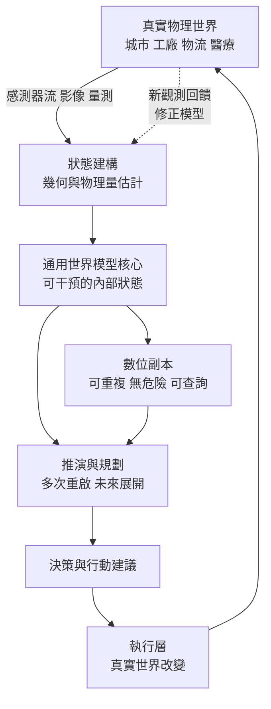

# 10.4 通用世界模型（General World Model）的未來藍圖：數位孿生、科學發現與物理世界的完全閉環

## 一、通用世界模型的三項要求

回顧全書，第 1 章的狀態空間、第 2 章的幾何表徵、第 3 章的物理先驗、第 4 至 6 章的三條生成架構、第 7 章的動作條件化與多感官、第 8 章的規劃機制、第 9 章的具身落地——每一章都處理了世界模型的一個面向。把這些面向收束成「通用世界模型」這個詞，需要先說清楚它究竟比專用模型多出了什麼。

第一項要求是**跨環境的學習能力**。一個只在固定場景、有限物件類別中訓練過的模型，即使內部表徵再精緻，也只是某個領域的專家。通用性意味著模型能在遇到全新環境時，利用既有的物理與因果先驗快速建立可用的內部模型，而不是從零開始累積經驗。這要求狀態表徵不能綁死在特定的語意標籤上，而要能承載尚未被命名過的物件與交互。

第二項要求是**可干預的狀態**。一個僅能生成漂亮影像的模型，無法回答「如果我把那個球推過去會怎樣」。世界模型必須能接受一個干預作為輸入，並且給出干預後的狀態演化。這正是第 3 章的結構因果模型、第 7 章的前向動力學與第 8 章的規劃三者交會的地方，也是世界模型與單純的生成模型之間最銳利的分界。

第三項要求是**規劃與行動的統一介面**。模型的內部狀態必須能被讀取為一個可供搜尋與最佳化的載體，並且其模擬的時間尺度要與真實行動的時間尺度相容。一個能產生極其逼真的長影片、卻無法在毫秒級反覆查詢「下一幀會怎樣」的模型，在工程上是不可用的。

## 二、四條技術路線的未來走向

| 技術路線 | 核心目標函式 | 目前的優勢 | 關鍵瓶頸 | 與通用性的關係 |
| --- | --- | --- | --- | --- |
| 擴散世界模型 | 去噪噪聲匹配的似然近似 | 多峰未來、多樣性佳、可引導 | 採樣慢、推理成本高 | 提供「產生可能世界」的能力，利於假設生成 |
| JEPA 特徵預測 | 潛在特徵空間的自迴歸預測 | 表達緊湊、避免像素幻覺 | 細粒度結構一致性弱 | 提供「抽象狀態」的能力，利於跨環境泛化 |
| 自迴歸自體監督 | 下一 token 的極大概似 | 細緻、靈活、可分岔 | 複合誤差最嚴重 | 提供「細緻動態」的能力，但需長期一致性機制 |
| 物理引導與混合 | 資料項加物理殘差 | 可稽核、守恆律可檢查 | 適用範圍窄、表達空間受壓 | 提供「可驗證性」，是信任的基礎 |

這張表的意義不在於排出一個勝負，而是指出**通用世界模型大概不會是單一路線的成品**。擴散的多峰性適合用來生成假設與可能世界；JEPA 的緊湊抽象適合用來維持跨環境的狀態表徵；自迴歸的細緻度適合用來表達真實的連續動態；而物理引導提供的可稽核性，是讓前面三者的產出能被信任的底層。四者的關係更接近分工，而不是競爭。

第二條路線是**具身資料的規模化**。第 9 章已經指出，世界模型需要的不只是觀測影片，而是「觀測–動作–結果」的配對序列；這類資料的取得成本遠高於網路上的靜態影像。要讓通用世界模型成形，必須找到讓具身互動資料規模化的方法——人類的示範資料、跨型號的機器人資料、以及合成與真實的混合，都屬於這個方向。

第三條是**合成與真實的混合**。純真實資料受限於成本與危險性；純合成資料受限於保真度。第 9 章的 Sim-to-Real 討論與第 10.3 節的模擬器困境都指向同一個結論：**沒有一種來源是充分的**。混合策略的關鍵不只是比例，而是分工：合成資料負責覆蓋罕見與危險的情境，真實資料負責校正保真度與消除模擬器的系統性偏差。值得注意的是，隨著生成模型變得逼真，合成與真實的界線本身也開始模糊——這既是機會，也是評測方法學上的新難題。

第四條是**形式化物理與學習的融合**。第 10.2 節已經說明，物理資訊方法目前收益有限；而第 3 章的直覺物理學先驗說明，把物理寫死又太過受限。中間地帶是**把符號物理作為結構假設、把神經網路作為殘差項**：網路負責學會難以解析表達的部分（摩擦係數隨地面材質的變化、柔性物體的形變），符號層負責保證不可違反的部分（重力方向、動量傳遞）。這種混合架構在物理求解器領域已有長久的傳統，把它與大規模學習結合，是一條值得押注的路線。

## 三、數位孿生：把即時的物理世界映射成可模擬的副本

數位孿生是通用世界模型最立即能落地、也最能說明其價值的形態。它的定義相當樸素：一個與真實物理系統保持即時對應的數位副本，能夠反映當前狀態，並且能在數位空間中被推演。

四個應用領域的成熟度並不相同，但各自展示了不同的能力需求。在**工廠**情境中，數位孿生的價值主要在於把「某個維修流程會不會讓整條產線停擺」這個問題從現實中搬到數位空間裡回答——這要求模型能處理剛體動力學、關節約束與時序規劃。在**城市與物流**情境中，重點在於把數以萬計的移動物體同時納入同一個狀態，並且能回答「若這條路在兩小時後因事故封閉，配送路徑該如何重排」——這要求模型處理大规模、多主體的交通流與離散的決策事件。在**醫療**情境中，模型必須描述人體生理系統中跨越多個時間尺度的過程，並且允許對治療方案做反事實推演，這對模型的可解釋性要求最高，因為推論錯誤的代價直接落在人體上。

從世界模型的角度看，數位孿生扮演的角色是把第 10.1 節的問題從「被迫接受」變成「可以管理」：真實世界的觀測不斷重置孿生體的狀態，而孿生體內部的推演則承擔了那些真實世界無法重複實驗的部分。開迴圈測試之所以在自動駕駛中如此關鍵，正因為它是數位孿生的一種極端形態。

## 四、科學發現上的潛力

世界模型在科學上的應用，構成了一條與工程應用完全不同方向的價值線。如果模型能夠模擬一個系統的狀態演化，那麼它就可以用來**生成假設**：提出一個在既有模型中可行但尚未被檢驗的機制，或是在參數空間中搜尋能產生特定可觀測結果的區域。

其中最有價值的一類應用，是**實驗設計**。真正的科學研究不只包含「解釋已知結果」，更包含「決定下一個實驗要做什麼」。一個能夠模擬參數空間與環境條件的世界模型，可以在真實實驗之前排除大部分必定失敗的設定，把昂貴的實驗次數留給真正有資訊量的那些。這與本系列的《電腦下棋》一書中所展現的原則是同一個：價值不只在於給出答案，而在於**在有限資源下把計算力配置到最能改變決策的地方**。

另一個方向是**結構預測**。本系列的《AlphaFold》一書展示了一個成功的方法論：把一個物理問題轉化為一個可被大量生成的結構所決定的問題，再用明確的驗證條件（實驗資料）來篩選候選。蛋白質的結構預測之所以能帶來實際影響，正是因為它有明確的、可獨立檢查的驗證條件——你可以拿預測結果去和實測結構對照。世界模型若要被用於科學發現，同樣需要這類**可驗證性**：預測本身不夠，必須能被外部的真實測量所檢驗，否則它只是另一種形式的猜測。

這條思路的推廣是值得期待的。世界模型可以在一個領域中提出假設，再由該領域的實驗來否證；而每一次否證都成了對模型的外部糾正資料。模型與科學共同構成一個迭代的迴圈，而第 10.1 節所說的「閉環一致性」，在這裡就成為「模型的預測是否真的能帶來新的科學」。

## 五、完全閉環的願景

把以上所有線索收束成一張圖，得到的是一個**完全閉環**：感知現實、建模內部、規劃行動、執行、再用新的觀測修正內部。

這個迴圈的每一個環節都不是新概念，但它們第一次被同一個可微的、可持續更新的內部模型所串連。第 2 章的三維幾何、第 3 章的因果結構、第 4 至 6 章的生成機制、第 7 章的動作條件化、第 8 章的搜尋、第 9 章的軀體、第 10.1 與 10.2 節的誤差與物理對齊、第 10.3 節的分層安全架構——每一章都在補上這個迴圈的某一段。而最後一環，也就是**被真實世界糾正**的那一環，是整個結構之所以有意義的原因。

值得強調的是，這個閉環不是一次性的組裝，而是一個持續運作的過程。模型的內部狀態會不斷被真實觀測修正，參數會不斷從糾正中更新，能力的邊界因此是**隨經驗增長**的，而不是在訓練結束時就固定的。這是「通用」兩個字在工程上的真正含義：不是一個涵蓋一切場景的模型，而是一個能在任何場景中持續取得經驗並自我更新的模型。

迴圈中還有一個常被忽略的成員：**遺忘**。一個只增不忘的模型，內部狀態會隨時間被無關細節淹沒，最終失去對真正相關變數的追蹤能力；真正的閉環需要能夠判斷哪些資訊在當前的時間尺度上已經無關，並且把它們從狀態中剔除。第 10.1 節提到的以真實觀測重置狀態，正是這種遺忘機制的一個粗糙版本；而一個成熟的通用模型，必須把重置從「週期性事件」變成「依任務需求自適應的機制」。

## 六、三個根本性的未解問題

儘管藍圖清晰，三個問題至今沒有令人滿意的答案，而且它們都不是靠算力堆疊就能繞過去的。

第一是**表達的足夠性**。真實世界的狀態似乎可以無限細分：一杯水的溫度場、桌上每一粒灰塵的位置、織物纖維的形狀。模型所能承載的潛在維度是有限的，那麼它究竟丟棄了什麼、又憑什麼保證被丟棄的部分在決策中不重要？一個維度不足的世界模型，可能在統計上完全合格，卻在關鍵時刻因為遺漏了某個細節而釀成災難。這個問題沒有普遍解，只能針對特定領域建立可驗證的充分性判準。

第二是**規劃的可計算性**。在連續的動作空間中做深層規劃，其組合爆炸是幾何性的：每增加一層深度，候選分支就乘上一個常數。第 8 章的 MCTS 與 MPC 提供了可行的工程折衷，但「足夠深且能即時」的規劃在複雜場景中仍然不可及。設計更好的搜尋、更好的剪枝、或者讓模型直接學會一個近似的策略，都只是把問題推到別處。這個問題本質上是複雜度理論與實務需求之間尚未彌合的落差。

第三是**驗證的可行性**。怎麼知道模型對自己的預測有多可信？這是第 10.1 節不確定性估計、第 10.2 節物理檢測器、第 10.3 節安全驗證層共同指向的問題，也是最根本的一個。若無法驗證，就無法決定何時可以信任模型從而行動，也無法在出事之後界定責任。與物理學不同，AI 領域至今沒有建立同等強度的可驗證性傳統；如何補上這一塊，可能比任何單一技術突破都更決定通用世界模型的成敗。

## 七、與本系列其他書的整合

回頭看，這本《世界模型》在本系列中的位置相當特殊：它幾乎不自己發明任何基礎技術，而是把其他書各自的成果重新排列成一個可運作的整體。

《神經網路》一書提供了算子與層的基本單位，是所有模型的實作基礎。《強化學習》一書提供了學習演算法，尤其是從交互中學習策略的方法，構成了「閉環」中行動側的支柱。《語言模型》一書提供了語意與介面：世界模型要能被下令、要能被解釋、要能與人類溝通意圖，語意能力是不可或缺的通道。《聲音模型》一書提供了多感官的另一半，讓模型能從聲音而非只有影像獲得關於世界的資訊——聲音是診斷機械故障、判斷空間幾何、辨識異常最廉價的感官通道。《電腦下棋》一書提供了搜尋與規劃的方法論，以及「用搜尋把算力轉成品質」的思路；《AlphaFold》一書提供了結構預測的範例，把物理問題轉化為可大量生成候選、再以實驗驗證的流程。

而這一切最終都指回同一件事：**通用世界模型的終點不是一個更大的模型，而是一個能夠持續被真實世界糾正的內部模型**。規模提供能力，但只有與真實世界的持續互動才能提供可靠性。第 10.1 節說明了可靠性為何必須用閉環長期一致性來衡量，第 10.2 節給出了最低限度的物理可稽核性，第 10.3 節展示了分層冗餘在生死情境中的必要性——這三節共同構成了這個判準的實踐面。而最後這張藍圖要說的，是這條道路值得走下去，因為在它盡頭的，不是一台更會猜的機器，而是一個終於能夠在開放環境中持續行動、並且為自己的行動負責的心智結構。
