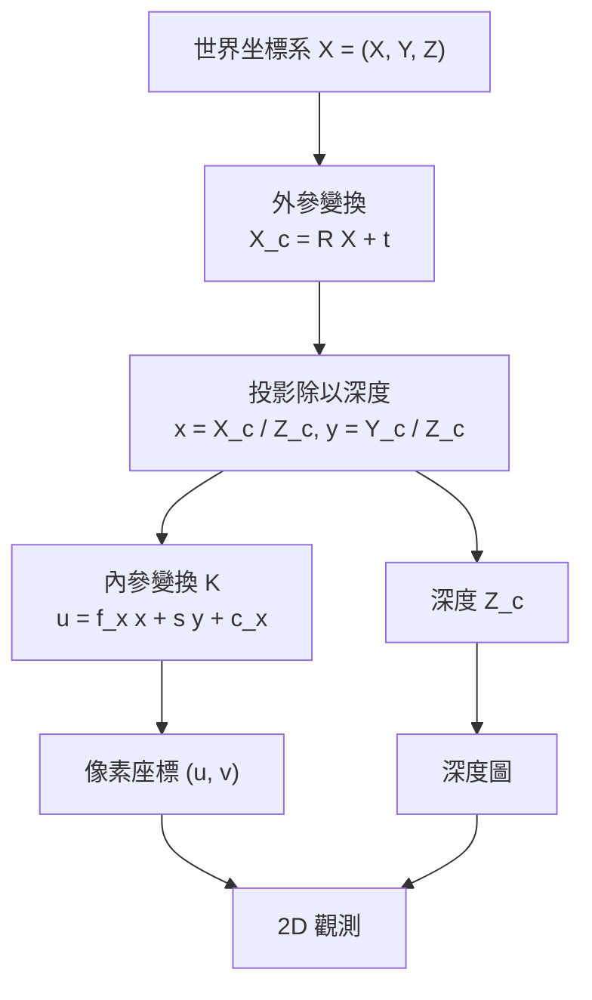

# 2.1 從像素柵格到空間拓撲：3D 幾何感知、深度估計與坐標系對齊

## 一、為什麼 2D 像素不足以承載物理

一張影像是一個二維函數 $ I : \mathbb{R}^2 \to \mathbb{R}^3 $ ，把空間沿著某個方向投影到感光元件上。這個投影是一次資訊的不可逆壓縮：深度被摺疊進像素強度裡，遮擋關係被抹平，三維結構則退化成邊界、色塊與透視線索的集合。對「辨識這是一張狗」而言，壓縮並無妨礙，因為語義在投影下大致穩定；但對「球落地後會彈多高」而言，壓縮是致命的，因為物理量的計算需要長度、角度與彼此的位置關係，而這些恰恰是投影抹去的部分。

更麻煩的是，投影是**多對一**的映射。同一個像素值可以對應無限多種三維配置：一個近處的小球與一個遠處的大球，可以產生完全相同的著色區域。於是從單張影像出發，深度估計在本質上是一個**欠定**（underdetermined）的逆問題。模型學到的不是「這個像素的深度是多少」這個物理事實，而是「在人類與世界分布中，這個像素**通常**對應多深」這個統計先驗。這個先驗在室內街道這類高度受約束的場景相當可靠，一旦進入陌生環境就會系統性偏移。

遮擋關係的問題更根本。像素柵格是一種**可見性集合**：它只記錄「此刻哪些表面朝向觀者可見」。它不記錄「此刻被遮住的表面是什麼」或「被遮住的物體位於何處」。而物理推理的絕大部分場景——杯子落在別的杯子後面、球滾進箱子裡、手伸到柱子後方——都需要知道看不見的部分。在 2D 表徵裡，這些資訊**在採樣那一刻就被物理性地刪除了**，任何下游模型都無從重建。

因此本章的論點是：世界模型若要在三維空間中做規劃，它的狀態表示必須從「像素陣列」升級為「帶座標的三維場」，並且這個升級過程本身需要嚴謹的幾何學支撐。

這個壓縮還帶來一個容易被忽略的後果：它把**物理量變成了像素的函數**。在二維表示中，「這輛車距離我多遠」只能寫成「這個車形區塊在影像中的大小」；而在三維表示中，它是直接可讀的深度值。這不是效率上的小差異，而是表達能力上的質變——帶有度量的物理量必須在一個賦有尺度的空間中定義，否則任何涉及碰撞、投影、遮蔽的運算都將失去單位意義。

## 二、深度估計：主動與被動途徑

**單目深度估計**從單張影像猜測深度。歧義性的形式化描述是：給定像素著色與語義線索，存在一個尺度因子 $ s > 0 $ 作用於所有深度值，使得 $ d' = s d $ 仍能產生合理的投影。這種縮放不改變任何角度資訊——一顆球在所有相鄰縮放下的輪廓完全相同——因此單靠影像內容無法破解。打破歧義的只有三類先驗：物體尺寸的常規分布（地面高度、人體身高）、相對遮擋關係（若 A 在 B 前，則 $ z_A < z_B $ ）、以及語義分割邊界（天空、牆面、地平面各有其深度分布）。神經網路正是把這些先驗隱式編碼進權重，而這也解釋了它的脆弱性：先驗失效時（例如近攝微距、非常規尺度物體），深度圖會整片偏移。

**多目立體視覺**則利用兩個相機的視差幾何。設兩相機光心為 $ C_1 $ 與 $ C_2 $ ，連線即**基線**（baseline），對任一世界點 $ X $ ，它在兩影像上的投影 $ x_1 $ 與 $ x_2 $ 構成**對極幾何**（epipolar geometry）。所有對極線通過同一個極點（epipole），滿足：

$$
x_2^{\top} F x_1 = 0, \quad F = K_2^{\top} [R \mid t] K_1^{-1}
$$

其中 $ F $ 為基礎矩陣（fundamental matrix）。有了對極線約束，兩視圖中的對應點不必在整張影像上搜尋，只需沿著一條線移動，這把匹配從二維搜尋降為一維。基線長度 $ B $ 與視差 $ d = x_1 - x_2 $ 之比給出深度：

$$
Z = \frac{f B}{d}
$$

這裡的 $ f $ 是以像素為單位的焦距。值得注意的是，此式同時暴露了單目與多目的共同弱點：**深度與基線成反比**。基線越短、視差越小，深度估計的相對誤差就越大，這正是「近距離多目深度不準」的幾何原因。

**主動深度**（active depth sensing）以雷射、發射紅外線或聲波主動量測往返時間（time-of-flight），直接繞過了歧義問題，代價是硬體成本與對材質的敏感性。結構光（structured light）投射編碼點陣同樣是主動方法，其深度誤差可低至毫米級，但必須在受控環境下運作。

值得注意的是，被動與主動的分界並不等同於「準確」與「不準確」的對立。被動方法在紋理豐富的多視圖場景中反而更穩健，因為它用多幀之間的對應關係而非單幀的語義先驗來消除歧義；主動方法的真正價值在於**供應絕對尺度**，這正是被動方法結構上無法提供者。兩者是互補而非競爭的關係，這也解釋了為何現代自動駕駛系統同時搭載相機與雷達。

另一個常被忽視的量測是**光束法對焦**所隱含的深度線索：散焦量與物距成反比。這類「隱式對焦線索」在計算攝影中被用來做景深分離，但在機器視覺中通常未被利用，因為其可靠性遠低於幾何量測。

| 深度來源 | 物理量測量 | 尺度可得 | 適用環境 | 主要失效模式 |
| --- | --- | --- | --- | --- |
| 單目網路 | 統計先驗 | 僅相對 | 通用自然場景 | 尺度偏移、陌生布局 |
| 多目立體 | 視差幾何 | 是 | 紋理充足、基線夠大 | 無紋理區域、低視差 |
| 雷射時間飛行 | 光速往返 | 是 | 自主駕駛、室內掃描 | 反光材質、吸光材質 |
| 結構光 | 三角量測 | 是 | 室內、掃描儀 | 陽光干擾、距離上限 |
| 人工標註深度 | 對齊雷射掃描 | 是 | 訓練資料集 | 昂貴、覆蓋稀疏 |

## 三、相機模型與坐標系：把世界變成像素

要從幾何重建回到像素，需要一組精確的相機參數。針對針孔模型（pinhole model），**內參矩陣** $ K $ 描述相機內部幾何：

$$
K = \begin{bmatrix} f_x & s & c_x \\ 0 & f_y & c_y \\ 0 & 0 & 1 \end{bmatrix}
$$

其中 $ f_x $ 與 $ f_y $ 為以像素為單位的焦距， $ (c_x, c_y) $ 為主點（principal point）， $ s $ 為像素傾斜因子（skew），理想情況下為零。**外參** $ [ R \mid t ] $ 則把世界坐標系連到相機坐標系： $ R $ 是三階旋轉矩陣， $ t $ 是平移向量。

完整的投影鏈如下，其中 $ \tilde{u} $ 為齊次像素座標， $ X $ 為世界座標中的點：

$$
\tilde{u} \sim K [R \mid t] X
$$

這個式子可以拆成三個可獨立操作的階段。 $ R $ 與 $ t $ 負責把世界點轉到相機座標系（外參）， $ K $ 負責把相機座標系的深度除以深度並投影到影像平面（內參），最後除以第三分量完成齊次正規化。這種拆解的實踐意義極大：當我們要從多視圖重建時，可以分別優化內參、外參與場景本身。

值得補充的是**畸變**（distortion）。上述針孔模型假設光線直線傳播，但真實鏡頭存在徑向與切向畸變，常以 Brown-Conrady 模型描述：

$$
x_d = x (1 + k_1 r^2 + k_2 r^4) + 2 p_1 x y + p_2 (r^2 + 2 x^2)
$$

其中 $ r^2 = x^2 + y^2 $ 為徑向距離平方， $ k_1, k_2 $ 為徑向係數， $ p_1, p_2 $ 為切向係數。嚴謹的重建流程必須先以標定板（如棋盤格）估計內參與畸變係數，才能進入多視圖幾何階段——否則畸變會被誤認為深度變化，在場景邊緣產生系統性彎曲。

另一個常見的近似是**球面全景模型**，把影像映射到單位球面上，這種表示讓相機旋轉變成純粹的旋轉變換，有利於以四元數或李代數來處理姿態。但它同時犧牲了解析度的一致性，並在極軸附近引入嚴重失真，因此適用於面向 $ 360 $ 度環景而非精密量測。

## 四、坐標系對齊：extrinsic calibration 與最小化重投影誤差

多視圖重建的第一個難題是「把所有影像放進同一個座標系」。每台相機都有自己的外參，而外參與場景本身是**耦合**的：把整個場景剛體旋轉會同時改變所有相機的外參，因此存在一個**規範自由度**（gauge freedom）——重建結果只在相差一個相似變換的意義下唯一。

解法是把對應點的三維重投影誤差最小化。給定對應點集合 $ \{ (\mathbf{x}_i, \mathbf{X}_i) \} $ ，求解：

$$
\min_{\{ \mathbf{X}_i \}, K_1, \ldots, K_n, \{R_j, t_j\}} \sum_{i} \sum_{j} \left\| \pi\!\left( K_j [ R_j \mid t_j ] \mathbf{X}_i \right) - \mathbf{x}_{i}^{(j)} \right\|^2
$$

其中 $ \pi $ 表示齊次座標正規化。這個目標函數是**非凸**的，但因為每個相机的外參只透過重投影誤差與場景耦合，實務上常用交替最佳化：先以 SfM（Structure from Motion）求取相對姿態，再以 BA（Bundle Adjustment）交替精修姿態與點座標。稀疏 BA 正是 SLAM 與 SfM 的共同核心。

值得強調的是**重投影誤差與感知損失之間的落差**。重投影誤差把每個特徵點視為等權，實際上一個位於畫面角落、可能錯配到別處的點，會對姿態估計造成與畫面中心同等的擾動。現代系統常引入魯棒核函數或基於學習的特徵匹配器來抑制外點，這是純粹幾何方法與深度學習方法的交界地帶。

另一個實務挑戰是**初始化**。BA 需要一個大致正確的初始姿態，否則容易陷入區域極小。可靠的初始化通常來自序貫結構：先用前兩對影像估計初始相對姿態與稀疏點，再逐步加入新影像並以局部 BA 保持誤差不外溢。這種「由粗到細、邊加邊精修」的策略，正是今天所有 SfM 與 SLAM 系統的共同骨架。

這裡出現本章第一個關鍵區分：**幾何對齊（registration）與語義對齊（semantic alignment）是兩件事**。幾何對齊確保「同一個物理點在不同影像中對應到同一個座標」；語義對齊確保「這顆球在第 10 幀仍然是同一顆球」。前者是多視圖幾何可以解決的，後者需要 2.3 節的持久性機制。

## 五、尺度歧義與多視圖幾何的約束

回到 2.1 開頭的縮放不變性。單目深度在數學上只能恢復**相對深度**：所有深度同時乘上 $ s $ 仍與觀測相容，因此估計出的深度圖必然帶有一個未定的全域尺度因子。要決定這個因子，必須引入世界尺度資訊——已知尺寸的參考物體、與地平面或 GPS 的對齊、或移動機器人的里程計。若尺度未定，則所有以長度為單位的物理量（重力加速度對應的時間尺度、彈簧剛度、摩擦係數）都無法被正確反推。

多視圖幾何則以**三角化**提供絕對的深度來源。對兩個相機，第 $ i $ 個特徵點在影像 $ j $ 中的觀測 $ \mathbf{x}_{i}^{(j)} $ 滿足：

$$
\mathbf{x}_{i}^{(j)} \sim K_j [ R_j \mid t_j ] \mathbf{X}_i
$$

把每個相機的投影矩陣記為 $ P_j = K_j [ R_j \mid t_j ] $ ，則三角化就是求解 $ P_1 \mathbf{X}_i \sim P_2 \mathbf{X}_i $ 的最小平方解（DLT）。其幾何本質是：來自同一物理點的兩條光線（每個相機中心到該影像點的連線）必須相交，交點即為三維點。三角化的**條件數**決定深度精度，它隨基線增大而改善，但在基線平行於視線方向時退化。這一退化情形在純旋轉運動下尤為嚴重，也是單目視覺里程計難以規模化地恢復尺度的根本原因。

三視圖以上的情形則引出**多視圖幾何的一致性檢驗**：對一組投影矩陣 $ P_j $ ，存在一個非零三維點同時滿足所有投影方程的充要條件，是存在向量 $ \mathbf{x} \in \mathbb{R}^{3n+1} $ 使得所有 $ P_j $ 的列共同張成的矩陣之零空間包含該向量。這就是相機姿態的**代數約束**，也是束平差能夠收斂的理論基礎：它把「三維點必須落在所有光線交會處」這件事寫成了線性代數中可求解的條件。

尺度歧義還有另一層後果。即使多視圖方法能在數學上恢復相對正確的三維結構，整個場景仍可被任意縮放，因此「這張桌子有多高」這類問題依然無解。解法有三種：引入已知尺寸的參考物（例如印有已知圖樣的標定板）、以 GPS 或地圖對齊世界系（提供絕對位置但精度有限）、或利用移動平台的里程計與雷達提供尺度錨點。三者都會在幾何之外引入額外的先驗，這也說明尺度問題本質上是一個**需外部資訊才能閉合**的問題，而非純粹視覺問題。

## 六、從 2D 到 3D：三條表徵路徑

一旦獲得幾何量測，如何把它組織成可被網路消費的狀態？三條主流路徑各有取捨。

**路徑 A：深度圖加網格（depth + mesh）**。把深度圖反投影成點雲，再三角網格化為多邊形表面。它保留了拓撲（哪個面鄰接哪個面），適合渲染與物理模擬，但需要密集且連續的深度估計；深度噪聲會直接變成幾何噪聲，細節幾何容易出現孔洞。

**路徑 B：點雲與占用表示（occupancy）**。占用表示不描述表面，而是描述空間被分成的格點（voxel）是否為空。占用網路（Occupancy Network, Mescheder et al. 2019）以連續函數 $ f : \mathbb{R}^3 \to (0, 1) $ 表示某點在物體內的機率。它不需要精確表面拓撲，對遮擋與未觀測區域的處理更自然，且能表示非 watertight 的複雜形狀；代價是三維解析度帶來的記憶體與計算量成長。

**路徑 C：連續場（continuous field）**。用神經網路直接對空間座標求值，代表物就是第 2.2 節的 NeRF 與 3DGS。這類表示連續、可微、不需要預先離散化網格，因此在細節與記憶體之間取得更好的取捨。

三條路徑的分野，其實是「離散與連續」這個光譜上的取樣位置不同。深度圖是沿著單一視錐的稀疏取樣，網格是對體積的規則取樣，連續場則把「場」本身作為基本對象，取樣點延遲到查詢時刻才決定。這個延遲是關鍵：它意味著同一份表示可以支援任意解析度的查詢，也意味著訓練時的梯度可以沿著「座標」這條維度傳遞，而不只是沿著「像素」這條維度。

另一個維度是**拓撲是否顯式**。網格提供顯式的面片鄰接關係，適合直接跑有限元素或剛體碰撞偵測；連續場的等值面 $ f(\mathbf{x}) = \tau $ 則隱含拓撲，需要在渲染時以 Marching Cubes 動態提取，或像 3DGS 那樣直接以原子集合近似。前者更適合物理模擬，後者更適合視覺生成。

| 表徵類型 | 描述對象 | 幾何精度 | 拓撲 | 記憶體 | 適合下游 |
| --- | --- | --- | --- | --- | --- |
| 深度圖 | 每像素到表面的距離 | 中 | 無 | 極低 | 即時定位、幾何驗證 |
| 點雲 | 離散表面取樣 | 中低 | 需重建 | 低 | 配準、LiDAR 融合 |
| 網格 mesh | 三角面片集合 | 高 | 顯式 | 中 | 物理模擬、渲染 |
| 占用體素 | 空間是否被填滿 | 中高 | 隱式 | 高 | 碰撞、遮擋推理 |
| 連續場 | 任意座標的函數 | 高 | 隱式 | 依模型而定 | 新視圖合成、生成 |

## 七、世界模型為什麼需要「可微分、可查詢、帶座標」的狀態

把以上收斂成三個對世界模型至關重要的性質。

**可微分（differentiable）** 是首要條件。規劃（planning）需要在狀態空間中做搜尋，而搜尋要求能對狀態施加微小擾動並觀察結果如何改變——這正是梯度。第 3 章的物理模型若不可微，就無法嵌入基於梯度的推斷與反向傳遞，第 8 章的模型預測控制也將退化成只能隨機嘗試。

**可查詢（queryable）** 意味著能對任意三維座標詢問「這裡有什麼」。這與「已經把整個場景網格化好」不同：一個世界模型必須能在規劃過程中臨時提出諸如「如果把手伸到那個位置，會碰到什麼」的問題，而不必重新推導整個場景。這要求表示在**連續**座標上定義，而不是綁死在固定的離散格點上。

**帶座標（with coordinates）** 則是幾何一致性的最低要求。所有狀態元素都必須能引用同一個全局參考系，使得「球在桌子左邊」這種關係可以被運算。沒有共享坐標系，模型就無法處理物件間的相對位置，而相對位置正是遮擋、碰撞與支撐關係的幾何基礎。

這三個性質加上「連續場」的表徵形式，自然導向第 2.2 節的主題：NeRF 與 3DGS 如何用一個連續、可微、帶座標的函數承載整個場景，又如何以令人訝異的速度完成訓練與渲染。
