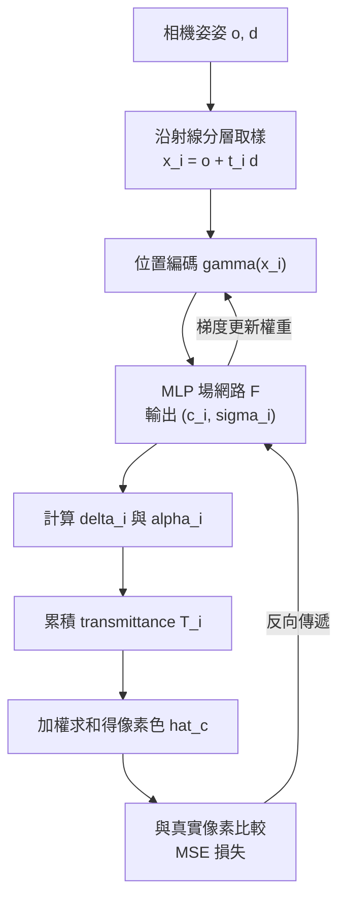

# 2.2 連續輻射場（NeRF）與 3D 高斯潑濺（3DGS）在動態環境動態重建中的角色

## 一、NeRF：把場景變成一個連續函數

2020 年 Mildenhall 等人提出的 NeRF（Neural Radiance Field）做了一件概念上極為乾淨的事：它不再用網路去「預測一張圖片」，而是去「描述一個函數」。這個函數以空間位置與觀測方向為輸入，輸出該方向的顏色與密度：

$$
\mathbf{F} : (x, y, z, \theta, \phi) \to (c, \sigma)
$$

其中 $`(x, y, z)`$ 是三維空間中的位置， $`(\theta, \phi)`$ 是從相機中心指向該位置的方向（以角度參數化）， $`c = (r, g, b)`$ 是輻射顏色， $`\sigma`$ 是體密度（volume density）。這樣的定義意味著場景**不再是資料的集合，而是一個可以直接求值的對象**。給定任何相機位置與方向，只要沿著射線對這個函數做一次積分，就能合成出對應視角的影像。

NeRF 的底層機制可以拆解為三步。第一步是**射線生成**：從相機光心 $`\mathbf{o}`$ 出發，經過像素方向 $`\mathbf{d}`$ ，射線上的點記為：

$$
\mathbf{r}(t) = \mathbf{o} + t \mathbf{d}, \quad t \in [t_{\text{near}}, t_{\text{far}}]
$$

第二步是**體渲染（volume rendering）**：把連續積分離散化為沿射線的一組樣本點 $`\mathbf{x}_i`$ ，在每個樣本上查詢場網路取得 $`(\mathbf{c}_i, \sigma_i)`$ ，再依「可見性權重」加權求和：

$$
\hat{c}(\mathbf{r}) = \sum_{i=1}^{N} T_i \alpha_i \mathbf{c}_i, \quad T_i = \prod_{j<i} (1 - \alpha_j)
$$

其中 $`\alpha_i = 1 - \exp(-\sigma_i \delta_i)`$ 是第 $`i`$ 個樣本在區間厚度 $`\delta_i`$ 內被遮擋的機率， $`T_i`$ 是抵達第 $`i`$ 點之前未被前面樣本擋住的機率（transmittance）。這個累積乘積形式的物理意義非常直觀：光線從相機出發，每經過一個有密度的樣本，就有一定機率被吸收或散射一次。反過來說， $`T_i`$ 也可以理解為「光線成功穿過前 $`i-1`$ 個樣本而抵達第 $`i`$ 個樣本的機率」，因此整個加權和就是一條光線沿路收集到的輻照度的期望值。

這個積分形式還隱含了一個優雅的幾何意義：**密度場的等值面就是物體表面**。當 $`\sigma`$ 累積到某個閾值時，光線就被完全阻擋，此時累積的透明度假設為零。因此 NeRF 的密度場天然攜帶了幾何資訊，提取等值面即可得到三維模型。這是 NeRF 與 2D 影像方法最根本的差異——它不是先預測深度再融合，而是直接學出一個帶深度的三維場。

第三步是**梯度回流**：渲染損失是 $`L = \sum_{\mathbf{p}} \left\| \hat{c}(\mathbf{r}_{\mathbf{p}}) - c(\mathbf{p}) \right\|^2`$ ，其中 $`\mathbf{p}`$ 遍歷影像中的所有像素。關鍵在於 $`L`$ 對每個樣本的 $`(\mathbf{c}_i, \sigma_i)`$ 都有非平凡的偏導數：

$$
\frac{\partial L}{\partial \sigma_i} = -T_i \alpha_i \, \frac{\partial L}{\partial \hat{c}} \cdot \mathbf{c}_i + \text{（透過後續樣本的傳遞項）}
$$

因此場網路的所有權重都能收到梯度。這就是 NeRF 的樞紐：**它把「重建」變成了一個端到端可反傳的函數擬合問題**。對照之下，傳統的 SfM 與深度估計是一串獨立的步驟，彼此無法共同最佳化，而 NeRF 的單一可微分目標函數讓所有參數——包括相機姿態——都能同步精修。事實上，相機外參在 NeRF 中被直接當作待优化的變數，這使它能同時完成重建與自定位。

### 1.1 位置編碼：為什麼需要它

如果只用原始座標 $`(x, y, z)`$ 輸入多層感知機，網路將被迫用一個連續但緩慢變化的函數去擬合高頻的場景細節。位置編碼（positional encoding）的做法是將座標映射到一組不同頻率的正弦函數：

$$
\gamma(\mathbf{x}) = \left( \mathbf{x}, \sin(2^0 \mathbf{x}), \cos(2^0 \mathbf{x}), \sin(2^1 \mathbf{x}), \cos(2^1 \mathbf{x}), \ldots \right)
$$

這個構造的本質是**分層的傅立葉特徵基（Fourier feature basis）**。它讓網路能夠分別地表達低頻（場景的大尺度色調變化）與高頻（細緻紋理）成分，而不必讓同一組權重同時承擔兩種尺度。NeRF 原論文用 $`L = 10`$ 的多分辨率編碼（即最高頻率為 $`2^{10}`$ ），實驗顯示提高 $`L`$ 會讓渲染結果更接近真實但更易出現高頻雜訊——這是典型的過擬合跡象。

編碼的另一個作用是處理**方向依賴性**。顏色在某些材質上會隨視角改變（鏡面高光、玻璃），因此方向 $`(\theta, \phi)`$ 也需要編碼。NeRF 原論文實驗發現，**只對密度使用位置編碼、對顏色同時使用位置與方向編碼**，在合成資料集上的效果優於「對所有輸出都用完整編碼」。這個看似任意的取捨，事實上對應了物理上的區分：密度屬於「介質」的性質，與觀測方向無關；顏色則同時受介質性質與入射角影響。這個區分讓網路更容易學到正確的結構，也為後續的分解式方法（如 NeRF-W 的外觀分支）埋下伏筆。

### 1.2 分層取樣與重要性取樣

原始 NeRF 在每條射線上均勻取樣 $`N = 64`$ 個點。這有一個明顯的浪費：真正含有內容的樣本只佔少數，大部分樣本落在空空間。為此 NeRF 提出**分層取樣（hierarchical sampling）**：先用 $`N_{\text{coarse}} = 64`$ 個均勻樣本估計每個樣本的貢獻權重，再依此密度分布抽取 $`N_{\text{fine}} = 128`$ 個重要性樣本，兩個樣本集合合併後重新渲染。這個簡單的改進把 PSNR 提升約 $`1`$ 到 $`2`$ dB，且計算量僅增加一半左右。

重要性取樣的權重直接來自粗層的累積透明度假設，也就是沿用上式中的 $`T_i \alpha_i`$ 。這是一個很漂亮的設計：**同一個物理量（光線在各處被阻擋的機率）同時被用來做渲染加權與取樣策略**，兩者完全一致，因此不需要額外的訓練目標來協調它們。

### 1.3 NeRF 的代價與它的真正貢獻

NeRF 的弱點同樣顯著：訓練一個場景需要數小時到數十小時，推論一幀影像需要對每個像素的射線跑數百次網路查詢，因此即時互動幾乎不可能。更關鍵的是，**NeRF 的記憶體成本與場景複雜度無關**，而只與網路大小和取樣數有關；這意味著一個極簡單的場景（例如牆面上一個球）與一個極複雜的場景需要同樣大的網路容量。另一個限制是**每個場景都需要獨立訓練**，模型無法在多個場景間共享先驗，這也是後來 NeRF-W、Instant-NGP 等「共享或即時化」工作的动机。

NeRF 真正的歷史貢獻並非在於實用性，而在於**它證明了「渲染作為學習目標」是可行的**。在 NeRF 之前，三維重建的主流是 SfM 加網格化或深度融合的管線；NeRF 展示了可以把整個重建問題放進一個端到端的、可微分的框架裡，而這個框架正是後續所有輻射場方法與 3DGS 的共同祖先。

## 二、3DGS：用原子集合取代神經網絡

2023 年 Kerbl 等人提出的 3D Gaussian Splatting 對 NeRF 的核心假設提出了一個大膽的挑戰：NeRF 的 MLP 過於昂貴，而場景其實可以被一群**各向異性三維高斯**近似描述。每個高斯原子有中心 $`\mathbf{m}`$ 、協方差 $`\Sigma`$ （分解為縮放 $`s`$ 與旋轉 $`R`$ ）、不透明度 $`\alpha`$ 與球諧係數（編碼視角相關的顏色）：

$$
G(\mathbf{x}) = \alpha \, \exp\!\left( -\tfrac{1}{2} (\mathbf{x} - \mathbf{m})^{\top} \Sigma^{-1} (\mathbf{x} - \mathbf{m}) \right)
$$

這裡的**各向異性**至關重要：一個扁平的橢圓可以沿著牆面或桌面鋪展，比等向的球體需要少得多的原子就能覆蓋同一塊表面，而各向異性的切向方向還能順帶編碼表面的朝向。

3DGS 的渲染採用**可微分光柵化（differentiable rasterization）**：把高斯投影到螢幕平面，依深度排序後以「混合（blending）」方式合成。與 NeRF 的逐射線積分不同，光柵化是「先投影、再排序、最後逐像素由前到後混合」，這使得渲染速度可以達到即時。更重要的是，投影、排序與混合這三個環節都能寫成可微分的算子，因此梯度可以直接回傳到每個高斯的中心、協方差、不透明度與外觀係數。

光柵化的排序問題是一個值得注意的工程細節。由於高斯有體積，投影到螢幕後彼此在深度上重疊，必須決定前後順序。傳統光柵化用**深度測試**（先到先畫）來處理，但這對可微性不友善。3DGS 的解法是對每個像素收集其覆蓋的所有高斯，依深度排序後做**累積混合**：

$$
C(p) = \sum_{i} \mathbf{c}_i \alpha_i \prod_{j<i} (1 - \alpha_j)
$$

這個式子與 NeRF 的體渲染積分在形式上幾乎相同——差別只在於 NeRF 沿著一條射線對連續樣本積分，而 3DGS 在每個像素上對離散的高斯投影做混合。這個對照說明：兩種方法的物理直覺是同一個，差別純粹在於「場的參數化方式」與「積分的離散化位置」。

3DGS 的訓練流程還包含兩個關鍵機制。**密度化（densification）**：在梯度較大的區域分裂或複製高斯，以提升解析度；**剪枝（pruning）**：刪除不透明度低且貢獻小的原子，以控制記憶體。兩者共同維持了一個動態的原子數量，使模型能在細節處變密、在平坦處變疏。

所謂「**高斯形狀退化**」，是指訓練過程中某些高斯會為了填補空隙而變得極大且近乎透明，其渲染貢獻趨近於零，卻仍佔用記憶體與排序成本。3DGS 的後續工作（如加入 densification 與 pruning 準則、以及吸收機制）正是針對這一點。

| 面向 | NeRF（2020） | 3DGS（2023） |
| --- | --- | --- |
| 基本元素 | 連續場函數 | 離散高斯原子集合 |
| 場景容量 | 隱式連續，容量高 | 顯式原子數，容量受限 |
| 渲染方式 | 逐射線體渲染積分 | 可微分光柵化與排序混合 |
| 訓練時間 | 數小時至數十小時 | 數十秒至數分鐘 |
| 推論速度 | 每幀數秒至數十秒 | 數十至數百 FPS |
| 記憶體占用 | 視網路大小，較低 | 原子數乘以每原子係數，較高 |
| 細節表現 | 細緻但易失真 | 略遜但邊緣銳利 |
| 動態延伸 | 時間編碼、動態場 | 每原子時間戳或形變場 |
| 對齊誤差 | 光線一致性好 | 需注意高斯形狀退化 |

從這張表可以看出，速度的差異並非來自數學本身的簡化，而來自**表示形式的選擇**。NeRF 把整個場景壓縮進一個共享的 MLP，優點是容量高、記憶體省、代價是每個查詢都要跑一次完整的前向傳播；3DGS 把場景展開成大量獨立的局部原子，優點是每個原子的計算極簡、可平行、記憶體充裕， 代價是容量受限且必須顯式管理原子的數量。

兩者的取捨反映了一個普遍規律：**當表示是「共享參數加連續查詢」時，記憶體效率高但查詢昂貴；當表示是「局部實例加離散索引」時，查詢便宜但容量與記憶體隨場景複雜度線性成長**。這個取捨在深度學習的許多地方出現過，3DGS 只是把它放到了三維重建的場景裡。

另一個值得記錄的後續進展是**輻射場的「物件化」**：ObjectSDF、NeRF-SH 等方法嘗試把場景分解成多個獨立的物件場，各自帶有語義標籤與獨立的顏色。這已是 2.4 節的主題，但在這裡先點出其動機：只有把場景拆成物件，才能對個別物件做操控、刪除或物理模擬。

## 三、從靜態場景到動態場景

把 NeRF 與 3DGS 用於**動態**環境時，核心問題是：如何在時間維度上擴充表示，同時維持幾何一致性？主流做法有三條路徑。

**路徑一：時間編碼的動態 NeRF**。把時間 $`t`$ 編碼成高維特徵，與位置編碼一同送入場網路，讓網路學會 $`\mathbf{F} : (\mathbf{x}, \mathbf{d}, t) \to (c, \sigma)`$ 。這種做法最直接，但訓練資料必須覆蓋同一場景的多個時間點，否則網路無法區分「時間造成的變化」與「位置造成的變化」。D-NeRF（Dynamic NeRF, Pumarola et al. 2021）用這個方法處理單目動態影片重建，並以標準化場景座標處理相機運動。

**路徑二：4D 高斯（4D Gaussian Splatting）**。把高斯的時間變化建模為**形變場（deformation field）**：一個從標準化空間與時間映射到當前空間的神經網路：

$$
\mathbf{x}_{\text{cur}} = \mathcal{D}(\mathbf{x}_{\text{can}}, t)
$$

其中 $`\mathcal{D}`$ 以 MLP 或小型 3D 卷積網路實現，輸入標準化座標與時間，輸出形變後的座標。這個設計借用了 NeRF-W 的**分解策略**：把場景拆成「與時間無關的結構」與「隨時間變化的形變」兩部分。3D 動態高斯（3DGS-DCC, 4DGS）都沿用這個架構，其優點是幾何與外觀解耦後更容易收斂。

**路徑三：每原子的時間戳與運動軌跡**。更直接的做法是讓每個高斯帶一個時間參數 $`t_i`$ ，以線性或三次插值描述其運動軌跡，並在對應時間點執行形變。這種做法在訓練與推論上最簡單，但需要大量跨時間的密集視角，否則原子之間的時間對應難以建立。

這三條路徑共同暴露了動態重建的第一個難題：動態重建本質上是一個**欠定問題**。單一時間點的視覺觀測無法區分「相機在動」與「場景在動」，這需要 2.3 節的運動解耦與持久性機制來處理。

第二個難題是**幾何與外觀的耦合**。當一個紅色球從紅色背景前移過時，觀測到的像素變化可以被解釋為「球在動」，也可以被解釋為「背景在變」。形變場的設計正是為了切斷這個耦合：把「結構」（標準化空間中的高斯叢集）與「外觀變化」（時間上的形變與顏色偏移）分開處理，讓前者保持穩定，後者承擔變化。

第三個難題是**資料的多視圖性**。靜態 NeRF 只需要多個視角在同一時刻的對應；動態重建則要求系統辨識出「哪些視角是同一時刻拍的」，這在實際拍攝中極難保證。因此動態方法往往假設輸入是單目連續影片，並依賴光流或時間一致性來推導跨視圖的對應。

值得強調的是，動態重建與**物理模擬**在本質上是不同的任務。動態重建追求的是**外觀的逼真**，它可以把一個球「黏」在牆壁上，只要每一幀的重建結果都正確即可；物理模擬追求的是**因果的正確**，球必須在沒有外力時保持等速直線運動。兩者的訓練訊號完全不同：前者用渲染損失，後者用動力學方程的殘差。把這兩者混為一談，是理解世界模型時最常見的陷阱。

## 四、世界模型中的角色：渲染器這一環

回到第 0.3 節的三元視角——渲染器、模擬器、規劃器。NeRF 與 3DGS 正是**渲染器**這環的技術基礎：它們提供了「給定一個三維狀態與一組相機參數，生成對應觀測」的能力。在世界模型的架構裡，這個能力可以用來做三件事。

第一是**作為生成式觀測介面**：在 Dreamer 這類模型中，潛在狀態會被解碼成像素以供規劃器「看見」預測的未來。若解碼器採用的是輻射場解碼器，則解碼過程本身就帶有幾何約束，生成的影像在遮擋與視角變化上會更合理。

第二是**作為資料增強引擎**：由重建好的場景，可以合成任意新視角，補足多視角監督訊號，對於需要深度或姿態的任務特別有價值。

第三是**作為可微分的物理沙盒的前置**：一旦輻射場的幾何部分（密度場的等值面）被提取成網格，就可以直接送入第 3 章的物理引擎。這個流程雖多了一道離散化步驟，卻把「重建」與「模擬」這兩種世界模型的核心能力接軌在同一個座標系上。

第四是**作為生成模型的幾何條件**。當生成式模型（擴散或自迴歸）以輻射場或高斯場作為狀態表示時，它生成的不只是像素，而是可以隨機取新視角的三維內容。這使得「生成一個新場景」與「生成這個場景的一個新觀測」變成了同一件事。

但必須清楚指出它們的侷限：**NeRF 與 3DGS 都是重建方法，不是預測方法**。它們能從已知視角合成新視點，這是插值式的外推；但它們不保證時間上的物理一致性——一個被重建出來的高斯或場函數，並不遵守牛頓運動定律、碰撞或重力。重新渲染第 100 幀，不會讓球自動落回地面。

換句話說，它們回答了「這個世界看起來是什麼樣子」，卻沒有回答「接下來會發生什麼」。這正是從**重建**走向**預測**的分水嶺，也是 2.3 節要處理的問題：當物體被遮擋時，重建方法會如何處置那個「看不見但仍然存在」的部分。
