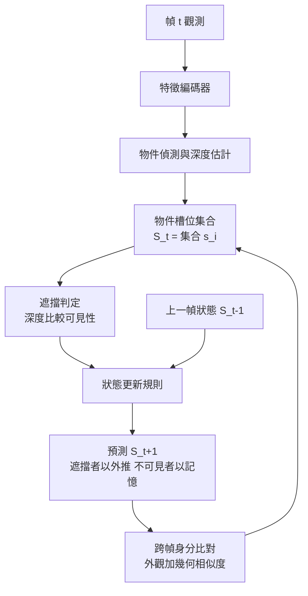

# 2.3 物體持久性（Object Permanence）與遮擋推理：空間一致性的底層挑戰

## 一、物體持久性的定義

在發展心理學裡，**物體持久性**（object permanence）指的是嬰兒學會的一項基本能力：一個被毯子蓋住的玩具仍然存在，毯子被拿開時它還在原處。這個概念在機器視覺裡被重新詮釋為一個更嚴格的工程要求：**物體的狀態必須在遮擋期間被保留，並在遮擋解除後以同一身分重新出現**。

這個要求包含三個可以分開檢驗的成分。第一是**存在性**：被遮擋的物體並未消失，它只是不可見。第二是**狀態延續性**：物體在被遮擋期間的運動、速度、甚至與其他物體的碰撞都必須被正確推估，而非暫停。第三是**身分一致性**：當物體重新出現在視野中，系統必須知道「這還是剛才那個物體」，而不是把它當成一個新出現的陌生物體。

第三點是最容易被忽略卻最具區別性的。若一個模型在每幀重新估計場景，它在遮擋期間會「遺忘」被遮蔽的物體；解除遮擋後，它會看到一個形狀相似的區域，但無法確認這是否為同一物體。這種缺陷在分類任務中無害（反正答案是一個類別），卻在世界模型中是致命的——因為世界模型需要對**特定物體**的未來做推估，例如「球撞到牆後會反彈回來」，這要求跨越遮擋的狀態追蹤。

## 二、為什麼這是空間一致性的底層挑戰

遮擋之所以構成底層挑戰，是因為它同時挑戰了表示的**完整性**與**時間的延續性**。

在 2.1 節我們已經論證過：像素柵格只記錄可見性集合，被遮蔽的表面資訊在採樣那一刻就被物理性地刪除了。這意味著遮擋不是一個「模型不夠好」的問題，而是一個「資訊不在輸入裡」的問題。模型唯一能做的，是**用先驗補上缺失的資訊**——假設被遮擋的物體仍然在那裡，以某種合理的方式運動。

這個先驗的表達，正是持久性機制的核心。傳統的逐幀估計器（例如單張影像的深度估計或語義分割）沒有任何機制攜帶這樣的先驗，因為它們的介面就是單幀。要攜帶它，必須引入**跨時間的狀態**：一個記憶體。

更根本的挑戰在於**幾何遮擋與視覺遮擋的耦合**。當物體 A 被物體 B 遮擋時，觀測到的變化可以有三種來源：A 移動、B 移動、或相機移動。要正確維護被遮擋物體的狀態，模型必須先把這三種來源解耦。這就是「相機運動與物體運動的解耦」問題，也是 2.3 節後半段的主題。

| 挑戰層面 | 問題描述 | 缺乏機制的後果 | 所需機制 |
| --- | --- | --- | --- |
| 存在性 | 遮擋期間物體是否仍被追蹤 | 物體消失又重生 | 跨時間狀態記憶 |
| 狀態延續 | 遮擋期間物體如何運動 | 物體從原地復位 | 運動預測與外推 |
| 身分一致 | 重現時如何對應到同一物體 | 追蹤身分錯亂 | 身分嵌入與比對 |
| 幾何遮擋 | 遮擋關係本身如何被表示 | 無法推論遮蔽順序 | 深度排序或佔用表示 |
| 運動解耦 | 相機運動與物體運動的分離 | 靜止相機被誤判為運動 | 視差估計與ego-motion |

## 三、2D 卷積網路的誘導偏置問題

一個值得深究的問題是：為什麼標準的卷積網路特別不擅長處理遮擋？

標準 CNN 的核心是**局部連接性**（local connectivity）與**平移等變性**（translation equivariance）。這兩個歸納偏置在許多任務上是巨大的先驗，但在遮擋推理上恰恰構成限制。局部連接性意味著一個位置的輸出只取決於周圍有限範圍的輸入，因此一個被遮蔽物體的資訊，在遮蔽期間根本沒有任何路徑可以傳入該區域；平移等變性則意味著網路沒有機制的先驗來假設「看不見的東西還在原處」。

這裡有一個更深刻的結構性問題：**2D 卷積網路無法表達深度順序**。在影像平面上，一個遮擋邊界只是兩片區域的交界，資訊「哪個在前」並不存在於二維資料格式中。即使網路學會了邊界偵測，它學到的也只是邊界的**位置**，不是邊界的**拓撲方向**。兩個物體的前後關係是三維資訊，必須由深度或佔用表示來承載。

值得注意的是，這不是 CNN 專有的缺陷。Transformer 與 RNN 也有各自的問題：Transformer 的注意力雖然是全局的，但若輸入仍是逐幀的序列，它同樣沒有機制把「不可見」與「不存在」區分開；RNN 的循環狀態雖可攜帶記憶，但訓練時要透過時間反傳把「遮擋前」的訊號傳到「遮擋中」的時刻，這條梯度路徑很長且脆弱。

因此，處理遮擋的正確方向不是「換一個更強的骨幹網路」，而是**改變狀態表示的結構**：讓表示本身帶有深度、帶有跨時間的物件身分，並且讓模型能夠在「沒有新觀測」的情況下主動更新狀態。

## 四、遮擋推理的三種解法

### 4.1 記憶槽位與場景圖（scene graph）

最直接的思路是把場景表示成一個**物件清單**，每個物件帶有獨立的槽位（slot）。當某個物件在當幀未被偵測到時，模型並不刪除它，而是依據其最後的狀態與速度做外推，將它標記為「暫時不可見但仍然存在」。這就是物件追蹤與多目標追蹤（MOT）領域的核心思想，也是所謂的**場景圖**（scene graph）：一個隨時間更新的結構，其中每個節點是一個物件，邊描述其空間關係。

這種方案的優點是概念清晰、效率高、可解釋；缺點是它依賴一個獨立的偵測器，一旦偵測器在遮擋邊界附近失效（例如物體只露出 10% 而被誤判為背景），整個槽位系統就會崩潰。

### 4.2 佔用預測（occupancy prediction）

另一條路線是放棄「物件清單」，改用**空間佔用預測**。模型不是預測「這裡有沒有球」，而是預測三維空間中每個位置在未來時刻是否被佔據。這個方向在自動駕駛領域發展迅速，代表作如 FIERY、OccWorld 等，用時序模型預測未來的佔有網格。

佔用預測在遮擋上的優勢是，它天然地表達了「看不見的區域仍然有內容」這個概念——被遮蔽區域的佔用並不因為不可見而變成空白，因為它是由上一幀的資訊與運動模型外推而來。但它的挑戰是三維解析度帶來的記憶體成本，以及「占用」本身不帶有物件身分，因此無法直接支援追蹤與操作。

### 4.3 三維場景表示的持久性

第三條路線是讓**三維場景表示本身**攜帶持久性。回到 2.2 節：NeRF 與 3DGS 重建的是一個三維場，而不是一幀影像。在這個框架下，遮擋不再是一個需要「推理」的問題——被遮擋物體的三維表示仍然完整地存在於場中，它只是被另一個物體挡住了視線。

這個觀點非常關鍵，但也有嚴格的條件。**NeRF 與 3DGS 之所以能在遮擋下維持一致，前提是多視圖資料已經觀察過被遮蔽區域**。如果某個區域從未被任何相機看見，輻射場在那裡的內容是任意的（通常被最佳化為空空間）。因此，靜態多視圖重建本質上是一種「把遮擋問題外包給資料收集」的策略：只要視角足夠多，看過的東西就永遠不會真的消失。

動態場景則無法如此。當物體持續運動時，總會有從未被任何時刻的相機完整看過的區域——球體背面隨旋轉而露出，室內角落隨移動而顯露。要處理這些區域，就必須引入**生成式的先驗**：模型要能問「一個球在看不見的那一面應該長什麼樣」，這已超出輻射場插值的能力，進入建模與預測的領域。

三種解法的比較如下：

| 解法 | 狀態表示 | 遮擋期間的更新 | 優點 | 主要侷限 |
| --- | --- | --- | --- | --- |
| 記憶槽位與場景圖 | 物件清單與關係圖 | 依速度外推 | 效率高、可操作 | 依賴偵測器、邊界脆弱 |
| 佔用預測 | 三維佔用體素 | 時序模型外推 | 天然處理不可見區域 | 記憶體高、無身分資訊 |
| 三維場景表示 | 輻射場或高斯集合 | 幾何本身維持 | 幾何一致、可渲染新視角 | 需多視圖、從未見處無資訊 |

## 五、時序一致性與遮擋邊界

最困難的遮擋情境不是完全遮住，而是**遮擋邊界**（occlusion boundary）：物體只被遮住一部分，此時可見區域提供的線索最為脆弱。

在遮擋邊界上，可見特徵可能只有物體的一小條邊緣。典型的遮擋邊界問題可以分為幾個層次：首先是**偵測層**——偵測器可能把「半個球」判為背景或誤判類別；其次是**分割層**——分割邊界在遮擋處容易漂移；第三是**追蹤層**——外觀特徵在遮擋前後變化劇烈（只見局部），基於外觀的關聯（appearance association）會失效。

解決這些問題的通用策略是**融合多種證據**。一個穩健的關聯分數不應只看外觀相似度，而應結合：

$$
\text{score}(i, j) = w_1 \cdot \text{appearance} + w_2 \cdot \text{geometry} + w_3 \cdot \text{motion} + w_4 \cdot \text{shape}
$$

其中幾何項給出的是兩者在同一世界座標系中的距離，運動項給出的是依前一幀速度預測的位置與實際位置的偏差，形狀項則比較體積與輪廓的比例等對遮擋穩定的特徵。這種**多證據融合**的思路，在 2.4 節的槽位注意力中也會出現——槽位的關聯同樣需要融合外觀與幾何線索。

另一個關鍵設計是**保留被遮擋物體的「影子」狀態**。一個成熟的多目標追蹤系統不會在偵測失敗時立刻終止軌跡，而是把物體標記為「預測中」，維持其最後已知狀態一段時間。這段期間若偵測重新出現，則進行身分恢復。這正是物體持久性的工程實作。

## 六、相機運動與物體運動的解耦

這是本章最具世界模型意涵的議題。

人類在觀察世界時，能毫不費力地區分「我在動」與「世界在動」。我們走過一間房間時，牆壁與家具在視野中大幅移動，但我們不會認為房間在飛；我們看到對方走過時，房間紋絲不動，我們卻知道對方在動。這種能力在數學上來自**視差**（parallax）與**剛性結構假設**（rigidity assumption）：若一群點之間的相對幾何保持不變，則它們的共同位移必定是相機運動。

在機器視覺中，這個解耦通常透過估計**ego-motion**（相機自身的六自由度運動）來完成。有了相機姿態，就可以把每個觀測點反投影到世界座標系，此時「世界在動」與「我在動」便不再混淆——兩者的差值就是物體在世界系中的真實運動。

對世界模型而言，這個解耦具有決定性的意義。若無法解耦，模型會把相機的平移誤判為場景的整體平移，導致所有物體的位置估計持續漂移。反過來，若解耦成功，模型就得到了一個**絕對參考系**中的物體軌跡，這個軌跡可以直接用於物理推斷——因為牛頓定律描述的是世界系中的運動，而不是影像平面中的運動。

這裡也接上了第 7 章的**動作條件化**。相機運動在機器人身上就是一個動作（或者說，是與環境無關的自身運動）。第 7 章將論證，世界模型必須能區分「環境的變化」與「我造成的變化」，否則反事實推理將無法成立。在本章的語境下，這個區分的**幾何版本**就是相機運動與物體運動的解耦。

| 情形 | 觀測到的變化 | 若不解耦的錯誤推論 | 正確推論 |
| --- | --- | --- | --- |
| 機器人前進 | 所有物體影像放大外移 | 場景在膨脹 | 自身平移，場景靜止 |
| 物件靠近相機 | 該物體影像變大 | 物件在膨脹 | 物件在靠近 |
| 燈光搖晃 | 全場明暗變化 | 物體材質改變 | 光照條件改變 |
| 鏡頭轉向 | 影像整體平移 | 物體集體平移 | 自身旋轉 |

## 七、定量評估的困難

評估持久性是一個令人頭疼的問題，原因是**缺少 ground truth**。我們沒有辦法知道一個被遮蔽了兩秒的球，在那兩秒裡精確地走到哪裡——除非我們用合成資料。

三種可行的評估途徑各有優劣。**合成資料**：在可控的模擬器（如 Isaac Sim、PhysX）中建立場景，精確知道每個物體在每個時刻的精確位置，因此可以計算遮擋期間的位置誤差。這是最精確的方法，但模擬器與真實世界的差距（sim-to-real gap）使得絕對數值難以直接外推。**合成遮擋**：在真實影片上人工或程式化插入遮擋物（例如從資料庫合成一根柱子擋在鏡頭前），這能測試真實外觀下的遮擋能力，但遮擋的物理真實度有限。**人類標註**：讓標註者在影片中標記遮擋事件的起止與物體身分，這能提供真實的遮擋分布，但成本極高且標註一致性難以保證。

常用的評估指標包括：遮擋期間的**位置誤差**（預測位置與真實位置的距離）、**身分切換率**（ID switches，遮擋結束後把同一物體當成新物體的比例）、以及**遮擋後的重建或分割品質**。這些指標共同構成了一個評估維度上的空白——直到近年來，遮擋推理在機器視覺中仍是個相對邊緣但關鍵的議題。

值得強調的是，**遮擋事件在自然影片中其實非常普遍**：人走過人、汽車開過車、視線離開物件再回來。任何長時段的影片理解都必然面對遮擋，只是大多數基準測試為了簡化而刻意避開了它。

## 八、對世界模型的意義

把以上收斂成一句話：**狀態必須是跨時間持久的，而不是每幀重新估計的**。

這個要求對世界模型的架構有直接的後果。第一，模型需要一個**獨立的狀態記憶體**，而不是把整段歷史壓縮成一個固定維度的向量（那會遺忘細節），也不是每幀獨立處理（那會遺忘身分）。第二，狀態記憶體的組織單位應該是**物件**而非像素，因為物件才有身分可言。第三，模型需要一個**預測機制**來更新那些暫時沒有觀測的狀態元素，這個機制必須內建物理或運動先驗，否則外推只是任意的猜測。

這三點直接導向 2.4 節的主題：如果狀態的組織單位是物件，那麼物件的表示方式、可解碼的資訊、以及物件之間如何被區分，就成了核心設計問題。而 Slot Attention 正是第一個把「物件中心」與「可微分」這兩個性質結合在同一個機制裡的方案。
