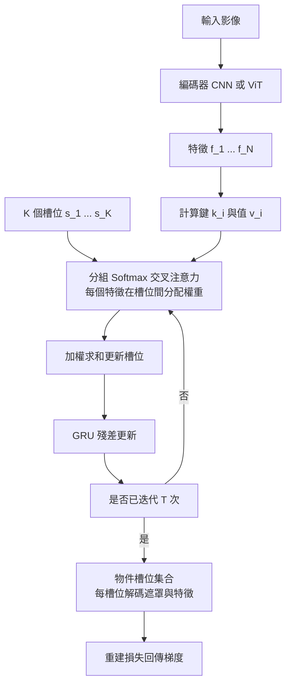

# 2.4 以物體為中心（Object-Centric）的場景分解與槽位注意力（Slot Attention）機制

## 一、動機：世界由物件構成，而不是像素

整個深度學習的傳統，長期以「整張影像」或「整段影片」為處理單位。卷積網路處理影像 patch，Transformer 處理序列 token，而這些 token 或 patch 都是**無名稱的**：它們只是位置的索引，沒有獨立的身分、沒有屬性、沒有可以被指涉的存在。

但人類並不這樣看世界。我們看到的是「一個紅色的杯子在桌子左邊，旁邊有一個藍色的球」。這種描述包含四類資訊：物件的**身分**（杯子、球）、**屬性**（紅色、藍色）、**位置**（桌子左邊）與**關係**（旁邊）。這四類資訊在像素或 patch 的表示中是**隱含且難以取用的**——它們需要從大量特徵中被歸納出來，而歸納的過程本身極其耗費資料。

物件中心表示（object-centric representation）的論點是：**應該直接把物件當作表示的基本單位**。一個場景被分解成一組物件，每個物件有自己的特徵向量；下游任務（計數、追蹤、辨識、互動）都在這個物件層級上進行，而不是在像素層級。

這個轉變帶來四個具體的好處。第一是**可持續追蹤**：一個物件的向量可以在時間上被攜帶，形成一條軌跡。第二是**可被操縱**：若要「把球移走」，只需修改對應那個槽位，不必重新生成整張圖。第三是**可被推理**：物件之間的關係可以用圖結構或注意力來表達，支撐「球撞到杯子」這類事件推理。第四是**參數效率**：結構化的物件表示往往比稠密的像素表示更緊湊。

此外，還有一個更根本的理由：物件是**物理互動的最小單位**。碰撞發生在物體之間，摩擦作用於接觸面，支撐關係連結兩個物體。如果一個世界模型無法辨認出「這是同一個球」，那麼它在物理層面就沒有可供碰撞的對象。

## 二、早期線索

物件中心表示的想法並非一蹴可就，它是多條研究路線匯流的結果。

**空間插槽假說（spatial slot hypothesis）**來自認知科學。Gazzaniga 等人的神經科學研究指出，人類大腦的視覺皮層中存在多個獨立的「物件特徵庫」，每個模組各自編碼一類特徵（如顏色、形狀、數量），並在視覺工作記憶中以「插槽」的形式維持有限數目的物體。這種「有限數目的物體槽位」的心理學直覺，是 Slot Attention 的直接靈感來源。

**NeRF 的物件分解**提供了另一條線索。ObjectSDF、NeRF-SH 等方法在輻射場的基礎上，把場景拆成多個獨立的物件場，每個物件有各自的幾何與外觀。這證明了一件關鍵的事：**重建的目標不一定要是「一個統一場景」，也可以是「一組物件場」**。但這類方法的分解通常依賴語義標籤的監督，需要人工標註或預先訓練的分割模型，並且通常假設了物件數量已知。

**Slot Attention**（Locatello et al., 2020）則是第一次把「物件中心」與「可微分」結合在同一個精簡機制裡。它的目標極為明確：用一個標準的、神經網路可微分的方式，從一組輸入特徵中**無監督地**發現一組物件槽位，不需要任何標籤、也不需要事先知道物件數量。

| 方法 | 監督需求 | 物件數量 | 主要輸出 | 對物理的適用性 |
| --- | --- | --- | --- | --- |
| 監督式語義分割 | 需要標籤 | 由類別決定 | 像素到類別的映射 | 低，類別非個體 |
| 物件偵測 | 需要框標籤 | 需預設上限 | 偵測框與類別 | 中，可追蹤但無形狀 |
| NeRF 物件分解 | 需語義監督 | 需預設 | 獨立物件場 | 中高，幾何完整 |
| Slot Attention | 無監督 | 迭代決定 | 物件槽位集合 | 高，槽位即物件 |

## 三、Slot Attention 的演算法細節

Slot Attention 的核心想法可以一句話概括：**把物件槽位當作查詢（query），對輸入特徵做交叉注意力，但用競爭式的 Softmax 取代標準的 Softmax**。

完整的演算法包含五個步驟。

**第一步：初始化槽位**。用可學習的參數矩陣 $ S \in \mathbb{R}^{K \times d} $ 初始化 $ K $ 個槽位向量，其中 $ K $ 是槽位數量（上限）， $ d $ 是槽位維度。實作上常加入輕微的空間噪訊作為初始位置提示，使槽位在初始化時彼此可分：

$$
S_1^{(k)} = s_k + \epsilon \odot u_k
$$

其中 $ s_k $ 是第 $ k $ 個可學習參數， $ \epsilon $ 是噪聲比例， $ u_k $ 是隨機向量。

**第二步：投影輸入特徵**。把輸入影像經由編碼器（如 CNN 或 ViT）得到 $ N $ 個特徵，並為每個特徵計算一個**分組 Softmax 權重**（grouped softmax）用的鍵與值：

$$
\mathbf{k}_i = W_k \mathbf{f}_i, \quad \mathbf{v}_i = W_v \mathbf{f}_i
$$

**第三步：以槽位為查詢做交叉注意力**。這是與標準 Transformer 最不同的地方。標準注意力的 Softmax 是**跨所有位置**正規化，每個位置對每個查詢都貢獻一點；Slot Attention 的 Softmax 是**跨槽位**正規化——每個輸入特徵必須把它自己的權重分配給某個槽位，而不是同時分給所有槽位：

$$
A_{i,k} = \frac{\exp\!\left( \langle \mathbf{s}_k, \mathbf{k}_i \rangle \right)}{\sum_{j=1}^{K} \exp\!\left( \langle \mathbf{s}_j, \mathbf{k}_i \rangle \right)}
$$

這裡的分母是**對槽位求和**，而非對特徵求和。這個改動是整個機制的核心：它把「注意力」從「軟性選擇」變成了「硬性分配」。

**第四步：以加權和更新槽位**。用歸一化後的權重對值做加權平均：

$$
\mathbf{s}_k \leftarrow \sum_{i=1}^{N} A_{i,k} \mathbf{v}_i
$$

這個步驟的直覺是：槽位 $ k $ 收集那些「最像自己」的特徵。若某個槽位的權重集中在一隻狗的像素上，它就會吸收狗的特徵。

**第五步：反覆迭代並以 GRU 更新**。上述第二到第四步會重複執行 $ T $ 次（實作上常取 $ T = 3 $ ），每次迭代後槽位透過 GRU 做殘差更新：

$$
\mathbf{s}_k \leftarrow \mathrm{GRU}\!\left( \hat{\mathbf{v}}_k, \mathbf{s}_k \right)
$$

其中 $ \hat{\mathbf{v}}_k $ 是第四步得到的加權和。GRU 的存在是為了讓槽位在迭代中保持身分連續性——若只用簡單的加法更新，槽位的表示會在迭代中被不斷覆寫，而 GRU 的門控機制能選擇性地保留舊資訊。

## 四、為什麼要強制「每個特徵只屬於一個槽位」

強制分配的設計，是整個 Slot Attention 得以運作的關鍵，值得仔細說明。

若使用標準 Softmax（跨特徵正規化），每個槽位都會嘗試解釋**所有**特徵，只是程度不同。結果是所有槽位都會變得相似——它們都吸收了整張影像的資訊，只是比例略有差異。這種現象稱為**塌縮**（collapse）到相同或高度重疊的表示。

分組 Softmax 從數學上排除了這個可能。對每個特徵 $ i $ ，權重向量 $ (A_{i,1}, \ldots, A_{i,K}) $ 滿足：

$$
\sum_{k=1}^{K} A_{i,k} = 1, \quad A_{i,k} \ge 0
$$

也就是每個特徵的「注意力質量」總和為一，並且被**完整地瓜分**給 $ K $ 個槽位。這有兩個後果。第一，競爭機制迫使槽位去**分化**：若兩個槽位想解釋同一批特徵，它們的權重就會互相削弱，最終某一方會輸給其他槽位而專注於別的特徵。第二，分配的**總量守恆**意味著沒有特徵會被漏掉，也沒有特徵會被重複計算。

這個機制可以類比為「每次只能歸屬一隊」的分配問題（例如把球員分到不同隊伍）。起初大家都想要同一位球員，但名額有限，於是分配自然趨於分散。

還有一個微妙但重要的效果：**分組 Softmax 讓槽位的數量 $ K $ 成為一個容量控制旋鈕**。若 $ K $ 過小，多個物件會被迫共享槽位；若 $ K $ 過大，槽位會退化成單一像素或單一特徵的過度細分。實作上常見的策略是以較大的 $ K $ 訓練，再用一個**存在性機制**（existence mechanism）預測哪些槽位是「空的」，在推論時將其丟棄。

## 五、重建損失如何迫使槽位分解出物件

單靠注意力機制，槽位並沒有理由去對應真實的物件——它們只會找到某種方便的分組。真正把它推向物件中心的是**重建損失**。

典型的物件中心重建模型採用一個**空間廣播解碼器**（spatial broadcast decoder）：每個槽位先被解碼成一個低解析度的特徵圖（例如 $ 8 \times 8 \times C $ ），然後把這個圖**廣播**到全解析度，再把所有槽位的廣播結果以遮罩加權混合：

$$
\hat{\mathbf{u}} = \sum_{k=1}^{K} \hat{\mathbf{m}}_k \odot \hat{\mathbf{v}}_k
$$

其中 $ \hat{\mathbf{m}}_k $ 是第 $ k $ 個槽位解碼出的遮罩（每像素一個權重）， $ \hat{\mathbf{v}}_k $ 是該槽位解碼出的特徵值（RGB 或特徵向量）。

這個解碼器設計有三個精妙之處。第一，**遮罩的競爭性**：雖然解碼後的遮罩沒有強制競爭，但它們在重建一個像素時競爭同一份貢獻權重，隱性地鼓勵分工。第二，**廣播解碼的容量限制**：每個槽位只能解碼出一張低解析度圖，這限制了單一槽位的表達能力，迫使模型把複雜場景拆成多個槽位。第三，**物件級別的一致性**：由於所有槽位共享同一個解碼器，學到的解碼器具有物件通用性，可以遷移到未見過的場景。

訓練目標是逐像素的重建損失：

$$
L_{\text{recon}} = \sum_{\mathbf{p}} \left\| \hat{\mathbf{u}}(\mathbf{p}) - \mathbf{u}(\mathbf{p}) \right\|^2
$$

在這個目標下，唯一能降低損失的方式是讓不同的槽位各自學會解碼不同的**空間連通區域**，因為只有這樣遮罩的加權混合才能重建出連貫的物體輪廓。

這個機制的深層邏輯是：**重建的多解性由架構來消除**。純粹的重建有無窮多種解（一張圖可以用無數種方式分割成碎片），但「固定數量的槽位，各自帶一個空間遮罩，共同解釋整張圖」這個架構，把解空間收斂到「有 $ K $ 個物件」這個語義上。模型沒有被告知「有 3 個球」，但架構本身讓「3 個球」成為最容易解釋資料的方式。

實務上常加入幾個輔助損失來改善訓練：**匹配損失（matching loss）** 用 Hungarian 演算法在預測槽位與真實物件之間做最佳配對，使損失不受槽位順序影響；**存在性預測** 用以處理空槽位；以及**方差損失** 鼓勵不同槽位的解碼結果彼此多樣化，防止所有槽位塌縮到同一種解釋。

## 六、下游能力

當場景被分解成物件槽位之後，一系列原本難以處理的能力變得自然且高效。

**計數**是最簡單也最直觀的應用：要數場景中有幾個球，只需數有多少個槽位的遮罩通過了「非空」檢查。這比從像素上直接數要穩健得多，因為遮罩的邊界漂移不會改變計數結果。

**追蹤**則利用槽位在時間上的延續性。若模型逐幀處理影片，可以要求第 $ t $ 幀的槽位集合與第 $ t-1 $ 幀的槽位集合做配對，配對依據可以是遮罩重疊度、形狀相似度或位置連續性。第 2.3 節討論的多證據融合關聯分數，在這裡有直接的對應物。

**可操作的狀態**是更重要的下游目標。若一個槽位代表一個物理物體，那麼「把這個槽位的位置參數改變」就等於「把這個物體移動」，這使得以物件為介面的生成與編輯成為可能。在具身智能的脈絡中，這對應到第 9 章的 VLA 模型：一個動作被解讀為對某個槽位狀態的修改，而非對像素的修改。

**關係推理**則是把物件槽位串成一個圖，邊承載「在旁邊」、「在下面」、「持有」等關係。這是 2.3 節提到的場景圖在高階的形式，也是理解「球在杯子裡」這類複雜構型所需要的表示。

## 七、訓練與評測

Slot Attention 最著名的評估結果是它在多個合成資料集上的**物件中心指標**（object-centric metrics）表現優於競爭對手。代表性的合成資料集包括：

**ClevrTex** 與 **ClevrTex6** 是帶有真實背景紋理的合成幾何物件場景。**ShapeStacks** 則是模擬真實世界「物件堆疊」的結構，包含遮擋關係，因此特別適合評估遮擋下的身分一致性。**MOVi** 系列（由 Kubric 生成）提供多變的物體數量、形狀、材質與相機運動，是目前最常用的動態物件中心基準。

| 評估面向 | 具體指標 | 意義 |
| --- | --- | --- |
| 分解品質 | 調整後 Rand Index（ARI） | 分組與真實物件標籤的一致度 |
| 物件發現 | 前景 F1 | 是否找對了物件數量與邊界 |
| 身分一致性 | 遮擋後的遮罩 IoU | 重現時是否為同一物件 |
| 重建品質 | 逐像素 PSNR | 解碼器還原能力 |
| 泛化能力 | 未見場景的 ARI | 是否學到物件通用性 |

一個關鍵的實驗發現是：**即使重建 PSNR 很高，物件分解的指標也可能很差**。這說明模型有時會找到一個能重建影像但與物件邊界無關的分組（例如按顏色分組而非按個體分組）。這是「重建表現」與「物件中心性」之間的解耦，也是評測設計上必須兩者並列的原因。

另一個關鍵實驗是**遮擋下的身分一致性**：在 ShapeStacks 中，一個球被另一個球遮住再出現，模型必須讓同一個槽位重新接續。這正是 2.3 節的持久性要求在物件層級的實現。

## 八、局限

Slot Attention 雖然概念優雅，但距離實用還有相當距離，其局限可歸為五類。

**複雜真實場景的分解品質**是最直接的問題。在合成資料集上表現優異的模型，轉移到真實街景時經常崩潰：真實世界的物件邊界不連續、材質變化劇烈、背景極其複雜，模型往往退化成按顏色或紋理分組。

**遮擋與接觸**的處理仍然薄弱。兩個物體互相接觸時，它們的像素特徵連續分界，槽位容易合併或錯分；而遮擋則要求模型記住看不見的部分，單幀的 Slot Attention 本身沒有跨時間的記憶機制（這需要第 2.3 節的持久性模組與第 7 章的動作條件化）。

**槽位數量需要先驗**。 $ K $ 必須在訓練前指定，雖然存在性機制可以讓空槽位被丟棄，但「上限設多大」仍是一個沒有理論答案的工程選擇。理想的做法是讓模型自適應地決定物件數量。

**缺乏物理屬性**。槽位編碼的是外觀特徵，並不天然帶有質量、材質、摩擦這些物理量。第 3 章所需的物理建模，必須另外設計機制來從軌跡與互動中反推這些屬性。

**缺乏動作條件化**。原始的 Slot Attention 是一個純粹的感知模組，它解釋「這是什麼」，但不回答「如果我這樣做會怎樣」。把它接入第 7 章的動作條件化框架，是通向可用世界模型的必要一步。

## 九、銜接第 3 章

現在可以看見第 2 章到第 3 章的接縫在哪裡。

物理引擎的工作方式是：給定一組物體及其屬性（位置、速度、質量、形狀），計算下一時刻的狀態。它要求輸入是**離散但具身分的物件集合**，而不是像素或稠密特徵圖。如果一個世界模型的狀態是像素或稠密特徵，那麼「球撞到牆」這個事件在表示層面根本沒有對應的主體。

因此，**只有當物件被分解出來，碰撞與交互才有一致的建模對象**。這是本章與第 3 章的接口：物件中心表示提供了物理引擎可以操作的實體清單，而第 3 章的物理先驗又反過來為物件的屬性（質量、形狀、支撐關係）提供約束，形成一個從感知到物理的閉環。

在這個閉環裡，2.1 節的幾何提供了座標系與尺度，2.2 節的輻射場提供了可渲染的三維內容，2.3 節的持久性提供了跨時間的一致身分，2.4 節的槽位提供了物件的離散介面。下一章要做的，就是讓這些物件真正地**動起來**——遵守重力、碰撞與摩擦，並且能夠被反事實地推演。
