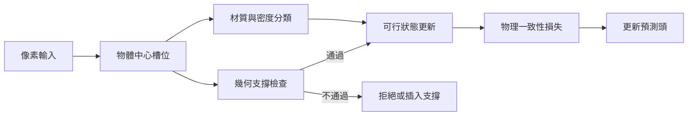

# 3.1 直覺物理學先驗：剛體運動、質量、重力加速度與支撐關係建模

## 3.1.1 直覺物理學是什麼

直覺物理學指的是：人或動物在完全不理解牛頓方程式的情況下，仍能對物理現象做出大致正確的預測。嬰兒在尚未學會說話之前，就已經知道把手鬆開後杯子會往下掉而不是往上飛；貓在落地前會扭轉身體以增加轉動慣量；被問到「若同時把兩個不同大小的球從高處拋下，哪個先落地」時，多數受試者會答錯，因為他們在腦中把「下落快慢」與「重量」綁在一起。這種能力並非來自語言教育，而來自身體經驗在神經系統中沉積下來的統計結構。

對世界模型研究而言，直覺物理學的價值在於它定義了**何謂一個合理的預測**。一個純粹的外觀模型可以生成看起來流暢的影片，卻讓杯子穿過桌面；一個具備直覺物理先驗的模型則會在畫面中維持支撐、遮擋與持續性。本章的目的不是把物理學完整複製進模型，而是抽取其中**可預測的約束**作為先驗注入。

## 3.1.2 剛體運動的最小知識集

剛體（rigid body）是物理學中第一個也是最有效的抽象：形狀不變、內部結構不變，只追蹤六個自由度。對世界模型而言，最小知識集由四個量構成：位置 $`\mathbf{x}`$ 、速度 $`\mathbf{v}`$ 、加速度 $`\mathbf{a}`$ 與質量 $`m`$ ，它們之間由運動方程串接：

$$
m \frac{d^2 \mathbf{x}}{dt^2} = \mathbf{F}_{\text{ext}}
$$

這裡的推論鏈極短但極有力量。知道了力，就能算加速度；把加速度對時間積分得到速度，再積分得到位置。於是預測未來所需的全部資訊，就是當下的位置與速度這兩個狀態變數加上外力場——這正好是本節標題「先建模」的含義：先確定狀態變數是什麼，再談如何從像素中辨識它。

在地球表面附近且忽略空氣阻力時，垂直方向的外力就是重力，因此加速度為常量：

$$
\ddot{y} = -g, \qquad g \approx 9.8 \ \mathrm{m/s^2}
$$

把這個解直接寫進來，就得到拋體運動的解析式：

$$
x(t) = x_0 + v_{0x} t
$$

$$
y(t) = y_0 + v_{0y} t - \frac{1}{2} g t^2
$$

這兩條式子的物理直覺含量極高：水平方向速度不變，因為重力沒有水平分量；垂直方向以固定速率被拉快，因此水平距離與落地時間可以由初速獨立決定。而這正是「拋物線」這個概念的來源——人類在幾千年前描述落體時，並不知道微積分，但他們知道路徑是彎的，且彎的程度由初始的向上速度決定。

這裡值得停下來思考一下**狀態變數的充分性**。上面只用了位置與速度兩個量，卻足以描述自由落體的完整演化，這是因為牛頓力學是二階常微分方程，狀態空間的維數等於方程階數的二倍。若一個物體還會旋轉，就必須加上角度與角速度，狀態變數立刻從兩個變成四個；若它是可形變的柔性物體，狀態空間的維數會隨網格解析度線性膨脹。這意味著世界模型的狀態表示必須與它所宣稱模擬的物理層級相匹配：宣稱能模擬扭轉，就必須把轉動慣量放進狀態，否則模型會在「一條棍子掉在桌上」這類場景中產生毫無物理根據的行為。**模型的狀態維度宣告了它的物理野心。**

對照之下，第 1 章談到的 Dreamer 一類潛在狀態模型採用的是「先學一個壓縮表示，再用它做預測」的策略，其狀態維數並不對應任何明確的力學自由度。這並無不妥，但代價是物理約束只能以事後損失的形式施加，而無法像解析解那樣直接給出閉式的未來預測。

對世界模型而言，這個解析解還有一層額外的意義：它是**監督訊號的來源**。我們可以從一段真實影片中估計物體的初速與起點，再用上式預測幾幀之後的位置，把預測位置與真實位置之間的差異作為物理一致性損失（physics consistency loss）。這種「用解析解當老師」的做法，強度遠高於用另一個神經網路當老師。

```mermaid
flowchart TB
    A[初始狀態 x0, v0] --> B[施加重力 g]
    B --> C1[水平: x(t) = x0 + v0x t]
    B --> C2[垂直: y(t) = y0 + v0y t - 0.5 g t^2]
    C1 --> D[拋物線軌跡]
    C2 --> D
    D --> E{是否落到支撐面?}
    E -->|是| F[碰撞: 法向速度歸零, 切向保留]
    E -->|否| G[繼續自由飛行]
    F --> H[支撐成立: 物體與地面保持接觸]
    G --> I[浮空狀態: 需有向上速度]
```

## 3.1.3 支撐與接觸：直覺物理中最強的約束

在所有直覺物理規則中，**支撐**（support）可能是最被低估、也最容易被人類執行、卻最難讓純資料驅動模型學會的一條。原因很直觀：一個物體若靜止不動，畫面上幾乎沒有可辨識的運動線索可供統計學習——沒有紋理變化、沒有速度場變化、沒有形變。模型要從靜止畫面中推論出「下方存在一個不可穿透的平面」幾乎不可能，因為單幀影像不包含這個資訊。

然而「浮空」在視覺上極其刺眼。心理物理學的實驗顯示，當受試者觀看電影中的物體在沒有地面時靜止懸浮，多數人會立即察覺異常。反過來，當物體有微弱的上下抖動而沒有可見支撐物，人們往往不會認為它「漂浮」，因為抖動提供了「受力的證據」。Khatib 與 Chang 所提出的「支持性原理」（the support principle）正是這類研究的集大成：人們判斷物體由重力施加的力是被支撐還是自由落下，其依據是環境中存在與該物體接觸、且能提供相應反作用力的物體。

這一點對模型設計的啟示極為直接。**支撐檢查不需要理解材質、不需要精確密度、不需要解方程，它是一個近乎二元的幾何判斷**：物體下方一格像素的深度值是否顯著小於物體自身的深度？在地面平面上做一次這樣的比較，就能擋掉大量「穿牆」「懸空」這類最刺眼的物理幻覺。反過來，這也解釋了為什麼純像素自迴歸模型特別容易在靜止場景出錯——它沒有任何動力去生成那個「看不見但必須存在」的地面。

| 直覺物理要素 | 視覺可偵測訊號 | 所需最小模型能力 | 常見模型失效型態 |
| --- | --- | --- | --- |
| 支撐存在 | 物體下方深度小於自身深度 | 深度估計或物體中心槽位 | 懸空、穿桌 |
| 重力方向 | 場景中一致的下落方向 | 全域座標系與深度 | 彈簧骨動畫飄浮 |
| 質量差異 | 材質光澤、形狀、體積 | 物體分割與材質分類 | 輕重物同速下落 |
| 遮擋持續性 | 物體進入視野再離開 | 記憶槽位與遮擋推理 | 物體消失重生 |
| 碰撞邊界 | 接觸瞬間的運動學不連續 | 事件偵測與狀態機 | 撞牆後穿牆 |

## 3.1.4 質量的視覺線索

第二個容易被直覺誤導的量是質量。初學者常以為「重的東西掉得快」，但實際上在真空中，所有物體的加速度都是 $`g`$ ，與質量無關。空氣阻力才會讓輕的東西（羽毛、雪花）明顯慢下來。因此「大小不等於質量」是直覺物理學最重要的一次修正之一。

那麼人們如何判斷質量？線索是間接的：木材、金屬、塑膠、棉花的視覺表面（光澤、紋理、顏色）對應不同的密度；形狀給出體積的粗略估計；兩者結合才能推回質量。實驗室裡的經典演示是把兩顆大小相同但材質不同的球同時釋放，觀察者會依材質判斷落地順序——這是一種**基於外觀的物理量推斷**，與真正的力學計算無關。

對世界模型而言，重點不在於讓模型學會「算質量」，而是在於讓它**不要把視覺尺寸直接等同於物理質量**。具體做法是讓物體中心槽位同時承載一個「外觀尺度」（ $`s`$ ，由槽位大小決定）與一個「慣性參數」（ $`m`$ ，由材質分類器或學習到的嵌入決定）兩個量，並在預測時使用後者。這種參數解耦在多剛體接觸模擬中尤其重要：若模型隱含「大的必然重」，則一個大而輕的氣球撞上小而重的鐵球時會產生完全錯誤的碰撞結果。

## 3.1.5 主流研究證據：基準與謎題

物理直覺並非不可測量。過去十年間出現了幾條重要的實證路線。

第一條是 Physion 類基準，它把物理場景依照「是否需要理解物理才能完成任務」分為包含（containment）、連結（linkage）、支撐（support）、動力學（dynamics）等任務族，並設計成：若模型沒有內建物理直覺，無法判斷畫面中哪個情形的結果符合物理規律。這類基準的關鍵設計是**對照選項都由合理但錯誤的規則生成**，例如「物體穿過容器」或「支架斷裂後物品仍懸浮」。

第二條是 IntPhys 這類以短影片為輸入、要求模型判斷「是否違反物理」的工作，它把抽象規則具體化為「兩個物體必然會碰撞但影片中未碰撞」「球在沒有支撐的情況下靜止」這類可判定敘述。

第三條是 Bongard 類的物理謎題（物理版）：給定若干「正常情境」與若干「反常情境」的圖片，模型必須找出區分兩者的那條規則。這種設定直接測驗的是**特徵化（feature-ization）**能力——把一堆像素轉成「有無支撐」「是否自由落下」這類抽象變數的能力。

三條路線的共同啟示是：直覺物理是可被量化、可被訓練的，但需要**在資料中被刻意隔離出來**。若訓練資料中物理違例的片段與正常片段混雜不清，模型學到的將是環境的統計常態而非物理規則。

還有一項常被忽略的方法論教訓：這些基準的評分對象不是模型整體，而是模型**對特定物理概念的內部表徵**。當 Physion 這類基準上模型答錯「支撐」題目時，研究者會去檢查模型是否真的編碼了物體與地面的相對深度，而不是去問它整體預測分數為何。把「能力」拆解到概念層級，是讓直覺物理能被系統性改善的前提，也呼應第 2 章所強調的物體中心槽位：槽位中的「深度」與「是否有下方支撐」這種關係量，才是直覺物理的天然介面。

最後是資料來源的問題。真實影片中的物理事件極其稀少——一天中能看到幾次球落地？幾次車禍？這使得純被動觀影的資料在物理上是高度欠採樣的，而物理引擎可以任意生成這些稀有事件。這是第 9 章「數位孿生作為低成本訓練場」的核心动机，也是本章結尾要引出的架構選擇之一。

## 3.1.6 對世界模型的啟示：物理作為可預測的約束

綜合以上，一個清醒的工程判斷是：**物理不該被完整仿真，也不該被遺忘**。完整仿真意味著在渲染的每一幀背後跑一個真正的求解器，這在多數世界模型的算力預算下不可行；而完全遺忘則會得到流暢但物理崩壞的生成結果。中間路線是把物理壓縮成一組**約束**（constraints）而非**方程式**：

- **支撐約束**：任何靜止物體下方必須有可支撐的表面，否則需要解釋它的浮力來源。
- **遮擋約束**：物體被遮擋期間必須持續存在，且位置可由運動模型外推。
- **邊界約束**：物體不可穿越固體邊界，碰撞後法向速度歸零。
- **守恆約束**：碰撞前後的總動量與（近似）總能量守恆，可用於損失函數或診斷指標。

這組約束的共同特徵是**不需要知道完整參數**即可檢查。支撐不需要精確密度，邊界不需要精確摩擦係數，守恆不需要知道形狀細節。這使得它們特別適合當作神經世界模型的**結構性先驗**：以注意力偏置、遮罩、附加損失或硬編碼的可行性檢查器三種形式注入。

值得強調的是，這些約束的檢查本身也可以是學習式的。與其寫死「物體下方必須有面」，不如訓練一個輕量的二元分類器，判斷「當前狀態在物理上是否可持存」，並用物理違例（讓物體穿透地面）作為負樣本。這種做法把硬編碼規則轉換成了一個小型可驗證元件：規則本身仍可被人類閱讀與修正，而觸發時機由資料決定。兩者的最佳分工通常是——**邊界條件硬編碼，觸發門檻學習化**。

這也回答了本章一個核心問題：為什麼把物理寫成硬編碼的啟發式（例如「畫面下緣不可穿透」）比讓模型從像素自行學出來更可靠？因為像素自迴歸的學習訊號極其稀疏——支撐關係在單幀中是隱藏的，在真實影片中又往往不發生違反，因此梯度幾乎為零；而硬編碼約束只需對應到一條明確的幾何規則，立刻就能把違反率壓下來。硬編碼的代價當然是規則本身可能不適用於所有場景（例如液體、飛行中的直升機），所以合理的做法是把它做成**可開關的偏置**，而非不可協商的硬牆。

還可以補一個更根本的理由：像素自迴歸模型學到的是「在這個資料分布中，接下來最可能出現什麼像素」，而物理問題問的是「在這個初始狀態下，接下來必然會發生什麼」。前者的答案是分布的眾數，後者的答案是由約束推導出的相對必然。兩者只在多數情況下重合；一旦偏離分布，前者就會漂移，而後者會崩潰得明確且可診斷。**物理崩潰是警訊，相對不確定性是常態**，這個區別在評測設計上極為重要。



## 3.1.7 小結

直覺物理學提供的是一組**稀疏而強力的先驗**：狀態變數是什麼、哪些關係必須成立、哪些場景可以直接排除。它並不要求模型理解方程式，只要求模型持有可檢查的約束。支撐關係是其中最典型的例子：它幾乎不需要參數，卻能解釋人們對「懸空」異常的即時偵測。質量的視覺線索則提醒我們，外觀與物理量之間需要一層學到的映射，而不是捷徑的等同。

下一節我們把視角拉近到**互動**。當兩個物體接觸時，物理不再只是各走各的單體軌跡，而是透過碰撞、摩擦與接觸約束耦合在一起的系統。碰撞提供了本章沒有的一樣東西：一組可以用初等代數寫出解析解的**事件**，這讓它同時成為可模擬的機制與可監督的訓練訊號。

## 參考文獻

- Khatib, F., & Chang, R. (1999). The Support Principle: Known and Unknown Constraints on Object Support. *Image and Vision Computing*.
- Beck, V., et al. (2020). Physion: Evaluating Physical Prediction from Video Understanding. *Nature Machine Intelligence*.
- Li, Z., et al. (2020). IntPhys: Intuitive Physics Understanding of Video. *NeurIPS*.
- Xu, Z., et al. (2021). Learning to Detect Physics Concepts with a Video Dataset. *CoRL*（Bongard 類物理謎題）。
- Pearl, J. (2009). *Causality: Models, Reasoning, and Inference*（第 3.3 節的理論來源）。
