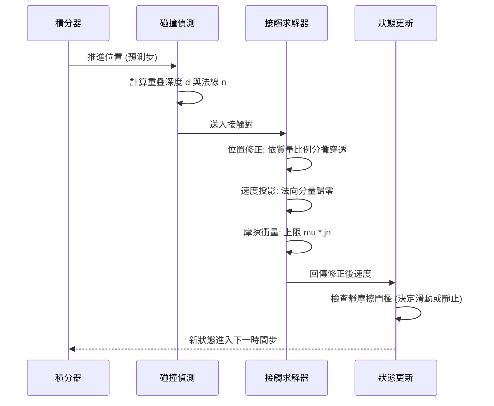

# 3.2 動態交互預測：彈性碰撞、摩擦力、關節約束與流體變形

## 3.2.1 碰撞是交互的原子事件

3.1 節處理的是**孤立的物體**：每一個物體各自依循自己的方程演化，彼此不相干。一旦兩個物體接觸，情況就根本性地改變了——此後的軌跡不再是各自的函數，而是耦合的結果。這意味著碰撞是世界模型必須建模的**原子事件**：它是交互的最小時間單位，是「兩個物體的命運從此交織」的瞬間。

碰撞之所以特別適合作為學習與評測的對象，有三個實質原因。第一，它是**可觀測的離散跳變**：接觸前後的位置與速度會出現明顯的不連續，這在連續的影片序列中容易偵測。第二，它有**封閉形式的解析解**，至少在一維、理想化的情形下如此，因此可以作為強監督訊號。第三，它暴露了模型是否真的學到「質量」與「材質」這些物理量，因為碰撞後的結果對這些參數高度敏感。

## 3.2.2 一維彈性碰撞的解析解

考慮沿同一條直線運動的兩個物體，質量分別為 $m_1$ 與 $m_2$ ，碰撞前速度分別為 $v_1$ 與 $v_2$ ，碰撞後的速度記為 $v_1'$ 與 $v_2'$ 。對於完全彈性的碰撞，有兩條守恆律可用：

$$
m_1 v_1 + m_2 v_2 = m_1 v_1' + m_2 v_2'
$$

$$
\frac{1}{2} m_1 v_1^2 + \frac{1}{2} m_2 v_2^2 = \frac{1}{2} m_1 {v_1'}^2 + \frac{1}{2} m_2 {v_2'}^2
$$

第一式是動量守恆（系統不受外力），第二式是動能守恆（碰撞無能量損失）。把第二式改寫成兩物體相對速度乘積的形式，再與第一式聯立消去，可以解出：

$$
v_1' = \frac{m_1 - m_2}{m_1 + m_2} v_1 + \frac{2 m_2}{m_1 + m_2} v_2
$$

$$
v_2' = \frac{2 m_1}{m_1 + m_2} v_1 + \frac{m_2 - m_1}{m_1 + m_2} v_2
$$

這個結果有幾個直覺上很好的特例。當 $m_1 \gg m_2$ （小球撞大牆），第一式化為 $v_1' \approx v_1$ 、 $v_2' \approx 2 v_1 - v_2$ ：小球的速率幾乎不變，而大球以「鏡像反射」的方式獲得速度——這正是保齡球撞瓶的近似。當 $m_1 = m_2$ 時，兩式化為 $v_1' = v_2$ 與 $v_2' = v_1$ ：兩物體**交換速度**。這個等質量交換性質是所有碰撞物理中最常被引用的特例，也是判斷模型是否正確的簡易測試。

值得補充的是，動量守恆這條式子其實**不需要任何關於碰撞性質的假設**——它是外力為零時的必然結果，即使碰撞完全非彈性、即使能量全部轉換成變形與熱，動量守恆依然成立。相對地，動能守恆才是那個額外的假設。這個區分在實務上很重要：它意味著只要模型能學會「外力為零時總動量不變」，它就已經掌握了碰撞物理中最穩健的一部分；而能量守恆的細節（有多少轉成熱）則可以交給資料與可視化判斷來細化。**先守住較弱但更普適的守恆律，是學習式物理模型一個務實的策略**。

三維情形並不更難，只是把每個速度分量獨立處理即可，因為碰撞衝量沿法線方向，各分量互不耦合。

## 3.2.3 恢復係數與非彈性碰撞

真實世界的碰撞很少是完全彈性的。用恢復係數（coefficient of restitution） $e$ 描述碰撞後法向相對速度與碰撞前法向相對速度之比：

$$
v_{\text{rel},n}' = -e \, v_{\text{rel},n}
$$

其中 $e \in [0, 1]$ ， $e=1$ 對應完全彈性， $e=0$ 對應完全非彈性（兩物體黏在一起共同運動），而中間的塑膠球撞擊、濕泥巴落地則落在中間值。把這個係數代入上面的動量守恆式，即得到一般形式的解。

這裡出現一個對世界模型而言非常重要的物理事實：**恢復係數不是從影片中直接可觀測的量**。模型看到的是碰撞前後的運動，它必須從資料中反推 $e$ 、 $m_1$ 、 $m_2$ 這三個無法單獨辨識的參數。這正是**不可辨識性（identifiability）**的第一個物理實例：在沒有其他約束的情況下，同一段觀測可以用許多不同的 $(e, m_1/m_2)$ 組合解釋。這也是第 3.3 節要處理的因果問題在物理層面的第一個化身——把參數的結構先驗（ $0 \leq e \leq 1$ 、質量為正）加進模型，可以大幅收斂可行解的範圍。

## 3.2.4 摩擦力與靜摩擦門檻

摩擦與碰撞的本質不同：碰撞是瞬時事件，摩擦是持續作用力。而更特別的是，摩擦具有**門檻效應**，這解釋了日常經驗裡最具戲劇性的一個物理場景——斜面上的箱子為什麼「先不動、再滑動」。

庫侖摩擦模型將摩擦力寫成：

$$
F_{\text{fric}} = \min(\mu_s N, \mu_k N)
$$

其中 $N$ 是法向力（在水平面上 $N = mg$ ，在斜面上 $N = mg \cos \theta$ ）， $\mu_s$ 與 $\mu_k$ 分別為靜摩擦與動摩擦係數。當沿斜面方向的重力分量 $mg \sin \theta$ 小於靜摩擦上限 $\mu_s N$ 時，箱子保持靜止，實際靜摩擦力恰好等於 $mg \sin \theta$ ；一旦超過門檻，摩擦力跳降至 $\mu_k N$ ，箱子開始加速下滑。門檻臨界角為：

$$
\theta_c = \arctan(\mu_s)
$$

這個門檻帶來兩種截然不同的行為模式，且切換是**不連續**的。對連續時間的預測模型而言，這是一個本質上難以平滑逼近的問題：只要參數估計有微小誤差，箱子就會被判定為「應該滑動」而開始移動，即使它其實靜止。實務上常用的處理是引入一個**速度門檻帶**（如 $|v| < \epsilon$ 時視為靜止）與一個較大的靜摩擦係數（通常取動摩擦的 $1.2$ 到 $2$ 倍）來製造遲滯區（hysteresis），避免在門檻附近來回震盪。

從學習的觀點看，摩擦門檻是「直覺物理」的又一個絕佳例子：人類不需要知道 $\mu_s$ 的數值，就能判斷「這個箱子會不會滑下來」，因為我們從傾斜程度與物體材質的經驗中學到了這條門檻的**定性位置**。世界模型要能預測傾倒行為（例如第 9 章的人形機器人），就必須內化這條門檻，而不只是內化「接觸面之間有阻力」這種模糊概念。

## 3.2.5 關節約束與接觸

接觸的處理涉及一類被稱為**關節／接觸約束**（joint constraints）的技術。當兩個物體進入接觸狀態時，它們的相對運動被限制：法向速度必須歸零（不可穿透），切向速度則受摩擦限制（可滑動但有阻力）。

一個標準的接觸求解流程包含以下步驟：

1. **偵測**：找出距離小於閾值的物體對。
2. **位置修正**：沿法線方向把重疊的物體推開，消除穿透。常用做法是依質量比例分配修正量：

$$
\Delta \mathbf{x}_1 = \frac{m_2}{m_1 + m_2} d \hat{\mathbf{n}}, \qquad
\Delta \mathbf{x}_2 = -\frac{m_1}{m_1 + m_2} d \hat{\mathbf{n}}
$$

其中 $d$ 為穿透深度， $\hat{\mathbf{n}}$ 為單位法線。
3. **速度修正**：求解衝量，使法向相對速度不為正（物體不得分離穿透），同時施加摩擦衝量上限 $\mu |j_n|$ 。

這套流程有一個常被低估的設計要點：**順序依賴性**。位置修正與速度修正的先後會影響結果，尤其在多物體堆疊（桌子上的書堆、倒地的抽屜）這類場景。物理引擎通常需要反覆迭代求解接觸網絡，這也解釋了為什麼真實的剛體模擬在複雜接觸下非常耗費算力——約束越多，非線性越強，收斂越慢。

## 3.2.6 連續介質與形變

剛體是對真實世界的近似，而這個近似的邊界在某些現象上很快就被突破。彈性的球落地會變形再回彈，水會飛濺，柔軟的沙發會凹陷而非被穿透。處理這類現象需要不同的數學工具。

最簡單且最常用的是**彈簧—阻尼模型**：把物體之間的接觸（或物體自身的形變）建模為一組彈簧與阻尼器，彈簧常數 $k$ 提供回復力，阻尼係數 $c$ 提供能量耗散。這一模型可以寫成狀態空間形式，並且天然地支持反傳（第 3.4 節的反事實路徑之一）。它的缺點是剛度與時間步長之間存在嚴格的穩定性限制：剛度越高，需要的時間步越短，模擬成本呈平方級上升。

流體的處理則更為困難。常見的近似層次有三種：首先是**粒子法**（SPH），把流體離散成帶壓力的粒子集合，用密度估計計算壓力力，能自然處理自由表面且容易與其他物理耦合；其次是**格子／有限體積方法**，把流體放在網格上求解壓力泊松方程，精度高但成本大；最後是**深度學習式的流體近似**（如 FluidNet 系列），用網路直接回傳速度場或密度場，速度快但對長時間積分與複雜邊界仍不穩定。

在可形變物體的處理上，一條實用的路線是**混合表示**：主體仍用剛體描述整體運動，只在接觸區域或變形劇烈的區域加上局部形變場（例如用神經輻射場或網格形變表示凹陷）。這種分層策略的好處是保留了剛體模型的速度與穩定性，同時捕捉到視覺上最明顯的形變痕跡。

## 3.2.7 三種學習式世界模型的實作路線

在學習式世界模型中，物理知識的注入方式可以歸為三條路線，它們在監督訊號來源、泛化能力與實作成本上有系統性的差異。

| 面向 | 物理引擎式 | 資料驅動式 | 混合式 |
| --- | --- | --- | --- |
| 物理來源 | 解析求解器（Bullet、Isaac 等） | 從影片與互動中歸納 | 引擎提供約束或損失 |
| 訓練標籤 | 模擬器直接輸出狀態與標籤 | 僅觀測像素或少量標記 | 引擎標籤加影片對齊 |
| 泛化能力 | 受限於引擎與場景設定 | 可覆蓋真實世界的長尾 | 取決於約束強度 |
| 成本 | 模擬生成耗算力 | 資料取得與訓練耗算力 | 兩者皆有 |
| 失敗模式 | Sim-to-Real 落差 | 物理幻覺、複合誤差 | 參數過強則僵化 |

**物理引擎式**的做法是讓模擬器扮演環境的角色，模型學習的是引擎產生的軌跡。它最大的優勢是提供了完美對齊的標籤：每一幀的物體位置、速度、接觸力、是否滿足支撐約束都能直接讀出。Dreamer 系列在 Atari 與 DMC 上獲得的成功，很大程度上建立在能無限生成軌跡的模擬器之上（第 1 章已述）。但這種做法的瓶頸在於**真實世界的長尾**：模擬器的材質、摩擦係數、接觸細節都是人工設定的，模型若過度依賴這些設定，就會在真實攝影機下失效。

**資料驅動式**的做法是從像素與動作序列中直接學動力學。它的優勢是能捕捉物理引擎難以建模的現象（布料、煙火、柔軟物體、真實接觸的複雜細節），而且不依賴任何手寫的物理規則。代價則是它學到的是**環境的統計常態**：在真實影片中物理違例少見，模型沒有機會學到「物體不該穿透桌面」這條否定性規則，因此容易生成看似合理但物理上不可能的畫面——第 10 章將此稱為物理幻覺。

**混合式**是當前最主流的務實路線，其做法是保留資料驅動的表達能力，同時以物理約束作為引導或損失的組成部分。常見的實作包括：以守恆量（總動量、能量）作為預測頭的正則項；以接觸與支撐的可滿足性作為生成結果的可行性過濾器；或在對抗式生成中，用物理判別器篩掉不可能的樣本。第 5 章的物理約束引導屬於這一類的延伸。

## 3.2.8 交互的難度梯度與評測指標

不同類型的交互對模型的要求差異極大，可以排成一個難度梯度。

第一級是**單一剛體在靜態環境中的運動**：只有重力與邊界，沒有交互，3.1 節的拋體公式已足以應付。第二級是**兩物體的碰撞與單純接觸**：需要質量、恢復係數與碰撞法線，解析解可作監督。第三級是**多體接觸網絡**：如球堆、積木塔，需要穩健的接觸求解與迭代，剛體模型在此開始變得昂貴而脆弱。第四級是**可形變物體**：需要彈簧阻尼或網格形變，模擬成本陡增，且視覺與力學的耦合更難建構。第五級是**連續介質**：流體、破碎、彈性布料，通常需要專門的近似方法。

評測時，指標也必須對應到物理量，而不是籠統的感知指標。常見的三類如下。

**接觸準確率**：預測中物體首次接觸的時間與位置，相對於真實資料的誤差。這是最直接測量「模型是否知道東西會撞上」的指標。

**速度誤差**：在接觸事件前後，預測速度與真實速度的差（例如 $L_1$ 或相對誤差）。這個指標測量的是碰撞解的正確性，而不只是位置正確。

**支撐違反率**：在宣稱為靜止的時間步中，模型預測的物體與下方物體之間出現穿透、或是物體下方無支撐卻保持靜止的比例。這個指標直接延續 3.1 節的主題，是最容易量化的物理一致性格測。

| 難度級 | 場景例子 | 關鍵參數 | 建議指標 |
| --- | --- | --- | --- |
| 一 | 自由落體與拋射 | $g$ 、初速 | 位置誤差 |
| 二 | 兩球碰撞 | 質量比、 $e$ | 碰撞後速度誤差 |
| 三 | 多體堆疊 | 接觸約束、摩擦 | 接觸時間誤差、堆疊崩潰率 |
| 四 | 落球形變、軟體 | $k$ 、 $c$ | 形變輪廓 IoU、恢復係數誤差 |
| 五 | 液體傾倒 | 表面張力、黏度 | 體積守恆誤差、粒子分布 KL |

## 3.2.9 小結

碰撞把「各自獨立的物體」轉化為「互相糾纏的系統」，也因此成為模型物理能力的天然試金石。一維彈性碰撞提供了閉式解，恢復係數揭示了參數的不可辨識性，摩擦門檻揭示了不連續行為，關節約束揭示了多體接觸的數值困難，可形變與流體則揭示了剛體近似的邊界。

三條實作路線各有代價，而當前最務實的是混合式：讓資料提供表達力，讓物理提供約束。至於「物理規則本身帶有什麼結構」——它不是一組彼此獨立的數學等式，而是一張有方向、有層次、可以施加干預的因果網絡。這正是下一節的主題。

不過在收束之前，還有一項常被低估的工程細節值得提出：**接觸事件的時間戳解析精度**。物理引擎通常以固定的時間步（例如 $1/240$ 秒）離散積分，而真實影片的取樣率遠低於此（常見為 30 fps）。當模型要在影片時間軸上對齊接觸事件時，會遇到一個數值問題——引擎認為的接觸發生在第 $57.3$ 步，而觀測到的第一個「看起來有接觸」的影格可能在第 $58$ 步。若不處理這個離散化誤差不僅是錯一格影格的問題，它會**系統性地偏誤速度估計**：把「接觸前」的速度錯配到「接觸後」的影格上，會讓學到的恢復係數出現偏差，而偏差方向在各場景中一致，模型便會把它學成一個偏置。

解法之一是讓模型在預測時採用**連續時間的接觸事件表示**，而非把事件綁定到影格邊界；例如把接觸建模為一個具有事件時刻 $t_c$ 與衝量幅度的原子記錄，由解碼器在連續時間上重建速度變化。另一個更簡單但有效的做法是在資料預處理時，以子影格插值把接觸時刻對齊到觀測精度。這種「時間對齊」的細節，往往比換更大的網路更能改善物理預測的準確度，也說明了為什麼第 1 章強調物理引擎提供**對齊標籤**的價值——對齊本身就是一種稀缺資源。
