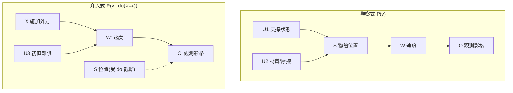
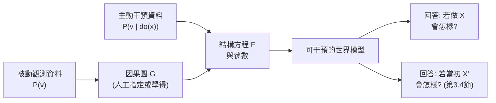

# 3.3 結構因果模型（SCM）在世界模型中的實作：介入、干預與因果圖推導

## 3.3.1 為什麼需要因果層次

到目前為止，本章的討論停留在「預測接下來會發生什麼」。但人類對物理的運用遠不只於此：我們會問「如果我從側面推它一下，它會撞到那個杯子嗎」「如果這張桌子塌了，我該往哪邊跑」。這類問題在統計學的框架下是完全不同種類的問題，它們問的不是「世界通常是怎樣的」，而是「若我做了某件事，世界會變成怎樣」。

Judea Pearl 把這個差異整理成一個三層的因果階層，是理解本章內容最有效的骨架。

| 階層 | 典型問題 | 所需資訊 | 統計工具 | 對應模型能力 |
| --- | --- | --- | --- | --- |
| 關聯（Seeing） | $A$ 與 $B$ 是否相關？ | 聯合分布 $P(a,b)$ | 相關係數、迴歸 | 下一 token 預測 |
| 介入（Doing） | 若強制令 $A = a$ ， $B$ 會是什麼？ | 因果圖與結構方程 | do-演算、潛在結果 | 動作條件化預測 |
| 反事實（Imagining） | 若當初 $A$ 為 $a$ 而非 $a'$ ， $B$ 會是什麼？ | 完整的因果模型與結構方程 | 對偶與替換 | 平行未來推演 |

三層的關係是遞進的而非平行的：能回答第三層，必然能回答第二層與第一層；反之則不然。一個只學會了關聯的系統，可以用極高的準確率預測「下雨時地面濕」這個相關性，但它無法回答「若我開了灑水器，地面會不會濕」——因為後者要求把「下雨」這個原因從方程中**刪除**，而這正是介入的定義。

## 3.3.2 SCM 的三元組與結構方程

Pearl 的結構因果模型（Structural Causal Model, SCM）由三個部分組成：一組外生變數 $U$ 、一組內生變數 $V$ ，以及一組決定每個內生變數如何依賴其父節點與自身雜訊的結構方程 $F$ 。記為三元組 $(U, V, F)$ 。

具體而言，每個內生變數 $X_j$ 都有一條結構方程：

$$
X_j = f_j(\mathrm{Pa}_j, U_j)
$$

其中 $\mathrm{Pa}_j$ 是 $X_j$ 在因果圖中的父節點集合， $U_j$ 是它的外生雜訊。這個形式化的關鍵在於：**父節點的取值一經決定， $X_j$ 就被完全決定了**，只需要一個隨機項 $U_j$ 來表達剩餘的不確定性。這是一個很強的假設，但在物理世界模型中相當合理，因為牛頓力學的本質就是確定性的微分方程加上初始條件。

從結構方程出來，因果圖 $G$ 是一個有向無環圖（DAG），節點是變數，邊 $X \to Y$ 表示 $X$ 是 $Y$ 的一個原因。因果圖可以從結構方程直接讀出：若 $X_j$ 的方程中出現了 $X_i$ ，就畫邊 $X_i \to X_j$ 。反過來，給定一個因果圖並指定每條邊上的函數 $f_j$ ，就得到完整的 SCM。

這個對應關係在物理上有特別自然的例子。一維剛體的狀態方程可以寫成 $X_{t+1} = f(X_t, U_t)$ ，其中 $X_t$ 包含位置與速度， $U_t$ 是外部作用力或隨機擾動。於是因果圖只有兩層：初值節點指向狀態節點，狀態節點指向觀測節點。這樣的圖雖然簡單，卻已經足以區分「同一初值下不同擾動導致的分布差異」與「不同初值導致的差異」——而這正是反事實推理能夠運作的結構基礎。物理世界模型不需要複雜的圖，但需要的圖必須是**有向且無環**的，且方向必須反映真實的作用次序。



## 3.3.3 觀察式與介入式的數學差異

這是本章最核心的技術內容。觀察一個變數 $X$ 與對它施加介入，兩者在數學上有本質不同的定義。

觀察式是條件分布：

$$
P(v) = \sum_u P(v \mid u) P(u)
$$

這裡的求和遍歷所有外生變數的配置，也就是說， $X$ 之所以取某個值，是因為整個上游的因果歷史恰好如此。在觀察式裡， $X$ 與其父節點是**一起**被條件化的。

介入式則是把 $X$ 的結構方程整條**刪除**，代之以一個常數：

$$
P(v \mid \mathrm{do}(X = x)) = \sum_u P(v \mid u) P(u \mid \mathrm{do}(X=x))
$$

更一般地，Pearl 證明了介入等價於**在因果圖中截斷（cut）進入 $X$ 的所有邊**，然後對剩餘的圖做普通的因子化分解。這個「圖上的截斷」就是所謂 do-演算的圖像化版本，也是它最容易被非專家記住的部分。

兩者的差異可以用一個簡單的混淆例子說明。假設下雨會讓地面變濕，而灑水器也會讓地面變濕，同時下雨會讓人打開灑水器：

```
下雨  →  地面濕
下雨  →  開灑水器  →  地面濕
```

在這個圖中，「下雨」是「開灑水器」與「地面濕」的共同原因（confounder）。此時觀察到的關聯 $P(\text{灑水器開} \mid \text{地面濕})$ 是偏的，因為下雨同時推高了兩者。而若我們想問「若強制開啟灑水器，地面會濕嗎」，答案要沿另一條路徑推斷。

這個混淆例子並非學術上的裝飾，它在真實資料中無所不在。醫學上「藥物降低死亡率」與「病情嚴重者更常被開藥」正是同一結構；推薦系統中「點擊率高的物品被推薦得更多」亦然。在物理世界模型的語境裡，同樣的問題出現在極為日常的場景：某個通道裡的人流量總是很大，於是模型學會「人多的通道裡物體移動得快」；但真實的原因可能是「通道寬，所以兩人都能通過而不相撞」，而不是「人多導致變快」。這類**把共現誤認為因果**的錯誤，正是 3.1 節所說「物體大小不等於質量」的更高層級版本：觀察到的穩定共現，不等於作用機制。

| 問題 | 圖上的操作 | 結果的意義 |
| --- | --- | --- |
| 觀察 $P(a \mid b)$ | 沿因果路徑混合所有可能原因 | 關聯，可能含混淆偏誤 |
| 介入 $P(a \mid \mathrm{do}(b))$ | 截斷進入 $b$ 的入邊 | 純粹的因果效應 |
| 對照 $P(a \mid b, \mathrm{do}(c))$ | 截斷 $c$ 的入邊 | 以 $c$ 為條件的因果效應 |

## 3.3.4 為什麼觀察資料無法識別介入分佈

現在到了本章最關鍵的問題：**能不能只從觀察資料學出 $P(v \mid \mathrm{do}(x))$ ？**

在某些情況下可以。Pearl 給出的充分條件是「圖的模型可識別」（identifiable），其核心想法是**把介入在數學上轉化為觀察的極限**：當 $x$ 是隨機變數時，

$$
P(v \mid \mathrm{do}(X = x)) = \lim_{z \to x} \frac{P(v \mid X = z) P(X = z)}{P(X = z)}
$$

這是前端因果推斷的核心技術：利用「後門準則」找到一個可觀測的調整集合 $Z$ ，使得

$$
P(v \mid \mathrm{do}(X = x)) = \sum_z P(v \mid X = x, Z = z) P(Z = z)
$$

但這只在有適當條件時成立。若一個變數 $X$ 只有在圖中無其他父節點（即 $X$ 是根節點）時才可識別。回到物理世界：假設我們只有一堆被動觀測到的影片，其中從來沒有人主動推過箱子，那麼「施加外力」這個變數在資料中就沒有任何變異性，我們完全無法從資料中估計它的效果——模型只能憑先驗或憑物理來猜。

這就是**混淆**與**路徑選擇**（collider bias）之所以嚴重的原因。混淆是「共同原因未被控制」；路徑選擇則相反，是「未被控制的共同後果」。例如，若我們只在「球撞到牆之後」的影格中觀察速度，而「撞到牆後球停下來」這個觀察條件本身會影響後續速度的分布，則以此條件化所得到的相關性會系統性偏誤。

一個實用的推論是：**在被動觀察的世界模型中，主動行為的因果效應基本上是無法從資料中識別的**。這不是方法的缺陷，而是資訊的根本限制——Pearl 用一個思想實驗說明：任何觀察方法都無法從被動資料中區分「只有下雨才會自動開啟的灑水器」與「真正的灑水器」，因為兩者在觀察上完全不可分辨。要打破這個僵局，只有兩條路：引入**介入資料**（主動執行動作並記錄結果），或引入**結構先驗**（用物理規則告訴模型什麼會影響什麼）。

## 3.3.5 在世界模型中的實作位置

把上述理論放回世界模型的架構，介入機制有兩個明確的落點。

**落點一：物理引擎提供正確的 do-語義。** 當我們在模擬器中「按下按鈕」，實際上就是把某個變數的結構方程替換為外部指定的值。例如施加外力 $F$ 於物體，等價於把運動方程改寫為 $m\ddot{\mathbf{x}} = \mathbf{F} + \mathbf{F}_{\text{other}}$ ，其中 $\mathbf{F}$ 被固定，與初始狀態無關。這正是 do-語義的物理實現：**用外部設定取代上游依賴**。因此模擬器產生的資料天然帶有正確的介入標籤，這也是第 9 章「合成資料作為低成本訓練場」能夠教會模型動作因果性的原因。

**落點二：學習模型需要從資料中推斷介入。** 若沒有引擎，模型只能靠 (a) 主動探索收集介入資料，或 (b) 從被動資料中借用結構先驗。第 7 章的主題（動作條件化、前後向動力學）正是在解決這個問題：把「動作」當作一個可被干預的根節點來建模。



## 3.3.6 兩條建模路線的取捨

面對「要不要把物理寫進模型」這個問題，實踐中有兩條風格迥異的路線。

**以物理引擎為先驗**的路線把已知力學寫成明確的結構方程與約束，好處是守恆律有保證、介入語義天然正確、而且可以生成無限量的稀有事件資料。它的限制同樣明確：物理引擎是人類手寫的，它只包含工程師想到的那些效應；一旦場景超出引擎的建模範圍（例如真實布料、液體破裂、人體軟組織），模型就完全沒有辦法。此外，過度依賴引擎會讓模型傾向於學習引擎的近似，而非真實物理——這是 Sim-to-Real 落差的主要來源。

**以資料驅動並以因果約束正則化**的路線則讓模型從資料中學動力學，同時用因果結構作為架構上的約束：例如把變數間的依賴關係寫進圖結構、把可干預變數設為根節點、或在損失中加入守恆與遮擋的約束。它能覆蓋引擎做不到的現象，但需要主動收集介入資料，而且因果結構本身的取得往往依賴人工指定或額外的假設。

實務上可行的通常是**分層混合**：底層用物理引擎提供可干預的骨架與標籤，上層用學習模型處理引擎無法涵蓋的細節（例如外觀、材質、遮擋邊界）。第 9 章討論的人形機器人與 VLA 系統正是這種結構的實例。

## 3.3.7 因果圖作為先驗知識注入

因果圖最有價格的用途之一，是作為**稀疏的先驗知識介面**。完整描述真實世界的因果圖不切實際，但我們可以指定最關鍵的幾十條邊：物體的位置依賴速度，速度依賴加速度，加速度依賴外力與質量，觀測依賴位置與外觀。

這種注入帶來三個好處。第一，**參數效率**：受限的圖結構強烈限制了模型可以學到的函數類，所需的資料量顯著下降。第二，**外推能力**：在訓練分布之外，干預式的預測不需要重新學習，因為結構保證了因果方向不會被顛倒。第三，**可解釋與可診斷**：模型出錯時，可以沿圖追查是哪一條邊的參數估計有誤。

| 注入方式 | 具體做法 | 優點 | 代價 |
| --- | --- | --- | --- |
| 圖結構先驗 | 限制網路的連接方式 | 參數效率、方向正確 | 圖需人工設計 |
| 結構方程殘差 | 用已知動力學解釋觀測殘差 | 物理保真、可解釋 | 只適用於已知部分 |
| do-演算約束 | 對干預樣本要求邊際分佈正確 | 直接對齊因果目標 | 需收集干預資料 |
| 守恆正則 | 以守恆量作為損失項 | 簡單、效果穩定 | 無方向性資訊 |

## 3.3.8 從相關性預測到介入預測的評測

評測設計必須跟著目標走。若我們用相關性指標（例如像素重建誤差）來評估一個世界模型，它可能在物理上完全錯誤卻得到高分；反過來，一個在相關性指標上略遜的模型，可能在干預能力上遠勝。

因此需要**介入式基準**。其設計原則是：固定初始場景與一個動作，比較模型預測的結果分佈與真實（引擎或實驗）介入結果分佈。具體形式可以是對比的——給定同一初始狀態與兩個不同動作 $a_1, a_2$ ，要求模型給出的「動作 A 導致此結果、動作 B 不導致」的判斷正確率。這本質上是把物理的因果效應轉成辨識任務，好處是不需要量測完整的分佈，只需要排序正確。

更進階的評測會檢驗**干預一致性**：對同一初始狀態施加不同的干預，模型產生的分佈必須彼此不同且方向正確；若模型對所有動作給出相同預測，它的相關性再高也毫無用處。

介入式基準的設計有幾個實務上的陷阱值得留意。其一是**混淆動作與自發變化**：若環境本身就會隨機產生波動，而干預動作的效果量級小於波動幅度，模型即使學會了正確的因果效應也難以在指標上展現。因此基準通常需要多次重複試驗並以統計檢定來判斷顯著性。其二是**干預的劑量**：若只施加單一強力的干預，模型可能只學會「開／關」兩種反應，而沒有學到連續的劑量反應關係。其三是**反事實對照組的必要性**：最好的基準設計會為同一初始狀態配對多個不同的干預，讓模型在配對比較中展現其因果知識，而不是靠猜測絕對分佈。這也自然地把評測推進到下一節的問題：我們不只想知道「若我做了 X 會怎樣」，還想知道「若當初 X 不同，會怎樣」。

## 3.3.9 誠實的評估：架構上的因果 vs 實質上的因果

這裡必須提出一個嚴格的自我批評。現今號稱「物理神經網路」或「因果世界模型」的工作中，**大多數在實質上仍是相關性模型**。它們借用因果圖的視覺語言、借用結構方程的記號、借用 do-演算的術語，但實際的訓練目標仍舊是重建誤差或下一幀預測的似然。

這些工作的真正貢獻通常是：把已知的物理結構（哪個量依賴哪個量）**寫進了架構**，使得模型在歸納偏誤上更接近物理。這是有價值的，而且形式化語言讓這類先驗更容易表達與比較。但它與真正的因果推理之間，仍有相當的距離——最明顯的判別標準是：**當訓練資料分布外的干預被施加時，模型是否仍給出方向正確的反應**。純相關性模型在此會失敗，因為它從未見過那樣的動作與其後果的配對。

另一個判別標準來自 Pearl 的定義：真正的反事實推理需要能對同一個已發生的事件做「替換」運算，例如「已知球在牆上反彈後的結果，若撞擊前它有不同速度會怎樣」。這需要模型內部保留一個能重新執行的因果程序，而不只是一組統計權重。下一節就處理這個問題。

## 參考文獻

- Pearl, J. (2009). *Causality: Models, Reasoning, and Inference*, 2nd ed.
- Spirtes, P., Glymour, A., & Scheines, R. (2000). *Causal Inference in the Statistical Sciences*.
- Peters, J., Janzing, D., & Schölkopf, B. (2017). *Elements of Causal Inference*.
- Schölkopf, B., et al. (2021). Toward Causal Representation Learning. *Proceedings of the IEEE*.
- Yıldırım, M., et al. (2020). CausalWorld: A Robotic Manipulation Benchmark for Causal Structure Learning.
