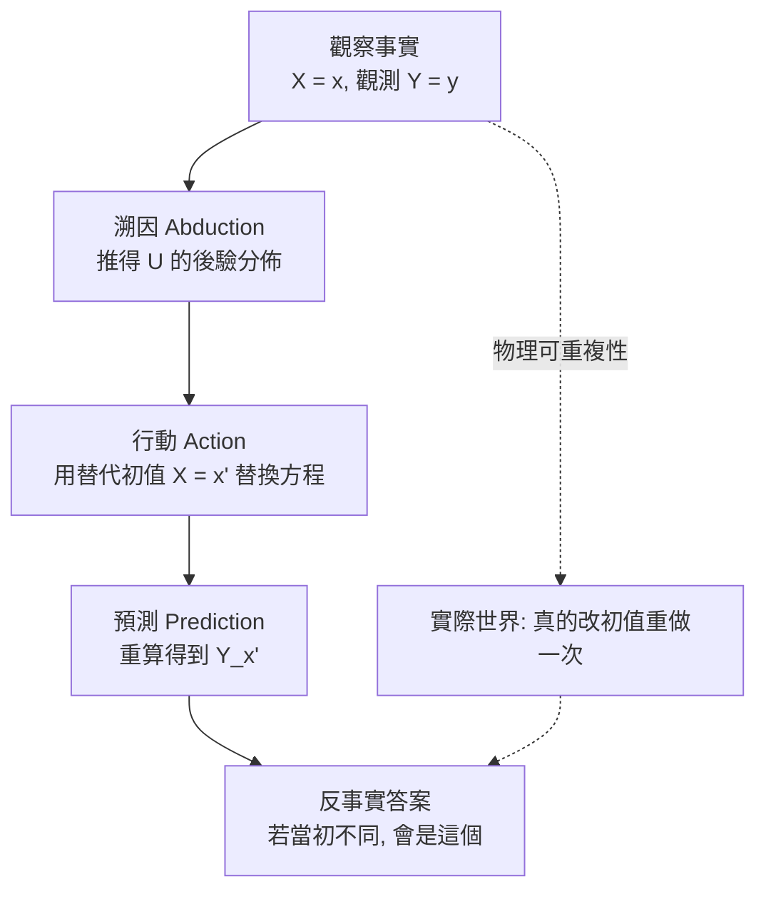
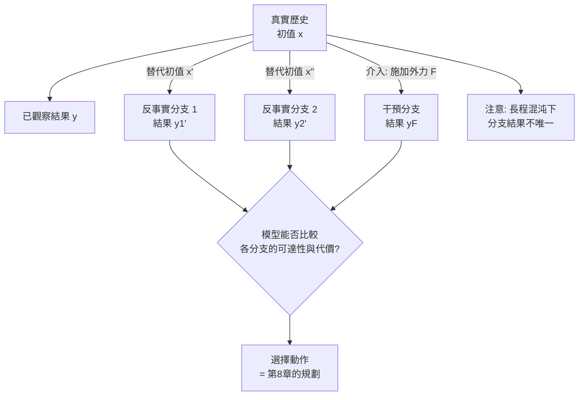

# 3.4 反事實推理（Counterfactual Reasoning）：「如果當初施加外力，軌跡將如何分岔？」

## 3.4.1 反事實的問題形式

本章前三節把因果能力從「預測」推到「介入」，但介入只處理了「尚未發生的未來」。反事實處理的是更難的問題：**已經發生的這件事，若當初條件不同，結果會如何？**

Pearl 對反事實給了精確的定義：給定一個觀測到的事實與一個假想的偏離，問「若當初 $`X`$ 為 $`x`$ 而非 $`x'`$ ， $`Y`$ 會是什麼」。用符號寫，其反事實分佈是：

$$
P(Y_{x'} \mid X = x, Y = y) = \sum_u P(Y_{x'} \mid u) P(u \mid X = x, Y = y)
$$

這個式子的讀法是：先從觀察到的事實 $`(X = x, Y = y)`$ 反推外生變數 $`U`$ 的後驗分佈（這一步稱為 abduction，溯因），再用這個後驗作為先驗，在**替代**了 $`X = x'`$ 的世界裡重新推演 $`Y`$ （這一步稱為 action，行動），從而得到反事實的結果（稱為 prediction）。三步的分工正是 Pearl 對因果階層的著名直覺：**溯因、行動、預測**。

用一個物理例子說明。已知球以某個初速飛出、撞到牆後反彈並停在某處。問題是：「若球初速是另一個數值，它會停在牆的哪裡？」模型必須先把「導致這個觀測結果的隱藏條件」推回去（初速、摩擦係數、球的質量），再在替代初速下重算整條軌跡。這比單純的 do-運算多了一層：要回答「若當初不同」，必須處理**已經發生的那段歷史**。

## 3.4.2 為什麼物理特別適合反事實推理

反事實在經驗科學中往往難以企及，但在物理世界模型中卻異常自然，原因有三個。

第一，**動力學是決定論且可逆的**。給定完整的狀態與時間，演化過程唯一；給定某時刻的狀態，往前與往後都有唯一解。這意味著「把初值換掉，重跑一遍」在原則上就是正確的反事實程序，不需要額外的統計假設。

第二，**初值唯一性定理**保證了解的存在與唯一：在 Lipschitz 連續的向量場下，給定初值與連續控制，解存在且唯一，且對初值連續依賴。這提供了兩個性質保證——反事實軌跡是良定的，且微小的初值改變只會導致微小的軌跡改變（在有限時間窗內）。

第三，**物理的可重複性**讓反事實可以用實驗檢驗：我們可以在現實中真的把初速改成另一個值，重跑一次，再與模型的預測比較。這與社會科學中反事實難以驗證的處境形成鮮明對比。

## 3.4.3 技術路徑一：在可微分模擬器中反傳

最直接的做法是把物理模擬器寫成可微分的形式，然後對初始條件求導。若模擬器的狀態轉移為 $`s_{t+1} = g(s_t, a_t, \theta)`$ ，而初值為 $`s_0(\xi)`$ ，則軌跡對初值的偏導數可由鏈式法則累積：

$$
\frac{\partial s_T}{\partial \xi} = \frac{\partial s_T}{\partial s_0} = \prod_{t=0}^{T-1} \frac{\partial g}{\partial s_t} \frac{\partial s_0}{\partial \xi}
$$

這個乘積正是**雅可比矩陣的連乘**，它在數學上就是線性化理論中的**變分方程**。它的實用價值在於：一次前向傳播加上一次反向傳播，就得到初值到結果的完整敏感度資訊，也就是「往哪個方向推、往哪個方向轉，可以讓球落在目標點」這類問題的所需資訊。

在實作上，有幾個技術障礙。第一是**接觸的不連續性**：一旦發生碰撞，狀態轉移函數變成非光滑的，梯度會失效或劇烈跳變。第二是**長序列的梯度爆炸或消失**：雅可比連乘的模長會隨時間步指數增長或衰減。第三是**不可逆的離散事件**（破裂、黏合、摩擦啟動），這些根本沒有可微的表示。

針對這些問題，常見的緩解策略包括：以有限差分代替解析梯度（代價是計算量與精度）、把接觸事件改寫成平滑的懲罰形式（soft contact）、或只在不含碰撞的片段上計算梯度。

## 3.4.4 技術路徑二：對抗式反事實生成

第二條路徑不直接計算反事實，而是把它當成**條件生成**問題。給定一段已觀察到的場景與一個替代初值（例如「球的初速若不同」），訓練生成器產出「在該替代條件下最可能發生的觀測」。對抗式的做法是把判別器的任務設定為：給定一段觀測，判斷它是在真實歷史下產生的，還是在替代初值下產生的。於是生成器被迫產出「對替代初值而言最逼真的後果」。

這種做法在影像領域特別有效，因為它不需要物理求解器，只需要視覺上的一致性。但它的弱點也很明顯：**視覺逼真不等於物理正確**。生成器可以畫出一個看起來很合理卻違反動量守恆的反事實畫面，除非判別器或後處理明確地把守恆律寫進去。因此更穩健的版本是**物理約束的對抗訓練**——把守恆量與接觸可行性寫成判別器的一部分，拒絕物理上不可能的樣本。

有一個更細緻的問題值得提出：**生成器可能學會「抄答案」而不是「做推論」**。若對抗訓練中的替代初值是以某種方式暴露在輸入給生成器的資訊中（例如把替代初值以文字或標籤形式直接餵進去），生成器可以學會「看到標籤 x' 就輸出資料庫中對應的錄影」這條捷徑，而完全不建立初值與結果之間的因果映射。要避免這件事，替代初值必須以**可被物理推演的形式**（例如初始速度向量、力的大小）進入網路，並且訓練時的替代值必須是生成器從未見過的連續取值，而不是有限枚舉的類別。這也說明了為什麼反事實生成的方法設計往往比一般生成任務更敏感。

另一個值得注意的方向是**反事實的忠實性與多樣性之分**。在某些應用中我們只想要一個合理的反事實（例如「若當初風更大，草會不會倒」只需知道會倒）；在另一些應用中我們需要分佈完整的答案（例如風險評估需要知道各種反事實的機率）。前者的評測可以放寬到「是否落在可接受集合內」，後者則要求模型校準整個條件分佈。這兩種需求對訓練訊號的要求不同，也解釋了為何同一套方法在「生成一個合理的替代未來」與「估計替代未來的機率」上表現差異甚大。

還有一條介於兩者之間的折衷路徑值得提及：**基於搜尋的反事實**。給定一個目標（例如「讓球落在指定位置」），用第 8 章將討論的模型預測控制（MPC）或蒙地卡羅樹搜尋，在初值空間中搜尋最能達成目標的替代初值。這把反事實從「生成一個假想的未來」重新表述為「找到一個實現目標的替代初值」，在機器人規劃中特別實用。

## 3.4.5 技術路徑三：把反事實納入訓練

第三條路徑不在推論時做反事實，而是**在訓練時就讓模型見過反事實**。做法是對同一個場景生成多個不同初值的版本，讓模型在資料中同時觀察到「初值 A 導致結果 X」與「初值 B 導致結果 Y」，並在損失中要求它能依初值區分這兩者。

這種資料增廣有幾個實作要點。首先，同場景的多次重演能提供**嚴格的配對對照**，消除了環境變動帶來的混淆，這正是因果訓練資料最貴重的地方。其次，覆蓋的初值範圍必須足夠寬，否則模型只是把反事實當作記憶。第三，**時間對齊**至關重要：不同初值下的同一事件（例如撞牆）發生在不同的絕對時刻，若不對齊，模型學到的只是事件頻率而非因果。

在生成端，模擬器天生適合做這件事：改一個初始條件就得到一個新版本，成本極低。從影像生成模型的角度，則可以用控制網路或結構化條件，讓同一張圖對應多個不同的運動初值。

| 訓練資料組成 | 提供什麼資訊 | 模型學到的能力 | 取得難度 |
| --- | --- | --- | --- |
| 單次被動觀測 | $`P(v)`$ | 相關性預測 | 最低 |
| 多初值重演同一場景 | $`P(v \mid \mathrm{do}(x))`$ | 介入預測 | 中（需模擬器） |
| 配對反事實版本 | 反事實分佈 | 反事實一致性 | 中高 |
| 介入 + 反事實 + 真實 | 三層齊備 | 完整因果 | 高 |

## 3.4.6 分岔點：混沌與長程反事實的不唯一性

這裡必須引入一個冷靜的物理事實：**長程反事實在原理上可能不唯一**。

考慮一個混沌系統（例如三體問題，或真實世界中由於空氣擾動而不穩定的球棒系統）。它的特徵是初始條件的微小差異會隨時間指數放大。以 Lyapunov 指數 $`\lambda`$ 描述這個放大率，兩條初始距離為 $`\delta_0`$ 的軌跡在時間 $`t`$ 後的距離約為：

$$
\delta(t) \approx \delta_0 e^{\lambda t}
$$

當 $`\delta(t)`$ 增長到與系統尺度相當時，兩條軌跡在行為上已無區別，這就是「對初值極敏感」的定量說法。

對反事實而言，這意味著一個根本的限制：如果真實世界的演化本身是混沌的，那麼「若當初初值差了一個極微小的量，結果會是什麼」這個問題，其答案**在物理上就不是唯一確定的**，因為微小的未建模擾動（空氣流動、地面不平、球體形狀）會填補那個縫隙。這與工程上的誤差累積不同——它是原理性的：即使我們有完美的初始條件測量與完美的模擬器，只要系統本身是混沌的，長程預測就存在不可消除的不確定性。

因此反事實推理的可行範圍必須被明確界定。實務上，可靠的反事實通常落在三個條件交會處：**簡化的物理**（把真實系統理想化到可解析的模型，例如把空氣阻力忽略）、**短的時間窗**（分岔尚未放大到行為層級）、以及**對結果的定性而非定量描述**（例如「球會往左偏」而不是「球會落在距離牆 12.3 公分處」）。

這一點在方法論上極重要：**不可唯一不等於不可問**。反事實的實用價值往往不在於給出精確數值，而在於提供**方向性的判斷**——「若我把杯子往左推，它會撞到那支筆」。把反事實的目標設定在恰當的抽象層級，是讓它在混沌限制下仍然可用的關鍵。

## 3.4.7 反事實能力作為「可干預性」的檢驗標準

反事實能力之所以重要，還有一個方法論上的理由：它是**檢驗世界模型是否真的內化了因果**的試金石。一個純相關性模型可以完美預測「當球以這個速度飛出時會撞到牆」，因為這類片段在資料中常見；但它難以回答「若球初速減半會怎樣」，因為那個版本在資料中可能完全沒有出現過。

因此，反事實問答可以作為干預能力的**間接檢驗**：若模型能對反事實給出方向正確且與物理一致的答案，就表示它在內部表示中保留了可重新執行的因果過程，而不只是一組靜態的相關性權重。這也解釋了為什麼第 3.3 節強調「真正的反事實需要能重新執行的程序」——反事實能力是區分「相關性模仿」與「因果內化」最有效的判別器。

從規劃的角度看，反事實是第 8 章的基礎。在腦中排練計畫，本質上就是在問一系列嵌套的反事實：「若我採取動作 A，未來會怎樣」「若在那之後我改採 B 呢」。反事實能力不足的世界模型，在多步規劃中會迅速退化——第一步的預測就錯了，後續的比較與剪枝（第 8.3 節）也就失去了依據。

## 3.4.8 誠實評估

必須明確承認，目前的反事實世界模型能力在幾個方面都受限於簡化的物理與短的時間窗。

在**任務層面**，多數實證集中在剛體、多邊形碰撞、低速運動的場景，而真實世界的軟體、流體、多體耦合互動仍在射程之外。在**時間尺度**上，有效的反事實推論多在一秒以內，超過這個長度，模型自身的自迴歸誤差（第 10 章將詳述複合誤差問題）就會蓋過因果效應本身。在**驗證方式**上，由於真實世界的反事實通常無法直接觀測，多數研究依賴模擬器作為參考，這使得「模型與模擬器一致」與「模型與真實一致」之間仍存在一道未跨越的鴻溝。

還有一個容易被忽略的評測陷阱：若用模型自己產生的反事實來評測模型（以模型的預測作為參考答案），得到的將是自證循環。因此反事實評測必須依賴外部的真實資料或獨立的物理求解器。

## 3.4.9 收束：從物理到符號

本章從「直覺物理學是什麼」開始，逐步建立了世界模型的物理層：3.1 節說明物理不需被完整仿真，而應以可預測的約束形式注入；3.2 節處理交互的原子事件與接觸求解，並比較了三種實作路線；3.3 節把物理規則的因果結構顯式化，說明觀察資料無法識別干預分佈，以及主動介入與結構先驗的必要性；3.4 節則抵達因果推理的最高層級，指出反事實在物理中特別自然，卻受混沌與時間窗的原理性限制。

這四節共同確立了一個立場：**世界模型的物理不是裝飾，而是方向性結構**。它告訴模型哪個量影響哪個量、哪些關係必須成立、哪些操作會改變未來。

而這也立刻帶出了下一個問題。如果世界模型的核心任務是預測未來，而未來是一個連續的三維時空過程，那麼我們該用什麼樣的**表示**來承載它？像素太過冗長且缺乏結構；抽取出物體槽位雖然保留了結構，卻丟失了外觀的細緻變化與場景的整體連續性。本書接下來的三章，將處理三種答案：把連續世界壓縮成可自迴歸的離散 token（第 4 章）、用擴散模型在連續潛在空間中直接生成（第 5 章）、以及放棄像素重建、在抽象特徵空間中預測（第 6 章）。三者代表對「什麼才是預測」三種不同的取捨，而它們的取捨，最終都受限於本章所建立的那個判準——未來是否必須服從物理。

## 參考文獻

- Pearl, J. (2009). *Causality: Models, Reasoning, and Inference*, 2nd ed.（第 9 章：反事實與對偶）。
- Lewis, D. (1973). *Counterfactuals and Causal Models*.
- Greydanus, D., Kádár, S., & Konidaris, G. (2019). Learning to Simulate Complex Physics with Graph Networks.（以圖網路學習交互的代表性工作。）
- Pfaff, T., et al. (2021). Learning Mesh-Based Simulation with Graph Networks.
- Tobin, J., et al. (2018). Domain Randomization for Transferring Deep Neural Networks from Simulation to the Real World.
- Kurth, A., et al. (2021). Towards a Universal Physics Engine: A Framework for Physical Reasoning.（對物理推理框架的系統性檢視。）
