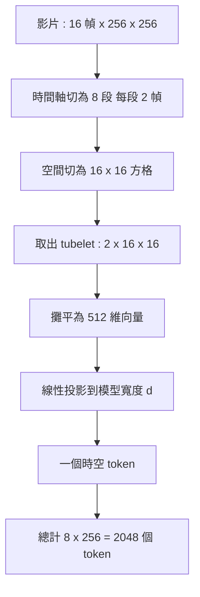

# 4.1 時空補丁化（Spatiotemporal Patches）：將連續影片投射為動態視覺 Token

文字模型的輸入已經是離散的符號序列，每個 token 大致對應一個詞或詞的一部分，這讓序列長度與語意密度之間維持了一個方便的交換率。影片則完全不是這個樣子。影像是一張在二維網格上連續採樣的函數，而影片再加上第三個軸：時間。三個軸同時被壓縮成離散 token 的這件事，在資訊理論上有著與文字截然不同的代價。

先看解析度的負擔。一張 $`256 \times 256`$ 的影像若以像素直接餵入模型，就會是 65,536 個維度的向量。這個數字在單幀層面尚可接受，但只要把它乘上幀數，序列長度立刻爆炸。 $`16`$ 幀就是超過一百萬個位置，任何基於全注意力的架構都會在記憶體上先行崩潰。

於是 ViT 的空間補丁化（patchification）成了自然的起點：把影像切成不重疊的 $`16 \times 16`$ 方塊，每個方塊攤平後是一個長度 $`256`$ 的向量，再經過線性投影映射到模型寬度 $`d`$ ，就得到一個 token。單幀的 token 數從 65,536 降到 256，壓縮了 256 倍，而視覺 Transformer 的表現幾乎沒有因此損失。

影片多出的那一個軸讓事情更棘手。如果每幀各自做空間補丁，16 幀就會產生 4,096 個 token，而且這些 token 彼此之間沒有任何結構性的關聯被保留。時空補丁（tubelet 或时空 patch）就是為了解決這點：把影片切成 $`T \times H \times W`$ 的立方塊，每個立方塊跨越數個相鄰幀與數個相鄰空間方塊，整塊映射成單一 token。時間軸上的相鄰性就此被烙印進 token 本身。

給一個具體的數字示例。假設一段 16 幀、每幀 $`256 \times 256`$ 的影片，空間補丁大小為 $`16 \times 16`$ ，時間上每個 tubelet 涵蓋 2 幀。於是時間維度被切為 $`16 / 2 = 8`$ 段，空間維度被切為 $`256 / 16 = 16`$ 段見方格，總 token 數為

$$
N = \frac{T}{t_{p}} \times \frac{H}{p} \times \frac{W}{p} = 8 \times 16 \times 16 = 2048
$$

如果退回到逐幀獨立切塊（時間補丁長度為 1），token 數就會是 $`16 \times 256 = 4096`$ ，整整翻倍。時空補丁用「一個 token 承載兩幀」換來了序列長度減半，代價是模型對單一時間點的定址能力下降。

這個結構的好處不只是省算力。tubelet 在時間上連續取樣，意味著單一 token 內含的是「這一小塊空間在這兩幀之間如何變化」的資訊。物體在這兩幀之間的位移方向與速度，會直接反映為該 tubelet 內部像素分佈的位移。這讓模型有機會在低階就學到局部運動的統計，而不是被迫用顯式的光流去表示。

## Token 數與注意力複雜度的平方關係

自注意力的計算量對序列長度是二次的。若 token 數為 $`N`$ ，則注意力配對數為 $`N^{2}`$ ，即

$$
\text{Attention} = O\left(N^{2} d\right)
$$

代入數字看看。 $`N = 2048`$ 時，每層每頭的配對數是 4,194,304 ； $`N = 4096`$ 時是 16,777,216。單看一個頭不算什麼，但把層數與頭數乘進去就會嚇人：若模型有 24 層、16 個頭，以半精度計算， $`N = 4096`$ 僅僅為了「容納注意力矩陣」就需要約 12.9 GB 的記憶體。

更關鍵的是這不是可以靠優化繞過的常數，因為它是架構層面的必然。線性注意力、稀疏注意力、FlashAttention 這類技術確實能把記憶體降到線性或近線性，但它們改變的是「如何計算那 $`N^{2}`$ 個配對」，而不是「是否需要那麼多 token」。真正決定序列能否成長的，是表示本身的資訊量。

這也是為什麼補丁大小是模型設計中一個關鍵的經濟學決策。補丁從 $`16 \times 16`$ 縮到 $`8 \times 8`$ ，token 數立刻變成四倍，注意力成本變成十六倍。在文生圖領域這是划算的，因為一張圖的語意複雜度有限；但在影片中，長序列的必要性遠高於單幀，因為模型必須記住數秒前的物體狀態。

## 位置編碼必須同時表達時間與空間

一旦把影片壓成序列，「哪個 token 在哪裡」就成了必須回答的問題。純粹的一維正弦位置編碼在這裡會失效，因為序列位置 $`i`$ 同時混合了時間索引與空間索引，模型無法分辨「向前移動兩格」是時間上的兩幀還是空間上的兩個補丁。

常見的解法有三種。第一種是獨立的時間位置編碼與空間位置編碼，各自加到對應的 token 表徵上，兩者可以相加或串接。第二種是三維位置編碼，直接對 $`(t, h, w)`$ 三個座標做正弦編碼並拼接。第三種是分解式（factorized）的編碼，把空間與時間分開處理，例如某些架構讓空間 token 在同一時間步內共享注意力，而時間 token 在同一空間位置間共享注意力。

從物理直覺上說，位置編碼的選擇其實預設了「世界怎麼運轉」的假設。如果時間與空間被完全對稱地對待，模型就分不清因果與相關。但更誠實的說法是：這些設計大多數是工程上的權衡，真正的因果結構需要由注意力遮罩來承擔，而遮罩正是 4.2 的主題。

在實務細節上，位置編碼的選擇往往與遮罩策略綁在一起。若採用全空間可見、僅時間因果的遮罩，時間位置編碼就是必要的，因為模型需要知道「這是第幾幀」；但空間位置編碼的重要性相對下降，因為同一幀內的所有 token 都同時可見，其相對位置主要靠內容注意力自行發現。反之，在分解式設計中，空間注意力需要位置資訊來區分「鄰近」與「遙遠」，而時間注意力則明確依賴時間索引。

另一條技術路線是三維旋轉位置編碼，把相對位置編碼的旋轉性質推廣到時間軸。這種做法的好處是對未見過的幀數有一定的外推能力：模型在訓練時看過 16 幀，理論上可以推廣到 32 幀而不需要重新學習位置結構。這對影片生成很重要，因為使用者要求的長度往往與訓練時不同。

值得注意的是，位置編碼本質上只是提供了「索引」，並沒有提供「幾何」。真正與物理幾何掛鉤的是第 2 章討論的座標系對齊與深度資訊。純粹的補丁化加上位置編碼，模型並不知道各個補丁在三維空間中的相對位置——它們的深度、視差與遮擋關係，全都要靠內容與動作條件在訓練中隱式學會。這是純視訊生成模型在處理「視差運動」時格外吃力的一個根源。

## 壓縮為何是生成模型的必要條件

值得強調的是，這裡的「壓縮」不只是省記憶體的技巧，它對生成模型有本質性的意義。生成模型的訓練目標是在分佈上擬合，而對高連續性的資料進行自迴歸建模時，序列長度直接決定了梯度更新的效率與有效樣本的數量。

如果每個 token 只承載單一幀的一小块，模型實際上是在做「以像素為單位的高階隨機行程建模」。這需要的參數量與資料量，都是天文數字。反過來，如果每個 token 承載足夠大的時空區塊，模型就轉而以「語意片段」為單位進行建模，這正是它能夠把計算集中在真正有結構的層級上的原因。

換句話說，壓縮是模型能夠「看見整段影片」的前提。一個序列長到無法容納的模型，就算它再聰明，也沒有機會學到跨越整段時間的依賴關係。

這裡有一個可以量化的直覺。假設一個模型要以像素級的保真度重現整段影片，它需要攜帶的狀態量至少等於影片本身的位元數，這遠大於任何可行模型。而一個以語意片段為單位的模型，需要攜帶的狀態量約等於「場景中物體的狀態集合加上它們的運動」，其量級只隨場景複雜度而非像素總數增長。前者不可能，後者可行——這就是壓縮策略的根本理由。

還有另一個常被低估的好處：壓縮把序列長度的增長從「線性於像素數」變成「線性於語意單元數」。當我們把解析度從 $`256 \times 256`$ 提高到 $`1024 \times 1024`$ 時，像素數是十六倍，但若場景中的物體數量不變，語意單元數幾乎不變。這個特性讓高解析度生成在算力上不至於爆炸，也是影片模型能夠逐步提升細節的前提。

當然，壓縮率與資訊保留之間存在一條取捨曲線。補丁取得越大，序列越短、訓練越可行，但小物件與細緻紋理越容易被抹除。這個取捨沒有免費的解，只能靠多尺度設計（第 5 章的潛在表示提供了一個自然的出口）或靠分層生成策略來分擔。

## 補丁化帶來的三個代價

第一個代價是細節被抹除。一個 $`16 \times 16`$ 的補丁涵蓋 256 個像素，投影成 $`d`$ 維向量時必然是有損的。當物體只有幾個像素寬時，它的資訊會被空間平均稀釋掉，模型看到的只是一個模糊的顏色斑塊。這解釋了為什麼小物件、文字與細緻紋理在視訊生成中特別容易崩壞。

第二個代價是時間局部性被綁定。tubelet 把兩幀壓進同一個 token，意味著這兩幀被強迫共享同一個表示向量。當物體在這兩幀之間移動得相對較多時（例如快速旋轉或彈跳），tubelet 內部的像素對應關係會完全失效，一個 token 裡同時混入了物體出現與消失的地點。

第三個代價是大運動物體被切碎。若一個物體橫跨補丁邊界，它的各部分會被分配到不同的 token，模型必須靠注意力在 token 之間重建整體性。而當物體在幀與幀之間大幅移動時，跨幀的 token 對應關係不斷改變，「同一個物體」這個概念在 token 層級變得模糊。

| 面向 | 逐幀獨立補丁 | 時空補丁（tubelet） |
| --- | --- | --- |
| 16 幀 256x256 的 token 數 | 4096 | 2048 |
| 時間資訊保留 | 極弱，靠位置編碼補 | 直接編入 token |
| 單幀定址能力 | 強 | 弱，時間被摺疊 |
| 小物件細節 | 相對較好 | 更易被抹除 |
| 對運動的表徵 | 需跨 token 拼接 | 內建於 tubelet 內 |

## 補丁化作為資訊瓶頸的量化思考

把補丁化視為一個編碼器，可以更精確地描述它的代價。令一個補丁覆蓋的像素集合為 $`P`$ ，像素分佈為 $`p(x)`$ ，而投影後的 token 表示為 $`z`$ ，其維度為 $`d`$ 。我們關心的是互資訊 $`I(X_{P} ; Z)`$ ——token 保留了原始像素的多少資訊。

當 $`d`$ 遠小於 $`|P|`$ 時，映射必然是有損的，損失的量級由該區域像素分佈的實際熵與 $`d`$ 共同決定。一個有啟發性的後果是：損失並非均勻發生。像素分佈平滑、對比低的區域（例如天空、牆面）幾乎不損失資訊，因為它們的熵本來就低；而邊緣密集、紋理複雜的區域（例如樹葉、人群、文字）損失最為慘重。

這解釋了一個常見的現象：生成的影片整體流暢、背景平滑，卻在物體邊緣與文字處崩壞。模型並不是「沒學好」，而是資訊在第一步編碼時就已經不在了，後續的所有參數都無法把它找回來。

更細緻地說，若時間補丁跨越了物體快速運動的區段，tubelet 內部的像素對應關係被破壞，該 token 承載的運動資訊不是被「壓縮」而是被「抹平」。這是時空補丁相對於逐幀補丁的一項隱性虧損，也是某些工作選擇「時間補丁長度為 1、但加上光流或其他運動線索作為額外輸入」的原因。

## 多尺度的補丁策略

既然單一尺度的補丁無法同時兼顧細節與效率，多尺度就成為自然的選擇。一種常見做法是在不同層使用不同的下取樣率：淺層處理高解析度的細補丁，深層處理粗補丁，模型在每一層都能看到適合該層抽象程度的資訊。

另一種做法是層級式的序列佈局：把影片分成多個時間解析度的金字塔，最粗的那層只保留少數幾幀，代表場景的整體動態；最細的那層保留全部幀。生成時先在粗層決定「接下來大致會發生什麼」，再在細層逐步填入細節。這種結構實際上把第 8 章要討論的「測試時計算」提前內建進架構裡，也讓誤差有機會在粗層就被攔截。

值得留意的對比是，擴散模型在這方面反而有結構上的優勢。擴散模型不需要把影片離散化成 token 序列，它在連續潛在空間中處理整段影片，解析度的提升可以透過潛在空間的重新縮放平滑地完成。這個差異會在本書第 5 章展開。

## 與第 5 章潛在擴散的對照

這裡值得停一下，因為它直通第 5 章的主題。擴散模型並不把影片離散化成 token。它在連續的潛在空間中工作，而潛在編碼器本身就是一個可學習的、有損但連續的壓縮方案。它的「token」在數學上是連續向量，不是離散的符號。

這個差異帶來一個有趣的對照：離散化的補丁化損失了哪些資訊？答案是不可逆的資訊損失——一塊 $`16 \times 16`$ 的補丁被投影成一個固定維度的向量之後，這個區域內的細節分佈就永久消失了。相較之下，連續潛在空間保留了可微分性，資訊的丟失是漸進的、可被梯度部分補償的。

具體來說，在離散 token 的世界裡，「稍微移動一個物體的邊界兩像素」是一個離散的、不可微的跳躍，模型只能把它當成另一個類別來學。在連續潛在裡，這個移動是潛在空間中的一個小擾動，梯度可以沿著它精確地指出方向。這就是為什麼在同樣的參數預算下，擴散架構在細節重建上往往能達到更好的品質——不是因為它更聰明，而是因為它的最佳化地形更平順。

另一個差異在於序列長度的可擴充性。離散 token 序列的注意力成本隨長度平方成長，硬性限制了模型能處理的時間跨度。潛在擴散則可以在固定的幀數上調整解析度而不增加序列長度，也可以用金字塔式的多解析度排程來處理長影片。

但我們也不應把這兩者看成非此即彼。自迴歸架構也有自己的優勢：它天然支援無限延展、可做動作條件化的逐步推演、並且能把推理時計算放在最關鍵的幀上。第 5 章會看到，兩者在實務上正在互相吸收對方的優點。

當我們在 4.3 談到擴展定律的失效模式時，會看到很多瓶頸其實根源於「離散化造成的資訊損失無法被更多參數補回」。而在第 5 章的時空潛在擴散中，同樣的算力預算因為連續表示而能承載更豐富的細節。這不是新舊世代的取代關係，而是兩種瓶頸的分布不同。

## 小結與銜接

時空補丁化把一段影片從「數百萬個像素」壓成「數千個 token」，讓 Transformer 的自迴歸架構在算力上可行。但壓縮本身只是把問題從「記憶體不夠」換成了「因果結構沒有被建模」。當我們讓模型只看過去的幀來預測未來時，它才真正需要回答一個物理問題：接下來會發生什麼？

這正是下一節的主題。也值得在這裡把三個數字記在腦中：一段 16 幀、 $`256 \times 256`$ 、補丁 $`16 \times 16`$ 的影片會變成 2,048 個 token；全注意力的配對數是 $`2048^{2} \approx 4.2 \times 10^{6}`$ ；而這個平方關係，正是所有時空注意力設計的出发点。

在技術史的座標上，補丁化是一個把「視覺」與「語言」縫合起來的關鍵零件。當我們回頭看第 0 章提過的典範轉移，會發現補丁化正是把影像從「連續訊號處理」的領域搬進「序列建模」的領域的那道橋樑。而一旦進了序列建模的領域，因果遮罩就成了必須回答的問題——因為在語言裡，遮罩幾乎是形式的；而在影片裡，遮罩承載了因果本身。
