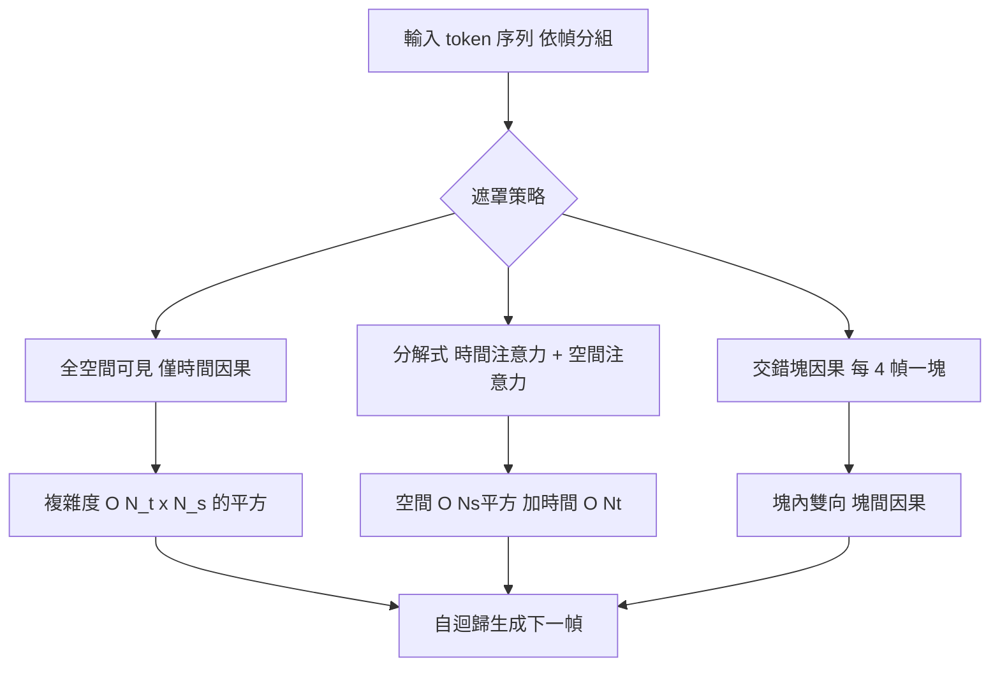

# 4.2 自迴歸視訊生成的狀態預測：Transformer 注意力在時空維度的因果遮罩設計

自迴歸視訊生成的核心想法簡單得令人吃驚：把一段影片的幀序列當成一個 token 序列，然後做下一個 token 預測。給定前 $`k`$ 幀，模型預測第 $`k + 1`$ 幀；把預測的結果接回序列，再預測第 $`k + 2`$ 幀，如此反覆直到產生整段影片。

形式上，把影片 $`V = \left\{ v_{1}, v_{2}, \dots, v_{K} \right\}`$ 經過時空補丁化（第 4.1 節）後得到 token 序列 $`x_{1}, x_{2}, \dots, x_{L}`$ ，其中每個 $`x_{i}`$ 對應第 $`t(i)`$ 幀中的某個時空區塊。訓練目標是標準的下一 token 預測：

$$
\mathcal{L} = - \sum_{i=1}^{L} \log p\left(x_{i} \mid x_{< i}, c\right)
$$

其中 $`c`$ 是條件訊號，例如文字提示。這種寫法的好處是任何語言模型的一切技術——預訓練、指令微調、強化學習、人類偏好對齊——都可以直接沿用。這也是自迴歸視訊模型能夠快速繼承整個 LLM 生態的原因。

但把「句子」換成「影片」之後，序列的內部結構不再是均質的。文本 token 之間只有順序關係，而影片 token 之間有兩個獨立的維度：哪一幀，以及那一幀中的哪一塊。這迫使注意力遮罩的設計變得非平凡。

## 時空因果遮罩的三種設計

第一種設計最直接：所有空間位置互相可見，但只允許看見過去的時間。也就是說，第 $`t`$ 幀的任何一個 token，其注意力可以覆蓋第 $`1`$ 到第 $`t`$ 幀的所有空間 token，但看不到第 $`t + 1`$ 幀以後的任何內容。這種遮罩保留了完整的二維空間結構在每一幀內部，因為同一幀的資訊是同時存在的，不存在「未來」的語意。

第二種設計是分解注意力（factorized attention）：把注意力拆成時間注意力與空間注意力兩個階段。空間注意力在單一時間步之內的 $`N_{s}`$ 個空間 token 之間計算，複雜度是 $`O\left(N_{s}^{2}\right)`$ ；時間注意力則在同一空間位置、跨 $`N_{t}`$ 個時間步之間計算，複雜度只有 $`O\left(N_{t}\right)`$ 。由於空間序列在每幀都相同，時間注意力的計算可以沿用線性注意力的技巧。

第三種設計是交錯的塊因果遮罩（block-causal）。模型先把影片切成若干「區塊」，例如每 4 幀一塊。同一塊之內的 token 可以互相看見（雙向），不同塊之間則只允許從前往後看。這種設計在實務上非常常見，因為它讓「區塊內生成、區塊間自迴歸」成為可能，大幅簡化了 KV 快取的管理。



## 遮罩的形式化

把遮罩寫成一個布林矩陣會最清楚。令 token 索引為 $`i = (t, h, w)`$ ，其中 $`t`$ 是幀索引、 $`(h, w)`$ 是該幀內的空間補丁座標。遮罩 $`M_{i,j}`$ 定義查詢位置 $`i`$ 是否可以讀取鍵位置 $`j`$ 。

第一種策略下，

$$
M_{(t,h,w),\,(t',h',w')} =
\begin{cases}
1 & t' \le t \\
0 & t' > t
\end{cases}
$$

注意時間條件對整幀一致，空間條件恆為真。這個定義的物理意義是：在時刻 $`t`$ ，模型對整個場景有完整的可見性，但對未來一無所知。

第二種分解策略則把 $`M`$ 寫成兩個矩陣的乘積形式，空間遮罩 $`M_{s}`$ 依賴 $`(h, w)`$ 與 $`(h', w')`$ ，時間遮罩 $`M_{t}`$ 依賴 $`t`$ 與 $`t'`$ 。總體可見性是兩者之交，分解的優勢正是在於計算可以分開進行。

第三種塊因果策略引入塊索引 $`b(t) = \lfloor (t - 1) / B \rfloor`$ ，遮罩變成

$$
M_{(t,h,w),\,(t',h',w')} =
\begin{cases}
1 & b(t') < b(t) \;\text{或}\; \left( b(t') = b(t) \;\text{且}\; t' \le t \right) \\
0 & \text{其他}
\end{cases}
$$

嚴格來說，實務中常見的變體是：允許讀取塊 $`b(t)`$ 之前的全部幀，以及塊 $`b(t)`$ 內直到 $`t`$ 為止的幀；這與上面的寫法在實作上等價。

遮罩矩陣的可視化如下，其中 `X` 代表可見、`-` 代表遮蔽：

```text
            幀1   幀2   幀3   幀4
幀1       X X X  - - -  - - -
幀2       X X X  X X X  - - -
幀3       X X X  X X X  X X X
幀4       X X X  X X X  X X X  X X X
```

這張三階的下三角矩陣，本質上是文本自迴歸模型那張矩陣沿時間軸的複製。差別在於每一個「格」其實是一整塊 $`N_{s}`$ 個空間 token 的矩陣，而不是單一 token。

## 序列佈局：幀交錯與空間交錯

遮罩的具體形態，取決於 token 在序列中的排列方式，而這並非無關緊要的實作細節。

第一種佈局是幀交錯：先把第一幀的所有空間 token 排完，再排第二幀的，依此類推。序列的長度為 $`N_{t} N_{s}`$ ，而遮罩自然形成一組「幀級區塊」。這種佈局的好處是生成時非常直觀——一次前向就得到一整幀，並且可以在幀的邊界做快取管理。代價是幀與幀之間的位置距離很遠，注意力要走很長的路徑才能連到前一幀的對應位置。

第二種佈局是空間交錯：把同一個空間位置在所有幀上的 token 排在一起，即第 $`j`$ 個空間位置在時間軸上的所有幀連續排列。這種佈局讓「同一物體在多幀中的演化」變成序列上的局部鄰居，模型只需看鄰近幾個位置就能追蹤運動。代價是單次生成的是「所有幀的同一個位置」，這在實務上不太自然，且難以直接解碼成可觀看的影片。

第三種是混合佈局，把時間分成若干區塊，每個區塊內採用幀交錯。這在工程上是目前最常見的折衷：它兼顧了局部時間連續性與生成的可解碼性。

無論哪種佈局，「遮罩必須讓時間資訊單向流動」這件事都不變。佈局影響的是效率與歸納偏置，而因果性由遮罩保證。

## 三維注意力的計算量

設總 token 數為 $`N = N_{t} N_{s}`$ ，其中 $`N_{t}`$ 是幀數、 $`N_{s}`$ 是每幀的空間 token 數。若使用單純的全三維注意力（每個 token 對所有 $`N`$ 個 token 做注意力），複雜度是 $`O\left(N^{2} d\right) = O\left(N_{t}^{2} N_{s}^{2} d\right)`$ 。

空間注意力版本的複雜度是 $`O\left(N_{t} N_{s}^{2} d\right)`$ ，時間注意力是 $`O\left(N_{t}^{2} N_{s} d\right)`$ ，兩者相加大致是

$$
O\left(N_{t} N_{s}^{2} d + N_{t}^{2} N_{s} d\right) = O\left(N_{t} N_{s} d \cdot (N_{s} + N_{t})\right)
$$

這比全三維注意力省下了大約一個 $`\min(N_{t}, N_{s})`$ 的因子。當 $`N_{t} \gg N_{s}`$ 時，收益尤其顯著。交錯的塊因果遮罩則介於兩者之間：塊內的空間注意力是全連通的，塊間是序列式的，實際成本由塊數與塊大小的乘積決定。

用第 4.1 節的數字來體感這個差別。取 $`N_{t} = 16`$ 幀、 $`N_{s} = 256`$ 個空間 token，全三維注意力需要處理 $`4096^{2} \approx 1.68 \times 10^{7}`$ 個配對；而分解式設計的總成本是 $`16 \times 256^{2} + 16^{2} \times 256 = 1.11 \times 10^{6}`$ ，大約只有原來的十五分之一。

這裡還有一個常被忽略的工程成本：即使採用因果遮罩，注意力核的計算量仍是平方的，因為被遮蔽的位置依然佔據了矩陣的位置。真正把成本降下來的是 FlashAttention 這類融合算子，它利用遮罩矩陣的分塊結構，在分塊內跳過完全被遮蔽的區塊，使得因果注意力的實際計算量降到約原來的一半，而記憶體完全不必實體化整張注意力矩陣。在自迴歸視訊生成中，快取前一幀的鍵值向量、只計算新幀的查詢與舊鍵的交互，是標準的推論優化。

## 訓練與推論的不對稱

這是自迴歸視訊生成最深的一個結構性問題。在訓練時，模型看到的是真實歷史：預測第 $`t + 1`$ 幀時，輸入的是資料集中真實的前 $`t`$ 幀。這個過程可以完全向量化，所有時間步的損失同時計算，訓練效率等同於一般自迴歸語言模型。

但在推論時，模型必須回饋自己生成的幀。第 $`t + 1`$ 幀是模型自己畫的，它可能已經有輕微的畸變或漂移，而第 $`t + 2`$ 幀的預測必須建立在這個不完美的歷史之上。這個過程沒有辦法向量化，只能一幀一幀地跑。

更重要的是分佈偏移。訓練時模型學到的是「條件在真實歷史上的分佈」，推論時條件卻是自己產生的歷史，兩者不同。模型從未在這種輸入上被訓練過，於是它的誤差會被下一幀放大，形成一個正回饋。

### 教練強制與自由運轉的數學對比

這個不對稱性可以用一個簡化的模型來刻畫。假設真實資料的分佈是 $`p`$ ，而模型在推論時自產生的歷史分佈是 $`q`$ ，並令 $`\delta`$ 衡量兩者的每步差距（例如以均方誤差或以對數概似比衡量）。在教練強制下，模型在整段序列上的累積誤差是各步獨立誤差的總和；而在自由運轉下，第 $`t`$ 步的條件本身帶有前 $`t-1`$ 步累積的偏差。

一個常用來刻畫自由運轉誤差的量是「累積狀態誤差」，其增長形式近似為

$$
\epsilon_{T} \approx \sum_{t=1}^{T} \left( \frac{\partial \epsilon_{t}}{\partial \epsilon_{t-1}} \right) \epsilon_{t-1}
$$

也就是說，誤差的放大率取決於模型對歷史的敏感度 $`\left| \partial \epsilon_{t} / \partial \epsilon_{t-1} \right|`$ 。當這個導數大於 1 時，誤差以指數方式發散；當它小於 1 時，誤差會收斂。這個「收斂因子」是判斷一個架構是否穩健的關鍵量，也是第 10.1 節會正式推導的對象。

值得與對照的是語言模型。文字序列的 token 之間語意耦合較弱，一個詞的錯誤通常不會讓整句崩潰；影片則不然，畫面裡的一隻手若在第 $`t`$ 幀多了一根手指，第 $`t + 1`$ 幀就會很難合理地延續。視訊中這個耦合因子天然更大，因此對自由運轉的穩健性要求也更高。

### 常見的加速技巧

常見的緩解手段有幾種，各自針對不同的問題。

關鍵幀加權是讓模型在少數關鍵幀上投入更多容量，其餘幀則可以低解析度或低步數生成。理由是關鍵幀承載了場景的結構資訊（鏡頭切換、物件出現、動作起始），而中間幀多為過渡。這個策略把有限的算力集中在資訊密度最高的位置。

漸進式生成則從低解析度開始生成全序列，再逐步提升解析度，每一階都作為下一階的條件。這同時解決了兩個問題：低解析度階段的序列短、推論快；而且低解析度的誤差比高解析度溫和得多，等到解析度提升時，先前階段的不完美已經被部分吸收。

幀間快取則利用相鄰幀之間的高度相似性，避免重複計算昂貴的空間注意力。在自迴歸推論中，前一幀的鍵值向量可以重用，只需要為新幀計算查詢與鍵。

此外還有幾種策略性的做法：引入「時間噪聲」讓模型在推論時對自己的歷史施加擾動，理由是模型在訓練時見過帶有輕微瑕疵的真實影片，因此對不完美輸入更魯棒；以及採用逐步蒸餾，把原本數十步的逐步生成壓縮成少數幾步，同時把誤差累積降到最低。

這些技巧的共同邏輯是：既然自由運轉必然帶來誤差累積，就應該讓每一步的條件「更像真實」，並且減少步數。這也解釋了為什麼擴散模型在長影片上往往比自迴歸更穩——它本質上把「步數」從幀數降到了去噪步數。

| 面向 | 自迴歸視訊生成 | 擴散視訊生成 |
| --- | --- | --- |
| 訓練目標 | 下一 token 預測 | 對雜訊預測去噪 |
| 序列處理 | 嚴格因果，一次一幀 | 整段影片同時去噪 |
| 推論是否可向量化 | 否 | 是，迭代整段 |
| 跨幀一致性機制 | 因果遮罩 + 注意力 | 共享的全局注意力層 |
| 誤差累積 | 明顯，逐幀回饋 | 較輕，各幀條件對稱 |
| 生成時長 | 與幀數成正比 | 與去噪步數成正比 |

## 三維一致性為何是最難的部分

「三維一致性」指的是同一個物體在多幀中的外觀穩定：它的形狀、顏色、材質與身分標誌不會在幀與幀之間漂移。這是視訊生成中最常被使用者察覺到的失敗模式，因為人類對物體身分恆常性的期待極高。

問題的本質是，模型並沒有一個明確的「物體」變數可以攜帶。物體身分是從像素分佈中隱式湧現的，而自迴歸的貪婪解碼每一幀都重新做一次這樣的湧現。幀 $`t`$ 稍微模糊的邊界，會讓幀 $`t + 1`$ 的生成條件變得不確定，於是模型「重新發明」了這個物體。

在自迴歸架構中，這個問題格外棘手，因為遮罩本質上是不對稱的：幀 $`t`$ 的資訊只能單向流向幀 $`t + 1`$ ，沒有回頭修正的機制。而在擴散模型中，整段影片的所有幀在同一個去噪網路裡同時被細化，某一幀的資訊可以影響另一幀，因此一致性有更多機會被修復。

這個不對稱性還有一個容易被忽略的後果：自迴歸模型無法在生成過程中「回頭」修正已經產生的幀。當我們對第 $`t`$ 幀不滿意時，唯一能做的只有讓第 $`t + 1`$ 幀去遷就它，而不是讓第 $`t`$ 幀重新變好。相較之下，擴散模型的整段去噪過程允許反覆的全局協調。

另一個層次是三維結構本身的一致性。同一個物體在三維空間中的形狀，應該在不同視角下保持相容——這正是第 2 章的槽位表徵與三維重建所處理的問題。純粹的二維影片模型沒有任何機制保證這一點，它只能靠資料中的一致性做歸納，因此視差較大的鏡頭運動特別容易失敗。

值得留意的是，動作條件化（第 7 章）為這個問題提供了一個自然的解法方向：當物體的運動由外部給定的動作軌跡決定時，模型不再需要自行決定物體該往哪裡走，跨幀的一致性就有了外部錨點。

## 誤差累積與第 10.1 節的連結

我們在這裡看到的「餵回自身生成的幀」，正是第 10.1 節所論述的複合誤差（compounding error）的最基本形態。在那裡我們會把問題推廣到更長的時間軸、更大的模型與更強的推論策略上，並分析其數學極限。核心直覺不變：任何帶有反饋的生成過程都會把隨機性與系統性偏差累積起來。

因此第 4.3 節要問的問題就變得尖銳了：如果誤差會累積，那麼擴大模型是否真的能改善生成品質？答案取決於我們是在加大模型，還是在改變模型的目標函數。

在進入下一節之前，讓我們把本章的因果鏈整理一次。補丁化把影片變成序列；序列讓我們可以用 Transformer 的因果遮罩來表達「只依賴過去」；因果遮罩讓模型成為一個狀態預測器；而狀態預測器在自由運轉下的不穩定性，則成為所有後續討論的起點。

## 小結與銜接

時空因果遮罩把「自迴歸」這件事在影片上真正建立起來，但它也帶來了自帶的弱點：不對稱的資訊流、可累積的誤差、缺乏全局修正。下一節我們將把視訊生成的擴展定律拉進來檢驗，看看「更大的模型」究竟能不能解決這些問題。
