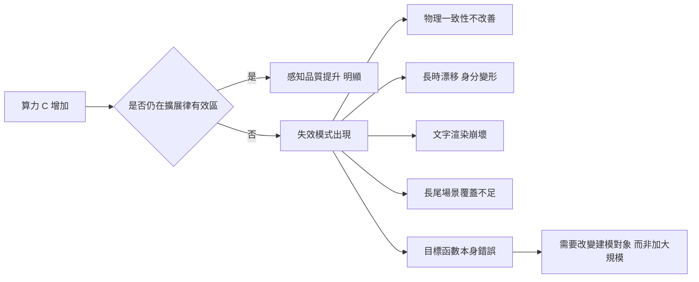

# 4.3 擴展定律（Scaling Laws）在物理場景生成中的適用邊界與失效模式

擴展定律是深度學習最成功也最具建設性的經驗之一。在語言模型上，人們發現模型的損失可以相當可靠地預測為參數量 $`N`$ 、資料量 $`D`$ 與計算量 $`C`$ 的冪律函數：

$$
L(N, D, C) \approx \left(\frac{N_c}{N}\right)^{\alpha_{N}} + \left(\frac{D_c}{D}\right)^{\alpha_{D}} + E
$$

這個式子的實用價值在於：它讓研究者可以用一次昂貴的訓練損失作為錨點，用廉價的小規模實驗外推出完整訓練會達到的表現。整個 AI 產業的資源配置決策，某種程度上都建立在這條曲線的斜率與常數上。

那麼，把這套方法論搬到物理場景的視訊生成上會發生什麼？這是本節要處理的問題，而答案並不簡單樂觀。

## 視訊資料、參數與計算量的關係

在視訊生成上，擴展的基本形式與語言模型一致：更大的模型在更多資料上訓練更久，通常產生更逼真的影片。直覺性的量級估計是這樣的：把模型參數從 10 億增加到 100 億、資料從數十萬小時增加到數百萬小時，生成影片的感知品質會有可觀的提升，細節變得更銳利、偽影更少。

這個方向上的改善是真的，文獻中反覆驗證過。問題在於改善的斜率與上限：從語言模型的經驗來看， $`\alpha_{N}`$ 大約在 0.05 到 0.1 之間，代表把算力增加十倍能帶來相對微小的損失下降。搬到視訊上，這條曲線的起點就已經比文字更難爬。

在衡量方式上，視訊的擴展曲線通常不是畫在交叉熵上，而是畫在幾個代理指標上：保真度（生成幀與真實幀的感知距離）、銳利度、多幀一致性的評分，以及人類偏好的勝率。這些指標彼此相關卻不重合，因此「損失」這個詞在視訊生成裡其實是複合的。實務上，一個模型可能在保真度上大幅領先，卻在多幀一致性上停滯不前。

更麻煩的是，這些代理指標與「物理正確」之間只有部分重疊。一個模型可以在所有代理指標上都大幅領先，同時生成完全違反力學的片段。這是本章後續要展開的主軸。

## 為什麼文字的擴展經驗難以直接搬遷

第一個原因是資訊密度。文字的一個 token 大致對應一個詞，承載的語意相對稀薄；而視訊的一個 token 承載的是一整塊時空區塊的連續像素分佈，其內含的資訊量遠高於一個詞。語意越密集，同樣的模型容量與資料量所能「榨取」的可預測結構就越少。

這意味著同樣的算力預算下，視訊模型的損失下降會更慢。用一個簡化的資訊論直覺來說明：模型要學會的自然語言規律具有高度的冗餘性，預測一個詞有大量「被壓縮過的」結構可以利用；而像素的時空分佈幾乎沒有這種冗餘，多樣性消耗了大部分的模型容量。

第二個原因是資料的不可擴展性。文字資料來自整個網路，其總量在人類文明尺度上是近乎無限的，而且這些文字本質上就是人類思考的外部化產物。視訊資料則受限於人類實際拍攝的總時數，並且高品質的動態交互資料（例如特定物體的物理行為、特定罕見場景）只佔其中極小的比例。資料的多樣性天花板比文字低得多。

第三個原因是評估的不對稱性。語言模型的評估可以用困惑度與各種基準測試精確度量，損失的下降幾乎必然對應能力的提升。視訊生成的評估高度依賴人類偏好或代理指標，而人類偏好與「物理正確」之間只有部分相關。這使得擴展過程中的真實改善難以被精確追蹤，也讓「損失下降」不再保證「物理能力提升」。

## 失效模式一：物理一致性不隨規模改善

這是最關鍵的一項。當我們把模型從數十億參數擴到數千億參數、把資料擴大十倍，生成影片中物體的運動軌跡並沒有相應地變得更符合力學。球還是不會在正確的角度彈開，杯子倒下時液體的傾倒方式仍然怪異。

原因在於擴展律所擬合的「損失」，在本質上衡量的是對資料分佈的擬合度。如果訓練資料中的影片本身就帶著拍攝角度、剪輯與後期處理的偏置，那麼最優的擬合結果就必然繼承這些偏置。模型學會的不是力學，而是「看起來像真實影片的外觀統計」。

這個失效模式有個令人不安的後果：擴展會讓模型在統計上更接近人類拍攝的影片，但在物理上並不更接近真實世界。一個能把煙霧流動模仿得像素層級逼真的模型，仍然無法判斷「煙是向上飄的」這個方向性約束。

值得強調的是，這與第 4.2 節談到的遮罩設計並不矛盾。因果遮罩確實保證了「模型只看過去」，這是一種資訊層面的因果性，但它與物理層面的因果性是兩回事。遮罩禁止模型偷看未來，卻不保證模型學到的是「力學」而非「外觀」。把因果遮罩當成物理保證，是一個非常常見的誤解。

另一個更技術性的原因是影片資料的構成方式。網路上的影片經常已經過剪輯、轉場與後期處理，模型在學習時看到的是「剪輯後的因果」，而非物理過程本身。這種偏置會被更大的模型學得更徹底——它更擅長複製剪輯的統計規律，而剪輯的規律與物理的規律並不相同。

還有一個常被低估的因素：最佳解可能根本不關心物理。最小化像素重建損失的最短路徑，往往是精確複製那些與物理無關但在資料中高度相關的模式，例如鏡頭運動與物體運動之間的統計關聯。模型沒有動機去建立一個物理上正確但資料中沒有的機制。

## 失效模式二：長時一致性

第二類失效出現在較長的時間跨度。生成數秒的影片時，前段還算穩定，但一到後半段就會出現緩慢的漂移：物體的顏色漸漸偏移、物體的形狀慢慢變形、背景中原本不存在的物體慢慢「長」出來。

漂移的機制與第 4.2 節討論的誤差累積直接相關。當生成長度增加時，模型必須維持的狀態變多，而每一幀的條件訊息裡，關於早期幀的資訊會被稀釋。擴大模型可以延緩漂移，但無法從根本上消除它，除非模型擁有某種形式的顯式長期記憶或可循環更新的狀態攜帶機制。

值得注意的是，第 1 章的 Dreamer 這類潛在動態模型正是針對這個問題設計的：它用固定維度的潛在狀態攜帶歷史，理論上使漂移不隨時間線性累積。把這類設計引入視訊生成，是本書後續章節會反覆回到的線索。

漂移的形態也值得分類。色彩漂移最容易被察覺，因為整體色調會隨時間緩慢移動；形狀漂移更隱晦，物體的輪廓會在數十幀內慢慢變形，直到某一幀突然「變成」另一個形狀；而身分漂移最嚴重——杯子逐漸變得不像杯子，最後變成了另一件物品。模型沒有「這個物體必須保持同一個」這種硬約束，只有「下一幀要像前一幀」這種軟偏好，而軟偏好在長時間尺度上不足以維持身分。

## 失效模式三：對抗性的細節與文字渲染崩壞

第三類失效特別有趣，因為它出現在模型「更大」之後而非之前。當生成解析度從 $`256 \times 256`$ 提升到 $`1024 \times 1024`$ 時，模型有更多容量去產生細節，但文字、招牌、介面元素這類高度結構化且對抗性的內容卻不會跟著改善，有時還會惡化。

原因是這類內容的生成需要的是組合性與精確對齊，而不是統計平滑。模型知道「招牌上有幾個字」，卻沒有在像素層面上把每個筆畫對準位置。第 4.1 節提到的補丁化資訊損失在這裡被放大：一個 $`16 \times 16`$ 的補丁跨越了多個字元時，這些字元的資訊在被投影的瞬間就已經不可逆地混合在一起。更大的模型能學到更好的上下文，卻無法挽回這個步驟已經丟失的資訊。

文字渲染特別具有診斷價值，因為它是「組合性」的直接測試。一個模型或人類只要掌握了有限的基本筆畫與筆順規則，就能組合出任意數量的新字形；這個過程需要的是把部件依規律組合起來的能力，而不是記憶每一個字的像素外觀。模型在這件事上的失敗模式非常明確：它會畫出「看起來像字」的筆劃堆疊，但筆畫的位置、比例與間距都不對。這說明模型掌握了字形的統計外觀，卻沒有掌握構成規則。

同樣的失敗也出現在幾何結構上：畫一個人伸手去拿一個杯子時，手與杯子的相對位置經常不對，或者手穿過了杯壁。這些都是組合性問題，不是解析度問題。

## 失效模式四：資料偏置與長尾覆蓋

第四類失效來自資料分佈的形狀。擴展律的經驗公式假設資料可以在目標分佈上無限擴展，但真實的視訊資料分佈有極重的長尾。常見的場景（街道、室內、風景、賽車）佔據了絕大多數樣本，而罕見但對物理理解極具價值的場景——例如特定流體的傾倒、多物體的複雜碰撞、非剛體的形變——樣本數極少。

在這種分佈下，擴展資料量主要是把更多算力投入在主流場景上，長尾部分得到的邊際收益很低。模型對「怎麼讓車在雨天的濕滑柏油路上打滑」這類問題的訓練訊號，可能比「怎麼讓書本在翻動時維持頁碼順序」還要少。這也意味著以擴展為主要路線的系統，會系統性地忽略物理中最有趣的部分。

資料偏置還有更隱蔽的一層：人類拍攝的影片本身就有強烈的意圖性。人們會為了好看而調整角度、避免拍到不尋常的情況、讓實驗性的物理現象在畫面外發生。模型學到的是「人類想要呈現的世界」，而不是「世界本身」。這是第 3 章討論的結構因果問題在資料層面的對應物：觀察資料是被選擇機制汙染的。

## 為什麼更大的模型不是萬靈藥

把上面四種失效模式放在一起，可以歸結出一個共同結構：它們都不是「表示能力不足」造成的，而是「目標函數錯誤」造成的。

如果訓練目標只是像素層級的下一 token 預測，那麼一個完美的最佳解就是「生成一個在分佈上完美、但在物理上荒謬的影片」。因為在訓練分佈裡根本沒有倒流的煙可以作為反例——真實世界不會出現這種畫面，所以模型的損失函數無法分辨「煙往上飄」與「煙往下沉」。

這就是擴展的極限：更多的參數讓模型更善於擬合目標函數，而當目標函數本身沒有編碼物理守恆時，再好的擬合也只會讓模型生成更流暢、更自信、但物理上更錯的內容。第 10.2 節會詳細討論如何用守恆律構造損失或引導訊號來修正這一點。

這裡值得引用一個更一般的觀察：在機器學習中，參數擴展能夠補償「表示能力不足」，卻無法補償「目標定義錯誤」。當目標函數把問題問錯了，增加容量只會讓錯誤的答案更精緻。這條區分線在第 4.4 節會被推到底：連「物理正確」本身都需要被明確地寫進學習目標裡。

## 真正的分歧：重建像素、預測特徵、還是模擬分佈

這就引出了第 5 章與第 6 章的分歧點。當擴展律撞上失效模式時，研究者必須回頭檢視「建模對象」的選擇，而不只是規模。

| 失效模式 | 外觀症狀 | 規模能否緩解 | 真正的成因 |
| --- | --- | --- | --- |
| 物理一致性不足 | 物體違反力學 | 否 | 目標函數無守恆項 |
| 長時漂移 | 身分變形、色偏 | 部分 | 自由運轉的誤差累積 |
| 文字與細節崩壞 | 筆畫錯位 | 否 | 補丁化的資訊損失 |
| 長尾覆蓋不足 |罕見場景表現差 | 有限 | 資料分佈的長尾結構 |

| 建模目標 | 核心假設 | 物理能力的來源 | 主要弱點 |
| --- | --- | --- | --- |
| 重建像素（自迴歸 / 擴散） | 資料分佈足以承載物理 | 從無數真實影片中歸納 | 目標函數無守恆，偏置會被放大 |
| 預測特徵（JEPA） | 特徵空間已抽象掉不可預測細節 | 抽象掉表面細節，保留結構 | 崩塌風險，物理仍需外部注入 |
| 模擬分佈（生成式） | 對抗訓練逼近真實分佈 | 以分佈層面對齊真實性 | 缺乏明確的物理量約束 |

第 5 章的時空潛在擴散模型走的是「在連續潛在中重建」的路线，試圖用連續表示減少第 4.1 節的離散化損失。第 6 章的 JEPA 則走向另一端：放棄像素重建，改為在抽象特徵空間預測世界狀態，理由之一正是像素層級的重建目標與物理能力之間存在結構性的落差。

三者都不保證解決物理問題，但它們對「什麼是正確的目標函數」提出了不同的答案。而第 4.4 節將用一個更根本的準則，來檢驗所有這些答案。

## 小結

擴展律在視訊生成上仍然有效，但它有效的是「感知品質」這個目標，而不是「物理正確性」。把算力投入更大的模型，是在把資料的偏置放大，而不是在把物理補進來。真正的進步點，往往來自改變目標函數本身——這是接下來兩章的主題。

我們也該避免過度悲觀。擴展確實帶來了真實的進步：更清晰的畫面、更穩定的運動、更長的影片。把這些成果說成「無效」是不準確的。準確的說法是：擴展解決了「看起來像真的」問題的很大一部分，但對「行為符合真實規律」問題的邊際收益遠低於前者，而後者才是世界模型真正需要的。

下一節我們要用一個更根本的判準來檢驗這整個架構族：熱力學的時間箭頭。它不像物理一致性基準那樣可以用一組測試題來打分，而是提供了一個貫穿所有物理過程的結構性判準。
