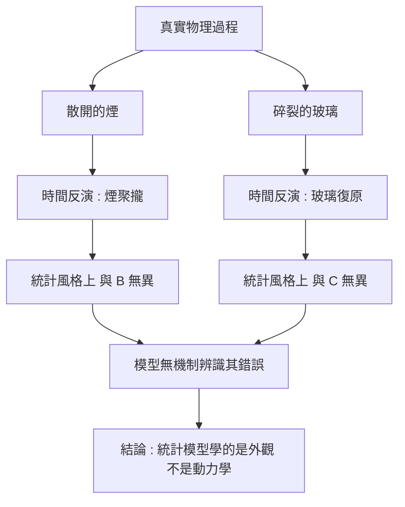

# 4.4 自迴歸生成對「不可逆物理過程」（熱力學時間箭頭）的模擬能力分析

熱力學第二定律是物理學中最反直覺的陳述之一。微觀的力學方程是時間對稱的：牛頓的運動方程在時間反演 $`t \to -t`$ 下形式完全不變，如果一個粒子集合的演化路徑是可行的，那麼把速度全部取反、沿著路徑倒著走，同樣是可行的。但在宏觀世界裡，我們卻觀察到幾乎所有自發過程都朝著同一個方向：煙散開、玻璃摔碎、咖啡冷卻、冰融化。

這個不對稱性被稱為熱力學的時間箭頭。它的統計學解釋是熵增原理：一個封閉系統的熵 $`S = - k_B \sum_i p_i \ln p_i`$ 在自發過程中傾向於增加，而「低熵」狀態（例如所有分子都集中在房間一角）是一種極端特殊、機率極小的狀態。反過來說，讓煙重新聚攏、讓摔碎的玻璃自行拼回原狀，雖然不違反任何力學定律，但它的機率低到在宇宙的年齡內發生機會約為零。

玻爾茲曼的直覺更進一步。他把狀態空間的體積與宏觀狀態聯繫起來：系統佔據的相空間體積越大，其對應的宏觀描述就越可能。當細碎粒子散開時，它們可以佔據的相空間體積暴增，於是「散開」這個宏觀描述佔據了幾乎全部的機率質量，而「聚攏」佔據的比例可以小到無法以任何尺度觀測。這就是時間箭頭的真正來源：不是某種神秘的力量，而是計數方式的必然。

因此「不可逆」在實務上是概率性的而非絕對的。足夠大的系統、足夠長的時間，理論上仍可能出現局部逆轉。但在人類可觀測的時空尺度上，這些逆轉的機率小到可以忽略，因而我們把它當作定律來建模。

生成模型與這個問題有著一個尷尬的關係。模型是從資料中學習的，而資料全部來自真實世界，因此資料中只包含「時間箭頭指向的方向」。理論上，這對模型是有利的：它不需要被教會物理定律，只要學會「什麼看起來像真實世界」。

但這裡有一個隱藏的陷阱，也是本節的核心論點。

## 一個統計模型應該能生成的違反片段

考慮一個純粹從統計角度訓練出來的影片生成模型。它沒有任何內建的物理約束，只學會了「真實影片在像素層面上的樣貌」。那麼，當我們要求它生成「煙散開」的過程時，它完全可以生成；因為它見過無數這類片段，它知道散開的煙看起來是什麼樣子。

但同一個模型，當我們要求它生成「煙聚攏」的過程時，它也能生成——因為把生成結果的幀順序倒過來，統計風格幾乎完全一樣，模型並沒有任何機制會認為這是錯的。碎玻璃自行拼回原位、融化的冰重新結冰、倒流的瀑布，這些片段在統計風格上都是「完美」的，但在物理上是錯的。

這就是關鍵區分：模型學到的是外觀統計，不是物理動力學。若模型內部真的存在一個近似正確的狀態轉移模型，那麼在給定相同的初始條件時，它產生的軌跡分佈應當遵循同樣的方向性約束，而時間反演會落到零機率的區域。

這個區分在自迴歸架構中還有一層額外的意義。自迴歸模型的本質是學會一個條件分佈 $`p(x_{t+1} \mid x_{\le t})`$ ，也就是「給定歷史，下一步最可能發生什麼」。如果這個條件分佈學的是動力學，那麼它就隱含了方向性；如果它學的是外觀，那麼把歷史倒過來餵進去，得到的分佈依然合理，因為倒序的歷史同樣是「像真實影片的歷史」。

換言之，方向性不是從「只依賴過去」這個結構中自動湧現的。過去與未來的區別在統計上是對稱的（除了資料集中只有一個方向的樣本），而在物理上是非對稱的。要讓模型捕捉到這個非對稱性，必須有某種東西把它編碼進目標函數。

## 判別方法：時間可逆性測試與熵變化測試

那麼我們該如何測試一個生成模型是否具備方向性？一個直接的做法是構造時間可逆性測試。取模型生成的片段 $`\hat{V} = \left\{ \hat{v}_{1}, \dots, \hat{v}_{T} \right\}`$ ，把幀順序完全倒轉得到 $`\hat{V}^{\text{rev}}`$ ，然後計算模型對兩者的似然。如果模型能分辨正序與倒序（倒序的似然顯著較低），代表它內部捕捉到了方向性資訊；如果兩者似然幾乎相同，代表它沒有內建的方向性偏置。

另一個做法是測量生成片段的熵變化軌跡。在真實世界中，一段包含擴散過程的影片（例如煙霧擴散、液體混合、碎裂）應該呈現出單調遞增的空間資訊熵或像素統計熵。可以對生成片段計算逐幀的局部熵，並檢查其斜率。如果模型生成的「擴散」片段熵值持平甚至遞減，那麼它並沒有在模擬擴散，而是在模擬靜態。

第三個測試是方向性干預：給定同一組初始條件分別向正序與逆序生成，看模型產生的終態分佈是否具有不對稱性。若一個真正內建物理的模型，其逆向生成的機率應該遠低於正向生成。

這三種測試可以組成一個完整的評估構面。時間可逆性測試檢查模型是否「知道」時間方向；熵變化測試檢查生成過程是否真的呈現擴散行為而非靜態重播；方向性干預則檢查模型在不同初始條件下的反應是否符合物理。理想上，一個真正合格的物理生成模型應該在三個測試上都表現出明顯的非對稱性。

| 測試方式 | 做法 | 若模型具備物理時的預期 | 若模型只學外觀時的預期 |
| --- | --- | --- | --- |
| 時間可逆性 | 倒轉生成片段再算似然 | 倒序似然顯著更低 | 正逆似然幾乎相同 |
| 熵變化 | 逐幀計算局部熵並看斜率 | 擴散過程中單調上升 | 持平甚至遞減 |
| 方向性干預 | 同初始條件正逆序生成 | 終態分佈顯著不對稱 | 分佈大致對稱 |

這些測試的實作並不困難，困難的是基準的建立。人類對「哪一段是物理上合理的」判斷相當準確，但把這個判斷量化成可重複的指標並不容易。目前的直覺物理學基準（如 CLEVRER 這類碰撞推理資料集、以及專門為流體與材料設計的測試集）提供了一部分覆蓋，但離「完整的物理直覺」還很遠。

## 自迴歸模型的特殊弱點

自迴歸架構在這一點上有特別的弱點，值得單獨說明。

在第 4.2 節中我們看到，自迴歸模型的生成過程是「一次一幀、逐幀回饋」的。在短期尺度上，這種機制其實善於保持細節的一致性：模型只要記住前一幀裡那隻杯子在哪裡、什麼顏色，就能合理地延續。但這份一致性恰恰是一種「黏著性」，它維持的是外觀的連續，而不是物理方向的約束。

更具體地說，自迴歸模型的訓練目標只有「條件在過去上的下一幀分佈」。這個目標函數裡完全沒有任何項去區分「這一幀是自然演化」還是「這一幀是時間反演」。在資料集中，前進的片段極多、反演的片段一個也沒有，因此模型在這個二元的分界上沒有任何可學的判別邊界。於是它對兩者一視同仁，並且——由於它採用的是條件於過去的分佈——它甚至能很流暢地「倒著寫」。

這裡還有一層更微妙的困難：自迴歸模型的機制鼓勵「回到過去」。因為條件分佈是 $`p(x_{t+1} \mid x_{\le t})`$ ，若某個狀態是「已出現過的」，模型就傾向於再次生成它，因為那樣的序列在訓練資料中更常見。這種對熟悉狀態的偏好，方向上與時間箭頭相反：真實世界的演化是走向統計上更不可能、但依然典型的狀態，而模型的自迴歸偏好則是走向已經常見的狀態。

這在實務上有可觀察的後果。當一段影片進入一個穩定狀態（例如煙已經散滿整個畫面），模型會傾向於維持這個狀態而不是讓它繼續演化，因為維持是「常見」的。在真實世界中，散滿的煙會繼續擴散、稀釋並最終消散；模型則可能讓畫面凝固。

還有一個方向性的偏誤值得留意：模型傾向於生成「消散型」的運動而非「聚合型」的運動。這並非巧合，而是資料的必然結果——真實世界幾乎不發生聚合型運動，所以模型對它的先驗接近於零。缺乏對這個方向的先驗，正是下一節要談的失效模式之一。

## 物理資訊的注入方式

解法方向是明確的：既然目標函數缺少物理，就要把物理加進目標函數裡。具體路徑有兩條，兩者在第 5.4 節與第 10.2 節會詳細展開。

第一條是以守恆律構造損失函數。例如對模型生成的軌跡估計總動量或總能量，若與初始狀態的量不一致，就在損失中加入懲罰項：

$$
\mathcal{L}_{\text{phys}} = \lambda \left\| E_{\text{gen}} - E_{\text{init}} \right\|^{2} + \mu \left\| p_{\text{gen}} - p_{\text{init}} \right\|^{2}
$$

第二條是引導式（guidance）在採樣過程中直接注入物理資訊。擴散模型中已有成熟的做法：在每一步去噪時，用能量函數的梯度對預測的樣本做修正，引導它走向守恆律滿足的子空間。第 5.4 節會詳細討論以能量函數與無分類器引導強制遵循守恆定律的機制。

值得注意的是，這兩條路徑都把物理從「資料中的隱含偏置」提升為「顯式的、可驗證的約束」。這正是第 4.3 節的論點的實踐面向：當擴展撞到失效模式時，進步往往來自改變目標函數。

守恆律特別適合作為注入目標，因為它不需要模型學到完整的物理理論，只需要掌握少數幾條不變量：總質量守恆、總動量守恆、能量守恆。相較之下，「摩擦力必須為零所以物體不會自己停住」這類推論就難以直接編碼。

更進階的做法是引入能量函數，把物理過程表述為某個標量勢能沿軌跡的演化，並引導生成過程滿足單調性條件。第 5.4 節會詳細描述這個機制。第 10.2 節則從更一般的角度處理「物理幻覺」問題，也就是生成內容與真實物理之間的可量化落差。

## 與擴散模型的對比

擴散模型在這個問題上表現得如何？整段去噪的過程其實給了全局一致性更好的機會，因為所有幀在同一個去噪網路中被同時細化，某一幀的結構可以透過共享注意力影響其他幀。相較於自迴歸的逐幀黏著，擴散的耦合更緊密，也更不容易出現局部的時間反演異常。

但擴散模型同樣沒有內建守恆。它只是把「整段影片看起來合理」這件事做得更好，而不是把「整段影片在物理上可能」這件事做得更好。一段風格流暢、內部一致的倒流煙，對擴散模型而言同樣是合理的樣本。兩者的差異在於失誤的形態，而非失誤的存否。

## 誠實的評估

我們必須誠實地承認：目前最先進的視訊生成模型在直覺物理基準上的表現，仍然遠未達到人類水平。

在物體恆存性測試上，人類在短時間遮蔽後能準確預測物體是否出現，而模型常常讓被遮擋的物體消失或重複。在重力測試上，模型有時能學會物體大致往下落，但在彈跳、滾動與斜面滑動上會出現明顯錯誤。在材料性測試上，水與液體的行為是最薄弱的一環，傾倒、濺散與容器交互的結果常常不符合流體的直覺。

這些不是「再多訓練幾個 epoch」就能修好的問題。它們反映的是目標函數與資料分佈的結構性限制，需要第 4.3 節所說的「改變建模對象」的嘗試：從像素重建走向特徵預測（第 6 章），從純粹的分佈擬合走向物理引導的生成（第 5 章）。

我們也該記錄一個有點諷刺的觀察：目前表現最好的視訊生成模型，恰恰是最擅長生成「物理上可疑但美觀」內容的那一批。流暢的液體、絲滑的布料、隨手一揮就散開的煙霧——這些在視覺上令人愉悅，在物理上卻往往是錯的。人類的評估偏好會進一步強化這個偏差，因為人們對「看起來合理」與「物理上正確」的辨別能力，遠低於對「美觀與否」的辨別能力。

換言之，在這個領域，評估機制本身就是瓶頸的一部分。如果我們想要一個能生成物理正確未來的模型，就必須有一種能辨認物理正確性的評估方式；否則我們會持續把資源投入到改善那些人類更容易感知、卻與物理無關的面向。

## 為什麼這是終極測試

最後，讓我們說清楚為什麼這個問題值得被稱為「終極測試」。

物理正確的時間箭頭，本質上是一個關於「因果方向」的測驗。動物行為中的因果方向、語言敘述中的時間方向、科學推理中的過程與結果，都共享同一個結構：原因在先，結果在後。熱力學的時間箭頭是這個結構在物理世界中最普遍、最不可違逆的實例。

一個能夠生成物理正確未來的模型，意味著它內部存在的不只是外觀的相關性，而是真正的動力學——狀態如何隨時間演化，演化有什麼約束，未來有多少可能性。這正是「世界模型」這個詞的核心內涵，也是第 1 章到第 3 章所鋪陳的 MDP、POMDP 與結構因果模型的終極意義。

從資訊理論的角度還可以再推一步。一個可逆的物理過程，其狀態與未來之間是一一對應的關係，未來可以由現在完全決定；而不可逆過程的狀態與未來是多對一的，現在包含了許多關於過去的資訊，但未來只保留其中一部分。時間箭頭意味著「現在」承載的資訊多於「未來」。因此，能正確生成不可逆過程的模型，必須內部擁有某種相對於時間不對稱的狀態更新機制——這是第 1 章潛在動態模型設計的深層理由。

這個判準之所以是終極的，是因為它無法靠資料規模繞過。任何資料集都幾乎不含逆向樣本，任何擴展都不會讓模型學到方向性。方向性只能被設計進去。

## 引出第 5 章

於是我們來到架構分歧的路口。當純粹的擴展與純粹的資料擬合都無法帶來物理能力時，架構本身必須改變。

第 5 章要處理的正是這個問題：擴散世界模型。它不是把自迴歸換成擴散這麼簡單——它改變的是「什麼東西被去噪」。當去噪的對象從像素變成連續潛在中的時空軌跡，模型就有機會在連續表示裡保留那些離散化必然丟失的結構資訊，而第 5.4 節更會把物理守恆直接寫進去噪的引導過程中。

從這裡開始，我們將進入第二種架構範式。若說自迴歸的直覺是「接下來會是什麼」，那麼擴散的直覺是「什麼樣的整段影片能解釋這個被破壞的版本」。這個改變不只是演算法上的替換，它改變了模型對時間的基本態度：從逐步推進的因果鏈，走向整體的一致性求解。
