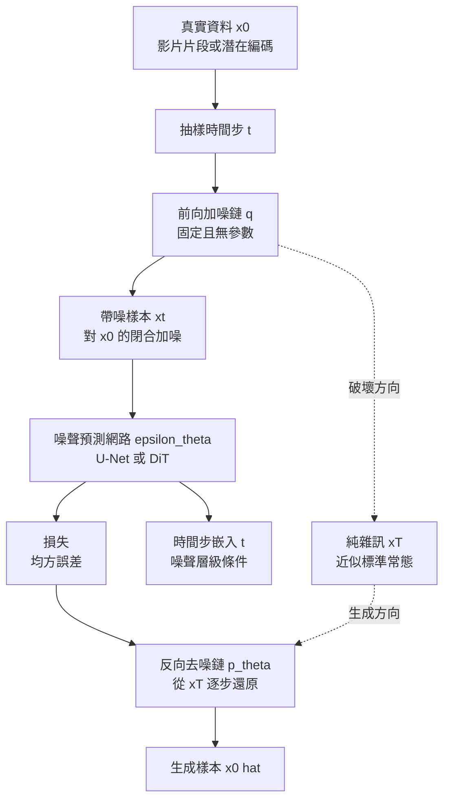

# 5.1 潛在擴散模型（LDM）用於時空轉移：從像素去噪到物理軌跡去噪

## 一、擴散模型的數學基礎：兩條方向的馬可夫鏈

擴散模型的原始構造來自非平衡熱力學的直覺：把一張真實影像逐步摻入高斯雜訊，直到它變成一團純粹的隨機性，然後學習如何把這條退化路徑反過來走。現代的數學表述把這個物理故事置換成兩條離散時間的馬可夫鏈。前向鏈是固定、不含任何可學參數的破壞過程，從資料分佈 $q(x_0)$ 出發，反覆施加高斯加噪，經過 $T$ 步之後把資料分佈送到近似標準常態 $q(x_T) \approx \mathcal{N}(0, I)$ ：

$$
q(x_t \mid x_{t-1}) = \mathcal{N}\left( x_t \;;\ \sqrt{1 - \beta_t}\, x_{t-1},\ \beta_t I \right)
$$

由於高斯加噪具有閉合形式，前向鏈的任意時刻可以直接從原始資料取樣，不必真的逐步迭代。若記 $\alpha_t = 1 - \beta_t$ 且 $\bar{\alpha}_t = \prod_{s \leq t} \alpha_s$ ，則

$$
x_t = \sqrt{\bar{\alpha}_t}\, x_0 + \sqrt{1 - \bar{\alpha}_t}\, \epsilon,\qquad \epsilon \sim \mathcal{N}(0, I)
$$

反向鏈才是模型真正要學的部分：它以一個前向的鏡像形式從純雜訊出發，逐步把樣本還原成資料，而每一步的還原方向由一個參數化的神經網路給出：

$$
p_\theta(x_{t-1} \mid x_t) = \mathcal{N}\left( x_{t-1} \;;\ \mu_\theta(x_t, t),\ \Sigma_\theta(x_t, t) \right)
$$

把兩條鏈拼起來，整個模型就是一個可逆的破壞與重建對偶。值得注意的是，這裡的訓練目標並不直接是最大化對數概似，而是化簡後的噪聲預測損失：

$$
\mathcal{L} = \mathbb{E}_{x_0, \epsilon, t} \left[ \left\| \epsilon - \epsilon_\theta(x_t, t) \right\|_2^2 \right]
$$

這個化簡是擴散模型在工程上取得勝利的關鍵。模型不必真的學會一個完整的高斯分佈，它只需要在任意噪訊層級上說出「這團噪聲裡混了什麼樣的原始訊號」。由於前向鏈是已知的、與參數無關的，任取一個時間步 $t$ 都可以直接構造訓練樣本，訓練因此變成了大規模並行的監督式回歸問題，而不再是昂貴的逐字串列對數概似計算。第 4 章描述的自迴歸模型必須嚴格地一個 token 接一個 token 地訓練；擴散模型可以把整段影片的每一個時間步同時餵進網路，資料效率與硬體利用率完全是另一個量級。

## 二、為什麼擴散適合表示多峰與不確定的未來

在世界模型的語境裡，最重要的一個技術判準是：**未來不是唯一的**。同一個初始狀態在同一組動作下，可以演化出許多條不同的合理軌跡；球可能被推向左邊或右邊，機器人可能從上方或側方繞過障礙物，而模型如果只給出一個「平均答案」，那麼這個平均答案往往既不屬於任何一條真實軌跡，也無法支持任何有意義的規劃。

自迴歸模型的難處在於它的訓練目標本質上是最大概似。逐 token 的交叉熵損失會把機率質量集中到高頻模式上，在有明確數學極小值的樣本上（例如影像重建）能得到不錯的結果，但一旦目標分佈是多峰且鋒利的，最大概似傾向於覆蓋全部分佈而導致模糊，或在實作中被溫度與取樣策略推成單一模態。要在同一個初始條件下產生多條不同的未來，就必須額外引入噪聲或引入帶類別的複雜分佈假設。

擴散模型的取樣過程恰好保留了多峰性。反向去噪的每一步都是從一個機率分佈中取樣而非取其均值，整條鏈走完等價於從學到的資料分佈中抽樣，而這個分佈可以是多峰的。更關鍵的是，擴散模型給出的是一個**機率分佈的樣本**，而不是一個點估計。同一個初始觀測可以反覆執行反向鏈而得到不同的未來軌跡，這正是第 8 章要用的原料：多個平行未來世界需要被展開、被評分、被剪枝。

更細一層，擴散模型的每一步去噪都在做「局部去平均」。在噪訊層級高的時刻，網路的輸出接近於整段序列的粗略骨架，這個骨架可以有多個不同的分支；隨著時間步下降，各分支被逐步確定並收斂到某一個具體的未來。反之，如果把整段未來一次性用確定性網路回歸出來，多峰會在訓練中被抹平。這是擴散模型在物理軌跡生成上相對自迴歸的第一個結構性優勢。

## 三、從像素到潛在：LDM 的編碼器與解碼器

直接在 RGB 像素空間做去噪有兩個麻煩。第一是維度太高：一張 $256 \times 256$ 的影像是六萬多個維度，而其中真正承載物理資訊的結構——物體邊界、接觸點、相對位置——只佔少數。第二是像素誤差的權重錯置：高頻紋理上的微小偏差與邊界位置上的重大偏差，在均方誤差裡受到幾乎相同的待遇，而後者才是物理正確與否的關鍵。

潛在擴散模型的設計是在像素與模型之間插入一個固定的編碼器 $E$ 與解碼器 $D$ 。編碼器把觀測 $x$ 壓縮成低維潛在 $z = E(x)$ ，擴散模型完全在 $z$ 上進行，生成完畢後再由 $D$ 解回像素：

$$
\hat{x}_0 = D\left( z_0 \right),\qquad z_t = \sqrt{\bar{\alpha}_t}\, E(x_0) + \sqrt{1 - \bar{\alpha}_t}\, \epsilon
$$

這個設計在物理世界模型上的意義常被低估。編碼器在低頻結構上花費容量，等價於把「物體在哪裡、彼此相對位置如何」這類幾何資訊放大，把「表面有沒有細微顆粒感」這類資訊壓縮。第 2 章主張的物體中心槽位表示與幾何一致性要求，在像素空間中需要額外的損失去強迫，但在一個已經把高頻細節壓縮掉的潛在空間裡，幾何結構往往是佔據容量最多的部分。此外，潛在空間中同樣大小的向量對應同樣多的算力，使得同一份硬體可以處理長得多的時間軸。

代價也必須誠實列出。編碼器與解碼器是一道**不可微分**的瓶頸：潛在中發生的微小錯誤在解碼時可能被放大成可見的物理幻覺，而且一旦決策所需要的資訊在編碼時就被丟棄了，擴散模型再怎麼去噪也找不回來。這也預告了第 6 章的論點——若目標本來就不是重建像素，而是在特徵空間裡做預測，潛在擴散的中間層其實可以讓位給更抽象、更有用途的表示。

## 四、時空擴散：三個軸同時存在

把擴散模型放進影片時，噪聲不再作用於單張圖，而是作用於一段有時間厚度的張量。此時必須區分三個彼此獨立的軸。

**空間軸**處理單一時間點內的內容佈局，負責「這一幀裡有什麼東西、在哪裡」。**時間軸**處理跨幀的運動與持久性，負責「東西如何移動、消失、互相作用」。**條件軸**則引入外部資訊，例如文字描述、給定的第一幀，或更關鍵的——第 5.2 節要討論的動作序列。三個軸在實作上並非截然分開的模組，而是共享同一組權重的注意力層：模型在每一步去噪時，同時判斷「這幀該長什麼樣」與「接下來幾幀該怎麼演」。

一個直覺但重要的後果是：**時間軸上的多峰性同樣由擴散自然承載**。一段影片可以有兩種完全合理的未來，而擴散模型不需要額外的機制去表達「這條軌跡有 0.4 的機率、那條有 0.6 的機率」。相較之下，自迴歸影片模型要表達同一件事，就必須在每個 token 上攜帶不確定性機制（例如在標記集合上做分類並附上機率），而這會讓生成變得笨重且難以校準。

另一個常被低估的技術細節是**噪聲排程**。前向鏈的噪聲層級 $\beta_t$ 通常採餘弦排程而非線性排程，使得大約一半的時間步集中在低訊噪比區間，此時網路才真正在做內容佈局的決定；若採線性排程，模型會把大量算力浪費在高噪聲的質地決定上。對物理軌跡而言還有一個額外的好處：低訊噪比區間的密度較高，代表模型在「整體運動模式」這個尺度上有更細緻的取樣解析度，而運動模式恰恰是軌跡合理與否的關鍵。

## 五、Video LDM 與類 Sora 架構

Video LDM 的代表性設計是**逐幀的空間壓縮加上跨幀的時間壓縮**。空間上，一幀影像先被壓縮成較低解析度的潛在；時間上，若連續數幀被視為一個單元一起壓縮，就能進一步縮短序列長度，讓骨幹網路的計算量與時間長度近似呈線性關係。代價是時間壓縮會讓快速的運動細節變得模糊，因此實作上往往只在空間上做強壓縮、在時間上做輕壓縮。

骨幹有兩種主流選擇。**三維 U-Net** 沿用影像生成的做法，把時間維度併入卷積或注意力視窗，結構直觀且在中等規模資料上表現穩定。**擴散 Transformer** 則把每個潛在區塊攤平成 token，套用自注意力，並以自適應層正規化注入時間步嵌入；這條路線在規模放大時展現出更好的擴展性，多數類 Sora 系統都採此架構。類 Sora 系統還有一個關鍵設計是把**空間與時間一起切成時空區塊**，也就是把連續數幀的同一空間區域合併成一個 token，讓注意力能直接跨越「同一物體的相鄰時刻」建模，這對運動連續性有明顯好處。

注意力模組的設計是時空骨幹的核心分歧點。若把空間與時間 token 完全混合做全注意力，模型可學到任意時空耦合，但計算量隨序列長度平方增長；若採用**分解注意力**，先做空間注意力再做時間注意力，計算量降為線性乘積，代價是放棄了顯式的跨時空聯合查詢。實務上常見的折衷是讓大部分層使用分解注意力以控制成本，只在最後若干層改用全注意力，以補回跨時空聯合推理的能力。

| 面向 | 自迴歸（AR）世界模型 | 擴散（Diffusion）世界模型 | 對物理軌跡的意義 |
| --- | --- | --- | --- |
| 生成目標 | 逐 token 極大化對數概似，訓練目標與推理目標一致 | 噪聲預測的均方誤差回歸，訓練是各時間步的並行回歸 | 擴散把「預測下一幀」換成「猜測整段未來的殘差結構」，較容易覆蓋多峰 |
| 多峰與不確定性 | 以分類分佈或取樣近似表達，實作上易退化為單一模態 | 反向鏈每步隨機取樣，同一條件可抽出多條不同未來 | 規劃所需的多個平行未來世界，是擴散的自然副產品 |
| 條件注入位置 | 只能作用於當前 token 的上下文，無法回溯改寫已生成內容 | 條件可作為全序列的全局上下文，影響整段生成的每一步 | 動作條件化得以作用於整段軌跡，而非僅最後幾幀 |

## 六、從像素去噪到物理軌跡去噪：狀態序列的擴散

本章標題所說的「物理軌跡去噪」不只是修辭。當擴散的對象從像素換成物體的幾何狀態序列（位置、速度、朝向、或第 2 章的槽位向量）時，模型的性質會發生一個本質轉移。像素去噪時，網路每一個時間步都在重新思考「這個像素該是什麼顏色」；狀態序列去噪時，網路思考的是「這個物體該在哪裡、往哪裡去」。前者的輸出是被觀察者，後者的輸出是**可被決策者直接消費的狀態估計**。也就是說，擴散模型在這個設定下不再只是一個生成器，而是一個把觀測不確定性傳遞到狀態估計上的推論器。

這個轉移在工程上有三個好處。其一是**不確定性得以保留在狀態層**：從像素反推物體位置本身就是一個病態的反問題（遮擋時尤甚），而如果生成器直接工作在狀態空間，這個反問題被吸收進模型，輸出端拿到的就是已經處理過多解性的狀態分佈。其二是**生成成本與決策需求對齊**：狀態序列的維度遠小於像素，數十步去噪的成本變得可以承受。其三是**與物理先驗的接口變得自然**：能量函數、碰撞約束這些量本來就是定義在狀態上的，因此可以在去噪的每一步直接計算殘差，而不必從渲染圖片中去「看」出物理錯誤。第 5.4 節的守恆引導正是建立在這個接口之上。

代價則是狀態必須先被定義好。這把問題推回第 2 章：若槽位表示的物體對應關係在遮擋時會跳動，那麼擴散去噪再漂亮，也只是在對錯誤的狀態變數做漂亮的去噪。這說明架構範式的選擇並非孤立的技術決策，它與「什麼是狀態」這個更早的判斷緊密相扣。

## 七、擴散相對自迴歸的三項優勢與三項劣勢

把話說完整的時機到了。三項優勢是：**全局一致性較好**，因為反向去噪是對整段序列同時進行的全域迭代，不像自迴歸那樣把已生成的開頭當成不可更改的既定事實，後面幀無法回頭修正開頭的幾何矛盾；**訓練目標穩定**，均方誤差回歸沒有曝光偏差，訓練時見到的都是加了噪的完整序列，天然覆蓋了推理時會遇到的各類損壞程度；**可處理變長**，因為每個樣本的時間軸長度可以在資料層面自由變動，不必受制於固定視窗。

三項劣勢同樣明確。**推理步數多**，數十到數百次的去噪迭代意味著生成一段影片的成本遠高於自迴歸的單次前向，這在需要高頻重規劃的閉環系統中格外昂貴。**對動作條件化不自然**，自迴歸模型中動作與 token 同屬一個序列，天然共享一套因果注意力；而在擴散中，動作並不佔據生成序列的位置，要讓它真正影響生成結果必須額外設計注入機制，這正是下一節的主題。**誤差不以逐幀累積的形式出現**，而是在去噪過程的內部傳播：一個在早期噪聲層級形成的錯誤結構假設，會在後續所有去噪步中被逐步強化，最終以一種整體連貫但物理錯誤的形式呈現。這與第 4 章描述的自迴歸長程漂移是兩種不同的失效病理——前者是「每一幀都合理但整體崩壞」，後者是「越到後面越離譜」。

本章建立了擴散作為世界模型生成核心的數學骨架，也說明了它在表達不確定性上的先天優勢。但一個不帶動作條件的擴散模型，本質上只是「生成像樣的影片」，還不是「生成我在這個世界中的未來」。第 5.2 節要處理的，正是把控制信號注入生成核心的具體機制，以及它與真正的世界模型之間那道至今尚未完全跨越的鴻溝。
