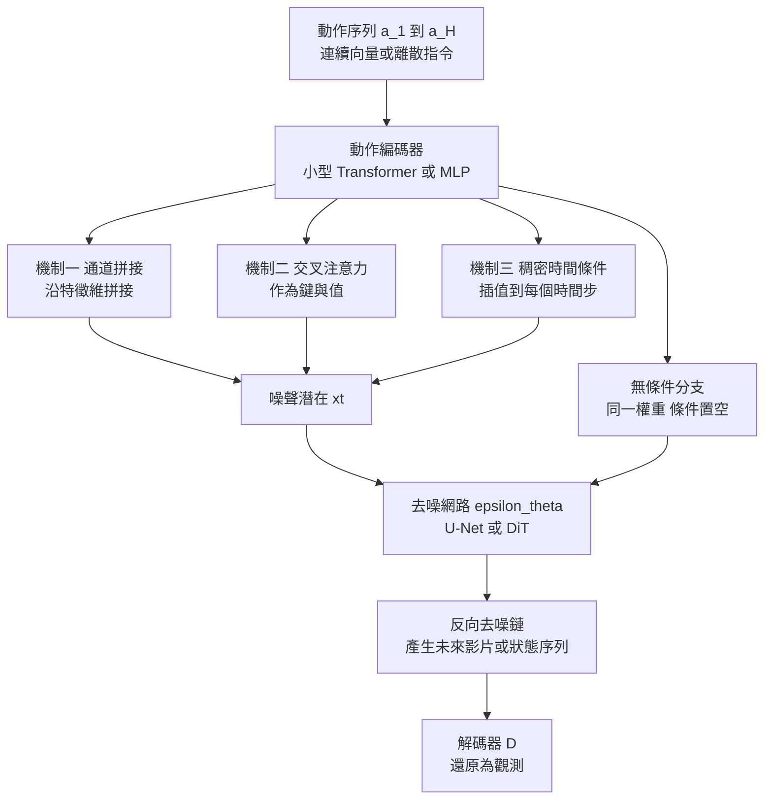

# 5.2 動作條件化擴散（Action-Conditioned Diffusion）：將控制信號注入生成核心

## 一、為什麼動作必須進入生成核心

第 5.1 節的擴散模型還缺一塊拼圖。一個只學會「續寫影片」的模型，能夠回答「接下來可能發生什麼」，卻無法回答「如果我這樣做，會發生什麼」。這個差別不是程度上的，而是方向上的：第 3 章的反事實推理要求模型能接受干預，把動作視為對狀態轉移分佈的介入，而不是觀測序列的自然延續。因此動作必須以某種形式進入生成過程本身，讓同一個初始狀態在不同的動作條件下產生不同的未來。

這件事在擴散架構裡之所以需要被單獨設計，理由在第 5.1 節已經埋下伏筆：擴散的生成對象是整段序列的整體結構，而動作是一個與生成對象**異質**的輸入。動作可能是連續的七維向量，也可能是離散的抓取指令；它可能與時間戳一一對應，也可能是整段任務層級的一句自然語言。把它硬塞進生成序列並不自然，但在擴散裡，「作為全域條件影響每一步去噪」卻是一個已經被驗證的成熟機制。

## 二、三種注入機制

**第一種是通道拼接（channel concatenation）**，最為直觀。生成對象若是一段影像，可以把動作映射成一張與時間軸對齊的低解析度「動作圖」，然後沿通道維度與 noisy latent 串接後送入 U-Net 的第一層卷積。若生成對象是狀態序列，動作向量可以直接沿特徵維度拼到每個時間步的狀態向量上。

**第二種是交叉注意力（cross-attention）**，這是文字到影像生成中最成熟的做法。動作序列經過編碼器或小型 Transformer 得到一組動作嵌入，作為交叉注意力的鍵與值，而 noisy latent 作為查詢，於是每個空間或時間位置都可以「詢問」動作序列裡哪一段與自己相關。這種機制的優點是**位置對齊是學出來的**而非硬編碼的，模型可以自己決定「第一幀該關注動作序列的哪一段」。

**第三種是把動作編碼為時間上稠密的條件向量**。這是一個常被忽略但極重要的設計選擇。若動作只在整段尺度上提供一個全局嵌入（例如任務描述），模型就只有粗略的方向感；若動作被插值或重複到與生成序列每一個時間步一一對應，那麼模型在去噪第 $`t`$ 步時手裡握著的不只是「有動作」這個事實，而是「這一刻的動作是什麼」。後者才能真正支撐細緻的物理對應——手往左伸的同時杯子被推向右方，這種反向的因果連結只有在稠密條件下才學得出來。

## 三、為什麼擴散裡的動作條件化比自迴歸裡更自然

自迴歸模型也能做動作條件化，事實上第 4 章提到的許多影片生成模型就採用「動作 token 與影像 token 交錯排列」的設計。但這套設計有個結構上的尷尬：動作 token 佔據了序列的位置，模型的注意力被迫在「讀動作」與「生成影像」之間分配容量；而且一旦前段的动作 token 被寫死，模型在生成後段時無法回頭修正早期解讀錯誤的動作語意——這與第 5.1 節提到的自迴歸全局一致性缺陷是同一個病根。

擴散沒有這個問題。整段去噪過程中，條件訊號在**每一個時間步、每一個噪聲層級**都可用，因此整段動作可以影響整段生成的每一個局部決定。更微妙的是，擴散的反覆迭代特性允許一種「協同收斂」：模型在早期去噪層級先形成一個粗略的運動骨架，在後續步驟中不斷用條件訊號**重新檢視**這個骨架是否與動作一致，必要時推翻重來。這種「動作與生成的雙向對齊」在單趟前向的自迴歸裡幾乎不可能出現。

換句話說，自迴歸是「先決定動作怎麼讀，再往下生成」；擴散是「動作與未來在反覆協商中共同確定」。這在需要閉環糾錯的物理場景中，意味著顯著的差異。

## 四、無分類器引導的雙分支訓練

第三種機制嚴格說來不是「注入位置」而是「注入方式」，但它與動作條件化關係太密切，必須一起談。**無分類器引導**（classifier-free guidance）在第 5.4 節會被完整推導，這裡先只看它在動作條件化中的角色。做法是：訓練時以機率把條件（動作嵌入）隨機置空，讓同一個網路同時學會有條件的預測與無條件的預測。推理時，把兩者的差異拿來放大條件的影響力：

$$
\tilde{\epsilon}_\theta(x_t, t, a) = \epsilon_\theta(x_t, t, \varnothing) + w \left[ \epsilon_\theta(x_t, t, a) - \epsilon_\theta(x_t, t, \varnothing) \right]
$$

其中 $`w`$ 是引導強度。這個機制對動作條件化有三個好處。**第一，它讓動作的影響力可以連續調節**： $`w`$ 等於零時模型忽略動作， $`w`$ 越大動作越強制，這在測試「模型到底有沒有真的用上動作」時是一個方便的探針。**第二，它不需要額外的分類器**：傳統的引導需要訓練一個判別器來估計條件是否滿足，而動作條件的判別器在連續控制空間中本來就難以訓練。**第三，它讓同一部權重可以同時服務兩種用法**：需要高保真遵循指令時用大 $`w`$ ，需要保留多樣性時用小 $`w`$ 或改用隨機取樣。

代價是每次推理要跑兩次前向，因為無條件與有條件分支都必須計算。在第 5.3 節將談到的閉環控制延遲問題上，這個額外成本會被放大，這也是實務上常把引導強度與取樣步數一起調低的原因。

## 五、稠密動作序列與稀疏指令

真實世界中的動作訊號有兩個極端，中間地帶才是一般情況。**稀疏指令**是任務層級的，例如「把紅色方塊推到盒子裡」，動作序列在時間上只有少數幾個有意義的時刻有內容，其餘是等待。這種情形下，條件應該被視為一個語意嵌入，而不是稠密序列。**稠密序列**則是機器人控制的常態，每個時間步都有七維的關節目標，總長度可能上百步。

兩者的處理方式應該不同。對稀疏指令，一個有效的做法是把指令嵌入加入全域條件，並允許模型自行決定在時間軸上的哪個位置落實它；對稠密序列，則必須保證動作與觀測在時間上嚴格對齊，否則模型會學到錯位的因果。實作上常用的折衷是**混合條件**：一條全局的語意通道承載任務意圖，一條稠密的向量通道承載具體執行，兩者分開注入。這樣的好處是模型可以把「意圖」與「執行」解耦——同一個任務目標下有多種合理執行方式時，模型有機會產生不同的軌跡，而意圖部分保持穩定。

這裡有一個容易被忽略的量綱問題：影像生成模型的分幀率與控制的更新率往往不同。一個 24 幀每秒的影片生成模型，要對應的是 50 赫茲的控制更新。若不處理，模型只能學到「動作在 24 幀內大致不變」這個近似，而在物理敏感的場景（例如剛好撞上障礙物的瞬間）這個近似足以毀掉整段生成。

## 六、觀測條件化：另一半的條件不能省

只注入動作是不完整的。若模型只學到「給定動作，生成某種影片」，它並不知道眼前的場景是什麼，也無法解釋「同一個動作在不同場景下為什麼產生不同結果」。因此真實的動作條件化模型幾乎一定同時接受**觀測條件**：給定當前的觀測（或其潛在編碼）、有時再加上當前狀態的估計，模型據此生成未來。

這裡的架構選擇相當關鍵。第一種是**起始幀條件（image-to-video）**：把第一幀作為條件輸入，模型生成其後的幀。這在製作上非常實用，但它的物理嚴謹性有限——模型知道第一幀長什麼樣，卻不知道第一幀的動量、接觸狀態與物體的材質屬性，而這些恰恰決定了球是滾出去還是彈起來。第二種是**狀態條件**：模型額外接收一個結構化的狀態向量（物體位置、速度、朝向、接觸旗標），這在形式上就是第 6 章所談的特徵空間預測。第 5.1 節所說的「物理軌跡去噪」實際上就是第二種。

兩者的差別可以總結為：**觀測條件提供外觀，狀態條件提供動力學**。而外觀與動力學分離，正是把生成模型變成世界模型的關鍵一步，因為它讓「這個場景長什麼樣」與「這個場景怎麼演化」變成兩個可以分別驗證、分別改進的模組。

| 維度 | 通道拼接 | 交叉注意力 | 稠密時間條件 | 觀測與狀態雙條件 |
| --- | --- | --- | --- | --- |
| 對齊方式 | 由通道位置硬性決定 | 由注意力學出 | 由時間戳硬性決定 | 依外觀與動力學分工 |
| 適配稠密動作 | 佳 | 佳 | 最佳 | 依狀態通道而定 |
| 對長動作序列 | 受限於通道容量 | 佳 | 佳但需插值 | 佳 |
| 物理嚴謹性 | 中 | 中 | 中高 | 高，可注入守恆量 |
| 主要工程代價 | 通道數膨脹 | 額外注意力層 | 插值誤差 | 需要可靠的狀態估計 |

## 七、反向動力學與前向動力學的分工

在動作條件化的模型中，兩個截然相反的問題經常被混為一談。**反向動力學**（inverse dynamics）問的是「我看到這個狀態變化，是什麼動作造成的」，也就是從觀測推回動作，它是第 7 章動作條件化機制的核心。**前向動力學**（forward dynamics）問的是「若我施加這個動作，世界會怎樣演變」，這才是世界模型真正需要的。

一個實作上的誘惑是：既然手上已經有動作標註資料，乾脆讓模型同時學兩者，把反向動力學當成輔助任務。這個策略在文獻中確實常見且有正面效果——因為反向任務提供了一個密集且廉價的訓練訊號，可以避免正向任務的資料瓶頸。但必須清楚它的地位：反向動力學**不能取代**前向動力學。它能學會「這個畫面對應一個向右的推力」，卻學會不了「如果推力比這個再多一牛頓，杯子會滑得多遠」。前者是辨識，後者是模擬。

在動作條件化擴散的框架內，更精確的分工是：模型的前向鏈負責學**生成**由動作造成的未來觀測；一個附加的反向預測頭（從預測的狀態變化回推動作）則提供一個**一致性正則**，強迫模型生成的變化必須能由某個合理的動作解釋。這種正則化的好處是它不需要額外的動作標註就能運作——只要有成對資料即可。

## 八、訓練資料的數量瓶頸

動作條件化擴散面臨的第一號問題是資料。訓練需要**成對的觀測與動作**：不僅要知道發生了什麼，還要知道是誰做的、做了什麼。純粹的影片資料（ billions 秒的無標註 footage）對這項任務毫無用處，因為裡面沒有動作標籤。可用的資料來源大致有三類：機器人自己的示範（真實但數量少）、人類示範（透過戴著動作捕捉手套或 VR 控制器操作，可擴展但存在人手與機器手的不匹配）、以及模擬器產生的合成資料（數量無限但有 sim-to-real 落差）。

瓶頸的性質因此不只是數量，而是**多樣性與對齊精度**。一個模型若只在幾十小時單一場景的示範上訓練過，它學到的並非「動作如何改變世界」，而是「這個場景裡這幾個動作長什麼樣」。第 9 章會討論如何用世界模型本身來合成訓練資料，從而繞開這個瓶頸；本章只需指出這個瓶頸的存在，因為它決定了本章所述方法的適用邊界。

## 九、評測的三個維度

動作條件化模型的評測不能只看畫質。至少有三個維度必須分開量測。**動作一致性**衡量的是「生成的運動是否真的對應了給定的動作」，可以用軌跡追蹤誤差、動作辨識準確率或光流方向的相關性來量化。**生成品質**衡量的是單幀與影片的逼真度、連貫性與文字描述的一致性，沿用影像生成的既有指標。**對未見動作的泛化**衡量的是模型在訓練分佈之外的動作（例如更大的速度、更刁鑽的方向）上是否仍然給出合理結果，而不是退化成模糊的平均運動。

第三個維度最能區分「學到了動力學」與「背下了示範」。如果模型只是記憶了訓練集中的動作與其結果的分佈，那麼給它一個罕見的動作，它會退回到平均結果——生成一段「安全」的、但與指令無關的運動。反之，一個真正學到前向動力學的模型，在未見動作上會產生外推結果，而這個外推結果雖然粗糙，方向卻是對的。這個「方向正確但幅度不精確」的特徵，是物理模型與純生成模型在診斷上最可靠的分水嶺。

## 十、誠實的差距：從條件化影片生成器到世界模型

必須坦白指出本章的核心張力。一個動作條件化的擴散影片模型，**並不自動就是世界模型**。理由有二。第一，它可能沒有可執行的狀態：模型內部的「狀態」只是編碼器與去噪網路隱層裡的特徵，不是可以查詢、可以被干預、可以作為下游決策輸入的變數。第 2 章與第 3 章要求的幾何表徵與因果結構，在這樣的模型裡是隱式且不可檢驗的。第二，它可能沒有真正的閉環一致性：模型學會的是「給定這段動作，這段像素看起來會怎樣」，而不是「給定這個狀態與這個動作，狀態會如何轉移」；前者是反過來的問題，而且並不保證多次生成的結果彼此相容。

區分兩者的操作性判準是：**你能否從模型中讀出一個狀態，並且在這個狀態上執行干預**。若答案是肯定的——模型存在某個可輸出的狀態表示，給它一個動作會讓狀態以可預測的方式改變——那麼它是世界模型。若答案是否定的，你手上的只是一個條件化的影片生成器，它在視覺上像世界模型，在功能上不是。

這個差距不是靠擴大模型規模就能自動填平的。第 6 章將給出一個更激進的想法：與其花容量重建像素，不如只預測對決策有用的特徵。而第 5.3 節要處理的，則是把生成機制反向使用——讓擴散去生成「動作」而不是「觀測」，這將是決策與生成統一的第一個具體成果。
