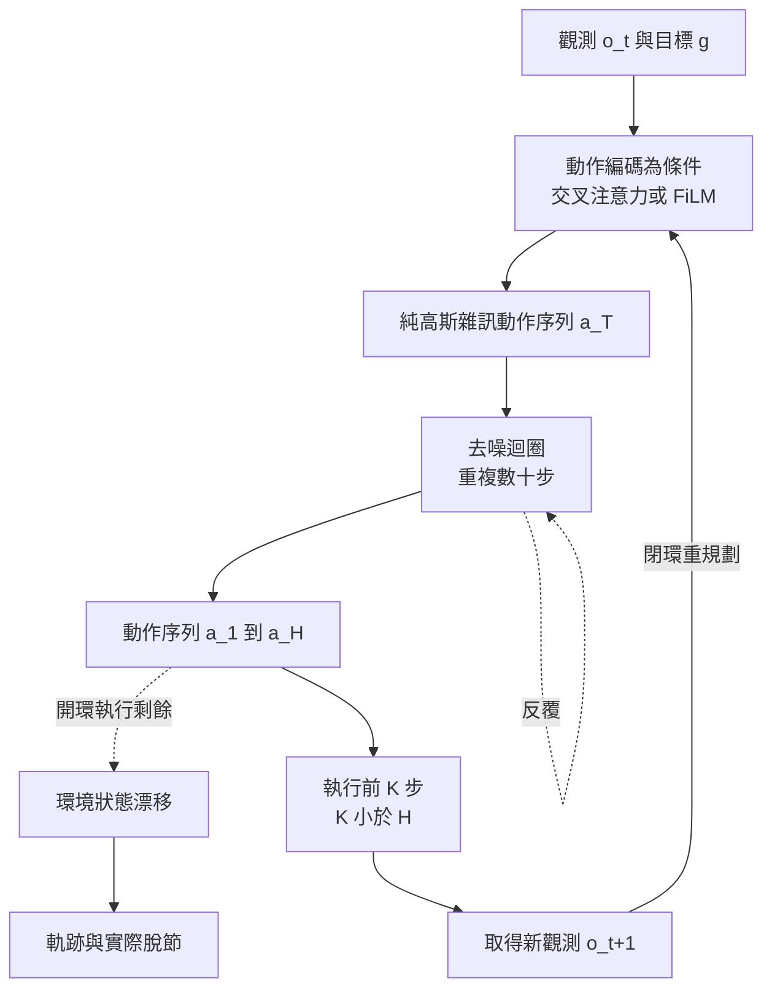

# 5.3 擴散策略（Diffusion Policy）與世界模型的對偶性：決策即生成

## 一、把決策視為條件生成

第 5.2 節的動作條件化擴散是單向的：動作是條件，觀測是生成物。而擴散策略（Diffusion Policy，Chi 等人於 2023 年提出）做了一件反過來的事——**讓擴散模型直接生成動作序列**。觀測與任務目標成為條件，模型的輸出則是一段連續的動作軌跡：

$$
\hat{\mathbf{a}} = \left( \hat{a}_1, \hat{a}_2, \dots, \hat{a}_H \right),\qquad \hat{a}_h \in \mathbb{R}^{d_a}
$$

這個視角的意義在於，它把長期規劃的難題從「搜尋」重新表述為「生成」。傳統的行為克隆網路輸出一個固定的動作向量 $\pi(o_t)$ ，其訓練目標是對示範動作做均方回歸；這個目標本身就把示範中的隨機性抹平了。擴散策略則把決策表述為一個分佈的樣本：模型學的是示範動作的分佈 $p(a_{1:H} \mid o, g)$ ，而不是它的均值。

## 二、動作分塊與短時域規劃

有一個容易被忽略但決定成敗的實作選擇：**一次生成多長的動作序列**。若只生成一步（ $H = 1$ ），擴散退化成一個複雜的動作回歸器，多模態性的好處大幅喪失，因為被抽樣的只有一個動作向量，沒有軌跡形狀可談。若一次生成很長（例如數百步），則計畫完整但開環漂移嚴重。

實務上的甜蜜點是**短時域的動作分塊（action chunking）**：生成未來 $H$ 步的動作，但只執行前 $K$ 步， $K \ll H$ ，然後重新規劃。這個設計同時解決了兩個問題。多模態性得以保留，因為被抽樣的是整段軌跡，向量場中不同的峰對應著不同的整體策略；開環漂移則被限制在 $K$ 步之內，因為每 $K$ 步就會被新的觀測重新校正。

參數 $K$ 於是成了一個明確的工程旋鈕，兩端各有代價。 $K$ 太小，雖然穩健，但規劃的視野被壓縮到幾乎等同反應式策略，模型無法利用長程結構（例如「先抓穩再提起」這類順序約束）。 $K$ 太大，開環期間的狀態漂移會讓動作落在演示分佈之外，而擴散模型在分佈外的行為是沒有任何保證的。實驗上常見的結論是， $K$ 大約在 $H$ 的四分之一到三分之一時能取得不錯的平衡。

第二個細節是**閉環頻率與幀率的非同步**。相機通常以 30 赫茲擷取，控制輸出可能需要 50 赫茲以上。當規劃週期長於控制週期時，中間的時間必須由某種方式插值補齊——最簡單的是保持上一個動作值，但這在接觸階段會造成實際的力控制失敗。較好的做法是在規劃時就生成帶時間戳的軌跡，再以時間感知的插值填補。

## 三、去噪過程的數學描述

擴散策略的前向鏈作用在動作序列這個低維張量上。以高斯加噪破壞示範動作序列：

$$
\mathbf{a}^{(t)} = \sqrt{\bar{\alpha}_t}\, \mathbf{a}^{(0)} + \sqrt{1 - \bar{\alpha}_t}\, \epsilon
$$

網路 $\epsilon_\theta(\mathbf{a}^{(t)}, t, o, g)$ 學習預測加入的雜訊，推理時從純雜訊出發反覆去噪，得到動作序列：

$$
\mathbf{a}^{(t-1)} = \frac{1}{\sqrt{\alpha_t}} \left( \mathbf{a}^{(t)} - \frac{\beta_t}{\sqrt{1 - \bar{\alpha}_t}}\, \epsilon_\theta(\mathbf{a}^{(t)}, t, o, g) \right) + \sigma_t \zeta
$$

這個過程與第 5.1 節描述的影片去噪在數學上完全同構，差別只在張量的語義與骨幹的規模：動作序列只有數十到數百步、每步數個到數十個維度，因此骨幹可以小得多，去噪步數也可以壓到數十步以內。

**與傳統策略輸出一個動作的差異**在這裡必須說清楚。傳統策略 $\pi(o_t) \to a_t$ 在每個時間步獨立地輸出當下的一個動作，所謂的「規劃」其實是隱含在網路權重裡的先驗，而不是任何顯式的搜索過程。擴散策略輸出的則是一整段軌跡，裡面包含了一段**被顯式表達**的多步計畫：先靠近、對位、然後抓取。當這段計畫被執行時，前段的誤差會不會被吸收，取決於反饋迴路是否在段內被閉合——這正是下面要談的閉環問題。

## 四、為什麼動作序列生成帶來多模態性

多模態性是擴散策略最主要的宣稱價值。考慮一個抓取任務：把杯子從桌上拿起來放到架子上。示範者可能從正面抓杯身，也可能從側面抓杯耳，可能先傾斜杯子再翻正。這個任務在本質上就有多個合理的解決模式。

用均方回歸訓練的策略網路會把這些模式平均掉，輸出一個「折衷動作」——既不是正面接觸也不是側面接觸。這個折衷動作在訓練分佈裡從未出現過，因此它在執行時往往既不穩定也不自然。理論上，回歸模型對多峰目標的最佳逼近是條件平均，而條件平均在多峰分佈上是最差的單點猜測。

擴散策略採用的是去噪式生成，它學習的是整個示範分佈。由於反向鏈每一步都從機率分佈取樣，同樣的觀測輸入可以產生不同的動作軌跡，而且這些軌跡各自落在示範分佈的某個峰上，而不是峰之間的空隙。這裡有一個重要的實作細節：擴散策略的骨幹通常是** Transformer 架構而非 U-Net **，因為動作序列是一維的、且長度可變，序列模型更為合適，而 U-Net 的多尺度空間歸納偏誤在此毫無用處。

多模態性的實際價值不只於「看起來更多樣」。當任務中有兩條同樣好的路徑時，一個能表達兩者的策略，實務上會比只會走其中一條的策略更有韌性——因為當其中一條在現場因障礙物不可行時，另一條仍然可用。

## 五、擴散策略的評測方式

評測擴散策略需要一個能區分「真的學到了軌跡分佈」與「只是產生了看起來像的動作」的設計。最直接的證據是**模式覆蓋度**：在同一個觀測下重複取樣 $N$ 次，收集產生的動作序列，量測它們在特徵空間中的多樣性與每個模式所占的質量。若模型真的學到了多峰分佈，樣本應該散落在多個聚類上，且各聚類的質量比例接近示範分佈；若模型實際上退化成單峰，取樣的方差會異常的小——這可以簡單地由動作序列的取樣方差診斷出來。

第二個證據是**示範覆蓋的一致性**：對同一個情境，把模型多次採樣的結果投影回示範動作的最近鄰，檢查模型產出的軌跡是否落在示範軌跡的流形上。落在流形上表示模型沒有產生物理上或統計上離譜的軌跡，即使它的具體選擇可能與任何一位示範者不同。

第三個證據是**對擾動的敏感度**：把觀測加入小幅噪聲或改變物件位置，模型產生的軌跡是否相應地平滑改變。一個真正依賴觀測的模型必須對它敏感；一個實際上靠記憶示範過的模型則常常不動。

這些診斷都有一個共同的目的：區分生成器與世界模型。前者只需要產出合規的動作，後者必須在環境改變時正確地改變動作。

## 六、閉環控制的問題

擴散策略在開環軌跡規劃上非常有效：給定觀測，它能產出一段在演示分佈內的合理軌跡。但真實的機器人控制是閉環的。每執行一小段動作，系統就會取得新的觀測，而新的觀測可能與預期不符——物件滑走了、夾爪沒夾穩、有人在旁邊走過。

此時有兩種反應方式。**重規劃（replanning）**是每一小段都重新執行一次擴散去噪，用最新觀測產生新的一段軌跡。這在概念上最正確，但代價是顯著的延遲：數十步去噪乘上每步數百毫秒的神經網路前向時間，一次重規劃可能需要數百毫秒到數秒，對於需要百赫茲控制的連續任務而言是不可接受的。**開環執行**是把整段軌跡一次算完，然後一口氣執行，期間不做重規劃。這延遲很低，但一旦環境偏離，整段動作就會在錯誤的狀態下繼續執行。

實務上多數系統採取折衷：以固定頻率（例如每 0.2 秒）做一次部分重規劃，並且讓輸出的軌跡在時間上重疊——新的規劃不必等到舊的結束，而是在舊軌跡還有剩餘時就啟動，用新的觀測把計畫向前修正。這種「滑動視窗式的重規劃」把延遲與穩健性拉到了實用的平衡點，也讓擴散策略在真實機器人上的表現明顯優於同樣資料訓練的行為克隆。

值得強調的是，這個閉環問題並非擴散策略獨有；任何以幀為單位產生動作的系統都面臨同樣的取捨。但擴散策略把它放大了，因為去噪本身耗時。於是就有了「動作序列生成」與「動作逐步生成」之間的權衡：前者的規劃能力與多模態性更強，後者的延遲更低。近期的一些混合做法是讓模型只去噪一小段（例如未來十步），執行其中前幾步，然後立刻重規劃，用「規劃範圍」這個旋鈕在品質與延遲之間連續調整。

## 七、與世界模型的對偶關係

現在可以說出本章的核心論點。**世界模型是「生成未來觀測」的模型，擴散策略是「生成未來動作」的模型，而兩者共用同一套去噪框架。**

| 面向 | 世界模型（生成觀測） | 擴散策略（生成動作） | 對偶的共同結構 |
| --- | --- | --- | --- |
| 生成對象 | 未來影片或狀態序列 $o_{t+1:t+H}$ | 未來動作序列 $a_{t:t+H}$ | 都是一段有時間厚度的連續張量 |
| 條件 | 當前觀測與動作 | 當前觀測與目標 | 都是把已知的資訊壓進全域條件 |
| 多峰來源 | 多條物理合理的未來世界 | 多種合理的執行方式 | 反向鏈每步隨機取樣 |
| 推理成本 | 數十步去噪，產生像素代價高 | 數十步去噪，但動作空間低維 | 兩者的延遲都遠高於單次前向 |
| 閉環需求 | 給定新動作要重新生成 | 給定新觀測要重新規劃 | 兩者都需要高頻重算 |
| 主要用途 | 規劃的內部模擬 | 真實環境的直接控制 | 皆為「以生成替代搜尋」 |

這個對偶有幾個立即可用的推論。**第一，兩者的瓶頸是同一個**——都受限於去噪步數帶來的延遲，也都受限於示範或經驗資料的覆蓋範圍。**第二，兩者可以互相餵養**：世界模型可以合成新情境來擴充動作資料（這是第 9 章的合成資料策略），而擴散策略的訓練訊號可以反過來提供世界模型的目的地標記。**第三，兩者可以組合成完整系統**：擴散策略負責產生「想嘗試什麼」，世界模型負責評估「那樣會怎樣」，這正是第 8 章的模型預測控制架構。

這個對偶也解釋了一個常見的混淆。擴散策略**不是**世界模型，因為它生成動作而不是狀態，它的內部並沒有「世界如何演化」的模型，它學到的是「在這種情況下，人會這樣做」。這是一個關於示範者行為的分佈，而不是關於物理的分佈。相對地，動作條件化的擴散世界模型**不是**決策器，因為它生成觀測而不是動作，它沒有回答「我該做什麼」。兩者是同一個數學框架在兩個方向上的實例，必須分開評估。

## 八、狀態、動作、觀測三者的生成順序與代價

把三者的關係攤開，可以得到一個統一視角。物理世界的因果鏈是：狀態 $s_t$ 加上動作 $a_t$ 決定下一個狀態 $s_{t+1}$ ，狀態透過觀測模型 $Z(o \mid s)$ 產生觀測 $o_{t+1}$ 。這條鏈上每一段都可以用生成模型來表達，而每個選擇都有代價。

**生成觀測**（ $Z$ 方向）最貼近視覺，但代價是要在像素空間工作，推理貴，且生成的觀測含有大量與決策無關的細節。**生成狀態**（ $s$ 方向）最貼近物理，因為守恆律、動力學都以狀態書寫，但要求模型能從像素裡抽出可靠的狀態，這部分難度由第 2 章承擔。**生成動作**（ $a$ 方向）最直接對接控制，且輸出維度低，但完全不描述環境如何演化，因此無法回答反事實問題。

三者的實務分工在今日相當清楚：**狀態生成**用於物理推理與規劃，**觀測生成**用於訓練資料合成與人類可檢視的模擬，**動作生成**用於真實執行。真正有潛力的系統是三者的聯動——擴散策略提出候選動作，世界模型在狀態空間中評估其後果，再把結果回饋給決策。這條聯動路徑的瓶頸不在數學，而在整體延遲：每一次聯動都要付出數十步去噪的代價，而這正是第 8 章要把算力搬到決策期的原因。

## 九、實務現況與代價

在機器人操作任務上，擴散策略相較於傳統行為克隆展現出明確優勢：多模態性帶來更強的適應性，長序列軌跡生成帶來更好的多步任務表現，而在不同示範者、不同物體、稍微改變的初始條件下，泛化能力也更穩健。工業界的機器人團隊也已把這類模型用於真實的整理、折疊與裝配作業。

代價同樣清楚，且被系統性地低估。**延遲是第一位的問題**：去噪步數與模型規模的乘積，直接決定了控制迴路的頻寬。**多次重規劃帶來不確定性**：每次從純雜訊重新開始抽樣，意味著同一個觀測可能導致略有不同的軌跡，這在閉環中會造成執行抖動，實作上常需在軌跡間做平滑或選擇固定的隨機種子。**視覺條件依賴**：擴散策略的表現高度依賴相機設定，換個視角就可能失效，因為它本質上在做視覺匹配而非狀態推理。**資料需求**：仍然需要高品質的示範資料，量級雖小於自迴歸影片模型，但也不是隨手可得。

一個必須誠實指出的趨勢是，隨著第 9 章所描述的視覺語言動作模型（VLA）成熟，擴散動作解碼器逐漸成為這些系統的標準組件——用擴散去生成連續的七維動作序列，而非用離散的動作 token 自迴歸輸出。這一選擇正是因為擴散在連續動作空間上的表現更好，也正是本章所述對偶關係在工業規模上的確認。

下一個問題是：如果擴散生成的未來在視覺上逼真、在動作上合理，卻在物理上違反了能量守恆，我們該怎麼辦？把物理約束直接寫進去噪迴圈，比事後用物理引擎修補更自然——這是第 5.4 節的主題。
