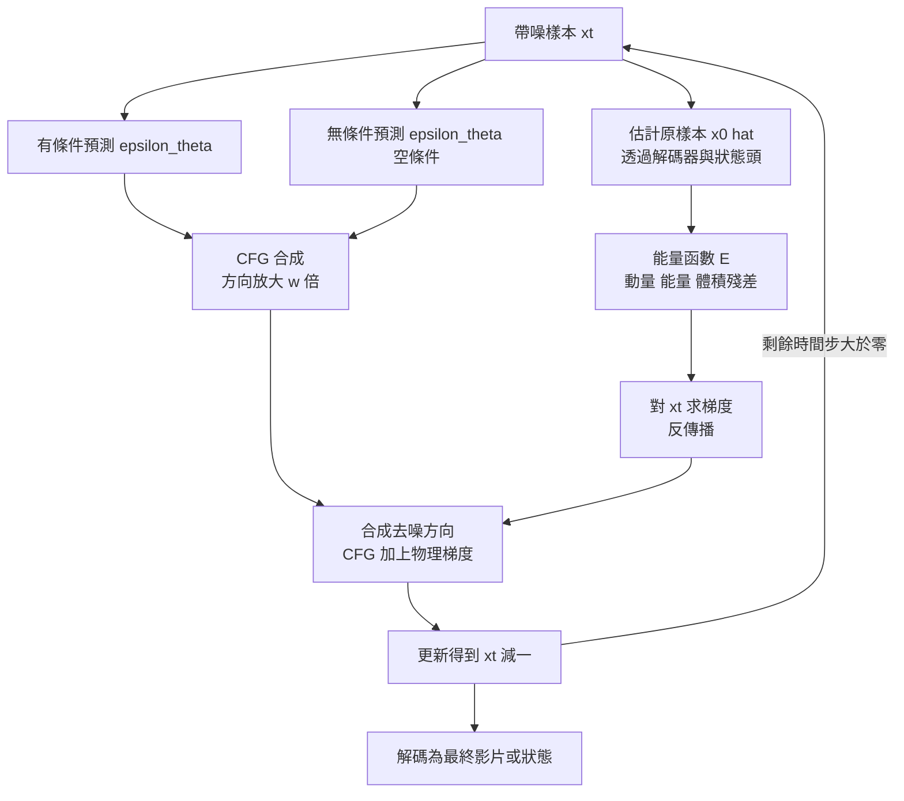

# 5.4 物理約束導引：利用能量函數與無分類器引導（CFG）強制遵循守恆定律

## 一、物理幻覺的具體形態

第 3 章談過物理幻覺，第 5.1 至 5.3 節則證明了擴散模型在視覺上極其擅長、在物理上卻毫無保證。兩者結合會產生一種特別危險的組合：**看起來完美、動起來荒謬**。具體的失效形態包括：物體在無外力下突然改變速度、穿透彼此、懸空不落、質量明顯改變、容器裡的水憑空溢出。

這些失效之所以危險，是因為它們不會在畫面中留下明顯的破綻。一個穿牆而過的杯子在單幀裡完全正常，只有在連續播放並量測其位置與速度時才會暴露。而大多數生成模型的評測指標恰恰只看單幀相似度與人眼觀感，因此物理違規幾乎不會被自動偵測到。

本章要處理的是：既然模型無法天然學會守恆律（因為守恆律是**硬約束**而非資料中的統計傾向），那麼能不能在生成過程中把它**強制進去**。答案是可以，但必須對「強制」的意義有清醒的認識——這是本章最後要回頭處理的問題。

## 二、無分類器引導的數學

引導的出發點是 Ho 與 Salimans 於 2022 年提出的**無分類器引導**（classifier-free guidance, CFG）。它的基本洞見是：要引導一個生成模型朝條件 $c$ 的方向走，不必訓練一個獨立的分類器去估計 $\nabla_x \log p(c \mid x)$ ，只要比較同一個網路在有條件與無條件下的兩個預測即可。

令 $\epsilon_\theta(x_t, t, c)$ 為有條件預測， $\epsilon_\theta(x_t, t, \varnothing)$ 為無條件預測，則引導後的雜訊估計為：

$$
\tilde{\epsilon}_\theta(x_t, t, c) = \epsilon_\theta(x_t, t, \varnothing) + w \left[ \epsilon_\theta(x_t, t, c) - \epsilon_\theta(x_t, t, \varnothing) \right]
$$

其中 $w$ 是引導強度， $w = 1$ 退回到純條件預測， $w > 1$ 則把條件方向放大。這個式子可以被解讀為一個近似的梯度：差值項 $\epsilon_\theta(x_t, t, c) - \epsilon_\theta(x_t, t, \varnothing)$ 在某種意義上就是條件分佈對輸入的（負）梯度方向，方向就是「讓樣本更像是滿足條件 $c$ 的樣本」。實作上，訓練時以一定機率把條件置空，推理時同時算兩條分支即可，成本是兩次前向。

CFG 的威力在於它把「條件」這個概念從語義擴展到了**任何可微的性質**。若把條件換成一個物理量的目標值——例如「這段軌跡的總動量必須是零」——那麼引導方向就變成了「讓生成結果更接近滿足物理條件的方向」。

## 三、守恆律的能量函數形式化

物理守恆律可以用**能量函數**（更精確地說是守恆量的殘差）來表徵。對一個守恆量 $C$ （總動量、總能量、體積），定義其在生成結果上的違反量：

$$
E(\hat{x}) = \left\| C(\hat{x}) - C_{\text{target}} \right\|_2^2
$$

三個典型的守恆量可以這樣寫。**動量守恆**：在無外力的封閉系統中，總動量 $\sum_i m_i v_i$ 守恆，因此違反量是 $\|\sum_i m_i \hat{v}_i\|^2$ 。**能量守恆**：在無外力做功的情況下，總機械能 $\sum_i \frac{1}{2} m_i \|\hat{v}_i\|^2 + \sum_i m_i g h_i$ 守恆，違反量是這個總和相對初始值的偏差。**體積守恆**：對不可壓縮流體，佔據體積 $\sum_i V_i$ 守恆，違反量是 $\|\sum_i \hat{V}_i - V_0\|^2$ 。

這些量的共同特徵是**可在生成結果上直接計算**，因為它們只依賴物體的狀態量（位置、速度、體積），而不依賴渲染外觀。這一點極其關鍵：它意味著約束可以在去噪迴圈的每一步即時求值，而不需等到影片渲染完成再去偵測問題。

## 四、把能量梯度加進去噪引導

有了可微的違反量 $E(\hat{x})$ ，就可以構造物理引導項。在反向去噪的每一步，除了原有的雜訊預測之外，再加上一個沿能量梯度下降的方向：

$$
\tilde{\epsilon}_\theta(x_t, t, c) = \tilde{\epsilon}_\theta^{\text{CFG}}(x_t, t, c) - \lambda \sqrt{1 - \bar{\alpha}_t}\, \nabla_{x_t} E\left( \hat{x}_0(x_t) \right)
$$

其中 $\hat{x}_0(x_t)$ 是把當前的帶噪樣本估計回原樣本， $\nabla$ 的計算需要對解碼器與狀態抽取器反傳播， $\lambda$ 是物理約束的權重。這個式子的直覺是：CFG 負責「生成像條件的東西」，物理項負責「生成守恆的東西」，兩者相加後的去噪方向就同時朝兩個目標前進。

實作上有三個關鍵細節。第一，**物理項必須乘上噪聲尺度因子**，因為在高噪聲層級上， $x_t$ 與 $x_0$ 的關係是強衰弱的，直接對 $x_t$ 求梯度會得到一個尺度不對的修正量。第二，**物理項通常只在後段去噪步啟用**。在高噪聲層級上，樣本還沒有可辨識的物體結構，能量函數根本算不出來，此時的梯度是雜訊而不是訊號。第三，** $\lambda$ 需要隨時間步衰減**，因為越接近收尾，模型自身的先驗越可靠，物理修正應當越保守；過強的物理引導會把生成結果壓成僵硬、只有一種解的軌跡，等於抹掉了擴散最珍貴的多樣性。

## 五、從守恆律到接觸：約束強度的分級

守恆律之所以容易實作，是因為它有一個極為便利的性質：**它是一個全域的、不帶接觸細節的等式**。總動量是所有物體動量的和，總能量是所有物體機械能的總和；它們不關心任一對物體之間的接觸狀態，因此不會因為接觸幾何的細微變化而改變形式。這是守恆律能被寫成簡潔能量函數的根本原因。

相較之下，**接觸與非穿透是帶不等式的局部約束**。兩個剛體不得互相滲透，寫成不等式 $\|x_A - x_B\| \geq r_A + r_B$ ；接觸時法向力不得為負（只能推不能拉），寫成 $f_n \geq 0$ ；摩擦力受庫侖錐約束，寫成 $\|\mathbf{f}_t\| \leq \mu f_n$ 。這三組不等式耦合在一起，加上接觸點位置未知這個變數，使得接觸問題成為一個**互补性問題**（complementarity problem）：接觸力與穿透深度必須滿足「二選一」的互斥條件。

要對這類約束求梯度，就必須先求解互補性條件，也就意味著要在每次去噪步內部執行一次接觸求解。這在數值上是昂貴的，在工程上更是脆弱——求解器收斂與否本身成為新的不確定性來源。因此實務上的做法是分級的：先用容易實作的守恆量做粗篩，再用較弱的接觸近似（例如深度圖重疊的懲罰）做細修，並且把整個物理模組的求解設定在近似或鬆弛的層級上。

這個分級提示了一個更一般的判準：**一個物理約束是否值得編碼，取決於它對決策的影響權重與實作成本的比值**。總能量守恆的實作成本是近乎零的（加總幾個標量），而它的影響——偵測出「物體憑空加速」——在安全關鍵的系統中極高；摩擦錐的實作成本則高昂得多，而多數日常任務中，摩擦的細節並不決定成敗。

## 六、與物理資訊網路的關係

這種「把已知物理方程編碼進訓練或推理過程」的思路，與**物理資訊網路**（physics-informed neural networks, PINN）共享同一個血統。PINN 的做法是：網路在解偏微分方程時，除了資料的邊界條件與初始條件之外，還加入一個**殘差損失項**：

$$
\mathcal{L}_{\text{PINN}} = \mathcal{L}_{\text{data}} + \mu\, \left\| \frac{\partial^2 u}{\partial t^2} - \nabla \cdot \sigma(\nabla u) + f \right\|^2
$$

兩者的關係是精確的鏡像。PINN 把物理方程編碼成**訓練時的損失項**，讓網路在學習的過程中就傾向於滿足方程；本章的引導法把物理方程編碼成**推理時的方向項**，讓去噪的每一步都朝物理允許的方向移動。PINN 依賴方程的導數形式，需要對網路輸出求二階導數，實作上既昂貴又容易數值不穩；引導法只需要對狀態量求一階導數，實作上更簡潔，但需要一個能從生成結果中抽出物理量的**狀態頭**。

這裡出現了一個極重要的工程前提：**物理引導的品質完全取決於狀態抽取器的品質**。若從生成影片中估計物體速度是用差分位置座標得到的，那麼這個速度估計本身就有雜訊，梯度就會把雜訊當成物理修正的方向。在理想狀態下，擴散模型直接在狀態空間工作（第 5.1 節所說的物理軌跡去噪），此時能量函數的輸入是模型原生輸出的狀態，不需要從像素反推，物理引導才真正可靠。

## 七、導引法與投影法的比較

另一條完全不同的路線是**投影法**：先生成，再用一個物理引擎或最佳化程序把結果「拉回」守恆集合。形式上，這是求一個距離生成結果最近、且滿足守恆律的修正：

$$
\hat{x}_{\text{proj}} = \arg\min_{x} \left\| x - \hat{x}_{\text{raw}} \right\|_2^2 \quad \text{s.t.} \quad C(x) = C_{\text{target}}
$$

這個最佳化可以用投影梯度法、牛頓法或基於物理引擎的重新模擬來求解。兩種方法的能力邊界有本質差異。

**引導法**的優點是它作用在生成的過程中，因此能影響生成結果的**結構**：模型是被引導去找一個本身就守恆的解，而不是先生成一個錯誤的解再被動修正。這也意味著引導法能帶來更好的視覺品質與更合理的物體行為。它的代價是**不保證嚴格滿足**——引導只是一個局部方向的近似，去噪步數有限、能量函數非凸，最終的違反量通常只是變小而非歸零。

**投影法**的優點是**保證滿足**（若最佳化收斂），因為滿足性是硬編碼在約束裡的。它的代價則有兩重：一是破壞視覺品質，因為把生成結果投影到守恆集合上的最近點，很可能造成像素級的突兀變化與時間上的不連續；二是無法修復**因果結構**上的錯誤。舉例而言，若原始生成中一個杯子從桌面內部穿出，投影法可以把它拉回桌面附近，但拉回後的軌跡可能是一個違反運動學連續性的跳躍——它滿足能量守恆，卻在物理上是不可解釋的。

因此實務上的結論是：**引導為主，投影為輔**。用引導在過程中塑造，用投影在最後做一道保險，並且要度量投影前後的違反量變化，以確認投影沒有把視覺品質一起壓垮。

## 八、實驗設計：如何偵測物理違反

物理約束研究最脆弱的地方是評測。一個生成模型即使完全不遵守守恆律，若評測者只用畫面相似度打分，它依然會贏。所以必須設計**能自動偵測物理違反的評測器**。

三種方法可以並列比較：

| 方法 | 偵測對象 | 優點 | 弱點 |
| --- | --- | --- | --- |
| 幾何穿透檢測 | 佔據區域重疊、穿牆、懸空 | 直覺明確，可自動化 | 依賴分割與深度估計，容差難調 |
| 能量監測 | 動量與機械能隨時間的漂移 | 直接對應守恆量，易量化 | 速度由光流或位置差分推得，噪聲大 |
| 反事實一致性 | 兩組初始條件下的比例關係 | 檢驗的是結構而非數值 | 需要成對生成，評測成本高 |

第一類是**幾何穿透檢測**。偵測物體的佔據區域在三維空間中的重疊：若兩個剛體的碰撞體積持續為正，或一個物體的佔據區域穿過支撐面，這就是明確的違反。這個檢測可以從深度估計或分割遮罩重建，難點在於接觸附近的遮罩本身就有誤差，因此需要容差設計。

第二類是**能量監測**。在生成的軌跡上估計動量與機械能隨時間的變化，看它們是否在無外力的情境下保持恆定。這個檢測可以直接在狀態空間做，也可以在像素上用光流推估速度。

第三類是**反事實一致性檢測**：把同一個場景用兩組不同的初始條件生成，檢查物理量是否按守恆律預期的比例改變。例如給物體兩倍的初速度，若總動量守恆，另一個聯動物體的速度應當按比例變化。

這三類檢測都必須與**畫面品質指標並列報告**。只報告物理指標的論文與只報告畫質指標的論文，兩者都不足以支持「物理正確的主張」。一個好的實驗設計，是把守恆引導開與關各跑一次，同時報告視覺保真度、耗時與物理違反量三組數字——若開啟引導後視覺品質大幅下降而違反量只微降，那麼這個方法在該場景下就是不值得的。

## 九、誠實評估：守恆律是弱約束集

最後必須把話說清楚，這也是本章最重要的判準。

**滿足守恆律不等於物理正確。** 守恆律是一組非常弱的約束：它們只規定某些量在無外力的封閉系統中保持不變，卻完全不規定系統必須如何演化。數學上存在無窮多種滿足守恆律但不具任何物理意義的解——例如一個物體在空間中畫著複雜的圖形而總動量恰好為零。守恆律排除的是顯而易見的荒謬，而不是所有的不合理。

更麻煩的是，**真實的物理問題遠超目前的損失設計能處理的範圍**。剛體接觸問題就是最好的例子。一個方塊落在另一個方塊上，涉及接觸力求解、非穿透約束、摩擦錐、庫侖摩擦的 stick-slip 轉換、以及接觸點位置的確定——這是一個帶不等式約束的互動式動力學問題，它的解不唯一，且取決於物體的質量分佈與接觸面的形狀細節。把這些編碼成一個可以對生成結果求梯度的能量函數，遠比想像中困難得多。現有的嘗試多是把接觸簡化為一個懲罰項（例如深度圖的負重疊量），這在簡單場景有效，但在堆疊、滾動、多物體連鎖碰撞時會失敗。

還有一個量級問題值得強調。守恆引導需要對生成結果反傳播以求梯度，因此**每一步去噪都要做一次完整的物理量計算與反傳**。相較於單純的神經網路前向，這可能讓推理成本增加數倍。當我們在第 5.3 節已經受夠了擴散策略的延遲問題時，這個成本是必須正視的。

因此本章的誠實結論是：物理約束導引是一個**必要但不充分**的工具。它能把明顯的物理幻覺壓到罕見的程度，這本身就極有價值，因為駕駛與操作系統無法承受偶發的穿透。但它不能取代一個真正的物理模型或一個真正的狀態表徵，只能作為後者的補充。

這就引出了第 6 章的核心論點。如果一個模型的主要工作是重建像素，而物理正確又幾乎無法從像素層次直接學會，那麼值得追問的是：容量是否用錯了地方？與其把數十億參數花在重建高頻紋理上，不如讓模型只預測那些對決策真正有用的特徵——位置、朝向、速度、可交互性。JEPA 架構正是沿著這條路徑，把世界模型從「生成看起來像的東西」重新定義為「預測有用的東西」，而這一次，物理守恆不再是外加的懲罰，而是內生的結構。
