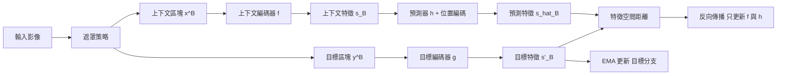
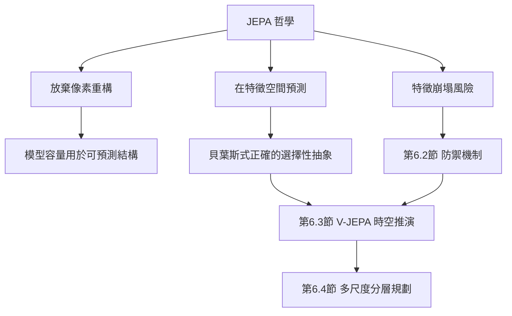

# 6.1 JEPA 哲學核心：放棄像素重構，只在抽象潛在特徵空間預測世界未來

## 像素重構是一種慷慨的浪費

在 JEPA 登上舞台之前，主流的自監督學習幾乎都建立在同一個念頭之上：把輸入遮住一部分，讓模型把它猜回來。影像有遮罩自編碼器，序列有掩碼語言模型，音訊有波形重建。目標函數驚人地一致——最小化觀測與重建之間的距離。LeCun 對此提出的批評可以概括為一句話：這種做法把模型最寶貴的容量，浪費在重建那些本質上不可預測的細節上。

葉子落下是教科書級的例子。假設我們看見一片葉子從樹梢飄落，問「它落在地面時每個像素的精確灰階是什麼」，這個問題在物理上是無解的：風的微小擾動、葉片自身的轉動軸、它與空氣摩擦產生的細渦流，都會讓著地點偏移數公分。這些偏移不是模型的缺陷，而是世界本身的隨機性。一個成功的模型不該學會猜出葉子的確切著地位置，而該學會承認它不可預測，並把容量轉移到真正可預測的量上：葉子的存在、它正在下降、下降方向大致朝向地面。

LeCun 的洞見在於把可預測性這件事從像素層級抬升到抽象層級。他主張人類與動物並不在內部重建整幅視野：視覺皮質的資源集中在形狀、位置、運動方向與物體恆常性上，背景的細微紋理幾乎不進入工作記憶。所謂世界模型，正是這種只保留可操作結構的緊湊內部狀態。JEPA 是他給這條路線取的名字：Joint Embedding Predictive Architecture，聯合嵌入預測架構。

這個批評的力量在於它是選擇性的。模型容量有限，而每一個參數都意味著在其他任務上少了一分餘裕。若目標函式要求還原隨機噪點，網路就必須把噪點也編碼進去；若目標函式只要求還原可預測的結構，網路才有餘裕去學會「這是一個會往下掉的物體」這種一般性原理。前者要求模型記住世界的快照，後者要求模型理解世界的規律。

這個取捨在算力受限時更為關鍵。重建式模型需要處理高維像素輸出，它的解碼頭往往佔掉整個網路相當大的比例，而且這些參數全數投注在無法推廣的細節上。JEPA 把輸出降到數百維的特徵向量，網路深處的所有容量都可用於建構狀態表示。這在模型規模受限的邊緣設備上特別重要：一台機器人上的小型編碼器若只須輸出抽象特徵，其計算量可比輸出整幅影像低數個數量級。

還有一個容易被忽略的效率來源。重建式目標要求模型把輸入重新走一遍完整資訊路徑，因為漏掉任何一個像素都是誤差；JEPA 的遮罩設定允許模型大幅稀疏化上下文，甚至只保留全圖百分之十的可見區域。只要編碼器真的學到了可推廣的抽象，遮罩越嚴格就代表任務越有挑戰、學到的結構越穩健。這是 I-JEPA 實驗中反覆出現的現象，也是遮罩比例成為關鍵超參數的原因。

## 核心命題：在抽象潛在空間中預測未來

JEPA 的命題可以一句話講完：**把預測的發生場所從觀測空間搬到抽象的潛在特徵空間，並且放棄對輸入細節的重建要求**。這裡有兩個獨立的改動，缺一不可。第一個改動是空間的改動：目標不再是要還原的像素，而是某個抽象編碼器對目標區域算出的特徵向量。第二個改動是內容的改動：預測目標不必與輸入的外觀一一對應，它只需要與目標的語義結構一致。

這兩者結合之後，模型的工作性質就完全改變了。重建式模型扮演的是攝影師的角色：它的任務是忠實複製看見的東西。JEPA 模型扮演的是物理學家的角色：它描述的是「接下來會有什麼」，而不是「剛才那張照片長什麼樣」。前者追求的是外觀保真度，後者追求的是結構一致性。

這個區別在物理世界裡尤其重要，因為物理的狀態與外觀之間存在大量不可逆的資訊流失。當一個球滾進陰影裡，它的外觀特徵在像素上完全消失了，但它的位置與速度並沒有消失。若模型的工作是重建外觀，它必然會在遮擋處失敗；若模型的工作是預測抽象狀態，它只需要維持一條跨越遮擋的狀態軌跡即可。第 2 章之所以要引入物體中心的槽位表示，理由正在於此——抽象狀態必須能在視覺證據缺失時仍然存在。

## 目標函數：上下文編碼、目標編碼與預測器

JEPA 的形式化很簡潔。給定一段輸入影像，遮罩策略切出兩部分：上下文區塊 $`x^{B}`$ 與一個或多個目標區塊 $`y^{B}`$ 。上下文編碼器把可見部分映射為特徵：

$$
s_B = f_{\theta}(x^{B})
$$

目標編碼器把目標區塊映射為目標特徵：

$$
s^{\prime}_B = g_{\bar{\theta}}(y^{B})
$$

預測器以上下文特徵為輸入，嘗試還原目標特徵：

$$
\hat{s}_B = h_{\phi}\left(s_B, \operatorname{pos}(y^{B})\right)
$$

整個模型的訓練目標就是在特徵空間中對齊預測值與目標值：

$$
\mathcal{L}_{\text{JEPA}} = \sum_{B} \left\| \hat{s}_B - \operatorname{sg}\left(s^{\prime}_B\right) \right\|_2^2
$$

其中 $`\operatorname{sg}(\cdot)`$ 是停止梯度算子， $`\operatorname{pos}(\cdot)`$ 提供目標區塊的位置編碼。這個公式裡藏著三個關鍵設計。第一，誤差是在特徵空間量測的，不是像素空間。第二，目標分支帶著停止梯度，意味著它不直接接受梯度更新。第三，預測器必須依賴位置編碼才能定位目標，因為特徵向量本身不帶座標資訊。

值得留意的是，這個目標函式與自監督世界模型中常見的「以重建為主、對齊為輔」形成鮮明對照。重建的損失是像素級的歐氏距離，JEPA 的損失是特徵級的歐氏距離。兩者形式上只差一個編碼器，但這個編碼器改變了學習問題的性質：特徵空間裡的距離不再對應物理上的不可預測細節，而對應抽象結構的相似程度。

## 與兩條既有路線的結構性差異

把 JEPA 放進更大的座標系裡比較，差異會更清楚。第一個對照物是變分自編碼器（VAE）。VAE 的目標函式要求解碼器從潛在向量重建出接近原始的像素：

$$
\mathcal{L}_{\text{VAE}} = \mathbb{E}_{q}\left[ \left\| x - g_{\text{dec}}(z) \right\|_2^2 \right] + \beta\, \mathrm{KL}\left( q(z \mid x) \,\|\, p(z) \right)
$$

重建項是主導項，它把解碼器壓成一個「把特徵變回像素」的翻譯器。JEPA 沒有這個翻譯器，也沒有對應的像素生成壓力：它的解碼方向被完全砍掉，只留下「從已有狀態推想未知狀態」這一件事。VAE 擅長的是記憶與生成，JEPA 擅長的是推演。

第二個對照物是對比學習。對比學習是判斷式的：它問「這兩張圖是不是同一張圖的正檢視圖」，用正樣本拉近、負樣本推遠來塑造表徵。JEPA 是預測式的：它不要求任何正負判定，而是要求模型給出一個具體的目標特徵。這個差別在資料效率與規模上極為關鍵——判斷式方法需要大量負樣本來界定邊界，而預測式方法只要一個「猜對了沒有」的連續訊號。

| 架構路線 | 預測目標空間 | 目標函式 | 代表方法 | 優點 | 主要代價 |
| --- | --- | --- | --- | --- | --- |
| 自迴歸重建 | 像素／Token 序列 | $`-\sum \log p(x_{t} \mid x_{<t})`$ | GPT 類、VideoGPT | 生成品質高、可用 likelihood 評估 | 逐 token 推理慢、易產生物理幻覺 |
| 擴散生成 | 像素／潛在分佈 | $`\mathcal{L}_{\text{diff}} = \mathbb{E}_{t,\epsilon}\left[ \| \epsilon - \epsilon_{\theta}(x_t, t) \|^2 \right]`$ | Diffusion World Model | 能表示多模態未來 | 推理需多步去噪、訓練資料龐大 |
| 特徵預測 | 抽象潛在特徵 | $`\lVert \hat{s}_B - \operatorname{sg}(s^{\prime}_B) \rVert_2^2`$ | I-JEPA、V-JEPA | 不浪費容量在不可預測細節 | 難以用像素指標評估、可能塌縮 |

第三條路是本章的主軸。值得注意的是三者並非互斥：擴散模型可以在潛在特徵空間中去噪，一樣具有 JEPA 氣質。真正的分水嶺在於目標函式的落點——落在可見像素上，還是落在抽象特徵上。

## 抽象特徵作為可組合的狀態座標

JEPA 的目標函式還有一個常被忽略的後果：它把特徵空間變成了一個可以在其上做幾何運算的狀態座標。像素空間不具備這個性質——兩張影像的像素差取決於相機位姿、光照與紋理，因此像素距離幾乎不含幾何資訊。特徵空間則不同，只要編碼器學到的特徵對應於物件身分、位置與姿態，那麼特徵之間的距離就承載了物理意義。

這個性質是規劃的前提。第 8 章的蒙地卡羅樹搜尋與模型預測控制，都要求能夠在狀態空間裡做插值、外推與比較：把兩個候選狀態拿來排序、沿著某個方向輕微擾動以檢查穩定性、從一個狀態出發推演多條分支。像素空間做不到這件事，因為像素之間的「小改變」未必對應世界中的「小改變」；特徵空間可以，只要編碼器的訓練逼它對世界變化敏感。

另一個後果是特徵預測天然帶有等變性啟發。當物體在場景中平移時，它的特徵不應該大幅改變，只有位置編碼該跟著動。I-JEPA 之類的方法之所以要在預測器裡注入目標區塊的位置編碼，正是為了讓模型學會「移動的是位置，不是身分」。這種「身分不變而位置變動」的分解，正是第 2 章幾何表徵所追求的東西，而它在 JEPA 的架構裡是免費附帶的副產品。

值得強調的是，這些好處並非來自額外的監督訊號。它們從「用抽象特徵而非像素作為預測對象」這一個改動中自然湧現。換句話說，JEPA 的哲學不只是省下算力，它還順帶選對了狀態的度量方式。

## 放棄細節的貝葉斯正確性

「放棄細節」聽起來像是偷懶，但從統計的觀點看，它是唯一正確的選擇。設世界狀態為 $`z`$ ，觀測為 $`o = \omega(z, \eta)`$ ，其中 $`\eta`$ 代表隨機噪聲：葉片的細微顫動、像素的隨機抖動、感測器的熱雜訊。若我們要求模型預測完整的觀測，那麼最優預測是條件期望 $`\mathbb{E}[o \mid z]`$ ，這在數學上已經把不可預測的分量除掉了——條件期望天然地只保留可預測的部分。

JEPA 做的事情，是把這個原理再往前推一步：不是先算出最佳像素預測再去比對，而是讓編碼器直接學會丟棄那些丟了也無損的維度。編碼器的目標不是壓縮，是**選擇性抽象**。理想編碼器應當滿足兩個條件：對 $`z`$ 中可預測的部分保持敏感，對 $`\eta`$ 完全不變。這正是 JEPA 的損失函式在做的事，因為目標特徵 $`s^{\prime}_B`$ 若真的編碼了隨機細節，預測它就會變成不可能的任務。

這裡有一個更深的對稱性值得指出：VAE 與擴散模型都在某種意義上保留了觀測分佈的全部資訊，包括隨機分量；它們的生成能力正來自於此。JEPA 則是刻意放棄這種能力，轉而追求預測的可靠性。兩者的取捨不可兼得，但在世界模型這個任務上，可靠性通常比還原度更重要——一個能把不可預測的葉片位置猜得很像的模型，並不比一個知道自己猜不準的模型更有用。

## 三個實例架構的分工

JEPA 家族目前有三個成員，各自佔據不同的抽象層級。I-JEPA 處理靜態影像，它證明了遮罩式特徵預測能在影像上學到可遷移的物件與場景結構，且完全不需要標註。V-JEPA 把同一套機制推到影片，讓模型在遮罩時空區塊的條件下預測未來幀的特徵，這是第 6.3 節的主題。Y-JEPA 則試圖把架構推向外感官與世界模型層級，讓預測跨越多種觀測模態與時間跨度，處理更接近完整世界狀態的抽象。

三者的共同骨架不變：上下文編碼器、目標編碼器、遮罩預測器、停止梯度、動量更新。改變的只是遮罩的幾何形狀與時間跨度。這個穩定性本身就是一個訊號：JEPA 不是一堆零散的技巧，而是一個可以持續擴展的架構範式。

三個成員也對應了三種不同的時間觀點。I-JEPA 沒有時間軸，它預測的是空間中的缺失區塊，學到的是靜態的場景語意。V-JEPA 加入了時間軸，預測的是未來時刻的特徵，學到的是運動與物件恆常性。Y-JEPA 試圖把時間尺度拉到極長，預測的是小時至天級別的世界狀態變化。這個跨度擴張的順序很重要：它說明 JEPA 的抽象機制在時間上是可擴展的，而不是只在靜態影像上恰好有效。

在這個意義上，Y-JEPA 的存在是本章最重要的理論預測之一。若第 6.4 節的多尺度分層確有必要，那麼單一時間解析率的 JEPA 就不夠用；必須讓不同層的預測器各自佔據不同的時間跨度。Y-JEPA 試圖在同一個架構內處理這個問題，而第 6.4 節會給出更明確的分層設計。

## 從被動推演到主動規劃：塌縮的幽靈

JEPA 的哲學很吸引人，但直接實作會立刻撞上一堵牆。如果目標特徵與上下文特徵之間存在某種平凡的捷径——例如模型發現只要輸出某個常數向量就能把損失壓到很低——那麼預測器會毫不猶豫地這麼做。這種現象稱為特徵崩塌（representation collapse），它是 JEPA 路線最根本的失敗模式，也是本章下一節要處理的對象。

在進入那場數學討論之前，值得先記住 JEPA 的定位：它提供的是一個抽象的、對細節免疫的推演引擎。但一個不會崩塌的推演引擎，若不知道「我的動作」會如何改變世界，它仍然只是一個被動的觀察模型。第 6 章處理的是「如何在特徵空間預測未來」，第 7 章才會把動作這個維度加回來。

