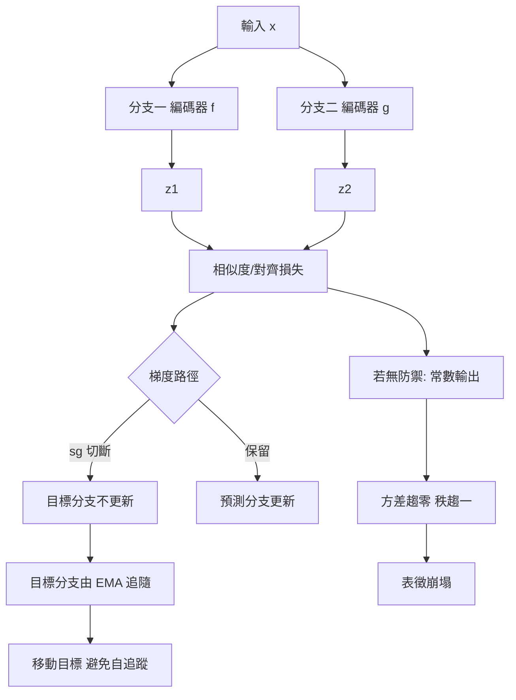
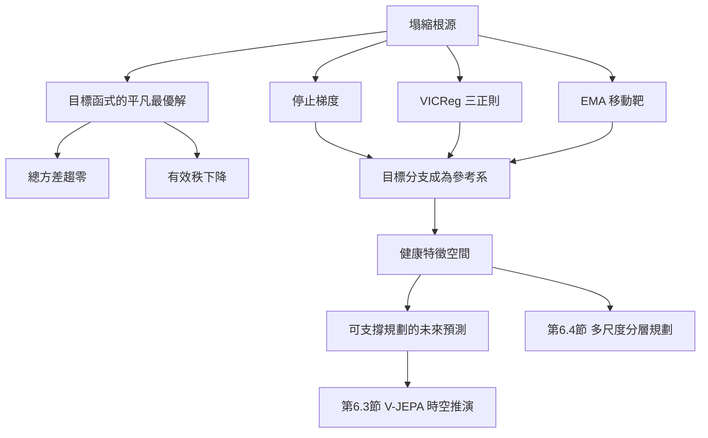

# 6.2 特徵崩塌（Representation Collapse）的數學根源與防禦機制（VICReg / 停止梯度）

## 一個令人不安的最優解

自監督學習有個著名的幽靈：當目標函式只剩下「讓兩份表示靠近」時，最簡單的解法不是學到有意義的特徵，而是讓所有輸入都映射到同一個常數向量。這時損失為零，表徵毫無資訊量，而訓練曲線看起來完美地下降。這個現象被稱為表徵崩塌（representation collapse），在對比學習中叫作表徵塌縮，在預測式方法中則呈現為預測器輸出退化。

崩塌之所以會發生，不只是因為訓練不夠好，而是因為它是目標函式的**全域最優解**。設編碼器為 $`f_\theta`$ ，兩個分支的輸出為 $`z^{(1)} = f_\theta(x^{(1)})`$ 與 $`z^{(2)} = f_\theta(x^{(2)})`$ ，若唯一的要求是兩者接近：

$$
\mathcal{L}_{\text{naive}} = \left\| z^{(1)} - z^{(2)} \right\|_2^2
$$

那麼把 $`f_\theta`$ 設為常數函數 $`f_\theta(x) = c`$ 即可讓損失恆為零。更關鍵的是，這個解在數學上是**唯一**的最小值點附近的吸引域：任何朝常數函數收縮的微小擾動都會進一步降低損失。也就是說，梯度下降在這個目標上是被結構性地吸引向平凡解的。

更根本的問題出現在解碼器上。假設我們要預測一個目標特徵 $`y`$ ，並允許網路使用任意的中間表示 $`z`$ ：

$$
\mathcal{L} = \left\| h_\theta(z) - y \right\|_2^2
$$

若 $`h_\theta`$ 是恆等映射，最優解就是 $`z = y`$ ；但若 $`h_\theta`$ 可以把任何輸入壓成常數，只要 $`y`$ 本身接近某個常數，最優解就是 $`z = \text{const}`$ 。這裡的問題不是網路「壞掉」，而是資訊瓶頸的位置錯了：當預測器沒有被迫依賴上下文時，網路可以走捷徑。

## 能量守恆的失效與秩塌縮

從能量與秩的觀點來看，崩塌有更精確的描述。設一批 $`N`$ 個樣本的表示矩陣為 $`Z \in \mathbb{R}^{N \times d}`$ ，其中心化後的總方差可寫成：

$$
\mathcal{E} = \frac{1}{d} \sum_{i=1}^{d} \operatorname{Var}\left[ z_{:,i} \right]
$$

在健康的表徵中， $`E`$ 應該維持在某個正值，因為不同樣本確實有不同的特徵值。崩塌時 $`E \to 0`$ ，所有維度的樣本方差都趨近於零。更嚴重的是秩的塌縮：表示矩陣 $`Z`$ 的數值秩隨之下降：

$$
\operatorname{rank}(Z) \to 1
$$

這意味著整個特徵空間退化成一條線或一個點。模型在這種狀態下不是「學得不夠」，而是**資訊通道被物理性地關閉**了。

這個能量失效的描述有兩個好處。第一，它把「崩塌」翻譯成一個可以監測的量：訓練時直接追蹤每個維度的方差與整體協方差矩陣的特徵值，就能即時發現塌縮。第二，它指出崩塌並非二元事件，而是連續退化過程；防禦機制因此應該設計成持續施加的「能量注入」，而不是一個開關。

值得注意的是，批次正規化（BatchNorm）在這裡扮演了不對稱的角色。它在實作上強行把每個維度的樣本方差拉到接近一，因而部分掩蓋了崩塌的症狀。這種「用工程手段偷偷修復目標函式的缺陷」的做法的代價是：模型對批次組成產生了隱性依賴，批次大小與資料分佈的改變會直接改變模型行為。

## 停止梯度：把移動靶的機制拆開

JEPA 與 VICReg 的第一道防線是停止梯度。在 6.1 節的目標函式裡：

$$
\mathcal{L}_{\text{JEPA}} = \sum_{B} \left\| \hat{s}_B - \operatorname{sg}\left(s^{\prime}_B\right) \right\|_2^2
$$

$`\operatorname{sg}`$ 切斷了從目標分支回到目標編碼器的梯度路徑。這個操作的意義是：**目標分支不再是學習的對象，而是一個移動的參考系**。梯度只能沿著預測分支流動，讓 $`h_\phi`$ 收縮到當前的目標特徵周圍。

為什麼這能防止塌縮？因為若目標分支不接收梯度，它就不會為了降低損失而主動退化。若允許梯度流過目標編碼器，最省力的路徑是讓編碼器把所有輸入都映射成同一個向量——如此目標與預測自動一致，損失為零。停止梯度剝奪了這個捷徑。

但停止梯度本身**不保證**不崩塌。若上下文編碼器與目標編碼器都是恆等映射，而預測器也是恆等映射，那麼目標函式退化成：

$$
\left\| x^{B} - y^{B} \right\|_2^2
$$

這個量不可能被壓到零（輸入確實不同），所以預測器不會平凡化。然而若編碼器先學到一個「把所有輸入映到場景平均」的退化解，目標與預測就會共享這個退化解，損失同樣趨近於零。也就是說，停止梯度是必要條件，但不是充分條件。

這就是為什麼 JEPA 需要**不對稱架構**：上下文編碼器與目標編碼器不共享參數，且目標編碼器不直接受梯度更新，而是以指數移動平均（EMA）從上下文編碼器取權重：

$$
\bar{\theta} \leftarrow m \bar{\theta} + (1 - m)\, \theta
$$

其中 $`m`$ 是動量係數，通常設在 0.99 以上。這個機制同時解決了兩個問題：它保證目標與上下文來自**不同的**函數（避免共享捷徑），並且提供一個緩慢漂移的目標，使模型永遠在追一個略微不同的參考系而非固定的自己。

## VICReg 的三項正則

若目標分支被保護住了，剩下的問題是：如何保證編碼器**願意**保留多樣的特徵？VICReg 的答案是顯式地把三種互相競爭的需求寫進損失函式。

第一項是**不變性項**，它維持兩份增強視圖之間的一致性：

$$
\mathcal{L}_{\text{inv}} = \left\| z^{(1)} - z^{(2)} \right\|_2^2
$$

第二項是**方差項**，它鼓勵表示在每個維度上保持變異：

$$
\mathcal{L}_{\text{var}} = \frac{1}{d} \sum_{i=1}^{d} \max\left( 0, \; \gamma - \operatorname{Var}\left[ z^{(1)}_{:,i} \right] \right)
$$

這個 hinge 形式的設計很精巧：當某個維度的方差低於門檻 $`\gamma`$ 時才產生懲罰，一旦超過門檻就歸零。它不要求方差越大越好，只要求每個維度都「活著」，因此不會與不變性項直接衝突——因為不變性項只要求同一樣本在兩個視圖下相同，不同樣本之間仍然可以自由差異。

第三項是**協方差項**，它降低維度之間的冗餘：

$$
\mathcal{L}_{\text{cov}} = \frac{1}{d} \sum_{i \neq j} \left[ C_{ij} \right]^2 , \qquad C_{ij} = \frac{1}{N - 1} \sum_{b=1}^{N} \left( z^{(1)}_{b,i} - \mu_i \right) \left( z^{(1)}_{b,j} - \mu_j \right)
$$

若第 $`i`$ 與第 $`j`$ 維度高度相關， $`C_{ij}`$ 就會很大，平方後受到重罰。總損失為：

$$
\mathcal{L}_{\text{VICReg}} = \lambda \mathcal{L}_{\text{var}} + \mu \mathcal{L}_{\text{cov}} + \mathcal{L}_{\text{inv}}
$$

三項的分工可以這樣理解：不變性項提供**語義黏合**，方差項提供**資訊保險**，協方差項提供**維度效率**。前兩者保證不塌縮，第三者保證不浪費。

| 正則項 | 作用 | 對塌縮的防禦 | 代價 |
| --- | --- | --- | --- |
| 不變性 $`\mathcal{L}_{\text{inv}}`$ | 跨視圖語義一致 | 提供對齊訊號 | 過強會抹除樣本差異 |
| 方差 $`\mathcal{L}_{\text{var}}`$ | 每維保持變異 | 直接阻止總方差趨零 | 強行變異可能壓縮語義 |
| 協方差 $`\mathcal{L}_{\text{cov}}`$ | 降低維度冗餘 | 防止有效秩下降 | 與方差項存在張力 |
| 停止梯度 $`\operatorname{sg}`$ | 保護目標分支 | 切斷平凡捷徑 | 目標與預測可能失配 |
| EMA 目標 | 提供移動靶 | 避免模型追蹤自身 | 引入動量超參數與延遲 |

## 與 Barlow Twins、SimSiam、BYOL 的血緣關係

VICReg 不是孤立出現的，它是一系列「無負樣本自監督方法」的集大成，而這些方法共享同一個診斷：沒有負樣本，就沒有人告訴模型「不要把所有東西變成同一樣」。

Barlow Twins（Zbontar 等人，2021）走的是矩陣化對齊路線。它計算兩份增強視圖表示之間的交叉相關矩陣：

$$
C_{ij} = \frac{\sum_{b} z^{(1)}_{b,i} z^{(2)}_{b,j}}{\sqrt{\sum_{b} z^{(1)}_{b,i} z^{(1)}_{b,i}} \sqrt{\sum_{b} z^{(2)}_{b,j} z^{(2)}_{b,j}}}
$$

然後要求這個矩陣逼近單位矩陣：對角線元素趨近 1 ，非對角線元素趨近 0 。對角線逼近 1 就是在防止各維度塌縮，非對角線逼近 0 就是防止維度冗餘。這個目標與 VICReg 的方差加協方差項在數學上高度相似，只是一個以相關係數寫、一個以中心化協方差寫。

SimSiam（Chen 與 He，2021）走的是更簡潔的路線：一個對稱的 Siamese 網路，兩條分支共享權重，其中一條分支的輸出經過一個預測器 MLP，並在計算相似度前對該分支施加停止梯度。它證明了一個驚人結果：**僅僅停止梯度加上預測器，就能避免塌縮**。這個發現的重要性在於它說明防塌縮不需要複雜的正則項，只需要打破「兩條分支同時被同一個目標優化」的對稱性。

BYOL（Grill 等人，2020）則是 JEPA 的直系前輩：它用一個線上網路與一個目標網路，目標網路以 EMA 更新，線上網路額外帶一個預測器去逼近目標網路的輸出。BYOL 明確地證明了負樣本不是自監督的必要條件，但也明確地暴露了這個結論的脆弱性——它的穩定性高度依賴動量係數、預測器結構與批次大小這些看不見的「隱性假設」。

把這四條線排在一起，可以畫出一條清楚的演化路徑：BYOL 確立了「移動靶」機制，Barlow Twins 確立了「矩陣正則」機制，SimSiam 確立了「最小充分條件」，VICReg 則把這三者系統化並給出完整的數學說明。而 I-JEPA 幾乎是 BYOL 的結構加上遮罩預測任務。**沒有負樣本時，防止平凡解需要結構性假設**——這是這條研究線最重要的結論。

還值得停下來思考這個結論的哲學意涵。對比學習之所以能防止塌縮，是因為它引入了外部的否定性資訊：一句「這個樣本不是那一個」提供了模型自己無法產生的邊界條件。當負樣本被拿掉，這種外部邊界消失，模型必須**自己構造**對稱性的破壞。停止梯度、動量更新、方差門檻、矩陣正交——這些機制的本質都是**人為製造的不對稱性**，讓損失函數的平庸最優解不再全局可達。

這解釋了一個長期困惑：為什麼自監督領域裡那些看似工程技巧的東西（動量係數的具體數值、預測器的層數、批次大小）會有那麼大的影響。因為這些超參數其實在編碼「要如何打破對稱性」這個根本問題，數值稍微改動，就可能讓模型滑進或滑出塌縮區域。也因此後續的文獻逐漸把這些機制從「經驗技巧」重新表述為「明確的結構性假設」，並嘗試給出更乾淨的理論化敘述。

另一個教訓是關於**負樣本成本的重新估計**。在分佈式檢索時代，負樣本意味著儲存與檢索的大量工程負擔，且在語意空間中效果有限。JEPA 這條路線說明：把負樣本換成結構性正則，在很多設定下是划算的交換。第 7 章討論動作條件化時會再次出現這個張力——在動作空間裡，「負樣本」可以由反事實動作自然生成，那時負樣本重新變得廉價而有用。

## 對世界模型的意義

塌縮的世界模型會給出一個平靜的未來。若表徵空間退化成一點，所有預測都會輸出同一個特徵，模型內部的「未來」就是一個不動點：沒有運動，沒有變化，沒有錯誤，也沒有任何可供規劃的訊號。第 8 章的樹搜尋在這種模型上會失效，因為所有分支的價值都相同，搜尋沒有任何可比較的分歧點。

更危險的是，崩塌的模型在訓練指標上看起來完全正常。損失下降得漂亮，EMA 目標穩定地跟著移動，只有特徵空間的幾何已經死掉。這意味著防禦機制必須被主動監測：追蹤表示的總方差、特徵值譜、有效秩，以及各維度間的平均絕對相關，都是必要的健康檢查。

還有一個容易被忽略的塌縮型態：**部分塌縮**。模型整體方差維持正常，但某個重要維度群（例如所有與速度相關的維度）已經死亡。這種情況無法靠總方差指標察覺，必須分組追蹤。對世界模型而言，這是最危險的一種：物體的「靜止」與「運動緩慢」在特徵上變得無法區分，而這恰好是物理推理最需要的判別。

## 與 Dreamer 的 KL balancing 對照

這裡容易出現一個混淆：Dreamer 系列也提到「塌縮」，但它防止的是**後驗塌縮**，不是表示塌縮。兩者的對象、機制與目的都不同。

在 Dreamer 中，離散潛在狀態 $`z_t`$ 有兩個分佈：先驗 $`p_\theta(z_t \mid h_t)`$ 由 RNN 隱狀態推出，後驗 $`q_\phi(z_t \mid x_t, h_t)`$ 由觀測校正。先驗與後驗之間存在 KL 散度，KL balancing 透過非對稱權重來平衡兩者：

$$
\mathcal{L}_{\text{KL}} = \alpha\, \mathrm{KL}\left( q_\phi(z_t \mid x_t, h_t) \,\|\, p_\theta(z_t \mid h_t) \right) + \beta\, \mathrm{KL}\left( p_\theta(z_t \mid h_t) \,\|\, q_\phi(z_t \mid x_t, h_t) \right)
$$

若 $`\beta`$ 太小，後驗可以任意偏離先驗而幾乎不付代價，於是 RNN 的隱狀態 $`h_t`$ 會忽略觀測，模型變成一個閉眼生成器——這是後驗塌縮。若 $`\alpha`$ 太小，先驗無法攜帶足夠資訊，模型同樣失敗。KL balancing 的作用是迫使先驗與後驗各自承擔一部分資訊，避免某一方獨吞。

VICReg 的問題則完全不同：它關心的是**表示的整體幾何**是否退化，與兩個分佈之間的對稱性無關。Dreamer 的 KL balancing 可以讓一個完全塌縮的表示通過它的訓練，因為塌縮的表示同樣可以有一個與先驗吻合的後驗。兩者是互補的關係：KL balancing 處理動態模型內部的資訊分工，VICReg 處理表徵空間本身的幾何健康。

這個區分在實作上意味著，一個採用 Dreamer 式動態模型的系統仍然需要 VICReg 式的健康檢查；反過來，一個單純做表徵學習的系統不需要 KL balancing。兩個機制的正交性意味著它們可以疊加使用，而疊加之後的模型才真正具備「既能動態推演、又不塌縮」的性質。第 7 章會指出，這種正交疊加再加上動作條件化，才構成完整的可控世界模型。

| 面向 | Dreamer 的 KL balancing | VICReg |
| --- | --- | --- |
| 塌縮對象 | 先驗與後驗的分佈塌縮 | 特徵空間的整體退化 |
| 發生位置 | 離散潛在狀態與 RNN 隱狀態 | 編碼器輸出的表示矩陣 |
| 核心機制 | 非對稱 KL 權重 $`\alpha`$ 與 $`\beta`$ | 方差項、協方差項、不變性項 |
| 觸發條件 | 後驗偏離先驗過多或過少 | 表示總方差趨零、有效秩下降 |
| 為何需要 | 防止模型忽略觀測或忽略動態 | 防止模型給出平凡的未來 |
| 共同點 | 都是「沒有負樣本時必須顯式防止平凡解」的實例 | 同左 |

## 從表徵健康到時空推演

防塌縮機制解決了 JEPA 能否學出東西的問題，但它還沒回答 JEPA 該預測什麼。在靜態影像上，遮罩區塊的預測本質上是空間的補全；這種任務能學到場景語意，卻學不到運動。要讓預測真正承載物理，必須把時間軸放進來，讓模型在遮罩時空區塊的條件下推想未來幀的特徵。這正是 I-JEPA 到 V-JEPA 的結構演進，也是下一節的主題。

