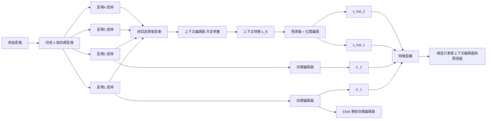
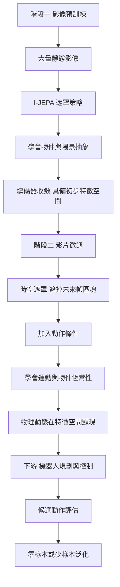

# 6.3 I-JEPA 到 V-JEPA：從靜態影像遮罩到時空動態特徵預測的結構演進

## I-JEPA：一個遮罩策略的設計藝術

I-JEPA（Assran 等人，2023）的出現在當時是一件頗具挑釁意味的事：在自監督影像學習被掩碼自編碼器的主導下，它用一個更激進的遮罩策略與一個完全不同的目標函式，拿到了同等甚至更好的下游表現。

遮罩策略是 I-JEPA 最具辨識度的設計。掩碼自編碼器通常隨機遮掉小方塊，模型要靠周圍像素把細節補回來；I-JEPA 則是遮掉**大片的連續區域**，只保留一小塊上下文。典型設定是遮掉影像中約四分之三的區域，僅留下零星的上下文區塊。這種設計改變了任務的本質：模型不能靠鄰近像素的外插來猜補洞，它必須真的理解場景結構才能預測出被遮區域的特徵。

遮罩區塊與上下文區塊之間還有一個不對稱性。上下文遮罩後的影像經由**上下文編碼器** $f_\theta$ 處理，得到特徵 $s_B$ ；目標區塊則經由**目標編碼器** $g_{\bar{\theta}}$ 處理，得到目標特徵 $s^{\prime}_B$ ；預測器 $h_\phi$ 接收上下文特徵與目標區塊的位置編碼，輸出 $\hat{s}_B$ 。整體目標仍是特徵空間的歐氏距離：

$$
\mathcal{L}_{\text{I-JEPA}} = \frac{1}{B} \sum_{b \in B} \left\| \hat{s}_{b} - \operatorname{sg}\left(s^{\prime}_{b}\right) \right\|_2^2
$$

與此同時，**每個目標區塊各自對應一個獨立的預測**。一張影像被切成多個目標區塊，模型要分別預測每一塊的特徵，而不是把整張圖當成一個目標。這樣做的好處是讓模型學到區塊之間的一致性——不同區塊的預測必須能拼湊成一個連貫的場景。

## 不對稱與動量：移動靶的必要性

I-JEPA 的架構裡有兩個刻意的「不對稱」，每一個都有明確的功能。

第一個是**參數不對稱**：上下文編碼器與目標編碼器不共享權重。這切斷了模型透過共享表示來降低誤差的捷徑。若兩者共享，模型可以讓編碼器直接忽略輸入、輸出某個固定的「場景基底」，然後預測器複製這個基底，損失同樣接近零。不共享參數迫使兩個編碼器各自學到真實的輸入映射。

第二個是**更新機制不對稱**：上下文編碼器由反向傳統更新，目標編碼器則透過指數移動平均追隨：

$$
\bar{\theta} \leftarrow m\, \bar{\theta} + (1 - m)\, \theta , \qquad m \in [0.99, 1.0]
$$

這個動量機制的意義在於提供**移動靶**。若目標編碼器是目標網路的固定複本，模型要預測的其實是「自己上一個版本的輸出」，這在數學上比預測外部目標容易得多，也更容易收斂到平凡解。動量更新讓目標緩慢地漂移，模型永遠在追一個略微不同的參考系。

這裡有一個微妙的張力值得點出：動量係數 $m$ 越接近 1，目標越穩定、追蹤越平滑，但模型與目標的差距也越大，損失的下限被抬高。實務上，I-JEPA 採用動態動量調整，在訓練早期使用較小的 $m$ 以加速收斂，後期逐步提高 $m$ 以穩定目標。這種排程看似細節，卻反映出 JEPA 家族的一個普遍事實：**穩定性與塌縮的距離，往往由幾個不起眼的超參數決定**。

動量與停止梯度的分工也值得說明：停止梯度決定「梯度不往哪裡流」，動量決定「目標往哪裡走」。前者是靜態的結構約束，後者是動態的優化策略。兩者同時存在，才構成 6.2 節所說的「結構性假設」。

## 為什麼 JEPA 特別適合物理

JEPA 的時空化之所以必要，理由不只是「物理需要時間」這種泛泛之談。更精確地說：物理資訊主要體現在**運動**與**物件恆常性**上，而這兩者都是時間性的現象。

考慮一個球撞到牆壁。如果模型只在靜態影像上訓練，它看到的是「球在牆的左邊」與「球在牆的右邊」兩張圖，它要學的是這兩種外觀的對應關係；但它沒有學到球為什麼會從左邊跑到右邊、動量是怎麼守恆的、撞擊後速度如何反向。要學到這些，模型必須觀察連續的幀並預測後續幀。

反過來，JEPA 的抽象特徵空間恰好是物理量的良好容器。位置、速度、朝向、接觸關係——這些物理量在像素空間裡是彎曲的、難以線性操作的，但在被物理資訊訓練過的特徵空間裡，它們往往近似線性或低維流形。第 2 章談到的槽位表徵、第 3 章談到的碰撞建模，兩者都需要這種「特徵空間帶有物理幾何」的性質。

還有一個更深的理由：物理是**稀疏**的。大多數時間裡，場景中大部分物體都沒在變化；若模型被迫重構每一幀的像素，它會把九成的容量用在描寫靜態背景。JEPA 只要求預測特徵，而特徵在無事件的時間段裡本應保持不變——這個「預測不變」本身就是一種免費的物理恆定性監督。

## V-JEPA 2：先影像、後影片的兩階段策略

V-JEPA 2 是 JEPA 家族在 2025 年推出的重要一步，它把架構從靜態影像推到影片，並且在機器人規劃上展現了實用價值。但它最具啟發性的地方不是最終結果，而是它的**訓練策略**。

V-JEPA 2 採用兩階段：第一階段沿用 I-JEPA 的方法，在大量靜態影像上預訓練；第二階段才在影片上做微調。這個順序不是省事的產物，而是深思熟慮的工程發現。

理由是資料與算力的結構性不對稱。影片比影像昂貴得多——儲存成本高數十倍，傳輸與解碼成本更高，且需要連續的幀序列而非隨機抽樣。而 JEPA 預測需要遮罩**大片的時空區域**，這意味著模型要處理高解析度的時空輸入。於是「先用便宜的靜態資料把編碼器練到會做抽象」，再用昂貴的影片資料做針對性微調，就成了成本效益最高的路徑。

更重要的發現是：**幀間資訊遠比單幀細節更難學**。這個敘述看似平淡，卻有深刻的含義。若模型在單幀上已經能預測出遮罩區塊的特徵，它就沒有動力去學任何關於運動的東西——因為單幀的內容分佈與遮罩內容分佈統計上高度相似。唯有當任務本身無法被靜態內容解答時，時間資訊才會被真正地被迫編入表徵。兩階段策略的隱含邏輯正是如此：第一階段把「靜態抽象」這件事做到極致，第二階段再把殘餘的、只有動態才能解釋的誤差逼出來。

V-JEPA 2 的另一個重要特性是**動作條件化的存在**。在影片預訓練階段，模型可以選擇性地把動作標籤作為條件輸入，使得預測的不只是「接下來會看到什麼」，而是「我做了這個之後會看到什麼」。這個能力讓模型能直接在機器人上做規劃：給定一個候選動作，預測該動作之後的特徵，並比較不同動作的後果。

這個條件化機制的形式很簡單：把動作向量編碼後，透過加法或串接注入到預測器的特徵中：

$$
\hat{s}_B = h_{\phi}\left( s_B, \operatorname{pos}(y^{B}), \operatorname{emb}(a_{t:t+\Delta}) \right)
$$

但它的意義重大：它把 JEPA 從「觀察預測」推向了「反事實預測」。若模型能回答「如果我推這張桌子，杯子會不會倒」，它就擁有了規劃所需的最小條件。第 7 章會指出，這一步之後還有大量工作要補——真正的反事實推理需要動作不只作為條件，還要在動力學中占據正確的位置。

還有一個細節常被略過，但對理解整體結構至關重要：V-JEPA 2 在規劃時並不需要把預測特徵「還原成圖片」再讓人看。它直接比較不同候選動作下的預測特徵與目標特徵的距離，選出最能降低距離的動作。也就是說，規劃發生在特徵空間裡，全程沒有像素介面。這是 JEPA 路線相對於生成式世界模型的最大工程優勢：生成式模型必須先生成影像再評估影像，代價是每個候選都要跑一次昂貴的去噪。

## 兩階段訓練的結構意義

這個兩階段結構可以理解為一種**課程學習**。第一階段的任務在時間上是靜態的，模型只需理解空間；它提供的初始化讓第二階段不必從隨機初始化開始面對一個極難的時空任務。第二階段的任務因為第一階段已經建立了好的特徵基礎，變成一個「在既有意義空間中做插值」的問題，而插值比從零建立意義空間容易得多。

值得留意的是，這個順序與 6.1 節提及的 Y-JEPA 方向形成一個有趣的張力。Y-JEPA 追求的是把預測跨度拉到極長，而 V-JEPA 2 的實踐路徑卻是「先把短的時間尺度練到極致，再逐步延長」。這兩個方向未必互斥，但實驗證據目前更支持後者——延長時間跨度的難度，遠大於把時間維度本身建構起來的難度。

## 與自迴歸影片生成、擴散模型的目標函式對照

把三種架構放在同一個平面比較，最能看清 JEPA 的位置。

自迴歸影片生成（第 4 章）把未來幀分解成 token 序列，逐個 token 地最大化條件對數似然：

$$
\mathcal{L}_{\text{AR}} = - \sum_{t} \sum_{n} \log p\left( x_{t,n} \mid x_{t,<n}, x_{<t} \right)
$$

它的長處是能用 likelihood 這個絕對尺度評估，也因為能生成具體像素而適合視覺化與資料增強。它的短處是目標空間被鎖死在像素層級：模型必須解釋葉片的確切著地位置，而那是隨機的。

擴散模型（第 5 章）把未來視為一個分佈，並在潛在空間中去噪：

$$
\mathcal{L}_{\text{diff}} = \mathbb{E}_{t, \epsilon, x_0} \left[ \left\| \epsilon - \epsilon_{\theta}(x_t, t, c) \right\|_2^2 \right]
$$

它比自迴歸更能表達多模態的未來，代價是多步去噪的推理成本，以及同樣把容量投注在隨機細節上。

JEPA 的目標函式只在抽象特徵空間計算：

$$
\mathcal{L}_{\text{JEPA-Video}} = \sum_{B} \left\| \hat{s}_B - \operatorname{sg}\left(s^{\prime}_B\right) \right\|_2^2
$$

這個函數裡沒有任何一項要求模型解釋像素級細節。它要求的是：遮罩掉未來的時空區塊之後，模型能否給出一個與真實未來特徵相容的預測。

| 比較維度 | 自迴歸影片生成 | 擴散世界模型 | JEPA 時空預測 |
| --- | --- | --- | --- |
| 預測空間 | 像素 token | 像素或潛在像素 | 抽象特徵 |
| 目標形式 | 逐 token 最大似然 | 加噪去噪回歸 | 特徵空間歐氏距離 |
| 未來表達 | 單一模態樣本 | 明確的多模態分佈 | 單一特徵預測 |
| 物理容量 | 細節佔用大量容量 | 細節佔用大量容量 | 容量集中在結構 |
| 推理成本 | 與序列長度成正比 | 與去噪步數成正比 | 與遮罩區塊數成正比 |
| 評估方式 | likelihood、像素指標 | 像素與語意指標 | 下游決策效用 |
| 失敗模式 | 物理幻覺、卡在細節 | 物理幻覺、推理慢 | 塌縮、預測過於平滑 |

## 誠實評估：像素指標的失效

JEPA 家族在評估上處於一個尷尬的位置。主流的影像模型可以用 FID、SSIM、PSNR 這類像素級指標衡量，而 JEPA 的輸出根本不是像素——它是抽象特徵。這些指標對它不適用。

更麻煩的是，即使我們拿解碼器把 JEPA 的預測特徵還原成圖像，還原出來的結果往往比專門訓練的生成模型模糊得多，因為編碼器從未被要求保留外觀細節。這不是缺陷，而是設計的直接後果，但這使得 JEPA 難以在既有的排行榜上被公平評估。

可行的替代評估方式有三種。第一種是**下游決策效用**：把預測特徵送進一個分類器或策略網路，看決策準確率如何變化。第二種是**特徵空間的檢索準確率**：給定預測特徵，在候選特徵庫中檢索真實的目標特徵，看命中率。第三種是**物理一致性探針**：設計一些需要理解物理的探針任務，例如給出物件的初始狀態與幾幀觀測，測試模型能否預測接下來的運動方向或碰撞結果。

這三種評估都有一個共同特點：它們衡量的是**預測的特徵是否對決策有用**，而不是預測的特徵是否像真實特徵。這個轉向是本章的核心論點之一。生成模型的品質可以用「像不像」來衡量，因為它生產的東西就是給人看或給下游像素管線用的。JEPA 生產的是給下游決策器用的狀態，因此它的品質只能由下游決定。

這個評估難題也解釋了為什麼 JEPA 的文獻風格與生成模型截然不同：它很少出現「我們的模型在 FID 上大幅領先」這種句子，取而代之的是「我們的模型在規劃任務上只需少量示範即可泛化」。

評估上的這種不對稱還有一個副產品：JEPA 的進步不容易被外界看見。當一個生成模型發表新的 FID 紀錄時，社群能立刻判斷這是否有意義；當一個 JEPA 模型在某個遮罩比例或某個動量係數上取得提升時，外界往往無從判斷。因此這個領域的發展高度依賴內部評測體系的成熟，而這正是本章反覆強調「預測的特徵是否對決策有用」的原因——只有把下游決策做成標準化的基準，JEPA 的進步才會被公平地度量。

另一個評估難點來自特徵空間本身的可比性。不同實驗使用不同的編碼器與不同的特徵維度，跨論文的數字並不可直接比較。這使得 JEPA 的評估更依賴同一模型內部的消融實驗——例如固定架構、只改動遮罩比例或動量係數，看下游決策準確率的變化。這種評估方式較為內向，但至少保證了因果推論的可信度。

## 時空推演之後的下一個問題

V-JEPA 2 展示了 JEPA 可以在影片上學到運動與物件恆常性，甚至可以用於機器人規劃。但它的時間解析率是固定的：一個模型只有一種「看見多少秒未來」的方式。

人類顯然不是這樣工作的。當我們預測「杯子會不會倒」，我們的內心模擬大概涵蓋了兩秒；當我們預測「這條路走到頭會通到哪里」，我們的內心模擬涵蓋了十分鐘。不同尺度的問題需要不同解析率的抽象，而把這兩者塞進同一個時間解析率的模型，會讓模型在短尺度上不夠細、長尺度上不夠穩。這正是下一節的主題。
