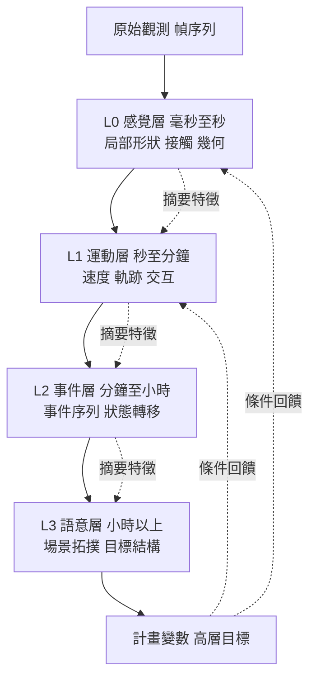
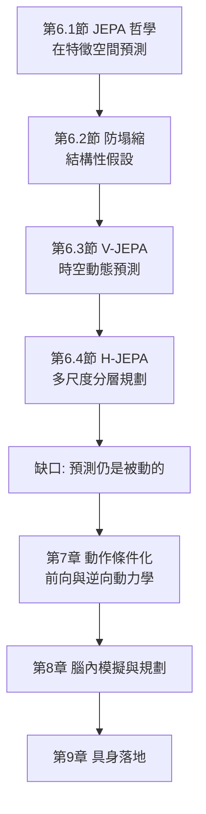

# 6.4 層級式 JEPA（H-JEPA）：針對不同時間粒度（毫秒至小時）的多尺度抽象規劃

## 時間粒度是多尺度抽象的核心問題

如果 H-JEPA 這個名字裡最重要的一個詞是「層級」，那麼第二重要的就是「時間粒度」。

物理世界的時間是不均勻地被需要著的。抓取一個杯子時，決定成敗的時間尺度是毫秒級的：手指接觸杯壁的那一瞬間，物體的形變、摩擦係數、指尖的加速度都進入方程。判斷一個人是否會在紅綠燈前停下來，需要的是秒到分鐘級的觀察。而預測「這條路走到頭是河還是空地」，需要的則是小時甚至天級的尺度。

單一時間解析率的模型無法同時處理這三種問題。若模型以幀為單位建模，它在毫秒尺度上過於粗糙——兩幀之間杯子可能已經被握住或滑落；若模型以秒為單位，它在長尺度上又過於昂貴——預測一小時需要串聯數千次推演，誤差會以乘法方式累加。

更麻煩的是，不同尺度需要的是**不同抽象層級的特徵**，而不是同一個特徵的不同時間戳。毫秒尺度上需要的是接觸點的幾何與力學狀態；小時尺度上需要的是場景的語意與拓撲結構——「這是一條巷子」「這裡是死路」這類判斷。把兩者放在同一個特徵空間裡，模型會被迫在「保留接觸細節」與「保留場景語意」之間做權衡，而這兩種需求在資訊上是互相衝突的。

人類的解法是分層：視覺皮質處理局部形狀，頂葉處理空間位置與身體圖式，海馬處理情節與時間結構，小腦處理運動細節。每一層有自己專屬的時間常數，彼此之間透過傳遞物質（PFC—基底節—丘腦迴路）交換資訊。H-JEPA 試圖在機器上重建這個結構。

## 分層結構：每一層預測下一層的摘要

H-JEPA 的核心設計是引入**時間金字塔**。最底層處理原始觀測的短片段，最頂層處理長跨度的高階狀態；相鄰層之間不是傳遞原始觀測，而是傳遞**摘要特徵**。

形式上，設第 $`l`$ 層的輸入時間跨度為 $`\tau_l`$ ，且滿足 $`\tau_{l+1} = k \tau_l`$ ， $`k > 1`$ 為層間的時間擴展倍數。第 $`l`$ 層的編碼器 $`f_l`$ 從一段時間跨度為 $`\tau_l`$ 的觀測中抽取摘要：

$$
z^{(l)} = f_l\left( o_{t-\tau_l:t} \right)
$$

第 $`l`$ 層的預測器嘗試預測第 $`l+1`$ 層在更遠未來的摘要：

$$
\hat{z}^{(l+1)} = h_l\left( z^{(l)}, \Delta t \right) , \qquad \Delta t \gg \tau_l
$$

損失是層間的特徵距離之和：

$$
\mathcal{L}_{\text{H-JEPA}} = \sum_{l} \lambda_{l} \left\| \hat{z}^{(l+1)} - \operatorname{sg}\left( z^{(l+1)}_{\text{true}} \right) \right\|_2^2
$$

這個設計的最重要後果，是**每一層只需要預測自己尺度上的摘要，而摘要吸收了低層的隨機性**。葉片確切著地位置的不確定性在低層是顯著的，但「葉子落在地上」這個事件在上一層是高度確定的。低層的不確定性被摘要機制壓縮成一個布林式的「事件發生」訊號，於是高層的預測誤差不會因為低層的隨機性而爆炸。

## 抽象狀態的傳遞：高層給目標，低層做展開

分層的真正價值不在於「層數多」，而在於**資訊流動的方向性**。高層不負責展開細節，它只負責給出方向與約束；低層不負責長期規劃，它只負責在高層指定的條件下展開具體的動作軌跡。

這正是階層式增強學習（Hierarchical RL）的核心思想。傳統的階層式 RL 有高層策略 $`\pi_H(s_H)`$ 輸出高層動作 $`a_H`$ ，低層策略 $`\pi_L(s_L, a_H)`$ 輸出原語動作 $`a_L`$ 。在自監督世界模型中，這個結構翻轉過來：不是高層「動作」指揮低層，而是高層的**計畫變數** $`p \in \mathbb{R}^{d_p}`$ 作為條件注入低層的特徵預測：

$$
\hat{z}^{(l)} = h_l\left( z^{(l)}, \operatorname{emb}(p) \right) , \qquad l < L
$$

也就是說，高層產生的不是「移動左邊十公分」這種原語，而是一個連續的目標向量；低層的預測器讀取這個向量作為條件，生成符合該目標的具體演化。這種設計讓高層保持抽象且可微，同時讓低層保有解決細節的能力。

兩個好處立刻湧現。第一，高層的計畫變數可以在低層尚未確定時先被優化與評估——第 8 章的樹搜尋可以在高層的特徵空間中進行，成本遠低於在像素空間中搜索。第二，低層的不同細節解（不同的手勢、不同的路徑）只要達成同一個目標向量，就可以在高層被視為等價，這大幅降低了規劃的分支因子。

但代價也同樣清楚：目標向量的語義必須被學出來，而不是被指定。這是階層式 RL 最著名的難題——高層動作空間的含義會隨訓練漂移，導致已經學好的低層策略失效。H-JEPA 必須用某種機制把計畫變數的語義錨定在可解釋的特徵上，否則分層只會把塌縮問題從一個層級推廣到所有層級。

## 為什麼分層是必要的：誤差的累積與不確定性的吸收

長時預測有個嚴格的數學障礙。若模型的單步預測誤差是 $`\epsilon`$ ，且各步誤差獨立同分佈，那麼 $`T`$ 步之後的累積誤差方差的量級是：

$$
\operatorname{Var}\left( \hat{s}_{t+T} - s_{t+T} \right) \sim T \cdot \sigma^2
$$

也就是誤差隨步數**線性**累積，在方差上；若是相對誤差累積，則可能更快。這個簡單的估計已經說明：一個小時的推演如果以 30 幀每秒進行，需要一萬次串聯預測，累積誤差會大到完全淹沒訊號。第 10 章會正式處理這個複合誤差問題，並指出它是所有生成式世界模型的共同致命傷。

分層提供了兩條不同的救濟路線。第一條是**跳步**：高層直接預測「一小時後的場景摘要」，跳過中間的一萬步，累積項數從一萬降到一。第二條是**誤差吸收**：低層的不確定性不傳導到高層，因為高層只觀察到摘要，而摘要在眾多低層細節中取其穩定者。

用一個簡單的模型說明第二點。假設低層預測某個事件的精確時間，誤差標準差為 $`\sigma = 0.5`$ 秒；而高層只預測「事件是否在接下來十秒內發生」。後者的預測在低層誤差為零到一秒時都是正確的，因此高層的判斷完全不受低層精確誤差的影響。這就是摘要的價值：它把一個連續量的不確定性轉化為一個閾值化的離散判斷，而不確定性被截斷而非累積。

這也解釋了為什麼生物學上的分層幾乎總是搭配「閾值化」的處理——神經元的放電是全有全無的。放電率的閾值化在功能上扮演了資訊摘要的角色，讓上層不必關心下層的細微抖動。

值得注意的是，摘要並不等於丟棄資訊。好的摘要是一種有損但有方向的壓縮：它保留那些在該時間尺度上「會影響未來」的維度，而丟棄那些即使變化了也不會改變長期結果的維度。這個「影響力」的判準，正是物理直覺的核心之一——第 3 章談到的直覺物理學先驗，其本質就是「哪些量必須被記住，才能正確推演接下來」。因此多尺度分層不是一個純粹的工程技巧，它其實是把物理學中的相關性判斷內建到架構裡。

| 時間尺度 | 典型物理量 | 需要的抽象 | 分層位置 | 主要誤差源 |
| --- | --- | --- | --- | --- |
| 毫秒至秒 | 接觸力、形變、摩擦 | 局部幾何與接觸關係 | 感覺層 | 感測器噪聲、接觸瞬間的不連續 |
| 秒至十秒 | 速度、軌跡、碰撞 | 運動狀態與動量 | 運動層 | 碰撞瞬間的衝量不確定 |
| 十秒至分鐘 | 事件序列、狀態轉移 | 事件與轉移關係 | 事件層 | 事件時機的隨機性 |
| 分鐘至小時 | 場景拓撲、可達性 | 空間語意與結構 | 語意層 | 人的意圖與外部規則 |
| 小時以上 | 目標、環境長期狀態 | 高階情境結構 | 計畫層 | 未建模的外部因素 |

## 與 Dreamer 的 imagination 與行為層級對照

Dreamer（第 1 章已述）提供了另一條通向多尺度預測的路徑，值得仔細比較。

Dreamer 的 imagination 是**單一解析率的滾動展開**。它從一個真實觀測開始，在潛在空間中反覆套用潛在動力學模型 $`\hat{s}_{t+1} = f(s_t, a_t)`$ ，產生一段虛構的潛在軌跡 $`s_{t:T}`$ ，再從中評估價值與策略。它的多尺度能力來自**同一個解碼器**在不同時間跨度上的泛化：模型在短軌跡上學到的細節行為，會被自動延伸到長軌跡上。

H-JEPA 的多尺度能力則來自**多個專屬的時間常數**：每個時間尺度有自己的編碼器與預測器，專門處理該尺度的抽象。兩者的差異在於「泛化 vs 專用」的哲學立場。

| 面向 | Dreamer 的 imagination | H-JEPA 的多尺度分層 |
| --- | --- | --- |
| 多尺度來源 | 單一解碼器跨跨度泛化 | 每層專屬的時間常數 |
| 狀態傳遞 | 同一潛在向量逐步推進 | 摘要特徵逐層上傳 |
| 長跨度成本 | 步數隨時間線性增加 | 層數隨抽象層級增加 |
| 誤差處理 | 靠 KL balancing 穩定先驗 | 靠摘要吸收低層不確定 |
| 行為層級 | 階層策略（選技能） | 計畫變數作為條件 |
| 共同點 | 皆在潛在空間推演，皆需防止表示退化 | 同左 |

Dreamer 的優點是結構簡潔、已經有強大的實證基礎；它的弱點是長跨度展開的累積誤差。H-JEPA 的優點是結構上杜絕了長串聯預測；它的弱點是層間介面需要額外的訓練技巧，而且每一層都要獨立地面對 6.2 節的塌縮問題。

兩者並非互斥。事實上，一個自然的整合方向是：讓 H-JEPA 的高層提供計畫變數，再由 Dreamer 式的 imagination 在中層展開具體的潛在軌跡。這樣高層負責決定「往哪裡去」，中層負責「怎麼去」，底層負責「手怎麼動」。

## 與第 8 章規劃的串接

第 8 章的論點是：智慧的一部分不在於權重，而在於測試時花的算力。JEPA 提供的是可以被反覆查詢的抽象狀態，而 H-JEPA 提供的是多個尺度的可查詢狀態，兩者結合才構成完整的規劃基礎。

在多尺度規劃中，樹搜尋的節點不再只是「一個時間步的狀態」，而是「一個抽象層的狀態加上一個待展開的子計畫」。一個節點的擴張方式是先在高層展開數步，若某個高層分支的價值明顯低落就整枝剪掉，只有在接近葉節點時才下沉到低層展開細節。這種由粗到細的展開是樹搜尋中最有效的剪枝策略，因為它把算力集中在少數有希望的高層分支上。

多尺度計畫在腦內模擬中的執行，可以分為三個階段。高層階段生成數個候選的計畫變數，這些變數可以被解碼成人類可理解的意圖，例如「走向門口」或「把杯子移到桌邊」。中層階段針對選定的計畫變數，在潛在空間中展開軌跡並檢查物理可行性——杯子能不能被拿起來而不會打翻，門是不是開著。低層階段才細化到關節層級的具體動作。

這個結構有個重要特徵：**高層計畫是可攔截的**。若中層檢查發現計畫不可行，可以退回到高層換一個計畫變數，而不必重新展開全部細節。這正是 8.3 節所談的軌跡修剪在多尺度下的形態。

另一個值得注意的耦合是動作條件化與分層的結合。第 7 章會說明世界模型必須知道自己動作的效果；而在 H-JEPA 中，動作的效果在不同抽象層級上表現不同：高層動作改變事件序列，低層動作改變接觸細節。這種「同一動作在不同層有不同語義」的特性，要求動作編碼器也是分層的。

## 誠實評估：這條路線仍在早期

必須坦白說，分層自監督世界模型的成熟度遠低於單層方法。至少有四個未解決的問題。

第一是**訓練穩定性**。多個層級、多個 EMA 目標、多組動量超參數會互相耦合。某一層的特徵空間若在訓練中途改變，上層的預測目標就會失效，整個金字塔可能需要重新收斂。實務上常見的做法是分階段訓練：先練底層、凍結，再練上層，但這也意味著模型可能學到不適合高層需求的底層特徵。

第二是**層間介面的設計**。摘要應該包含什麼資訊？多包含則下層無法定義抽象，多包含則帶來過度具體、無法泛化。這個問題沒有理論答案，目前只能靠實驗摸索。

第三是**評測標準**。多尺度模型的品質該怎麼測？每一層各自有下游探針，但整體規劃效能的歸因變得困難——一次失敗究竟是高層目標錯了，還是低層展開失敗了？

第四是**與動作的耦合尚未完全釐清**。第 7 章的主題正是這個問題，而它必須在多尺度的架構內解決，難度更高。

儘管如此，多尺度抽象並非只有理論上的吸引力。生物學上的層級結構是經過億萬年演化篩選的產物，它提示我們：一個能處理從毫秒到小時的完整世界模型，幾乎必然需要多個時間常數，而不是單一的解析率。

## 收束：從被動預測到主動規劃

回顧整個第 6 章，JEPA 路線完成了三件事。它定義了一個不同的目標函式：在抽象潛在特徵空間中預測，而非重建像素。它揭示了這個目標函式的內在脆弱性：沒有負樣本時，平凡解永遠是個威脅，因此需要停止梯度、動量目標與方差正則這類結構性假設。它證明了這個架構可以從靜態影像一路推到影片，甚至推到機器人規劃。

但整章反覆暗示的缺口也越來越清楚。JEPA 的預測始終是**被動的**：它預測「接下來會發生什麼」，卻沒有回答「如果我做了某件事會發生什麼」。而後者才是規劃與控制的根本需求。一個完美的被動預測器，仍然只是一個精密的錄影機。

打開這個缺口的路徑已經在文獻中浮現：把動作作為條件輸入模型、學習前向與逆向動力學、用多感官資料提供更豐富的狀態約束。第 7 章將沿著這條路徑，把 JEPA 從觀測模型升級為互動模型。

