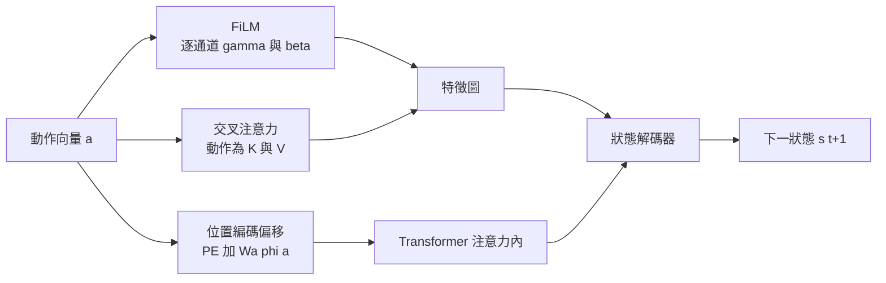

# 7.1 動作條件化機制設計：FiLM、交叉注意力（Cross-Attention）與物理控制參數編碼

## 被動觀測模型的三個不可解問題

第 4 至 6 章介紹的三種架構範式——自迴歸、擴散與 JEPA——在訓練時都共享同一個資料前提：觀測序列是被動錄得的，模型看見的是已經發生過的事。這種資料形態本身無可厚非，網路上的人類影片確實是以此形式存在的。然而，被動資料能教給模型的東西有嚴格上限，而這個上限不是由架構容量決定，而是由「動作與變化之間的對應關係」在資料中是否可辨識所決定。

第一個不可解問題是**動作與變化的對應不可知**。當模型看見一個人推倒杯子，它無法從這段被動影片中斷定：是推力造成了傾倒，還是桌面本來就是斜的？是人的動作造成杯子滑動，還是杯子原本就在晃動？在沒有動作標籤的情況下，任何兩個因果假設都會產生幾乎相同的像素序列，因此模型無法在它們之間做出辨識。這並不是模型「不夠聰明」，而是辨識論層面上的不可區分：不同的世界模型賦予這段觀測相同的似然。

第二個不可解問題是**反事實不可生成**。反事實問題是「如果我沒有推那把杯子，現在會是什麼樣子」。被動觀測的分佈 $p(o_{0:T})$ 只記錄了事實軌跡，而反事實需要的是分佈 $p(o_{0:T} \mid do(a_t))$ 。由於 $do(a_t)$ 在訓練資料中從未被執行過——同一段影片不可能同時存在「推了」與「沒推」兩條平行宇宙——模型沒有任何依據可以外推到這條支線。

第三個不可解問題是**規劃不可行**。規劃要求反覆試算：提出一個動作、推演其後果、比較好壞、再提出下一個。若模型沒有動作這個變數，那麼它的 $s_{t+1}$ 只是時間的函數 $p(s_{t+1} \mid s_t)$ ，整條時間軸上的狀態都被鎖死在唯一一條已發生的軌跡上，任何「如果換一個動作」的比較都無從進行。

這三個問題彼此相依，卻有一個共同的解方：把**動作**變成模型的顯式輸入變數，讓模型學的是一個以動作為參數的轉移函數，而非單純的時間函數。一旦動作進入模型，模型面對的就不再是「接下來會怎樣」，而是「我這樣做，接下來會怎樣」。

## 動作條件化的形式定義

在馬可夫決策過程的框架下，條件化世界模型的目標分佈可以寫成：

$$
p_\theta(s_{t+1} \mid s_t, a_t, c)
$$

其中 $s_t$ 是當前狀態， $a_t$ 是動作， $c$ 是物件與環境的物理屬性條件。三個條件變數的分工是清楚的： $s_t$ 攜帶幾何與動力學資訊， $a_t$ 攜帶外力與控制意圖， $c$ 攜帶質量、摩擦、材質這類不隨時間大幅改變的屬性。

問題在於，這個分佈並不能只靠一句「把 $a_t$ 餵進網路」就實現。網路架構必須確保動作資訊真的能夠**穿透**到影響狀態更新的每一個環節，而不是在編碼層就被平均掉。以下三種機制代表三種不同的穿透策略。

## 機制一：FiLM 式縮放與平移

最直接的做法是借用 FiLM（Feature-wise Linear Modulation）的思路。FiLM 原本出現在視覺語言任務中，用一句文字描述去「調製」影像特徵：文字經過一層小型網路後，輸出與影像特徵同形狀的逐通道縮放係數與偏移量，逐元素相乘與相加。

用在動作條件化上，只需把文字編碼器換成動作編碼器。設中間層特徵為 $h \in \mathbb{R}^{C \times H \times W}$ ，動作向量 $a$ 經由一個小型多層感知機映射出 $\gamma \in \mathbb{R}^{C}$ 與 $\beta \in \mathbb{R}^{C}$ ，調製後的特徵為：

$$
h' = \gamma(a) \odot h + \beta(a)
$$

這個形式之所以有效，是因為 $\gamma$ 與 $\beta$ 是**逐通道**的，而通道在捲積網路中往往承擔了不同的語意分工：某些通道偵測邊緣、某些偵測紋理、某些偵測運動方向。讓動作去改變每個通道的響應強度，等於賦予動作「哪些性質會被這次動作影響」的控制權。

FiLM 的優點是計算極輕：所謂的多層感知機只有兩層全連接，參數量相對於主干可以忽略不計，且不需要改變注意力的拓撲結構。它的限制同樣明顯——調製是**全局**的。一次「向左平移」或「抓起」這樣的動作，可能只影響場景中的一小塊區域，但 FiLM 會把整張特徵圖的所有通道一起乘上同一個係數。這種粗粒度在語義分割等任務中無妨，在物理預測中卻可能造成大範圍的連鎖失真。

## 機制二：交叉注意力

第二種機制是交叉注意力，它把「動作」與「狀態」的關係交給注意力機制去學。做法是把狀態特徵當作查詢，把動作（或動作的多個片段）當作鍵與值，計算：

$$
\operatorname{CrossAttn}(Q_h, K_a, V_a) = \operatorname{softmax}\left( \frac{Q_h K_a^{\top}}{\sqrt{d_k}} \right) V_a
$$

輸出再與原特徵殘差相加。其直覺是：模型在處理每一個位置時，可以依據當前的「需求」去動作序列中挑選相關資訊——左半邊的像素或槽位可能去讀取水平位移的編碼，下方的槽位可能去讀取抓取的編碼。

交叉注意力比 FiLM 更有表達力，因為它允許**位置相關的**動作作用：不同的空間位置可以對同一個動作作出不同的反應。這一點對物理預測是關鍵的——把箱子推動時，只有被推的那一面會產生加速度分佈的改變，其他區域幾乎不動。

代價則是計算量。一次交叉注意力需要 $N_h$ 個查詢對 $N_a$ 個鍵計算相似度矩陣，若查詢數量是影片 patch 數量（動輒數千），注意力矩陣本身就佔用可觀的記憶體。此外，交叉注意力的效果高度依賴動作編碼的品質，因為它假設動作已被壓縮成足以被查詢的鍵與值。

## 機制三：注入注意力的位置編碼

第三種機制最為輕量，卻常被忽略：直接修改位置編碼。Transformer 的注意力對位置並無內建感知，全靠輸入時附加的位置向量提供。若把動作資訊編碼成一個額外的位置偏置加在位置編碼上，例如：

$$
\mathrm{PE}(p, a) = \mathrm{PE}_{\text{base}}(p) + W_a \, \phi(a)
$$

其中 $\phi(a)$ 是動作的特徵映射， $W_a$ 是可學習的投影。於是同一個位置在不同動作下具有不同的位置表示，模型可以學會「在向左這個條件下，第 40 號 patch 與第 41 號 patch 之間的相對關係被改變了」這類資訊。

此機制的計算開銷幾乎為零，因為它只在輸入端多加一次加法，且不需要額外的注意力層。它的侷限是作用範圍受限——位置編碼影響的是相對位置的隱式關係，對於「質量改變導致加速度改變」這類需要全局物理量參與的現象，表達力顯然不足。

## 三種機制的對照

三種機制的取捨可以整理成下表。

| 機制 | 注入位置 | 主要計算開銷 | 對位置選擇性的支援 | 對連續動作的適應 |
| --- | --- | --- | --- | --- |
| FiLM 縮放平移 | 捲積層或正規化層之後 | 兩層全連接，極輕 | 無，全域一致 | 好，連續輸出係數 |
| 交叉注意力 | 注意力模組之內 | 注意力矩陣，較重 | 強，依需求挑選 | 中，依賴編碼品質 |
| 位置編碼偏移 | 輸入端位置向量 | 一次加法，最輕 | 中，僅相對位置 | 好，直接相加 |

三者並非互斥。實務上常見的組合是：以位置編碼偏移提供廉價的全域訊號，以交叉注意力處理需要選擇性作用的區域，再以 FiLM 在解碼端做最後的全域微調。

## 連續動作的編碼問題

真實世界的動作幾乎都是連續的：末端執行器的位置是三維向量，抓握力度是連續標量，關節力矩是連續量。這與前文常見的動作離散化做法（把前進、左轉、跳躍視為離散類別）有本質落差，因為連續動作蘊含的資訊量遠高於離散類別：兩個略有差異的抓握力度，可能對應完全不同的接觸穩定性。

面對連續動作有兩條常見路徑。第一條是離散化，把連續區間切成若干桶，每個桶編碼成一個 token 或一段嵌入。優點是計算便宜、與離散動作的既有設施相容；缺點是量化誤差會在動作條件化的串接鏈中被放大——桶的邊界附近，微小的動作差異會被模型當成同一個動作，而生成的結果則可能出現難以解釋的跳變。

第二條是保留連續性：讓動作編碼器是一個小型連續網路，輸入正規化後的連續向量，輸出多個可被注意力使用的 token。這種做法保留了完整的數值資訊，代價是必須處理連續向量在不同場景下的尺度問題——夾爪位置是公制還是像素？力矩是牛頓公尺還是百分之一牛頓公尺？若沒有正規化，同一個數值在不同資料源會被解讀成完全不同的意義。

實務上常見的折衷是「連續數值加上單位與量綱標記」的組合：除了數值本身，把量綱標記也編碼進去，讓模型學得「這個數字是在什麼單位制下的數字」。這是一個很小的工程細節，卻往往決定模型能否跨資料源泛化。

## 物理控制參數：可干預的最小要求

只把「我的動作」放進模型還不夠。若物件的質量、摩擦係數、恢復係數都被吸收到隱藏特徵裡，那麼模型在訓練分佈內可以表現得很好，但一旦遇到沒見過的物理參數組合，它就無能為力——因為它從未被要求用這些參數做過任何推論。

正確的做法是把物理參數當作**獨立的條件變數** $c$ 傳入模型，例如對第 $k$ 個物件：

$$
c_k = \left[ m_k,\ \mu_k,\ e_k,\ \text{shape}_k \right]
$$

並在網路中設一個專門的編碼分支，把 $c_k$ 編碼成物件槽位的一部分。這樣一來，同一個模型便能回答「若這個箱子的質量從 2 公斤變成 8 公斤，碰撞後的速度為何」——因為質量已經是一個可被覆寫的輸入，而不是權重裡的常數。

為什麼屬性必須是顯式變數而不是隱藏特徵？理由可以用一個簡單的辨識論證說明：若屬性被藏進特徵空間，模型只能學到「這一類場景大致長這樣、會這樣動」，也就是一個插值式的記憶體。它在訓練分佈內有效，在分佈外無效——不是因為容量不足，而是因為問題本身被重新定義成了一個記憶任務。相反地，一旦屬性顯式化，模型學到的就成為規則：把屬性作為參數的通用映射。這是從案例記憶走向機制的分水嶺，也是第 3 章結構因果模型所要求的可干預性在工程上的落實。

## 訓練動態：注入位置決定梯度的路徑

注入位置不只改變計算量，也改變了訓練訊號能多快抵達那些真正需要動作資訊的參數。FiLM 的調製係數直接乘在主幹特徵上，因此動作訊號沿著一條極短的梯度路徑回傳到編碼器，收斂通常較快，但代價是模型容易學成一個粗粒度的全域開關。交叉注意力的梯度必須穿過注意力權重矩陣才能回到動作鍵值，訊號被稀釋了，卻也因此保留了選擇性作用的能力。位置編碼偏移的梯度路徑最短，但它只影響空間關係而非內容，因而常常需要搭配其他機制才能學到真正的物理量改變。

實務上還有一個容易被忽略的細節：動作的時間解析度不必與影像幀率一致。若動作在連續時間中被記錄，而影像是以較低頻率取樣，則同一個動作值會對應多幀影像，此時應當把動作依時間戳分配到各幀，而不是把所有幀都標上同一個動作。這個時間對齊問題會在第 7.3 節的即時互動系統中變得尖銳，因為互動延遲的本質就是時間對齊的失敗。

另一個設計選擇是動作的條件強度。實驗證據顯示，讓模型同時看見當前狀態與動作，比只看動作更容易學到物理規律，因為狀態提供了「在什麼條件下施加這個動作」的資訊。但也要注意不要把太多無關資訊塞進條件變數，否則模型容易退化成從條件中直接讀答案。實作上常見的折衷是讓狀態與動作各自編碼、再在融合層相加或串接，而不是先把兩者拼成一個長向量——後者的做法雖然省事，卻讓模型難以分辨哪一段資訊屬於「當前世界」而哪一段屬於「我的干預」。

## 資料要求：狀態—動作—下一狀態三元組

所有上述機制都指向同一個資料前提：訓練資料必須包含**配對的三元組** $(s_t, a_t, s_{t+1})$ ，而且是時間上嚴格相鄰的。這比單純的影片資料嚴格得多。

配對必須嚴格，因為動作條件化是在學一個偏移量。模型要把「有動作」與「無動作」兩種情形下的差異學會，而這個差異只有在時間對齊的前提下才有意義。若動作標籤比影像晚半秒，模型會學到一個錯誤的因果順序，最終在互動時產生半秒延遲的幻覺。

資料還必須多樣，覆蓋動作的多種取值。模型若只在「向前走」這一個動作下訓練，那麼它的 FiLM 係數就只在該動作附近有定義，換一個動作方向時輸出將不可預期。

另一個容易被低估的要求是**閉環或半閉環資料**。純開環示範只告訴模型「在這個狀態下我做了這個動作」，卻沒有告訴它「我做了這個動作之後世界變成什麼樣子」。真正的閉環——例如在模擬器中或真實環境中讓動作真正生效並記錄結果——才是動力學的訓練材料。這也是為什麼第 9 章會回到「用世界模型合成資料」的主題：生成模型最大的價值之一，就是補齊閉環資料。

## 結語：從單向觀測到可控生成

本節把「可控」這件事拆解成三個層次：架構上，要讓動作資訊以適當方式注入特徵生成過程；編碼上，要讓連續動作保有其數值語義；資料上，要讓物理屬性成為可覆寫的顯式變數。三者缺一，模型都只是在被動觀測的世界裡做得很流暢，卻始終無法回答「我這樣做會怎樣」。

然而，動作條件化本身只是把控制權交到模型手上，並未保證模型對物理的理解是正確的。一個把動作條件化做得很漂亮的模型，可能同時學會了「推杯子」與「杯子不動」這個荒謬組合——只要資料裡存在這樣的相關性。第 7.2 節要引入的雙向動力學約束，正是用另一方向的證據來替這個漏洞打補丁。
