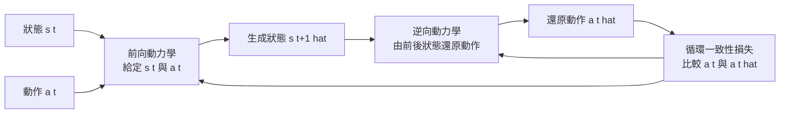

# 7.2 前向動力學（Forward Dynamics）與逆向動力學（Inverse Dynamics）的雙向約束學習

## 兩個方向的定義

第 7.1 節解決了「動作怎麼進入模型」的問題，但沒有解決「模型怎麼確認自己學到的物理是對的」。這需要另一個方向的證據。

前向動力學是**由狀態與動作推導下一狀態**的模型：

$$
p_\theta^f(s_{t+1} \mid s_t, a_t)
$$

它回答的是「我這樣做，世界會變成什麼樣子」。這正是第 7.1 節所討論的動作條件化世界模型的目標形式，也是第 8 章的蒙地卡羅樹搜尋與模型預測控制所直接呼叫的函數。前向動力學若正確，給定任意動作序列便可生成一整條可控的未來軌跡。

逆向動力學是**由狀態轉移推導動作**的模型：

$$
p_\theta^r(a_t \mid s_t, s_{t+1})
$$

它回答的是「世界是怎麼從這裡變成那樣的」。輸入是一對前後狀態，輸出是中間發生過的動作。這看起來像是一個輔助任務，實際上它的資訊量與結構都與前向模型截然不同。

兩者的關係可以用一個對偶的表格來把握：

| 面向 | 前向動力學 | 逆向動力學 |
| --- | --- | --- |
| 輸入 | 當前狀態與動作 | 前後兩個狀態 |
| 輸出 | 下一個狀態 | 中間的動作 |
| 對應關係 | $p(s_{t+1} \mid s_t, a_t)$ | $p(a_t \mid s_t, s_{t+1})$ |
| 學習難度 | 高，狀態空間連續且高維 | 低，動作類別數遠少於狀態空間 |
| 主要用途 | 可控生成與規劃 | 動作辨識、可達性檢查、先驗學習 |
| 失敗表現 | 生成物理上不可能的轉移 | 把不可能的轉移解釋成錯誤的動作 |

## 為什麼兩者結合能約束模型

單獨的前向模型有一個危險的失效模式：它可能學到一個「看起來合理」的轉移函數，卻在細節上違反物理。例如它可能學到「無論施加什麼動作，桌上的杯子都會以固定速度往右滑動」——這在訓練資料中若有大量近似靜止的杯子，就足以支撐這樣的錯誤映射。

逆向模型提供了外部檢查。假設前向模型生成了一組轉移 $(s_t, \hat{s}_{t+1})$ ，把這組轉移餵給逆向模型，看它推論出的動作是什麼。若逆向模型說這是「向左推」，那麼生成結果在動作的意義上是合理的；若它說這是「向左推，但同時杯子浮空了三公分」，那麼生成結果至少在物理一致性上可疑。兩個模型互相審查，構成一個閉環。

這個閉環的核心是**循環一致性（cycle consistency）**：從狀態出發，經由前向模型生成下一狀態，再由逆向模型還原動作，還原出的動作應當與原始動作一致。損失函數可以寫成：

$$
\mathcal{L}_{\text{cycle}} = \mathbb{E}_{s_t, a_t, s_{t+1}} \left[ \left\| a_t - \hat{a}_t \right\|_2^2 \right], \quad \hat{a}_t \sim p_\theta^r(\cdot \mid s_t, \hat{s}_{t+1}), \ \hat{s}_{t+1} \sim p_\theta^f(\cdot \mid s_t, a_t)
$$

注意這個損失的構造方式：它並不直接比較生成狀態與真實狀態（那是原本的預測損失），而是比較**還原出的動作**與**真實動作**。這樣一來，模型若生成了一個視覺上偏離真實、但在動作語義上等價的狀態，循環損失不會懲罰它；反之，若生成了一個物理上不可能的狀態，逆向模型將無從還原出合理的動作，循環損失就會上升。

這裡有一個更強的變體：**逆向引導的前向訓練**。把逆向模型的輸出當作前向生成的分佈約束，讓前向模型不只逼近真實下一狀態，也逼近「一個解釋得了這個轉移的動作所對應的狀態」：

$$
\mathcal{L}_{\text{inv-guide}} = \mathbb{E} \left[ D_{\mathrm{KL}}\left( p_\theta^f(s_{t+1} \mid s_t, a_t) \;\|\; p_\theta^f(s_{t+1} \mid s_t, \hat{a}_t) \right) \right]
$$

其中 $\hat{a}_t$ 是逆向模型的輸出。這等於要求「知道動作的模型」與「猜動作的模型」在解釋同一段轉移時達成共識。

雙向約束的整體結構如上：一個前向迴圈負責生成，一個逆向迴圈負責驗證，循環一致性損失在兩者之間傳遞訊號。

## 逆向動力學的實際用途

逆向動力學的價值不只在於訓練時的約束，它在部署階段同樣有四種具體用法。

第一是**從示範資料推斷動作**。當我們拿到一段人類操作影片但沒有動作標籤時，可以用逆向模型反推每一幀之間發生了什麼動作。這把被動資料轉換為帶動作標註的資料，成本遠低於重新蒐集動態捕捉。逆運動學在機器人領域的同名技術，正是同一族思想在連續空間中的延伸。

第二是**作為動作先驗**。在規劃時，一個好的逆向模型能告訴模型「什麼樣的動作是這個場景下合理的」，從而抑制物理上不可達的候選軌跡。第 8 章談到價值引導的軌跡修剪時，這會是一個自然的過濾器。

第三是**檢查生成的轉移是否可達**。當前向模型生成了一段看起來平滑的轉移時，可以用逆向模型判斷它是否對應某個合法的力學過程。若逆向模型給出的機率極低，則這段生成很可能是一段「物理幻覺」。

第四是**資料增強與狀態標註**。在第 2 章強調的物件中心槽位表示中，物體的狀態（例如是否被持有、是否在接觸中）往往需要從影像推斷。逆向動作資訊可以作為這些隱狀態的輔助監督訊號：知道「手往前伸了且手部閉合」幾乎等價於知道「物件現在被持有」，這條線索往往比純粹從影像猜測要可靠得多。

值得附帶一提的是，逆向模型還可以作為**資料清洗器**。在大型影片語料中，總會混有剪輯跳轉、鏡頭切換、暫停與倒放，這些片段的相鄰幀之間並不存在真實的物理轉移。若不處理，它們會污染前向模型的訓練訊號，因為模型會被要求解釋一個不可能的轉移。而逆向模型恰好是這些異常片段的天然偵測器：若一個片段的相鄰幀無法被任何合理的動作解釋，它很可能就是一段剪接。

## 兩個方向並非對稱的：資訊量與條件數

值得再深入一層的是，兩個方向的模型在統計結構上並非對稱。考慮前向模型作為一個從 $(s_t, a_t)$ 到 $s_{t+1}$ 的映射，它在實際上是多對一的：不同的狀態與動作組合可能導致相近的下一狀態（例如兩個不同的杯子以相同速度落到相同的桌面）。這種多對一性本身不構成問題，問題出在它的**病態性**：在狀態的高維流形上，輸出對輸入的微小擾動可能極度敏感，一個像素級的誤差就會讓預測分岔到完全不同的軌跡。這就是第 10 章所說的物理幻覺在數學上的來源。

逆向模型的映射則通常是**近似單射**的：在多數情況下，一對相鄰狀態所容許的動作集合是不連續且相當稀疏的。這意味著逆向預測在本質上是一個分類問題而非回歸問題，而分類問題的優化Landscape 遠比回歸平緩。這正是第 4 章談到自迴歸模型容易崩潰時沒有出現的性質。

換句話說，雙向約束之所以有效，不只是因為它提供了更多證據，更因為它是在一個**更容易優化的問題空間**裡提供了額外的梯度。當前向模型的梯度因為病態性而變得雜訊過大時，逆向損失提供了一個相對穩定的替代訊號來源，兩者相加能顯著改善訓練的穩定性。

## 對比學習式替代：避免離散化的資訊損失

逆向動力學有一個工程上的麻煩：動作必須被離散化才能被當成分類目標。回到第 7.1 節的問題，離散化會丟失連續動作的資訊——兩個略有差異的抓握力度被歸入同一個桶，逆向模型便無法區分它們，而這種資訊在接觸穩定性的預測中恰恰是最關鍵的。

一個更優雅的替代方案是使用**時序對比損失（temporal contrastive learning）**。其想法是：連續動作不必被預測成離散類別，而是被預測成一個連續向量 $\tilde{a}_t \in \mathbb{R}^d$ ，並要求它與真實動作的連續編碼 $e(a_t)$ 在嵌入空間中接近：

$$
\mathcal{L}_{\text{contrast}} = - \log \frac{ \exp\left( \operatorname{sim}\left( \tilde{a}_t, e(a_t) \right) / \tau \right) }{ \sum_{a^-} \exp\bigl( \operatorname{sim}\bigl( \tilde{a}_t, e(a^-) \bigr) / \tau \bigr) }
$$

其中 $a^-$ 是批次內的其他動作作為負樣本， $\tau$ 是溫度係數。這個形式的好處有三點。第一，它保留了動作的細微差異，因為嵌入空間是連續的。第二，它不需要人為指定動作類別邊界。第三，負樣本來自同一批次的其他片段，因此可以用大量無標註資料來訓練。

在這個框架下，循環一致性損失也可以改寫為連續版本：比較逆向模型還原的動作嵌入與原始動作嵌入之間的餘弦相似度，而非比較離散類別的交叉熵。這讓雙向約束能夠精細地作用在連續動作空間上，而不是退化成粗略的類別匹配。

## 不確定性建模：避免過度自信

前向模型的輸出應該是一個分佈而非一點估計。若用高斯混合或擴散頭來表達前向動力學，則生成的下一狀態是從分佈中抽樣而來：

$$
p_\theta^f(s_{t+1} \mid s_t, a_t) = \sum_{k=1}^{K} \pi_k \, \mathcal{N}\left( s_{t+1}; \mu_k(s_t, a_t), \Sigma_k(s_t, a_t) \right)
$$

這麼做有兩個好處。其一是避免長序列推演的崩潰：一個自信但錯誤的模型會把誤差沿著時間軸不斷放大，而一個誠實表示「這裡有兩種可能結果」的模型，至少讓規劃演算法知道哪些節點是不可靠的。其二是讓第 10 章要處理的複合誤差問題變得可控——不確定性可以沿著軌跡累積成一個風險估計。

逆向模型同樣可以輸出分佈，而這在物理上特別有意義：同一對狀態可能對應多個動作，例如「杯子向左移動了五公分」既可能是被推，也可能是被風吹，甚至可能是在移動的車廂中。逆向模型若只給出一個峰值動作，就會把這種固有的多解性壓平；保留分佈，則能讓前向模型知道存在多種解釋。

## 訓練實務：兩階段與交替更新

把上述元件組裝成一個可訓練的系統，通常有兩種做法。

第一種是**兩階段**：先用大量無標註影片訓練逆向模型至收斂，再凍結或微調它，用帶標註的合成資料訓練前向模型。這種做法工程上簡單，風險是兩階段之間存在分佈落差——逆向模型在真實影片上學到的動作語意，未必等於模擬器中的動作標籤語意。

第二種是**交替更新**：兩個模型各自持有對方的梯度，在每個訓練步驟中以一定比例混合兩種損失。交替更新的好處是兩個模型會共同演化，使得逆向模型輸出的動作嵌入漸漸對齊前向模型所處的狀態表示；代價是訓練超參數變多，收斂行為較難預測。

實務上還有一個常見的技巧：對逆向模型使用**輔助的時序差分**作為輸入。純粹的 $(s_t, s_{t+1})$ 配對在視覺上高度相似時幾乎無法區分——兩個幾乎靜止的相鄰幀，既可能對應「完全沒有動作」，也可能對應「極慢的微調」。加入幀間差分或光流作為輔助特徵，能讓這類模糊案例變得可分。

另一個技巧是**負樣本採樣的設計**。循環一致性若只在正樣本上計算，模型可以透過讓逆向模型退化（例如永遠輸出同一個動作）來降低損失。因此必須在批次內構造負樣本：給定 $(s_t, s_{t+1})$ 但配上一個錯誤的 $a_t$ ，檢查前向與逆向是否仍能一致。這把循環一致性從「一致性檢查」升級為「判別式檢查」。

## 關鍵教訓：逆向動力學比前向更容易學

在整個雙向約束的設計中，有一個經驗性的觀察值得單獨提出：**逆向動力學模型顯著比前向動力學模型容易訓練**。原因可以用資訊論的直覺來解釋：前向模型的輸出是下一個完整狀態，其可能值的數量與狀態空間的維度同階，模型必須在巨量可能的狀態之間做出精確的選擇；逆向模型的輸出是動作，而在一個受限的環境中，動作的類別數或取值範圍通常比狀態空間小得多。一個物體在三維空間中的位置與速度組合，其可能取值的數量級遠高於「向左推」「向上提」這類離散動作。

這個差異不只是工程上的便利，它改變了資料策略。具體而言：

**可以用大量無標註影片做逆向預訓練。** 網路上存在海量的人類活動影片，其中沒有任何動作標籤，也沒有成對的相鄰狀態，但相鄰幀之間的關係本身構成了訓練逆向模型的天然素材。模型可以先在這些資料上學會「什麼樣的狀態變化對應什麼樣的動作」的通用直覺，再以少量有標註的資料微調到特定機器人或特定環境。

**可以用合成資料做前向訓練。** 在模擬器中產生的資料天然具備完美的三元組配對與物理屬性標註，可以大規模生成，用來訓練需要高資料量才能收斂的前向模型。

**兩者的組合是自然的分工。** 逆向模型負責從便宜的被動資料中吸收「動作語意」，前向模型負責在昂貴但精確的資料上建立「可控生成」。這也解釋了為什麼雙向約束在實務中往往比單獨的前向訓練更有效——它把兩種資料源的長處放在同一個模型裡。

## 引出：從可控生成到可互動

至此，我們已經擁有了一個能接受動作並產生合理後果的模型，以及一套能驗證其合理性的雙向約束。但這些能力仍然停留在「批次」層面：一段固定的示範資料，一條預先規劃好的動作序列。

要讓世界模型真正成為一個可用的環境，還需要它能**持續回應使用者的即時輸入**——按住按鈕時角色應該持續前進而不是走一步就停，轉動滑鼠時視角應該即時跟隨。這意味著模型不只要預測「接下來一幀」，而要在使用者的連續控制下維持一個穩定、可回溯的狀態。第 7.3 節將把視角從單條軌跡轉移到即時互動迴圈，並討論速度、延遲與記憶體這三個真正決定實用性的瓶頸。
