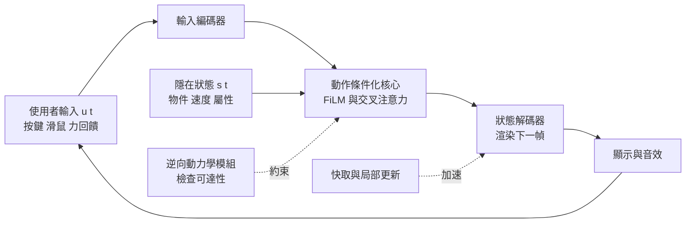

# 7.3 可交互即時世界模擬器：從靜態影片播放器邁向神經物理沙盒（Neural Sandbox）

## 影片播放器與沙盒的差別

到這裡為止，世界模型的能力邊界仍然可以用一句話概括：**它能預測一段預先決定好的未來**。使用者提交一段輸入，模型回應一段影片。這樣的系統本質上是「影片播放器」，它和 DVD 播放器的差別僅在於內容是即時算出的，而非預先錄製的。

然而，實用的系統——遊戲引擎、機器人模擬器、規劃用的腦內排練器——要求的是完全不同的東西。它要求**持續的互動**：使用者的每一個按鍵、每一個滑鼠位移、每一次力回饋，都必須立刻改變世界的狀態，並且下一幀必須反映這個改變。這個差別看似只是介面問題，實際上卻改變了模型需要解決的問題性質。

我們可以把兩種範式的對比寫成一個函數簽名的差別。影片播放器實作的是批次映射：

$$
F: (o_{0:t}, a_{0:t}) \mapsto o_{t+1:T}
$$

輸入一段序列，輸出整段未來。而互動沙盒實作的是一個帶有狀態的回饋迴圈：

$$
s_{t+1} = G(s_t, u_t), \qquad o_t = R(s_t)
$$

其中 $u_t$ 是使用者的即時輸入，可以是連續的按鍵強度、滑鼠角度或觸控軌跡。這個式子裡有兩件事在影片播放器中不存在。第一，輸入是連續且任意時間戳的——使用者的手可以停在半途，任何時刻都可能改變方向。第二，輸出必須即時，因為人對延遲的容忍度極低。

更關鍵的是，互動要求**因果性與一致性同時成立**：使用者的每一個輸入都必須有可預期的、可重複的影響。若使用者按住前進鍵一秒，角色必須往前移動一個确定的距離，而不是隨機地跳動或倒退。這意味著模型不能只是在影像空間裡生成「看起來像在動」的畫面，而必須在內部維持一個真正受控的狀態變數。

## 即時性的三個瓶頸

把互動沙盒的難度拆解成三個瓶頸是理解這個領域的最好方式。

**第一是推論速度。** 互動要求每幀在有限的時間內完成。以 30 幀每秒為目標，每幀只有約 33 毫秒的預算，而這 33 毫秒必須涵蓋整個網路的前向計算與資料搬移。這個數字對自迴歸模型特別嚴苛：若模型每次只生成一幀並把生成結果回饋到上下文，則計算量隨上下文長度線性增長，長期的互動會愈來愈慢。擴散模型則面臨另一種困難：生成一幀需要反覆去噪數十步，每一步都是一次完整的前向計算。

**第二是互動延遲。** 這裡必須區分兩個不同的量。*反應延遲*是從使用者輸入到模型開始計算的時間，通常可以透過非同步佇列與輸入預測壓得很低。*知覺延遲*是從輸入發生到對應畫面出現在螢幕上的時間，它才是使用者真正感受到的。人在操作一個環境時，對超過約 100 毫秒的延遲就會明顯感到不連貫；更嚴重的是，若延遲在互動過程中**波動**，使用者的操作節奏就會被打亂，因為他無法預測下一個動作會不會立刻生效。因此互動系統的目標不是「平均延遲夠低」，而是「延遲的離散度夠低」。

**第三是記憶體。** 互動沙盒需要同時維持多份狀態：模型權重、長期的上下文或潛在狀態、當前渲染所需的快取、以及為了處理多個並行角色或視角而存在的額外狀態。在消費級硬體上，記憶體往往比算力更早成為瓶頸。

這三個瓶頸彼此牽制。降低解析度可以同時節省記憶體與算力；減少擴散步數可以加快單幀生成，但品質會下降；縮小上下文可以節省記憶體，卻讓模型忘記較早發生的事，從而破壞一致性——這恰好觸及互動沙盒最不能妥協的性質。

三個瓶頸與其對策可以整理成下表。

| 瓶頸 | 症狀 | 主要對策 | 代價 |
| --- | --- | --- | --- |
| 推論速度 | 單幀生成時間超過幀預算 | 降低解析度、減少去噪步數、潛在空間運算 | 細節與時間一致性下降 |
| 互動延遲 | 操作節奏被打亂，延遲波動 | 輸入預測、非同步佇列、固定亂數種子 | 需額外維護狀態快照 |
| 記憶體 | 長上下文無法保存 | 局部更新與快取、壓縮狀態表示 | 長期一致性與細節遺失 |

## 神經物理沙盒的架構

神經物理沙盒的做法可以概括為一句話：**以世界模型作為渲染器**。使用者的輸入即時作用於內部狀態，模型再把狀態渲染成畫面。

這條管線中，狀態變數 $s_t$ 是整個系統的心臟。它必須是緊湊的——因為要在有限記憶體中保存數千個時間步——同時又必須是**可查詢的**：規劃模組要在不重新渲染的情況下讀取它來評估動作序列。純像素的隱藏狀態無法滿足這個要求，因為對它做數值查詢與代價評估是毫無意義的。因此沙盒通常採用第 2 章的物件中心槽位表示作為狀態基礎，把物理屬性以第 7.1 節所說的顯式變數形式附在各槽位上。

在公開報導方面，近年的成果大致勾勒出可行性的邊界。據公開報導，Google DeepMind 團隊在 2024 年發表的 GameNGen 系統，以擴散模型即時生成《DOOM》風格的第一人稱射擊畫面，能達到數十幀每秒的生成速率，並展現出物件持久性與大致合理的物理表現；它把「神經網路能否即時跑一個遊戲」這個問題從猜想變成了已展示的結果。據公開報導，2024 年底的 Genie 系列工作展示了從未經標註的互動影片中學習出可操作的平台環境模型，使用者的動作可以在生成世界中產生相應的連續效應。據公開報導，2025 至 2026 年間湧現的互動世界模型研究，焦點逐漸從「能不能即時生成」轉向「生成得是否物理一致、能否作為策略訓練的環境」。這些工作的共同意義在於，它們把世界模型從研究階段的離線生成器，推進成可以拿來玩、拿來測試策略的互動環境。

## 互動帶來的三個新需求

互動性對模型提出了影片生成中不存在的要求，值得逐條列出。

**動作必須有因果影響。** 在被動生成裡，使用者對畫面毫無影響力，因此模型可以生成任何「統計上像真的」序列。在互動沙盒裡，若模型忽略使用者輸入，使用者就會立刻察覺到世界沒有反應。因此動作注入機制不只是品質問題，而是可用性問題——第 7.1 節的三種機制在這裡都必須真正生效。

**回應必須即時且一致。** 即時性前面已經討論。 Consistency 則是指：同樣的狀態與同樣的輸入，必須產生同樣的結果。這要求模型具有某種程度的決定性，或者至少把隨機性侷限在可控範圍內。純擴散式生成天然帶有高隨機性，逐幀獨立採樣會導致物體在畫面中「抖動」；解決方式包括引入固定亂數種子、把前幾幀的噪聲 latent 快取下來、以及在生成時把先前的狀態作為強條件。

**可回到同一狀態。** 這是沙盒與單次生成的另一個差別。在遊戲中，使用者可以重複同一段操作序列來練習技巧；在機器人模擬中，策略必須能從相同的初始條件反覆重試。因此沙盒的狀態必須是**可快照與可還原**的：把某個時刻的 $s_t$ 存下來，之後可以從那裡重新開始。這一要求把生成模型從「一次性抽樣」轉為「帶狀態的系統」，也意味著模型的隨機性必須被收斂在一個可控的偽亂數序列之下。

## 品質與速度的取捨

在實務上，品質與速度的取捨通常透過五種手段進行，而每一種都伴隨明確的代價。

**降低解析度。** 這是最直接的手段，因為計算量大致與像素數成正比。代價是細節遺失：小物件消失、接觸判定變得模糊。補償方式是讓模型在低解析度的潛在空間中進行主要推理，只在最後一步以一個輕量的超解析模組還原細節。

**減少擴散步數。** 擴散模型的去噪步數直接決定生成時間。少數步的設計（如使用蒸餾或更高效的取樣器）可以讓單幀成本降到數十分之一，但細節的時間一致性通常會下降。

**快取與局部更新。** 由於互動沙盒的變化往往局限於畫面的一部分，可以只重新生成受影響的區域。這需要模型能夠判斷變動範圍——若使用者推動一個箱子，則只有箱子與其陰影需要重繪。這種局部更新把單幀成本從全畫面縮到一個小區塊，是最有效的加速手段之一，但前提是模型內部必須已經有明確的物件邊界。

**潛在空間運算。** 若整個管線都在壓縮的潛在空間中進行，渲染只在最後一步解碼，則中間步驟的成本會大幅下降。這與第 6 章 JEPA 的「放棄像素重構」在精神上一致。

**時間一致性的維護。** 傳統的加速做法（逐幀獨立生成）會帶來閃爍。常用的修補是保留前幾幀的 latent 與噪聲作為條件，讓新幀在生成時參照舊幀的一致性資訊。

這些手段的共同邏輯是：**把算力集中在「使用者真正看見會變化的地方」**。這與第 8 章要談的測時計算在本質上是同一種經濟學——有限的算力應該花在有歧義、需要探索的分支上。

## 評測的新難度：沒有標準答案的互動空間

互動沙盒帶來一個評測上的根本困難。在影片生成的評測裡，我們有參考影片，可以計算感知品質指標；但互動環境的空間是無限的——不同的輸入序列會產生無限多的軌跡，而且其中大部分沒有任何「標準答案」。

一個實用的方向是**程序化生成的測試任務**。既然無法窮舉互動空間，就應該設計可以自動生成、並且有明確可判定結果的任務。具體而言，可以由程式隨機生成一段物理場景設定——例如隨機的物件位置、質量、摩擦係數，以及隨機的目標——再要求模型完成一個有客觀判準的任務，例如把指定物件推到指定區域，或者讓某個堆疊在不傾倒的前提下維持數秒。這類任務的優點是判準可程式化、場景可無限重複，且能直接量測物理一致性（例如堆疊是否傾倒、物件是否穿模）。

另一個方向是**物理一致性探針**：在互動過程中隨機注入擾動（例如把一個物件稍微推向邊緣），檢查模型的回應是否符合物理直覺——它應該沿著重力方向下落、與地面產生摩擦減速、在撞到障礙物時改變方向。這類探針不需要完整任務，只需要檢查局部行為是否合理。

還有一個方向是**互動一致性量測**：把同一段輸入序列餵給模型兩次，檢查輸出是否一致；以及把狀態快照還原後再重播，檢查是否能重現相同軌跡。這直接測量的是「可回到同一狀態」這項要求。

這些評測思路共同反映了一個轉變：世界模型的評測不再只是「畫面像不像」，而是「世界的行為對不對」。前者可以由人眼或感知指標給出分數，後者必須由物理探針與任務成功率來回答。

## 神經沙盒與傳統物理引擎的分工

既然已有成熟的物理引擎，為什麼還要神經沙盒？關鍵在於兩者擅長的範圍不同。

傳統物理引擎的優勢是**可控與精確**：它依據明確的力學方程積分，能給出守恆律意義上的正確答案，也容易把任意物理參數設為輸入變數。它的弱點是**建模成本**：要讓引擎正確描述一個新的場景，往往需要工程師手寫物件的碰撞形狀、材質參數與關節約束，這個過程既耗時又難以覆蓋現實世界的長尾多樣性——布料、黏液、破碎、易碎物的形變，往往超出通用引擎的表達能力。

神經沙盒的優勢恰恰在此：它從資料中學到外觀與行為的對應，因此能以零標註的方式涵蓋訓練資料裡出現過的各種材質與互動。它的弱點則是**精確性與可控性**：輸出是生成的而非積分出來的，物理屬性只能以第 7.1 節所說的顯式變數近似，對於訓練分佈外的參數組合仍然不可靠。

因此一個實用的系統架構往往是**混合式**的：用物理引擎產生高精確度的基底資料與狀態，用神經模型處理那些難以編寫的材質與外觀，並用生成模型補上視覺的真實感。第 9 章所說的 Sim-to-Real，其核心挑戰正是在這個混合架構中處理兩者之間的落差。

另一個分工維度是**渲染與推論的分離**。神經模型不一定要負責畫面；它也可以只負責維護一個抽象的物理狀態，而由傳統渲染器負責把狀態畫出來。這種「神經物理 + 傳統渲染」的組合在工程上更可控，也更容易保證互動延遲的穩定——因為瓶頸從生成模型移到了渲染管線。

## 訓練互動模型的資料從哪裡來

互動沙盒的訓練資料來源，比被動生成更為嚴苛。以自迴歸模型為例，訓練需要的是長時間的連續互動序列，包含動作、觀測、以及中間的所有狀態；以擴散模型為例，則需要大量具備動作—後果配對的短片段。

來源大致有三種。第一種是**真實互動記錄**：人操作真實環境時的螢幕錄影與動作日誌。它的價值在於真實，但取得成本高，且難以覆蓋多樣的場景。第二種是**模擬器記錄**：在遊戲引擎或模擬器中大量隨機探索而得到的軌跡。優點是量大、標註完整、可程式化控制；缺點是外觀真實感較弱。第三種是**模型自我生成的軌跡**：用一個尚未成熟的模型互動產生資料，再以更強的模型或篩選器過濾，形成某種自我提升迴圈。

這三種來源的取捨，反映了本章一開始的張力：互動訓練需要的是「閉環的、多樣的、可控的」資料，而現實中大量存在的卻是「開環的、單一的、被動的」資料。第 7.2 節所說的資料效率策略——用逆向動力學從被動影片吸收動作語意——正是為了把第三種來源的可用素材擴大。

## 引出：視覺之外的世界

## 引出：視覺之外的世界

到目前為止，本章的所有討論都侷限在視覺通道。但物理資訊其實大量存在於其他感官之中：摩擦係數的細微差異，反映在觸覺與聲音上；重量體現在關節所承受的力矩上；接觸法向力則同時反映在觸覺陣列與聲音的響度裡。當模型只被允許觀看時，它對這些物理量的判斷就只能透過視覺的外觀線索去猜測，其精度遠低於直接測量。第 7.4 節將把視覺、聽覺、觸覺與本體感受放進同一個統一的狀態表示裡，說明跨感官預測如何讓世界模型的物理直覺突破單一通道的上限。
