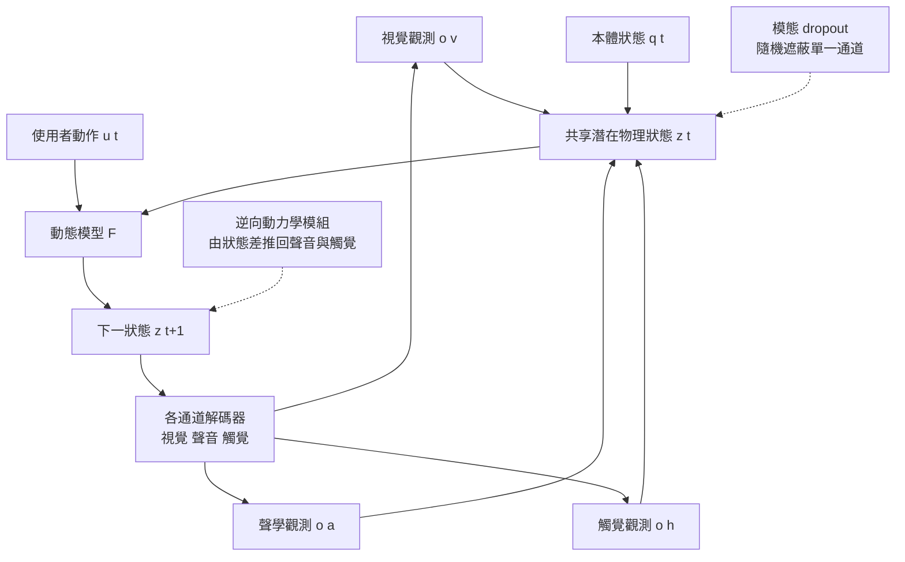

# 7.4 觸覺、聽覺與本體感受（Proprioception）：跨感官通道的交互預測

## 為什麼只有視覺不夠

本章一路走來，世界模型的狀態幾乎都是以視覺為主要觀測通道來定義的：像素、影片幀、物體槽位的幾何特徵。這在多數示範情境中可行，因為視覺確實是資訊量最豐富的通道。但有一個問題從未被解決：**許多最關鍵的物理量，其實並不主要表現在視覺上**。

摩擦係數就是最好的例子。兩個表面在外觀上可以完全相同，一個是打磨光滑的木板，一個是粗糙的橡膠墊，但當物體滑過時，前者的減速度遠大於後者。這個差異在畫面中只體現為極短暫的運動模糊，任何基於像素的模型都難以從中穩健地估出摩擦係數。然而，只要讓物體在兩者上滑動並記錄聲音，摩擦的差異就會直接反映在噪音的頻譜與衰減上。

重量也是類似的情況。提起一個空水杯與提起一個裝滿水的水杯，外觀上的體積與形狀幾乎相同，視覺只能給出一個粗糙的體積估計；但本體感受能直接測出關節所承受的力矩，從而反推質量。接觸法向力同樣如此：當手指按在桌面上時，力的大小幾乎不反映在視覺裡，卻同時記錄在觸覺陣列與肌肉的力覺回饋中。

這裡有一個更根本的論點。視覺是一個**被動的二維投影**：它丟棄了深度、丟棄了被遮擋的資訊、丟棄了物體的內部狀態。而物理世界的因果過程發生在三維、有內部結構的實體上。單靠視覺，模型永遠是在做一個資訊不足的逆問題；多感官則提供了互補的觀測，使逆問題變得可解。這正是第 2 章所說的「遮擋推理」問題在感官層面的延伸。

## 本體感受的狀態表示

本體感受（proprioception）指身體對自身狀態的感知，包括關節角度、關節速度、肌肉張力與所受的力矩。在世界模型的脈絡下，它扮演的角色是把「動作」從一個抽象的指令符號，轉換成**具物理量綱的實際施力**。

一個典型的機器人本體狀態可以寫成：

$$
q_t = \left[ \theta_t \in \mathbb{R}^{n_j},\ \dot{\theta}_t \in \mathbb{R}^{n_j},\ \tau_t \in \mathbb{R}^{n_j} \right]
$$

其中 $\theta_t$ 是各關節角度， $\dot{\theta}_t$ 是關節角速度， $\tau_t$ 是各關節的輸出力矩。加上接觸點與接觸法向力：

$$
\left[ c_t^{\text{loc}} \in \mathbb{R}^{3},\ c_t^{\text{n}} \in \mathbb{R}, \ c_t^{\text{fric}} \in \mathbb{R}^{2} \right]
$$

最後一項特別值得注意：**接觸點的切向摩擦力可以直接測量**，它是模型推斷摩擦係數的最直接證據。

把本體狀態與視覺狀態放在一起，就得到一個完整的物理狀態變數：

$$
s_t = \left( z_t^{\text{vis}},\ q_t,\ \{ z_k^{\text{obj}} \}_{k=1}^{K} \right)
$$

其中 $z_t^{\text{vis}}$ 是視覺編碼， $q_t$ 是本體狀態，而 $z_k^{\text{obj}}$ 是各物件的槽位表示。第 7.1 節所說的物理屬性（質量、摩擦、恢復係數）應當掛在物件槽位上或由本體量測推得，而不是藏在視覺特徵裡。

## 多感官對齊的兩個難題

把多個感官通道放進同一個模型，第一個難題是**對齊**。

**時間對齊。** 各通道的採樣率與延遲往往不同。相機可能是 30 或 60 幀每秒，力回饋感測器可能是 1000 赫茲，音訊則是連續串流。若直接把所有訊號切成相同長度的片段，模型會學到錯誤的因果順序——例如把「接觸發生的那一瞬間的力峰值」對應到「碰撞後一幀的音訊」。正確的做法是引入一個連續時間軸，把每個通道的觀測插值或對齊到事件時間戳上，並允許模型在推理時做小幅的時間校正。

**空間對齊。** 觸覺是**局部**的：手指上的感測器只感知到自己接觸到的那一小塊區域；視覺是**全域**的：一幀影像涵蓋整個場景。要把兩者放進同一個狀態表示，必須建立一個共同的座標框架——把觸覺接觸點投影到相機座標系中，把視覺中的物件位置映射到機器人本體座標系中。這個座標系的建立本身就是一個幾何問題，與第 2 章的幾何對齊工作直接相關。

第二個難題是**資料特性**。

觸覺資料是**高維且低採樣率**的。現代的觸覺感測器（如基於視覺的觸覺或電容式陣列）在單次接觸中可能產生數千維的訊號，但這類資料的採集需要昂貴的特製硬體，公開資料集規模遠小於影像資料。更麻煩的是，觸覺訊號的**解釋性差**：一個數值序列的變化可能來自接觸面積、接觸壓力、物體形狀變形、甚至感測器本身的漂移。這些因素在觸覺維度上高度混疊，使得觸覺的解碼比視覺困難得多。

聲學通道則相反：它**低維、高採樣率、語意豐富**。一段碰撞聲的頻譜特徵能提供材質、尺寸、接觸力大小的線索，但解碼需要的是時頻分析而非空間對齊。

各感官通道的特性對照如下。

| 通道 | 主要物理資訊 | 資料特性 | 空間範圍 | 主要難題 |
| --- | --- | --- | --- | --- |
| 視覺 | 幾何、拓撲、形變 | 高維、高採樣率 | 全域 | 遮擋與深度不可知 |
| 聽覺 | 材質、能量、遮擋後事件 | 低維、高採樣率 | 全域但方向模糊 | 環境噪音與混響 |
| 觸覺 | 接觸力、摩擦係數、軟硬 | 極高維、極低採樣率 | 局部 | 訊號混疊難以解碼 |
| 本體感受 | 實際施力、力矩、關節狀態 | 低維、與動作同步 | 自身範圍 | 需外部標定與座標對齊 |

## 跨通道預測的數學

多感官模型的核心設計，是引入一個**共享的潛在物理狀態** $z_t$ ，讓所有感官通道都成為這個狀態的函數：

$$
p(o_t^{v}, o_t^{a}, o_t^{h}, q_{t+1} \mid z_t, u_t)
$$

其中 $o^{v}$ 是視覺觀測， $o^{a}$ 是聲學觀測， $o^{h}$ 是觸覺觀測， $q_{t+1}$ 是下一時刻的本體狀態，而 $u_t$ 是使用者的動作輸入。這個式子的關鍵在於：各通道的解碼器都從同一個 $z_t$ 讀取資訊，因此它們被迫在解碼過程中對齊。

訓練時的損失由三部分組成。**各通道的重構損失**：

$$
\mathcal{L}_{\text{dec}} = \sum_{m \in \{v, a, h\}} \lambda_m \, D_m\left( o_t^{m}, \hat{o}_t^{m}(z_t) \right)
$$

**跨通道的對齊損失**，要求由視覺推斷的潛在狀態與由觸覺推斷的潛在狀態彼此接近：

$$
\mathcal{L}_{\text{align}} = \left\| z_t^{v} - \operatorname{sg}\left( z_t^{h} \right) \right\|_2^2
$$

其中 $\operatorname{sg}$ 表示停止梯度，避免兩個分支同時塌縮到同一個無資訊的點。**動態一致性損失**，則要求共享狀態在動作作用下滿足動力學規律：

$$
\mathcal{L}_{\text{dyn}} = \left\| z_{t+1} - F_\theta(z_t, u_t) \right\|_2^2
$$

三者的加權組合，就是多感官世界模型的訓練目標。

**模態 dropout** 是其中一個非常有效的訓練技巧：在訓練時以一定機率隨機遮蔽某個通道的輸入，迫使模型不能把某一個通道當成唯一可依賴的資訊來源。這會帶來兩個好處。其一是避免通道塌縮——模型不會退化成「只靠視覺預測視覺」。其二是讓模型在實際部署時能容忍單一感測器失效。更重要的是，它讓模型學到**每個通道各自能預測什麼**：視覺通道的 dropout 迫使觸覺分支學會獨立的物理推斷，觸覺 dropout 則迫使視覺分支學會更仔細地觀察形變與陰影。

## 觸覺渲染：逆向動力學的感官版本

有一類研究把第 7.2 節的逆向動力學思想移植到感官層面：**從視覺與動作生成觸覺訊號**。其設定是，已知一段視覺與動作序列，要預測相應的觸覺訊號 $o_t^{h}$ 。用條件擴散模型來表達：

$$
p_\theta\left( o_{t-k:t}^{h} \mid o_{t-k:t}^{v}, u_{t-k:t} \right)
$$

這個任務的性質值得仔細辨認。從資訊論的角度看，觸覺訊號裡含有許多**視覺中不可得**的資訊——接觸力的大小、物體的軟硬程度。因此這個任務在原理上是不可解的，任何模型都只能預測一個「在給定視覺與動作下最可能的觸覺分佈」。這個不可解性其實正是它的價值所在：因為它必須依賴視覺中的線索（形變、陰影、運動模糊）與物理先驗（接觸時必有壓力、軟物必有形變）來推斷不可見的量，因此它是一個**隱式的物理推理測試**。

從逆向動力學的角度看，這個任務更接近「由狀態轉移推回中間的物理過程」：知道物體從這裡動到那裡，反推它在過程中承受了什麼力。這正是逆向動力學在感官通道上的對應物。而它的實用價值是雙向的：向前可用於生成（做一個能產生合理觸覺回饋的模擬環境，讓機器人策略在訓練時就體驗到接觸），向後可用於檢查（若一個生成的觸覺訊號與視覺過程不相容，說明這個視覺生成有物理問題）。

## 聲學通道：最早到達的物理訊號

在多感官的物理推理中，聲學通道具有一個其他通道都沒有 property：**時間上的先行性**。光速極快，聲速每秒約 340 公尺，這意味著在一個中等尺度的場景裡（例如一張桌子大小的環境），視覺幀與音訊之間的時間差只有幾十毫秒——但這已足以讓模型建立因果順序：先聽到碰撞，再看到形變。

更重要的是，聲音**能揭示被遮擋的事件**。當一個箱子滑到桌子另一側、消失在視野之外，視覺上什麼都沒有發生，但滑動摩擦與撞擊桌腳的聲音已經把事件完整地記錄下來。這使得聲學通道成為一種「離線的視覺」：它填補了遮擋造成的資訊空洞，正好對應第 2 章所強調的遮擋推理難題。

此外，聲音還揭示了視覺原理上無法呈現的物理量。撞擊的響度大致正比於動能，音色取決於材質的共振特性（木材有明顯的共振峰值，金屬有長久的餘響，塑膠則快速衰減）。這些線索使得「聽聲辨物」成為一個真正可解的物理問題。

在工程上，聲學通道的挑戰在於**空間定位**：在真實環境中，麥克風聽到的是所有聲源的混合。若要利用聲音做物理推理，需要把聲音與視覺中的事件做關聯，而這需要多麥克風陣列或至少能估計方向。

## 從多通道到多主動探測

多感官模型還帶來一個更激進的推論：如果模型擁有動作輸出能力，它不必只被動等待感官資料送來，它可以**主動去產生能區別假設的觀測**。這就是主動感知（active perception）的核心思想——在兩個物理假設之間，選擇最能分辨它們的測量。

一個具體例子。面前有一個不透明的箱子，模型想知道裡面是空的還是塞滿了石頭。視覺無法回答，但敲擊可以。若模型能控制敲擊的力道與位置，它便能設計出最有效的實驗：輕敲聽空腔回音，重敲聽底部悶響，兩者的差異比任何單次敲擊都更可靠。在世界模型的框架下，這個過程正是第 8 章所談的**試算**——模型在自己的狀態空間中比較多個可能的未來，挑選最能降低不確定性的那一個。

這也解釋了為什麼多感官與規劃必須放在一起討論。多感官提供了更豐富的狀態描述，但只有當模型能把這些描述轉化為「我下一步該做什麼才能知道更多」時，物理直覺才能真正發揮作用。純被動的模型永遠停留在「觀察到的世界」，而主動的模型才開始逼近「可理解的物理」。

## 多感官為何能突破單一通道的直覺上限

綜合上述分析，多感官帶來的增益可以歸結為三個機制。

**第一，互補性帶來資訊增益。** 兩個對同一物理過程觀察角度不同的通道，結合後的資訊量超過任一單獨通道。視覺給出幾何與拓撲，觸覺給出接觸力與摩擦，聲學給出材質與能量，本體感受給出實際施力。這些維度彼此正交，聯合起來才構成一個完整的物理狀態描述。

**第二，遮蔽與缺失的補償。** 當某個通道在特定情境下退化（視覺被遮擋、觸覺未接觸、聲音被環境噪音淹沒），其他通道仍能提供資訊。單通道模型在這種情境下只能猜測，多通道模型則仍有跡可循。

**第三，被迫的物理正則化。** 這是最深層的一點。當模型必須同時解釋視覺與聲學時，它無法用「視覺看起來合理」來敷衍一個物理上錯誤的解釋——因為那個錯誤的解釋也必須產生合理的碰撞聲。跨通道的一致性要求本身，就構成一種物理正則化，抑制了第 10 章所說的物理幻覺。

一個簡單的思想實驗可以說明這點。假設要判斷一個球是空心的還是實心的：若只有視覺，需要比較敲擊前後的形變，訊號微弱且容易受環境影響；若加上聲音，敲擊音色立刻區分兩者——空心球有明顯共鳴。這種判斷能力的差距，遠大於任何單純擴大視覺模型規模所能帶來的提升。這也說明，多感官並非把更多資訊丟進一個更大的模型，而是改變了問題的性質：從「這看起來像什麼」變成「這是什麼」。前者是辨識，後者才是物理理解。

## 收束：可預測且可干預的狀態

第 7 章的四節構成了一條完整的邏輯鏈。7.1 節建立了動作進入模型的三種機制，並說明物理屬性必須是顯式變數；7.2 節以雙向動力學約束，用逆向模型檢查前向生成的可信度；7.3 節把這套能力放進即時互動迴圈，並面對速度、延遲與記憶體三個瓶頸；7.4 節則把觀測從視覺單通道擴充到包含觸覺、聽覺與本體感受的多通道統一狀態。

這四節共同確立了對世界模型的一個明確要求：**狀態必須是可預測且可干預的**。可預測，指的是給定當前狀態與動作，未來的分佈可以計算；可干預，指的是這個狀態中的物理屬性是顯式變數，可以被覆寫與追問「如果」。這兩個性質正是第 3 章因果框架與第 6 章 JEPA 觀念在控制維度上的完成形。

但這一切都是為了下一件事做準備。一個可預測且可干預的狀態，最終必須被拿來**規劃**——在腦中比較多條可能的未來，選出最值得執行的一條。第 8 章要處理的正是這個問題：把模型預測從訓練期的正則化項，轉化為決策期的搜尋空間；把算力從「學會預測」搬到「比較好壞」。屆時我們會看到，前幾章鋪陳的每一個元件——動作條件化、雙向約束、可干預的物理屬性、多感官狀態——都會在搜尋演算法中找到自己的位置。
