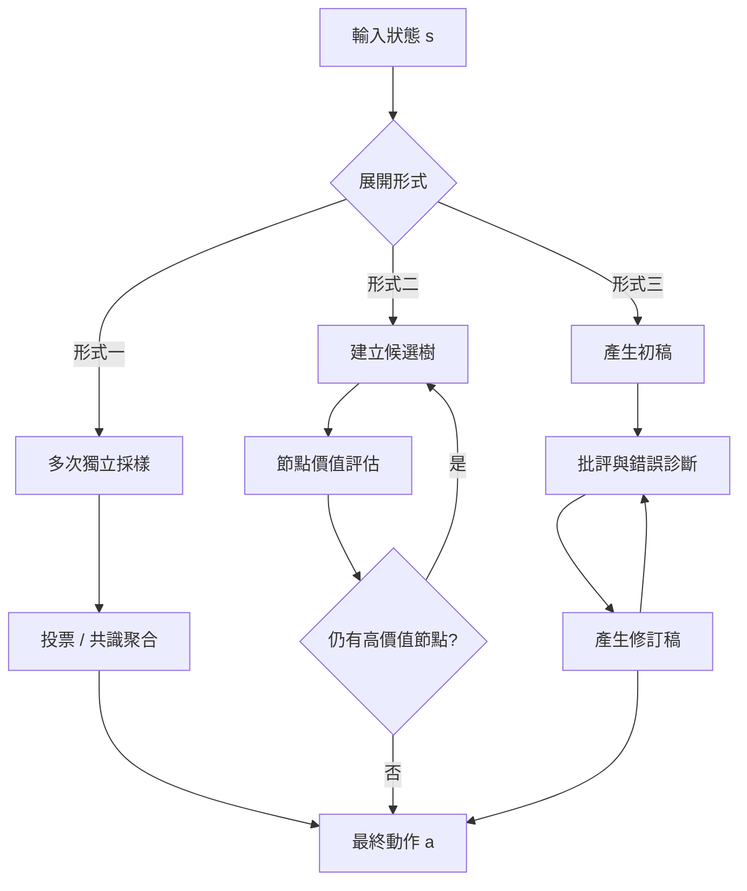

# 8.1 基於潛在軌跡的測試時計算擴展（Test-Time Compute Scaling）

## 8.1.1 系統二思維的工程定義

人類的決策有兩個風格鮮明的模式。系統一是快速、直覺、自動的，它在幾百毫秒內給出答案，卻幾乎不產生可報告的內部推理鏈。系統二則緩慢、費力、刻意，它的輸出伴隨著可被主觀感受到的計算痕跡。長期以來，深度學習系統只具備系統一的架構：無論輸入多複雜，網路都只做一次前向傳播，然後直接吐出答案。這樣的架構在分類問題上已經足夠，但一旦問題需要「考慮多種可能再決定」，它就顯得先天不足。

系統二思維的工程定義可以寫得很簡單：把推理時的算力用來**展開多條候選軌跡並加以比較**，而不是只用來做一次前向。關鍵不在於「想得久」，而在於結構的改變——推理程序從單次映射 $`f: x \mapsto y`$ 變成了一個帶有內部狀態的搜尋程序。

$$
\pi(a \mid s) = \int_{\mathcal{T}} \mu(a \mid s, \tau)\, p(\tau \mid s)\, d\tau
$$

這個式子的意思是：決策不再由一個策略網路直接給出，而是對所有可能的推理軌跡 $`\tau`$ 做加權平均，其中每條軌跡內部已經產生了某個具體的動作 $`a`$ ，而軌跡本身的權重由一個獨立的模型 $`p(\tau \mid s)`$ 給出。當 $`p`$ 是退化的（所有權重集中在一條軌跡上），這個式子就退化回系統一；當 $`p`$ 把權重分散到多條軌跡上，系統二才真正出現。

值得強調的是，這裡的算力並沒有被「消耗」在某種抽象的思考上，而是被花在了一個可以客觀描述的過程上：產生 $`M`$ 條軌跡、對每條軌跡評分、然後依分數分配後續算力。這使得系統二的行為變得可分析，也讓「把算力花在什麼地方」成為一個可以工程調校的問題。

## 8.1.2 測試時計算的三種形式

在工程實作上，測試時計算擴展可以歸為三種基本形式，它們在「算力投放到哪裡」這個問題上各有不同的答案。

第一種是**多次採樣並取共識**。同一個輸入送入模型多次，產生多個答案，再用多數決策、投票加權或某種一致性度量挑出最終結果。這是最簡單也最容易擴展的形式，因為它幾乎不要求改變模型架構，只要求改變推理時的批次大小。這種方法在推理任務上已被證明有效，但它的盲點在於：多條獨立採樣的軌跡彼此之間並不共享中間推理，若某一條早期的錯誤前提被多條軌跡共同繼承，取共識反而會把錯誤放大。

第二種是**樹狀搜尋**。推理過程被顯式組織成樹，模型不僅給出答案，還要判斷「還有多少值得挖的地方」，並依據某個節點的價值不斷向下擴展。這種形式能讓計算力集中在真正困難的分支上，但在連續動作空間中很難直接套用，因為分支數量會迅速膨脹。

第三種是**迭代修正**。模型先生成一個完整的初步答案，再對它進行批評、指出錯誤、產生修訂版本，如此反覆若干輪。這是實務中最容易部署的形式，因為它只需要「生成—批評」兩種角色，並且可以用同一個模型加不同的提示或角色標籤來實現。

這三種形式在「失敗時會怎樣」這件事上也有本質差異。多次採樣若共識一致，系統會非常自信但也可能整體錯；樹狀搜尋若搜尋預算不足，會退化成一個深度不足的近似，但方向通常不會完全跑掉；迭代修正則最容易被「修正到錯誤方向」，因為批評者與生成者共享同一套世界觀，共錯的時候會愈錯愈遠。這個對比在設計系統二的失敗處理策略時非常實用：系統需要知道自己的失敗模式屬於哪一類，才能選擇適當的退避或重啟機制。

這三種形式並非互斥。成熟系統通常同時具備：以樹搜尋作為骨架、以迭代修正處理無法分解的子問題、以共識聚合穩化最終輸出。對世界模型的場景而言，第三種形式往往要改寫為「在想像的連續軌跡上修正」而非「在文字上修訂」。

## 8.1.3 與本節的分工：展開與搜尋

本節處理的是「展開」的數學：給定一個狀態，如何系統性地產生多條物理上可分辨的候選未來，以及如何為這些未來定價。第 8.2 節則處理「搜尋」的具體演算法：如何在展開出來的樹上安排探索順序、如何用 PUCT 之類的平衡機制決定下一個該展開的節點、以及如何把整棵樹的結果收斂成一個可執行的動作。

兩者的關係可以類比成地質學與探勘工程。地質學回答「沉積層下可能有哪些地層、每層可能蘊藏什麼資源」，探勘工程回答「先鑽哪一口井、用什麼鑽頭、鑽多深、何時停止」。前者提供可能性空間的結構，後者提供在有限時間與有限成本下逼近最佳點的策略。缺少前者，搜尋只能盲目地在隨機分支上燒算力；缺少後者，再漂亮的展開也只能停留在紙面。

因此在本章的整體安排中，8.1 建立語彙與數學基礎，8.2 給出第一個可運作的演算法，8.3 處理讓搜尋可行的剪枝問題，8.4 則回到策略本身，讓模擬的結果能夠回頭改善直覺反應。

## 8.1.4 世界模型為何讓測試時計算特別有效

這是本節最核心的論點，也是全章存在的理由。對語言模型而言，測試時計算擴展的產物是**文本序列**，而文本序列的分支必須靠語意上的選擇詞（例如「因為」「但是」「或者」）顯式寫出，否則模型無法讓自己走進另一條路徑。這意味著分支機制本身就是額外的訓練負擔與額外的推論成本。

世界模型改變了這個遊戲規則。因為它是一個**反覆機制**：給定當前狀態與一個動作，它能生成下一個狀態；再給定新的動作，又能生成下一個。這代表候選未來的分支不需要被「寫」出來，而只需要被「執行」出來。

$$
s_{t+1} \sim p_\theta(\cdot \mid s_t, a_t), \qquad \hat{s}_{t+1} = \mathbb{E}[s_{t+1}]
$$

於是「多條平行未來」的生成成本從「生成一個分支所需的 token 數」變成「一次前向傳播的時間」。同一組初始條件，只要動作不同，就能得到彼此物理一致且互不相同的軌跡。這帶來一個關鍵差異：**重複同一條貪心路徑不再是唯一的選擇**。

更精確地說，一般的貪心決策是把算力全部投入「沿最可能的動作往前走」，它的期望回報是單條路徑的回報；而測試時計算把算力分散到多條軌跡上，其價值來自於比較之後挑出最好的一條。在許多任務中，貪心一步的選擇會把系統鎖入一個次優的局部盆地，而只有多軌跡比較才能發現那條需要「先退兩步再轉向」的路徑。

這一點在物理操作任務中尤其明顯。當機械臂要把杯子放到架子上，貪心策略往往會先把杯子往最近的方向平移，結果杯底撞上架子邊緣；一條稍微繞遠的軌跡反而能順利完成。多軌跡展開的真正價值不是「把最好的答案找得更精確」，而是「讓系統有機會看見那些不在最可能位置上的解」。

另一個容易被忽略的價值是**失敗的早期偵測**。單條貪心軌跡的失敗往往要到很後面才會顯現，此時已經沒有退路；而多軌跡比較可以在第一步就發現「大多數候選動作都會撞牆」，從而觸發重新規劃或退避。這種把偵測成本前置的能力，在真實世界的機器人系統中往往比平均效能的提升更有價值。

## 8.1.5 成本分析：寬度乘以深度

測試時計算並非免費。讓我們把成本寫清楚。若展開寬度為 $`B`$ （每個節點生成 $`B`$ 個子節點）、深度為 $`D`$ （向前看的時間步數），則總節點數為：

$$
N = 1 + B + B^2 + \cdots + B^{D} = \frac{B^{D+1} - 1}{B - 1}
$$

若每次展開需要呼叫世界模型一次，耗時為 $`t_f`$ ，則總推論延遲約為 $`N \cdot t_f`$ 加上樹管理與價值評估的開銷。延遲因此隨寬度與深度**相乘**而非相加，這是與訓練時擴展的根本差別：訓練時參數共享，一次前向處理整個批次；測試時的每個分支都是獨立的序列。

這裡出現了本章反覆出現的張力：**算力的投入量是超線性的，但回報不是**。把寬度從 8 加到 16，節點數大約翻倍；但若新增加的分支大多落在同一個局部模式（見 8.3 的多樣性維護），額外算力幾乎不帶來資訊增益。這意味著單純堆疊測試時算力並不划算，必須同時投資於分支取樣的機制設計與價值的估計品質。

除了節點總數，延遲還受另一個因素支配：**串列依賴**。若世界模型的展開必須等前一步完成才能開始（即深度方向的依賴），那麼真正的瓶頸是深度而非寬度。反過來，若系統採用批次化展開——一次把所有候選節點送進世界模型並行預測——則寬度方向幾乎是免費的，瓶頸就轉移到批次大小與記憶體容量。這個工程約束會在 8.2 節反覆出現：**MCTS 樹的寬度可以靠硬體堆出來，深度卻必須靠模型本身夠快才走得完**。

| 展開形式 | 算力投放位置 | 對世界模型的適配度 | 主要失效模式 |
| --- | --- | --- | --- |
| 多次採樣取共識 | 同一輸入的獨立副本 | 中：可比較多條完整軌跡 | 共享錯誤前提，共識反而固化偏差 |
| 樹狀搜尋 | 節點的分岔與延伸 | 高：模型本身就是展開器 | 分支數膨脹，需要剪枝 |
| 迭代修正 | 對既有產物的批評與改寫 | 中高：可改寫動作序列 | 修正方向缺少物理約束，容易漂移 |
| 貪心策略（對照） | 單一路徑 | 低：不使用多餘算力 | 陷入局部盆地，無法挽回 |

## 8.1.6 與《語言模型》一書的系統二推理對照

在人工智慧系列的《語言模型》一書中，系統二推理被描述為在 **token 樹**上的展開：模型在生成時考慮多種可能的接續詞，並依某個評分機制決定往下走。這套方法在數學推理與程式碼生成上展現了明確的收益。

世界模型的對應版本是在**連續軌跡**上的展開。兩者的差異不是表面的，而是結構性的，值得逐項拆解。

一個最簡單卻最直觀的對照是樹的「邊」的意義。在語言模型那邊，一條邊是一個 token，它的合法性由語法與語意共同保證；在世界模型這邊，一條邊是一段連續的動作向量，它的合法性則由物理決定——一個把杯子推向牆面的動作在語意上完全通順，在物理上卻立刻會被約束檢查擋下。這使得世界模型的搜尋樹帶有一種語言模型所沒有的先天過濾力。

| 對照項目 | 語言模型的系統二推理 | 世界模型的系統二推理 |
| --- | --- | --- |
| 展開的對象 | token 序列，離散且分岔明確 | 連續動作與狀態軌跡，連續且分岔隱含 |
| 分支的產生 | 由模型在每個決策點選擇候選詞 | 由模型對每個候選動作做一次狀態預測 |
| 分支的數量 | 由詞表大小與 top-k 決定，可精確界定 | 由動作空間的體積決定，難以窮舉 |
| 價值的來源 | 語意上「這段推理是否通順、有幫助」 | 世界後果「這條軌跡的累積回報是多少」 |
| 展開的產物 | 一段可讀的推理文本 | 一段不可讀但可執行的動作序列 |
| 典型失效 | 自我一致性高但結論錯誤 | 軌跡在物理上不可行 |

## 8.1.7 連續空間的展開為何更難

連續空間的展開有兩個本質困難，必須被正視。

第一，**沒有現成的分支結構**。在文字生成中，語句邊界、標點、詞與詞之間的依存關係，天然提供了可切分的決策點，因此樹的結構是「給定」的。而在連續動作空間中，什麼算是一個「決策點」？若以固定時間步長切分，則每一步的動作空間是一個高維連續體；若以事件切分，則又需要先解決「事件」在連續物理中如何被偵測的問題。前者導致樹寬度難以界定，後者導致分支條件本身不確定。

第二，**樹寬度難以界定**。文字模型可以用 top-k 把每個節點的分支數限制在 $`k`$ ，這是一個方便的工程近似。但在連續動作空間中，即使把每一步的候選動作限制為 $`k`$ 個，整棵樹的節點數仍然是 $`k^{D}`$ 這樣的指數式增長，而且這 $`k`$ 個候選動作要如何從連續分佈中抽出、抽出的樣本是否具有代表性，都沒有現成答案。

這意味著，想把測試時計算擴展搬到世界模型上，必須引入兩樣東西。

第一樣是**分支的取樣機制**：給定狀態與動作分佈，如何產生有代表性且多樣的候選動作。這部分將在 8.2 節以策略先驗與隨機搜尋的形式出現，並在 8.3 節以交叉熵方法（CEM）與多樣性維護的細節加以強化。

第二樣是**價值的估計器**：給定一條模擬出來的軌跡，如何快速判斷它值不值得繼續深挖。若沒有這一個，搜尋就退化成盲目隨機展開，計算量會完全被浪費在沒有希望的分支上。

這兩樣東西合起來，正好構成第 8.2 節的 MCTS 設計骨架：樹狀結構提供展開的容器，PUCT 提供探索與利用的平衡，價值網路提供價格標籤，而世界模型提供從節點到子節點的轉移。

## 8.1.8 小結

測試時計算擴展的本質，是把「單次前向」的策略網路改造成「帶內部狀態的搜尋程序」。世界模型使這件事在物理連續空間中得以成立，因為它本身就是一台能把任意動作轉化為確定後果的機器。下一節將把這台機器接到蒙地卡羅樹搜尋與模型預測控制上，回答最實際的問題：給定一個狀態與一個世界模型，具體要怎麼樣下棋。
