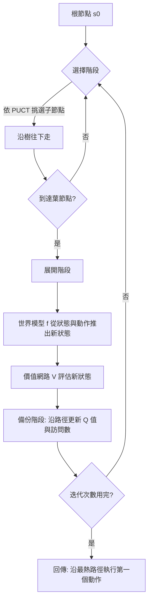

# 8.2 在腦海中下棋：世界模型驅動的蒙地卡羅樹搜尋（MCTS）與模型預測控制（MPC）

## 8.2.1 把棋盤搬進腦袋

國際象棋的頂尖棋手在落子之前，並不會在腦中列舉所有可能的棋局——那個數量是天文數字。他們做的是另一件事：估算局面，看見幾條好的應手，估算對手的應手，再估算自己的下一步。這個過程之所以可行，是因為象棋的狀態空間雖然巨大，但每一步的分岔是離散且有限的，而且每個局面的價值可以被快速、粗略地判斷。

機器把這件事做得更徹底。AlphaGo 在落子時於腦中建構一棵數千到數萬個節點的搜尋樹，用網路評估局面、用蒙地卡羅樹搜尋決定展開順序。這套方法之所以能搬到機器身上，是因為網路提供了一件人類沒有的東西：**毫秒級的價值估計**。人類能估計一個局面好不好，但每秒大概只能估計幾十個；網路可以每秒估計幾萬個。

世界模型的出現讓同一個框架有了新的落點。在 AlphaGo 的架構中，搜尋樹的邊是棋步，節點是局面，網路是價值與策略的評估器。在世界模型的架構中，樹的邊是連續動作，節點是物理狀態，而**評估器的角色被移交給了兩部分**：一個專門估計「現在這個狀態有多好」的價值網路，以及一個專門把狀態往前推的世界模型。理解這個替換關係，是理解整個第 8 章的關鍵。

## 8.2.2 MCTS 的四個組成元件

一個可運作的世界模型驅動 MCTS 需要四個元件，每一個都對應一個明確的工程問題。

**節點與邊的定義**。節點代表一個狀態 $`s`$ ，邊代表一個動作 $`a`$ 以及從父節點到子節點的轉移。要注意，狀態在這裡必須是**緊湊且可模擬的**：如果是原始影像，節點的記憶體成本會極高；如果是第 1 章與第 3 章所說的潛在狀態或物體中心槽位表徵，節點就只是一個固定大小的向量。這是前面各章的技術選擇在此處兌現價值的地方。

**展開機制**。從一個節點出發，必須能產生若干個子節點。在棋類中這是列舉合法棋步，在連續動作空間中則是**從動作先驗中採樣**。這是連續版本與離散版本最尖銳的差異，也是最常被低估的難點。

**價值函數**。對葉節點或新節點給出一個估計值 $`V(s)`$ ，表示「從這個狀態出發，未來能拿到多少累積回報」。在實作上這是一個獨立的網路，可以與世界模型共享編碼器但擁有不同的輸出頭。

**樹策略**。決定接下來要展開哪個節點。AlphaGo 使用的 PUCT 公式把「探索未充分訪問的分支」與「利用價值高的分支」結合成一個分數：

$$
\mathrm{PUCT}(n) = Q(n) + c_{\mathrm{puct}} \cdot P(n) \cdot \frac{\sqrt{N(n)}}{1 + N(n)}
$$

其中 $`Q(n)`$ 是節點 $`n`$ 的平均價值估計， $`P(n)`$ 是策略網路給出的先驗機率， $`N(n)`$ 是訪問次數。當 $`N(n)`$ 很小時，第二項很大，鼓勵擴展新分支；當 $`N(n)`$ 很大時，第二項趨近於零，選擇就完全由 $`Q`$ 主導。這個公式的精妙之處在於它讓探索與利用自動過渡，不需要人工設定切換時機。

## 8.2.3 與《電腦下棋》一書的呼應

在人工智慧系列的《電腦下棋》一書中，AlphaGo 的出現被描述為一次範式的融合：蒙特卡洛樹搜尋提供搜尋框架，深度卷積網路提供價值與策略的評估，強化學習讓兩者得以在自我對局中共同改善。AlphaZero 更進一步移除了人類棋譜，把整個系統化為「搜尋 + 網路」的自我對局迴圈。

這裡的呼應與差異同樣清楚。**相同之處**在於框架：都是「維護一棵樹、用網路做啟發式、用搜尋決定行動」。**差異之處**在於網路的職責。AlphaGo 的網路做兩件事：估計局面價值、給出棋步先驗。這個世界模型驅動的版本則把這兩件事拆開：價值估計仍然由一個網路負責，而**狀態推進改由世界模型負責**。

這個替換帶來三個後果。第一，樹的邊不再是有限的離散集合，而是一個連續分佈，這使得 AlphaZero 那種「窮舉合法棋步」的做法失效，必須改用採樣。第二，展開一個節點不再是查表，而是要真的跑一次世界模型前向，這使得每次展開的邊際成本從近乎免費變成數毫秒。第三，世界模型的誤差會沿樹向下累積，因此樹的深度受限於模型品質，而不僅受限於算力預算。

還有一個更隱蔽的後果：**搜索的目標函數從「勝負」變成了「環境回報」**。棋類的回報是離散的、終局的、無歧義的；物理任務的回報往往需要人工設計，且常常是稠密但主觀的。「把手伸向杯子」這個目標究竟值多少分、把手伸向的位置差異如何折算成數值，這些選擇會直接決定 MCTS 會往哪裡搜尋。目標設計的模糊性在搜尋框架下會被放大，因為搜尋總是能找到讓目標函數得分最高、但實際上並不可取的方案。

另一個呼應在 AlphaZero 的根節點噪聲：它刻意在根節點加入隨機擾動，以避免同一個局面被反覆計算出同一棵樹。這個技巧在連續動作空間中同樣必要，且理由更強——因為連續空間裡「同一個局面」本身就無法被精確辨識，若不加入足夠的噪聲，搜尋會迅速收斂到一個過度銳利的局部最優。

## 8.2.4 MPC：MCTS 的貪心局部版本

模型預測控制（Model Predictive Control）是控制理論中處理約束問題的標準方法。它的流程非常直接：維持一個內部模型，在每個控制時刻用它向前模擬一段固定長度的時域，在時域內最佳化一個累積目標，取第一個動作執行，然後丟掉其餘部分，到下一個時刻重新開始。

$$
a_t^* = \arg\max_{a_{0:H-1}} \sum_{k=0}^{H-1} \gamma^k r(s_k, a_k)
$$

MPC 的關鍵特徵是**反覆重解**。它不是一次規劃到底，而是每一步都把過去的模擬結果丟掉、重新規劃。這帶來一個極為重要的性質：MPC 對模型誤差的容忍度遠高於開環規劃，因為模型誤差只會影響一個時域的預測，不會累積到整個序列。

那麼 MPC 與 MCTS 的關係是什麼？可以把 MPC 看成 MCTS 的一個特殊情形：**樹寬為 1、深度為 $`H`$ 、只保留最佳路徑、每個決策時刻重新建樹**。MCTS 則是把「一次規劃」的深度拉長、樹寬放寬、並且在同一棵樹上累積數百次迭代的資訊。

這個對照揭示了兩者的取捨。MPC 的優點是延遲低、實作簡單、對模型誤差相對寬容；缺點是它只看見一棵樹的深度，而且每次重新開始，浪費了先前累積的搜尋經驗。MCTS 的優點是能在眾多候選之間做真正的比較、能累積多輪迭代的統計；缺點是延遲高、且在模型不夠快時根本走不深。

| 規劃方法 | 樹結構 | 迭代方式 | 對模型速度的敏感度 | 對模型誤差的敏感度 | 延遲量級 |
| --- | --- | --- | --- | --- | --- |
| 貪心策略 | 無樹，單步 | 無 | 低 | 低 | 一個決策步 |
| MPC | 寬 1 深 $`H`$ 的路徑 | 每步重建 | 中 | 中 | $`H`$ 次模型呼叫 |
| MCTS | 多分支多深度 | 單棵樹上數百次展開 | 高 | 高 | $`N`$ 次模型呼叫 |
| MPC + 神經網路 | 寬 1 深 $`H`$ ，網路給初值 | 每步重建並warm start | 中 | 中 | $`H`$ 次模型呼叫 |

## 8.2.5 時域 $`H`$ 的取捨

時域是 MPC 中最關鍵的超參數，它的兩端都是陷阱。

時域太短，規劃就看不到長期後果。一個 $`H=1`$ 的 MPC 等同於貪心策略：它只考慮當下這一步的回報，不會知道「現在往前衝出去雖然這一步分數高，但三步後會撞牆」。在需要負責任地完成任務的場景中，過短的時域會讓系統反覆地把自己送進需要復原的死路。

時域太長，模型誤差就會累積。若世界模型在單步上的預測誤差為 $`\epsilon`$ ，而在嚴格線性累積的假設下， $`H`$ 步之後的誤差量級約為：

$$
\epsilon_H \approx H \cdot \epsilon
$$

更壞的情況是誤差以幾何級數放大，因為後一步的動作是依據前一步（已經失真的）狀態決定的，此時策略與環境之間的耦合會把微小偏差不斷放大。在真實的物理系統中，長時域模擬經常出現「越遠越離譜」的現象：機器人規劃十步之後會讓自己走進牆裡。

因此實務上的時域通常在 5 到 20 步之間，並且搭配「終止狀態的價值估計」來補齊長時域的資訊缺口——也就是讓世界模型只負責展開前 $`H`$ 步，第 $`H`$ 步之後的價值交給一個學到的函數來估。這種混合結構在 AlphaZero 的搜尋中就已經隱含存在：搜尋到葉節點時，由網路直接給出該局面在雙方最佳應手下的價值。

## 8.2.6 世界模型的兩難：缺的不是模型，是先驗

在 AlphaGo 的架構中，搜尋之所以能收斂，是因為每個節點都有一個**先驗分布** $`P(n)`$ 指明該節點的棋步多值得展開。這是先驗在整個架構中不可替代的原因：它把算力引導到有希望的區域，同時又透過UCT 的探索項保證不漏掉意外的好手。

現在把這個結構搬到世界模型上，立刻會遇到一個尷尬的問題：**世界模型的輸出不是動作分布，而是一個狀態**。給定狀態 $`s`$ 與動作 $`a`$ ，世界模型告訴你「接下來會是這個狀態」，卻不告訴你「這個動作有多值得考慮」。

有幾種可能的解法，各自的代價不同。最直接的解法是**再加一個策略網路**，這正是 AlphaGo 的做法：世界模型負責推進，策略網路負責給先驗，價值網路負責估值。三個網路各司其職，架構乾淨，但訓練與維護成本高，而且策略網路的品質若與世界模型不匹配，反而會誤導搜尋。

更經濟的解法是**只用價值網路引導**：既然樹上已經有了每個節點的價值估計，就可以直接用價值最高的節點作為展開方向，完全放棄先驗項。這等價於把 PUCT 簡化成一個純利用的貪心規則加上一點探索。它的問題在於：價值網路的絕對數值在樹的不同深度之間往往不可比（較深的節點天然累積較大的回報），直接比較會系統性地偏向深節點。

第三種解法是**讓世界模型自己隱含地提供先驗**。若世界模型的訓練目標包含「預測的動作與實際動作相符」，那麼它的內部表示其實隱含了一個動作模型，只是這個隱含模型的輸出形式是狀態而非機率。這種做法的優點是模型數量少，缺點是先驗的品質無法被直接檢查與校準。

## 8.2.7 實務上的折衷：價值引導、模型展開、批次並行

綜合以上，現代實作中最可行的折衷大致是這樣的組合。

**用價值網路引導**：放棄精確的動作先驗，改用一個動作條件化的價值網路 $`Q(s, a)`$ 來對候選動作排序。這個網路可以與世界模型共享編碼器，因而訓練成本增加有限。

**用世界模型展開**：把被選中的動作送入世界模型，得到子狀態；再用價值網路對子狀態估值。這樣一次「展開」的成本就等於一次世界模型前向加一次價值前向。

**用批次並行**：把所有候選動作同時送進世界模型，一次前向就得到整批子狀態。在 GPU 上這使得「展開 $`B`$ 個分支」的成本與「展開 1 個分支」幾乎相同，因為瓶頸變成記憶體而非算力。

這個組合讓 MCTS 在連續動作空間中第一次有了實用的效能。它的代價是每個節點的價值估計比 AlphaGo 的情境更粗糙，因此需要更多迭代次數才能收斂，也更依賴 8.3 節將要討論的剪枝機制來控制分支膨脹。

## 8.2.8 成本與誠實評估

成本是這條路線最誠實的瓶頸。假設世界模型的一次前向需要 $`t_f = 5`$ 毫秒，展開 $`N = 500`$ 個節點需要 2.5 秒——這已經遠超任何即時控制系統的週期要求。即使透過批次並行把這 500 次呼叫壓縮成 50 個批次，仍需 250 毫秒。

因此目前的實況是：**真正能實際部署的，主要是短時域的 MPC**。它只需要 $`H`$ 次模型呼叫（例如 10 次、50 毫秒），足以支撐多數視覺導航與抓取任務。樹搜尋版本則受限於模型速度，目前主要存在於研究環境與離線規劃（例如影片生成中的長期一致性規劃、機器人操作前的離線軌跡優化）。

還有第二個限制常被忽略：**搜尋的品質上限由價值網路決定，而不是由搜尋的深度決定**。如果價值網路無法區分「看起來相似但長期結果截然不同」的兩個狀態，那麼再深的樹也只是在精確地優化一個錯誤的目標。這也解釋了為什麼實務上寧可把算力花在更好的世界模型與更好的價值網路上，而不是花在更大的搜尋預算上。

| 設計維度 | 棋類 AlphaGo | 世界模型驅動版本 | 根本原因 |
| --- | --- | --- | --- |
| 樹的邊 | 有限離散棋步 | 連續動作分佈 | 動作空間的本質差異 |
| 展開成本 | 近乎免費（查表） | 一次世界模型前向 | 連續狀態必須被模擬出來 |
| 先驗來源 | 策略網路的棋步機率 | 價值網路排序或額外策略網路 | 世界模型不輸出動作分佈 |
| 節點表示 | 棋盤編碼 | 緊湊潛在狀態 | 記憶體與批次可行性 |
| 可行深度 | 數十至數百步 | 數十步，受模型速度限制 | 展開成本差異 |
| 主要失效 | 搜尋不足 | 模型誤差沿樹累積 | 預測模型不完美 |

## 8.2.9 小結並引出下一節

把世界模型接到 MCTS 上，需要三樣東西同時到位：一個能從狀態與動作推出新狀態的模型、一個能給候選動作定價的價值網路、以及一個能在連續空間中決定探索順序的平衡機制。這套組件在本質上是 AlphaGo 架構的物理版本，只是把棋步換成動作、把局面編碼換成物理狀態、把近乎免費的展開換成昂貴的模型前向。

下一節要處理的是這套架構最迫切的實務問題：分支數隨深度指數成長，使得剪枝不再是優化，而是規劃得以成立的必要條件。
