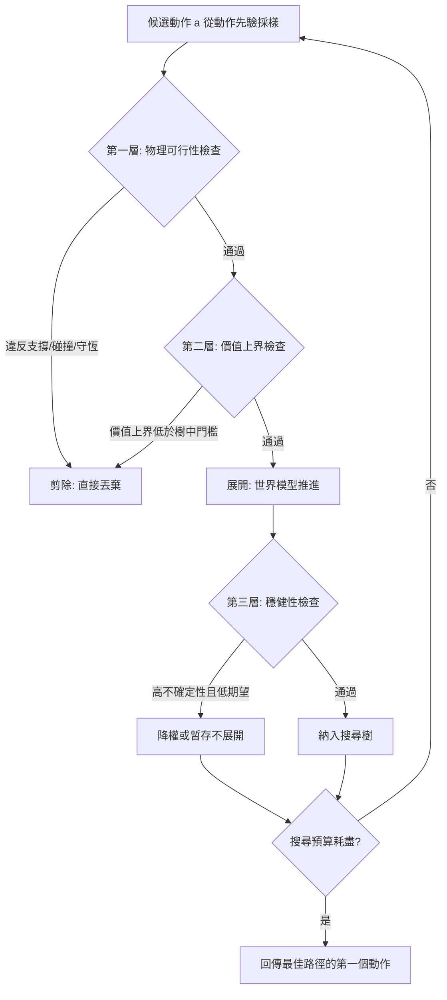

# 8.3 價值導向的軌跡修剪：在發散的平行未來中過濾「物理不可能」與「高風險」路徑

## 8.3.1 為什麼剪枝是必要條件而不是優化手段

讓我們回到第 8.1 節給出的那個式子：若展開寬度為 $`B`$ 、深度為 $`D`$ ，節點數是 $`B^D`$ 的量級。在棋類中， $`B`$ 大約是 30 到 40 的合法棋步數， $`D`$ 限制在數十步，因此一棵搜尋樹可以容納數萬個節點。在連續動作空間中，情況完全不同。

連續動作的一維分量就已經有無限多種取值。就算把每步的候選動作數限制為 $`B = 8`$ ，深度 $`D = 10`$ ，節點數也已經是：

$$
N = 8^{10} \approx 1.07 \times 10^{9}
$$

這是十億個節點。就算把寬度壓到 4 、深度壓到 6 ，仍然有 4096 個節點，若每個節點需要一次數毫秒的世界模型前向，延遲就已經到了不可接受的量級。

因此在連續動作空間中，剪枝不是「讓搜尋更快」的優化，而是**讓搜尋在有限時間內有可能存在**的必要條件。沒有剪枝的連續空間 MCTS 不是「比較慢」，而是「在物理上不可能執行」。這個判斷是本節的起點。

這裡還有一個量級上的直覺值得停下來看。若世界模型的一次前向是 5 毫秒，那麼十億個節點意味著需要大約 58 天的連續運算；即使有一千顆 GPU 並行，也需要超過一個半小時。相較之下，MPC 走十步只需要 50 毫秒。這個對比說明了一個不愉快但必須承認的事實：**在連續空間裡，樹搜尋的價值不在於「能搜得深」，而在於「能在可接受的延遲內搜得比 MPC 更寬」**。當模型速度無法大幅提升時，MPC 的實用性遠高於 MCTS，而 MCTS 的價值集中在那些可以容忍數百毫秒到數秒延遲、但又需要多路徑比較的離線規劃場合。

更麻煩的是，連續動作空間中的分支不是均勻的。若每步都從動作先驗中獨立採樣，兄弟節點之間的差異會隨深度累積，最後各條軌跡在物理空間中相距甚遠，難以比較。反過來，若採樣過於集中，樹又會退化成一條獨木橋。剪枝因此不只是省算力，它同時也是**控制探索多樣性**的手段。

## 8.3.2 剪枝判準的三個層次

一個實用的剪枝機制通常包含三層判準，它們分別作用在樹的不同位置上。

**第一層是可行性剪枝**，作用在展開之前。它問的是：這個候選動作本身是否物理上可行？例如一個把手伸進牆裡的動作、一個在沒有支撐的情況下讓物體靜止的動作。這一層可以攔掉相當一部分顯然錯誤的分支，成本也最低，因為它只需要在動作空間上做幾何檢查，不需要真的跑模型。

**第二層是價值剪枝**，作用在展開之後或之前。它問的是：這條分支的價值估計是否已經低到不可能反轉？若一個節點的價值估計已經遠低於樹中其他分支，繼續展開它就是在浪費算力。

**第三層是穩健性剪枝**，作用在那些價值估計不夠確定、但又沒有低到可以直接排除的分支上。它問的是：這條分支的結果是否可靠到足以承載整個決策？

這三層的順序不是任意的。可行性檢查最便宜且最可靠，應該最先執行；價值剪枝需要價值網路的前向，比可行性檢查貴；穩健性檢查則需要額外的方差估計，最貴也最不確定。把便宜的判準放在前面，是剪枝機制能否真正省下算力的關鍵。

## 8.3.3 物理不可能的過濾

第一層剪枝要解決的是一個很實際的問題：世界模型在連續空間中展開時，必然會產生大量在物理上不可行的軌跡。這些軌跡不是「預測錯誤」，而是「根本不可能發生」。

最典型的三類是：**支撐與碰撞的違反**、**與守恆律的矛盾**、以及**物體的瞬間穿透**。

支撐與碰撞的違反可以用第 3 章的幾何檢查來做。若一個物體在新的狀態中位於桌面之上但沒有接觸桌面，則該分支違反支撐關係；若兩個物體的佔據體積重疊且相對速度指向彼此，則該分支違反碰撞約束。

與守恆律的矛盾需要能量與動量的檢查。一個世界模型預測「物體在沒有外力的情況下速度突然增加」，無論這個預測多麼逼真，它在物理上都是不可能的。

為了讓這類檢查能作為硬約束而非模糊建議，需要引入**違反量**（violation magnitude）這個量，把每個約束的偏離程度量化成一個非負數，並設定門檻 $`\tau`$ ：

$$
v_{\text{total}}(s, s') = \sum_{k} w_k \cdot \max\!\left(0,\, \phi_k(s, s') - \tau_k\right)
$$

其中 $`\phi_k`$ 是第 $`k`$ 個約束的違反函式， $`w_k`$ 是權重。當 $`v_{\text{total}} > \tau_{\text{hard}}`$ 時，該分支被直接剪除。

這個設計有兩個好處。第一，它把「物理不可行」從二元判斷變成了連續分數，因此可以做soft pruning——不是完全丟棄，而是給分支一個懲罰項，讓搜尋自己去權衡。第二，它讓不同約束的相對重要性可以被調參，例如在抓取任務中，碰撞約束的權重可以設得比支撐約束更高。

這裡有一個必須誠實面對的問題：**這些檢查本身是模型**。支撐檢查需要準確的深度或物體中心位置，碰撞檢查需要準確的幾何。如果世界模型已經把杯子畫到桌子裡面去了，那麼碰撞檢查也會一併失效。因此硬約束剪枝只在「檢查器比展開器更可靠」的層級上才安全。

## 8.3.4 高風險路徑與風險敏感目標

第二類需要被濾掉的分支不是「不可能」，而是「危險」。危險的特徵是：**期望回報不低，但方差極高**。一條有 20% 機率撞碎玻璃杯的軌跡，其期望回報可能是正的，但對大多數實際部署而言，這樣的系統是不可接受的。

最直接的處理方式是採用**風險敏感目標函數**，把期望回報換成一個扣除風險項的目標：

$$
J(\pi) = \mathbb{E}\left[\sum_{k=0}^{H-1} \gamma^k r_k\right] - \lambda \cdot \operatorname{Var}\left(\sum_{k=0}^{H-1} \gamma^k r_k\right)
$$

其中 $`\lambda`$ 是風險 aversion 係數， $`Var`$ 是回報的變異數。這個式子的直覺是：我願意用一些期望效能去換取更可預測的行為。在機器人控制中，這種取捨是標配，因為一次撞擊的代價往往遠高於日常操作數十次的平均收益。

風險敏感目標對價值網路的訓練提出了額外要求：網路不能只估計回報的均值，還需要估計不確定性。在實作上，常見的做法是讓價值網路輸出分佈的參數（例如均值與對數變異數），並以負對數似然訓練；或者用一組獨立的頭來估計多個 bootstrap 分位數，從分位數之間的差距推得方差。

在搜尋層面，風險敏感目標意味著**葉節點的評分不再只是價值**，而是一個風險調整後的分數。這會讓 MCTS 的備份規則變得稍微複雜一些，因為回傳的統計量不再是單一數值。

## 8.3.5 啟發式上界與 admissible bound

第三種剪枝判準來自 MCTS 的傳統。假設我們對一個節點的後續最佳回報有一個上界估計 $`U(n)`$ ，而已經找到的最好解的價值是 $`V_{\text{best}}`$ ，則當：

$$
U(n) \leq V_{\text{best}}
$$

時，這個節點的任何後代都不可能超越目前的最好解，因此可以安全剪除。這是exact dynamic programming 中的標準剪枝思想，也是 MCTS 中某些變體（如在連續空間上使用的最優化型剪枝）所依賴的原理。

在連續動作空間中， $`U(n)`$ 的取得方式有兩種：

**第一種是學習一個上界網路**。訓練時刻意讓網路 overestimate，確保真實值永遠不超過預測值。這種上界網路的品質直接決定了剪枝的有效性——如果它高估得太離譜，就等於沒有剪枝；如果它偶爾低估，就會剪掉真正的好解。

**第二種是從動作範圍推導**。若某些動作在物理上不可能帶來回報（例如已經撞到牆角之後仍想往同一方向加速），可以用物理推理給出一個保守但可靠的上界。這類上界品質較差但絕對可靠，適合當作硬剪枝的第一道防線。

實務上通常兩者併用：先用物理推導的保守上界做硬剪枝，再用學習的上界做軟剪枝。

| 剪枝判準 | 作用位置 | 所需元件 | 可靠性 | 主要風險 |
| --- | --- | --- | --- | --- |
| 物理可行性（支撐、碰撞） | 展開前 | 幾何檢查器 | 高 | 檢查器本身誤判時會誤剪 |
| 守恆律一致性 | 展開前 | 能量動量檢查 | 高 | 耗損與接觸模型使判定變複雜 |
| 價值上界剪枝 | 展開前 | 上界網路 | 中 | 上界過鬆則形同虛設 |
| 風險敏感篩選 | 展開後 | 分佈式價值網路 | 中 | 風險係數調校敏感 |
| 多樣性維持 | 取樣階段 | 距離度量 | 中 | 多樣性過高會分散資源 |

## 8.3.6 連續動作空間的分支取樣效率

剪枝的成效不僅取決於剪掉多少，也取決於留下的分支有多樣。讓我們回到取樣機制本身。

在棋類中，樹的邊是確定的清單，沒有取樣的問題。在連續動作空間中，每個節點要生成 $`B`$ 個子節點，就必須回答「從哪裡取這 $`B`$ 個動作」。

第一種策略是**用動作先驗**。若有一個動作條件化的策略網路 $`\pi_\phi(a \mid s)`$ ，就從它採樣。這是最自然也最常見的做法，優點是採樣出來的動作符合系統既有的行為分布，缺點是若策略網路本身偏保守，採樣會集中在狹窄區域，分支多樣性不足。

第二種策略是**隨機搜尋**。不依賴任何學習到的分佈，直接在動作空間中均勻採樣。這個方法完全不需要額外的網路，因而最簡單；它的問題是在高維動作空間中，隨機採樣命中率極低，大多數分支會是明顯糟糕的動作，浪費大量算力。

第三種策略是**交叉熵方法**（Cross-Entropy Method, CEM）。它的做法是維護一個動作分佈（例如以均值與協方差的多元高斯來參數化），在每輪中從當前分佈採樣一批軌跡，用回報把表現最好的前若干percentile篩出來，再用這些精英軌跡重新估計分佈參數，反覆迭代：

$$
\mu_{k+1} = \frac{1}{|\mathcal{E}|} \sum_{\tau \in \mathcal{E}} \mu_\tau
\qquad \Sigma_{k+1} = \frac{1}{|\mathcal{E}|} \sum_{\tau \in \mathcal{E}} (\mu_\tau - \mu_{k+1})(\mu_\tau - \mu_{k+1})^\top
$$

其中 $`\mathcal{E}`$ 是精英集合。CEM 的優點是它把「取樣」變成一個有方向的過程，越迭代越集中到好區域；缺點是它傾向於收斂到單一模式，除非特別設計多樣性機制。

CEM 與 MCTS 並非互斥。實務上常見的組合是：用 CEM 產生候選動作池，MCTS 在這個池上做樹搜尋，CEM 在每次 MCTS 結束後用搜尋結果更新其分佈。

## 8.3.7 多樣性維護

多樣性維護是一個容易被略過但影響很大的機制。若所有分支都落在同一個局部模式，則樹上看起來有很多節點，但實際上提供的資訊量遠低於節點數。

在 AlphaZero 中，對應的機制是**根節點噪聲**：在根節點對策略先驗加上 Dirichlet 噪聲，迫使搜尋去探索根節點的不同分支。這個做法在連續空間中同樣適用，但需要重新設計，因為連續空間裡「根節點的不同分支」沒有離散的棋步可以列舉。

一個可行的做法是**在動作取樣時加入結構化的多樣性約束**：當已經選取了若干個分支之後，新分支的採樣分佈要避開已被選取分支的某個特徵空間區域。最簡單的實現是對候選動作做特徵投影（例如投影到前若干個動作維度或某個學習到的動作嵌入），然後對過於靠近既有分支的候選施加懲罰。

另一個做法是**在 CEM 中用分佈混合**：維護多個高斯分量，每個分量負責一個區域，依各自的分數決定採樣權重。這樣既保留了 CEM 的收斂效率，又避免了單模式的陷阱。

這個機制的理論意義值得強調：搜尋的價值來自於**資訊增益**，而不是節點數。一個把所有算力都花在幾乎相同的軌跡上的搜尋，其資訊增益趨近於零。剪枝與多樣性維護是同一枚硬幣的兩面：剪枝減少無效節點，多樣性確保剩下的節點彼此有別。

## 8.3.8 剪枝與第 10 章複合誤差的關係

最後必須把本章與第 10 章連起來，因為剪枝機制是複合誤差放大最為顯著的環節。

第 10 章將論述：自迴歸預測的誤差會隨時間步累積，若每步的相對誤差是 $`\epsilon`$ ，則 $`H`$ 步之後的相對誤差約為 $`H \cdot \epsilon`$ ，而在閉環系統中還會有更嚴重的幾何級數放大。剪枝機制恰好站在這條放大鏈的**上游**。

問題在於：剪枝的依據若來自不可靠的檢查，模型誤差就會被轉化為系統性偏差。舉一個具體例子：若世界模型在深色木紋表面上的深度估計有偏，支撐檢查就會系統性地把「物體其實放在桌上但深度略有誤差」判成「物體懸空」，於是剪枝會把所有涉及該物體的分支全部丟掉。搜尋的結果因此不是「稍微有偏」，而是「在某個區域完全失明」。

更危險的是剪枝與採樣之間的耦合。若多樣性機制依賴特徵距離，而特徵來自同一個有偏的世界模型，則系統會系統性地保留彼此相似的分支，並丟棄那些「看起來不一樣但其實都很好」的分支。

因此有兩條設計原則必須遵守。第一，**硬剪枝的門檻要保守**，寧可多留一些壞分支，也不要誤剪好分支，因為壞分支會自然被價值網路排在後面。第二，**剪枝的統計要可監測**：在部署時記錄各類剪枝的觸發比例，若某一類的觸發率突然暴增，往往代表模型或環境出現了分布外狀況，而不是代表策略變得更果斷。

## 8.3.9 小結

剪枝在連續動作空間中不是可選項，而是必要條件。它的三層結構——可行性、價值、穩健——依循「先便宜後昂貴、先可靠後模糊」的順序組織，才能真正省下算力。其中物理可行性檢查是獨一無二的世界模型特有的機制，因為只有連續物理世界才存在「這條未來根本不可能」的判準；而風險敏感目標則把部署者真正在意的東西——不只要好，也要穩——放進了數學裡。

還有一個實務上的提醒常被忽略：剪枝的門檻不應寫死成常數，而應隨搜尋階段變化。搜尋初期對分支過度嚴苛，會讓樹長不出夠深；搜尋末期對分支過度寬容，則會把預算浪費在已經證明無望的分支上。實務上常見的做法是讓硬門檻在前三分之一迭代中較嚴格、在後續迭代中逐步放寬，把算力集中到最有希望的區域，同時保留最後一點探索餘裕。

下一節把視角從「怎麼搜」轉回「搜完之後要改變什麼」：如何讓這些在腦中排練過的失敗，變成策略本身的修正。
