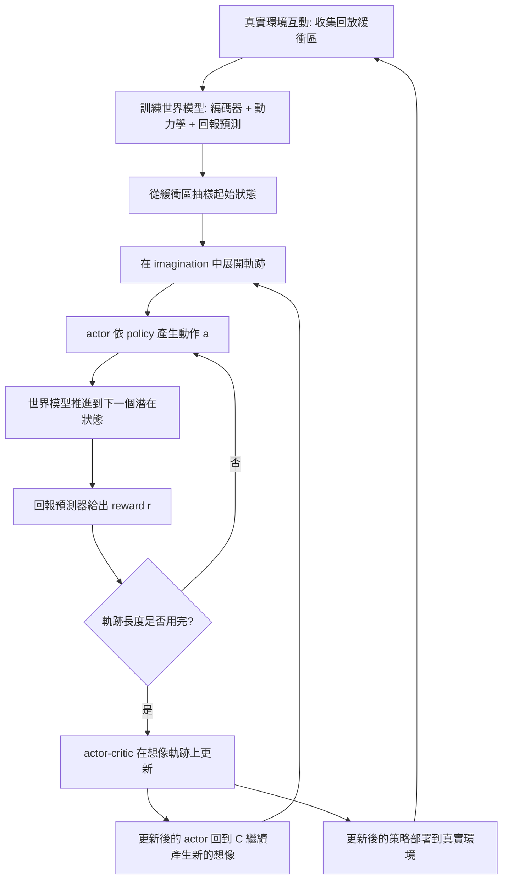
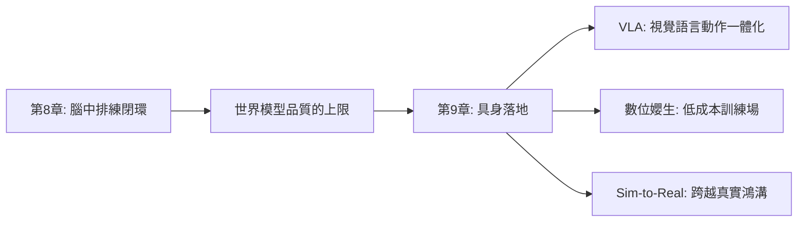

# 8.4 自反思架構：利用模擬結果修正直覺策略（Actor-Critic in Dream）

## 8.4.1 直覺也需要被修正

前三節建立了「在腦中下棋」的能力：能展開多條未來、能對它們定價、能剪掉不可能與高風險的分支。但這整套機制只解決了一個問題——「在這一組候選中，哪一個最好」。它沒有解決的是更根本的問題：**如果所有候選都不好呢？**

這就是自反思存在的理由。當搜尋結束後，得到的最佳軌跡若仍然無法達成任務目標，這個結果本身就是一條極有價值的資訊：它告訴我們目前的直覺策略在這個狀態下會失敗。傳統的強化學習在這裡只能默默地接受這個失敗並繼續學習；而一個具備反思能力的系統，會停下來問：**剛才那條軌跡為什麼失敗？是模型預測錯了？是動作選錯了？還是目標本身就設定得不對？**

本章的核心主張是：世界模型讓系統可以在**沒有真實物理回饋的情況下**進行這類修正，因為「在腦中排練過的失敗」是可以被拿來學習的。

## 8.4.2 Dreamer 的做法：在想像中學習

Ha 與 Schmidhuber 在 2018 年提出的世界模型架構（第 1 章所述）已經包含了一個關鍵想法：用模型產生的「夢」來訓練控制器，控制器完全不需要直接經歷真實環境的探索。

後續的 Dreamer 系列把這個想法推到成熟的形態，形成一個三段式的循環。

**第一段：從真實經驗中學習世界模型**。用互動得到的資料訓練編碼器、動力學模型與獎勵預測器。這裡可以用重建損失、潛在狀態的 KL 散度與回報預測誤差作為訓練目標。

**第二段：在模型中生成想像軌跡**。從真實經驗的回放緩衝區中抽樣一個起始狀態，然後**完全在模型的 imagination 空間中**展開一條長軌跡：

$$
\hat{s}_{\tau+1} \sim p_\theta(\cdot \mid \hat{s}_\tau, a_\tau), \qquad a_\tau \sim \pi_\phi(\cdot \mid \hat{s}_\tau)
$$

這個展開過程完全沒有真實環境參與，它發生在一個由網路參數定義的「虛擬物理」之中。

**第三段：在想像軌跡上更新 actor 與 critic**。把整條想像軌跡視為一個批次資料，用 actor-critic 的目標來更新策略與價值函數。

這個循環的核心優勢在於**樣本效率**。一段 20 步的想像軌跡只需要一次世界模型前向的序列，就能產生 20 個訓練樣本，而且這些樣本帶有「稠密」的回報標籤（每一步都有預測的回報），不像真實經驗那樣只有稀疏的最終獎勵。

## 8.4.3 數學：actor 的目標與 critic 的回傳

actor 的目標是最大化想像軌跡上的累積折扣回報：

$$
J(\phi) = \mathbb{E}_{\hat{\tau} \sim p_\theta, \pi_\phi} \left[\sum_{k=0}^{H-1} \gamma^k r(\hat{s}_k, a_k) \right]
$$

由於這個期望是對隨機軌跡取的，實務上用有限數量的抽樣來估計。Dreamer 系列採用的是**重建回傳**（reparameterized reparameterization gradient）方法：不是從分佈中抽樣一條離散軌跡再對其回報做梯度，而是把隨機性以可微的方式重新參數化，使回報函數對策略參數 $`\phi`$ 可微：

$$
\nabla_\phi J \approx \frac{1}{K} \sum_{i=1}^{K} \nabla_\phi \left( \sum_{k=0}^{H-1} \gamma^k r(\hat{s}_k, a_k) \right)
$$

其中被隨機性干擾的量 $`\hat{s}_k`$ 透過 world model 的動力學以可微的方式傳遞梯度。這是整個架構在工程上最關鍵的一個技術細節：它讓「在想像中學習」能夠真的收斂，而不是淪為一種啟發式的權重調整。

critic 則估計當前狀態的價值 $`V_\psi(s)`$ ，並以回傳誤差訓練：

$$
\mathcal{L}_{\text{critic}} = \frac{1}{2} \mathbb{E}\left[\left\| r_t + \gamma V_\psi(\hat{s}_{t+1}) - V_\psi(\hat{s}_t) \right\|^2 \right]
$$

actor 的更新則使用 advantage 來把 critic 的判斷轉成梯度方向。最常見的形式是決定性策略梯度（deterministic policy gradient），它直接用 critic 對動作的梯度來更新 actor：

$$
\nabla_\phi J \approx \mathbb{E}\left[ \nabla_\phi a_\psi(\hat{s}) \cdot \nabla_a V_\psi(\hat{s}, a) \big|_{a = a_\psi(\hat{s})} \right]
$$

另一個常見形式是使用 advantage $`A(s, a) = Q(s, a) - V(s)`$ 來做加權的策略更新，其直覺是「在某些狀態下我的選擇比平均好，所以要加強它；比平均差，就減弱它」。

值得強調的是，**在這個迴圈裡 critic 的角色比在一般 actor-critic 中更關鍵**。因為所有的學習訊號都來自想像的軌跡，critic 若估計偏差，整個迴圈會系統性地朝錯的方向優化。而在真實環境中學習時，真實的回報至少提供了一個不受模型誤差影響的錨點；這正是想像式學習最脆弱的地方。

## 8.4.4 自反思的三個層次

「自反思」這個詞涵蓋了非常不同的機制。把它分成三個層次，有助於避免把不同性質的問題混為一談。

**第一層是局部糾錯**：修正當前的軌跡。當搜尋或 MPC 發現當前計畫行不通時，不改變大方向，只調整接下來的幾個動作——減速、換個角度抓握、退回上一個穩定姿勢。這是最快、最常用、也最不需要長期記憶的層次。MPC 的反覆重解本質上就提供了這種局部糾錯能力：模型發現前方即將碰撞時，會自動在下一次重解時改變動作。

**第二層是中期重排**：換一個計畫。當局部糾錯無法解決問題時，系統需要放棄當前的高階目標序列，改用另一條通往目標的路徑。這一層需要的是「目標條件化的規劃能力」——把同一個目標用不同的策略樹來表達，並比較它們的可行性。在 MCTS 中，這對應著樹上存在多個通往終局的路徑，而且搜尋有足夠的深度去比較它們。

**第三層是長期更新**：把經驗寫回長期記憶或權重。這是最慢但最有價值的層次。當某個模式反覆出現——例如「這種杯子總是抓不住」、「這種光照下深度估計總是偏的」——系統應該把它記下來，使得未來的規劃能夠避開或修正這個模式。

這三個層次與人類的直覺有一個有趣的對應：局部糾錯對應「即時調整手腕角度」，中期重排對應「換個策略，改從另一邊拿」，長期更新對應「這種杯子太滑，以後要換個握法」。人類不會把這三者混為一談，也不會為了長期更新而放棄即時反應。

## 8.4.5 失敗分析的作用

反思的價值不只在於「修正當前軌跡」，更在於**從失敗中提煉出可攜帶的結論**。

具體而言，每次規劃失敗都應該產生一條結構化的記錄：初始狀態摘要、採取的動作序列、模型預測的軌跡、實際發生的結果（如果有的話）、以及被辨識出的失敗原因。這個記錄有兩個下游客戶。

第一個是**世界模型的改進**。若失敗原因是「模型預測杯子會落在桌面，但實際上它從邊緣滑落了」，那麼這條記錄指向模型的動力學在接觸與摩擦處有缺陷，應該被加入訓練資料或提高其在模型中的權重。第 3 章所說的直覺物理先驗，正是用這類失敗案例來強化的。

第二個是**獎勵設計的改進**。若系統反覆地選擇「快速把杯子推向邊緣」這種短視行為，而這在真實中是災難性的，那麼問題出在獎勵函數沒有對這個風險給足夠的懲罰。第 8.3 節的風險敏感目標正是針對這類問題的數學工具。

第三個下游是**長期記憶的寫入**，把個案的失敗提煉為一般化的教訓，例如「表面濕滑的物體需要更慢的接近速度」。

這裡存在一個重要的取捨：**記錄所有的失敗會佔用大量記憶體，而且大部分失敗是雜訊**。因此實務上需要一個選擇機制，通常依據「失敗的嚴重程度」與「失敗模式的稀有程度」來篩選：常見的小失敗不值得記錄，罕見的大失敗一定要記錄。

## 8.4.6 記憶與反思的分工

自反思架構需要兩種性質截然不同的記憶，它們不應該混為一談。

**短期記憶是本次規劃的軌跡**。它容納當前這次搜尋或 MPC 展開的所有候選分支：它們的狀態、回報、價值估計、不確定性。這份記憶的生命週期是毫秒到秒級，隨著規劃結束而丟棄。它的作用是支援當前的搜尋決策——哪些分支值得深挖、哪個動作最終被執行。

**長期記憶是跨任務的失敗與成功案例**。它的生命週期是天到年級，跨越無數個獨立的任務實例。它承載的是可泛化的模式：哪些情境容易失敗、失敗的原因是什麼、有哪些有效的應對策略。

兩者的分工可以用一個類比來理解：短期記憶是工作記憶，長期記憶則是情節記憶與語意記憶的組合。反思機制的核心任務，正是把短期記憶中觀察到的失敗，提煉成可以寫入長期記憶的知識。

這個分工帶來一個工程上的重要推論：**反思的計算應該是異步的、低頻的**。在規劃的關鍵路徑上做反思分析會直接增加延遲，因此實務上通常把失敗記錄寫入佇列，在閒置時或批次作業時進行提煉。

這個分工也解釋了為什麼反思不能用同一個網路現學現賣：短期的軌跡記憶需要高頻更新、低延遲、容量相對小；長期的案例記憶則需要低頻更新、高容量、能被檢索。一個把兩者混在一起的系統，會在規劃延遲上付出代價，或者在記憶檢索上失去精度。

## 8.4.7 與人類的類比，以及它在哪裡不等價

人類確實在腦中排練，也在腦中從失敗中學習。運動員在比賽前會在腦中反覆演練動作；棋手會回放自己下錯的那一步；我們在準備一段重要的談話時，會在腦中預演可能的問答並準備應對。這些現象與本章描述的架構在功能上高度相似。

但這個類比有三個關鍵的不等價之處，必須誠實指出。

第一，**人類有真實身體作為校正來源**。人類的每一次排練都伴隨著真實的前庭覺、本體感覺與肌肉張力回饋，因此「想像」與「真實」之間存在一個穩定的錨點。而以世界模型為基礎的系統，它的「想像」完全由模型參數決定，一旦模型有偏，想像就會系統性地偏離真實。

第二，**人類有大量真實經驗作為先驗**。人類不需要在腦中學會「杯子會滑落」，他已經在真實世界裡摔過無數次杯子。世界模型的參數則是從有限的資料中學來的，且資料的分佈往往與部署環境不同。

第三，**人類的排練是社會化的**。人類可以從別人的失敗中學習，因為語言是共享的；機器人面對的是自己的模型產生的失敗，若模型本身有系統性偏差，這種「自我教學」只會把偏差固化。

這三點共同說明了一個殘酷但重要的事實：**想像式學習的品質上限，是世界模型的品質上限**。它能把一個正確的模型變成非常高效的學習器，但無法把一個錯誤的模型變成正確的。

## 8.4.8 誠實評估：最常見的失效模式

在想像中表現良好，但在真實世界中失效，是這條路線最常見的失效模式。它有幾種具體的表現形式。

**第一種是模型偏差累積**。在 imagination 中展開的軌跡是由模型自己生成的，因此每一個時刻的狀態都是上一個（已經失真的）狀態的函數。這個閉環使得誤差以幾何級數累積，而非線性。第 10 章將對此有完整的數學處理。

**第二種是過度擬合模型**。actor 學到的不是「什麼動作在真實世界中好」，而是「什麼動作在這個模型裡好」。若模型的弱點恰好落在任務的關鍵處，actor 會精準地學會如何在模型裡作弊。

**第三種是回報預測器的共謀**。世界模型同時包含動力學與回報預測器。當 actor 學會去利用回報預測器的不完美時（例如發現某個動作序列會讓回報預測器給出高分，即使物理上並不合理），就會出現reward hacking。在想像空間中，這種作弊特別容易發生，因為沒有真實環境來揭穿它。

緩解這些問題的手段有幾個：讓想像軌跡保持較短以限制偏差累積；在每段想像軌跡的某個點插入真實觀測以重新錨定（第 9 章的 Sim-to-Real 會詳細討論）；對回報預測器加上物理一致性約束；以及最根本的——**在真實環境中保留一定比例的探索，用真實回報定期校正模型**。

最後這一招值得特別強調，因為它把整個架構拉回了一個健康的平衡。純粹的想像式學習是把真實世界完全換成模型世界，其誘惑是省下所有的真實成本，代價是失去唯一的真相來源。混合式做法則讓真實世界扮演「錨」的角色：模型負責大部分的排練與學習，真實世界負責定期的驗證與校正。這個結構在人類身上也存在——我們大部分的技能是在腦中練成的，但我們仍然需要一次又一次地真正去做一次，才能確認那個腦中的版本是對的。

## 8.4.9 收束本章：從腦中的模型到真實的軀體

讓我們回顧整章的結構。第 8.1 節說明測試時計算擴展是把算力從單次前向改造成搜尋；第 8.2 節把它具體化為世界模型驅動的 MCTS 與 MPC；第 8.3 節處理讓連續空間搜尋得以成立的剪枝機制；本節則讓模擬的結果回頭改善策略本身。

這四節合起來構成了一個完整閉環：模型產生未來，搜尋在未來中選擇，剪枝剔除不可能與危險，反思把失敗轉成修正。這個閉環在**虛擬世界**內部是完整的、自洽的，甚至可以讓一個沒有身體的系統在純粹的想像中不斷變強。

但這個閉環有一個前提：**它的品質完全受制於世界模型的品質**。而世界模型的品質上限，又受制於它所見證據的品質。

這就把我們帶到第 9 章的主題。腦中的模型終究要放到真實的軀體上；軀體有真實的摩擦、真實的延遲、真實的相機雜訊、真實的物體形變，也會摔破東西。第 9 章將討論 VLA 模型、數位孿生與 Sim-to-Real，處理那個無法在腦中解決的問題——**如何讓想像與現實對齊**。

| 自反思層次 | 時間尺度 | 修改對象 | 需要的元件 | 主要風險 |
| --- | --- | --- | --- | --- |
| 局部糾錯 | 毫秒到秒 | 當前動作序列 | MPC 重解、MCTS 回傳 | 修正方向本身可能是錯的 |
| 中期重排 | 秒到分 | 高階目標序列 | 多路徑規劃與比較 | 搜尋預算不足時無法比較 |
| 長期更新 | 天到年 | 策略權重與世界模型 | 失敗記錄庫、批次提煉 | 從稀疏的真實回報學習效率低 |
| 風險敏感調整 | 持續 | 目標函數本身 | 分佈式價值網路 | 風險係數難以調校 |
