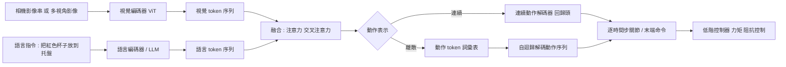

# 9.1 視覺-語言-動作（VLA）模型架構：空間感知與高維關節控制的端到端映射

如果把前三章到第八章的主線濃縮成一句話，那就是「如何在內部空間中表示一個世界」。但直到 9.1 為止，所有討論都停留在抽象的狀態空間裡：狀態是什麼、物理如何作用、模型如何生成未來、測試時如何規劃。真正把這些理論放回現實世界的，是一個笨拙但關鍵的轉譯問題——內部的「狀態」必須變成機器人身上的馬達命令，內部的「目標」必須變成人類說的一句話。視覺-語言-動作模型（Vision-Language-Action，VLA）就是這個轉譯層的現行候選答案。

## 問題設定：從一句話與一張圖到一段動作

VLA 的輸入是兩個來源極為不同的訊號。視覺側是機器人頭部相機拍到的影像串，可能是單張，也可能是一小段短影片，用來描述「現在場景長什麼樣子」。語言側則是一句自然語言指令，例如「把桌上的紅色杯子放到托盤裡」。輸出則是一段動作序列，可能是末端執行器的位姿增量，可能是一組關節目標，也可能是一串離散的動作 token。

這個問題的困難在於它的多模態落差。語言指令是稀疏的、全域的、抽象的：「放到托盤裡」並沒有指明該用哪隻手、該用什麼抓法、該以什麼速度移動。相對地，視覺觀測是稠密的、局部的、具體的。把前者與後者對齊到一個共同的內部表示上，需要模型同時處理語意層級與幾何層級的推理，而這兩者在傳統的模組化系統裡是由不同元件分開負責的。

更關鍵的是動作空間的維度。人形機器人的全身自由度可能是數十甚至上百，加上靈巧手的多指關節，任務向量 $ \mathbf{a}_t \in \mathbb{R}^{d} $ 中的 $ d $ 動輒破百。相較之下，文字模型的詞彙表是離散且有限的，而這裡的每個維度都是連續、耦合、且必須在數十赫茲的頻率下即時產生的。一個穩健的策略不只要選對「做什麼」，還要在數毫秒內輸出平滑且物理可行的數字。

## 端到端與模組化的取捨

在 VLA 之前，機器人系統的主流是模組化管線：感知模組輸出障礙物與物體位姿，規劃模組用這些幾何資訊做運動規劃，控制模組負責追蹤軌跡。這條路徑的優點是每一環都可以用傳統方法驗證，缺點是資訊在模組間被大量丟棄——一個語氣中的「輕輕地放」被轉成末端執行器的力控參數時，中間沒有任何機制保證語意被保留。

端到端的論點是：既然人類嬰兒學會抓取從來不靠顯式的幾何解析，那麼也許不該要求機器人如此。具體而言，端到端把「指令 + 觀測 → 動作」視為一個監督式序列建模問題，讓網路自己去學會那些我們沒想到要寫的規則。代價則是真實的可解釋性與安全性：模型出錯時沒有可供檢查的中間變數，而在真實機器人上，「看不懂的失敗」代價極高。

實務上的答案是混合的。語言理解通常仍交給大型語言模型或大型視覺語言模型處理，模型輸出一個中介的語意或幾何條件，動作部分則由專門的動作專家網路負責。這種「大模型當骨幹、專家當手腳」的分工，試圖在兩端各取所需。

## 三種主流架構做法

第一種做法是最直觀的串接：視覺編碼器負責把影像壓成 token，語言模型（自迴歸 Transformer）負責把視覺與文字 token 融合並進行推理，最後接一個動作解碼器把隱藏狀態映射回連續動作。這種架構的好處是每一段都可以用成熟的零件組裝，視覺編碼器可以預訓練，語言模型可以從網路上的圖文資料獲得先驗。代價是資訊瓶頸：語言模型的隱藏狀態是否保留了足夠的精細幾何資訊，直接決定了下游動作的精度上限。

第二種做法是「動作查詢參與注意力」，可以 RT-2 式的設計為代表。它把連續動作離散化成一組有限的動作 token，讓模型像預測下一個詞一樣，自迴歸地從詞彙表中選出動作。動作詞彙表可以是粗略的分類（如「向左移」「向上抬」）也可以是量化後的連續區間（把七維末端動作的每個維度切成數百個 bin）。這種做法最大的誘惑是：整套訓練與推論基礎設施完全沿用 LLM 的成熟技術，而且模型可以從語言的下一 token 預測中獲得直接的遷移。

第三種做法則是把動作作為真正的 token，直接以自迴歸方式解碼動作序列，同時把時間維度一起納入——也就是把整段動作軌跡當成一段「動作語言」來生成。相較於逐個時間步解碼，這種做法能讓模型考慮多步之間的一致性，並且在推理時透過樹狀搜尋或候選重排序一次評估多條軌跡。

## 動作表示的選擇：連續與離散

連續與離散的取捨在 VLA 中是一個真實的工程決策，不是風格偏好。

離散動作 token 的優點在於幾乎所有代價都集中在訓練與推論的既有工具鏈上，且模型輸出的分布是機率性的，便於用「取樣多個候選再選最好」的方式提升穩健性。缺點則在於量化誤差與序列長度的膨脹：若七維末端動作每維切成 256 個 bin，單一動作就是 1,792 個 token，比 256 個連續數字耗費序列長度得多。若壓低解析度，則細微的插入精度會被犧牲。

連續動作解碼器（例如以高斯混合或擴散式頭部輸出連續參數）保留了全解析度的控制精度，代價是模型輸出的多樣性與「可搜尋性」下降——連續空間裡的候選軌跡數量呈爆炸式增長，很難用 MCTS 那樣的機制有效評估。

這個取捨在高維關節控制時會更加嚴苛。七維末端執行器動作（位移三維、旋轉三維、夾爪開合一維）是工業界常見的折衷：它假設一個高階的全身控制器已經負責把手臂送到指定位姿，而 VLA 只負責決定末端要去哪裡。這個假設在人類行走、上樓梯這類全身任務上就失效了，因為那裡需要的是一整組相互耦合的關節角度。

## 視覺編碼器為什麼需要三維資訊

RGB 相機拍到的是投影，二維影像裡沒有深度。若模型要回答「伸手能否穿過這個縫隙」、「杯子後面是否有東西」這類問題，它需要幾何資訊。

常見的解法有三類。第一類是單目深度估計：讓模型內建（或從大量資料學到）一個深度預測頭，把 RGB 映射到深度圖，再在特徵層面做三維融合。這是最便宜的方案，但深度估計本身在無紋理區域、精細物體邊界與接觸場景附近都不可靠。

第二類是增加多視角相機：機器人裝上兩到四顆相機，或利用跨時間的相機運動做多視立體。這個方案直接測量幾何，代價是硬體成本與標定維護的複雜度。

第三類是引入顯式三維表徵：例如用點雲、射線場或物體槽位來承載場景幾何，再讓視覺 token 對這些結構化表示做注意力。這條路與本書第 2 章的主張一致——像素是二維的，而物理的因果結構需要三維物體中心的一致表示。2025 年前後密集出現的「三維-aware」視覺編碼器，正是把這一點推到了 VLA 前段。

## 本體感受與動作分塊

一個常被低估的技術細節，是動作在時間上的分塊（action chunking）。若模型在每個控制迴圈只輸出一個時間步的動作，那麼預測誤差會以控制頻率被硬編碼進物理系統：相機的曝光時間、通訊延遲、馬達的追隨誤差，會讓機器人實際執行的軌跡偏離模型想像的軌跡。實務上常見的做法是一次輸出一段 $ k $ 步的動作序列，只執行前 $ m $ 步就重新規劃，其比例通常取 $ m = k / 2 $ 左右。

這個折衷的意義不只在於平滑。它等價於在決策層引入一個時間抽象：模型在 $ k $ 步的尺度上思考「接下來這一小段要做什麼」，而低階的阻抗控制或追蹤控制器負責在更短的尺度上消化殘差。這與本書第 8 章所說的「把算力搬到測試時」是同一個精神——用一段粗略但連貫的開環計畫去取代反覆的細粒度反應，因為真正的誤差源被低階控制器吸收了。

本體感受訊息（關節角、速度、力矩、末端觸覺）在這裡扮演的角色也很關鍵。純視覺輸入意味著模型必須從影像反推自己的關節狀態，這既困難又脆弱：機械臂的自遮擋在單一相機視角下幾乎是必然的。把本體感受作為額外的 token 併入序列，等於把「我在空間中的哪裡」這個問題從推斷變成觀測。

## 評估的真實難題

VLA 的評估是這個領域最脆弱的一環。不同研究團隊使用不同的機器人、不同的工作空間、相機視角、指令措辭、成功率門檻，使得跨論文比較幾乎不可能。更麻煩的是，同一個模型常常只在一兩個場景上測試，而這些場景往往就是它被訓練過的場景。

評估的另一個陷阱是把「示範重建」當成任務本身。研究者給一個已經見過的指令，看模型能不能把物體放回原位，報告一個很高的數字。這與「面對沒見過的物體、沒聽過的措辭、在沒調過的位置完成任務」是完全不同的能力。把前者當成後者的證據，是這個領域最常見的量測謬誤。

也正因為評估困難，業界對 VLA 的樂觀與悲觀會同時存在，而且都有難以反駁的證據。樂觀的一方指出，端到端模型確實在長尾指令上展現了模組化管線難以複製的靈活性；悲觀的一方則指出，這些漂亮數字在真實部署中的重現率遠低於論文，而且失敗模式往往無法用事後規則修補。

## 語言模型作為推理骨幹

語言在 VLA 中扮演的角色，不只是「告訴機器人要做什麼」，更是提供任務的語意先驗與對 Demonstrations 的替代。

真實機器人資料極其昂貴：需要人類操作者穿上遙操作套裝或握著力覺裝置，一邊看著機器人一邊示範，一小時的資料可能只夠數百段軌跡。這種資料不僅數量少，覆蓋面也狹窄——幾乎全是成功的示範、固定的場景、單一類型的物體。

語言先驗改變了這個格局。「拿起那個易碎的物體」這句話攜帶了從文字語料中學到的關於易碎物體的外觀與行為的統計。模型於是可以把視覺特徵中一些模糊的線索，映射到一個龐大的先驗分布上，而不是只依賴「示範裡看過的那個杯子」。

更進一步，語言模型提供了分解與泛化能力。若示範資料只覆蓋了「拿起水杯」，一個好的 VLA 應該能理解「拿起水壺」只需要替換一個物件概念，而「輕輕放下」需要改變速度參數。基於Transformer 的語言骨幹天然地支援這種組合式泛化，這在純模仿學習系統裡很難得到。

這裡也呼應《Agent 技術》一書所建立的框架：Agent 系統的核心是感知—規劃—行動的閉環。VLA 把這個閉環做成了單一網路內部的隱式迴圈，用注意力替代顯式的符號規劃，用語言先驗替代顯式的世界知識庫。它的代價，正是把閉環的可解釋性一起埋進了權重裡。

## 資料瓶頸

VLA 的真正約束是資料。真實機器人示範的取得速度遠低於語言模型預訓練所需的規模，而在部署到新場景、新物體、新任務時又會立刻遭遇分布外問題。這也解釋了為什麼機器人領域大量借用網路上的圖文語料做預訓練：視覺語言部分可以「白嫖」互聯網，只有動作部分必須自己採集。

採集成本可以粗略分成三層。第一層是單次採集的硬件負擔：遙操作裝置、力覺手套、多相機 rig、專人操作與安全監督。第二層是規模：即使一切順利，一支團隊數月的努力通常只能得到數百到數千段有效軌跡，遠低於語言模型動輙數兆 token 的規模。第三層是覆蓋：這些軌跡高度集中於少數任務、少數場景與少數物體。第三層最難解決，因為它不是靠「多採一點」就能稀釋的，而是需要設計主動探索與任務生成機制。

於是自然的問題是：動作部分能不能不要自己採集？能不能用模型生成？

這正是 9.2 的主題：把世界模型當成一台數位訓練場。它不只生成外觀逼真的影像，而是要生成「觀測—動作」配對，因為後者才是策略學習真正需要的東西。

值得預先標記的是，合成資料有兩種截然不同的來源策略，而它們的失敗模式也完全不同。以生成模型為基礎的合成依賴模型已學到的世界樣貌，天然偏向外觀逼真但可控性差；以幾何與規則引擎為基礎的合成（程序化生成）可控且多樣，但外觀與接觸物理常常不真。9.2 會處理這兩條路線的分工，以及它們之間的取捨。

而無論資料從哪裡來，都有一個繞不開的問題：模型在仿真或生成的世界裡學會的策略，轉移到真實世界時會不會掉效？視覺外觀的差異、物理參數的差異、執行器的延遲與噪聲，會把看起來相似的兩個世界拉開成行為上的不同。這是 9.3 的主題，也是本章從「架構是什麼」轉向「落地會遇到什麼」的轉折點。
