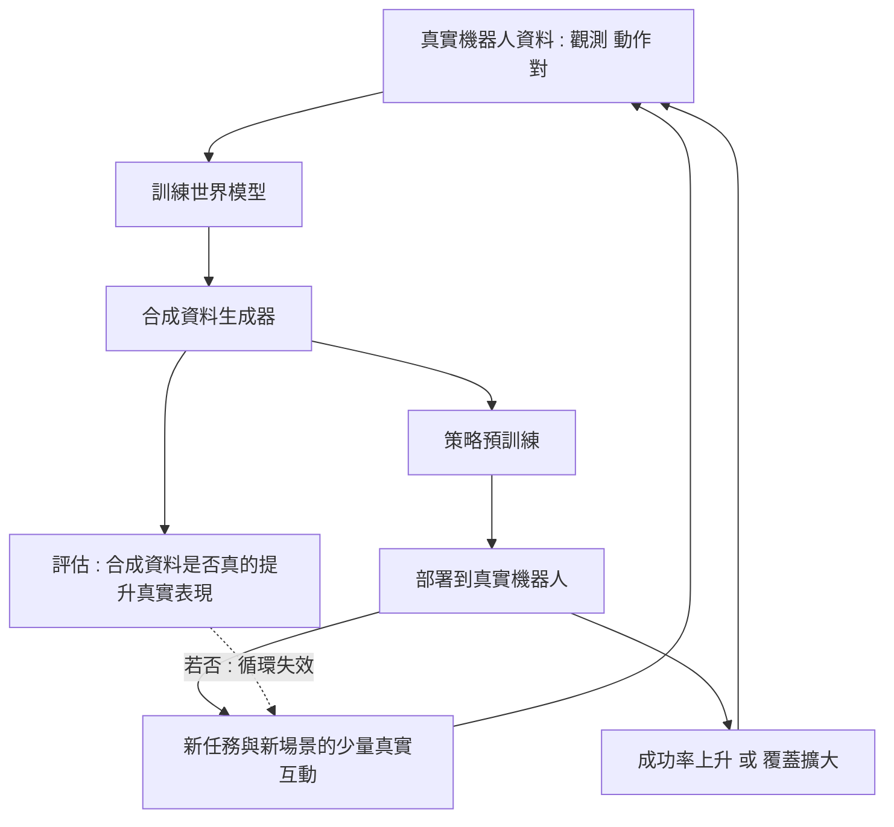

# 9.2 世界模型作為低成本數位訓練場：零樣本策略學習與無限合成數據合成

9.1 結尾的問題很明確：真實機器人示範昂貴、狹窄、難以擴充，因此整個領域都在尋找資料的替代來源。過去十年的主流答案是「建一個更好的物理模擬器」——用歐洲核子研究中心的 MuJoCo、Isaac Sim、Bullet 這類引擎，搭配人工建模的場景與材質，產生無限量的訓練資料。這個方向並沒有錯，但它撞上了一堵牆：物理引擎的高保真度需要龐大的人力與算力，而仿真到現實的落差又始終頑固存在。

世界模型提供了另一條思路：既然已經有大量「觀測—動作」配對的真實資料，就直接從這些資料學出一個能生成未來的模型，然後用這個模型當作訓練場。它不是取代物理引擎，而是提供另一種廉價的資料來源。

## 三種用法

第一種用法是把世界模型當成合成器，生成「觀測—動作」配對。給定一個起始的真實觀測與一段動作序列，世界模型預測後續的觀測，於是 ( $`o_0, a_0, o_1, a_1, \dots`$ ) 這樣的訓練樣本就可以被大量生產出來。關鍵在於配對中的動作是已知的（是我們輸入進去的），因此標籤自動正確，不需要額外標註。

第二種用法是 imagined rollout：讓一個策略在「腦內」跑一段軌跡，用世界模型檢驗這個軌跡是否物理可行、是否達成任務。如果 imagined rollout 的終態很差，就丟棄或重新規劃；如果可行，就把它當成一個正樣本或用來做策略改進。這個用法把世界模型接到了 8.2 與 8.3 討論的 MCTS 與 MPC 框架上，差別只在於搜尋發生在神經模型裡而非物理引擎裡。

第三種用法更為保守：把世界模型用來替代物理引擎的某些功能，而不是全部。比如需要一個能在幾毫秒內回答「這個接觸是否會發生」的模組（例如滑動、傾倒、是否會掉落），用物理引擎查詢太慢，用學習模型近似就夠快。這是一種工程上的分工，而不是範式的替換。

## 為什麼世界模型可能比模擬器便宜

傳統模擬器的高保真度來自三個成本來源：完整的物理場景建構（幾何、材質、碰撞體）、材質與外觀的繪製（為了在視覺上不產生 domain gap 而做的貼圖與光照調校）、以及每一步都要執行的物理求解。有了成熟的商業引擎與硬體加速，這些成本被壓縮了，但仍舊是「每個場景都要先建一次」的一次性工程成本。

世界模型的邏輯恰好相反：它不建構場景，而是從真實資料中直接學會外觀與動態的外觀映射。它學的是「在這種影像分布下，物體如何運動、如何被推動、如何掉落」，而不是「重力的常數是 9.81，力矩等於 $`r \times F`$ 」。這意味著新場景的取得成本大幅下降：不需要建模，只要給它足夠的條件資訊（初始觀測、動作、也許加上文字描述）。

這是一種範式的置換：用「建模型的成本」換成「學模型的成本與資料需求」。建模型是一次性且昂貴的工程投入；學模型則是資料驅動的、可增量改善的，而且它的改進可以自動惠及所有下游任務。這也是為什麼世界模型被視為比仿真器更有長期 Scaling 潛力的原因。

## 但也更容易有偏

代價是偏誤。世界模型只會生成它見過的東西。若真實資料集中從未出現過透明玻璃箱，它不會生成一個；即使生成，也多半是半透明塑料箱的樣子。更嚴重的是，這個偏誤會在自我迴圈中被放大：模型以自己的生成作為訓練資料，於是產出分布會逐步收斂到模型自己偏好的那個區域。

這裡需要區分兩個不同的概念。「模型偏誤」指的是世界模型對真實物理的近似有誤差，例如高估摩擦係數、低估物體的彈性。「生成偏誤」指的是模型產生的樣本分布本身有問題，例如永遠生成乾淨的桌面、永遠生成藍色的杯子。前者影響的是合成資料的正確性，後者影響的是合成資料的多樣性與代表性。

兩者會互相加劇：如果模型偏誤讓生成資料的物理特性系統性地偏離真實（例如所有物體都比真實的輕），那麼在這些資料上訓練出來的策略會形成一種對真實世界而言完全錯誤的直覺。這種錯誤很難被察覺，因為策略在合成環境裡表現良好——錯的是環境本身。

更細緻的問題是「邊界遺忘」。模型在分布內表現優異，在分布外則常常崩潰，而崩潰的方式不是漸變的，而是離散的跳躍：物體穿透牆壁、手指穿過杯子。這種失敗難以用少量資料微調修正。

## 合成資料該怎麼評估

評估的第一個問題是：合成資料是否真的提升了真實世界的表現？這需要一個只在真實環境上執行的評測集，且必須嚴格排除合成資料。但這在實務上很難保證，因為研究者會反覆在評測集上調參，而每一次調整都是對評測集的一次隱性適應。當合成資料的來源是「從真實資料學來的模型」時，這種污染尤其危險：模型會把評測場景的統計學進去，合成資料再把它帶回策略。

誠實的評估做法有幾條。其一是保留一段從未進入任何訓練流程的真實軌跡作為最終測試集，且不反覆查詢。其二是報告「合成資料比例」作為混淆因子的消融數據——若策略在合成資料比例為零時就已經很好，那麼合成資料的貢獻可能被高估了。其三是報告跨場景的泛化曲線，而不是單一場景的成功率，因為單一場景的成功率正是偏誤最容易藏身的地方。

還有一個常見的量測問題：「成功率的提升」常常來自評測流程本身的改變而非策略變好。例如把任務變簡單、改變成功判定標準、減少障礙物、或在同一個場景反覆測試同一個物體的位置。這些改動都會讓數字變好看，但與策略能力無關。

## 合成資料的種類與物理可行性

「合成資料」在這個脈絡裡至少指三種不同的東西，混淆它們是常見的錯誤。

第一種是觀測合成：只生成影像（或其他觀測），標籤由既有的真實動作軌跡拼接而成。這類資料適合做視覺編碼器的預訓練，但對動作策略的幫助有限，因為策略真正需要的是「在這個狀態下，什麼動作會導致什麼後果」。

第二種是軌跡合成：由真實片段拼接成較長的合成軌跡，或由程序化生成器構造幾何一致的序列。它在物理一致性上需要額外驗證，因為拼接處常常產生違反動力學的跳躍。

第三種是反事實軌跡合成：在同一個初始狀態下，生成不同的動作分支及其後果。這是對策略學習最有價值的一種，因為它直接擴展了行為分布，而不是只擴展外觀分布。9.1 提到的 imagined rollout 與策略改進，主要依賴的就是這一類。

無論哪一類，都有一個必須回答的問題：生成的動作真的可執行嗎？如果合成模型會產生違反關節極限、速度上限或碰撞原理的動作，那麼拿它訓練策略，等於在教策略一些永遠不會在真實世界發生的情境。這就是為什麼許多工作會加上一個「動作過濾器」或「可逆性檢查」，只保留物理上可執行的部分。

## 粒度的選擇：像素、潛在空間還是模型內

世界模型可以在不同粒度上合成，這對成本與保真度有決定性影響。

在像素空間合成最直觀，也最貼近真實觀測分布，但計算最貴，且誤差會逐幀累積——這正是第 10 章要處理的「複合誤差」問題。在潛在空間合成（例如 JEPA 式的特徵預測）便宜得多，且因為不追求像素級重建，模型可以忽略那些對任務無關的細節，壞處是合成出來的潛在向量無法直接解碼回可供人類檢視的影像，也難以確認其物理合理性。

在中間地帶，模型內合成佔主流：先從潛在表示解碼出部分可解釋的量（例如物體位置、接觸點），再由專門的渲染或物理層負責外觀與動力學。這個折衷在工程上往往最實用，因為它讓「可控性」重新回到設計者手中。

這裡可以看見第 6 章與第 8 章的交會：JEPA 的論點是「只要有用」，而規劃的論點是「要能比較」；當合成資料要同時服務於兩者時，粒度選擇就成了一個沒有免費午餐的取捨。

## 程序化生成與世界模型生成的分工

程序化生成與世界模型生成構成本書討論的兩種合成哲學，各有不可替代的位置。

程序化生成以隨機化幾何、材質、光照、動力學參數來創造多樣性。它的可控性極高——可以指定「這個場景的摩擦係數是 0.3」「地面是斜的 15 度」，這對系統辨識與域隨機化是不可或缺的。它的弱點是外觀與接觸物理不真：物件看起來像低多邊形的遊戲道具，橡膠與塑膠的接觸行為難以區分，玻璃、水果、布料的形變幾乎不可能正確。

世界模型生成在逼真度上遠勝程序化生成，因為它的目標分佈就是真實影像。但它的可控性差：幾乎無法直接指定物理參數，難以系統性地覆蓋某個參數區間，也難以生成「物體必須從某個角度接近」這類帶有幾何約束的樣本。

合理的分工是：外觀與接觸由世界模型負責，幾何與動力學的可控覆蓋由程序化生成負責，兩者混合。這也預告了 9.3 的主題——當兩種來源都被使用，Sim-to-Real 的落差會變成多源的，而解法也就必須多源。

## 零樣本策略學習

更激進的想法是：在完全沒有真實示範的情況下，只靠世界模型學習策略。流程是讓一個初始策略在 imagined rollout 中嘗試，用世界模型作為環境提供回饋，並以強化學習演算法在想像出的軌跡上更新策略。理論上，如果世界模型足夠準確，這就等於擁有一台無限便宜、真實場景分佈的訓練場。

這個想法的吸引力在於：它把「資料不足」這個問題轉化成了「模型不夠準」這個問題，而後者是可以用更多計算與更好的架構持續改進的。但在實務上，零樣本策略學習的結果高度依賴於世界模型在策略會去到的地方的準確度——而策略恰恰會系統性地探索模型最不確定、模型最容易被欺騙的區域。這是離策略學習與環境模型學習之間一個結構性的張力。

## 資料飛輪及其誠實評估

把上述環節串起來，就得到一個看似優雅的飛輪：真實資料訓練世界模型，世界模型生產合成資料，合成資料訓練更好的策略，更好的策略產生更多樣、更有用的真實資料（因為策略能走到更值得採集的地方），從而改善世界模型。

這個飛輪在概念上很有吸引力，也是 2024 年以來機器人領域最常被引用的敘事。但必須誠實地指出：這個飛輪是否真的存在，目前的證據是混合的。

支持它的證據包括：一些團隊報告在加入生成式合成資料後，真實機器人成功率有可重現的提升；世界模型在視覺預測的準確度上確實持續改善；策略能力與資料多樣性之間的正相關在中等規模實驗中被觀察到。

但也有相當有力的反面證據：生成式合成帶來的提升往往在跨場景、跨物體的測試中大幅衰減；一些仔細的消融實驗顯示，合成資料的主要貢獻可能來自「多樣化幾何」而非「逼真外觀」，而前者其實用程序化生成就能便宜地做到；還有報告指出，把合成資料比例推到很高會反而損害真實表現，這正是分布收斂的徵兆。

另一個容易被忽略的變數是資料比例。合成資料與真實資料的比例並非越高越好，而存在一個內部最優：比例過低，合成資料的偏誤不足以影響模型；比例過高，模型開始把生成器的特徵當成真實世界的特徵，反而降低了對真實分布的分辨力。這意味著最優比例本身是一個需要調校的量，而調校它又需要真實評測——於是飛輪的旋轉速度受限於真實驗證的吞吐量。

還有一層結構性的問題：飛輪的正回饋並非單向。真實資料的增加也會讓世界模型更好，而世界模型更好的話，同樣的真實資料能支撐更多樣的策略。也就是說，「更多真實資料」這條路徑依然是有效的，而且它的邊際報酬未必低於合成路徑。這使得「合成資料是關鍵」這一說法在邏輯上並不必然成立——真正的論點應該是合成資料改變了資料分布的形狀，覆蓋了真實採集難以到達的區域，而不只是增加了資料量。

最誠實的總結或許是：世界模型確實降低了資料的邊際成本，但它降低的主要是「量」的成本，未必是「質」的成本。真正困難的資料——稀有物體的精確接觸、失敗模式、極端邊界情況——依然只能從真實世界取得，而正是這些資料決定了策略在部署時的可靠性。

下一節要處理的，正是合成資料與真實世界之間那條不肯消失的縫隙。
