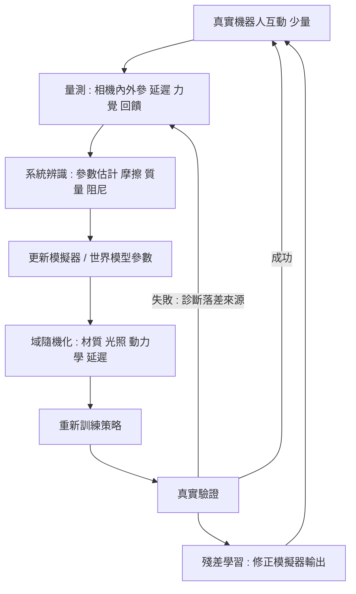

# 9.3 跨越真實鴻溝（Sim-to-Real Gap）：域隨機化、動態校準與實體感官反饋對齊

9.2 結束在一個令人不安的問題上：合成資料降低了資料成本，但真實與仿真之間的縫隙並沒有因此縮小。策略在仿真裡動作流暢，放到真實機器人上卻可能在第一秒就失敗。所謂 Sim-to-Real gap，指的正是這個落差本身。

這個詞常被當成一個籠統的謎語來談論，彷彿只要找到某個關鍵技巧，鴻溝就會被一舉填平。事實上，Sim-to-Real gap 不是一個單一的問題，而是多個來源不同的差距疊加而成，且每一種來源需要不同的對策。把這些來源拆開來看，是本章的核心工作。

## 鴻溝的來源

第一類是視覺外觀差距。仿真渲染的影像在解析度、光照模型、材質反射、陰影與抗鋸齒上，與真實相機擷取的自然影像系統性地不同。策略可能學會「依賴渲染器的陰影來判斷物體高度」這類在仿真中成立、在真實中完全無效的線索。這是最早被注意到、也最容易透過域隨機化部分緩解的一類。

第二類是物理參數差距。摩擦係數、恢復係數、阻尼、接觸剛度、求解器迭代次數、積分步長——仿真中的預設值往往與真實物體相差甚遠。更麻煩的是，摩擦這類參數並非全局常數，而是隨表面材質、濕度、磨損與接觸狀態變動。

第三類是執行落差。真實機器人的動作從送達控制器到真正生效之間存在延遲，可能是幾毫秒的控制通訊延遲加上數十毫秒的伺服跟隨時間。在視覺閉迴控制中，這個延遲會造成相位落後，使得策略「看見」落後於「預測」的狀態。此外還有量測噪聲：編碼器解析度極限、力覺感測器的漂移、觸覺感測器的串擾。

第四類是接觸與摩擦模型差距。真實接觸涉及形變、黏滯、滲透與滑移，這些是剛體引擎根本不建模的。當策略把手指按在一塊軟墊上，仿真裡那是一個硬體，於是策略學會了錯誤的按壓行為。

第五類是觀測遮擋。仿真相機可以設在完美位置、沒有鏡頭污損、沒有機械臂自己的遮擋；真實相機看到的是帶有自遮擋、陰影、快速運動模糊的場景。這一類差距本質上是資訊的缺失，只能靠更好的感知或更多視角來補償。

## 域隨機化及其代價

域隨機化的想法很直覺：如果策略能在各種各樣的隨機環境下都成功，那它就必須學到不依賴環境細節的穩健特徵。這是把「消滅差距」的負擔，轉嫁給「在分布上做歸納」的模型能力。

隨機化的範圍可以直接對應前述差距來源：隨機化材質與反射特性處理視覺差距；隨機化光源位置、色溫、強度與陰影角度處理光照差距；隨機化摩擦係數、質量、阻尼、接觸剛度處理物理差距；隨機化控制延遲與執行器增益處理執行落差；隨機化相機的外參抖動、鏡頭污損遮擋處理觀測差距。

代價是明確的：訓練效率急遽下降。隨機範圍越寬，任一個具體環境下能提供有效學習訊號的樣本比例就越低。在有限算力下，模型要同時學會幾十種環境下的任務，等於把每種環境的學習難度都乘上一個係數。更糟的是，部分參數與任務成功與否無關（例如鞋底紋路對抓取不重要），卻同樣消耗了容量。

域隨機化還有一個結構性的侷限：它是「對抗分布」的策略，而不是「對抗物理」的策略。它假設真實世界是隨機化分布中的一個樣本，因此用足夠寬的分布去覆蓋它。這在覆蓋充分時有效，但真實的物理參數組合可能是分布外的，而模型沒有任何機制知道這一點。

## 動態校準：把物理參數變成顯式條件

另一條思路是相反的：不追求泛化到未知參數，而是承認我們對具體這個機器人、這個場景的物理了解不足，然後用少量真實互動把它估出來，並把估計結果回饋到模擬器中。這就是動態校準。

具體做法是系統辨識：設計一段安全的探測性動作序列（敲擊、推動、傾斜、旋轉），量測回應，用物理模型擬合參數。例如對一個未知物體施加已知力 $ F $ 並量測其加速度 $ a $ ，由

$$
F = m a \quad \Rightarrow \quad m = \frac{F}{a}
$$

估計質量；對物體施加切向力並量測其接近穩態的速度 $ v $ ，由 $ F_{f} = \mu N $ 估計摩擦係數。

這種做法與第 7.1 節的主張呼應：把物理參數從「隱藏在模型權重裡」提升為「顯式的條件變數」。當摩擦係數 $ \mu $ 是條件輸入而非模型內隱含的先驗時，模型就必須學會「在不同摩擦下如何動作」，而不是「假設摩擦是某個值」。這個改變同時解決了泛化問題與可解釋性問題——你可以直接查詢模型在某個 $ \mu $ 下的行為。

## 系統辨識的數學與可辨識性

系統辨識並非把資料往模型裡丟就行，它有嚴格的理論限制。以最簡單的線性動力系統為例，量測為

$$
y_{t} = \mathbf{A} \theta + \varepsilon_{t}
$$

其中 $ \theta $ 是待估參數向量， $ \mathbf{A} $ 為已知的實驗設計矩陣。若量測無雜訊，估計就是 $ \hat{\theta} = \mathbf{A}^{\dagger} y $ ；有雜訊時，最小平方估計 $ \hat{\theta} = (\mathbf{A}^{\top} \mathbf{A})^{-1} \mathbf{A}^{\top} y $ 依然有效。

問題出在 $ \mathbf{A}^{\top} \mathbf{A} $ 接近奇異時。這個矩陣的條件數決定了參數估計的誤差放大倍率：條件數很大意味著某些參數方向上的實驗設計資訊不足，估計值會極度敏感於噪聲。所謂「可辨識性」正是指參數是否能由給定的實驗設計唯一且穩健地確定。

這一點對機器人極為致命。接觸參數幾乎都是弱可辨識的：摩擦係數與接觸剛度常常在短時間的量測中高度相關，因為兩者對觀測到的軌跡產生相似的影響。想把它們分開，就必須設計能把它們「拆散」的實驗——比如施加足以產生滑移的力，且在不同法向壓力下重複，才能辨識出 $ \mu $ 是否隨壓力變化。

## 感官反饋對齊

除了物理參數，硬體層面的量測誤差也必須被校準，否則再好的模型也只是在錯誤的狀態估計上做正確的推論。

相機的內參（焦距、主點、畸變係數）與外參（相機在世界或機器人座標系中的位姿）通常由工廠標定後固定，但振動、溫度變化與碰撞都會讓外參慢慢漂移。線上校準的做法是利用已知的機械結構幾何作為參考（例如相機看到機器人自己的特定標記點，據此反推外參變化），或者利用場景中已知尺寸的物體反推尺度。這件事看似瑣碎，但外參誤差的幾度就足以讓抓取位置偏移數公分。

延遲的量測與補償同樣關鍵。可以用高速攝影配合關節編碼器，把「指令發出」到「實際運動」之間的時間差量出來，並且區分出控制通訊延遲與機械跟隨時間。前者可以透過時間戳對齊來補償，後者則需要模型在預測時把狀態往前推相應的量。忽略延遲的策略在閉迴中會系統性地過度反應。

力覺與觸覺的反饋對齊則涉及單位與座標系的統一。不同感測器對「力」的定義（力、力矩、壓力、剪切力）與座標軸定義往往不一致，而機器人在接觸過程中的力資料與力矩資料需要正確對齊才能用於學習。此外，觸覺感測器有明顯的漂移與滯回，必須在每次使用前做基線重置，否則模型會學到「絕對零點」在慢慢漂移的假象。

## 殘差學習

如果完全無法把模擬器調到足夠準確，還有一個務實的做法：讓一個小的殘差網路去修正模擬器的輸出。形式上，真實世界被建模為

$$
s_{t+1} = f_{\text{sim}}(s_t, a_t) + r_{\phi}(s_t, a_t)
$$

其中 $ f_{\text{sim}} $ 是一個已定標的物理模擬器， $ r_{\phi} $ 是一個容量很小、參數量遠少於主模型的殘差網路，用來吸收那些模擬器無法建模的效應。

這個設計的智慧在於容量分配：大尺度的物理由成熟的模擬器負責，小尺度的偏差由神經網路負責。殘差網路不需要學會「什麼是重力」，只需要學會「在這個場景裡物體會比理想狀態多滑一點」。由於修正量通常很小且局部，學習問題的條件數良好，資料需求量也低得多。

但殘差學習有清楚的失效邊界：它只能在訓練分布覆蓋到的狀態範圍內有效，且它修正的對象是模擬器與真實之間的「平均差異」，對隨機的、未被模型學到的真實性（例如一次意外的碰撞）無能為力。此外，當殘差網路的輸出被串接進閉迴控制時，它自身的誤差會被反饋迴圈放大，因此通常需要對修正量做幅度限制。

## 差距來源與對策對照

把上述內容整理成一張表，可以清楚看出哪一種對策對應哪一種差距，以及它們各自要付出的代價。

| 差距來源 | 具體表現 | 主要對策 | 代價與限制 |
| --- | --- | --- | --- |
| 視覺外觀 | 渲染與真實在材質、光照、陰影上不同；策略依賴渲染器線索 | 域隨機化材質與光照；世界模型生成逼真背景 | 訓練效率下降；隨機分布未必覆蓋真實 |
| 物理參數 | 摩擦、恢復係數、阻尼、接觸剛度與真實不符 | 系統辨識估計參數；把參數作為顯式條件輸入 | 接觸參數弱可辨識，估計方差大 |
| 執行延遲 | 控制通訊與伺服跟隨造成相位落後 | 量測延遲並在預測中補償；隨機化延遲 | 延遲具時變性，靜態補償不足 |
| 感測噪聲 | 編碼器解析度、力覺漂移、觸覺串擾 | 濾波與基線重置；訓練時注入噪聲 | 濾波可能吃掉真實的高頻接觸訊號 |
| 接觸與摩擦模型 | 剛體引擎無法建模形變、黏滯、滑移 | 用學習式接觸模型；殘差網路修正 | 修正僅在訓練分布內有效 |
| 觀測遮擋 | 相機視角不佳、自遮擋、鏡頭污損、運動模糊 | 多視角相機；深度估計；模仿真實遮擋的渲染 | 硬體成本與標定維護複雜度 |
| 幾何不一致 | 物件尺寸、公差、組裝誤差 | 線上量測與重建；把尺度變成條件 | 量測本身需要接觸或視覺線索 |

這張表的重點不在於列數，而在於最後一欄。每一種對策都不是免費的，而且它們彼此並不完全正交：域隨機化解決的問題，動態校準也能解決一部分，但成本結構完全不同。域隨機化花的是算力，動態校準花的是真實互動的機會成本——後者在昂貴的機器人上尤為明顯。

另一個值得留意的對比是「應對落差」與「消除落差」。域隨機化屬於前者：它承認落差存在，並讓策略對它不敏感。動態校準屬於後者：它企圖讓模擬器在特定條件下真的變成真的。兩者在文獻中常被混為一談，但風險特性截然不同——前者失效時是性能退化，後者失效時是「以為校準了但其實沒有」的沉默錯誤。

## 校準的時序：批次、線上與漂移

系統辨識與校準在時間上如何組織，是一個容易被忽略但實務上很關鍵的問題。

批次校準是在部署前集中做一次：收集資料、估計參數、調整模擬器、重新訓練。它的優點是流程乾淨、結論明確；缺點是假設了參數在部署期間保持不變，而這個假設在真實機器人上常常不成立——工具磨損、電池電壓下降、地面清潔度改變，都會讓摩擦與阻尼緩慢漂移。

線上校準則是在執行過程中持續更新參數。這需要一個謹慎的設計，因為校準本身會干擾任務：在量測摩擦的時候，你正在改變物體的受力狀態，若這個探測動作影響了正在進行的操作，就必須把它安排在安全時機，或者用獨立的、被動的方式從既有操作資料中反推參數（這需要足夠的激發性動作才能讓參數可辨識）。

還有一個中間方案是週期性微調：每隔一段時間，用執行過程中自然累積的資料做一次小幅更新，而不做主動探測。它的資訊效率較低，但對任務的干擾最小。

無論採用哪種，都需要一個「參數變化的監控」機制：模型必須知道自己所依賴的參數假設是否仍然成立。這在實務上可以透過對觀測與預測的殘差統計量來實現——若殘差持續偏離零且有系統性趨勢，就代表假設失效。

## 評測的誠實性

最後必須談一個不常被承認的問題：在 Sim-to-Real 研究中，「成功率的提升」常常來自評測流程的漏洞，而不是策略本身的改善。

最常見的漏洞有幾種。第一是評測場景被反覆使用：研究者每次看到失敗就回到仿真裡調整，數十次之後，策略已經被（間接）過度擬合到那個特定場景，此時的真實測試只是同一場景的複製品。第二是成功判定的放寬：把「把杯子移到托盤上」改成「把杯子移到托盤的三十公分範圍內」，或把「掉落」也算成「任務結束」。第三是真實測試次數太少：三次裡成功兩次的比例，統計上幾乎無法區分於隨機行為。

嚴謹的做法要求：真實場景在測試期間不得被修改或重複使用超過特定次數；成功率判定的準則必須在測試前寫死並公開；報告的是多次測試的置信區間而非點估計；同時報告「真實測試中未見過的場景子集」上的表現，把分布內與分布外表現分開列出。

這些要求的嚴格程度，會讓這個領域的樂觀報導數字明顯下降。但這正是科學進步的必要條件——如果我們無法誠實地量測 Sim-to-Real 的進展，就既無法知道哪些方法真的有效，也無法知道下一個方法該往哪個方向努力。

下一節把這些問題放到一個具體而困難的場景中：多指靈巧手與人形機器人的全身動力學控制。在那裡，「差距」的後果不再只是抓取失敗，而是整台機器失去平衡而倒在地上。
