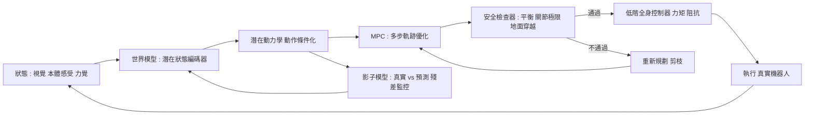

# 9.4 靈巧手操作與人形機器人全身動力學控制的世界模型實踐

前兩節的主題分別是「資料從哪來」與「落差怎麼補」。本章要把它們帶到一個具體而困難的應用場景：多指靈巧手與人形機器人。在這裡，所有在桌面機械臂上可以忽略的問題都會同時湧現——多指接觸、力控制、遮擋、全身耦合、平衡，以及跌倒。

這些應用不只是另一個任務。它們是本書前半部所有理論的壓力測試：如果一個世界模型真的學到了空間、物理與因果，它應該能在這些場景中做出有價值的貢獻；如果做不到，那麼它學到的多半只是外觀的相關性。

## 靈巧手操作的難度

一隻有五根手指、每根三個指節的靈巧手，擁有數十個自由度。這個數字本身就意味著動作空間的維度災難，而難度不只來自維度，更來自接觸的數量與耦合。

第一個難點是多指接觸的組合爆炸。要捏住一個圓柱形物體，不同的手指可以從不同角度施力，每個接觸點都有獨立的法向力與切向力。策略必須決定的不只是「手往哪裡去」，而是「哪幾根手指先接觸、以什麼順序、施加多大法向力才能產生足夠的摩擦而不把物體擠出來」。這個決策本質上是組合性的，但在連續的關節空間中卻必須被平滑地實現。

第二個難點是力控制與位置控制的張力。抓握一個雞蛋需要的是恰好足夠的法向力；抓握一個塑膠杯可以大力。策略不只要決定位置，還要決定力量量級，而力量與接觸面、摩擦係數、柔軟指端的形變共同決定。因此力量策略必須建立在對接觸狀態的估計之上，而接觸狀態只能從觸覺感測器讀取——這是一個閉環問題。

第三個難點是遮擋下的精確操作。手指與手掌本身會遮住物體，操作的關鍵視覺特徵往往正好在被遮蔽的區域。這意味著策略必須在視覺不確定時也能行動，這正是第 3 章與第 4 章反覆強調的問題：遮擋下的世界模型是「部分可觀察」的，模型必須內部化看不見的那部分。

第四個難點是物體本身的複雜度。軟體、布料、水果、液體——這些東西的形變與接觸行為，是剛體物理引擎與以剛體為中心的視覺模型都難以覆蓋的。而真實世界的物體大多不是剛體。

## 人形機器人的全身動力學

把靈巧手裝到一台上身之後，難度再一次跨越一個量級。

多關節耦合意味著全身的動力學互相影響：抬右臂時軀幹會有反作用力矩，必須由腿部與腰部補償；這意味著末端執行器的高精度目標，需要全身策略共同達成，而不是各關節各自追蹤。

接觸豐富（contact-rich）的動態是這類系統的常態。行走時腳與地面的接觸是連續變化的摩擦接觸，不是離散的碰撞；每一次落腳都是一次未建模的接觸事件。而當腳踩到一塊不平的地面， stumble 的機率就會急遽上升。

平衡與零力點（zero moment point，簡記 ZMP）提供了整個運動控制的核心約束。一個簡化的靜力學判準是：重心的垂直投影必須落在支撐多邊形之內，否則機器人就會傾倒。用靜力學寫成一個不等式，若以 $`p_{\min}`$ 與 $`p_{\max}`$ 表示支撐多邊形在行走方向的兩端邊界，

$$
p_{\min} < x_{\text{ZMP}} < p_{\max}
$$

意味著零力點必須被夾在支撐範圍之內；一旦它越出邊界，傾覆力矩就會把機器人推倒。這個簡單的判斷展示了為什麼「走穩」遠比「把手放到位」難：手部任務只涉及末端精度，而行走涉及整個身體的動量與支撐關係，兩者耦合在同一套方程裡。

而所有這些都帶著跌倒風險。跌倒意味著硬體損壞、機器人損壞，以及每次測試都要重置的時間成本。這使得真實人形機器人的資料採集極其昂貴，也使得安全成為一級需求，而不是附加項。

## 世界模型在此的角色

在這個場景裡，世界模型可以扮演三個實際的角色。

第一個角色是低成本的全身規劃器。傳統的全身運動規劃（在機器人學裡常見的做法）需要求解一個帶接觸與平衡約束的複雜最佳化問題，在高維度上耗時幾秒到幾十秒。世界模型提供一個快速近似：把規劃問題放進模型的潛在空間裡做搜尋，讓學習到的結構承擔大部分的最佳化負擔。這與第 8 章的 MPC 與 MCTS 一致——世界模型存在的意義之一就是把規劃的算力成本降到可接受的範圍。

第二個角色是安全檢查器。在執行任何全身軌跡之前，先用世界模型「想像」它，檢查是否會出現不可行的接觸序列、是否會穿越地面、是否會讓重心越界、是否會讓某個關節撞上極限。這個檢查器不需要很精確，只需要能擋掉大部分顯然危險的軌跡——它是一道過濾網，不是一個決策者。

第三個角色是接觸序列預測。這是特別值得強調的一項：要完成一個全身操作（例如爬下椅子、把一個箱子從高處搬下來放到地面），必須有一系列相互依賴的接觸事件——先後腳著地、然後手扶牆、然後身體重心轉移。這些接觸的順序如果錯了，軌跡在物理上根本不成立。接觸序列預測本質上是一個結構因果問題（第 3.3 節的介入與反事實），而世界模型因為能接受動作作為條件輸入，恰好是處理這類問題的合適架構。

## 模型預測控制在全身控制中的適用

MPC 的邏輯很直觀：在每一個控制週期，用世界模型向前模擬若干步，評估不同候選動作序列的代價，選出最好的一組，執行其中第一步，然後重新規劃。這是一種滾動時域（receding horizon）的策略，它把「開迴路計畫」與「閉迴修正」結合起來。

在全身控制中，MPC 特別合適，原因有三。其一是全身動力學的高維性與耦合性，使得開迴計畫在真實世界裡幾乎必然偏離，而閉迴修正能吸收這種偏離。其二是接觸事件本質上是不可預期的——腳踩到預期外的位置，就必須重算。其三是 MPC 提供了一個自然的約束檢查點：每一輪的候選軌跡都會經過模型，因而每一輪都能篩掉危險軌跡。

但 MPC 在這裡有一個硬性的速度要求。控制器必須在數毫秒到數十毫秒內完成數十次模型推論。這意味著模型必須能以批次並行方式執行、能接受潛在空間而不是像素輸入、而且必須能承受量化帶來的誤差。好消息是這與本書第 6 章 JEPA 的論點高度契合——不重建像素、只預測對規劃有用的特徵，恰好就是 MPC 所需的高效形態。壞消息是，潛在空間的模型在接觸細節上的精度，往往正是全身任務最需要的地方。

## 模仿學習與強化學習的現況

人形機器人領域目前有兩條主導路線。

模仿學習路線用人類示範訓練策略，人工示範可以透過動作捕捉、遙操作或人類示範影片取得。優點是能利用人類的廣泛經驗，缺點是存在一個著名的「分佈誤差放大」問題：如果策略稍微偏離了示範軌跡，它就會到達示範中從未出現的狀態，而在那些狀態上它沒有任何學習訊號，於是偏差進一步放大。人形機器人的閉環特性讓這個問題特別嚴重，因為重心一偏就是傾倒。

強化學習路線則讓策略在仿真中自行嘗試，靠獎勵塑形學會走路。優點是不需要示範，且能發現人類想不到的動作；缺點是獎勵設計極難——「走得多快而不倒」涉及多個互相衝突的目標，而重置成本高、樣本效率低。

在具體任務上，據公開報導，平地行走與跑步、以及上下樓梯與跨越障礙等任務在 2024 年至 2026 年間都有明顯進展，部分團隊展示了相當長距離的連續行走與在真實機器人上的操作任務結合的示範。這些成果是真實的，但同時也伴隨著顯著的脆弱性：在擺放位置略有差異、地面材質改變、身上多掛一個物件、或被輕輕推擾時，許多已展示的能力會迅速退化。

這種脆弱性本身就是最有價值的資訊。它說明目前的策略學到的多半是特定初始條件下的軌道，而不是「如何保持平衡」這個可遷移的原理。這也說明世界模型的價值不在於讓策略看起來更聰明，而在於讓策略能在腦中預演「如果我現在重心偏了，會不會倒」這類問題。

## 資料瓶頸與安全

真實人形機器人的資料採集面臨三重的成本與風險。

成本方面，一台高階人形機器人的造價、維護、能耗與佔地空間都不低；每次跌倒可能導致本體損壞與數小時的維修；一次完整的示範採集活動需要安全人員、操作員與工程師在場，這些都不是能大規模攤銷的開支。風險方面，在真實機器人上做全身運動實驗意味著數百公斤的質量與數十赫茲的關節速度，任何控制失誤都可能傷及人員。

這解釋了為什麼虛擬環境在人形機器人研究中扮演了如此重要的角色：它允許無限次跌倒而無代價。虛擬環境不是一個方便的替代品，而是這項研究能夠持續的必要條件。但 9.3 所說的一切在這裡都成立：仿真中的跌倒統計與真實中的跌倒統計並不相同，而那些差異正是策略失效的地方。

於是安全機制成為必備項。物理上需要的是安全繩、力矩限制、碰撞檢測與急停；演算法上需要的是世界模型作為安全檢查器，以及一個明確的「我對這個狀態沒有把握」的拒答機制。這個拒答機制在實務中往往表現為退化到一個保守的、被充分驗證的舊策略——而這本身又引出另一個問題：如何在更新的過程中驗證新策略真的比舊策略好。

## 誠實評估

我們需要對這個領域的現況保持清醒。

從仿真到真實的落差仍然巨大。「在仿真中能走」與「在真實中能走」之間的差距，在人形機器人這個具體情境中並沒有被解決，只是被更好的物理引擎、更好的域隨機化與更多樣的資料所部分緩解。已被證實相對穩健的能力集中在低速、平地、條件可控的任務；而那些吸引人注意力的能力——跑步、跳躍、推擾下的恢復——大多仍然脆弱。

世界模型是重要的加速器，但不是充分條件。它能把一部分仿真迭代從數小時壓縮到數分鐘，能讓規劃變得可行，能提供安全檢查。但它無法替代真實接觸物理的準確性，無法解決物體形變與摩擦的細節，也無法保證策略在分布外的環境中不失效。

更誠實的定位是：世界模型把「需要用真實時間與真實風險換取的經驗」的一部分，轉換成「可以用算力換取的經驗」。這個轉換是有價值的，因為真實經驗的邊際成本隨著機器人數量與實驗時數而上升，而算力可以便宜地取得。但經驗的總量並沒有因此減少——它只是換了一種貨幣來支付，而這兩種貨幣之間的匯率並不固定，而且往往對我們不利。

## 一個具體的整合範例

把本章的種種元件串起來，可以想像一個完整的系統輪廓，它也是第 10 章討論通用世界模型時的具體參照。

視覺與本體感受編碼器把多視角影像、關節狀態與力覺讀數編碼成一個潛在狀態 $`z_t`$ ，這個編碼器被訓練成能夠保留對接觸與平衡有用的資訊，而不必重建像素。動作條件化的潛在動力學 $`p(z_{t+1} \mid z_t, a_t)`$ 描述狀態如何隨動作演化，同時接受物理參數作為條件輸入（摩擦係數、質量估計）。MPC 在潛在空間中做多步軌跡優化，每一步都會呼叫一個安全檢查模組，檢查候選軌跡是否讓重心投影越出支撐多邊形、是否讓關節逼近極限、是否包含不可能的接觸序列。

在真實執行端，高階控制器把 MPC 選出的動作轉成全身力矩，並以阻抗控制提供柔順性——這樣即使模型有小幅誤差，機器人也會以「退讓」而非「僵硬」的方式回應，而不是瞬間崩潰。每一輪執行後，觀測與預測之間的殘差被累積，用於監控物理參數假設是否仍然成立；當殘差出現系統性偏移時，系統觸發一次小幅的線上校準。

這個輪廓裡沒有任何一個組件是新的：它只是把本書前面各章的元件——JEPA 式特徵預測（第 6 章）、動作條件化（第 7.1 節）、MPC 與軌跡剪枝（第 8 章）、VLA 的感知動作接駁（9.1）、合成資料飛輪（9.2）、動態校準與殘差修正（9.3）——組成一個閉環。它的價值不在於某一環的突破，而在於閉環本身的自洽性：每個環節都為下一個環節提供它需要的資訊，而每個環節的誤差都被下一個環節吸收或監控。

也正是在這個意義上，9.4 是第 9 章的收束，也是第 10 章的鋪陳——因為這個閉環能否持續運轉，取決於它能否抵禦時間的侵蝕。

## 引向第 10 章

我們在第 9 章走完了從架構到落地的完整鏈條：VLA 提供從語意到動作的端到端映射；世界模型提供廉價的數位訓練場；域隨機化與動態校準試圖彌合最後的縫隙。而在這些問題的深處，始終有兩個未被解決的難題在等待。

第一個是複合誤差。任何自迴歸生成的世界模型，在長時程上都會面臨預測誤差的累積，而這正是長時生成的物理機制（第 4.4 節）所描繪的熱力學困境。

第二個是物理對齊。一個在視覺上逼真、但在能量守恆與動量定理上不守恆的模型，是一個危險的模型——它會讓策略相信不可能的動作是可執行的。

這兩個問題，以及它們背後更根本的問題——一個真正通用的世界模型該長什麼樣子——正是第 10 章的主題。
