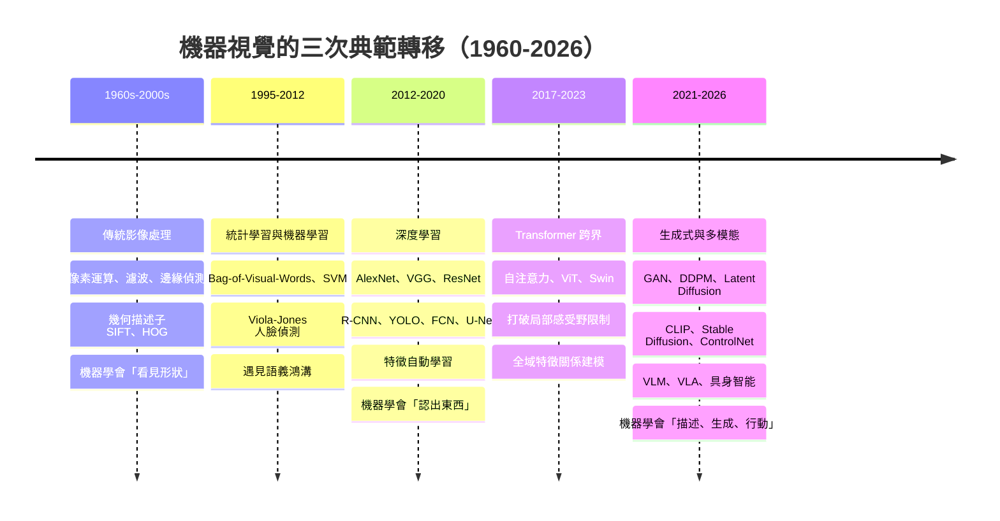
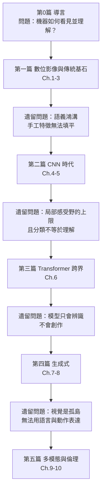
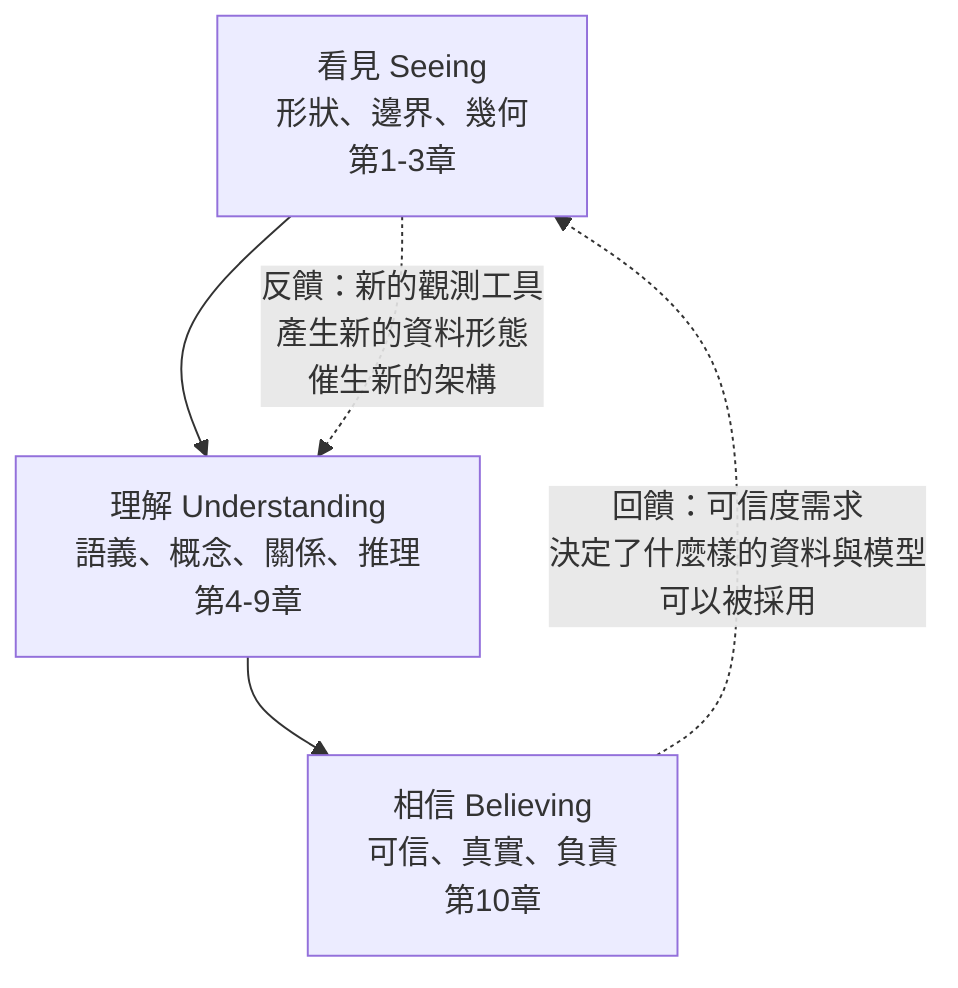

# 0.1 導言：機器如何「看見」並「理解」這個世界（1943-2026）

## 一、一個被低估的哲學問題：看見，究竟是什麼？

人類每天睜開眼睛，看見桌上有咖啡杯。這件事輕鬆到不值得思考，因此「機器能否看見」反而成了一個被嚴重低估的哲學與工程問題。

要理解它有多難，最好的方式是問一個更簡單的問題：**一隻蒼蠅能看見嗎？**

蒼蠅只有幾萬個神經元，沒有高解析度的視網膜，沒有視覺皮層的六層結構，牠的「看見」必然不是人類式的。但蒼蠅確實能看見：牠能追蹤移動中的物體、躲避障礙、在複雜背景中辨識同類。生物學家所謂的 **fly visuomotor system** 讓我們意識到，「看見」並非單一的本能力量，而是一整套從光子到行為的資訊處理管線（pipeline）中，多個簡單機制串接起來的結果。

那麼，機器要模仿的是哪一段？是要模仿**光子打到感光元件**（這是物理學與半導體的問題）？是模仿**視網膜的邊緣偵測與方向選擇性**（這是神經科學與訊號處理的問題）？還是模仿**大腦皮層對「咖啡杯」的語義賦予**（這是認知科學與機器學習的問題）？

這三層問題的答案，恰好構成本書的敘事主線。

### 1.1 本書的核心命題

> **「看見」（seeing）與「理解」（understanding）是兩個不同的能力，而現代機器視覺最大的成就，是把這兩者之間的距離從「不可逾越的鴻溝」縮短為「可以工程化的連續光譜」。**

傳統影像處理時期，機器能「看見形狀」——它能在一張照片裡找到邊界線、直線、圓弧，但無法說出那是什麼。深度學習時期，機器能「認出東西」——它能給出一張影像屬於「貓」或「狗」的機率分布，但無法解釋貓的形狀在哪裡。到了生成式與多模態時代，機器開始「描述、生成、甚至行動」——它能用一句話解釋畫面裡發生了什麼，也能畫出一張全新的圖，甚至根據畫面決定機械手臂的下一步。

因此本書不把「機器視覺的歷史」寫成技術清單，而把它寫成一條**因果鏈**：每一代方法的出現，都是為了解決上一代方法解決不了的問題；而每一代方法在解決舊問題的同時，又製造了新的問題，迫使下一代方法出場。

---

## 二、生物視覺：工程師的靈感來源

在談論機器視覺之前，必須先談生物視覺。原因有二：一是生物視覺是唯一已被充分研究、且確實「成功」的視覺系統；二是過去六十年幾乎所有重要的視覺演算法，其設計動機都可追溯到某個生物學發現。本節的目的不是生物學，而是要抽取**可供計算機科學利用的結構性原則**。

### 2.1 從光子到神經訊號：視網膜的計算

人類眼睛的視網膜並不是一個被動的感光板。它是一層精密的運算單元，約有一億個感光桿狀細胞（rod）與六百萬個錐狀細胞（cone），以及雙極細胞（bipolar cell）、水平細胞（horizontal cell）、無長突細胞（amacrine cell）等中間細胞構成的三層迴路。

關鍵在於**視網膜的逆轉**：光學影像在眼睛的後方是「上下顛倒」的，而視網膜上的神經節細胞（ganglion cell）已經對它做了初步處理，並且**以視野相反的方式重新排列**。這意味著視覺並不是「把整張影像接收下來再送到大腦」——**一部分計算在採樣之前就已經完成**。

這第一個原則是：**先做適當的稀疏編碼，再傳輸**。1970 年代 Field 與 Mashel 的**中心周邊拮抗（center-surround antagonism）**實驗顯示，視網膜神經節細胞並不對均勻亮暗敏感，而是對「局部對比」敏感：

$$
r(x,y) = w_c \cdot I(x,y) - w_s \cdot \bar{I}_{\text{surround}}(x,y)
$$

其中 $`w_c`$ 與 $`w_s`$ 分別為中心與周邊的權重，且通常 $`w_s > w_c`$ ，因此高斯型差分運算子即為神經元的實際反應特性。這正是 1968 年 Sobel 與 Canny 邊緣偵測算子的生物學對應物——**邊緣偵測不是一個工程發明，而是對視網膜電生理的數學重現**。

第二個原則是**對數壓縮**。視網膜對光強的回應大致遵循 Weber–Fechner 定律，即對數比例：

$$
r \propto \log I
$$

這解釋了為什麼後來的影像處理幾乎都以對數域（log-domain）進行：因為那是人眼真正「感受到」的量。這個小細節將在 1.2 節（色彩空間與亮度色度分離）再次出現。

### 2.2 感受野：局部性作為計算的基本單位

一個神經元究竟「看到」多大的世界？這個問題由生理學家與數學家共同回答。

Hubel 與 Wiesel 在 1950 年代對貓的視覺皮層（V1）進行單細胞記錄，得到了一個驚人的結論：V1 的細胞並不對整個視野有反應，而是只對視野中一個**局部區域**有反應——這個區域稱為**感受野（receptive field）**。對一個方向選擇性細胞而言，其感受野是一個長方形區域，並被「劃分」成兩個次區：一個對特定方向的**亮條（bar）**反應，另一個對**正交方向**的亮條反應。兩者的空間位置錯開，恰好使得「亮條斜著穿過感受野」比「亮條對齊通過」引發更強的反應。

這個「錯開」可以用一個簡單的二維線性濾波器精確表達：

$$
w(\Delta x, \Delta y) = \delta(\Delta y - k\,\Delta x)
$$

也就是一個方向性的 Gabor 濾波器。**方向選擇性不是抽象概念，它是一個卷積核。**

這給出了第二個原則：**視覺的第一層計算是「局部、線性、多方向」的濾波**。1981 年 Marr 與 Hildreth 提出的 **edges of half-occlusion** 理論，主張初始視覺（primal sketch）是由零交叉（zero-crossing）構成的，這一主張與 Hubel–Wiesel 的生理證據在數學上高度一致。

### 2.3 V1 的 simple cell 與 complex cell：從濾波到不變性

Hubel 與 Wiesel 隨後發現 V1 中存在兩類細胞，各自有非常不同的性質：

| 性質 | Simple cell | Complex cell |
|------|-------------|-------------|
| 對刺激位置 | 極敏感，位置偏移即失效 | 不敏感，可容忍位移 |
| 對刺激方向 | 高度選擇性 | 高度選擇性（但與位置無關） |
| 對刺激相位 | 需對齊（亮暗次序固定） | 不需對齊（相位無關） |
| 對立概念 | 位置敏感的局部濾波器 | 對位置/相位不變的特徵偵測器 |
| 數學描述 | 具有明確疊加區（subregion）的加權和 | 對 simple cell 輸出取絕對值或平方後加總 |

這裡出現了本書的第一個重要洞見：**「不變性」（invariance）是視覺最難的問題，而它不是一個附屬功能，它是從 simple cell 到 complex cell 這一步就已經出現的核心難題。**

現代深度學習中的「池化」（pooling）與「最大池化」（max pooling）表面上是為了降維與加速，實際上扮演的是 complex cell 的角色：對局部特徵的**位置擾動做對齊與鬆弛**，把「這裡有一條邊」提升為「這裡有一個轉角」。本章之後的第 4 章會告訴我們，當 CNN 堆到很深時，這種由人工設計的不變性機制本身成為瓶頸，於是 ViT 用自注意力提供了另一種解法。

### 2.4 更高等的皮層：從邊緣到物體

V1 的輸出沿著兩條主要視覺皮層路徑上行：

- **背側路徑（dorsal stream，where pathway）**：投向頂葉，處理物體「在哪裡」、形狀、動作與空間關係；
- **腹側路徑（ventral stream，what pathway）**：投向顳葉，處理物體「是什麼」、形狀辨識、類別歸屬。

腹側路徑上有著名的**梭狀回（fusiform gyrus）**區域，後來的 fMRI 研究發現其對**人臉**有異常強烈的反應，於是有了「梭狀回人臉區」（fusiform face area, FFA）。這是機器視覺裡 **face recognition** 長期以來是一個獨立研究分支的原因。

更有趣的是**大腦的「選擇性」與「不變性」的取捨**：神經科學家 Grossberg 與 Ullman 提出的 **adaptive resonance theory（ART）**，以及後來 **Neocognitron**（Kunihiko Fukushima, 1980）的架構，都是在處理同一個矛盾——**一個可辨識物體的形狀在不同位置、角度、尺度下會產生完全不同的影像刺激**。Neocognitron 用「取樣層（sampling layer）+ 聯想層（association layer）」的串接來解決，這幾乎就是今天 CNN 的直接祖先。

**Marr 的三層框架**（1976, *Vision*）則是另一個里程碑，也是本書第 2、3 章的理論骨架：

1. **表示層（representation）**：影像在何種符號系統中被描述？（原始像素、邊緣地圖、3D 模型……）
2. **運算層（computation）**：有哪些處理程序從一個表示轉到下一個？（濾波、邊緣偵測、分割……）
3. **演算法層（algorithm）**：這些程序如何被實現？（具體的計算步驟）

Marr 的核心洞見是：**同一個計算過程，在不同的表示層上是完全不同的問題**。一個物體的 3D 形狀在 2D 影像上是不可見的，因此「辨識 3D 形狀」在表示層上是「錯誤的問題」，在演算法層上無解——這不是演算法不夠好，而是表示選錯了。這個觀點在深度學習時代以「**表徵學習（representation learning）**」之名重返主流：深度學習的真正貢獻，就是**讓表示層本身成為可學的變數**。

### 2.5 但生物視覺並不是完美答案

在把生物視覺當作工程藍圖之前，必須指出它的侷限，否則會犯下「以生物為證」的謬誤：

- **能量效率遠低於現代硬體**。人類大腦視覺皮層消耗約 20% 的基礎代謝能量，處理的是相當低解析度的訊號；一塊 GPU 以數百瓦功率在毫秒內處理百萬像素的卷積，能效比高數個數量級。
- **對邊界案例的精確度遠低於我們想像**。多項研究顯示，人在快速影像中辨識特定類別的準確率與隨機猜測相去無幾；我們的「看見」很大程度上是**由語境與語言先驗補完**的建構，而非純粹的視覺辨識。
- **貓頭鷹與人類的視覺系統幾乎正交**。貓頭鷹的視覺細胞幾乎沒有方向選擇性，取而代之的是**位置敏感的神經節細胞（position-sensitive ganglion cells）**，而且牠們的視網膜主要靠圓錐細胞而非桿狀細胞工作。貓頭鷹在夜間狩獵的視覺精度極高，但它的機制與我們完全無關。這說明**生物視覺並非唯一的可能解**，只是自然界給了我們的第一個可行樣本。

因此本書的立場是：**生物視覺提供結構性啟發（局部性、層次化、多方向濾波、不變性機制），但不提供可直接移植的解法。** 這也是為什麼本書在每一章都會區分「這個方法在生物學上有對應」與「這個方法在數學上有效」。

---

## 三、機器視覺的兩條基本路線：符號／建構式 vs. 表徵／學習式

從 Marr 的框架出發，機器視覺在歷史上存在兩條根本不同的技術路線，它們的分歧不是風格差異，而是**關於「什麼是應該被寫死的先驗」的本質爭議**。

### 3.1 路線一：符號／建構式（Symbolic / Constructive）

這一路線認為：視覺是一個**由低階到高階的、由下而上的建構過程**，每一層都應該有明確的、符號化的中間表示。典範流程如下：

```
原始像素 → 平滑/梯度 → 邊緣 → 線段/曲線 → 區域分割 → 2D 形狀 → 3D 模型 → 物件
```

這條路線的每一個箭頭都是一次**資訊壓縮**，而且每個箭頭都需要人為決定「什麼資訊值得保留」。這種把中間表示「建構」出來的風格，因此被稱為**建構式（constructive）**視覺。

它的技術化身包括：

- **主動式視覺（active vision）**：Pahlavi（1986）、Bajcsy（1988）提出的「感知是被動的」假設之反面。機器主動移動相機，用視差三角測量重建 3D 結構。Brooks 的「主動視覺」是 1980 年代機器人視覺的重要分支。
- **規則式場景理解**：Marr 與 Nishihara 的 3D 模型、分割理論（region-based）理解。
- **幾何描述子與人工特徵**：SIFT、HOG、LBP（見第 2、3 章）。

**這條路線的假設是什麼？** 它假設「形狀的世界」（shape-based world）是自然影像的穩定核心，而光照、遮蔽、紋理只是干擾。這在工業檢測、醫學切片、衛星影像等**標準化、姿勢可控**的場景中大為奏效；在自然場景中則全面潰敗。

### 3.2 路線二：表徵／學習式（Representation / Learning-based）

這一路線認為：不應該由人手工指定中間表示，而應該讓模型**從資料中學出**對任務有用的表示。

它的技術化身是統計模式識別與機器學習：模板比對、隨機森林、支撐向量機（SVM），最終到卷積神經網路（CNN）與 Transformer。

**這條路線的假設是什麼？** 它假設「判別邊界」存在於一個可由資料揭示的高維特徵空間中，且「好特徵」可以從大量樣本中被自動發現。

### 3.3 兩條路線的交鋒與融合

歷史並非簡單的「傳統 → 深度學習」線性替代。實際情況是**三層交錯**：

| 面向 | 傳統（建構式） | 深度學習（學習式） | 融合現狀 |
|------|--------------|------------------|---------|
| 影像表示 | 像素 → 邊緣 → 線段 | 直接從像素學到深層特徵 | 現代模型仍隱式建立邊緣階層 |
| 形狀處理 | 幾何描述子、Hough 變換 | 幾何歸納偏置內建於卷積/注意力 | 幾何技巧仍在醫學影像與工業檢測 |
| 3D 重建 | 多視角幾何、建模 | NeRF、3D Gaussian Splatting | 深度模型佔主流 |
| 不變性 | 人工設計（正規化、特徵聚合） | 資料驅動學出 | 仍常嵌入人工歸納偏置 |

**這裡有一個極重要、卻常被忽略的誤解需要澄清：** 深度學習並非「不要歸納偏置」，恰恰相反，深度學習是**更精巧地選擇歸納偏置**。CNN 選擇了「局部性 + 權重共享 + 平移等變」，ViT 選擇了「全局 + 排列等變 + 位置編碼」。現代最成功的模型，往往是**歸納偏置與資料驅動的巧妙配比**——ConvNeXt 用少量卷積找回 CNN 的歸納偏置效率，Swin Transformer 用局部注意力找回歸納偏置的效率，兩者都是「取捨」而非「取代」。

這正是本書從第 4 章到第 6 章的主軸線。

---

## 四、三個階段的典範轉移

接下來是本書最核心的時間敘事。視覺技術在八十年裡經歷了三次根本性的典範轉移，每一次都由「上一代解決不了什麼」所驅動。



### 4.1 第一階段（1960s–2000s）：傳統影像處理——學會「看見形狀」

這一時期的核心信念是：**影像是一個二維訊號，訊號處理的工具箱足以解決視覺問題。**

代表性里程碑：

- **1965**：傅立葉轉換被引入影像處理（Cooley–Tukey 演算法使其可行），開啟頻域思維。
- **1968**：Sobel 與 Feldman 發表邊緣偵測算子。
- **1976**：Marr 出版 *Vision*，奠定三層框架。
- **1980s**：Canny 邊緣偵測、非線性濾波（雙邊濾波）、模糊群（fuzzy）邊緣追蹤。
- **1982**：Rosenfeld 的數學形態學（mathematical morphology）為二值影像處理提供代數基礎。
- **1991–1999**：Lowe 的 SIFT（1999）與 Viola–Jones 人臉偵測（2001）；全景影像拼接（panorama stitching）與球面流形投影（Al-Chalabi 等人 2010 年提出的球面影像模型）成為數位攝影與地景建模的基礎。
- **1999**：LeNet 在手寫數字辨識上的成功（第 4 章會詳述），證明「卷積 + 池化 + 梯度下降」可行，但當時資料量太小，無法在大規模自然影像上展現威力。

**這一階段解決了什麼？** 它建立了整套「像素 → 邊緣 → 線條 → 形狀 → 幾何量」的處理管線，並在工業檢測、醫學影像、遠端感測等領域至今仍是最合適的工具。第 1、2 章會完整重建這條管線。

**這一階段解決不了什麼？** 三個致命問題：

1. **光照與形變的脆弱性**：一個 Sobel 邊緣對光照改變、旋轉、縮放的反應極度敏感。SIFT 用尺度空間極值（DoG）與方向直方圖做了局部不變化，但只覆蓋了幾種**預先枚舉**的變換。
2. **特徵設計的瓶頸**：每個新任務都需要人重新設計描述子與串接流程。「專家時間」成為瓶頸，且這些描述子既不通用也不組合性良好。
3. **語義鴻溝（semantic gap）**：這是最根本的一條。SIFT 回應的是「**這個區域看起來像不像另一個區域**」（instance-level matching），而不是「**這兩張圖是不是同一類物件**」（category-level recognition）。Bag-of-Visual-Words 把 SIFT 關鍵點量化成視覺詞袋，勉強跨越了一點鴻溝，但「含有許多車輪形狀的視覺詞袋」到「這是一張汽車的照片」之間，仍然隔著一層薄冰。**第 3.3 節將專門處理這個問題**，它是全書因果鏈中最重要的一次轉折。

### 4.2 第二階段（2012–2020）：深度學習——學會「認出東西」

2012 年 9 月，Alex Krizhevsky、Ilya Sutskever、Geoffrey Hinton 的論文 *ImageNet Classification with Deep Convolutional Neural Networks* 在 ImageNet 大挑戰賽中把 top-5 錯誤率從約 26% 降到 15.3%，領先第二名超過 10 個百分點。這不是「比較好的結果」，而是**典範的斷裂**。

**為什麼是 2012？** 兩項條件同時成熟：

- **資料**：ImageNet 自 2009 年起以每秒數千張的速度累積，到 2012 年已有 1400 萬張標註影像、兩萬多個類別。深度學習是**資料饑餓**的方法，沒有這個量級的資料，前人的小資料實驗根本撐不起來。
- **算力**：2007 年之後 CUDA 讓 GPU 的通用運算能力可被 C++ 直接調用；AlexNet 使用兩塊 GTX 580 訓練了約六天。姊妹卷《神經網路與深度學習》第 8 章（GPU 與 CUDA）將專門處理「算力如何驅動深度學習」這個常被忽略的因果鏈環節。

**2012 之後的十年，可以被一條線索貫穿：把「特徵工程」從人手上移到機器上。**

- **2014**：GoogLeNet / VGG / R-CNN。VGG 用極簡的 $`3\times3`$ 卷積堆疊堆出深度；R-CNN 把區域建議（region proposal）接上 CNN，開啟兩階段偵測時代。
- **2015**：ResNet。**梯度消失**問題曾讓深度網路無法超過約 20 層；He 等人用殘差連接 $`y = F(x) + x`$ 讓網路深度重回可控，並在 ImageNet 上奪冠。ResNet 後來成為幾乎所有視覺 backbone 的預設選擇。
- **2016**：YOLO 把偵測從「多階段」改為「單階段回歸」，把偵測從離線研究變成即時應用。
- **2017**：FCN、U-Net。FCN 讓 CNN 可以輸出**像素級**的分割結果；U-Net 以跳接（skip connection）解決醫學影像中資料稀少與細節保留的雙重難題。
- **2018**：Mask R-CNN、Attention Is All You Need。
- **2019–2020**：ViT。

**第二階段解決不了什麼？** 三個問題，恰好催生了後面的章節：

1. **局部性偏誤的天花板**：CNN 的歸納偏置使它在小資料上高效，但感受野受限於理論上界；對於需要長距離關係的任務（如「數這張圖有幾隻貓」、「找出紅色的車」），堆深度不划算。第 6 章處理此問題。
2. **分類輸出不等於理解**：交叉熵損失只強迫模型給出邊際類別機率，模型內部**並沒有被明確要求建立物件邊界或屬性結構**。第 5 章的分割工作，正是對這一缺陷的直接修正。
3. **模型只會「辨識」，不會「創作」**：判別式模型學到的是資料的邊界，不是資料的分布。要生成新樣本，需要直接建模 $`p(x)`$ 。第 7 章處理此問題。

### 4.3 第三階段（2021–至今）：生成式與多模態——學會「描述、生成、行動」

2020 年前後，三件事幾乎同時發生，把視覺從「識別」推向「理解與創造」：

**第一，擴散模型證明了生成品質可以壓倒 GAN。** 2020 年的 DDPM（Ho, Jain, Abbeel）、2021 年的 DDIM 與 Classifier-Free Guidance、2021 年的 Latent Diffusion（Rombach 等）讓擴散模型在數百步內達到遠超 GAN 的影像品質，而 GAN 長期困於模式崩潰（mode collapse）與訓練不穩定。**這一章的數學核心是一個簡單得令人吃驚的構造**：把生成問題化為「把雜訊一步步還原成資料」的反向擴散，而反向過程可以用一條 SDE 表達（見 7.3 節）。

**第二，CLIP 讓文字與影像共享同一個語義空間。** 2021 年 OpenAI 的 CLIP 用 4 億組「影像—文字」配對，訓練雙塔對比模型，使得「a photo of a dog」與「a photo of a cat」在嵌入空間中分別靠近相應的影像群。**CLIP 的重要性在於它第一次讓自然語言成為視覺的通用介面**——不需要重新訓練，就能做零樣本分類（見 8.1 節）。

**第三，擴散模型 + CLIP 的接線產生了 Stable Diffusion。** 這就是為什麼 7 章與 8 章必須相鄰：**沒有 CLIP，就沒有人類可讀的提示（prompt）介面；沒有擴散模型，就沒有把提示變成像素的引擎。** 這兩者組合成為 2022 年 8 月 Stable Diffusion 的發布，讓「生成影像」從研究玩具變成大眾工具。ControlNet（2023）更進一步，把邊緣、語意分割、深度、人體姿態等**結構條件**注入擴散模型，使得「精準操控」成為可能（見 8.3 節）。

**第三階段的延伸：視覺語言模型與具身智能。** 2023 年起，GPT-4V、Gemini、LLaVA 等 VLM（視覺語言模型）讓視覺能力直接接入大語言模型的推理框架；2024 年起，RT-2、OpenVLA 等 **VLA（視覺-語言-動作模型）**讓視覺進一步連到機器人的動作輸出。**視覺從一個「感知的終點」變成了「行動的起點」**（見第 9 章）。

**第三階段解決不了什麼？** 能力越強，風險越大：深偽技術、資料偏見、隱私與法規問題成為無法迴避的下場。這是第 10 章的存在的理由，也是本書刻意把它放在最後而非附錄的原因。

---

## 五、核心命題的數學表述：從確定性映射到機率建模

前面三節是敘事。現在我們把這條敘事收斂成一個精確的數學對比——這是全書的理論脊柱。

### 5.1 第一類視覺：像素運算是確定性映射

傳統影像處理的每一個步驟，本質上都是一個**從影像到影像（或從影像到幾何量）的確定性函數**：

$$
I \mapsto f(I)
$$

其中 $`I`$ 是輸入影像， $`f`$ 是一個**完全由人手工指定**、不含任何隨機性的算子。例如：

$$
I_{\text{smooth}} = (h * I)(x, y) = \sum_{u,v} h(u,v)\, I(x-u, y-v)
$$

高斯平滑的濾波核 $`h`$ 是人選的；Sobel 的 $`h`$ 是人選的；Canny 的雙閾值與非極大值抑制規則是人選的。整個傳統管線可以寫成一個**固定的組合**：

$$
I \mapsto f_N \circ f_{N-1} \circ \cdots \circ f_1 (I)
$$

而所有的 $`f_i`$ 都是**不含可學習參數**的固定算子。

這種範式的本質特徵有四：

1. **確定性**：同一張輸入永遠得到同一個輸出，沒有機率分布，只有數值。
2. **資訊無損性有限**：濾波、抽樣、邊緣偵測每一步都在丟棄資訊，且丟棄哪些資訊完全由設計者決定。
3. **無不確定性表達**：邊緣偵測的門檻不是機率，「這個像素是邊緣」是一個二元決策，沒有「有多大把握」。
4. **無法從資料中學到新東西**：整個管線的「知識」全部在於設計者的腦中。

**必須澄清一個常見誤解**：這種「確定性映射」的說法並不意味著傳統方法「不處理不確定性」。統計模式識別（如第 3 章的 SVM、隨機森林）確實建模機率。但**它建模的是特徵空間中的類別邊界機率，而不是視覺世界的機率**——它的 $`P(y\mid I)`$ 是建立在人工特徵 $`\phi(I)`$ 之上的：

$$
P(y \mid I) = P\big(y \mid \phi(I)\big)
$$

這個「條件於特徵」的結構，是全書反覆出現的關鍵對比。

### 5.2 第二類視覺：語義理解是機率建模與不確定性推理

現代視覺模型的核心不是回答「是什麼」，而是**建模一個條件分布**：

$$
P(y \mid I)
$$

其中 $`y`$ 可以是類別標籤、物件框、遮罩、文字描述，甚至是一連串動作。這個改變的深遠之處在於四點：

**第一，機率分布承載了「不知道」。** 對一張模糊的貓狗照片，傳統管線只能強行給出一個標籤；機率模型可以給出「貓」機率 0.62、「狗」機率 0.31 的分布，並讓下游系統（自動駕駛、醫療決策）根據信心高低採取不同行動——這是**風險敏感決策**的基礎。

**第二，機率分布承載了「生成」。** 若模型不只給出 $`P(y\mid I)`$ ，而能建模 $`p(I)`$ 或 $`p(I \mid c)`$ （條件生成），它就能**創作**新影像。生成模型的訓練目標（GAN 的極小极大、VAE 的變分下界、擴散模型的去噪目標）全都是對 $`p(I)`$ 或其變分的估計。

**第三，機率分布承載了「推理」。** Transformer 的自注意力機制可以寫成一個嚴謹的機率式對比：

$$
\mathrm{Attn}(Q,K,V) = \mathrm{softmax}\!\left(\frac{QK^\top}{\sqrt{d_k}}\right) V
$$

其中 $`\mathrm{softmax}`$ 運算本質上是在**給定查詢 $`q`$ 的條件下，對所有鍵 $`k_i`$ 的相關性做一個正規化的機率分配**：

$$
\alpha_i = P(k_i \mid q) = \frac{\exp\!\big(\langle q, k_i\rangle / \sqrt{d_k}\big)}{\sum_j \exp\!\big(\langle q, k_j\rangle / \sqrt{d_k}\big)}
$$

也就是說，注意力在做的事是「**用查詢對鍵做貝葉斯式的軟性檢索，再對值做凸組合**」。這正是語義理解所需要的機制：在眾多可能的語境中做「軟性選擇」，而不是硬性判定。

**第四，機率分布承載了「統一介面」。** 對比學習（CLIP）把影像與文字都映射到同一空間，並直接最大化配對樣本的對數機率：

$$
\max_{\theta} \; \frac{1}{N}\sum_{i=1}^{N}\Big[\log \frac{\exp\!\big(\langle \phi_I(I_i), \phi_T(t_i)\rangle/\tau\big)}{\sum_{j=1}^{N}\exp\!\big(\langle \phi_I(I_i), \phi_T(t_j)\rangle/\tau\big)}\Big]
$$

這個目標函式裡沒有任何手工特徵、沒有任何邊緣、沒有任何區域——**只有機率與相似度**。它是「語義」這個概念第一次被寫成一個可微分的目標函式。第 8.1 節將完整推導。

### 5.3 兩者的對照總表

| 面向 | 傳統影像處理 | 現代視覺模型 |
|------|-------------|-------------|
| 核心對象 | 確定性映射 $`f(I)`$ | 條件機率 $`P(y\mid I)`$ |
| 資訊來源 | 設計者的先驗 | 資料的統計 |
| 特徵來源 | 人工設計 | 端到端學習 |
| 對不確定性 | 不表達，或事後門檻 | 內建於輸出分布 |
| 對遮蔽/變形 | 脆弱 | 可學得部分不變性 |
| 能否生成 | 否（除非另建模型） | 是（擴散/流匹配/VAE） |
| 可解釋性 | 高（每一步可檢視） | 低（需事後工具如 Grad-CAM） |
| 資料需求 | 少 | 多（但可遷移） |
| 失效模式 | 明確、局部 | 分布外輸入下難以預測 |

**一句話總結這個跨越：** 傳統影像處理回答「**這張影像經過哪些運算會產生什麼樣的數值**」，現代視覺模型回答「**給定這張影像，世界有多大機率是這個樣子、我對這個判斷有多確定、以及我可以怎麼做**」。前者是**世界作為被處理的物件**，後者是**世界作為被推理的假說**。

---

## 六、全書地圖：十篇的因果鏈

本書共十章，分五篇。分篇不是按年代切，而是按**「每一篇結束時，遺留了什麼問題」**來切——每一篇的結尾問題，就是下一篇的開頭問題。



### 6.1 第一篇（第 1–3 章）：傳統基石——把「影像是什麼」講清楚

**本篇任務**：建立共同語言與共同直覺，讓後面的所有章節都有可對照的基礎。

- **第 1 章 數位影像基礎與色彩空間**：從取樣定理（Nyquist–Shannon）講起，解釋「世界如何變成數字」——為什麼影像可以被視為離散二維訊號，以及取樣定理只保證**重建的上限**，完全不保證**語義**。接著是色彩空間（RGB、HSV、CIELAB、CMYK）與傅立葉轉換的頻域視角。本章將埋下全書第一個伏筆：頻域操作能看見紋理與邊緣，看不見「杯子」。
- **第 2 章 空間域濾波與特徵萃取**：高斯、中值、雙邊濾波；Sobel、Laplacian、Canny；SIFT、SURF、ORB。本章會把每個算子的生物學對應與數學推導並列，並明確指出**手工描述子是不變性的有限集合的枚舉**——你只能枚舉你想得到的變換。
- **第 3 章 傳統機器學習在視覺上的應用**：Bag-of-Visual-Words、HOG、SVM、Viola–Jones；以及全書因果鏈的樞紐——**語義鴻溝**。

**本篇結尾的未解問題**：語義鴻溝不是演算法不夠好，而是**表示的選擇**出了問題。人類的形狀世界概念（杯子、狗、臉）無法用 SIFT 描述子的數值組合表示。手工特徵再精巧，也只是「像素到形狀」的橋；橋的這一端永遠缺一個「形狀到概念」的映射。要跨越它，必須讓表示本身可學。

### 6.2 第二篇（第 4–5 章）：CNN 時代——讓機器自己學特徵

- **第 4 章 卷積神經網路的崛起**：卷積與感受野的數學、池化、AlexNet 的歷史轉折、VGG 的深度、ResNet 與梯度消失。本章會系統回答一個常被神化的問題：**深度學習到底改進了什麼？** 答案不是「更深的網路」，而是**把特徵工程變成了可微分、可端到端優化的層**。
- **第 5 章 物件偵測與影像分割**：R-CNN → Fast/Faster R-CNN → YOLO；FCN、U-Net、Mask R-CNN；醫學影像與自動駕駛。

**本篇結尾的未解問題**（兩個，分別指向第三、第四篇）：

1. **感受野與歸納偏置的上限**：CNN 的局部連接性給了它效率，也給了它一個硬上限。數學上，一個 $`L`$ 層、卷積核大小 $`k`$ 的 CNN，其理論感受野為

$$
r_L = 1 + L\,(k-1)
$$

這個成長是**線性**的。要讓 $`224\times224`$ 影像的全域都被覆蓋， $`3\times3`$ 卷積需要 111 層。在 2017 年，一個 111 層的 CNN 不只是慢的問題——**它在 ImageNet 上也不會贏**。解法不能是堆深度，必須換機制。
2. **分類 ≠ 理解**：模型知道「這張圖有貓」，但不知道「貓在哪裡」。這在醫療影像與自動駕駛中是致命的：診斷需要的是**像素級**的定位，而不只是「有病灶」的機率。

### 6.3 第三篇（第 6 章）：Transformer 跨界——用全局注意力打開長距離關係

**第 6 章 Vision-Transformer 與自注意力機制**回答第 4 章遺留的第一個問題：把局部卷積換成**全局自注意力**，讓任意兩個位置直接互動；再加上位置編碼維持順序資訊；Swin Transformer 再以局部注意力視窗與移位連接找回效率。

但本章也會誠實地交代代價：ViT 在小資料上不如 CNN（歸納偏置不足）、注意力是 $`O(N^2)`$ 的（第 7.3 節與 9.3 節會再回到這個複雜度問題）。

**本篇結尾的未解問題**：無論 CNN 還是 ViT，**它們都是判別式模型**。它們學到的是 $`P(y\mid I)`$ 的邊界，不是 $`p(I)`$ 的分布。判別式模型無法回答「一隻貓長什麼樣？」——因為它只見過貓的真實照片，從未學會如何畫出一隻貓。要創作，必須直接面對生成問題。

### 6.4 第四篇（第 7–8 章）：生成式——從辨識到創作，再到語言介面

- **第 7 章 從 GAN 到擴散模型**：GAN 的極小極大博弈與模式崩潰、VAE 的變分下界、流動模型（normalizing flows）、擴散模型的數學直覺（DDPM、Score-based Models）。本章的數學主線是：**生成 = 把一個易於採樣的分布變換成一個複雜分布**。擴散模型的做法是反向——從複雜分布退化到簡單的高斯，再學會逆向走回來。
- **第 8 章 文字與圖像的橋樑**：CLIP 的對比學習與零樣本遷移、Latent Diffusion 與 Stable Diffusion、ControlNet 的精準操控，以及 **8.4 節的 Text-to-Video**——把靜態生成推上時間軸，說明「每幀逼真」與「跨幀一致」的矛盾如何逼出 3D VAE、時空 patch 與 DiT，並一路通向互動式世界模型（第 9.3 節）。

**第 7 章與第 8 章為什麼不能倒過來？** 因為邏輯上，**擴散模型先存在，CLIP 後存在，而兩者的接線才產生了 Stable Diffusion**。但教學上，若先講 CLIP 再講擴散，學生會問「CLIP 對比學習的負樣本為什麼是全批次的文字？這個技巧跟語言模型裡的 in-batch negative 有何關聯？」答案是：**CLIP 的 in-batch negative 技巧直接來自 InfoNCE（見 8.1 節），而 InfoNCE 的另一個應用面就是第 7 章的對比式生成模型（如 SimCLR/DDIM 的加速變體）**。因此本書採「先建立生成的能力（第 7 章），再建立語言的介面（第 8 章）」的順序，並在 8.1 節回頭連結第 7 章的內容。**這是理解因果鏈的一個好例子：技術的歷史順序與依賴順序並不完全一致，而教學順序必須服從依賴順序。**

**本篇結尾的未解問題**：視覺模型仍然是一個**獨立的視覺孤島**。它能生成圖，卻不知道「杯子」這個詞是什麼；它的內部表示無法被人類讀出，也無法與語言系統對接。人類的視覺經驗本來就是**概念性的、可命名的、可討論的**——我們不只「看見」紅色杯子，我們會說「那是我的杯子」。第 8 章給了生成能力，第 9 章給了介面。

### 6.5 第五篇（第 9–10 章）：多模態、具身與倫理

- **第 9 章 多模態視覺語言模型與具身智慧**：VLM（GPT-4V、Gemini、LLaVA）、視覺問答與影像描述、**VLA**（視覺-語言-動作模型）與具身智能。這一章會回答導言末尾提出的問題：視覺如何成為通往具身智慧的大門。
- **第 10 章 電腦視覺的未來挑戰與倫理**：深偽與信任危機、資料偏見與隱私、演算法倫理與法規，最後以 **10.3 邁向 AGI** 作為全書收束。

**為什麼倫理章節不是「附加」？** 因為在導論的因果鏈中，它其實是**同一條鏈的必然延續**：第 7–9 章的能力（生成逼真影像、合成訓練資料、模擬人類對話與行動）同時是解決問題的工具（醫療輔助、缺陷檢測、無障礙輔助）與製造問題的來源（深偽、詐騙、偏見放大）。**能力與責任的邊界在視覺領域裡幾乎是重合的**，這是本書把它列為第十章而非附錄的核心理由。

---

## 七、術語與記號約定

為便於全書一致，本書使用下列記號。表中「首次出現」欄指該記號在本書中第一次被系統性使用的章節。

| 記號 | 意義 | 型別 | 首次出現 |
|------|------|------|---------|
| $`I`$ | 輸入影像 | $`\mathbb{R}^{H\times W\times C}`$ | 1.1 |
| $`y`$ | 標籤／輸出（類別、遮罩、文字、動作） | 依任務而定 | 0.1 |
| $`\tilde{I}`$ | 重建影像或有噪聲影像 | $`\mathbb{R}^{H\times W\times C}`$ | 1.1 |
| $`h`$ | 濾波核（卷積核） | $`\mathbb{R}^{k\times k}`$ | 1.3、2.1 |
| $`*`$ | 二維離散卷積 | 運算子 | 1.3 |
| $`\phi`$ | 特徵映射（encoder） | $`\mathbb{R}^{H\times W\times C}\to\mathbb{R}^{d}`$ | 2.3、8.1 |
| $`\psi`$ | 解碼／生成映射（decoder） | $`\mathbb{R}^{d}\to\mathbb{R}^{H\times W\times C}`$ | 7.2 |
| $`\theta`$ | 模型可學習參數 | 參數向量 | 4.1 |
| $`\mathcal{L}`$ | 損失函數（objective） | 純量 | 4.1 |
| $`\mathrm{Attn}`$ | 注意力運算 | 函數 | 6.1 |
| $`Q,K,V`$ | 注意力之查詢、鍵、值 | 矩陣 | 6.1 |
| $`\tau`$ | 對比學習的溫度係數 | 純量 | 8.1 |
| $`\sigma`$ | 雜訊水平／擴散步驟索引 | 純量或整數 | 7.3 |
| $`T`$ | 擴散步數（去噪步驟總數） | 正整數 | 7.3 |
| $`\beta_t`$ | 第 $`t`$ 步的變分係數或噪聲比例 | 純量 | 7.3 |
| $`\alpha_t`$ | 第 $`t`$ 步的訊號保留比例 | 純量 | 7.3 |
| $`p(I)`$ | 影像的資料分布 | 機率密度 | 7.1 |
| $`p(y\mid I)`$ | 給定影像的輸出條件分布 | 機率分布 | 0.1 |
| $`P(z\mid I)`$ | 後驗（VAE、CLIP 對比學習） | 機率分布 | 7.2、8.1 |
| $`\varepsilon`$ | 隨機噪聲 | $`\mathcal{N}(0, I)`$ | 7.3 |
| $`s_\theta`$ | 得分函數（score function） | 函數 | 7.3 |
| $`N`$ | 資料筆數或序列長度 | 正整數 | 4.2、6.2 |
| $`d`$ | 嵌入維度 | 正整數 | 8.1 |
| $`z`$ | 潛在變數（latent variable） | $`\mathbb{R}^{d}`$ | 7.2 |
| $`\mathrm{IoU}`$ | 交並比（IoU），偵測評估指標 | 純量 | 5.1 |

**關於記號的三點說明：**

1. **影像與張量的隱含約定**：全書把影像視為三維張量 $`I \in \mathbb{R}^{H\times W\times C}`$ ，其中 $`H, W`$ 為高與寬， $`C`$ 為通道數。若使用 PyTorch 的 NCHW 排版，則會多一個批次維度 $`N`$ ；為免混淆，本書的公式一律以「單張影像」為主，批次維度只在討論訓練迴圈時出現。

2. ** $`\mathcal{L}`$ 與 loss 的統一**：全書一律以 $`\mathcal{L}`$ 表示訓練目標函數，並區分「損失（loss）」與「目標（objective）」：最大化對數似然常寫成最小化負對數似然，即 $`\mathcal{L} = -\log P`$ 。

3. **機率與機率**：全書統一使用繁體中文的「機率」，但在小寫字母的隨機變數（如 $`z`$ 、 $`\varepsilon`$ ）與大寫的隨機變數（如 $`I`$ 、 $`y`$ 、 $`z`$ ）之間遵循慣例：粗體或大寫代表隨機變數的實例。注意本書中 $`I`$ 同時被用作影像張量與隨機變數，這在視覺文獻中已是通行慣例。

---

## 八、如何閱讀本書

本書假設讀者具備**線性代數**（矩陣乘法、向量空間、特徵分解）與**機率統計**（隨機變數、條件機率、最大似然、貝葉斯定理）的基本素養；**不假設**讀者有訊號處理或機器學習的先修知識。所有必要的基礎都會在需要時就地建立。

針對不同背景的讀者，建議如下三條路線。

### 8.1 給做電腦視覺研究的讀者

若你已有 CV 背景（讀過 Szeliski 或 Bradski 的 *OpenCV*，做過 OpenCV 專案，或修過線性代數與機器學習課）：

**路線：1.1 → 1.3 → 2.3 → 3.3 → 4.2 → 4.3 → 5.1 → 6.2 → 6.3 → 7.3 → 8.1 → 9.1 → 10.1**

其中 **3.3（語義鴻溝）與 4.2（AlexNet）是必讀的轉折點**。許多受過 CV 訓練的研究者是在 2012 年之後才進入這個領域，因此從未真正理解「手工特徵為什麼會走到盡頭」；補上 3.3 會讓你對當前方法論的侷限有更敏銳的判斷。若你的研究涉及高解析度影像或醫療影像，**2.1 與 5.3 值得細讀**；若涉及生成模型，**7.3 的數學推導不可跳過**。

### 8.2 給做工程與部署的讀者

若你的目標是把視覺模型放進產品（做 OCR、做缺陷檢測、做影像搜尋、做多模態應用）：

**路線：1.1 → 1.2 → 2.1 → 2.2 → 3.2 → 4.1 → 5.3 → 8.3 → 9.2 → 10.2**

工程讀者最容易犯的錯是**低估前處理的重要性**。第 1、2 章在工程上比在學術上更有價值：色彩空間選擇會改變模型輸出；對比度增強與雜訊抑制會改變偵測召回率；Canny 邊緣在某些工業檢測管線中至今仍是最好的工具。**4.1（卷積與感受野）** 是理解模型複雜度、記憶體用量與延遲的關鍵；**5.3（醫學影像與 LiDAR 融合）** 展示了真實部署中多感測器融合的必要性；**8.3（ControlNet）** 對做文生圖應用的工程師最為直接可用；**10.2（偏見與隱私）** 則是上線前的必讀檢查表。

### 8.3 給做語言模型 / LLM 的讀者

若你的主力是 NLP 或 LLM（做 LLM、訓練 Transformer、做 agent）：

**路線：0.1（本文）→ 4.1 → 6.1 → 6.2 → 7.3 → 8.1 → 8.2 → 9.1 → 9.3 → 10.3**

這條路線的重點是：**你已經熟悉的 Transformer，在視覺裡做了哪些不同的選擇，以及為什麼。** 具體而言，第 6 章會說明為什麼 ViT 需要位置編碼、為什麼注意力在視覺中比在語言中更貴（ $`N`$ 從數百變成數萬個 patch）、為什麼 Swin 與 Focal Transformer 選擇局部注意力。第 7 章會說明**擴散模型的自注意力本質上是去噪網絡的 U-Net 骨架加上一個全序列注意力層**，以及它與 autoregressive 生成（如 GPT）在訓練目標上的根本差異。第 8 章會說明 **CLIP 的 in-batch negative 正是 InfoNCE**，以及它如何讓同一套解碼器架構跨越兩種模態。第 9 章會說明 **VLM 的三種主流做法（late fusion / early fusion / projector-based）**如何對應到 LLM 架構設計的既有取捨。

### 8.4 給一般讀者與跨領域學習者

若你的目的不是寫程式，而是**理解這場革命如何發生、為什麼會發生、以及它對你意味著什麼**：請閱讀本文全篇，然後讀 1.1、1.3、3.3、4.2、8.1、9.1、10.1 與 10.3，並特別留意每章末尾的「常見誤解」段落。技術公式可以略過，但敘事因果鏈不要略過——**本書真正想傳達的，不是任何單一模型架構，而是「一個方法族為何會被下一個方法族取代」這個推理模式**。這個模式可以遷移到任何其他技術領域。

### 8.5 使用本書程式碼的說明

全書使用 **Python** 為主，視覺部分以 **OpenCV**、**NumPy** 為基礎，深度學習部分以 **PyTorch** 為主（第 4 章起）。若你偏好 TensorFlow / Keras，數學公式皆可一對一對應，本書在必要處會標明兩者的差異。本書的程式碼片段以「最小可執行示例」為原則：它們的目的不是提供完整的訓練管線，而是讓**公式與程式碼對應**——每一段數學推導後，都會有一段 10–30 行的程式碼把它具體化。

---

## 九、結語：看見、理解、相信

讓我們回到本章開頭的蒼蠅。

蒼蠅「看見」的方式與我們截然不同：牠沒有語義，牠不命名，牠的視覺處理在偵測小移動物體後即告終。但我們並不因此認為蒼蠅沒有視覺能力——因為「視覺」在我們的分類中並不要求語義。

反過來，一台 100% 準確率辨識貓狗的機器，若我們問它「你在看什麼」，它答不出來。我們通常不會認為它「理解」了。

這提示了「看見」這個詞的內在層次，而本書正是沿著這三個層次組織的：



**第一層：看見（Seeing）——把光變成結構。** 這是第 1–3 章的領域。機器從一堆無意義的數值中，提取出邊界、區域、形狀、關鍵點。這一層的核心是**物理與幾何**：光如何被取樣、如何被濾波、如何被分割。在這一層，「理解」尚不存在，只有一種非常精確但非常狹隘的知覺——感知到的形狀是否與資料庫中的形狀相似。

**第二層：理解（Understanding）——把結構變成意義。** 這是第 4–9 章的領域。機器開始建立概念（貓、街道、紅色、危險），開始把概念組織成關係（誰在誰的前面、這是什麼的哪一部分），開始用這些關係做推理與預測，並且能用人類語言描述它們。這個跨越在 2012 年由 AlexNet 完成第一步（特徵從資料中學出），在 2021 年後由 CLIP 與擴散模型接續（語義與生成合流），在 2023 年後由 VLM 與 VLA 完成閉環（理解與行動合流）。

**第三層：相信（Believing）——把意義變成信任。** 這是第 10 章的領域，也是最容易被技術人員忽略、卻最決定成敗的一層。當機器能生成以假亂真的影像、能與人自然對話、能代表我們行動時，人類社會的信任基礎就被重新分配了。深偽、偏見、隱私、法規——這些不是「技術之外的問題」，而是**這條因果鏈必然產生的下游問題**。上一代技術人太專注於上游的能力提升，以至於忘記了：**每一個被解決的瓶頸，都會在別處打開一個新的瓶頸，而新瓶頸的形狀往往與舊瓶頸完全不同。**

因此，本書最終想傳達的不是某一個架構，而是一個**判斷框架**：當你看到一個新的視覺技術問世時，你應該問三個問題——

1. 它解決的是**上一代方法解決不了**的什麼問題？（若答案是「更準一點」，那多半只是工程調優，不是典範轉移。）
2. 它**引入了什麼新的失效模式**？（幾乎所有重大進步都同時帶來新的脆弱性。）
3. 它的**下游社會影響**是什麼？（能力與風險的邊界通常重合。）

這三個問題，也是第 10.3 節「邁向 AGI」的前提。因為如果視覺最終要成為理解宇宙的第一步，那麼它第一步必須先學會**誠實地承認自己何時不知道**、**可被稽核**、**以及對錯誤的後果負責**。一台能看見、能生成、能行動，卻不能被相信的機器，在能力上是巨人，在社會中是災難。

從像素到靈魂——這段旅程的終點，不是更逼真的生成圖，而是一台**既能看見，又能理解，並且值得被相信**的機器。

---

## 參考文獻與延伸閱讀

* Marr, D. (1982). *Vision: A Computational Investigation into the Human Representation of Visual Information*. W. H. Freeman.
* Hubel, D. H., & Wiesel, T. N. (1962). Receptive fields, binocular interaction and functional architecture in the cat's visual cortex. *Journal of Physiology*, 160(1), 106–154.
* Fukushima, K. (1980). Neocognitron: A neural network model for a mechanism of visual pattern recognition. *Neural Networks*, 1(2), 141–157.
* Lowe, D. G. (2004). Distinctive image features from scale-invariant keypoints. *IJCV*, 60(2), 91–110.
* Krizhevsky, A., Sutskever, I., & Hinton, G. E. (2012). ImageNet classification with deep convolutional neural networks. *NeurIPS 25*.
* He, K., Zhang, X., Ren, S., & Sun, J. (2016). Deep residual learning for image recognition. *CVPR*.
* Goodfellow, I. J., et al. (2014). Generative adversarial nets. *NeurIPS 27*.
* Ho, J., Jain, A., & Abbeel, P. (2020). Denoising diffusion probabilistic models. *NeurIPS 33*.
* Rombach, R., Blattmann, A., Lorenz, D., Esser, P., & Ommer, B. (2022). High-resolution image synthesis with latent diffusion models. *CVPR*.
* Radford, A., et al. (2021). Learning transferable visual models from natural language supervision. *ICML*.
* Dosovitskiy, A., et al. (2021). An image is worth 16×16 words: Transformers for image recognition at scale. *ICLR*.
* Liu, Z., et al. (2021). Swin Transformer: Hierarchical vision transformer using shifted windows. *ICCV*.
* Radford, A., et al. (2023). InstructGPT. *NeurIPS 36*.
* Liu, H., et al. (2023). Visual instruction tuning. *NeurIPS 36*.
* Brohan, A., et al. (2023). RT-2: Vision-language-action models transfer web knowledge to robotic control. *CoRL*.
* Zhang, J., et al. (2023). Adding conditional control to text-to-image diffusion models. *ICCV*.
* Goodfellow, I., Bengio, Y., & Courville, A. (2016). *Deep Learning*. MIT Press.
