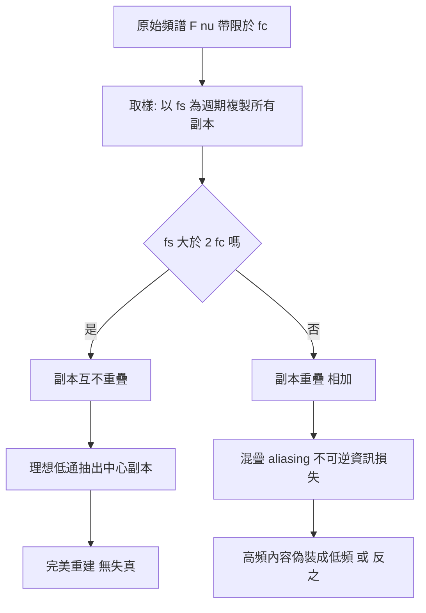

# 1.1 像素、解析度與取樣定理（1960-1990）

## 一、物理起點：光變成數字之前

要理解「像素」，必須先承認一件事：**數位影像不是現實世界的複製，而是對現實世界的量測經過兩次近似之後的殘留物**。這兩次近似分別是光學系統的模糊與感光元件的量子化。前者由物理決定，後者由工程決定；而 1928 年的取樣定理只對第二次近似的一半（取樣）給出了嚴格的上限，卻對量化幾乎無話可說。這個「理論保證的上限」與「工程實現的現實」之間的落差，正是 1960-1990 年間影像處理領域最主要的張力來源。

### 1.1 點擴散函數：光學系統本身就是一個低通濾波器

現實中不存在「理想點」。任何有限孔徑的光學系統都會把一個理想點光源的影像散佈成一個斑點，這個斑點的強度分佈函數就稱為**點擴散函數（Point Spread Function, PSF）**。

一維空間中，把物體視為無限多個理想點的疊加（這一步本身是傅立葉級數的物理意義，見 1.3 節），經過 PSF 作用後的成像為

$$
I_{\text{out}}(x, y) = \iint I_{\text{in}}(x', y')\,\text{PSF}(x - x',\, y - y')\, dx'\, dy'
$$

這就是一個**二維卷積**。換句話說，光學成像在物理上就是卷積運算。這一點極其重要，因為它意味著：

* 攝影機的「模糊」與影像處理課本裡的「模糊」在數學上是同一件事；
* 任何光學系統都必然是低通濾波器——PSF 的傅立葉變換（稱為**光學傳遞函數 Optical Transfer Function, OTF**）在零頻處最大，隨空間頻率衰減，且實物孔徑限制使其**帶寬有限**；
* 這個有限的帶寬是取樣定理能夠適用的物理前提。若 PSF 的 OTF 帶寬無限大（即無限小孔徑），任何有限的取樣率都必然混疊。

常見 PSF 的模型：

| PSF 類型 | 適用情境 | 特性 |
| --- | --- | --- |
| 高斯（Gaussian） | 大氣擾動、熱雜訊、許多鏡頭的近似 | 時域與頻域皆為高斯，唯一「自我對偶」的核 |
| 圓盤（Disk/Airy） | 理想圓形孔徑光學系統 | 對應 Airy 函數，中心亮斑外加振盪環 |
| 運動模糊（Motion） | 曝光期間相對運動 | 各向異性的線性核 |
| 散斑（Speckle） | 雷達成像、粗糙表面照明 | 乘性雜訊模型，非加性 |

**常見誤解**：很多人以為「相機解析度」只由感光元件的像素數決定。事實上，最終成像解析度是光學解析度與感光解析度的**串聯**結果，等效上兩者取決於方差的相加（近似的高斯疊加），而不是取最小值。

### 1.2 感光元件：量子效率、暗雜訊與光子統計

在 CCD 與 CMOS 影像感光元件（image sensor）中，光子打到感光二極體後會產生電子—空穴對，電子被累積並讀出。兩個關鍵參數：

* **量子效率（Quantum Efficiency, QE）**：入射光子中成功轉換為可計數電子的比例，記為 $ \eta $ 。QE 是波長的函數；即使是最先进的背照式 CMOS，在可見光綠光波段也常只有 60-80%。
* **暗雜訊（Dark Noise）**：即使在完全無光的情況下，感光元件也會自發產生電子（暗電流、熱激發）。這構成了一個噪聲底。

由此得到影像訊號雜訊比（Signal-to-Noise Ratio, SNR）的光學基礎。若入射光子數為 $ N_\gamma $ ，產生電子數的期望值為 $ \eta N_\gamma $ ，而暗電流電子數為 $ N_d $ ，計數過程本身還帶有散粒雜訊（shot noise），其變異數等於平均值。總電子數的期望與變異為

$$
\mathbb{E}[N_e] = \eta N_\gamma + N_d, \qquad \operatorname{Var}(N_e) = \eta N_\gamma + N_d
$$

因此以光子數為尺度定義的 SNR 為

$$
\mathrm{SNR}_{\text{photon}} = \frac{\eta N_\gamma}{\sqrt{\eta N_\gamma + N_d}}
$$

這個式子解釋了攝影界的基本直覺：**光線不足時，SNR 趨近於 1（雜訊主導），此時再增加曝光只會同時增加訊號與雜訊，無效**；而在光線充足時 SNR 近似正比於 $ \sqrt{N_\gamma} $ ，即每增加四倍光量，SNR 只提升兩倍。這就是為什麼高 ISO 會讓影像變得斑駁——ISO 本質上是**數位增益**（對已量測到的電子數做線性放大），放大的是訊號也放大的是雜訊。

---

## 二、影像的數學表達：取樣與量化

### 2.1 連續到離散：兩步走的離散化

物理世界給出的是連續函數 $ I(x, y) $ ，其中 $ x, y $ 為連續空間座標，$ I $ 為輻亮度。數位影像的建立過程是嚴格分兩步的：

**第一步：取樣（Sampling）**——在平面上選定有限個位置 $ (x_i, y_j) $ ，並記錄每個位置的連續值。

$$
I_{i,j} = I(x_i, y_j)
$$

取樣點通常排列成規則網格，網格密度即取樣密度（單位長度上的取樣數，samples per unit length）。

**第二步：量化（Quantization）**——把連續值映射到有限個離散等級上。

$$
Q(I_{i,j}) = \left\lfloor \frac{I_{i,j} - I_{\min}}{I_{\max} - I_{\min}} \cdot (2^b - 1) + \frac{1}{2} \right\rfloor
$$

其中 $ b $ 為**位元深度（bit depth）**，可表示 $ 2^b $ 個等級。$ b = 8 $ 時有 256 級，$ b = 16 $ 時有 65536 級。

這兩步的關鍵差異是：**取樣造成的誤差是系統性的、無法用後處理完全補救的（混疊是資訊的永久損失）；量化造成的誤差則是有界的、可預測的**。這也是本章要區分「空間域誤差」與「輻射域誤差」的源頭。

### 2.2 量化誤差與 SNR 的推導

假設量化器的步階（step size）為

$$
\Delta = \frac{I_{\max} - I_{\min}}{2^b - 1}
$$

在**均勻量化且不考慮輸入統計**的最簡模型下，量化誤差 $ e = I_{i,j} - Q(I_{i,j}) $ 被建模為在 $ [-\Delta/2, \Delta/2] $ 上均勻分布的隨機變數。其期望為零，變異為

$$
\sigma_e^2 = \mathbb{E}[e^2] = \frac{1}{\Delta}\int_{-\Delta/2}^{\Delta/2} e^2 \, de = \frac{\Delta^2}{12}
$$

這就是著名的**均勻量化雜訊功率**公式。相對於最大滿刻度（full scale）的 SQNR（Signal-to-Quantization-Noise Ratio）為

$$
\mathrm{SQNR}_{\mathrm{dB}} = 20 \log_{10} \frac{I_{\max} - I_{\min}}{\sigma_e} = 20 \log_{10} \frac{(2^b - 1)\Delta}{\Delta/\sqrt{12}} = 20\log_{10}\big(\sqrt{12}\,(2^b-1)\big)
$$

代入 $ b = 8 $ 與 $ b = 16 $：

| 位深 | 等級數 | 量化步階（滿刻度 1.0） | SQNR |
| --- | --- | --- | --- |
| 4 bit | 16 | $ 6.25\times10^{-2} $ | 約 24.4 dB |
| 8 bit | 256 | $ 3.92\times10^{-3} $ | 約 49.9 dB |
| 10 bit | 1024 | $ 9.78\times10^{-4} $ | 約 60.0 dB |
| 12 bit | 4096 | $ 2.44\times10^{-4} $ | 約 70.1 dB |
| 16 bit | 65536 | $ 1.53\times10^{-5} $ | 約 90.3 dB |

可以看出一個極重要的工程規律：**每增加 1 bit，SQNR 只改善約 6.02 dB**。而 8 bit 的 50 dB 恰好落在「一般顯示器在良好照明下肉眼難以辨識雜訊」的臨界點，這就是為什麼 8 bit 是影像處理與顯示領域的工程慣例。

但上式是**樂觀**的。它假設輸入訊號大致均勻分佈在滿刻度內。實際上自然影像的灰階值服從近似冪次（power law）分佈，大部分像素集中在暗部。因此：

* 真正決定視覺品質的不是**絕對**量化誤差，而是**每個區域的局部 SQNR**；
* 暗部少數像素的量化階梯（banding）比整體雜訊更刺眼；
* 這正是 8 bit 影像在暗部漸層（skyline、膚色過渡）會出現階梯狀色帶（banding）的數學原因。

**改進手段**：加性雜訊抖動（Dithering）。加入均勻分布於 $ [-\Delta/2, \Delta/2] $ 的隨機抖動訊號 $ d_n $ 後再量化：

$$
I_q = Q\big(I + d_n\big)
$$

抖動的功率等於量化雜訊功率，理論上 SNR 不變，但噪聲的功率譜被攤平到全頻段，並產生與量化階梯「錯開」的機會。抖動把「規則的階梯」轉化為「隨機的雜訊」，因為人眼對規則結構（banding）比對隨機雜訊更敏感，於是**主觀**品質反而提升。這是少數「數學上 SNR 不變、人眼主觀上卻變好」的經典案例，也是所有顯示器與影像編碼標準都內建抖動的原因。

### 2.3 矩陣表示

取樣與量化完成後，影像成為一個 $ H \times W $ 的矩陣

$$
I \in \mathbb{R}^{H \times W}
$$

其中每個元素取值於 $ [0, 2^b - 1] $ 的整數（單通道灰階）。彩色影像則是三個通道的堆疊，可視為張量 $ I \in \mathbb{R}^{H \times W \times 3} $ 。

這裡要建立一個貫穿全書的觀念：**這個矩陣不是「世界的縮圖」，而是「某個測量系統在某個取樣格點上的一組數字」**。矩陣的座標軸（$ x $ 與 $ y $ ）對應**空間維度**，像素值對應**輻射維度**。所有後續的影像處理，都可以歸類為「沿空間維度做的運算」（濾波、卷積）或「沿輻射維度做的運算」（對比拉伸、色彩空間轉換）。

---

## 三、三種解析度的區分

「解析度」一詞在業界被嚴重濫用。至少有三種互不等價的意義：

### 3.1 空間解析度（Spatial Resolution）

**定義**：單位空間長度上的取樣密度，或影像所能解析的最小特徵尺寸。

以像素為單位時常用「像素對（pixel pair）」或「線對（line pair per millimeter, lp/mm）」描述。經典定義：**可解析的最小黑白條紋間隔**（奈奎斯特頻率的一半）。若取樣密度為 $ p $ 個像素/公釐，則空間解析度上限為 $ p/2 $ 對/公釐。

空間解析度的物理上限由三個環節串聯決定：鏡頭 MTF、感光元件像素尺寸、以及取樣密度。**超出感光元件能力的「超解析度」（super-resolution）取樣並不帶來新資訊**——這是第 5 章要處理的問題（SRGAN 之類的方法是「先射後畫」，並非真的多出物理資訊）。

### 3.2 輻射解析度（Radiometric Resolution）

**定義**：能分辨的最小亮度差異，即量化步階 $ \Delta $ 。

這裡要注意與**位深**的關係：位深是**編碼**的位元數，輻射解析度是**物理量測**的精度。兩者不可等同：

* **位深可以人為拉高而不增加物理資訊**：把 8 bit 影像存成 16 bit PNG 只是多了一倍的零，沒有任何新資訊（這是「無效位深」的常見誤用）；
* **位深低於物理量測能力也是浪費**：如果感光元件的有效位深（ENOB, Effective Number of Bits）是 11 bit，存成 8 bit 就是在丟棄真實存在的資訊。

現代高階感光元件廣泛使用「雙轉換」（dual conversion gain）與「多幀堆疊」（binning / long exposure NR）技術：**透過多次取樣平均，把原本被雜訊淹沒的微弱訊號「榨」出來**，等效於提高有效位深。例如 12 bit 的感光元件在堆疊 4 幀後可達等效 14 bit。這也說明了一個反直覺事實：**多幀平均提升的不是解析度，而是輻射解析度**——因為被平均掉的是隨機雜訊，不是空間資訊。

### 3.3 時間解析度與相位解析度

動態影像還有第四個維度：時間解析度（frame rate）與相位解析度（phase resolution，即快門時間內能記錄多少運動細節）。

運動模糊的量化可以用時間取樣定理說明：若物體運動速度為 $ v $ 像素/秒，快門時間為 $ T $ 秒，則曝光期間移動了 $ vT $ 像素，模糊量級為 $ vT $ 像素。要「凍結」運動需要 $ vT \ll 1 $ ，但這與進光量衝突——**光量與時間解析度的取捨，是攝影物理與所有高速視覺系統（如視訊穩定、事件相機、rolling shutter）的根本矛盾**。

### 3.4 對照表

| 解析度類型 | 決定因素 | 改進手段 | 侷限 |
| --- | --- | --- | --- |
| 空間解析度 | 取樣密度、鏡頭 MTF、感光元件像素尺寸 | 更高像素感光元件、光學設計改善 | 受繞射與感光元件成本限制；超解析度多為猜測 |
| 輻射解析度 | 量子效率、暗雜訊、位深、堆疊幀數 | 冷卻（降低暗電流）、多幀平均、提高 QE | SNR 受光子數平方根限制 |
| 時間解析度 | 快門速度、曝光時間 | 全域快門、短曝光、事件相機 | 短曝光 = 少光子 = 低 SNR |
| 相位解析度 | 快門時間內的運動量 | 縮短快門 | 與時間解析度同源 |

---

## 四、取樣定理（Nyquist-Shannon, 1928）

### 4.1 命題

**取樣定理（取樣帶限定理，Nyquist-Shannon sampling theorem, 1928）**：設連續時間訊號 $ f(t) $ 的傅立葉變換 $ F(\nu) $ 在 $ |\nu| \ge f_c $ 處為零（即 $ f(t) $ 是**帶限（band-limited）**的，最高頻率為 $ f_c $ ），若取樣頻率 $ f_s > 2 f_c $ ，則可由取樣序列 $ f(n T_s) $ （$ T_s = 1/f_s $ ）**唯一地**重建 $ f(t) $ ；重建誤差不為零當且僅當 $ f_s \le 2 f_c $ 。

注意定理的兩個必要條件：

1. **帶限**：$ f(t) $ 必須沒有高於 $ f_c $ 的成分。實體影像（邊緣是尖銳的階梯函數）其傅立葉頻譜理論上延伸至無限頻率，**不嚴格帶限**。這就是為什麼工程上必須在取樣「之前」先做低通濾波（見 4.4 節）——不是為了數學漂亮，而是因為**不帶限的訊號在取樣後根本無法與混疊訊號區分**。
2. **取樣率嚴格大於** $ 2 f_c $ 。等號時，重建在理論上仍可行（頻譜副本恰好相接於零點），但任何微小的頻率偏移或噪訊都會破壞重建，工程上必須留餘裕度（通常取 1.2-2 倍）。

### 4.2 重建公式

重建由**理想低通濾波器**（抽頭係數由取樣值乘上 sinc）完成：

$$
f(t) = \sum_{n=-\infty}^{\infty} f(n T_s) \cdot \mathrm{sinc}\!\left(\frac{t - nT_s}{T_s}\right), \qquad \mathrm{sinc}(x) = \frac{\sin(\pi x)}{\pi x}
$$

這裡的 sinc 是**正規化 sinc**（normalized sinc，$ \mathrm{sinc}(0)=1 $ ），與影像處理文獻中常見的另一種定義 $ \sin(x)/x $ 只差一個尺度因子。

另一個等價且在實作上更方便的表述是**取樣定理的頻域版本**：

$$
F(\nu) = f_s \sum_{k=-\infty}^{\infty} F_s(\nu - k f_s)
$$

其中 $ F_s $ 是取樣序列的傅立葉變換（也等價地是 $ f $ 的傅立葉變換以 $ f_s $ 週期性延拓後的幅度）。這一式子說明了一切：**取樣在頻域做的事，是把 $ F $ 以 $ f_s $ 為週期複製到整個頻軸上**。

### 4.3 核心想法與證明思路

把頻譜的複製行為畫出來就一目了然了：



**證明的骨幹**（Landau 的形式化版本）：

1. 取樣序列 $ f(nT_s) $ 的傅立葉變換是 $ F(\nu) $ 的 $ 1/T_s $ 倍週期性延拓——這是狄拉克梳狀函數（comb function）與 $ F $ 卷積的直接結果；
2. 若 $ f_s > 2f_c $，各副本支集互不相交，故延拓後的 $ F_s $ 在中心區間 $ |\nu| \le f_c $ 上就等於 $ F(\nu) $；
3. 於是以理想低通濾波器（截止頻率介於 $ f_c $ 與 $ f_s - f_c $ 之間）截取中心副本，即可取回 $ F $，再取反傅立葉變換得 $ f $ ；
4. 反過來，若 $ f_s \le 2f_c $，副本重疊，中心區間上得到的已經是 $ F $ 與其他副本的**和**，此時存在 $ f \ne g $（兩者都帶限於 $ f_c $ ）產生**相同的取樣序列**。既然取樣序列相同，沒有任何演算法能分辨它們，因此**重建不可能唯一**。

第 4 點是理解混疊的關鍵：**混疊不是「精度不夠」，而是資訊論意義上的不可逆損失**。

### 4.4 混疊與反混疊：為什麼相機前面都有低通濾波器

當 $ f_s < 2 f_c $ 時，副本重疊。高於 $ f_s/2 $ 的頻率成分會「折疊」到較低的頻率。例如，一條每毫米 20 條的黑白條紋（空間頻率 $ f_c = 20 $  lp/mm ），若以 $ f_s = 12 $  lp/mm 取樣，重建出來的會是一組每毫米 8 條的條紋——**看起來完全合理，卻完全錯誤**。

這正是「莫利條紋」（Moiré pattern）的成因：兩組規則圖案疊加產生低頻的假紋路。在印刷、紡織、晶圓檢測、縮圖印刷等所有以規則柵格掃描連續圖像的場合，混疊都是頭號敵人。

**反混疊（Anti-aliasing）預濾波**：在取樣之前施加低通濾波，把 $ F(\nu) $ 中 $ |\nu| > f_s/2 $ 的成分**完全濾除**，使得取樣後的頻譜副本不會重疊。

* 在**光學**上：這就是感光元件前的**光學低通濾波器（Optical Low-Pass Filter, OLPF）**，也稱抗混疊濾波器。它通常是一片或多片放在感光元件前的低通濾光片。截止頻率設在取樣奈奎斯特頻率稍上方，讓最細的線對剛好被衰減到可接受，同時把高於此的頻率（最容易被混疊的成分）壓下去。代價是整張照片略微變軟。
* 在**數位**上：就是**降取樣前先濾波**，也就是所謂的「box filter / triangle filter / 面積平均」的真正用途。

**伏筆**：注意 OLPF 做的事在數學上就是**在頻域切掉高頻**。這正是 1.3 節的主題——我們將看到理想低通、巴特沃斯濾波器與高斯濾波器，正是 OLPF 在數位領域的對應物；而 OLPF 的「截止頻率選擇」在數位領域的對應物就是濾波器的截止頻率 $ f_c $ 與過渡帶寬。1.1 節的「反混疊」因此不是孤立技巧，而是整個頻域影像處理的**第一次出場**。

### 4.5 二維取樣與像素形狀

二維取樣定理是其一維版本分別套用在兩個軸上的結果，但實務上多了一個自由：**取樣格點的形狀**。

* **正方形格點（rectangular lattice）**：最常用，實作簡單。
* **六角形格點（hexagonal lattice）**：在相同取樣密度下，Nyquist 面積（每個取樣點覆蓋的 Voronoi 胞元面積）最小，也就是**每個像素的資訊量最大**。六角格點還能讓最近鄰等距化，有利於某些網格演算法。
* **隨機取樣（stochastic sampling）**：白雜訊取樣在期望上無混疊，但會引入噪聲；抖动（dithered）取樣則是兼具兩者的折衷。

另一個實務細節是**感光元件的填積因子（fill factor）**：像素之間有「溝槽」（inter-pixel space），無法感光。填積因子越低，等於有效取樣密度越低，因此感光元件設計中的微透鏡（microlens）技術的重要目標就是把光導到填積區域下方——這是把「幾何取樣率」與「有效取樣率」拉近的手段。

---

## 五、插值與重採樣

當我們改變影像的解析度時，就必須在新格點上估計原訊號的值——**插值（interpolation）**。插值本質上是**重建**，因此受取樣定理約束：若原訊號已混疊，任何插值都救不回來（插值只是把錯誤平滑掉，讓錯誤難以察覺）。

### 5.1 最近鄰插值

取最近的鄰居像素值。零計算量，零模糊，**但會產生塊狀（blocky）偽影與鋸齒**。在需要嚴格保留原像素值（如標註資料、醫療影像、遮罩）的場景中使用；不應用於照片縮放。

### 5.2 雙線性插值

在 2×2 鄰域上做線性插值，等價於對原影像施加三角核（tent kernel）卷積。**這就是「為什麼雙線性看起來模糊」的答案**：其等效頻域響應是三角函數的平方，特別在高頻處衰減明顯。

更精確地說，**雙線性插值 = 先做 box downsample 再做某種 upsample 的組合**。理論上，正確的下採樣應該先施加對應形狀的預濾波（面積平均），這與 4.4 節的反混疊一致；而雙線性插值並未做最優預濾波，所以它其實**在降取樣時部分混疊、在升取樣時部分模糊**——這是雙線性品質不佳的真正原因。

### 5.3 雙立方插值（bicubic）

使用 4×4 鄰域，以三次多項式插值。常用 Catmull-Rom 作為核。因為它是**插值型**（核值在整數點為 1、其餘點為 0），不會模糊掉原有像素值，結果比雙線性銳利，塊狀偽影更少。代價是邊界效應（外插時容易出現振盪）。

### 5.4 Lanczos 與其他銳利化插值

Lanczos 核由 sinc 函數截斷而成：

$$
L_n(x) = \begin{cases}
\mathrm{sinc}(x) & |x| < n \\
0 & |x| \ge n
\end{cases}
$$

它是取樣定理重建公式的**有限窗近似**——因此在理論上最接近「正確重建」，細節保留最好，但也最容易出現振盪（ringing）。

| 插值法 | 支援半徑 | 運算量 | 模糊程度 | 適用 |
| --- | --- | --- | --- | --- |
| 最近鄰 | 1×1 | 最低 | 無（但塊狀） | 遮罩、標註、最近鄰法 |
| 雙線性 | 2×2 | 低 | 明顯 | 快速預覽、即時縮放 |
| 雙立方 | 4×4 | 中 | 輕微 | 一般影像縮放 |
| Lanczos | $ 2n\times2n $ | 高 | 輕微但可能 ringing | 印刷輸出、高品質縮放 |
| Mitchell-Netravali | 4×4 | 中 | 可調 | 兼顧銳利與平滑 |

### 5.5 為什麼 AI 生成影像有「塑膠感」與「過銳」

這是本章最實用的一段。現代生成模型（GAN、擴散模型）的解碼器幾乎必然包含**上採樣層**（nearest/bilinear upsample + convolution，見第 7 章）。但學習到的上採樣核並不是固定的線性插值，而是**資料驅動地學出來的**。

結果是：

* **過銳（over-sharpening）**：神經網路在訓練時以像素級損失（如 L1/L2）為目標，而 L2 損失對邊界的最佳逼近傾向於「平均化」，模型為降低損失反而會把邊界「推」得更陡，加上銳化型損失或對抗損失的激勵，產生 halo（光暈）與邊緣振盪。
* **塑膠感（plastic look）**：高頻細節被模型「補」成統計上合理但物理上不真實的紋理（例如皮膚上的假毛孔、地面的假草紋）。因為**高頻是取樣最脆弱的資訊**（1.1 節：混疊發生在高頻），模型在生成高頻時缺乏物理約束，只能靠先驗填補。

這個觀察有一個技術性的推論：**判斷一張圖是否由生成模型產生，與其檢查高頻結構有關**（第 10 章的深偽偵測會回到這裡）。同時，它也說明為什麼「先降取樣再上採樣」的人工路徑（例如 super-resolution 模型的兩階段設計）會產生過銳——因為中間步驟丟掉的高頻資訊被第二階段用先驗「編造」回來。

---

## 六、深度學習如何改變「影像品質」的定義

### 6.1 從固定線性算子到可學習算子

傳統影像處理的取樣、插值、平滑、銳化，全部是**固定的線性算子**——核的係數由數學（取樣定理、高斯函數）決定，不從資料中學。

深度學習的核心改變是：把這些算子換成**可學習的非線性算子**。

* **卷積層**：一般化卷積，核由梯度下降學出；
* **轉置卷積 / 上採樣卷積**：學出來的「反卷積」，其效果可以對齊到某個特定的插值核加上學到的細節補償；
* **亞像素卷積（sub-pixel convolution, Shi et al. 2017）**：把上採樣拆成「先做 $ 1/r $ 解析度的卷積，再做像素間距排列」，等效於學出一組可學習的插值核。

**關鍵洞見**：ViT 的 patchify（第 6.2 節）就是一種**學出來的取樣**。傳統的 patchify 是固定地把影像切成 16×16 的方塊；ViT 的做法是把這件事變成一個可微的線性投影：

$$
x_p = E \, \mathrm{vec}(I) + b, \qquad E \in \mathbb{R}^{(P^2 C) \times (P^2 C)}
$$

層級化地說：ViT 把「像素 → patch」這個**取樣決策**從人工選擇變成了學習的一部分。取樣率、patch 尺寸、層級式的 patch 合併（Hierarchical Patch Merge, Swin-Transformer 第 6.3 節）都是可學習或半可學習的。這是「取樣定理 → 深度學習」這條故事線的交會點。

### 6.2 「品質」定義的轉移

在傳統影像處理裡，「品質」由客觀指標定義：PSNR、SSIM（見 1.2 節對 PSNR 計算空間的討論）、或人眼主觀評分。深度學習時代，「品質」多了兩個維度：

* **感知品質（perceptual quality）**：以 LPIPS（Learned Perceptual Image Patch Similarity, 2018）為代表，用預訓練網路的特徵距離代替像素距離。這是「特徵空間的 PSNR」——把取樣/重建的度量搬到**學到的特徵空間**裡。
* **條件一致性（fidelity / consistency）**：生成影像是否保留了輸入條件（如文字、邊緣圖、姿態）所要求的內容。對應 CLIP score、FID（Fréchet Inception Distance）。

這三者的張力正是生成模型的訓練難點：像素損失傾向模糊（L2 的平均化效應）、對抗損失傾向銳利但可能失真、感知損失傾向「好看」但不保真。第 7 章會回到這裡。

### 6.3 傳統取樣與學習式取樣的對照

| 面向 | 傳統（1960-1990） | 深度學習（2012-） |
| --- | --- | --- |
| 取樣決策 | 人工固定（均勻格點、patch 尺寸） | 可學習或半可學習（ViT patch projection） |
| 重建核 | 固定線性（box / bilinear / bicubic / Lanczos） | 學出的非線性（轉置卷積、亞像素卷積） |
| 混疊處理 | 取樣前預濾波（OLPF、面積平均） | 由網路隱式學習，無明確保證 |
| 品質度量 | PSNR / SSIM | LPIPS / FID / CLIP score |
| 代價 | 通用、確定、有理論保證 | 專用於資料分布、可能產生不真實高頻 |

**這裡有一個必須指出的張力**：取樣定理給的是**保證**，而神經網路給的是**經驗性能**。當 GAN/擴散模型產生的高頻細節在物理上不可信（塑膠感）時，我們其實是在用「可學」換掉了「可證」。這是第 10 章倫理與可信任性討論的技術根由。

---

## 七、實作：以 NumPy 觀察取樣與量化

### 7.1 位深與量化誤差

```python
import numpy as np
import matplotlib.pyplot as plt

def to_bits(img_float, bits):
    """把 [0,1] 浮點影像量化成指定位深。"""
    levels = 2 ** bits
    scale = levels - 1
    q = np.round(img_float * scale) / scale
    return q, levels

def sqnr_db(img_float, bits):
    levels = 2 ** bits
    ideal = (levels - 1) * img_float
    q = np.round(ideal)
    err = img_float - q / (levels - 1)
    signal = np.mean((img_float - img_float.mean()) ** 2)
    noise = np.mean(err ** 2)
    return 10 * np.log10(signal / noise)

# 合成一張有灰階漸層的測試圖（用來觀察 banding）
h, w = 256, 256
xx, yy = np.meshgrid(np.linspace(0, 1, w), np.linspace(0, 1, h))
img = 0.5 + 0.5 * np.sin(6 * np.pi * (xx + yy)) * np.exp(-2 * ((xx - .5) ** 2 + (yy - .5) ** 2))

for bits in (2, 4, 8):
    q, _ = to_bits(img, bits)
    print(f"bits={bits:2d}  levels={2**bits:5d}  SQNR={sqnr_db(img, bits):6.2f} dB")

fig, axes = plt.subplots(1, 3, figsize=(13, 4))
for ax, bits in zip(axes, (2, 4, 8)):
    q, _ = to_bits(img, bits)
    ax.imshow(q, cmap="gray", vmin=0, vmax=1)
    ax.set_title(f"{bits}-bit ({2**bits} levels)")
    ax.axis("off")
plt.tight_layout()
plt.show()
```

從輸出可以觀察到兩件事：**位深越低，階梯（banding）越明顯**；而以全圖平均計算的 SQNR 對位深呈 6.02 dB/bit 的線性成長。

### 7.2 暗部的局部 SNR：為什麼 8 bit 會有色帶

```python
img = np.linspace(0, 1, 4096).reshape(64, 64)   # 極暗漸層
for bits in (4, 8, 12):
    levels = 2 ** bits
    q = np.round(img * (levels - 1)) / (levels - 1)
    # 局部 SNR：分 8 段各自計算
    seg = np.array_split(q, 8, axis=1)
    local = []
    for s in seg:
        sig = np.var(s)
        noise = 1.0 / (12 * levels ** 2)
        local.append(10 * np.log10(sig / noise))
    print(f"bits={bits:2d}  局部 SNR (dB) 由暗到亮: {np.round(local, 1)}")
```

暗部的局部 SNR 遠低於全圖平均——這就是為什麼即使 8 bit 整體 SQNR 有 50 dB，肉眼仍能在暗部看到階梯。**任何影像編碼標準（H.264 的 8 bit、ProRes 10 bit、高位深 HEVC）都是圍繞這個問題設計的取捨。**

### 7.3 混疊的視覺化

```python
import numpy as np
import matplotlib.pyplot as plt

def make_bars(pairs_per_period=6, cycles=8, size=256):
    """產生高空間頻率的條紋圖。"""
    x = np.arange(size)
    f = pairs_per_period * cycles / size      # 像素頻率（cycles/pixel）
    phase = 2 * np.pi * f * x
    return 0.5 + 0.5 * np.sign(np.sin(phase))

def decimate(img, factor):
    """純取樣（不預濾波）——故意製造混疊。"""
    return img[::factor, ::factor]

def decimate_with_prefilter(img, factor):
    """先做面積平均（box filter）再取樣——反混疊。"""
    h, w = img.shape
    h2, w2 = h // factor, w // factor
    trimmed = img[:h2 * factor, :w2 * factor]
    return trimmed.reshape(h2, factor, w2, factor).mean(axis=(1, 3))

img = make_bars()
fig, axes = plt.subplots(1, 3, figsize=(13, 4))
axes[0].imshow(img, cmap="gray"); axes[0].set_title("原始條紋 (連續)")
naive = np.repeat(np.repeat(decimate(img, 8), 8, axis=0), 8, axis=1)
axes[1].imshow(naive, cmap="gray"); axes[1].set_title("直接下採樣 x8 -> 混疊")
good = np.repeat(np.repeat(decimate_with_prefilter(img, 8), 8, axis=0), 8, axis=1)
axes[2].imshow(good, cmap="gray"); axes[2].set_title("面積平均預濾波後下採樣")
for ax in axes: ax.axis("off")
plt.tight_layout(); plt.show()
```

第二張圖會出現與原圖完全不同的條紋頻率：這就是混疊。**注意：第二張圖並不比原圖「模糊」，它看起來甚至相當銳利——這正是混疊危險的地方，錯誤資訊偽裝成清晰的資訊。**

### 7.4 比較不同插值法

```python
import cv2

img = (np.random.default_rng(0).normal(size=(64, 64, 3)) * 40 + 128).clip(0, 255).astype(np.uint8)
methods = {
    "nearest": cv2.INTER_NEAREST,
    "linear":  cv2.INTER_LINEAR,
    "cubic":   cv2.INTER_CUBIC,
    "lanczos": cv2.INTER_LANCZOS4,
}
for name, flag in methods.items():
    up = cv2.resize(img, (256, 256), interpolation=flag)
    down = cv2.resize(img, (16, 16), interpolation=flag)
    up_back = cv2.resize(down, (64, 64), interpolation=flag)
    print(f"{name:8s}  round-trip MSE = {np.mean((up_back.astype(float) - img) ** 2):8.2f}")
```

「最近鄰」在 round-trip 上因為完全沒有高頻衰減反而 MSE 最低，但視覺上最差——這說明 **MSE 不是品質指標**（與 1.2 節的 PSNR 討論、與第 10 章的 LPIPS 動機呼應）。

---

## 八、小結與前後銜接

1. 數位影像 = 光學 PSF 卷積 + 取樣 + 量化；前兩步造成**不可逆**的資訊損失，量化誤差則可預測。
2. 位深與 SQNR 的關係是 6.02 dB/bit，但**局部**（尤其暗部）SNR 才是視覺品質的決定因素。
3. 取樣定理給出完美重建的充要條件：**帶限 + 取樣率 > 2 倍最高頻率**。混疊是資訊論意義上的不可逆損失，因此必須在取樣**前**做預濾波（OLPF、box filter）。
4. 插值是重建的近似；固定插值核（bilinear/bicubic/Lanczos）的品質上限受限於其核的頻域響應——這就是「模糊」與「塑膠感」的來源。
5. 深度學習把取樣與重建從固定線性算子變成可學習算子（ViT 的 patchify、轉置卷積），代價是**用經驗性能換掉了數學保證**。

**銜接 1.2 節**：本節的「輻射解析度」只處理了**單一通道的亮度**。但真實世界的光是彩色，人眼有三種色覺受器——如何把「光的物理量」映射到「人眼感知的量」，以及為什麼工程實務中我們還要關心「印刷的減法混色」與「視訊的亮度色度分離」，是 1.2 節的課題。

**銜接 1.3 節**：本節多次預告的「反混疊預濾波 = 在頻域切掉高頻」，將在 1.3 節被正式展開：傅立葉變換讓我們第一次能夠「看見」影像的頻譜，並設計出理想低通、巴特沃斯與高斯濾波器。也正是在那裡，我們會得到卷積定理——**卷積在頻域變成乘法**，這個恆等式是全書最重要的工具之一，也是 1.1 節的光學卷積模型與第 2 章空間域濾波、第 4 章 CNN 的共同數學基礎。

**銜接第 5、6 章**：本節末段提出的「學習式取樣」將在 ViT（第 6.2 節）與超解析度（第 5 章）中展開；而「高頻不可信」的診斷，將在第 10 章的深偽偵測中再度使用。
