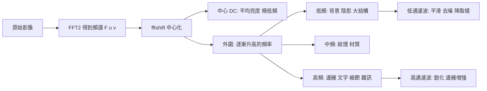

# 1.3 傅立葉轉換與頻域濾波（1822-1965）

## 一、1822：熱傳導問題與「用正弦波分解一切」

### 1.1 動機不是光，而是熱

傅立葉（Jean-Baptiste Joseph Fourier）在 1822 年提交的論文中，動機**不是光學，而是熱傳導**。當時的法國科學院希望理解金屬棒中的熱如何擴散——這是一個偏微分方程的邊值問題。傅立葉提出了一個大膽的主張：

> 任何定義在適當區間上的函數，都可以寫成**正弦與餘弦的無窮和**；而熱流方程在這個表示下變得極其簡單——每個正弦分量各自以固定的速率衰減，衰減率只與其頻率有關，與振幅無關。

也就是說，**熱傳導方程在頻域被解耦成一堆彼此獨立的 ODE**。這個「解耦」是整個傅立葉分析的樞紐：把難以處理的空間耦合問題，轉成一族標量方程。

我們可以直觀理解其物理意義：把一根加熱的棒想成無限多條正弦波型的「溫度波」疊加而成，最初的高溫沿著每條波以各自的頻率各自擴散——高頻波（變化劇烈的部分）衰減快，低頻波（緩慢變化的部分）衰減慢。時間推移後，高頻分量消失，只剩下緩慢的低頻波：**這就是「熱擴散使細節被抹平」在傅立葉語言裡的精確表述**，也是第 2 章「平滑就是低通」的物理出身。

### 1.2 三個關鍵的後續里程碑

| 年份 | 事件 | 對本章的意義 |
| --- | --- | --- |
| 1822 | Fourier 熱傳導論文 | 分解定理的提出 |
| 1922 | Whittaker–Shannon 取樣定理 | **取樣 = 頻譜複製**，傅立葉從數學變成通訊理論 |
| 1928 | Nyquist–Shannon 取樣定理完整化 | 帶限重建的充要條件 |
| 1965 | Cooley–Tukey FFT 演算法 | $ O(N^2) \to O(N\log N) $，**傅立葉從研究工具變成即時運算的基礎設施** |

**為什麼 FFT 的問世（1965）是本章的終點、也是影像處理的起點**：在 FFT 之前，計算一張 $ N \times N $ 影像的傅立葉變換需要 $ O(N^4) $ 次運算，1024×1024 的影像需要約 $ 10^{12} $ 次浮點運算——在 1965 年的電腦上不可行。FFT 把它降到 $ O(N^2 \log N) $，**同一台電腦上只需數秒**。這一改變直接使「頻域影像處理」從理論變成實務：濾波器設計、頻譜分析、壓縮，全部成為可用的工具。

本章的敘事線因此是：**傅立葉（1822）給出分解觀念 → 取樣定理（1922-1928）給出重建條件 → FFT（1965）給出可計算性 → 1960-1990 年代的影像處理把它變成一整套可重用的濾波器工具箱**。

---

## 二、傅立葉變換的定義

### 2.1 連續傅立葉變換（CFT）

對連續函數 $ f(t) $ ，定義其傅立葉變換

$$
F(\nu) = \int_{-\infty}^{\infty} f(t)\, e^{-j 2\pi \nu t}\, dt
$$

反變換為

$$
f(t) = \int_{-\infty}^{\infty} F(\nu)\, e^{j 2\pi \nu t}\, d\nu
$$

其中 $ j $ 為虛數單位，$ \nu $ 為頻率（以 Hz 表示，若 $ t $ 以秒為單位）。

**直觀意義**：$ F(\nu) $ 是 $ f(t) $ 與「複數指數波 $ e^{j2\pi\nu t} $」的內積。因此 $ F(\nu) $ 衡量的是「$ f $ 中有多少這個頻率的正弦波成分」。

**兩種表示的對照**：

* **幅度譜** $ |F(\nu)| $ ：各頻率成分的強度；
* **相位譜** $ \angle F(\nu) $ ：各頻率成分的相位偏移。

這兩者的關係是本章最重要的直覺之一（也是 1.2 節的延伸）：**幅度譜描述「影像裡有什麼樣的紋理」，相位譜描述「這些紋理在哪裡」**。若只保留幅度、丟棄相位再做逆變換，得到的是完全沒有結構的「斑點圖」（phase scrambling）。我們將在實作中驗證這件事。

### 2.2 離散時間傅立葉變換（DTFT）與離散傅立葉變換（DFT）

對離散序列 $ f[n] $ ，DTFT 為

$$
F(e^{j\omega}) = \sum_{n=-\infty}^{\infty} f[n]\, e^{-j\omega n}
$$

但 DTFT 是 $ \omega $ 的**連續函數**，且對有限長序列其值為 $ 2\pi $ 週期的連續曲線，難以逐點計算。DFT 則是取 DTFT 在 $ N $ 個等間隔頻率點上的取樣（令 $ \omega_k = 2\pi k / N $ ）：

$$
F[k] = \sum_{n=0}^{N-1} f[n]\, e^{-j 2\pi kn/N}, \qquad k = 0, 1, \dots, N-1
$$

反變換：

$$
f[n] = \frac{1}{N} \sum_{k=0}^{N-1} F[k]\, e^{j 2\pi kn/N}
$$

**為什麼 DFT 對影像特別重要**：二維影像 $ I[x, y] $ 的二維 DFT 恰好是**沿兩個軸分別做一維 DFT**（可分離性），因此可以用兩趟一維 FFT 完成，複雜度為 $ O(HW(\log H + \log W)) $。

$$
F[u, v] = \sum_{x=0}^{H-1}\sum_{y=0}^{W-1} I[x, y]\; e^{-j2\pi\left(\frac{ux}{H} + \frac{vy}{W}\right)}
$$

### 2.3 頻率軸的物理意義

在 $ N $ 點 DFT 中，bin $ k $ 對應的頻率為 $ \nu_k = \frac{k}{N}\Delta t $ ，其中 $ \Delta t $ 是取樣間隔。若取樣間隔為 $ \Delta t $ ，取樣率為 $ f_s = 1/\Delta t $ ，則

$$
\nu_k = \frac{k}{N}\Delta t
$$

- **$ k = 0 $** 對應直流（DC），即影像的平均亮度；
- **$ k = N/2 $**（若 $ N $ 為偶數）對應**奈奎斯特頻率** $ f_s/2 $ ，是取樣所能表達的最高頻率；
- **$ k > N/2 $** 的 bin 負頻率對稱性：實訊號的 $ F[N-k] = \overline{F[k]} $ ，即幅度對稱、相位反號。

**重要實務陷阱：空間頻率的單位。** 很多初學者以為「bin 編號」就是頻率。實際上，bin 編號對應的是**以像素為單位的空間週期**。$ N $ 點 DFT 中，bin $ k $ 表示「每 $ N/k $ 個像素一個週期」的紋理。若影像寬度為 $ W $ 像素且在水平方向取樣了 $ W $ 個點，則 bin $ k $ 的物理空間頻率是 $ k $ 週期/影像寬度。

---

## 三、卷積定理：全書最重要的工具

### 3.1 命題

**卷積定理（Convolution Theorem）**：

$$
f * g \;\longleftrightarrow\; F \cdot G
$$

具體地，時域卷積

$$
(f * g)(t) = \int_{-\infty}^{\infty} f(\tau)\, g(t - \tau)\, d\tau
$$

在頻域等價於逐點相乘 $ F(\nu)\, G(\nu) $。反之亦然。

離散形式（二維影像）：

$$
(F_{\text{DFT}}[I * K])[u,v] = F_{\text{DFT}}[I][u,v] \cdot F_{\text{DFT}}[K][u,v]
$$

### 3.2 這個定理為何改變了影像處理的命運

**（1）濾波器設計從「猜核」變成「畫圖」。** 在空間域設計濾波器，要在時域構造一個核（挑高斯係數、調整大小），每一個參數的影響都是間接的、難以預期的。在頻域設計濾波器，**就是在頻譜平面上直接畫一塊區域**（低通畫一個圓、高通畫圓環），再取逆傅立葉變換得到核。設計變得**視覺化且精確**。這就是為什麼教科書中所有濾波器章節都先用頻域圖說明。

**（2）計算複雜度翻轉。** 對大小 $ K \times K $ 的核做空間域卷積，成本是 $ O(K^2) $ 每像素；用頻域則是先做 $ O(N\log N) $ 的變換，再做 $ O(N) $ 的逐點乘法。但對小核（如 3×3）而言，空間域的實作更快（且無需 FFT 的邊界效應），這就是 **OpenCV 的 `filter2D` 對小核使用直接卷積、對大核使用 `DFT` 實作**（內部會依核大小自動切換）的原因。

**（3）卷積定理是 CNN 能高效落地的數學基礎之一。** 深度學習中的「卷積層」在數學上就是上式中的 $ I * K $ 。CNN 的高效性來自三個事實的疊加：

1. 卷積層是**線性**運算，可分解為矩陣乘法，在 GPU 上是高度並行的稠密矩陣運算；
2. 卷積在頻域等價於**逐點乘法**，這意味著可以把「空間域的局部運算」重新表述為「頻域的全域運算」；
3. 權重共享（同一組核用於所有位置）大幅減少參數量。

嚴格說，CNN 並不是「因為卷積定理才用 GPU」——GPU 的並行性來自矩陣乘法的硬體特性。但卷積定理揭示了卷積運算的**深層結構**，並解釋了為什麼 1.1 節的高斯濾波、1.2 節的 Retinex 照明估計，都可以在頻域用一次乘法完成。**更重要的是：理解了卷積定理，就能理解為什麼「在頻域做一次乘法」與「在空間域做一次卷積」是同一件事——這讓第 4 章的 CNN 與傳統濾波器在心智上接上了線。**

**（4）兩個實務上的重要推論**：

* **線性濾波器的脈衝響應即其頻率響應的逆變換**。所以知道濾波器的核，就知道它的頻率特性；反之亦然。
* **「模糊」與「加雜訊」的對偶**：既然 $ (f + n) * k = f * k + n * k $，那麼低通濾波會**同時**模糊訊號與雜訊。若 $ n $ 是白雜訊，其頻譜平坦，低通後變成低頻雜訊——這就是「雜訊被抹平」的數學描述。而邊緣增強（高通）會**同時**增強訊號邊緣與雜訊。

### 3.3 二維 DFT 的可分離性

$$
F[u,v] = \sum_{x}\sum_{y} I[x,y]\; e^{-j2\pi ux/H}\, e^{-j2\pi vy/W}
$$

可以拆成兩趟一維 DFT：先沿 $ x $ 軸做，再沿 $ y $ 軸做（或反之）。這意味著：

* 計算量從直接二維 DFT 的 $ O(H^2W^2) $ 降到 $ O(HW\log H + HW\log W) $ ；
* **更重要的**：二維卷積也可分離為兩趟一維卷積，而二維高斯核本身就是**兩個一維高斯核的外積**（可分離性）。這正是 5.1 節要證明的性質，也是 2.1 節高斯濾波能快速實作的原因。

---

## 四、看見影像的頻譜

### 4.1 幅度譜長什麼樣

對一張灰階影像做 `fft2` 並取對數幅度後中心化（`fftshift`），會看到一個明確的結構：

* **中心是一個亮點**（DC 分量，影像的平均亮度）；
* **亮點周圍能量按頻率向外衰減**——因為自然影像的功率譜大致遵循 $ 1/f^2 $（pink noise）的形式（這是 1/f 現象的一個實例）；
* **特定方向上的結構**對應影像中的方向性紋理（例如人像照片中，水平方向的邊界較多，會在頻譜的某條軸上出現亮帶）；
* **文字與規律結構**會在頻譜上產生規律的點陣（這是「頻譜域隱寫」的原理）。

### 4.2 fftshift：為什麼要中心化

`numpy.fft.fft2` 輸出的頻率索引排列是「低頻在左上角」的**捲曲式（wrap-around）**排列：bin 0（DC）在左上，而高頻沿兩個方向週期性地折回。這是因為 DFT 是週期延拓的。

`np.fft.fftshift` 做的只是**把零頻率移到中心**：

$$
\text{shift} = \left\lfloor \frac{N}{2} \right\rfloor
$$

對 $ H \times W $ 的影像，`fftshift` 相當於把行索引 $ x \to (x + H/2) \bmod H $ ，列索引同理。

**注意**：fftshift 純粹是**顯示用的重新排列**，不改變任何物理內容。很多人因為看到「中心化後的頻譜」而誤以為「中心 = 高頻」，這是常見誤解——中心是**低頻（DC）**。

### 4.3 低頻 = 緩變，高頻 = 急變

這是整個頻域影像處理的**核心直覺**，可以用傅立葉的不確定性原理（uncertainty principle）來精確表述：

> 一個函數在空間域的「集中程度」與在頻域的「集中程度」是互斥的。能量越集中於空間域的一小段，其頻譜就越寬廣。

把它翻譯成影像語言：

| 頻域成分 | 空間域外觀 | 影像中的意義 | 典型處理 |
| --- | --- | --- | --- |
| 極低頻（DC 及附近） | 大面積緩慢變化 | 整體亮度、天空漸層、大範圍陰影 | 低通保留 |
| 低頻 | 粗略的大結構 | 臉部大範圍輪廓、物件形狀、色塊 | 低通保留 |
| 中頻 | 中等尺度紋理 | 皮膚紋理、布料、樹葉 | 帶通 |
| 高頻 | 快速變化 | **邊緣、細節、文字、雜訊** | 高通 / 濾除 |
| 極高頻 | 逐像素抖動 | 感光雜訊、量化雜訊 | 濾除（去噪） |

**一個重要的細分**：**邊緣與雜訊在高頻段是疊在一起的**，這是所有去噪與邊緣偵測方法的核心困境。區分它們的依據是：

* **振幅**：真實邊緣的頻譜衰減較慢（結構性），隨機雜訊的頻譜平坦（$ 1/f^0 $）；
* **方向性**：邊緣在某個方向上呈現方向性結構，雜訊沒有；
* **相鄰性／連續性**：邊緣沿空間連續，雜訊不連續。

Canny（第 2.2 節）的三個步驟——高斯預平滑、非極值抑制、雙閾值連通——正是分別利用了上述三個判準。

### 4.4 一個視覺化的 mermaid 圖



---

## 五、濾波器設計

### 5.1 理想低通濾波器（Ideal Low-Pass, ILP）

頻域響應：

$$
H_{\text{ILP}}(u, v) =
\begin{cases}
1, & \sqrt{u^2 + v^2} \le f_c \\[4pt]
0, & \text{otherwise}
\end{cases}
$$

空間域的核（逆傅立葉變換）是**二維 sinc 的乘積**：

$$
h(x, y) \propto \mathrm{sinc}(x)\cdot \mathrm{sinc}(y)
$$

**致命缺陷——Gibbs 現象**：理想的「通帶／阻帶」邊界會在時域產生振盪，且振盪幅度不隨 $ f_c $ 增大而减小（大約是最大值的 9%）。Gibbs 現象的成因是：截斷頻譜相當於把無限長的 sinc 序列乘上一個矩形窗，矩形窗的頻譜是 sinc，其振盪造成時域的振盪。

**這個教訓極其重要**：在頻域「畫一個方框」再取逆變換，是得到**不可用**的濾波器。因此需要用**平滑的過渡帶**來替代階梯，於是有了 Butterworth 與 Gaussian。

### 5.2 巴特沃斯濾波器（Butterworth, 1930）

巴特沃斯濾波器的設計目標是：**在通帶內盡量平坦（像理想濾波器），在阻帶內衰減足夠（衰減率隨階數提高），且過渡帶盡可能窄**。幅度響應：

$$
|H(f)| = \frac{1}{\sqrt{1 + \left(\dfrac{f}{f_c}\right)^{2n}}}
$$

其中 $ f_c $ 是截止頻率（在此處幅度衰減到最大值的 $ 1/\sqrt{2} $ ，即 -3 dB 點），$ n $ 為**階數**。

* $ n $ 越大，過渡帶越窄，越接近理想濾波器；
* $ n $ 越大，時域核的振盪（overshoot）越嚴重。

**重要關係**（連續時間巴特沃斯）：$ n $ 階的過渡帶寬度與阻帶衰減率 $ A $ dB 的關係為

$$
n \ge \frac{\log\left(\dfrac{10^{A/10} - 1}{10^{0.1} - 1}\right)}{2 \log\left(\dfrac{f_s}{2 f_c}\right)}
$$

這是「階數 $ n $ 必須同時滿足過渡帶窄與衰減夠大」這兩個矛盾的工程折衷的定量表達。

對**二維圓形**巴特沃斯（即 $ f = \sqrt{u^2+v^2} $ 的旋轉對稱版本），空間域核是 **modified Bessel 函數** $ I_0 $ 的形式：

$$
h(r) \propto \frac{I_0\!\left( \dfrac{n f_c r}{f_s} \right)}{I_0\!\left( \dfrac{n f_c}{f_s} \right)}
$$

（$ I_0 $ 為第一類零階修正貝塞爾函數。）

### 5.3 高斯濾波器：唯一「自我對偶」的核

高斯濾波器的頻域幅度響應為

$$
H(f) = e^{-\frac{f^2}{2\sigma_f^2}}
$$

而時域核為

$$
g(x, y) = \frac{1}{2\pi\sigma^2}\, e^{-\frac{x^2 + y^2}{2\sigma^2}}
$$

**高斯函數的傅立葉變換仍然是高斯函數**（具體地，$ \mathcal{F}\{e^{-x^2/(2\sigma^2)}\} = \sigma\sqrt{2\pi}\, e^{-2\pi^2\sigma^2 \nu^2} $ ），只是寬度互換。這帶來三個極其珍貴的性質：

1. **無振盪（no overshoot / no ringing）**：高斯核是**單調的、完全正的**，其頻域響應也完全正。沒有 Gibbs 振盪，沒有假的邊緣。這是它在醫療影像、科學成像中不可替代的原因。
2. **可分離性**：二維高斯核是兩個一維高斯的乘積，因此可以用兩趟一維卷積實作，成本從 $ O(K^2) $ 降到 $ O(K) $ 。
3. **模糊程度的物理意義**：高斯模糊在物理上就是**熱擴散**——回到 1.1 節傅立葉最初解決的熱傳導問題。高斯模糊 = 熱擴散 = 布朗運動的分布。**這個閉環是全書最美的一個數學事實之一。**

**高斯核的實際構造**：核大小與標準差的關係

$$
k = 2\sigma + 1 \quad (\text{或 } k = 6\sigma + 1 \text{ 以涵蓋 } \pm 3\sigma)
$$

**標準差 $ \sigma $ 的選擇原則**：

* **由目標最小特徵尺寸決定**：若要抑制尺度小於 $ s $ 的特徵，則 $ \sigma \approx s / 2 $ 是一個實用的起點。理由是：一個寬度為 $ s $ 的特徵，其高斯平滑後的衰減因子為 $ e^{-s^2/(8\sigma^2)} $；
* **經驗公式**（常用的自動選取法）：

$$
\sigma \approx 0.3 \cdot \frac{(k_{\min} - 1)}{0.5 \cdot \left( \dfrac{w_{\min} - 1}{2} + 1 \right) - 0.8}, \qquad
k \approx \frac{(k_{\min} - 1)}{0.5 \left( \dfrac{w_{\min}-1}{2}+1 \right) - 0.8}
$$

（其中 $ k_{\min}, w_{\min} $ 為最小可分辨的 kernel 與寬度，單位為像素。）

* **在 Canny 中**，高斯預平滑的 $ \sigma $ 直接決定了最小可偵測的邊緣尺度——這是「Canny 的邊緣位置精度受 $ \sigma $ 限制」的來源。

### 5.4 三種低通的比較

| 特性 | 理想低通 | 巴特沃斯 | 高斯 |
| --- | --- | --- | --- |
| 頻域響應 | 階梯 | 平滑、有參數化階數 | 平滑、高斯 |
| 時域振盪 | 嚴重（Gibbs, ~9%） | 隨階數增加 | **無** |
| 時域核形式 | sinc 乘積 | Bessel 函數 | 高斯 |
| 可分離性 | 是 | 否 | **是** |
| 空間域計算 | 昂貴 | 昂貴 | **便宜** |
| 物理意義 | 無 | 無 | **熱擴散** |
| 適用 | 僅理論 | 硬體濾波器設計 | 影像處理預設選擇 |

### 5.5 高通與邊緣增強

**理想高通**：

$$
H_{\text{IHP}}(f) = \begin{cases} 0, & f \le f_c \\ 1, & f > f_c \end{cases}
$$

其時域核是帶負瓣（negative lobe）的環形——**高通濾波必然帶來振盪**，因為時域核的總和為零（DC 增益為零意味著 $ \int h = 0 $ ，因此核必須有正有負），有正有負就意味著在邊緣附近會產生過衝（overshoot）與下衝（undershoot）。

**Unsharp Masking**（空間域，1960 年代）：先模糊再相減

$$
g_{\text{sharp}} = g + k\,(g - g_{\text{blur}}), \qquad g_{\text{blur}} = g * h_\sigma
$$

這正是**高通濾波器的空間域實現**。$ k $ 是「銳化量」（amount），$ \sigma $ 決定「銳化的是哪個尺度的細節」。$ k > 1 $ 會產生明顯的 halo 光暈（這是 1.1 節提到的「AI 生成影像過銳」的同類現象）。

**拉普拉斯算子**（二階微分）：

$$
\nabla^2 I = \frac{\partial^2 I}{\partial x^2} + \frac{\partial^2 I}{\partial y^2}
$$

連續形式與常用的 4-鄰域離散核：

$$
\nabla^2 I \approx I(x+1,y) + I(x-1,y) + I(x,y+1) + I(x,y-1) - 4I(x,y)
$$

拉普拉斯算子的頻域響應為

$$
H_{\text{Lap}}(f) = -(2\pi f)^2
$$

即**頻率越高，增益越大**——這是一個「隨頻率平方增長」的無界高通，也是它過度增強雜訊的原因。實務上使用「遮蔽版拉普拉斯」（masked Laplacian）或把高頻增益限制在某個上限（clipping），就是把無界高通變成有界高通。

**Ideal Band-Pass**：頻域畫一個圓環（外半徑 $ f_2 $ 、內半徑 $ f_1 $ ），保留中頻段。時域核為環形 sinc 的乘積形式。

### 5.6 空間域核與頻譜的對偶：證明高斯的自我對偶性

我們已經宣稱高斯函數的傅立葉變換是高斯函數。這裡給出簡要推導，因為它是 2.1 節（高斯濾波）的數學前提。

**引理（高斯積分）**：

$$
\int_{-\infty}^{\infty} e^{-a x^2} dx = \sqrt{\frac{\pi}{a}}, \qquad \operatorname{Re}(a) > 0
$$

**推導**：定義 $ I(a) = \int_{-\infty}^{\infty} e^{-a x^2} dx $ ，令 $ x = u/\sqrt{a} $ 得 $ I(a) = \frac{1}{\sqrt{a}} I(1) $ 。再計算 $ I(1)^2 $ ：

$$
I(1)^2 = \iint e^{-(x^2+y^2)} dx\,dy = \int_0^{2\pi}\!\int_0^{\infty} e^{-r^2} r\, dr\, d\theta = 2\pi \cdot \frac{1}{2} = \pi
$$

故 $ I(1) = \sqrt{\pi} $ ，一般式得證。

**傅立葉變換**：取 $ g(x) = e^{-x^2/(2\sigma^2)} $ ，則

$$
G(\nu) = \int_{-\infty}^{\infty} e^{-x^2/(2\sigma^2)} e^{-j2\pi\nu x} dx
$$

令 $ a = \frac{1}{2\sigma^2} $ ，$ b = 2\pi\nu $ ，需計算 $ \int e^{-a x^2 - j b x} dx $ 。完成平方式 $ a x^2 + jbx = a\left(x + \frac{jb}{2a}\right)^2 + \frac{b^2}{4a} $ ，利用引理得

$$
G(\nu) = \sqrt{\frac{\pi}{a}}\; e^{-\frac{b^2}{4a}} = \sigma\sqrt{2\pi}\; e^{-2\pi^2\sigma^2 \nu^2}
$$

令 $ \sigma_{\text{freq}} = \frac{1}{2\pi\sigma} $ ，則 $ G(\nu) = \sigma\sqrt{2\pi}\, e^{-\nu^2/(2\sigma_{\text{freq}}^2)} $ ——**形式上仍是高斯函數，寬度為原來的倒數關係**。二維情形直接由兩次一維卷積（Parseval/分離性）得到。

**這個定理的三個立即推論**：

1. **模糊在物理上就是熱擴散**：高斯模糊對應的是無限長時間的熱擴散（熱方程的解就是高斯）。所以「加模糊」等同於「讓影像多散熱一段時間」。
2. **兩次高斯模糊 = 一次更寬的高斯模糊**：由時域的高斯卷積定理（高斯 ⊗ 高斯 = 高斯，寬度平方相加）：

$$
\sigma_{\text{total}} = \sqrt{\sigma_1^2 + \sigma_2^2}
$$

這解釋了為什麼連續套用幾次固定的高斯模糊，會得到一個等效的、更寬的單次高斯模糊——**不需要重算核**。
3. **高斯核的 Fourier 形式即「非負 + 完全平滑」，因此是物理上最合理的低通**（在物理上，隨機過程的時間平均其特徵函數正是高斯——這是 Wiener–Khinchin 定理的內容）。

**注意與 Retinex 的連結**：1.2 節的 MSR 演算法用多個尺度的高斯模糊來估計 log 域的照明分量，正是本節證明的性質的直接應用——**log 域的「照明」= log 域的低頻成分 = 高斯低通的輸出**。這兩個章節在本質上是同一件事的兩種語言。

---

## 六、實作：以 NumPy 探索頻域

### 6.1 二維 DFT 與中心化的頻譜

```python
import numpy as np
import matplotlib.pyplot as plt

def make_test_image(N=256):
    """合成一張同時含有低頻結構、高頻細節與噪訊的測試影像。"""
    y, x = np.mgrid[0:N, 0:N]
    img = np.zeros((N, N), float)

    # 低頻：大範圍緩慢變化（類似陰影與背景）
    img += 0.5 * np.sin(2 * np.pi * x / N) * np.cos(2 * np.pi * y / N)

    # 中頻：週期性紋理
    img += 0.2 * np.sin(2 * np.pi * (6 * x + 6 * y) / N)

    # 高頻：邊緣（方塊邊界）
    img[60:120, 60:120] += 0.8

    # 極高頻：白雜訊
    img += 0.05 * np.random.default_rng(0).normal(size=img.shape)
    return (img - img.min()) / (img.max() - img.min())

img = make_test_image()

# 二維 DFT
F = np.fft.fft2(img)
Fshift = np.fft.fftshift(F)
mag = np.log1p(np.abs(Fshift))
phase = np.angle(Fshift)

fig, axes = plt.subplots(1, 3, figsize=(15, 5))
axes[0].imshow(img, cmap="gray"); axes[0].set_title("空間域影像")
axes[1].imshow(mag, cmap="inferno"); axes[1].set_title("fftshift 幅度譜 (log)")
axes[2].imshow(phase, cmap="twilight"); axes[2].set_title("相位譜")
for ax in axes: ax.axis("off")
plt.tight_layout(); plt.show()

# 驗證 Parseval：能量守恆
print("空間域能量:", np.sum(np.abs(img)**2))
print("頻域能量:", np.sum(np.abs(F)**2) / img.size)
```

**觀察重點**：幅度譜中心有一個亮點（DC），能量向外衰減；方塊邊界的能量集中在水平與垂直方向；雜訊則在整個頻譜上平坦分布。相位譜看起來像雜訊——**這正是為什麼相位才是影像結構的所在**。

### 6.2 幅度與相位誰決定影像？

```python
def rebuild(mag, phase):
    return np.real(np.fft.ifft2(np.fft.ifftshift(mag * np.exp(1j * phase))))

fig, axes = plt.subplots(1, 3, figsize=(15, 5))
axes[0].imshow(img, cmap="gray"); axes[0].set_title("原圖")

# 只留幅度，相位置零
axes[1].imshow(rebuild(np.abs(Fshift), np.zeros_like(phase)), cmap="gray")
axes[1].set_title("只保留幅度（相位歸零）")

# 只留相位，幅度設為 1
axes[2].imshow(rebuild(np.ones_like(np.abs(Fshift)), phase), cmap="gray")
axes[2].set_title("只保留相位（幅度設為 1）")

for ax in axes: ax.axis("off")
plt.tight_layout(); plt.show()
```

**結論非常清楚**：只保留相位的結果完全不可辨識；只保留幅度得到的則是對稱的斑點，**沒有物體的形狀**。這說明：

> **幅度譜描述「有哪些頻率」，相位譜描述「這些頻率如何排列」。影像的結構幾乎完全由相位承載。**

這個事實在生成模型時代有直接的工程後果：**GAN/擴散模型的某些損失項（如 Winograd 距離、相位相關性）正是為了約束相位結構**；而「相位感知」的重建 loss（phase reconstruction loss）被用來解決 GAN 生成的模糊問題。

### 6.3 在頻域做濾波：三種低通與 Gibbs 現象

```python
def freq_filter(img, H):
    """H 為中心化頻域的濾波器響應（與 fftshift 後的頻譜對齊）。"""
    F = np.fft.fftshift(np.fft.fft2(img))
    return np.real(np.fft.ifft2(np.fft.ifftshift(F * H)))

N = 256
y, x = np.mgrid[0:N, 0:N]
u = np.fft.fftshift(np.fft.fftfreq(N))[:, None]
v = np.fft.fftshift(np.fft.fftfreq(N))[None, :]
r = np.sqrt(u**2 + v**2)

filters = {
    "ideal (fc=0.05)": (r <= 0.05).astype(float),
    "butterworth n=4": 1 / np.sqrt(1 + (r / 0.05) ** (2 * 4)),
    "gaussian":         np.exp(-(r**2) / (2 * 0.05**2)),
}
# 直接產生對應的時域核，用來顯示振盪
fig, axes = plt.subplots(2, 3, figsize=(15, 9))
for ax, (name, H) in zip(axes[0], filters.items()):
    ax.imshow(freq_filter(img, H), cmap="gray"); ax.set_title(name)
for ax, (name, H) in zip(axes[1], filters.items()):
    kernel = np.real(np.fft.ifft2(np.fft.ifftshift(H)))
    kernel = np.fft.fftshift(kernel)
    ax.imshow(kernel, cmap="RdBu_r", vmin=-np.abs(kernel).max(), vmax=np.abs(kernel).max())
    ax.set_title(f"{name} 的時域核")
for ax in axes.ravel(): ax.axis("off")
plt.tight_layout(); plt.show()
```

第二列的時域核圖是本章最值得盯著看的圖：**理想低通的核有明顯的正負振盪條紋，巴特沃斯有較弱的振盪，高斯的核完全是平滑的單峰，沒有任何振盪**。這就是為什麼 OpenCV 的 `GaussianBlur` 產生的影像不會出現假的「邊緣」，而用硬截止頻譜做濾波會出現「明暗環狀偽影」（ringing artifacts）。

### 6.4 空間域卷積與頻域乘法的一致性驗證

```python
def gaussian_kernel(ksize, sigma):
    ax = np.arange(ksize) - (ksize - 1) / 2
    g = np.exp(-(ax**2) / (2 * sigma**2))
    g /= g.sum()
    return g

k = 21
sigma = 3
k1d = gaussian_kernel(k, sigma)
k2d = np.outer(k1d, k1d)

# 空間域：直接卷積
sp = np.real(np.fft.ifft2(np.fft.fft2(img) * np.fft.fft2(
        np.fft.ifftshift(k2d)))) )

# 頻域：直接乘上高斯響應
rr = np.sqrt(np.fft.fftshift(np.fft.fftfreq(N))[:, None]**2 +
             np.fft.fftshift(np.fft.fftfreq(N))[None, :]**2)
H_gauss = np.exp(-(rr**2) / (2 * (1.0/(2*np.pi*sigma))**2))
fd = freq_filter(img, H_gauss)

print("空間域 vs 頻域 最大差異:", np.abs(sp - fd).max())
```

（注意：由于核為有限長，兩者只在大約 $ \pm 3\sigma $ 範圍內接近；這正是「有限窗近似」與「無限高斯」的差異。）

### 6.5 OpenCV：filter2D 與 getGaborKernel

```python
import cv2

img_u8 = (img * 255).astype(np.uint8)

# 1) 高斯模糊（內部使用可分離高斯，並自動選擇核大小）
blur = cv2.GaussianBlur(img_u8, (0, 0), sigmaX=2.0, sigmaY=2.0)

# 2) filter2D：直接卷積；核大時 OpenCV 自動改用 DFT 實作
kernel = np.array([[0, -1, 0], [-1, 5, -1], [0, -1, 0]], np.float32)  # 拉普拉斯銳化
sharp = cv2.filter2D(img_u8, -1, kernel)

# 3) Sobel：可分離的高斯微分
sobel_x = cv2.Sobel(img_u8, cv2.CV_64F, 1, 0, ksize=3)
sobel_y = cv2.Sobel(img_u8, cv2.CV_64F, 0, 1, ksize=3)

# 4) Gabor 濾波器：方向性帶通濾波器
for theta in (0, 45, 90):
    kern = cv2.getGaborKernel((21, 21), 4.0, theta, 8.0, 0.5, 0)
    resp = cv2.filter2D(img_u8, cv2.CV_64F, kern)
    print(f"theta={theta:3d} 回應均值 {resp.mean():8.2f}  標準差 {resp.std():8.2f}")

# 5) FFT 濾波的 OpenCV 版本
dft = cv2.dft(img_u8, flags=cv2.DFT_COMPLEX_OUTPUT)
dft_shift = np.fft.fftshift(dft)
# 建立圓形低通遮罩
h, w = img_u8.shape
cy, cx = h // 2, w // 2
Y, X = np.ogrid[:h, :w]
mask = (X - cx)**2 + (Y - cy)**2 <= (0.1 * w)**2
filtered = cv2.idft(np.fft.ifftshift(dft_shift * mask))
result = np.real(filtered).astype(np.uint8)
```

**Gabor 濾波器值得特別說明**：Gabor 核是「高斯包絡的正弦載波」：

$$
G(x, y) = e^{-\frac{x^2 + y^2}{2\sigma^2}} \cos\left(2\pi \frac{x}{\lambda} + \psi\right)
$$

由於高斯與餘弦的傅立葉變換都是高斯，**Gabor 濾波器在頻域是一個高斯形的帶通濾波器**（中心頻率由 $ \lambda $ 決定，方向由 $ \psi $ 決定，頻寬由 $ \sigma $ 決定）。它是**空間域與頻域之間的橋樑**：Gabor 濾波器組成的字典，是 2.3 節 SIFT 的關鍵步驟——SIFT 用 Gabor 濾波器組成的字典，在極尺度空間中抽取出局部特徵。第 6 章的 ViT 則幾乎是「放棄手工設計的 Gabor 字典，改讓網路自己學」——**這正是從 1.3 節的傅立葉世界走向第 6 章注意力世界的完整線索。**

---

## 七、小結與前後銜接

1. **傅立葉的起點是熱傳導**：把熱流方程解耦成一族獨立的 ODE，證明「任何函數都可分解為正弦波」。這個解耦思想是整個頻域方法的力量來源。
2. **卷積定理是全書最重要的單一工具**：$ f * g \leftrightarrow F G $。它讓濾波器設計可視化、讓大核卷積變快、並揭示了「卷積」的深層結構——這是 CNN 卷積層能與傳統濾波器接上線的數學橋樑。
3. **低頻 = 緩變 = 結構；高頻 = 急變 = 邊緣與雜訊**。這個二分的模糊性（邊緣與雜訊同在高頻）驅動了所有去噪與邊緣偵測方法的設計。
4. **濾波器設計是「平滑過渡 vs. 振盪」的取捨**：理想低通的 Gibbs 現象、巴特沃斯的階數參數、高斯的完全無振盪，三者構成完整的設計光譜。高斯因唯一的自我對偶性（模糊 = 熱擴散）與可分離性成為預設選擇。
5. **FFT（1965）把這一切從紙面帶到機器上**，開啟了 1960-1990 年代影像處理的實務繁榮期。

**銜接第 2 章**：本章建立了「濾波」的頻域語言，第 2 章要處理那些**不適合用頻域解決**的問題：

* **中值濾波**（2.1 節）無法用頻域表達（它是**非線性**的），但能有效去除椒鹽雜訊而保留邊緣——這說明卷積定理的適用範圍有邊界；
* **雙邊濾波**（2.1 節）把「值域相似性」加入判斷，本質是把 Retinex 的照明分解嵌進空間域；
* **Canny**（2.2 節）綜合了本章的高斯預平滑（本章的高斯選擇原則）、非極值抑制（高通思想的空間域版本）與雙閾值連通；
* **SIFT**（2.3 節）用 Gabor 濾波器組成的字典在**極尺度空間**中抽取特徵——「尺度空間」正是取樣定理在尺度維度上的延伸。

**銜接第 6 章**：本章最後提到的 Gabor 字典，是「**手工設計的特徵抽取器**」的典型代表；而 ViT（第 6.2 節）用一個可學習的 patch 投影取代了整條手工特徵管線。從傅立葉到 Gabor 到 CNN 再到自注意力，是一條「把先驗從數學形式逐漸交還給資料」的清晰路線。
