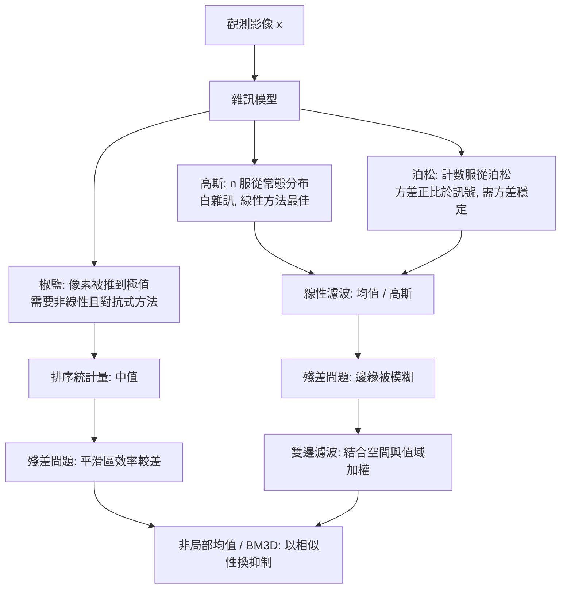

# 2.1 影像平滑與去噪：高斯、中值與雙邊濾波（1980-1998）

---

## 2.1.1 本節導覽：去噪為什麼是第一個值得認真做的問題

在第 1 章我們把影像變成一堆數字、把頻域工具交到手上。但「有一堆數字」與「數字裡面有資訊」之間還隔著一層雜訊。感光元件的讀出電子會產生熱雜訊，光子的隨機到達會產生散粒雜訊，數位傳輸會產生位元翻轉。任何直接建立在像素上的演算法——邊緣偵測（第 2.2 節）、角點偵測（第 2.3 節）、分割（第 5 章）——都會把這些雜訊一併放大成假的邊緣、假的角點、假的區塊。

因此去噪不是影像處理的前置雜務，而是第一個真正的「感知」問題：機器必須決定哪些像素變化是世界的真實結構，哪些是感測器的偶然。這個決定無法靠全域規則做出，因為答案取決於局部內容——一條邊界的兩側不一樣，但這不表示邊界本身是假的。

本節的主線是**歸納偏誤的逐步升級**：

* 均值濾波：假設「局部是常數」，所以把鄰域平均。這對白雜訊在線性意義上最佳，但對邊緣有偏。
* 高斯濾波：假設「局部是平滑且高斯化的」，用距離當權重。噪聲抑制更均勻，但同樣模糊邊緣。
* 中值濾波：假設「局部是常數，但用對抗式的統計量估計」，於是能對抗脈衝式破壞，卻在同分布雜訊下比均值差。
* 雙邊濾波：假設「局部同時是空間平滑且值域平滑」，於是把邊緣跨過。

每一個濾波器都在解決前一代的哪一個破綻，而每一個也都留下新的破綻。讀完本節，讀者應該能回答一個面試官很愛問的問題：「如果只給你一個濾波器，你選哪一個？」——正確答案是「取決於雜訊模型與影像內容」，而本節的表格就是為了讓這個答案有依據。

---

---

## 2.1.2 雜訊模型：一切的起點

「去噪」這個詞本身沒有意義，除非先知道雜訊是什麼樣子。雜訊模型決定了什麼叫「好結果」，也決定了什麼濾波器會有效。以下三個模型涵蓋了絕大多數實際影像。

### 高斯雜訊（熱雜訊、讀出雜訊）

電子元件在有限溫度下的熱擾動，以及感測器的讀出放大器雜訊，都近似為零均值常態分布。若影像原值為 $ s $，觀測值為

$$
x = s + n, \qquad n \sim \mathcal{N}(0, \sigma_n^2)
$$

其機率密度為

$$
p(n) = \frac{1}{\sqrt{2\pi}\,\sigma_n} \exp\left(-\frac{n^2}{2\sigma_n^2}\right)
$$

這個模型的重要性在於**它的解碼最優性是線性的**：在高斯雜訊下，任何線性估計器的均方誤差（MSE）最小化問題都有閉式解，而且可以獨立分解成「偏差」與「變異」兩項。整個 2.1 節的推導都建立在這個便利性上。

### 泊松雜訊（散粒雜訊）

光子在感光元件上的到達是隨機的。若某像素在曝光時間內平均收到 $ \lambda $ 個光子，實際計數 $ N $ 服從泊松分布：

$$
N \sim \mathrm{Poisson}(\lambda), \qquad \mathbb{E}[N] = \lambda, \qquad \mathrm{Var}[N] = \lambda
$$

這個模型有一個極其反直覺但極其重要的性質：**雜訊的絕對標準差與訊號強度成正比**。相對雜訊（訊噪比）因此為

$$
\mathrm{SNR} = \frac{\lambda^2}{\lambda} = \lambda, \qquad \mathrm{SNR}_{\mathrm{dB}} = 10 \log_{10} \lambda
$$

也就是說訊號越亮，相對雜訊越小。這直接導致一個實務陷阱：**在原始強度域做線性平滑，會系統性地過度抑制暗部、過度保留亮部**。標準的解法是方差穩定變換（variance-stabilizing transform），對泊松資料取平方根變換即可把方差壓成近似常數（Anscombe 變換）：

$$
x' = 2\sqrt{x + 3/8}
$$

變換後方差約為 $ 1/4 $ 的高斯，最後再反變換回來。

### 椒鹽雜訊（脈衝雜訊）

位元翻轉、壞點（bad pixel）、資料傳輸誤碼會產生個別像素被完全推到極值的現象。這類雜訊不遵循任何平滑的機率分布，其「機率密度」是離散的：像素以機率 $ p $ 變成 $ 0 $（胡椒）或 $ 255 $（鹽）。

椒鹽雜訊是三種模型中**最需要非線性方法**的一種。任何以加權平均為核心的線性濾波器都會把一個 255 的雜訊像素稀釋成周圍平均的 $ 1/9 $，於是雜訊變成了「一顆稍微亮的點」，視覺上仍然可見——這是雜訊的擴散（smearing），在某些量測（如面積、亮度總和）上比原始雜訊危害更大。

### 三種模型的行為對照



| 屬性 | 高斯 | 泊松 | 椒鹽 |
| --- | --- | --- | --- |
| 典型來源 | 熱雜訊、讀出放大器 | 光子到達、散粒雜訊 | 位元翻轉、壞點 |
| 分布特徵 | 連續、對稱 | 離散計數、右偏 | 兩點式、稀疏 |
| 噪聲標準差 | 與訊號無關 | 正比於訊號平方根 | 極大 |
| 線性濾波適用性 | 佳 | 需方差穩定 | 差 |
| 非線性適用性 | 可但無優勢 | 可但無優勢 | 佳 |
| 最佳對策 | 高斯濾波、BM3D | Anscombe + 高斯、BM3D | 中值、順序統計量 |

**常見誤解**：很多教材只教「加雜訊 → 高斯雜訊 → 高斯濾波」，於是讀者以為去噪就是模糊。實際上高斯雜訊只是最容易生成的模型，用來示範用的模型不代表真實世界。真實世界的數位相機在低光下主要是泊松，在高光飽和與長曝光下是讀出雜訊，而社群照片則大量摻雜壓縮偽影（8x8 區塊 DCT 係數被量化），那既不是高斯也不是椒鹽。

---

---

## 2.1.3 線性濾波的本質：加權平均

### 卷積的定義

空間域濾波的基本形式是二維卷積。令 $ x(m, n) $ 為輸入影像，$ h(m, n) $ 為濾波核（權重），則

$$
y(m, n) = \sum_{i} \sum_{j} h(i, j)\, x(m - i, n - j) = (h * x)(m, n)
$$

這個式子的關鍵性質是**線性**與**平移不變**：輸出是輸入的線性函數，且同一套權重套用在影像的每一個位置。線性帶來可分析性（可以在頻域做同樣的事，第 1.3 節），也帶來一個限制：**線性濾波無法區分「邊緣」與「雜訊」**，因為它只看權重，不看像素之間的內容關係。

第 1.3 節已經說明過，空間域卷積與頻域乘法是等價的：

$$
\mathcal{F}\{h * x\} = H(u, v)\, X(u, v)
$$

因此「濾波器的設計」等價於「設計它的頻域響應」。這是理解接下來每一種濾波器優缺點的統一語言。

### 均值濾波對高斯雜訊的最小均方最佳性（推導）

我們來證明一個具體的定理，它是所有線性濾波器理論的原型。

**假設**：在 $ (2k+1) \times (2k+1) $ 的窗口內，訊號 $ s $ 近似為常數；雜訊 $ n_i $ 為獨立同分布的零均值高斯，標準差 $ \sigma_n $。觀測為 $ x_i = s + n_i $。

**估計器**：任意線性估計器 $ \hat{y} = \sum_{i=1}^{N} w_i x_i $，其中 $ N = (2k+1)^2 $。

**無偏性**：要求 $ \mathbb{E}[\hat{y}] = s $，由 $ \mathbb{E}[x_i] = s $ 得

$$
\sum_{i=1}^{N} w_i = 1
$$

**均方誤差**：因為雜訊獨立且零均值，

$$
\mathbb{E}\left[(\hat{y} - s)^2\right] = \mathbb{E}\left[\left(\sum_i w_i n_i\right)^2\right] = \sum_i \sum_j w_i w_j \mathbb{E}[n_i n_j] = \sigma_n^2 \sum_{i=1}^{N} w_i^2
$$

**最佳化**：在線性約束 $ \sum w_i = 1 $ 下最小化 $ \sum w_i^2 $。用拉格朗日乘子法，設 $ L = \sum_i w_i^2 - 2\lambda\left(\sum_i w_i - 1\right) $，對每個 $ w_i $ 取偏導得

$$
2 w_i = 2\lambda \quad \Rightarrow \quad w_1 = w_2 = \cdots = w_N = \frac{1}{N}
$$

**結論**：對高斯白雜訊與局部常數訊號，最佳的**線性無偏**估計器就是均值濾波（box filter），其輸出變異數為

$$
\mathrm{Var}[\hat{y}] = \frac{\sigma_n^2}{N} \qquad \left( = \frac{\sigma_n^2}{(2k+1)^2} \right)
$$

這個推導的重要性不在於結論，而在於它**暴露了線性濾波的天花板**：我們是在「線性 + 無偏 + 局部常數」三重限制下取最佳。若放寬其中一條，就會得到更好的方法。中值濾波放寬了「線性」，雙邊濾波放寬了「局部常數」，後續章節的深度學習則一次放寬了全部三條。

### 為什麼均值濾波會模糊邊緣：偏差項

上述推導把雜訊造成的**變異**完全消除了，卻留下了另一個誤差來源。實測上若訊號在窗口內不是常數，而是有梯度（例如邊界附近），則

$$
\mathbb{E}[\hat{y}] = \bar{s} = \frac{1}{N}\sum_i s_i \neq s
$$

估計器的偏差為 $ \bar{s} - s $，於是總均方誤差分解為

$$
\mathrm{MSE} = \underbrace{\sigma_n^2 \sum_i w_i^2}_{\mathrm{Var}} + \underbrace{\mathrm{Bias}(\hat{y}, s)^2}_{\mathrm{Bias}^2}
$$

其中第一項是變異項（濾得越重越小），第二項是偏差項（濾得越重越大）。

這就是所有平滑方法的根本取捨。邊緣處偏差項急遽上升，結果就是邊緣被「拉平」、對比度被壓縮、角點被圓化。第 2.3 節會看到，這個偏差正是角點偵測器（如 Harris、SIFT 的 DoG）刻意**製造**的——他們要的正是「邊緣位置的二階響應」，而不是邊緣本身。

### 均值濾波的頻域響應：sinc 與旁瓣振盪

由第 1.3 節，長度為 $ N $ 的一維 box filter 的頻域響應為

$$
H(f) = \frac{1}{N}\sum_{n=0}^{N-1} e^{-j2\pi f n} = \frac{\sin(\pi N f)}{N \sin(\pi f)} = \mathrm{sinc}(N f)
$$

其中 $ \mathrm{sinc}(u) = \sin(\pi u)/(\pi u) $。二維情形是兩個 sinc 的乘積。

這個響應有兩個特徵：

1. **第一個零點**在 $ f = 1/N $。低於此頻率的部分被保留，高於此的部分被衰減，但衰減**並不乾淨**。
2. **旁瓣（sidelobe）以 $ 1/f $ 的速度緩慢衰減**，第一旁瓣約為 $ -13 $ dB。相較之下，高斯濾波器的頻域響應本身就是高斯形狀，衰減速度為 $ \exp(-2\pi^2\sigma^2 f^2) $，是超指數的。

因此 box filter 的兩個實際後果是：

* **高頻殘留**：高於截止頻率的雜訊只是被衰減而未被移除，因為響應在零點之間會回升。
* **振盪（ringing）**：sinc 的振盪對應空間域中的負權重，在邊界附近會產生亮暗交替的假影（Gibbs 現象）。這是純線性、無約束濾波器的通病。

這也是為什麼 1980 年之後高斯濾波幾乎完全取代了均值濾波——不是因為它更簡單（其實 2D 高斯不可分離，更難算），而是因為它在**頻域上是單調、單一參數**的形狀，工程可控性遠勝於 sinc。

---

---

## 2.1.4 高斯濾波

### 二維高斯核

二維高斯函數定義為

$$
G_\sigma(x, y) = \frac{1}{2\pi\sigma^2} \exp\left(-\frac{x^2 + y^2}{2\sigma^2}\right)
$$

它在兩個方向上都是常態分布，其性質非常適合用來做平滑：

* 非負且總和為 1（常態分布的正規化性質），因此常值影像經過濾波後維持不變（亮度平移不變性）。
* 單峰、對稱、單調遞減，沒有負權重，因此不會產生振盪。
* 頻域響應同為高斯，即濾波器在空間域與頻域域都是「單一寬度的 bell 形」，尺度參數 $ \sigma $ 具有直觀意義。

實際實作時會把核正規化使總和為 1：

$$
h(x, y) = \frac{1}{2\pi\sigma^2}\exp\left(-\frac{x^2+y^2}{2\sigma^2}\right), \qquad \sum_{x,y} h(x, y) = 1
$$

$ \sigma $ 的直觀意義：$ \sigma $ 是標準差，也就是高斯權重衰減到 $ e^{-1/2} \approx 0.61 $ 倍的距離。一個常用的經驗法則是取半徑 $ r = 3\sigma $（此時邊界權重降至 $ e^{-9/2} \approx 0.011 $），或直接令 $ r = \lceil 3\sigma \rceil $。

### 可分離性及其數學證明

二維高斯可以分解為兩個一維高斯的乘積：

$$
G_\sigma(x, y) = \underbrace{\frac{1}{\sqrt{2\pi}\sigma}\exp\left(-\frac{x^2}{2\sigma^2}\right)}_{g_\sigma(x)} \cdot \underbrace{\frac{1}{\sqrt{2\pi}\sigma}\exp\left(-\frac{y^2}{2\sigma^2}\right)}_{g_\sigma(y)}
$$

而二維卷積有標準的可分離性定理：若 $ h = h_1 \otimes h_2 $，則對任意 $ x $，

$$
(h * x) = (h_1 * h_2 * x) = \bigl((h_1 * x) \ast (h_2 * x)\bigr)
$$

更精確地說，若 $ h(x,y) = a(x)b(y) $，則

$$
(h * x)(m, n) = \sum_i \sum_j a(i) b(j) x(m-i, n-j) = \sum_i a(i) \left( \sum_j b(j) x(m-i, n-j) \right)
$$

令 $ v(m, n) = \sum_j b(j) x(m - i, n - j) $，內層括號與 $ i $ 無關，故

$$
(h * x)(m, n) = \sum_i a(i)\, v(m, n)
$$

這正是「先以 $ b $ 沿列做水平卷積，再以 $ a $ 沿行做垂直卷積」。

**複雜度的改變**：若窗口半徑為 $ r $（邊長 $ 2r+1 = K $），二維直接卷積每像素需要 $ K^2 $ 次乘加；可分離後只需要 $ 2K $ 次。當 $ K = 7 $ 時是 49 次對 14 次，約 3.5 倍；當 $ K = 31 $ 時是 961 次對 62 次，超過 15 倍。若視訊解析度為 1080p，兩者在純 Python 迴圈下的差距更是數量級之別。

這是影像處理史上第一個「因為數學結構而讓演算法從不可用變成可用」的例子：2D 高斯核的計算量是 $ O(N^2) $ 讓它在 1980 年代不實用，可分離性把它降到 $ O(N) $，才讓高斯金字塔（DoG，SIFT 的基礎，第 2.3 節）與多解析度處理成為可能。

### 邊界處理：replicate、reflect 與 constant

卷積在影像邊界需要處理 $ h $ 超出範圍的部分，常見四種策略：

| 方式 | 定義 | 效果 |
| --- | --- | --- |
| replicate (clamp) | 邊界像素的值向外延伸 | 影像邊界變成階梯狀高光，等效於邊界處的邊緣 |
| reflect (mirror) | $ x(-1, y) = x(1, y) $，不重複邊界像素 | 邊界梯度變為 0，視覺上最自然 |
| reflect101 | $ x(-1, y) = x(0, y) $ | 同上但連續性更好，OpenCV 預設 |
| constant (zero) | 補 0 | 邊框變暗，是最常見的假影來源 |

**為什麼邊界處理會影響濾波結果？** 這個問題在 2.2 節的邊緣偵測會變得尖銳：邊緣偵測是**線性運算後的差分**，任何邊界的亮度階梯（例如 replicate 造成的階梯）在差分後都會產生一條假的強邊緣。

具體而言：

* **constant 補零**會讓影像最外圈變暗，與內部的亮度差在 Sobel 響應中形成一圈「邊框邊緣」。修正方法是在卷積前先複製邊緣數像素，或在卷積後把邊框數值設回原值（padding 裁切）。
* **replicate**會把邊界變成「同一值連續延伸」，在水平方向形成階梯，垂直方向的 Sobel 會在左右兩側偵測到直線邊緣。
* **reflect** 把邊界梯度歸零，是最不容易產生假邊緣的選擇，因此在需要後續做邊緣偵測的流程中應優先採用。

實務上 OpenCV 的 `filter2D` 預設邊界為 `BORDER_DEFAULT`（即 reflect101），`GaussianBlur` 亦同。

---

---

## 2.1.5 中值濾波：排序統計量與對抗式的估計

### 定義與性質

中值濾波取窗口內所有像素值排序後的中間值作為輸出（偶數個時取中間兩者的平均）：

$$
y(m, n) = \mathrm{median}\left\{ x(m + i, n + j) \;\middle|\; (i,j) \in \mathcal{W} \right\}
$$

它不是線性濾波器：$ \mathrm{median}(a x_1 + b x_2) \neq a\,\mathrm{median}(x_1) + b\,\mathrm{median}(x_2) $。這正是它能對抗脈衝式破壞的原因。

統計學上，中值是**順序統計量（order statistic）**，屬於 L-statistic 族。它具有高達 50% 的**崩潰點（breakdown point）**：當超過一半的樣本被任意破壞時，中值仍可能不受影響。相較之下，均值的崩潰點是 0——一個被推到極值的像素就能把均值拉走。

### 對椒鹽雜訊的卓越效果

假設椒鹽雜訊比例為 $ p $，窗口大小 $ N $（例如 3x3 時 $ N = 9 $）。中值輸出被污染，需要窗口內**超過一半**（至少 5 個）的像素都是脈衝雜訊：

$$
P_{\text{fail}} = \sum_{k=\lceil N/2 \rceil}^{N} \binom{N}{k} p^k (1-p)^{N-k}
$$

取 $ N = 9 $、$ p = 0.01 $，可得

$$
P_{\text{fail}} \approx \binom{9}{5}(0.01)^5 = 126 \times 10^{-10} \approx 1.3 \times 10^{-8}
$$

也就是說中值濾波對 1% 的椒鹽雜訊幾乎完全免疫。而對同一個噪聲情境，均值濾波會把每個脈衝像素稀釋成周圍平均值的九分之一，並在視覺上留下可辨識的灰色斑點（因為中值本身被少數極值拉走不算多，但均值會被拉走 1/9）。

**常見誤解**：「中值濾波是去雜訊的萬用藥」。這只在脈衝型雜訊成立。實驗上對高斯雜訊，中值濾波的 PSNR 會**低於**高斯濾波。

### 為什麼中值對高斯雜訊反而較差

對常態分布母體，樣本中位數的漸近變異數為

$$
\mathrm{Var}[\tilde{x}] = \frac{1}{4 n f(m)^2}, \qquad f(m) = \frac{1}{\sqrt{2\pi}\sigma_n}
$$

代入得

$$
\mathrm{Var}[\tilde{x}] = \frac{2\pi \sigma_n^2}{4n} = \frac{\pi}{2}\cdot\frac{\sigma_n^2}{n} \approx 1.571 \cdot \frac{\sigma_n^2}{n}
$$

而均值濾波的輸出變異數是 $ \sigma_n^2 / n $。因此

$$
\frac{\mathrm{Var}[\mathrm{median}]}{\mathrm{Var}[\mathrm{mean}]} = \frac{\pi}{2} \approx 1.571
$$

左邊是中值輸出變異數與均值輸出變異數的比值。

**中值濾波對高斯雜訊的效率比均值濾波差約 57%**。原因很直觀：中值把資訊「丟掉」了——它只用中間那一半的樣本估計位置，而均值用了全部樣本（在高斯下這是有效率估計量的最佳選擇）。

這給出一個更一般的統計學事實：**沒有免費的午餐**。中值的優點來自它的對抗性（不對极端值敏感），代價是它丟棄了資訊；均值在同分布假設下有效率，代價是對離群值毫無防禦。

### 「邊緣保持」的直覺與其侷限

中值濾波在邊緣處表現優異的原因是：邊緣像素的少數（在一個跨越邊界的窗口中，邊緣兩側的像素各佔一部分），中值會落在**較大那一側的數值**上，而不是像均值那樣落在兩側的中間。因此邊緣不會被拉過去，邊界只是被「整齊地」保留下來。

但這個機制有嚴格前提：窗口內的**少數派必須是真正的少數**。若邊緣很寬（低對比、漸層過渡）或邊緣附近有紋理，中值會把紋理本身抹掉或產生「階梯狀」假影。這是所謂的「中值失效（median breakdown）」：在細密紋理區，中值濾波會把紋理判為雜訊並去除。

### 二維中值的代價與近似

二維中值需要對 $ K^2 $ 個元素排序，朴素實作複雜度為

$$
O\left(K^2 \log K^2\right) = O(K^2 \log K)
$$

當 $ K = 7 $ 時是 49 個元素排序；當 $ K = 21 $ 時是 441 個。相較之下，同尺寸的高斯濾波只需 $ O(K) $。

歷史上的解法：

* **Huang (1979)**：可分離近似——先對每一行取中值，再對每一列取中值。計算量降到 $ O(K^2) $，且實驗上與真正二維中值差異很小。代價是它不再是真正的中值，數學性質不再乾淨。
* **Perreault & Hébert (1993)**：常數時間演算法，用柱狀圖（histogram）維護中值，把每像素成本降到與窗口大小無關。
* **實務**：OpenCV 的 `cv2.medianBlur` 對 8-bit 影像用基於直方圖的方法，在小窗口下接近 $ O(1) $；`scipy.ndimage.median_filter` 使用插入排序的直方圖優化。

這條「代價驅動技術演進」的路線會在第 2.3 節重現：**局部特徵的偵測也需要在多個尺度上做類似運算，因此同樣面臨複雜度與偵測品質的取捨，而尺度空間的設計正是解方。**

---

---

## 2.1.6 雙邊濾波（1998, Tomasi & Manduchi）

### 定義

雙邊濾波的核心想法是：既然高斯濾波之所以模糊邊緣，是因為它對「位置鄰近」的像素一律給予高權重，而跨過邊界的像素雖然位置相近，值卻差很多——那麼就**同時用空間距離與值域差異來決定權重**。

Tomasi 與 Manduchi（ICCV 1998）定義

$$
y(i) = \frac{\sum_{j \in \Omega} w(i, j)\, x(j)}{\sum_{j \in \Omega} w(i, j)}
$$

其中權重是兩個高斯的乘積：

$$
w(i, j) = \underbrace{\exp\left(-\frac{\|p_i - p_j\|^2}{2\sigma_s^2}\right)}_{\mathrm{Spatial}} \cdot \underbrace{\exp\left(-\frac{\|I_i - I_j\|^2}{2\sigma_r^2}\right)}_{\mathrm{Range}}
$$

第一個因子是空間域高斯（由位置的接近程度決定權重），第二個因子是值域高斯（由灰階的相似程度決定權重）。

這裡 $ p_i $ 是像素的空間座標，$ I_i $ 是其強度（彩色影像時 $ \|I_i - I_j\| $ 取 RGB 或 CIELab 空間的歐氏距離）。$ \sigma_s $ 控制空間影響範圍，$ \sigma_r $ 控制允許多大的強度差異被視為「同一個區域」。

### 邊緣保持的機制

關鍵在於值域項的**選擇性抑制**。考慮一個跨越邊界的窗口：

* 邊界**同側**的像素：$ \|I_i - I_j\| $ 很小，值域權重接近 1，於是這些像素被正常平均。
* 邊界**異側**的像素：$ \|I_i - I_j\| $ 很大（若 $ \sigma_r $ 選得比對比差小），值域權重趨近 0，等同於被排除在平均之外。

結果是邊界兩側各自被獨立平滑，邊界位置不移動。這是「用內容自適應的權重取代固定的權重」，第一次讓平滑操作**知道自己在處理邊界**。

### 雙邊 vs 高斯：一張表看清差異

假設一個 5x5 窗口跨越一條對比度為 100 的邊界，$ \sigma_s = 1.5 $、$ \sigma_r = 50 $：

| 性質 | 高斯濾波 | 雙邊濾波 |
| --- | --- | --- |
| 邊界對側像素的權重 | 非零且平滑衰減（約 0.1 至 0.4） | 極小（$ e^{-2} $ 量級以下） |
| 邊界處的輸出 | 邊界被模糊，梯度最大值下降 | 邊界梯度基本保留 |
| 平坦區的行為 | 與雙邊幾乎相同 | 與雙邊幾乎相同 |
| 對椒鹽雜訊 | 無防禦（會擴散） | 部分防禦（值域項排除極端值） |
| 對高斯雜訊 | 高效 | 相當，但 $ \sigma_r $ 需配合 $ \sigma_n $ 調 |
| 是否線性 | 是 | 否 |
| 參數 | 一個 | 兩個，且互相耦合 |

### 參數 $ \sigma_r $ 的設定與失敗模式

$ \sigma_r $ 的選擇是雙邊濾波實用化的關卡。經驗法則：

$$
\sigma_r \approx 1.5 \sim 2.0 \times \sigma_n
$$

其中 $ \sigma_n $ 為雜訊標準差。若 $ \sigma_r $ 遠大於 $ \sigma_n $，值域項幾乎不起作用，退化為高斯濾波，邊緣被模糊；若 $ \sigma_r \ll \sigma_n $，值域項連同側的像素也被排除，輸出趨近於原始像素（不變），等於沒有濾波。**若 $ \sigma_n $ 未知，雙邊濾波在實務上就難以使用**——這是一個實際的限制，也是後續 BM3D 要解決的問題。

另一個常見失敗模式是**階梯邊界（staircase artifacts）**：在梯度平緩的斜面上，因為值域差的變化是連續的，某些位置會出現階梯狀的輸出。

### 計算複雜度與加速

朴素雙邊濾波的複雜度為每像素 $ O(K^2) $（$ K $ 為窗口邊長），比高斯濾波貴一個數量級。加速方法：

* **Perona & Malik (1998)**：以三次樣條近似值域高斯，把雙邊運算改寫成小波域的稀疏計算（$ O(N) $）。
* **Durand & Dorsey (2002)**：Fast Bilateral Filtering——把值域項近似為分段線性，結合下採樣、對數域處理與三線性插值（trilinear splatting），達到近似即時。
* **OpenCV**：`cv2.bilateralFilter` 對大 $ \sigma_r $ 以查表近似高斯，$ \sigma_r $ 小時逐像素計算。

### 血緣：非局部均值與 BM3D

雙邊濾波開啟了一條至今仍主導影像去噪的路線：**以「相似性」換取「雜訊抑制」**。後續兩篇代表性論文是：

* **Non-Local Means（Buades, Coll, Morel, CVPR 2005）**：把雙邊濾波的「單像素比較」升級為「**區塊比較**」。對每個像素 $ i $，在搜尋窗內找出與其鄰域區塊 $ N_i $ 相似的所有區塊 $ N_j $，以區塊距離作為權重：

  $$
  w(i, j) = \exp\left(-\frac{\|N_i - N_j\|_2^2}{h^2}\right), \qquad y(i) = \frac{1}{C(i)}\sum_j w(i, j) x(j)
  $$

  直覺是：真正的噪聲是隨機的，因此某個像素的「多個相似鄰域的平均」比單一鄰域的平均更乾淨；同時真正的結構在多處重複出現，所以平均不會抹掉它。

* **BM3D（Dabov, Foi, Katkovnik, et al., TIP 2007）**：把「相似性分組」推到了極致，成為 2007 至 2020 年代間最好的通用去噪方法之一。兩階段：
  1. **硬閾值 + 協同過濾**：在每個區塊的稀疏 DCT 域上做硬閾值，把相似的區塊堆疊成三維群組，利用群組內的秩結構做 Wiener 式的協同過濾。
  2. **非局部均值 + Wiener 濾波**：在維納域上再做一次非局部均值處理。

  BM3D 的效果極佳，PSNR 常比最好的傳統方法高 0.5 至 1 dB，並曾獲得 2012 年 denoising 挑戰賽的三項冠軍。

這條血脈的意義在於**問題的重構**：去噪不再是「對每個像素獨立地猜原值」，而是「在整體結構中尋找冗餘，利用冗餘抑制隨機性」。這正是深度學習在 2010 年代後重新發掘的思路——用網路去學會估計「給定 noisy patch，clean patch 是什麼」。

### 伏筆：去噪是低階視覺的終點，卻是高階任務的起點

去噪長期被視為「低階視覺的清理工作」，但 2010 年後它的角色反轉了：

1. **去噪結果作為分類的輸入**：在 ImageNet 競賽期間，有研究把 BM3D 去噪後的影像拿去訓練分類器，發現在刻意加入的嚴重雜訊下，去噪預處理能提升分類準確率。這開啟了「先學一個低階重建，再學高階語義」的分層思路。
2. **去噪作為自監督學習任務（Noise2Void, 2018）**：既然沒辦法拿到成對的 noisy/clean 資料，可以讓網路學會「把單張 noisy 影像的雜訊移除」。訓練出的網路不只會去噪，其**特徵**對下游分類、分割、光流都更強。深度學習的特徵學習能力，就這樣從一個低階任務中長出來。
3. **去噪就是生成**：2020 年代的擴散模型（DDPM, DDIM）證明，若把去噪過程反向走，就得到一個生成模型。第 7 章會詳述這個「去噪即生成」的等價性。

換句話說，2.1 節談的這些手工濾波器，在 2020 年代被一個「學出來的去噪器」徹底取代；但它們建立的問題意識——**什麼是雜訊？什麼是訊號？如何用冗餘抑制隨機性**——至今仍是深度影像處理的骨架。

---

---

## 2.1.7 各濾波器的選擇性比較

| 濾波器 | 類型 | 對高斯雜訊 | 對椒鹽雜訊 | 對泊松雜訊 | 邊緣保持 | 可分離 | 主要參數 |
| --- | --- | --- | --- | --- | --- | --- | --- |
| 均值 (box) | 線性 | 中（MMSE 最優但需權重非負且局部常數） | 差（擴散） | 中 | 差 | 是 | 窗口大小 |
| 高斯 | 線性 | 佳 | 差 | 佳（需方差穩定） | 差 | 是 | $ \sigma $ |
| 中值 | 非線性 | 差（效率比均值差 57%） | 極佳 | 中 | 中（細紋理會失效） | 否（可近似） | 窗口大小 |
| 雙邊 | 非線性 | 佳 | 中 | 中 | 佳 | 否 | $ \sigma_s, \sigma_r $ |
| 非局部均值 | 非線性 | 佳 | 差 | 佳 | 佳 | 否 | 搜尋窗、半徑、$ h $ |
| BM3D | 非線性 | 極佳 | 差 | 極佳 | 佳 | 否 | 區塊大小、$ \sigma_n $、閾值 |

**選擇原則（速查）**：

* 已知雜訊是高斯、且後續要做微分類運算（邊緣、梯度）→ **高斯濾波**，$ \sigma $ 取 1 到 1.5。
* 已知有椒鹽雜訊、壞點 → **中值濾波**，3x3 通常足夠；也可先用中值粗去椒鹽，再用高斯細修。
* 已知邊緣細節重要（醫學影像、遙測、紋理分析）→ **雙邊濾波**，$ \sigma_r $ 由 $ \sigma_n $ 推估。
* 追求最高品質、可以接受慢 → **BM3D**（或後續的深度去噪網路）。
* 邊緣細節重要 **且** 有椒鹽 → 先中值後雙邊。

---

---

## 2.1.8 實作：以 numpy / OpenCV 為例

### 濾波器實作與 PSNR 量化

```python
import numpy as np
import cv2


def add_gaussian_noise(img, sigma=15.0, rng=None):
    rng = rng or np.random.default_rng(0)
    noise = rng.normal(0.0, sigma, img.shape)
    return np.clip(img.astype(np.float64) + noise, 0, 255).astype(np.uint8)


def add_salt_pepper_noise(img, amount=0.05, rng=None):
    rng = rng or np.random.default_rng(0)
    out = img.copy()
    mask = rng.random(img.shape[:2])
    out[mask < amount / 2] = 0
    out[mask > 1 - amount / 2] = 255
    return out


def psnr(a, b):
    mse = np.mean((a.astype(np.float64) - b.astype(np.float64)) ** 2)
    if mse == 0:
        return float("inf")
    return 10.0 * np.log10(255.0 ** 2 / mse)


def ssim(a, b):
    """全域 SSIM（以高斯視窗平均的簡化版），僅供教學比較。"""
    C1, C2 = (0.01 * 255) ** 2, (0.03 * 255) ** 2
    mu_a = cv2.GaussianBlur(a, (11, 11), 1.5)
    mu_b = cv2.GaussianBlur(b, (11, 11), 1.5)
    sa = cv2.GaussianBlur(a * a, (11, 11), 1.5) - mu_a ** 2
    sb = cv2.GaussianBlur(b * b, (11, 11), 1.5) - mu_b ** 2
    sab = cv2.GaussianBlur(a * b, (11, 11), 1.5) - mu_a * mu_b
    num = (2 * mu_a * mu_b + C1) * (2 * sab + C2)
    den = (mu_a ** 2 + mu_b ** 2 + C1) * (sa + sb + C2)
    return float(np.mean(num / den))
```

### 從零實作高斯濾波與可分離性驗證

```python
def gaussian_kernel1d(sigma, radius=None):
    radius = radius or int(np.ceil(3 * sigma))
    x = np.arange(-radius, radius + 1, dtype=np.float64)
    k = np.exp(-(x ** 2) / (2 * sigma ** 2))
    return k / k.sum()


def gaussian_kernel2d(sigma, radius=None):
    k1 = gaussian_kernel1d(sigma, radius)
    return np.outer(k1, k1)


def convolve2d(img, kernel):
    """以 scipy 之外的簡單實作為例；正式程式請用 cv2.filter2D。"""
    from numpy.lib.stride_tricks import sliding_window_view
    r = kernel.shape[0] // 2
    pad = np.pad(img.astype(np.float64), r, mode="reflect")
    windows = sliding_window_view(pad, kernel.shape)
    return np.einsum("ijkl,kl->ij", windows, kernel)


img = cv2.imread("lena.png", cv2.IMREAD_GRAYSCALE)
sigma = 1.5
k2d = gaussian_kernel2d(sigma)
k1d = gaussian_kernel1d(sigma)

# 直接二維卷積 vs 兩次一維卷積，理論上應完全相同
direct = convolve2d(img, k2d)
sep = convolve2d(convolve2d(img, np.diag(k1d).reshape(-1, 1).T @ np.diag(k1d)),
                 np.diag(k1d).reshape(-1, 1))
print("separable max error:", np.abs(direct - sep).max())
```

（實務上建議直接使用 `cv2.GaussianBlur`，它內部以分離式高斯實現，並支援邊界模式。）

### 各種濾波器的效果對比實驗

```python
rng = np.random.default_rng(42)
clean = cv2.imread("lena.png", cv2.IMREAD_GRAYSCALE)

noisy_gauss = add_gaussian_noise(clean, sigma=15.0, rng=rng)
noisy_sp = add_salt_pepper_noise(clean, amount=0.05, rng=rng)

filters = {
    "box_5x5": lambda im: cv2.blur(im, (5, 5)),
    "gauss_s1.5": lambda im: cv2.GaussianBlur(im, (0, 0), 1.5),
    "gauss_s3.0": lambda im: cv2.GaussianBlur(im, (0, 0), 3.0),
    "median_3x3": lambda im: cv2.medianBlur(im, 3),
    "median_5x5": lambda im: cv2.medianBlur(im, 5),
    "bilateral": lambda im: cv2.bilateralFilter(im, 7, 60, 60),
    "nlm": lambda im: cv2.fastNlMeansDenoising(im, None, 15, 7, 21),
}

for name, fn in filters.items():
    out_gauss = fn(noisy_gauss)
    out_sp = fn(noisy_sp)
    print(f"{name:14s} PSNR(gauss)={psnr(clean, out_gauss):6.2f} "
          f"PSNR(sp)={psnr(clean, out_sp):6.2f} "
          f"SSIM(gauss)={ssim(clean, out_gauss):.4f}")
```

預期結果的規律（可用於教學時讓學生先猜再看程式輸出）：

* 高斯雜訊下，`gauss_s1.5` 的 PSNR 最高，`median_3x3` 明顯落後約 1 至 2 dB。
* 椒鹽雜訊下，`median_3x3` 遠勝其他方法（通常高 5 dB 以上）。
* `bilateral` 在 PSNR 上常不如最佳高斯參數，但在**邊緣區域**（用梯度幅值或 SSIM 的結構項衡量）明顯更好，這正是雙邊濾波的設計目標。
* `nlm`（OpenCV 的快速非局部均值）在高斯雜訊下通常優於雙邊濾波，因為它用區塊相似度取代了單像素相似度。

### 邊界處理對後續邊緣偵測的影響（銜接 2.2 節）

```python
img = cv2.imread("checkerboard.png", cv2.IMREAD_GRAYSCALE)
for mode, name in [(cv2.BORDER_CONSTANT, "constant"),
                   (cv2.BORDER_REPLICATE, "replicate"),
                   (cv2.BORDER_REFLECT_101, "reflect101")]:
    blurred = cv2.GaussianBlur(img, (0, 0), 1.0, borderType=mode)
    gx = cv2.Sobel(blurred, cv2.CV_32F, 1, 0, ksize=3)
    gy = cv2.Sobel(blurred, cv2.CV_32F, 0, 1, ksize=3)
    mag = cv2.magnitude(gx, gy)
    # 只看外圍 5 像素環帶的平均響應，用來量化邊框假影
    border = np.concatenate([
        mag[:5, :].ravel(), mag[-5:, :].ravel(),
        mag[:, :5].ravel(), mag[:, -5:].ravel()])
    inner = mag[10:-10, 10:-10].mean()
    print(f"{name:12s} border_mean={border.mean():8.2f} inner_mean={inner:8.2f}")
```

若 `border_mean` 明顯高於 `inner_mean`，表示邊界處理引入了假邊緣；`reflect101` 通常最小。這一組實驗直接把 2.1 節的內容接到 2.2 節。

---

---

## 2.1.9 本節小結與銜接

1. **雜訊模型先行**。高斯、泊松、椒鹽三個模型對應完全不同的最佳解；沒有雜訊模型，「最好的濾波器」是無意義的問題。
2. **均值濾波是線性無偏的最佳化極限**。我們用拉格朗日乘子法證明了這一點，同時也看清了它的天花板——線性、無偏、局部常數三個限制中的任何一個被放寬都會導向新方法。
3. **高斯濾波的勝利來自頻域的單調性**，而不是來自「更強的數學」；它的可分離性則是把研究想法變成可用系統的關鍵（$ O(N^2) \to O(N) $）。
4. **中值濾波用資訊損失換取對抗性**，在脈衝雜訊上無敵，在高斯雜訊上效率比均值差約 57%（$ \pi/2 $ 倍）。
5. **雙邊濾波開啟了「以相似性換抑制」的時代**，其血緣直通非局部均值與 BM3D，也直通 2020 年代的深度去噪與擴散模型。
6. **留下的問題**：所有這些濾波器都是**全域一致**的，它們不知道什麼是「物體」。於是第 2.2 節要問：能不能只關心那些「變化劇烈且有意義」的位置？

下一節我們進入邊緣偵測，會把本節的高斯平滑、Sobel 差分與 Marr-Hildreth 的尺度空間理論串起來，並首次引入「**多解析度**」這個在第 2.3 節會發揮核心作用的觀念。
