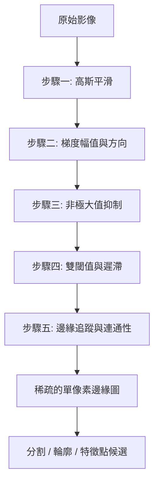
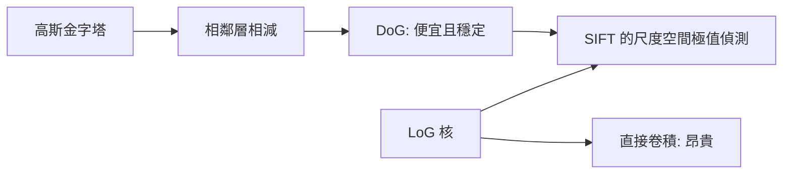
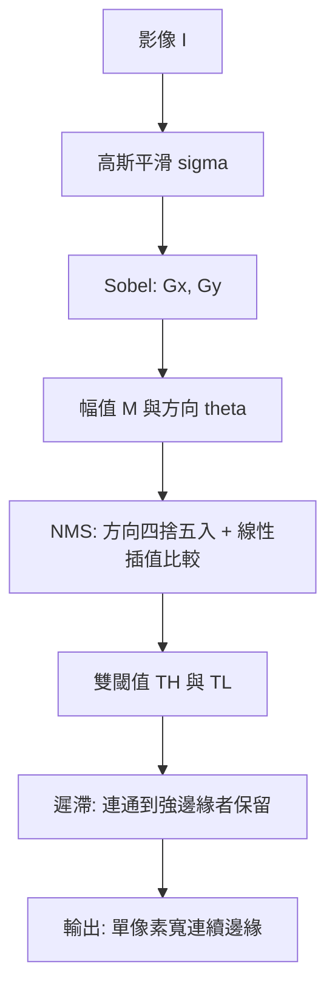

# 2.2 邊緣偵測：Sobel、Laplacian 與 Canny 算子（1968-1986）

---

## 2.2.1 為什麼要找邊緣

第 2.1 節我們把影像「抹平」，本節要做相反的事：**把變化劇烈的地方挑出來**。但挑出來之後呢？這是本節真正想回答的問題。

邊緣（edge）在影像分析中扮演三個角色：

1. **從像素到形狀的跳板**。一條邊界把影像分割成兩個區域，因此邊緣是分割（segmentation）問題的自然起點；第 1.3 節的譜系裡，分割方法正是從邊緣偵測演化而來。
2. **幾何資訊的載體**。邊緣的位置與方向包含了物體的形狀；由邊緣可以重建輪廓，進而做形狀分析（第 3 章的 HOG 正是把局部梯度統計化的產物）。
3. **幾何驗證的依據**。第 2.3 節的特徵匹配需要「兩張圖的對應點」，而邊緣是尋找對應點最直觀的來源——把兩張不同角度拍攝的建築照片的邊緣疊在一起，就能看出單應性矩陣。

但「邊緣」這個詞也隱藏著一個陷阱：**邊界不只來自物體，也來自雜訊、紋理、陰影、反射**。一塊磚牆有幾百條邊緣，一張人臉照片卻可能只有幾十條有意義的邊緣。因此邊緣偵測的真正難題不是「找出變化」，而是「**分辨哪些變化值得保留**」。Canny 演算法的全部設計，都是圍繞這個問題。

一個常見誤解是「邊緣偵測就是求梯度」。求梯度只是第一步。Canny 的五個步驟裡，有三個步驟（抑制、精細化、遲滯）都是為了處理「梯度大不等於是邊緣」這個問題。



---

---

## 2.2.2 梯度：定義、幅值與方向

### 影像的一階導數

對連續函數影像 $ I(x, y) $，梯度是偏導數組成的向量：

$$
\nabla I = \begin{bmatrix} \dfrac{\partial I}{\partial x} \\[6pt] \dfrac{\partial I}{\partial y} \end{bmatrix}
$$

梯度具有兩個關鍵性質：

1. **方向性**：$ \nabla I $ 指向 $ I $ 增長最快的方向，也就是**垂直於等值線（iso-intensity contour）**，因此垂直於邊界。
2. **大小**：$ \lVert \nabla I \rVert $ 度量變化速率，是「這裡有邊界嗎、邊界有多強」的量化。

常用的幅值定義有兩種：

$$
\lVert \nabla I \rVert = \sqrt{I_x^2 + I_y^2}, \qquad \lVert \nabla I \rVert \approx \lvert I_x \rvert + \lvert I_y \rvert
$$

第一種是歐氏長度（真實的變化率），第二種是曼哈頓距離（計算較快，是 Canny 原論文採用的近似）。兩者相差最多 $ \sqrt{2} $ 倍，在實務中影響不大。

方向由 $ \nabla I $ 的方向角給出：

$$
\theta = \operatorname{atan2}(I_y, I_x)
$$

### 邊緣有正反兩種梯度

這是初學者最常混淆的地方。一條從暗到亮的垂直邊界（例如物體的左輪廓），在物體內側梯度指向右（正的 $ I_x $），在物體外側梯度指向左（負的 $ I_x $）。也就是說**同一條邊界在像素網格上佔兩列**，兩列的梯度方向相差 180 度。

這帶來兩個實際問題：

* **邊緣位置有兩像素的模糊性**。哪一列才算「邊界」？這正是 Canny 的**非極大值抑制**要解決的問題——它把邊界收斂到單一像素寬，方法是在梯度的**垂直方向**上找局部極大值。
* **做方向統計時必須考慮循環性**。第 3.1 節的 HOG 方向直方圖把方向視為循環變數（0 度與 180 度是不同方向，但 359 度與 1 度幾乎相同），因此在累積時要做插值。第 2.3 節的 SIFT 描述子在把 36 個方向槽摺疊成 8 個時也要處理這個循環性。

### 離散化的取樣誤差

直接用中心差分近似偏導數會有 $ O(\Delta^2) $ 的截斷誤差，且對高頻雜訊非常敏感（相鄰像素相減，雜訊被放大 2 倍）。因此實務上一律先平滑再差分——這是下一節 Sobel 與 Prewitt 的出發點。

---

---

## 2.2.3 Sobel 與 Prewitt：平滑與差分的組合

### 為什麼要「先平滑再差分」

考慮最簡單的中心差分：

$$
I_x \approx \frac{I(x+1, y) - I(x-1, y)}{2}
$$

若影像含有獨立的高斯雜訊，輸出雜訊標準差為

$$
\sigma_{\text{out}} = \frac{\sigma_n}{\sqrt{2}}
$$

也就是雜訊被**放大**了（原本是 $ \sigma_n $，現在是 $ 0.707 \sigma_n $ 的信號衰減加上差分的放大）。更糟的是差分會把雜訊變成高頻成分，邊緣偵測正好要放大高頻。

解法是把平滑器與差分器**串聯**成一個核。對核做卷積，等價於先平滑再差分，也等價於對**平滑後影像的導數**做運算——這是線性系統的結合律的直接應用。

### Prewitt 與 Sobel 的核

**Prewitt 核（1968）**：

$$
G_x = \begin{bmatrix} -1 & 0 & 1 \\ -2 & 0 & 2 \\ -1 & 0 & 1 \end{bmatrix}, \qquad
G_y = \begin{bmatrix} -1 & -2 & -1 \\ 0 & 0 & 0 \\ 1 & 2 & 1 \end{bmatrix}
$$

**Sobel 核（1968, Irwin Sobel）**：

$$
G_x = \begin{bmatrix} -1 & 0 & 1 \\ -2 & 0 & 2 \\ -1 & 0 & 1 \end{bmatrix}, \qquad
G_y = \begin{bmatrix} -1 & -2 & -1 \\ 0 & 0 & 0 \\ 1 & 2 & 1 \end{bmatrix}
$$

兩者的差別只在平滑方向上的權重分配：Prewitt 用等權（1,1,1），Sobel 用二項式權重（1,2,1）。Sobel 的平滑效果較好，因此抗雜訊能力較強，是實務上的預設選擇。

### Sobel 的可分離性

Sobel 核可以分解為一維平滑核與一維差分核的外積：

$$
G_x = \underbrace{\begin{bmatrix} 1 \\ 2 \\ 1 \end{bmatrix}}_{\mathrm{Smooth}\;(y)} \cdot \underbrace{\begin{bmatrix} -1 & 0 & 1 \end{bmatrix}}_{\mathrm{Diff}\;(x)}, \qquad G_y = G_x^{\mathsf{T}}
$$

因此可以先做一維平滑再一維差分，每像素只需 $ 2 \times 3 \times 2 = 12 $ 次乘加，而非 18 次。OpenCV 的 `cv2.Sobel` 內部即利用此性質。

注意 $ G_y = G_x^{\mathsf{T}} $ 這個對稱性不是巧合，而是所有「等向性可分離核」的共同性質：對稱的平滑器搭配對稱的差分器，交換 $ x $ 與 $ y $ 就得到同樣的響應。

### Sobel 與高斯導數：尺度可調的邊緣偵測

這是本節最重要的一個連結。Sobel 核其實是**二維高斯偏導數 $ \partial G / \partial x $** 的離散近似。高斯函數的一階偏導為

$$
\frac{\partial G_\sigma}{\partial x} = -\frac{x}{\sigma^2} G_\sigma(x, y)
$$

它是一個「奇對稱」的 bell 形（左右異號、中間為零）。取 $ \sigma \approx 1 $ 並在 $ \{-1, 0, 1\} $ 上取樣再正規化，就得到 Sobel 核的形狀。

這個觀察帶來一個重要的**一般化**：把 Sobel 換成任意尺度的高斯導數，就得到尺度可調的邊緣偵測器：

$$
I_x = \frac{\partial G_\sigma}{\partial x} * I, \qquad I_y = \frac{\partial G_\sigma}{\partial y} * I
$$

$ \sigma $ 的意義：

| $ \sigma $ | 效果 |
| --- | --- |
| 小（0.5） | 只偵測細緻結構，對雜訊與紋理極敏感，邊緣位置偏細碎 |
| 中（1.0 - 1.5） | 標準取用，Canny 預設 |
| 大（2.0 以上） | 只留下粗壯結構，細節邊緣消失，但抗雜訊與輕微模糊的能力強 |

這就是「**多解析度邊緣偵測**」的雛形，也是第 2.3 節尺度空間理論的直接前身。邊緣偵測器的 $ \sigma $ 選擇，本質上是在問「我想看見多細的結構」。

**常見誤解**：「Sobel 是邊緣偵測，Laplacian 是邊緣偵測，所以可以互相替代。」不能。Sobel 是**一階導數**，給出的是「邊界在哪裡、往哪個方向、對比多強」；Laplacian 是**二階導數**，給出的是「邊界的中點在哪裡」（零交叉），對階梯邊界更精確，但對噪聲更敏感、且無法給出方向。

---

---

## 2.2.4 Laplacian 與 DoG：零交叉與尺度空間

### 二階導數與零交叉

Laplacian 算子為

$$
\nabla^2 I = \frac{\partial^2 I}{\partial x^2} + \frac{\partial^2 I}{\partial y^2}
$$

其離散近似常用的兩個版本：

$$
L_{4} = \begin{bmatrix} 0 & 1 & 0 \\ 1 & -4 & 1 \\ 0 & 1 & 0 \end{bmatrix}, \qquad
L_{8} = \begin{bmatrix} 1 & 1 & 1 \\ 1 & -8 & 1 \\ 1 & 1 & 1 \end{bmatrix}
$$

（$ L_8 $ 的四鄰角項是為了讓八方向等向；$ L_4 $ 只用四鄰居。）

對一個理想階梯邊界（過渡寬度為零），一階導數在邊界處是一個**尖峰**，二階導數則是兩個正負相鄰的**尖峰**，而 Laplacian 的響應在邊界**中點**穿過零。因此偵測邊界的規則變成：**找 Laplacian 響應的零交叉（zero crossing）**。

零交叉比「取最大值」更好，因為最大值的位置取決於邊界的過渡形狀（是對稱過渡還是拖尾過渡），而零交叉的物理意義更明確：它是灰階階梯的中點。

### Marr-Hildreth 與尺度空間理論（1980）

Marr 與 Hildreth 的論點是：**直接對雜訊影像求零交叉是不可靠的，必須先平滑。** 而且，平滑的程度不應是任意的——它應該由影像本身的內容決定。

「由內容決定平滑程度」的想法導致了**尺度空間理論**的核心命題：

> 在所有尺度上平滑過的影像所形成的函數族（尺度空間），其零交叉結構（即邊界的位置與型態）隨尺度的變化是連續且有規律的；邊界在特徵尺度（characteristic scale）上會從邊界「分裂」成兩條零交叉——一條在物體內、一條在物體外，中間夾著一個高斯隆起。

Marr-Hildreth 因此提出 **LoG（Laplacian of Gaussian）**：把高斯平滑與 Laplacian 結合為單一核

$$
\nabla^2 (G_\sigma * I) = (\nabla^2 G_\sigma) * I
$$

即「先平滑再看零交叉」。$ \sigma $ 就是我們選擇的尺度；LoG 核的形狀是一個「墨西哥帽」（正中央為負、外圍為正環）。

**Marr-Hildreth 的三個貢獻**：

1. **零交叉作為邊界偵測的原則**，並證明它是唯一對加性雜訊有合理響應的邊界偵測算子（在某個「平均」意義下）。
2. **尺度空間框架**：邊界偵測必須是多尺度的，尺度參數是演算法的一部分而不是超參數的細節。
3. **預測性編碼的雛形**：大腦視覺皮層的處理被比喻為「在不同尺度上建立影像的描述」，這是 1980 年代神經網路與視覺生理學交會的起點。

### DoG：LoG 的高效近似

直接計算 LoG 核的成本很高，且 LoG 本身是高斯對數的導數，數值上在遠處有振盪。Lowe（1999）在 SIFT 中指出：**高斯差分（Difference of Gaussians）** 是 LoG 的良好近似。

定義

$$
\mathrm{DoG}(x, y, \sigma) = G_{k\sigma}(x, y) - G_\sigma(x, y), \qquad k \approx 1.6
$$

兩者近似的理由來自高斯的尺度導數恆等式：

$$
\frac{\partial G_\sigma}{\partial \sigma} = \sigma \nabla^2 G_\sigma
$$

對尺度做有限差分：

$$
G_{k\sigma} - G_\sigma \approx (k-1)\sigma \frac{\partial G_\sigma}{\partial \sigma} = (k-1)\sigma^2 \nabla^2 G_\sigma
$$

也就是說 **DoG 就是尺度差分，而尺度差分正比於 Laplacian**。DoG 還有兩個額外好處：可以透過**高斯金字塔的相鄰層相減**來計算（等價於拉普拉斯金字塔，複雜度 $ O(N) $），以及數值上比 LoG 更穩定（LoG 在遠場有 $ 1/r^2 $ 的振盪尾巴）。

DoG 將在第 2.3 節成為 SIFT 尺度空間的基礎。



---

---

## 2.2.5 Canny 邊緣偵測（1986）

John Canny 在 1986 年的論文中提出三項判準，用來評價一個邊緣偵測器：

1. **正確性**：偵測到的邊界應與真實邊界相符，且不應有重複的回應（每條邊界只被報一次）。
2. **定位性**：偵測到的邊界位置應盡可能接近真實邊界。
3. **單邊性**：對一條邊界，反應應是單一的局部極大（而不是一串極大）。

這三項判準直接導出了 Canny 的演算法設計。

### 步驟一：高斯平滑

以 $ G_\sigma * I $ 平滑原影像，$ \sigma $ 通常取 1.0 到 1.5。理由是第 2.1 節的偏差—變異取捨：邊界偵測是差分運算，會放大雜訊，所以必須先以適當的平滑把雜訊壓到可接受水準。Canny 在論文裡明確指出，平滑是必要的，但過度平滑會破壞定位性——這是 $ \sigma $ 的主要意義。

### 步驟二：梯度幅值與方向

以 Sobel 核（或高斯導數核）計算 $ I_x $ 與 $ I_y $，然後

$$
M(x, y) = \sqrt{I_x(x, y)^2 + I_y(x, y)^2}
$$

或用曼哈頓近似 $ M = \lvert I_x \rvert + \lvert I_y \rvert $。方向為

$$
\theta(x, y) = \operatorname{atan2}(I_y(x, y), I_x(x, y))
$$

**重要實務細節**：直接對原始強度求梯度會使邊界偵測對**亮度偏移**與**對比縮放**敏感（$ I \to aI + b $ 時梯度變成 $ a \nabla I $）。因此實務上常先把影像正規化（例如除以 255，或做局部正規化），或使用已正規化的 Sobel 核（除以 8）。

### 步驟三：非極大值抑制（Non-Maximum Suppression）

NMS 解決「一條邊界被報成兩條」的問題。做法：**沿著梯度的方向，只保留梯度幅值的局部極大**。

因為梯度方向是連續的（$ -180^\circ $ 到 $ 180^\circ $），實作上把它**四捨五入到最近的 45 度倍數**（0 度、45 度、90 度、135 度），然後沿著該方向比較相鄰的兩個像素。

| 四捨五入後的方向 | 沿梯度方向的兩個比較對象 |
| --- | --- |
| 0 度 | $ (x-1, y) $ 與 $ (x+1, y) $ |
| 45 度 | $ (x-1, y-1) $ 與 $ (x+1, y+1) $ |
| 90 度 | $ (x, y-1) $ 與 $ (x, y+1) $ |
| 135 度 | $ (x-1, y+1) $ 與 $ (x+1, y-1) $ |

由於真正的梯度方向不是精確的 45 度倍數，**被比較的相鄰像素未必正好落在梯度線上**，此時就要用**線性插值**估計梯度線上的幅值。這是 Canny 演算法中最容易被忽略、卻直接影響邊緣品質的細節。

以 0 度方向（梯度沿 $ x $ 軸）為例，梯度線通過 $ (x, y) $、斜率為 $ \tan\theta $。它穿過第 $ x-1 $ 欄的列座標為 $ y - \tan\theta $，穿過第 $ x+1 $ 欄的列座標為 $ y + \tan\theta $。由於四捨五入到 0 度意味著 $ |\theta| \le 22.5^\circ $，故 $ |\tan\theta| \le 0.414 $，插值權重落在相鄰兩列之間：

$$
G_L = \tan\theta \cdot M(x-1, y-1) + \bigl(1 - \tan\theta\bigr) M(x-1, y)
$$

$$
G_R = \bigl(1 - \tan\theta\bigr) M(x+1, y) + \tan\theta \cdot M(x+1, y+1)
$$

像素被保留（標記為邊緣候選）的條件是

$$
M(x, y) \ge G_L \quad \wedge \quad M(x, y) \ge G_R
$$

也就是說，像素的幅值必須同時不小於左右（沿梯度方向）兩個插值估計值。

**方向為何取決於梯度而不是邊界？** 這裡有個容易搞混的細節：梯度指向亮度增加的方向，而一條邊界的兩側梯度方向相反（相差 180 度）。NMS 沿**梯度方向**比較，是在決定「這條邊界落在哪一列像素上」——從亮的一側往暗的一側看，梯度幅值會先升後降，最大值即位於邊界的過渡中心。若改成沿邊界方向比較，會把邊界「磨平」成一條更寬的帶，違反 Canny 的單邊性判準。

NMS 之後，邊緣被壓縮成**單像素寬**，但仍然存在兩類問題：**假陽性**（雜訊造成的局部極大）與**假陰性**（弱邊界被壓低到低於鄰居）。這兩類問題分別由步驟四的雙閾值處理。

### 步驟四：雙閾值與遲滯（Hysteresis）

**為什麼單一閾值不夠？** 這是 Canny 演算法的關鍵洞見。假設我們想偵測一條對比度均勻的邊界：

* 閾值設得**高**：整條邊界都通過，沒有假陽性，但弱對比區段的邊界會被整段漏掉（假陰性）。
* 閾值設得**低**：能連到弱對比區段，但雜訊產生的局部極大也會被保留（假陽性）。

兩者不可兼得，因為**單一閾值無法區分「弱但真實的邊界」與「弱但假的雜訊」**。Canny 的解法是使用兩個閾值並結合連通性：

* **高閾值 $ T_H $**（例如 $ 0.4 \cdot M_{\max} $）：標記為「確定邊緣」。
* **低閾值 $ T_L $**（例如 $ 0.1 \cdot M_{\max} $）：標記為「候選邊緣」。
* **遲滯規則**：與確定邊緣**連通**（8 連通）的候選邊界被提升為確定邊緣；其餘候選邊界被丟棄。

直覺是：**一條弱邊界如果連著一條強邊界，它大概是真的**（真實邊界的對比度通常沿著邊界連續變化，而不是突然中斷）；而一個孤立的弱響應多半是雜訊。這也讓輸出邊緣形成連續的曲線，而不是一堆碎點。

雙閾值比例（通常 $ T_L : T_H = 1 : 4 $ 或 $ 1 : 3 $）與 $ T_H $ 相對 $ M_{\max} $ 的比例，都是需要調校的參數。

### 步驟五：邊緣追蹤

沿著邊緣像素的連通性追蹤，形成完整的邊緣曲線（edge chain）。實作上通常與步驟四合併，用連通元件標記（BFS/DFS 或 union-find）一次完成：標記所有 $ M > T_H $ 的像素為強邊緣，再對每個未連接到強邊界的連通元件（其中含有 $ T_L < M \le T_H $ 的像素）整個刪除。

### Canny 的完整流程與參數



| 參數 | 典型值 | 影響 |
| --- | --- | --- |
| $ \sigma $ | 1.0 - 1.5 | 越大越抗噪但邊緣越粗、定位越差 |
| $ T_H / M_{\max} $ | 0.3 - 0.4 | 越大假陽性越少但邊緣變稀疏 |
| $ T_L / T_H $ | 0.2 - 0.3 | 越大邊緣越連續但假陽性增加 |
| 連通性 | 8 連通 | 決定邊緣曲線是否斷裂 |

---

---

## 2.2.6 評價指標：為什麼邊緣的評價與分類不同

### 分類式指標的失效

在分類問題中，正確答案只有「對」與「錯」兩個狀態，預測對了就是對。但在邊緣偵測中，「差一個像素算對還是算錯」是一個真實且重要的問題。真實邊界在離散網格上的位置有半像素的不確定性（過渡寬度決定了邊界中心落在哪一列），因此評價時必須給一個**容差**。

### 標準做法：容差內的邊緣匹配

最常用的做法（BSDS 邊緣基準採用的精神）：

1. 對每個預測邊緣像素，在容差 $ \tau $（常見 1 到 2 像素）內尋找最近的**真實邊緣**像素。
2. 對每個真實邊緣像素，同樣尋找容差內的預測邊緣像素。
3. 在匹配上的像素上計算

$$
\mathrm{Precision} = \frac{\#\mathrm{TP}}{\#\mathrm{Predicted}}, \qquad
\mathrm{Recall} = \frac{\#\mathrm{TP}}{\#\mathrm{GroundTruth}}
$$

其中 TP 是落在容差範圍內、被雙向匹配的邊緣像素數。

4. 為兼顧兩個方向且給出單一數字，常用 **F 測度**或 **ODS（Optimal Detector Score）/ OIS（Optimal Image Scale）**：

$$
F = \frac{2 P R}{P + R}, \qquad
\mathrm{ODS} = \max_{\mathrm{Global\ Threshold}} F, \qquad
\mathrm{OIS} = \max_{\mathrm{PerImage\ Threshold}} F
$$

ODS 使用整個資料集共用的單一閾值，OIS 允許每張影像各自挑選最佳閾值。

ODS 與 OIS 的差距是衡量**參數是否依影像而異**的指標：差距大表示演算法需要每張影像重新調參。

### 邊緣位移誤差

另一種更細緻的指標是 **edge displacement error（邊緣位移誤差）**：對每個預測邊緣像素，計算它到最近真實邊緣的**有向距離**（預測在真實邊界的哪一側），然後取絕對值的中位數。它比二元匹配更細緻，能區分「邊界位置整體偏左 1 像素」與「邊界完全錯位」。

### 與分類指標的哲學差異

| | 分類 | 邊緣偵測 |
| --- | --- | --- |
| 正確性的定義 | 離散的標籤對錯 | 連續的幾何距離 |
| 容差 | 無 | 必須，且是評估的一部分 |
| 誤報的代價 | 對稱（同等權重） | 通常假陽性的代價較低（寧可多畫） |
| 最佳化目標 | 最大化 F1 或 AUC | 通常在容差內最大化 F 或最小化位移誤差 |

**實務建議**：在做邊緣偵測實驗時，除了 ODS/OIS 之外，一定也要報告「在不同容差下的曲線」（$ \tau = 1, 2, 3 $），因為單一容差下的排名可能與另一個容差下完全不同。

---

---

## 2.2.7 參數敏感度實驗

下面的實驗程式碼可以讓讀者親眼看到 $ \sigma $ 與閾值比例如何影響結果，這也是理解 Canny 三項判準的最佳途徑。

```python
import numpy as np
import cv2


def canny_manual(img, sigma=1.5, low_ratio=0.25, high_ratio=0.4):
    """從零實作 Canny（示範用；正式用途請用 cv2.Canny）。"""
    # 步驟一：高斯平滑
    ksize = int(2 * round(3 * sigma) + 1)
    smooth = cv2.GaussianBlur(img, (ksize, ksize), sigma)

    # 步驟二：梯度幅值與方向
    gx = cv2.Sobel(smooth, cv2.CV_32F, 1, 0, ksize=3)
    gy = cv2.Sobel(smooth, cv2.CV_32F, 0, 1, ksize=3)
    mag = np.hypot(gx, gy)
    ang = np.rad2deg(np.arctan2(gy, gx)) % 180.0   # 折疊到 [0, 180)

    # 步驟三：非極大值抑制
    nms = np.zeros_like(mag)
    h, w = mag.shape
    for y in range(1, h - 1):
        for x in range(1, w - 1):
            m = mag[y, x]
            if m == 0:
                continue
            a = ang[y, x]
            if a < 22.5 or a >= 157.5:          # 0 度: 水平梯度
                n1, n2 = mag[y, x - 1], mag[y, x + 1]
            elif a < 67.5:                      # 45 度
                n1, n2 = mag[y - 1, x + 1], mag[y + 1, x - 1]
            elif a < 112.5:                     # 90 度
                n1, n2 = mag[y - 1, x], mag[y + 1, x]
            else:                               # 135 度
                n1, n2 = mag[y - 1, x - 1], mag[y + 1, x + 1]
            if m >= n1 and m >= n2:
                nms[y, x] = m

    # 步驟四：雙閾值 + 遲滯
    hi = high_ratio * mag.max()
    lo = low_ratio * mag.max()
    strong = (nms >= hi).astype(np.uint8)
    weak = (nms >= lo).astype(np.uint8)
    n, labels = cv2.connectedComponents(weak, connectivity=8)
    keep = np.zeros_like(strong)
    for i in range(1, n):
        if np.any(strong[labels == i]):
            keep[labels == i] = 1
    return keep
```

> **插值說明**：上面的簡化版直接用四捨五入方向的鄰居比較，沒有做線性插值。在方向接近 45 度倍數的邊界處，會出現明顯的「階梯效應」。加入插值後邊緣會更平滑連續，代價是每像素約多兩次乘加。

```python
def edge_metrics(pred, gt, tol=2):
    """容差內的 precision / recall / F（教學用簡化實作）。"""
    ys, xs = np.nonzero(pred)
    gy, gx = np.nonzero(gt)
    if len(ys) == 0 or len(gy) == 0:
        return 0.0, 0.0, 0.0
    # 對每個預測點找最近的真實邊緣
    hits = 0
    d2 = (ys[:, None] - gy[None, :]) ** 2 + (xs[:, None] - gx[None, :]) ** 2
    hits = int((d2.min(axis=1) <= tol ** 2).sum())
    precision = hits / len(ys)
    # 對每個真實點找最近的預測邊緣
    hits2 = int((d2.min(axis=0) <= tol ** 2).sum())
    recall = hits2 / len(gy)
    f = 0.0 if precision + recall == 0 else 2 * precision * recall / (precision + recall)
    return precision, recall, f
```

```python
img = cv2.imread("canny_test.png", cv2.IMREAD_GRAYSCALE)
gt = cv2.imread("canny_gt.png", cv2.IMREAD_GRAYSCALE) > 0   # 人工標註的真實邊緣

for sigma in [0.5, 1.0, 1.5, 2.5, 4.0]:
    pred = canny_manual(img, sigma=sigma)
    p, r, f = edge_metrics(pred, gt)
    n_edge = int(pred.sum())
    print(f"sigma={sigma:4.1f}  edges={n_edge:6d}  P={p:.3f} R={r:.3f} F={f:.3f}")
```

預期觀察：

* $ \sigma $ 增大時，邊緣總數先略增後銳減（細節被抹平），邊緣變粗但更連續；F 值通常有個甜蜜點。
* $ \sigma $ 太小時，紋理區會產生大量假邊緣，precision 下降。
* 閾值比例的掃描：

```python
for lo_r in [0.05, 0.1, 0.2, 0.3, 0.4]:
    for hi_r in [0.2, 0.4, 0.6]:
        if lo_r >= hi_r:
            continue
        pred = canny_manual(img, sigma=1.5, low_ratio=lo_r, high_ratio=hi_r)
        p, r, f = edge_metrics(pred, gt)
        print(f"lo={lo_r:.2f} hi={hi_r:.2f}  P={p:.3f} R={r:.3f} F={f:.3f}")
```

這會顯示典型的取捨：低阈值提高 recall 但降低 precision，高閾值反之，而 F 值在中間某處達峰。

### 與 OpenCV 的對照

```python
img = cv2.imread("canny_test.png", cv2.IMREAD_GRAYSCALE)
mine = canny_manual(img, sigma=1.5)
cv_out = cv2.Canny(img, threshold1=40, threshold2=110)   # threshold1=low, threshold2=high

diff = np.logical_xor(mine > 0, cv_out > 0)
print("disagreement pixels:", int(diff.sum()),
      "ratio:", diff.mean())
```

差異來自三個地方：OpenCV 內部對方向使用了**更精細的插值**（有 4 個量化方向但用精確的梯度方向做加權）、使用了不同的 Sobel 縮放因子、以及邊界處理方式不同。**自己實作一遍 Canny 的最大價值不在於取代 OpenCV，而在於把每一步的取捨暴露在眼前。**

---

---

## 2.2.8 邊緣偵測的侷限，以及它逼出的下一個問題

Canny 在 1990 年代幾乎是所有邊緣偵測的標準答案，但它有幾個結構性的侷限：

1. **只給邊緣位置，不給「邊緣是什麼」**。輸出是一張二值圖，無法區分「貓的輪廓」與「背景樹幹的邊界」。這是語義鴻溝（第 3 章、第 3.3 節）的早期徵兆。
2. **依賴單一尺度的強度**。$ \sigma $ 是全域參數，同一張圖裡「文字的邊」與「建築輪廓的邊」需要不同的尺度。Canny 只能靠多跑幾個 $ \sigma $ 再合併來近似尺度空間。
3. **邊緣是「線」，特徵是「點 + 描述」**。對於需要知道「這裡的角是什麼形狀」的任務（例如SfM 的幾何驗證、SLAM 的資料關聯），單純的邊緣點不夠——你還需要一個局部描述子。第 2.3 節的 SIFT 正是把「邊緣偵測」升級為「局部特徵偵測」。

於是自然的問題是：**能不能把邊緣偵測的「多尺度」與「區域描述」合而為一，用一個有方向的、可重複辨識的向量來代表影像中的局部結構？**

這就是下一節的主題。

---

---

## 2.2.9 本節小結

1. **梯度是一階導數，但「邊緣偵測」不等於「求梯度」**。NMS、雙閾值、遲滯三個步驟都是為了處理「梯度大不等於有意義的邊界」。
2. **Sobel/Prewitt 是「平滑 + 差分」的合成核**，其可分離性讓運算便宜；它們等價於尺度約為 1 的高斯導數，因此「換一個 $ \sigma $」就得到多解析度版本。
3. **Laplacian 的零交叉給出邊界中點**，但必須搭配平滑才有意義；LoG 把「平滑尺度」提升為演算法的一等公民，DoG 則是它的可計算近似——這條線直接通往 SIFT。
4. **Canny 的雙閾值與遲滯**解決了「單一閾值無法同時控制假陽性與假陰性」的困境，理由是弱邊界若連著強邊界，多半是真實的。
5. **邊緣的評價需要容差**，因此 precision/recall/F 與 ODS/OIS 的定義與分類問題不同，報告結果時必須交代容差。
6. **留下的問題**：Canny 給的是「線」，我們想要的是「帶有方向與局部描述的點」——而且要能抵抗縮放、旋轉、光照與輕微形變。第 2.3 節的 SIFT 正是對這個問題的完整回答，而它同時也是全書「歸納偏誤」主軸的第一個完整案例。
