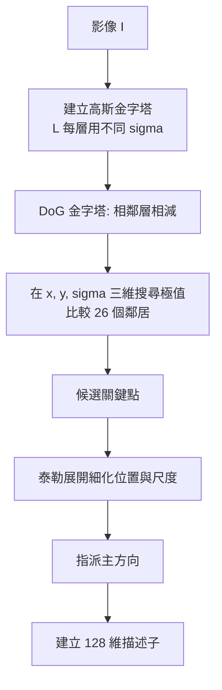

# 2.3 SIFT、SURF、ORB 與特徵匹配（1999-2011）

---

## 2.3.1 局部特徵的設計目標：不變性與唯一性

第 2.2 節的 Canny 給出了邊緣的位置，但留下了三個未解的問題：邊界是一條線而不是點；邊界沒有「這是什麼」的資訊；邊界的偵測依賴單一全域尺度。本節要引入的**局部特徵（local feature）**是對這三個問題的完整回答，也是 1999 到 2011 年間電腦視覺最重要的技術進步。

一個局部特徵是影像中某個位置的一個**特徵點（keypoint）**加上它的**描述子（descriptor）**。若要把兩張不同照片裡的同一個物體對應起來，理想上我們希望：在照片 A 中找到的某個特徵點，在照片 B 中也能找到一個對應的特徵點，而兩者的描述子要「很接近」。

要做到這件事，描述子必須同時滿足兩個性質，這兩者互相拉扯：

1. **唯一性（distinctiveness）**：不同的物體部位、不同的地方，要能給出**不同**的描述子。若所有特徵點的描述子都長得差不多，就無法配對。
2. **不變性（invariance）**：同一個物體部位，在縮放、旋轉、平移、光照改變、甚至輕微的仿射形變與遮擋之下，要給出**接近**的描述子。

若只追求唯一性，最簡單的做法是直接把圖片切一塊出來當描述子——但這樣一縮放就完全不匹配了。若只追求不變性，可以只取顏色平均值——但那幾乎沒有唯一性。**所有的特徵設計都是在這條取捨曲線上選一個點。**

### 需要抵抗哪些變化

| 變化 | 幾何影響 | 典型處理方式 |
| --- | --- | --- |
| 平移 | 位置改變 | 以特徵點為中心取相對座標（自動免疫） |
| 旋轉（影像平面內） | 方向改變 | 把描述子座標系旋轉到主方向（第 2.3.4 節） |
| 縮放 | 特徵大小改變 | 在尺度空間中偵測，記錄特徵的尺度（第 2.3.3 節） |
| 仿射 / 投影變形 | 局部形變 | 描述子本身無法完全抵抗；由後續的幾何驗證處理 |
| 光照變化 | 強度偏移與縮放 | 對梯度做正規化（相除消除對比縮放） |
| 遮擋 | 部分特徵消失 | 靠描述子的**部分**匹配能力（第 2.3.5 節） |

### 全書主軸：手工特徵就是在寫歸納偏誤

這是本節最重要的觀念，也是全書反覆出現的主線。

**歸納偏誤（inductive bias）**指的是：演算法在「所有可能的函數」這無限大的空間中所加上的先驗假設。機器學習的傳統說法是「沒有免費的午餐」——沒有偏誤的演算法在所有問題上的期望表現都一樣差。因此**設計一個演算法，本質上就是設計一組偏誤**。

手工特徵就是人類學者憑著對「什麼讓兩張圖的同一個部位看起來像」的直覺，把偏誤寫死進數學式裡：

* 假設「邊界是重要的」→ 所以先偵測邊界。
* 假設「局部形狀比絕對位置重要」→ 所以取相對座標。
* 假設「方向資訊比絕對方向重要」→ 所以正規化到主方向。
* 假設「尺度的變化是連續的，應在對數尺度上處理」→ 所以建立尺度空間。
* 假設「梯度比原始強度更可靠」→ 所以用梯度直方圖而不是像素值。

這些假設在自然影像上**非常有效**，因為自然影像確實有這些性質。SIFT 在 2000 年代到 2010 年代的幾千篇論文裡被當作 baseline，就是因為這些偏誤選得好。

但它們也是**天花板**：一旦影像內容違反假設（例如下面要談的弱形變、語義缺失），再怎麼調參也救不回来。第 3 章的 HOG + BoW + SVM 會嘗試用機器學習**補上語義**，第 4 章的 CNN 則是**直接把整條特徵工程鏈學出來**——也就是把歸納偏誤從「人手寫死的式子」換成「從資料中學到的、層層堆疊的偏誤」。

---

---

## 2.3.2 尺度空間與尺度空間極值

### 尺度空間的定義

要同時處理「在哪裡」和「多大」兩個問題，需要在多個尺度上處理影像。尺度空間的標準定義（Lindeberg, 1996）為

$$
L(x, y, \sigma) = G_\sigma(x, y) * I(x, y) = \iint G_\sigma(x - u, y - v)\, I(u, v)\, du\, dv
$$

其中 $ G_\sigma $ 是標準差為 $ \sigma $ 的二維高斯。這個定義的關鍵在於第 2.1 節已經證過的高斯的兩個性質：

1. **等向性**：$ G_\sigma $ 是旋轉對稱的，因此尺度空間不會偏袒任何方向。
2. **半群性（group property）**：$ G_{\sigma_1} * G_{\sigma_2} = G_{\sqrt{\sigma_1^2 + \sigma_2^2}} $，即連續做兩次尺度 $ \sigma_1 $、$ \sigma_2 $ 的平滑，等於一次尺度 $ \sqrt{\sigma_1^2+\sigma_2^2} $ 的平滑。這條性質讓「不同尺度的特徵點有固定的相對關係」，也讓金字塔式的快速實作成為可能。

### 尺度空間中的微分性質

Witkin（1983）與 Lindeberg（1994）證明了尺度空間的微分性質：若 $ L $ 是等向性尺度空間，且 $ \partial_x L $ 存在，則

$$
\partial_x L(x, y, \sigma) = (\partial_x G_\sigma) * I(x, y)
$$

也就是說，**對平滑後的影像求偏導，等價於對原影像做「高斯導數」的卷積**。這條性質解釋了為什麼尺度空間是處理「多尺度邊緣」的正確框架：不同尺度的邊緣偵測器，就是同一族 $ \partial_x G_\sigma $ 的不同成員。

### 為什麼對尺度取微分

在尺度空間中，邊界表現為隨 $ \sigma $ 變化的**零交叉結構**。對一個理想的邊緣（半平面），其尺度空間表示恰好是邊界位置的等值線。因此：

* **偵測邊界**：找零交叉（第 2.2 節的 LoG）。
* **決定尺度**：對尺度參數 $ \sigma $ 再取一次微分。零交叉的「合併與分裂」事件恰好對應到尺度空間的極值點。

用一個直覺的比喻：把一個物體放在一個不斷升高的霧裡（$ \sigma $ 遞增）。小尺度時，物體的邊界是兩條分開的線（內外各一條零交叉）；隨著霧變濃，兩條線會合而為一條，然後又分開——這個「合而復分」的瞬間，就是物體在該尺度下的**特徵尺度**。

數學上，SIFT 用的是尺度空間的 DoG（Laplacian of Gaussian 的近似，如第 2.2 節所述）：

$$
\mathrm{DoG}(x, y, \sigma) = L(x, y, k\sigma) - L(x, y, \sigma), \qquad k \approx 1.6
$$

**尺度空間極值點**定義為：在 $ (x, y, \sigma) $ 三維空間中，DoG 相對於其鄰域取極大值的點。Lowe 的實作只在對數尺度上取 $ \sigma $ 的整數倍（相鄰層間的比值為 $ k $），並用高斯金字塔計算每一層。



---

---

## 2.3.3 SIFT 的四個步驟（David Lowe, 1999-2004）

SIFT（Scale-Invariant Feature Transform）由 David Lowe 在 1999 年的 ICCV 提出，2004 年發表完整期刊版本，是整個手工特徵時代最具影響力的單一方法。它的四個步驟可以概括為一句話：**在哪（尺度空間極值）、多准（位置細化）、朝哪（主方向）、是啥（描述子）**。

### 步驟一：DoG 尺度空間極值偵測

**具體做法**：

1. 建立高斯金字塔：第 $ l $ 層的尺度為 $ \sigma_l = \sigma_0 k^l $，其中 $ k = \sqrt{2} $、$ \sigma_0 = 1.6 $。每層影像大小為前一層的一半（需先做 2 倍上採樣以維持解析度對稱）。
2. 計算 DoG 金字塔：$ D_l(x, y) = L_{l+1}(x, y) - L_l(x, y) $。
3. 在 DoG 金字塔中搜尋極值：某點若在目前層的 $ 3 \times 3 $ 鄰域與上一層、下一層各 $ 3 \times 3 $ 鄰域（共 $ 9 + 9 + 9 = 27 $ 個鄰居）中皆為最大（或最小）值，則為候選點。Lowe 實際上排除邊界點並做「每 3x3 網格最多保留一個」的稀疏化。

**為什麼用 DoG 而不是 LoG？** 如第 2.2 節所述，DoG 與 LoG 成比例，但可以透過高斯金字塔相鄰層相減來計算，複雜度從 $ O(N \cdot r^2) $ 降到 $ O(N) $。此外 DoG 沒有 LoG 在遠場的振盪尾巴。

**尺度不變性的來源**：一個特徵點在尺度空間中會有一個「最適尺度」——在此尺度下，該結構在 DoG 響應中達到極值。若影像被放大 2 倍，則其尺度空間被拉伸，最大值的 $ \sigma $ 也隨之加倍。**因此只要把特徵點的尺度（$ \sigma $）也記錄下來，縮放就不變性就自動成立。**

### 步驟二：精確位置與尺度的定位

極值點在離散金字塔中只能定位到像素級。Lowe 用**泰勒展開**細化：

對 DoG 響應 $ D(x, y, \sigma) $ 在極值點附近做二階泰勒展開

$$
D(x + \Delta x, y + \Delta y, \sigma + \Delta \sigma) \approx D(x, y, \sigma) + \frac{1}{2} \begin{bmatrix} \Delta x & \Delta y & \Delta \sigma \end{bmatrix}^{\mathsf{T}} H \begin{bmatrix} \Delta x \\ \Delta y \\ \Delta \sigma \end{bmatrix}
$$

其中 $ H $ 是 Hessian 矩陣。令偏導為零，解得偏移量

$$
\Delta x = \frac{D_{y}^+ D_{xy}^- - D_{y}^- D_{xy}^+}{D_{x}^+ D_{y}^- - D_{x}^- D_{y}^+}
$$

（此為求解二維線性方程組的 Cramer 規則形式，$ D_x^\pm $ 是前後鄰居的差分，$ D_{xy} $ 是交叉項。）

在實務中常用的簡化形式是一維拋物線擬合：若 $ x_- $、$ x_0 $、 $ x_+ $ 是 x 方向上相鄰三點的值（位置 $ x_0 - 1, x_0, x_0 + 1 $），則拋物線頂點在

$$
\hat{x} = x_0 + \frac{1}{2}\,\frac{x_+ - x_-}{x_+ - 2x_0 + x_-}
$$

尺度方向的細化同理，但尺度軸是不均勻的（相鄰層相差 $ k $ 倍），必須換算到對數尺度後再做拋物線擬合：

$$
\Delta \sigma = \frac{1}{2}\,\frac{\sigma_+ - \sigma_-}{\sigma_+ - 2\sigma_0 + \sigma_-}
$$

**過濾**：Lowe 再套用兩個判準：

* **低對比度剔除**：若細化後的 DoG 響應值小於 0.03（相對於正規化後的最大值），剔除。
* **邊緣剔除**：若 Hessian 的兩個特徵值滿足

  $$
  \frac{\mathrm{tr}(H)^2}{\det(H)} > \frac{(r+1)^2}{r}, \qquad r = 10
  $$

  則剔除。這個判準的直覺是：**邊緣上的響應在切線方向上曲率很小、法線方向上很大**，是不穩定的（雜訊會讓它沿邊界滑動）；角點則在兩個方向上曲率都大。實務上常用更簡單的替代判準：

  $$
  \frac{\lambda_2}{\lambda_1} < 0.4
  $$

  其中 $ \lambda_1 \ge \lambda_2 $ 是 Hessian 的兩個特徵值。

### 步驟三：主方向的指定

這一步是 SIFT **旋轉不變性**的來源，也是最容易被誤解的一步。

**做法**：

1. 取以特徵點為中心、半徑 $ 1.5\sigma $ 的圓形窗口。
2. 計算窗口內每個像素的梯度幅值 $ M $ 與方向 $ \phi $。
3. 用一個標準差為 $ \sigma $ 的高斯視窗加權（中心權重大、邊緣小），並用圓形遮罩切掉圓外。
4. 把加權後的梯度累積到一個 **36 個方向槽**（每槽 10 度）的方向直方圖中。
5. 找出直方圖的峰值（以 36 槽的週期做循環平滑），峰值位置即為**主方向** $ \theta $。
6. 對峰值做拋物線插值以取得次像素精度。
7. 若存在其他峰值且其值大於最大峰值的 80%，則**建立第二個特徵點**（同一位置、同一尺度、不同描述子方向）。這讓 SIFT 在方向不連續的結構（如稜角）上仍能穩定配對。

**為什麼這一步能帶來旋轉不變性？** 因為之後描述子裡的每一個梯度方向，都是**相對於這個主方向 $ \theta $ 來量測**的。若整張圖旋轉了 $ \alpha $，則：

* 梯度方向 $ \phi $ 變成 $ \phi + \alpha $；
* 主方向 $ \theta $ 也變成 $ \theta + \alpha $；
* 因此相對方向 $ \phi - \theta $ **完全不變**。

描述子是在「以特徵點為中心、以主方向為 x 軸」的**局部座標系**中建立的，而這個座標系本身會跟著影像一起旋轉。**這是本節最漂亮的一個設計：用一個離散的、可量測的局部方向當作座標系的基準，把連續的旋轉自由度「吸收」掉。**

**常見誤解**：「SIFT 的旋轉不變性來自描述子裡的方向直方圖。」不夠精確。方向直方圖確實記錄了方向資訊，但**不變性**來自於「先旋轉座標系、再量測相對方向」這個動作。如果跳過主方向指定而直接用絕對方向建立描述子，就完全沒有旋轉不變性了。

### 步驟四：描述子的建立

SIFT 的描述子是一個 **4×4 空間格 × 8 個方向 = 128 維**的向量。

**空間結構**：

* 描述子視窗以特徵點為中心，覆蓋 $ 6\sigma \times 6\sigma $ 的區域（半寬 $ 3\sigma $）。
* 這個視窗被切成 $ 4 \times 4 = 16 $ 個格子，每格 $ 1.5\sigma $ 見方。
* 在建構描述子前，影像已經被旋轉到主方向 $ \theta $，並以 $ \sigma $ 的尺度做過高斯模糊。

**方向量測**：每個像素的梯度方向要先減去 $ \theta $，再模 $ 360 $ 度，得到相對方向 $ \phi \in [0, 360) $。

**每格的累加（27 次插值的精確做法）**：

每一格取其中心附近 $ 3 \times 3 = 9 $ 個梯度樣本。對每個樣本 $ (m, \phi) $：

1. **方向槽插值**：8 個方向槽，每槽 45 度。若採用**三角形（3 抽頭）插值**，令 $ t = \phi / 45 $、$ k = \lfloor t \rfloor $，距離加權為

   $$
   w_j = \max\left(0,\, 1 - \frac{|(\phi - 45 j) \bmod 360|}{45}\right), \qquad j \in \{k-1, k, k+1\}
   $$

   然後正規化使 $ w_{k-1} + w_k + w_{k+1} = 1 $。樣本的幅值 $ m $ 就以 $ w_j $ 分配到這三個方向槽。

   > 這就是「27」的來源：**9 個取樣點 × 每個 3 個方向槽 = 27 次方向插值**。若改用更常見的**線性 2 抽頭**插值（只分給 $ k $ 與 $ k+1 $，權重 $ 1-f $ 與 $ f $，$ f = t - k $），則每格為 9 × 2 = 18 次，並在實作上幾乎沒有差異。兩種做法都是為了避免方向量化造成的「硬邊界」效應：當一個樣本的方向正好落在兩個槽的分界上，若不插值，它的貢獻會依數值捨入被完全歸給其中一邊，造成描述子對極小的旋轉過度敏感。

2. **跨格插值**：若樣本位於格邊界上，則用**雙線性空間權重**把它同時分給相鄰的格。這保證了描述子對特徵點位置的微小估計誤差是平滑的，而不是跳變的。

3. **累加**：把分配到該格各方向槽的加權幅值累加，得到該格的 8 維直方圖。16 格 × 8 維 = 128 維。

**正規化**（這一步對匹配品質極其重要）：

1. 將 128 維向量除以其歐氏長度，變成單位向量（此時描述子**不再區分對比強弱**，只關注方向的相對分佈）。
2. 把每個分量截斷（clamp）在 0.2：這一步抑制了那些「過度集中於單一方向」的格子，它們通常對應於邊緣或角點那樣不穩定的結構。
3. 再次正規化成單位向量。

第 2 步是 Lowe 實驗中顯著提升匹配率的關鍵細節，也常被初学者忽略。

**為什麼是 4×4×8？** 這是一個經過實驗調校的折衷：

* 格子太少（如 2×2）→ 空間資訊不足，容易誤配對；
* 格子太多（如 8×8）→ 對位置誤差過度敏感，需要更精確的對齊；
* 方向槽太少 → 方向量化誤差大；太多 → 維度暴增且每槽樣本稀疏。

128 維在 2000 年代的記憶體與比對速度下是個合理的平衡。Lowe 也實驗過其他配置（36 維、72 維、192 維），128 維的表现在各方面最均衡。

**局部且相對**：描述子用相對座標（相對於特徵點）與相對方向（相對於主方向），因此對平移與旋轉免疫；用梯度而非原始強度，因此對亮度偏移免疫（梯度不含直流分量）；正規化後對對比縮放免疫。

---

---

## 2.3.4 特徵匹配：比值測試與 RANSAC

有了兩張圖各自的特徵點與描述子，接下來是配對。但這一步有兩個必須解決的問題：**哪一對是真的**（描述子比對總會有誤配），以及**這些對應點之間是什麼幾何關係**（相機位姿、平面單應性）。

### 最近鄰比值測試（Lowe's Ratio Test）

最直接的做法是對每個特徵點 $ p_1 $，在第二張圖中找到描述子距離最近與次近的兩個點 $ q_1 $、$ q_2 $，然後採用比值判準：

$$
\frac{d(p_1, q_1)}{d(p_1, q_2)} < \tau, \qquad \tau \approx 0.8
$$

**為什麼需要 ratio test？** 直覺來自一個統計事實：在一張有 $ N $ 個特徵點的影像中，**每個特徵點都會有某個最近鄰居**，不管它是否真的是對應點。也就是說最近鄰的絕對距離本身不是判斷依據；有意義的是「最近的比第二近的**好多少**」。若真正的對應點存在，它通常在所有候選中**明顯**更接近；若另有兩個外觀相似的點，距離就會很接近，比值接近 1而被濾掉。

$$
\frac{d_1}{d_2} \approx 1 \Rightarrow \mathrm{Reject};\qquad \frac{d_1}{d_2} \ll 1 \Rightarrow \mathrm{Accept}
$$

也就是說：比值接近 1 代表該區域有歧義（拒絕），比值遠小於 1 代表對應點唯一可信（保留）。

**代價**：ratio test 會犧牲召回率。在某些重複紋理場景（樹林、磚牆、書架）中，許多正確匹配會因為「第二名也很像」而被濾掉。因此實務上常放寬到 $ \tau = 0.85 \sim 0.9 $，並搭配後續的幾何驗證來把關。

**實務加速**：暴力比對所有描述子是 $ O(N_1 N_2) $，在高特徵數影像上不可行。**FLANN（Fast Library for Approximate Nearest Neighbors）** 用 KD-tree 與分層的隨機 k-d 樹做近似最近鄰搜尋，大幅降低複雜度。現代實作（OpenCV 的 `FlannBasedMatcher`）是首選。

### 幾何驗證：RANSAC

ratio test 只用了**描述子**的資訊，它無法知道「這個角落對應到的那個角落，是否符合合理的相機幾何」。真正排除錯配的方式是引入一個幾何模型並檢查一致性。

**模型與所需最少點數**：

| 模型 | 自由參數 | 最少點數 | 應用 |
| --- | --- | --- | --- |
| 單應性矩陣 $ H $ | 8 | 4 | 平面場景、影像拼接 |
| 基礎矩陣 $ F $ | 7 | 7（八點法）或 8 | 兩台相機、一般 3D 場景 |
| 相似/仿射 | 4 / 6 | 2 / 3 | 2D 對齊、追蹤 |
| 三角測量 | — | 對應關係 | 由 $ H $ 或 $ F $ 推導相機姿態 |

**RANSAC 的抽樣保證**：令 $ w $ 為內點（inlier）比例，模型需要 $ k $ 個點，全部是內點的機率為 $ w^k $。抽樣 $ t $ 次後至少成功一次的機率為

$$
P = 1 - (1 - w^k)^t
$$

要求 $ P \ge 0.99 $，得

$$
t \ge \frac{\ln(1 - 0.99)}{\ln(1 - w^k)} = \frac{\ln 0.01}{\ln(1 - w^k)}
$$

代入不同的 $ w $ 與 $ k $：

| 內點比例 $ w $ | $ k = 4 $（單應性） | $ k = 8 $（基礎矩陣） |
| --- | --- | --- |
| 0.5 | 23 | 282 |
| 0.7 | 10 | 78 |
| 0.9 | 5 | 28 |
| 0.99 | 3 | 8 |

這張表說明兩件事：第一，**RANSAC 在內點比例低時迭代次數迅速增加**，這正是它的弱點（也是後來 LO-RANSAC、MSAC、MLESAC 改進的目標）；第二，**多估一個參數，所需樣本數就多一倍**，所以能用簡單模型就不要用複雜模型。

**RANSAC 的另一個弱點**：它是「假設錯誤比例已知且穩定」的模型。在 SfM 這類需要**從雜訊匹配中逐步選出子集**的場景裡，需要更精細的策略（LO-RANSAC 的局部最佳化、GC-RANSAC 的分組切割）。

### 從匹配到相機姿態

若兩張圖拍的是同一個**平面**（例如一張海報、一面牆），可以用單應性矩陣 $ H $ 描述對應關係：

$$
\begin{bmatrix} x' \\ y' \\ 1 \end{bmatrix} \sim H \begin{bmatrix} x \\ y \\ 1 \end{bmatrix}, \qquad H = K\, [r_1 \; r_2 \; t]
$$

其中 $ K $ 是相機內參矩陣。估計出 $ H $ 後，可透過分解求出相對旋轉與平移。

若是一般 3D 場景，需要**基礎矩陣** $ F $：

$$
\begin{bmatrix} x' \\ y' \\ 1 \end{bmatrix}^{\mathsf{T}} F \begin{bmatrix} x \\ y \\ 1 \end{bmatrix} = 0
$$

$ F $ 的推導來自相機模型：若兩個觀測共視同一個 3D 點 $ X $，則

$$
s_1 \begin{bmatrix} x \\ y \\ 1 \end{bmatrix} = K R_1 X + t_1, \qquad s_2 \begin{bmatrix} x' \\ y' \\ 1 \end{bmatrix} = K R_2 X + t_2
$$

消去 $ X $ 即得 $ F = K^{-\mathsf{T}} [t_2]_\times R K^{-1} $。有了 $ F $ 與內點對應，即可用三角測量重建 3D 點，得到稀疏的 3D 模型（point cloud）。

---

---

## 2.3.5 SIFT 的推廣、專利與實用化

SIFT 在 1999 年的論文發表後，立刻在機器人與電腦視覺社群引起轟動，但有兩個非技術性的障礙：

1. **計算速度**。每張影像的特徵點數量常在數千甚至上萬，描述子比對若用暴力法太慢。FLANN 的引入（Chapman, 1999）解決了近似最近鄰搜尋的效率問題。
2. **專利**。Lowe 在 2001 年取得美國專利 **US 6,711,293**（"Method and apparatus for identifying features in an image and use of such features for automated object identification"），這讓學術界與產業界一度迴避 SIFT。

**歷史小註**：該專利於 2020 年到期（專利期限為自申請日起 20 年），OpenCV 在 4.4 版（2020 年）之後把 SIFT 重新放回主倉庫（`cv2.SIFT_create`），此前只能從 `opencv-contrib` 的 `xfeatures2d` 取得。同樣的情況也發生在 SURF（**US 6,876,305**，2020 年到期）與 **US 8,635,796** 上。

Lowe 的另一個關鍵貢獻是**示範了完整 pipeline 的威力**：SIFT + ratio test + RANSAC 估計單應性，就能做物件辨識（Object Recognition Benchmark，2005）、影像拼接（image stitching）與 3D 重建的初始化。**這說明局部特徵的價值不在於單個演算法，而在於它讓「幾何推理」變得可行。**

---

---

## 2.3.6 SURF（2006, Herbert Bay 等）

SURF（Speeded Up Robust Features）的目標是**在不犧牲太多準確度的前提下，把 SIFT 加快一個數量級**。它的四個關鍵設計：

### 積分影像（Integral Image）

定義

$$
S(x, y) = \sum_{i \le x,\; j \le y} I(i, j)
$$

可以用一次累加求出，之後任意**矩形區域**的像素和只要四個查表：

$$
\mathrm{sum} = S(x_2, y_2) - S(x_1, y_2) - S(x_2, y_1) + S(x_1, y_1)
$$

這讓**盒式濾波的成本與區域大小無關**——這是積分影像在即時視覺中的標準武器（第 3.2 節的 Viola-Jones 人臉偵測會再用一次）。

### Haar-like 小波

SURF 用緊湊的盒式濾波器（Haar-like）來近似二維高斯的導數：

$$
S_{xx}(x, y) \approx \sum L(x, y; x, y, l, w, h, \theta)
$$

其中每個 $ L $ 是一個帶通濾波器，由兩到三個盒子組成，用積分影像就能快速求出。用積分影像計算一個 $ 9 \times 9 $ 的高斯導數近似只需要 4 次查表與少數加減法，而直接卷積需要 81 次乘加。

### Hessian 矩陣與尺度選擇

SURF 用 **Hessian 矩陣**（二階微分）而非 DoG 來偵測特徵點：

$$
H(x, y, \sigma) = \begin{bmatrix} L_{xx} & L_{xy} \\ L_{xy} & L_{yy} \end{bmatrix}
$$

Hessian 的行列式

$$
\det(H) = L_{xx} L_{yy} - L_{xy}^2
$$

在特徵點處取極大值。理由是 Hessian 給出的不只是「響應大小」，還直接給出了**兩個主方向及其曲率**——這是 SIFT 之後才由 Harris 響應與方向直方圖分別提供的資訊，SURF 一次取得。

SIFT 與 SURF 的核心對照：

| | SIFT | SURF |
| --- | --- | --- |
| 尺度空間 | DoG，高斯金字塔 | 積分影像 + 尺度空間的 Hessian |
| 偵測 | DoG 極值 + Hessian 過濾 | Hessian 行列式極值 |
| 方向 | 36 槽方向直方圖 | 方向由 Hessian 主軸直接給出（可選） |
| 描述子 | 128 維梯度直方圖 | 64 維（+方向則 128 維）Haar 響應分佈 |
| 速度 | 慢 | 快 5 至 10 倍 |
| 專利 | 有（2020 過期） | 有（2020 過期） |

**評價**：SURF 在多數基準上與 SIFT 相當或略差，但速度快得多，因此在需要即時性的系統中曾廣泛使用。**一個常見的誤解是「SURF 就是快版的 SIFT」**——兩者的偵測原理不同（DoG vs Hessian）、描述子家族不同（梯度直方圖 vs Haar 小波響應），只是整體設計目標相同。

---

---

## 2.3.7 ORB、FAST 與 BRIEF（2011, Ethan Rublee 等）

ORB（Oriented FAST and Rotated BRIEF）是針對**即時系統**（機器人、AR、行動裝置）設計的替代方案，目標是在 CPU 上達到 SIFT 的 10 至 100 倍速度，同時維持可接受的準確度。

### FAST：快速角點偵測

FAST（Features from Accelerated Segment Test，Rosten & Drummond, 2006）的想法是**只比較少數像素**就能判定是否為角點。

1. 取一個半徑為 3 的圓周上的 **16 個像素**（用 Bresenham 演算法生成），中心像素為 $ p $。
2. 判準：若圓周上存在**連續 9 個**像素（可設 8 至 16）**全部比 $ p $ 亮**（或全部比 $ p $ 暗），且亮度差都超過門檻 $ t $，則 $ p $ 是角點。

**加速技巧**：

* **快速判別（segment test）**：先檢查圓周上某 4 個連續像素（例如 12、13、14、15 號）是否同為亮或同為暗。若不是，直接否決（因為 9 個連續亮像素必須包含這 4 個）。這一步能在一半以上的候選點上提早結束。
* **查表加速**：把 16 個像素的「亮 / 暗 / 近似」三態編碼成 4 bits，對應 65536 筆預先計算好的「是否角點」的查表。
* **非最大值抑制**：在保留的分數中做局部極大。

### BRIEF：二值描述子

BRIEF（Biermann, Krost, Furgale, 2010）的洞見是：**描述子不需要是浮點數向量**。它在一個以特徵點為中心、經過高斯平滑的 $ 31 \times 31 $ 影像區塊（patch）上，隨機選取 $ N $ 對像素位置（典型的做法是集中在特徵點周圍的一個小區域內），對每一對 $ (p, q) $ 記錄一個位元：

$$
b_i = \begin{cases} 1 & \text{if } I(p_i) < I(q_i) \\ 0 & \text{otherwise} \end{cases}
$$

由 $ N $ 個位元組成描述子。**直覺是：這組隨機的強度比較，構成了一個「局部指紋」。** 只要區塊被平移、旋轉（在實作限制內）、縮放或加上少量雜訊，這些比較的多數結果不會改變。

### 為什麼二值描述子有效：距離比對的統計學

這是 BRIEF 最漂亮的部分，也是「隨機投影近似高斯分佈」這個想法的應用。

假設特徵點周圍有 $ N $ 個像素，其強度服從高斯分布。我們隨機選一對 $ (p, q) $，其強度差的分布也是高斯。若區塊被平移，$ I(p) $ 與 $ I(q) $ 會各自獨立地被擾動，於是**差值分布的標準差不變，但均值會漂移**。這意味著：只有在兩個值都很接近（即差值接近零）時，比較的結果才容易翻轉。

精確地說，令 $ D = I(p) - I(q) $，其均值 $ \mu $ 與標準差 $ \sigma $。當 $ \mu $ 遠離零時，$ D $ 的符號幾乎確定，位元「穩定」；當 $ \mu \approx 0 $ 時，位元「不穩定」。

由於隨機選出的像素對的 $ \mu $ 值服從近似的常態分布，**大部分位元都落在「穩定」區間**。因此 $ N $ 個位元組成的描述子，其差異可以用位元不一致的數目來度量：

$$
d_H(b_1, b_2) = \sum_{i=1}^{N} |b_1^{(i)} - b_2^{(i)}|
$$

這是**漢明距離**。關鍵在於它可以用位元運算（XOR + popcount）極快地計算：

```cpp
uint32_t diff = desc1[i] ^ desc2[i];
diff = (diff & 0x55555555) + ((diff >> 1) & 0x55555555);
diff = (diff & 0x33333333) + ((diff >> 2) & 0x33333333);
diff = (diff & 0x0F0F0F0F) + ((diff >> 4) & 0x0F0F0F0F);
hamming = (diff * 0x01010101) >> 24;
```

一個 256 位的描述子只需 8 個 32 位元組，比 128 維浮點向量的 L2 距離快數十倍。

### ORB 的三個改良

原始 BRIEF 有兩個致命弱點，ORB 逐一修正：

1. **旋轉不變性**：原始 BRIEF 的隨機取樣模式是固定的，因此區塊旋轉後描述子會完全改變。ORB 採用 **oriented FAST**（把特徵點旋轉到由 intensity centroid 或主方向決定的角度，並用 rotation matrix 旋轉取樣模式），稱為 **steered BRIEF**。另外，原始 BRIEF 的隨機取樣可能落在 patch 的邊緣（低信雜比區域），ORB 用**學習**的方式（對一組已知變換的影像做最佳化）挑出集中在特徵點周圍高信雜比區域的取樣模式，得到 **rBRIEF（rotation-aware BRIEF）**。

   > 這裡出現了一個關鍵的歷史轉折：**「隨機取樣模式」變成了「學出來的取樣模式」**。這是手工特徵與學習方法的邊界開始模糊的時刻——特徵設計的第一步（取樣模式的選擇）被機器學習接手了。完整的故事會在第 3.3 節（語義鴻溝）展開。

2. **尺度不變性**：ORB 在影像金字塔上執行 FAST，並以「有多少層的角點」作為尺度資訊，用類似非極大抑制的方式挑出尺度最大的那個特徵點。
3. **方向**：使用 intensity centroid（以特徵點為中心的加權亮度重心）計算主方向，比 SIFT 的 36 槽直方圖快得多，但精度較低。

ORB 的完整描述子是 **256 位**（ORB-SLAM 中使用 128 位以加速），可與 SIFT 的描述子湊成混合向量以提升召回率。

### 三者的定位

| | SIFT | SURF | ORB |
| --- | --- | --- | --- |
| 年份 | 1999 | 2006 | 2011 |
| 偵測 | DoG 極值 | Hessian 行列式 | FAST |
| 描述子 | 128 維梯度直方圖 | 64/128 維 Haar 響應 | 256 位二值 |
| 距離度量 | L2 | L2 | 漢明距離 |
| 旋轉不變性 | 有（主方向） | 有（可選） | 有（oriented FAST） |
| 尺度不變性 | 有（尺度空間） | 有 | 有（金字塔） |
| 速度 | 慢 | 中 | 極快 |
| 專利 | 已過期 | 已過期 | 無 |
| 典型用途 | 高精度離線、SfM | 離線、快速 | 即時、SLAM、AR |

---

---

## 2.3.8 局部特徵時代的頂點

2010 年前，局部特徵撐起了整個三維視覺的工業：

* **SfM（Structure from Motion）**：從無序的影像集合中重建稀疏 3D 點雲。2006 到 2009 年間的 Bundler、Agglomerative SfM 等系統都以 SIFT 為核心。
* **SLAM（Simultaneous Localization and Mapping）**：**ORB-SLAM（Mur-Artal, Montiel, Tardós, 2011）** 是分水嶺——它以 ORB 特徵（即時）、地圖點、關鍵幀、局部地圖與即時重定位的完整設計，讓 SLAM 從實驗室走進消費級產品。
* **影像拼接**：全景照片、地圖製作。
* **物件辨識**：SVM + SIFT 的 BoVW 管道（第 3 章）。

但這個時代的鼎盛，也正是它的極限被暴露的時期。

### 局部特徵的四個結構性缺陷

1. **語義缺失**。SIFT 描述子只知道「這裡有個邊界的交會點，梯度方向分布是這樣」，它**不知道**那是貓的耳朵、磚頭的角、還是樹枝的分岔。同一個描述子可以出現在任何形狀相似的局部區域上。這是「語義鴻溝」最尖銳的表現（第 3.3 節）。

2. **對弱形變脆弱**。SIFT 的不變性設計覆蓋了平移、旋轉、縮放與光照，但對於**仿射形變**（視點變化造成的局部透視變形）、**非剛性形變**（布料的褶皺、人體的姿勢）、**遮擋**（物件被擋住一半），描述子會顯著退化。特別是遮擋：只要遮擋比例超過約 30%，描述子距離就會急遽上升。

3. **密集場景的特徵爆炸**。特徵點數量隨影像解析度**平方**成長。對 4000×3000 的照片，SIFT 可能偵測到 10 萬個特徵點；在一個 4K 影片串流中做即時追蹤，這在算力上不可行（雖然 ORB 緩解了這一點）。

4. **重複紋理造成的匹配歧義**。在樹林、書架、磚牆這類重複結構中，同一個描述子會出現很多次，ratio test 大量拒絕，導致**密集重建失敗**——而這些恰恰是 SfM 最需要的地方。

### 預告：接下來的兩章在做什麼

| 問題 | 第 3 章的答案 | 第 4 章的答案 |
| --- | --- | --- |
| 語義缺失 | HOG + Bag-of-Visual-Words + SVM：把局部描述子量化成「視覺詞」，用分類器**在統計上**逼近語義 | CNN：直接從像素端到端學出層層特徵，語義在深層自然湧現 |
| 形變脆弱 | 以 SVM 的統計模型吸收形變的多樣性 | 池化、資料增廣、更大的感受野與不變性 |
| 手工偏誤的侷限 | 仍受限於人手寫死的特徵定義 | 歸納偏誤改由資料決定 |
| 密集場景 | — | 多尺度特徵圖（金字塔）、注意力機制 |

**一句話總結整個第 2 章**：我們花了三十一年時間，把「影像」變成「特徵」，每一步都在用人類寫死的歸納偏誤對抗影像的變化；直到 2012 年 AlexNet 出現，人們才發現**可以直接從影像學出特徵**，而那些花費了三十一年建立的偏誤，早已被網路用更大的資料與算力學了回來。

---

---

## 2.3.9 實作：OpenCV 的 SIFT 與 ORB

### SIFT 偵測與描述

```python
import cv2
import numpy as np

img1 = cv2.imread("scene1.png", cv2.IMREAD_GRAYSCALE)
img2 = cv2.imread("scene2.png", cv2.IMREAD_GRAYSCALE)

# SIFT 在 OpenCV 4.4 之後回到主倉庫
sift = cv2.SIFT_create(nfeatures=0, contrastThreshold=0.04)
k1, d1 = sift.detectAndCompute(img1, None)
k2, d2 = sift.detectAndCompute(img2, None)

print("keypoints:", len(k1), len(k2))
print("descriptor shape:", d1.shape)   # (N, 128)

# 關鍵點的屬性記錄了尺度與方向
for kp in k1[:3]:
    print(f"pt=({kp.pt[0]:.1f},{kp.pt[1]:.1f}) size={kp.size:.2f} "
          f"angle={kp.angle:.1f} response={kp.response:.3f}")
```

### ORB 與二值描述子的漢明比對

```python
orb = cv2.ORB_create(nfeatures=5000)
ko1, do1 = orb.detectAndCompute(img1, None)
ko2, do2 = orb.detectAndCompute(img2, None)

bf = cv2.BFMatcher(cv2.NORM_HAMMING, crossCheck=True)
matches_orb = bf.match(do1, do2)
matches_orb = sorted(matches_orb, key=lambda m: m.distance)
print("ORB matches:", len(matches_orb), "best distance:", matches_orb[0].distance)
```

### SIFT 匹配 + ratio test + RANSAC

```python
bf = cv2.BFMatcher(cv2.NORM_L2)

# knnMatch 取最近與次近
knn = bf.knnMatch(d1, d2, k=2)

good = []
for m, n in knn:
    if m.distance < 0.75 * n.distance:
        good.append(m)

print(f"knn pairs: {len(knn)}  after ratio test: {len(good)}")

src_pts = np.float32([k1[m.queryIdx].pt for m in good]).reshape(-1, 1, 2)
dst_pts = np.float32([k2[m.trainIdx].pt for m in good]).reshape(-1, 1, 2)

H, mask = cv2.findHomography(src_pts, dst_pts, cv2.RANSAC, ransacReprojThreshold=3.0)
inliers = int(mask.sum())
print(f"inliers: {inliers} / {len(good)}  ratio = {inliers / max(len(good),1):.2%}")
```

**觀察重點**：
* ratio test 通常會濾掉 60% 至 90% 的匹配（取決於場景的重複程度）。
* RANSAC 又會濾掉剩餘匹配中相當一部分的錯配。**最終的內點比例是評估這條 pipeline 品質的最直接指標**。
* 若內點比例很低（< 30%），通常代表：圖片之間沒有足夠的重疊、尺度差異太大、或場景是重複紋理。

### 可視化

```python
matches = good[:60]
img_match = cv2.drawMatches(img1, k1, img2, k2, matches, None,
                            flags=cv2.DrawMatchesFlags_NOT_DRAW_SINGLE_POINTS)

# 只畫內點
if H is not None:
    inlier_matches = [m for m, ok in zip(good, mask.ravel()) if ok]
    img_inlier = cv2.drawMatches(img1, k1, img2, k2, inlier_matches, None,
                                 matchColor=(0, 255, 0),
                                 flags=cv2.DrawMatchesFlags_NOT_DRAW_SINGLE_POINTS)

cv2.imwrite("matches.png", img_match)
cv2.imwrite("inliers.png", img_inlier)
```

### 混合 SIFT 與 ORB（提升召回率）

```python
# 兩種描述子可以串接，提高在困難場景中的召回率
d1_mixed = np.hstack([d1, np.zeros((len(d1), 0), dtype=np.float32)])
# 實務上做法是各自匹配後合併，或把 ORB 的位元展開成浮點向量並各自正規化
```

### 效能量測

```python
import time

t0 = time.time()
for _ in range(10):
    sift.detectAndCompute(img1, None)
t_sift = (time.time() - t0) / 10

t0 = time.time()
for _ in range(10):
    orb.detectAndCompute(img1, None)
t_orb = (time.time() - t0) / 10

print(f"SIFT: {t_sift*1000:.1f} ms/frame, {len(k1)} kp")
print(f"ORB : {t_orb*1000:.1f} ms/frame, {len(ko1)} kp")
```

在典型的 1024×768 影像上，ORB 的偵測與描述速度通常是 SIFT 的 10 至 30 倍，而描述子比對（漢明 vs L2）還要再快一個數量級。**這個數量級差異，就是為什麼即時系統全都轉向 ORB，而離線的高精度流程仍用 SIFT。**

---

---

## 2.3.10 本節小結

1. **局部特徵的本質是一組明確寫下的歸納偏誤**：相對座標（平移不變）、主方向座標系（旋轉不變）、尺度空間（縮放不變）、梯度（光照不變）。整個第 2 章是「歸納偏誤」這個全書主軸的第一個完整案例。
2. **SIFT 的四步**——尺度空間極值偵測、泰勒細化、主方向指定、128 維梯度直方圖——每一個步驟都在解決一個特定的幾何變化。
3. **DoG 是 LoG 的可計算近似**，這個 1999 年的工程決定讓 SIFT 得以落地，也讓尺度空間理論從神經生理學進入工程實務。
4. **比值測試與 RANSAC 分工明確**：前者用描述子自身的資訊排除歧義匹配，後者用幾何一致性排除違反相機模型的匹配。兩者都無法單獨取代對方。
5. **SURF 用積分影像與 Hessian 換速度，ORB 用 FAST 與二值描述子換速度**；所有加速手段的代價都是精度損失或專利限制。
6. **頂點與終結**：局部特徵在 2010 年代撐起了 SLAM 與 SfM 的工業化，但它們**不懂語義**、**怕形變與遮擋**、**在密集場景爆炸**。這三個問題正是第 3 章（用機器學習補語義）與第 4 章（用 CNN 取代整條特徵工程鏈）的出發點。
