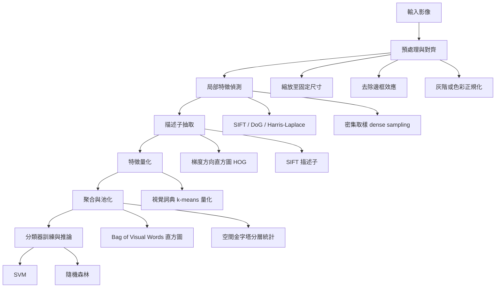
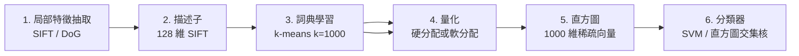
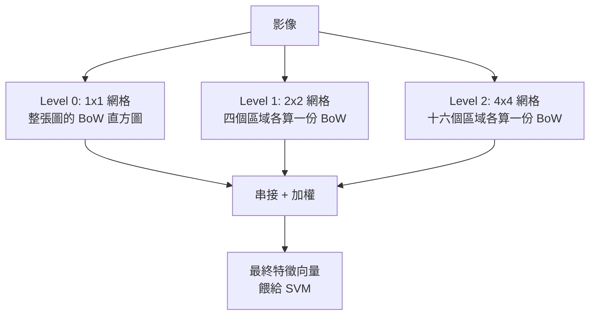
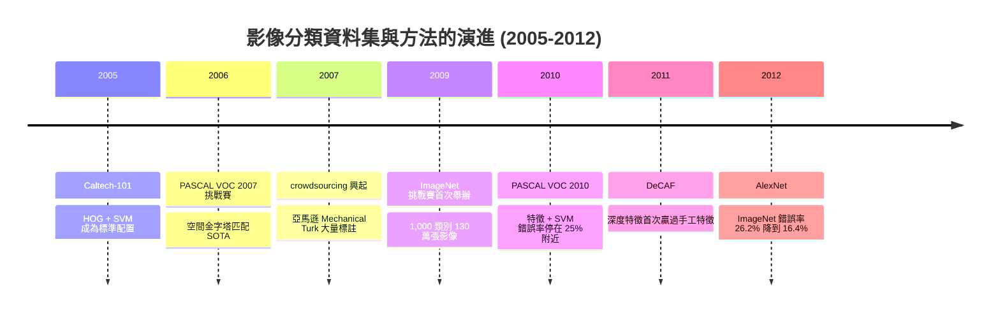

# 3.1 影像分類工作流程：HOG 與 Bag-of-Visual-Words（1995-2012）

前一章我們介紹了 SIFT、SURF、ORB 等局部特徵偵測器。它們解決的是「影像中有哪些穩定的點」這個問題，但沒有解決「這個影像代表什麼」。本章要處理的第一個大命題，正是把「描述影像」與「分類影像」接起來。

在 2012 年之前，主流的影像分類研究只有一條路可走：**人工設計特徵（handcrafted features）描述影像，再交給統計學習演算法做分類**。這條路的每一個環節——梯度方向直方圖、局部特徵、詞典量化、空間金字塔——都是研究者基於對「什麼樣的像素排列對人類而言代表某個概念」的理解而手動寫下的。

本章的目標有兩個：第一，讓讀者能夠完整重建這條 pipeline 的每一個環節；第二，讓讀者清楚理解**為什麼它成功了、又為什麼它的天花板是硬的**。第三節將把後者推到極限。

---

## 3.1.1 一個典型的分類 pipeline

所有 2000 年代的影像分類系統，剥掉模型之間的差異，都可以歸結為同一個六階段流程。



這六個階段各自承擔一個明確的職責：

1. **預處理與對齊（normalization & alignment）**：把不同來源、不同尺寸、不同曝光的影像拉到一個可比較的共同表示。諸如把影像縮放成固定長寬、對邊框做邊緣處理的「反射填補（reflection padding）」、把像素值映射到 $[0,1]$ 或做 per-image 的零均值單位方差。
2. **局部特徵偵測（detection）**：找出影像中「有資訊量」的點。稀疏偵測（SIFT 關鍵點）或者密集取樣（在固定網格上每 N 個像素取一點）。
3. **描述子抽取（description）**：把每個局部區域編碼成固定長度的向量。HOG、SIFT、隨機森林式描述子。
4. **量化（quantization）**：把連續的描述子離散化為有限的「視覺詞」索引。
5. **聚合（aggregation / pooling）**：把可變數量的局部描述子合成固定長度的影像表示。
6. **分類（classification）**：SVM、隨機森林、線性判別分析等統計學習器。

**一個關鍵的分工原則**：整條 pipeline 只有最後兩階段是「學出來的」，前面四階段全是「人手寫死的」。這就是 2000 年代整個領域的寫照，也是第 3.3 節要清算的核心問題。

---

## 3.1.2 手工特徵時代的統計學習轉折

### 為什麼「不學特徵、只學分類器」是當時可行的折衷

要理解 2012 年之前的共識，先要理解 1995-2012 這段期間在算力與資料上的硬約束。

| 資源 | 1995 年 | 2005 年 | 2012 年 |
|---|---|---|---|
| 典型訓練標註量 | 數百 | 數千 | 數千（手機尚未普及） |
| 常用 CPU 核心 | 1 | 1 | 8（仍非標準配備） |
| GPU 可用性 | 無 | 幾乎無（顯示用途） | 開始有 CUDA 開發者程式 |
| CNN 訓練所需時間（ImageNet） | 不可能 | 不可能 | 約 5-6 天 |

在這個約束下，從零開始學一個「影像 → 類別」的端到端映射，代價是天文數字：神經網路在 1990 年代末經歷過長達十年的低潮（1990-1995 年間，商用反向傳播的案例極少），核心原因正是「沒有資料也沒有算力」。

於是形成了一個務實的分工：**把「什麼特徵是好的」這個難題，用人類的先驗知識硬編碼進去；把「哪些特徵組合對應哪些類別」這個相對容易的問題，交給統計學習。**

這個分工的成功可以量化。以 PASCAL VOC 2010 的分類任務為例，VOC 2007-2009 的冠軍方法錯誤率大約在 25%-30% 區間，其中相當一部分的進步來自**分類器本身的更換**（從 SVM 到 better-regularized SVM、到 kernel、到 bagging），而不是特徵本身的大改進。

### 「不學特徵」的真正代價

然而，這個折衷有個隱藏的假設：**特徵的設計者與分類器看見的是同一種「物體」**。一旦特徵選擇偏離了任務真正需要的資訊，分類器再強也救不回來。

這就是 3.3 節所說的**語義鴻溝**的技術根源：手工特徵是一種**top-down** 的先驗注入——研究者先假設「形狀對分類有用」，於是設計梯度直方圖；先假設「局部輪廓統計有用」，於是設計 SIFT。先驗錯了，整條鏈路就從一開始就錯了。

### 統計學習在此時扮演的角色

統計學習在這個時代提供的是三樣東西：

- **在高維稀疏特徵上仍能訓練出良好分隔超平面的能力**（SVM，3.2 節詳述）
- **能處理數千維描述子組成的字典，且不需明確建模其分布**（核方法、稀疏性）
- **能容忍一定程度的特徵冗餘與噪聲**（隨機森林、boosting）

而它不提供的是：**從原始像素中自行發現特徵的能力**。這要等到深度學習。

---

## 3.1.3 HOG：梯度方向直方圖（2005）

### 動機

HOG（Histogram of Oriented Gradients）由 Navneet Dalal 與 Bill Triggs 於 2005 年 CVPR 論文《Histograms of Oriented Gradients for Human Detection》中提出，CVPR 2011 因「行人偵測」獲得 Marr 獎。

它不是憑空出現的。Triggs 是 Oxford 那個主張「bag of visual words」的圈子裡的人（3.1.4 節），而 HOG 本身在概念上直接來自 SIFT 的描述子步驟：SIFT 的 dense 版本就是在每個局部網格上計算 4×4 個子區域的 8 方向梯度直方圖。HOG 的貢獻是：

1. **拿掉關鍵點偵測**。SIFT 的 DoG 極值點偵測既慢又對參數敏感；HOG 直接在固定網格上取 cell，密度均勻且計算量可預測。
2. **放棄尺度空間**。既然 cell 本身在影像座標上是固定大小的，尺度處理就交給外部的 image pyramid。
3. **用 block normalization 取代關鍵點周圍的局部歸一化**。

結果是一個**快、簡單、對旋轉與光照相當穩健、且在行人偵測上大幅超越 SIFT**的描述子。同一篇論文裡，作者報告 SIFT 的行人偵測錯誤率比 HOG 高得多。

### 梯度計算

給定灰階影像 $ I $，中心差分梯度：

$$
G_x(x,y) = \frac{I(x+1,y) - I(x-1,y)}{2}, \qquad G_y(x,y) = \frac{I(x,y+1) - I(x,y-1)}{2}
$$

梯度大小與方向：

$$
g(x,y) = \sqrt{G_x(x,y)^2 + G_y(x,y)^2}, \qquad \theta(x,y) = \arctan\left(\frac{G_y(x,y)}{G_x(x,y)}\right)
$$

方向以 180 度為週期，因為一個邊緣（edge）沒有「頭尾」之分——這是 HOG 相較於一般梯度方向的關鍵設計細節，讓它天然地對邊緣極性（亮到暗 vs 暗到亮）不變。

實務上有兩個優化：先做一次高斯平滑（$\sigma=1$ 的二維高斯核）以抑制噪聲；以及用符號近似的反正切：

$$
\theta(x,y) = \arctan\left(\frac{G_y(x,y)}{G_x(x,y)}\right) \approx \text{fast\_atan2}(G_y, G_x)
$$

這裡要指出一個常見誤解：**HOG 並非「完全」旋轉不變**。它只有*方向分佈*的分箱帶來部分旋轉穩健性，實際上在行人偵測上 HOG 對 90 度旋轉並不魯棒，但對 ±20 度的小角度變化有一定容忍。

### Cell 的方向直方圖

影像被切分成互不重疊的方形 **cell**（原論文用 8×8 像素）。每個 cell 內所有像素的梯度，依其方向 $\theta$ 被投票到 9 個方向 bin 之一（bin 寬 20 度，共 180 度）。

投票不是每個像素單獨投，而是**依梯度大小加權**。原始論文的投票公式：

$$
h(c, k) = \sum_{p \in c} w(p) \cdot \left[ \theta(p) \in B_k \right]
$$

其中 $ w(p) = \min\left(g(p), g_{\max}\right) $ 是截斷後的梯度大小，$ g_{\max} $ 為截斷上限（例如 20）。截斷的作用是**抑制強邊緣（例如物體輪廓）壟斷整個直方圖**，讓紋理特徵也能被保留下來。

### Block 與正規化

單一 cell 的 9 維直方圖**對光照變化極度敏感**：整體對比度被拉伸時，所有 bin 同時放大或縮小，分布形狀不變但幅度全變。因此需要正規化。

**Block** 是一個由 $ 2\times2 $ 個 cell 組成的矩形（16×16 像素）。block 的特徵是把其中 4 個 cell 的 9 維直方圖串接為一個 36 維向量，然後做正規化。所有 block 產生的特徵串接起來，就是最終的描述子。

重要的是**歸屬（assignment）規則**：一個 cell 屬於四個 block（以 cell 為 block 的右下角、右下角的左邊、下邊、左下角）。因此鄰接 cell 的特徵被重複計算，這提供了更細緻的局部對比資訊（相鄰 cell 間的梯度大小比例），也是後來 LBP（局部二值模式）也採用的設計。

### L2-Hys 正規化與其理由

歸一化有多種選擇，HOG 論文的實驗結論是 **L2-Hys**（L2 normalization followed by clipping by a threshold）最好。

步驟為三：先做 L1 正規化：

$$
v = \frac{v}{\|v\|_1 + \varepsilon}
$$

再做 L2 正規化：

$$
v = \frac{v}{\|v\|_2 + \varepsilon}
$$

最後**截斷**（clipping）：

$$
v_i \leftarrow \min\left(v_i, 0.2\right), \qquad v \leftarrow \frac{v}{\|v\|_2 + \varepsilon}
$$

**為什麼要截斷？** 直覺上，歸一化後所有元素都在 $[0,1]$，而 $L_2$ 範數為 1。如果某一個 bin 的值遠大於其他 bin（例如 0.7，而其餘都接近 0），那麼在後續的線性分類器眼裡，這個特徵向量幾乎只由那一個 bin 決定，方向 bin 之間的比例關係（真正帶語意的資訊）就被淹沒了。截斷把所有 bin 的上限壓在 0.2，等於**強制性地把分布形狀（而非單一 bin 的絕對大小）成為主要訊號**。

這是手工特徵設計裡非常典型的一種「經驗性但有理據的取捨」：沒有理論保證，只有實驗支持。

### 參數一覽

| 參數 | 原論文行人設定 | 說明 |
|---|---|---|
| cell 大小 | 8×8 像素 | 決定特徵的最小空間解析度 |
| block 大小 | 2×2 cells（16×16） | 決定歸一化的上下文範圍 |
| 方向 bin 數 | 9 | 20 度/bin |
| block 步幅 | 8 像素 | 每 2 個 cell 移動一次 |
| cell 步幅 | 8 像素 | cell 不重疊 |
| 方向截斷 | $g_{\max}=20$ | 抑制過強邊緣 |
| block 截斷 | 0.2 | 見 L2-Hys |
| 高斯平滑 | $\sigma=1$ | 抑制噪聲 |

### 特徵維度計算（數字實例）

以一張 **64×128 像素**的行人裁切影像（行人偵測的標準尺寸）為例。

**步驟一：cell 數量**

影像寬 64、高 128，cell 為 8×8 像素且不重疊：

$$
N_{cell,x} = \frac{64}{8} = 8, \qquad N_{cell,y} = \frac{128}{8} = 16
$$

總 cell 數 $ = 8 \times 16 = 128 $。

**步驟二：block 數量**

block 為 2×2 cells，且 block 以 2 個 cell（16 像素）為步幅平移：

$$
N_{block,x} = \frac{8 - 2}{2} + 1 = 4, \qquad N_{block,y} = \frac{16 - 2}{2} + 1 = 8
$$

總 block 數 $ = 4 \times 8 = 32 $。

**步驟三：每 block 的維度**

$ 4 \text{ cells} \times 9 \text{ bins} = 36 $ 維。

**步驟四：總維度**

$$
D = 32 \times 36 = 1152
$$

注意：即使 cell 總數為 128，block 總數卻只有 32，因為每個 2×2 的 cell 組在四種位置被重複使用了。這正是歸屬規則的直接結果。

### 另一個常見配置與 3780 維

HOG 在 OpenCV 與 `skimage` 中最常見的行人偵測配置是：**cell 8×8、block 2×2、9 bins、cell 步幅 8、block 步幅 8**，在 64×128 上得到 1152 維（如上）。

而 **3780 維**這個數字來自另一個常見設定：**cell 8×8、block 2×2、9 bins、cell 步幅 8、block 步幅 4**（block 重疊步幅），用於 64×128 的影像：

- block 數：橫向 $ (8-2)/1 + 1 = 7 $（步幅 1 cell），縱向 $ (16-2)/1 + 1 = 15 $（步幅 1 cell），共 $ 7 \times 15 = 105 $ 個 block
- $ 105 \times 36 = 3780 $ 維

另一條得到 3780 的路徑是使用 **`skimage.feature.hog` 的 `cells_per_block=(2,2)`、`block_norm='L2-Hys'`、像素寬高 `pixels_per_cell=(8,8)`**，搭配 `transform_sqrt=True`。不論走哪條路，關鍵結論相同：**HOG 特徵是數千維的稀疏向量，這正好落進 SVM 最擅長的區間**——這就把我們帶到了 3.2 節。

### 一個 cell 直方圖的數字實例

假設某個 8×8 cell 內，64 個像素的梯度經加權投票後，得到 9 個 bin 的值：

$$
h = [3, 5, 12, 1, 0, 8, 4, 6, 2]
$$

我們可以看到 bin 2（20-40 度）與 bin 5（100-120 度）有明顯峰值，代表該 cell 內存在兩條方向相反的邊緣——這在行人上半身影像中很常見（例如肩膀的斜邊與手臂的外側）。

這 9 個數字加上鄰居三個 cell 的 27 個數字，構成一個 36 維 block 向量。L2-Hys 正規化後送入 SVM。

**關鍵洞察**：HOG 完全沒有「知道」邊緣是肩膀還是背景。它只知道「這個 16×16 區域內，有兩條夾角約 80 度的邊緣，強度比約 3:2」。語意是由 SVM 從標註資料裡學出來的。

---

## 3.1.4 Bag of Visual Words（2004-2005）

### 從文字處理借用武器

Bag-of-Words（BoW）是資訊檢索與文字分類的經典方法。把一份文件表示成其詞彙的次數向量，丟棄詞序：

$$
\mathbf{x} = (x_1, x_2, \dots, x_V), \qquad x_k = \#\{\text{文件中出現詞 } k \}
$$

若一個詞在整個語料庫中越常見，其區辨力越低，於是有了 tf-idf 加權：

$$
\mathrm{tfidf}(k) = \mathrm{tf}(k) \cdot \log\left(\frac{N}{\mathrm{df}(k)}\right)
$$

**問題在於**：文字是離散的，詞典 $ V $ 本來就存在於世界之中。而影像描述子是連續的（例如 128 維 SIFT），無法直接「數次數」。

### 完整的 BoVW 流程

Csurakis 等人於 2004 年在機器人研發社群的工作中首次提出把 BoW 應用到視覺；Sivic 等人於 2005 年的 ICCV 論文《Bag of Visual Words in a Quotient Space》則是把它推向經典地位的工作。



**步驟 1-2：局部特徵抽取與描述子**
對每張影像取得可變數量的局部描述子集合 $ \{ \mathbf{d}_1, \dots, \mathbf{d}_n \} $，每個 $\mathbf{d}_i \in \mathbb{R}^{128}$。數量 $ n $ 因影像而異（數百到數千）。

**步驟 3：詞典學習（codebook learning）**
把所有訓練影像的所有描述子集合起來（實務上通常先隨機抽樣數量以控制成本），用 k-means 分成 $ K $ 個叢集（$ K $ 常見值 1000、3000、10000）。每個叢集中心 $\mathbf{c}_k $ 就是一個**視覺詞（visual word）**，全體 $\{ \mathbf{c}_1, \dots, \mathbf{c}_K \} $ 構成**視覺詞典（visual vocabulary）**。

k-means 的目標函數：

$$
\min_{\{\mathbf{c}_k\}} \sum_{i=1}^{n} \min_{1 \le k \le K} \left\| \mathbf{d}_i - \mathbf{c}_k \right\|^2
$$

**步驟 4：量化（quantization）**
把每個描述子映射到最近的視覺詞索引：

$$
\ell(i) = \arg\min_{k} \left\| \mathbf{d}_i - \mathbf{c}_k \right\|^2
$$

這是**硬分配（hard assignment）**。**軟分配（soft assignment）** 則保留前 $ t $ 個最近詞的概率：

$$
p(k \mid \mathbf{d}_i) = \frac{\exp\left(-\beta \left\| \mathbf{d}_i - \mathbf{c}_k \right\|^2\right)}{\sum_{j=1}^{K} \exp\left(-\beta \left\| \mathbf{d}_i - \mathbf{c}_j \right\|^2\right)}
$$

其中 $ \beta $ 是銳度參數。軟分配的代價是每個描述子要貢獻到多個 bin，但好處是**降低了量化誤差**：硬分配是量化過程中最嚴重的資訊損失來源（見 3.3 節）。

**步驟 5：聚合為直方圖**
每張影像得到一個 $ K $ 維向量：

$$
\mathbf{v} = \left( v_1, \dots, v_K \right), \qquad v_k = \sum_{i=1}^{n} p\left(k \mid \mathbf{d}_i\right)
$$

這就是「Bag of Visual Words」。**注意：空間位置資訊在此被徹底丟棄**——「狗在左上角、球在右下角」與「狗在右下角、球在左上角」的直方圖完全相同。這是 BoVW 最大的結構性缺陷，3.1.5 節會修正它。

**步驟 6：分類**
直方圖是稀疏高維的（$ K=1000 $ 時非零維度通常只有數十到數百）。用線性 SVM 即可。

### 為什麼要離散化？三個真實理由

把連續描述子離散化成「視覺詞」聽起來像是無謂的資訊損失，但在 2004-2008 年這是有充分理由的設計。

**理由一：借用文字分類的統計工具。** 有了離散的詞，就有了詞頻、有了 tf-idf、有了文件之間的餘弦相似度、有了 n-gram（空間鄰接的詞組合）。這些在 NLP 中磨了三十年的工具立刻可用了。

**理由二：讓「共現」成為可用的關聯訊號。** 這是更深層的理由。一個連續描述子的相鄰位置分布沒有天然的「詞」意義；但量化之後，「建築窗戶」與「斑馬條紋」這兩種視覺詞會因為在真實影像中**總是一起出現**而產生統計關聯。分類器因此能學到「這個物體的詞彙組合模式」——這是一種**共現先驗（co-occurrence prior）**，相當於把語言學的搭配（collocation）移植到視覺。

**理由三：稀疏性。** 量化後的直方圖極度稀疏，而稀疏表示搭配線性 SVM（或直方圖交集核，見 3.2 節）效率極高，且訓練樣本數可以遠小於特徵維數（此時是 $ K=1000 $ 維）。

### 量化誤差的量測

有個實驗值得記住：在 CIFAR-10 上用 BoVW 分類，報告的分類準確率大約落在 70% 上下，而同一資料集在幾年後的深度方法可以到 90% 以上。**差距的主要來源不是分類器，而是量化本身**：一個 128 維 SIFT 被硬分配到 1000 個中心之一，等於是強迫它去代表「這個叢集裡所有的東西」。這是 3.3 節論證「語意鴻溝不是靠更好的描述子填平的」的關鍵證據之一。

### 各步驟的實作注意事項

| 步驟 | 常見做法 | 陷阱 |
|---|---|---|
| 描述子 | SIFT（浮點、需 L2 正規化） | 未正規化會讓 k-means 被高維度樣本主導 |
| 詞典大小 | $ K = 1000 \sim 10000 $ | 太大 → 量化誤差小但直方圖維度高、稀疏 |
| k-means | 初始化用 k-means++ | 隨機初始化會讓結果不穩定 |
| 硬/軟分配 | 硬分配快，軟分配準 | 軟分配的 $ \beta $ 需調 |
| 背景去除 | 丟棄低 saliency 的描述子 | 可去除 50-90% 的背景描述子 |
| 分類器 | 線性 SVM | 加上 tf-idf 加權通常有幫助 |

---

## 3.1.5 空間金字塔匹配（2006）

### 問題：BoW 丟棄了「在哪裡」

BoW 直方圖是**順序無關（orderless）**的。但人類辨識物體高度依賴空間配置：一個圓形在左上方、圓形在右下方、圓形在中間，是三種不同的構圖。

Spatial Pyramid Matching 由 Andrea Vedaldi、Karen Lichy、Andrea Verbeckova 於 2006 年 CVPR 論文《Spatial Pyramid Matching for Image Categorization》提出，是 3.1.6 節提到的幾個重要玩家之一。

### 做法：分層直方圖 + 逐層加權

概念極簡：**把影像切成一個金字塔狀的網格層級，在每一層計算 BoW 直方圖，把各層直方圖串接起來**。



假設詞典大小為 $ K $，金字塔層數為 $ L $（$ L $ 層含 level 0 到 level $ L-1 $），各層的網格數為 $ 1, 4, 16, \dots, 4^{L-1} $。

第 $ l $ 層（$ l=0,1,\dots,L-1 $）有 $ 4^l $ 個 cell，每個 cell 貢獻一份 $ K $ 維直方圖，因此第 $ l $ 層的總維度是 $ 4^l K $。加權後：

$$
\mathbf{f} = \left[ \alpha_0 \mathbf{h}^{(0)}, \alpha_1 \mathbf{h}^{(1)}, \dots, \alpha_{L-1} \mathbf{h}^{(L-1)} \right], \qquad \alpha_l = \frac{1}{4^l}
$$

其中 $\mathbf{h}^{(l)}$ 是第 $ l $ 層所有 cell 直方圖的**串接**。

### 為什麼權重是 $ 1/4^l $

這個權重設計可以從兩個角度理解。

**角度一：讓各層的貢獻總量相當。** 第 $ l $ 層有 $ 4^l $ 個 cell，每個 cell 的直方圖 L1 範數為 1，所以第 $ l $ 層串接後的 L1 範數是 $ 4^l $。乘上 $ \alpha_l = 1/4^l $ 後，每層的總量都等於 1。這讓 SVM 不會因為高層（更細）維度多而天然偏好它們。

**角度二：直方圖交集核的分解性。** 這是理論上的關鍵。若分類器使用**直方圖交集核（Histogram Intersection Kernel, HIK）**：

$$
K(\mathbf{a}, \mathbf{b}) = \sum_{i} \min(a_i, b_i)
$$

那麼金字塔的加權串接可以分解為各層 kernel 的加權和：

$$
K_{SPM}(\mathbf{f}, \mathbf{g}) = \sum_{l=0}^{L-1} \alpha_l^2 K_{HIK}\left(\mathbf{h}^{(l)}, \mathbf{g}^{(l)}\right)
$$

而且每一層的 HIK 又可以分解到各個 cell 的 HIK 之和（因為 $\min$ 是逐元素的，串接結構自然分割）。**也就是說，SPM 的每一層、每一個 cell，都可以被一個獨立的線性分類器處理。**

這解釋了為什麼 SPM 在當時能用「多個線性 SVM 分別在各層各 cell 上訓練，再用 HIK 組合」的方式實作（此即 Zhang et al. 的做法），並且能達到與單一 SVM 相當甚至更好的效果。

### 實例：$K=1000$、$L=3$ 的維度

$$
D = \left( \frac{1}{1} + \frac{1}{4} + \frac{1}{16} \right) \times \left( 1 + 4 + 16 \right) \times K = \frac{21}{16} \times 21 \times K
$$

實際上因為每一層是**串接**而非加總，維度是各層串接後的總和：

$$
D = \left( 1 \cdot 1 + 4 \cdot 4 + 16 \cdot 16 \right) \times K = (1 + 16 + 256) \times K = 273K
$$

$K=1000$ 時為 **273,000 維**。這是一個非常稀疏（稀疏度常超過 99%）的高維向量——在 2006 年的硬體上，SVM 的訓練與推論都必須依賴稀疏性與 kernel 近似。

### 這是「把空間先驗重新塞回去」的最後努力

SPM 的歷史意義在於它標誌了一個階段的結束：**手工 pipeline 在 2006-2008 年已經把所有容易想到的結構性先驗都用盡了**。

- 加了局部形狀統計 → HOG
- 加了局部特徵的不變性 → SIFT
- 加了局部特徵的統計 → BoVW
- 加了空間先驗 → SPM

下一步該加什麼？「加更多人工設計的特徵」已經不是有效率的作法了。於是研究方向轉向兩個平行支線：**（a）讓分類器更強**（SVM、隨機森林、卡方向量機），**（b）讓特徵學得更好**（NMF、LDA、以及最終的深度特徵）。

---

## 3.1.6 其他重要玩家

### Fischer & Bischl (2004)：機器學習在影像分類的系統性回顧

Frauke Fischer、Bernhard Bischl 等人在 2004-2008 年間做了一系列實驗（後來集結為《Machine Learning and Data Mining in Image Analysis》），系統性地比較了 SVM、隨機森林、AdaBoost、決策樹等分類器在 COIL-20、NOAA、Caltech 等影像分類資料集上的表現。

核心結論之一至今仍成立：**在中小規模的影像分類資料集上，SVM 幾乎永遠是最好的選擇**，特別是搭配核方法與恰當的特徵正規化。他們也實證了「分類器調參的邊際效益」在手工特徵的極限下很快就會飽和。

### Ahmed et al. (2004)：非負矩陣分解用於影像表示

NMF（Non-negative Matrix Factorization, Lee & Seung 1999）在影像分類中的應用：把一個影像資料矩陣 $ V \approx W H $ 分解，其中 $ V \in \mathbb{R}^{n \times p} $ 是 $ n $ 張 $ p $ 維特徵的資料矩陣，$ W \in \mathbb{R}^{n \times k} $ 是基底係數，$ H \in \mathbb{R}^{k \times p} $ 是基底。

因為 $ W, H \ge 0 $，分解結果具有**可解釋性**：每個基底 $ H_{:,:,j} $ 往往對應一個具語意的影像模式（如「車輪邊緣」、「文字筆劃」）。這是一種**弱監督的特徵分解**——NMF 試圖讓資料自己長出基底，而不是我們手動指定基底（例如 HOG 的 9 個方向 bin 就是手動指定的基底）。

Ahmed 等人的做法是對 $ W $ 施加以 l1 稀疏性約束，並用分類器在 $ W$ 的列上訓練。這是「特徵學習」的早期非深度版本，但因為基底是全局線性分解（沒有局部性），表現遠不如後來的局部方法。

### Fei-Fei & Perona (2005)：從標籤學習視覺詞

這是通往深度學習的關鍵一步。Fei-Fei 與 Perona 的《A Bayesian Approach to Unsupervised One-Shot Learning of Object Categories》提出 **LDA（Latent Dirichlet Allocation）** 式的模型，關鍵顛覆在於：

**詞典不是從無標註影像學的，而是從帶標籤的影像學的。**

- 用每一類別的訓練影像構成一個「文件」，文件中的詞就是局部描述子。
- 對每個局部描述子，計算它在各類別條件下的機率 $ p(\text{word} \mid \text{class}) $。
- 用 LDA 從中推導出**類別專屬的**基底（topic），即每個類別有自己的「視覺詞典」。

這就把 Bag-of-Words 從「無監督的統計壓縮」提升為「**監督的判別式特徵學習**」。Fei-Fei 等人證明，使用類別條件的基底比通用基底（用 k-means 在無標籤資料上學）有更好的分類效果。

**這個洞見極其重要**：分類器不只是學「特徵到標籤」的映射，**特徵本身也可以是從標籤學出來的**。這正是深度學習「端到端學特徵」的先聲——只是此時的模型仍然是線性 topic model，無法學到局部性與層次性。

### Fei-Fei et al. (2007)：瓶頸浮現

《Using the Web to Learn 3.0 Appearance Models of Object Categories》是一篇轉折性的論文。它嘗試用網路上大量**無標註**的影像來擴充訓練集，但結論是殘酷的：無標註的網路影像對「分類器訓練」幫助有限，因為分類器學的是「特徵 → 類別」的映射，必須有標籤；而更大的問題是——

**要得到好分類器，先要有好特徵；而要好特徵，先要有好模型；要了好模型，先要有好標註資料。**

Fei-Fei 在 2007 年左右受訪時說過一句廣為流傳的話：**「機器人給了世界，但人類才是瓶頸。」** 這是對整個資料瓶頸的精準總結。

同年，Fei-Fei 與 R-CNN 系列工作的前驅（Dowson & Landini, 2012 等）共同把焦點轉向了一個更根本的問題：

> 如果瓶頸是標註，那就把瓶頸本身工程化。

---

## 3.1.7 資料瓶頸與通往 ImageNet 的路

2007 年之後的幾年，影像分類研究的重心悄悄轉移了：從「如何設計更好的特徵」轉向「如何取得更多標註」。



**PASCAL VOC**（2007-2012）的重要性在於它把「偵測 + 分類 + 分割」統一成一套標準評估協定（IoU 門檻 0.5、AP 指標），讓研究可比。VOC 2007 的冠軍方法 SVMCFT（Vedaldi 等人）用 HOG + 幾何上下文 + SVM，在 20 類上的 AP 約 0.44。

**Amazon Mechanical Turk (AMT)** 的興起改變了標註的經濟學：2006-2009 年，Fei-Fei 等人開始用 crowdsourcing 標註 ImageNet 的物件框。它把標註成本從「專家每小時數百元」降到「每張幾美分」，使十萬級標註第一次成為可能。

**ImageNet**（2009）由李飛飛（Fei-Fei Li）與 Olga Russakovsky 等人建構，基於 WordNet 的 8 萬個 synset 架構，涵蓋 1,000 個類別、130 萬張網路影像、標註了約 4.5 萬個物件框。它不是「第一個大資料集」——Caltech-101、LabelMe（2007）都更早——但它是**第一個在概念上把「分類」問題推到真實世界複雜度**的資料集：1,000 個類別、類內差異巨大、類間差異細微。

**而這條路的終點是 2012 年。** 2012 年 9 月 30 日，AlexNet 論文在 ImageNet 大會上發表，把 top-5 錯誤率從約 26.2% 降到約 16.4%。差距約 10 個百分點——大於此前幾年所有方法加總的進步。3.3 節會詳細拆解為什麼 2012 是分水嶺，第 4 章會拆解 AlexNet 的機制。

本章的 pipeline 沒有白費：**AlexNet 的第一層其實就是一個可學習的 HOG**（卷積 + 池化 + ReLU），整個 CNN 可以看成是「把 BoW 的分層聚合換成可學習的層次特徵」。這個對照將在第 4 章展開。

---

## 3.1.8 實作：sklearn 中的 HOG + SVM

下面示範完整的 pipeline。我們用 `sklearn.datasets.load_digits`（手寫數字，8×8 灰階、1797 張、10 類）作為可控的示範資料集，因為它不需要下載。

```python
import numpy as np
from sklearn.datasets import load_digits
from sklearn.model_selection import train_test_split
from sklearn.preprocessing import StandardScaler
from sklearn.svm import SVC
from sklearn.pipeline import Pipeline
from sklearn.metrics import classification_report, confusion_matrix
from sklearn.feature_extraction.image import img_to_array

from skimage.feature import hog
from skimage import exposure

X, y = load_digits(return_X_y=True)
# digits: (1797, 64) -> (1797, 8, 8)
X = X.reshape(-1, 8, 8)

def extract_hog(image):
    """把一張 8x8 影像轉成 HOG 特徵向量。"""
    fd = hog(
        image,
        orientations=9,          # 9 個方向 bin
        pixels_per_cell=(4, 4),  # cell 尺寸
        cells_per_block=(2, 2),  # block = 2x2 cells
        block_norm='L2-Hys',     # 正規化方式
        transform_sqrt=True,     # sqrt 壓縮（類似 HOG 的梯度截斷效果）
        feature_vector=True,
    )
    return fd

Xh = np.array([extract_hog(img) for img in X])
print("HOG 特徵維度:", Xh.shape[1])

Xtr, Xte, ytr, yte = train_test_split(
    Xh, y, test_size=0.3, random_state=42, stratify=y
)

pipe = Pipeline([
    ("scale", StandardScaler()),
    ("clf", SVC(kernel="rbf", C=10.0, gamma="scale")),
])
pipe.fit(Xtr, ytr)
pred = pipe.predict(Xte)

print(classification_report(yte, pred, digits=3))
print(confusion_matrix(yte, pred))
```

在 digits 上，HOG + RBF-SVM 通常可以達到 98%-99% 的準確率——這個數字看起來很漂亮，但它**完全沒有說明 HOG 的真實價值**：手寫數字是 8×8 的低解析度影像，沒有形變、沒有尺度變化、沒有背景雜亂。真正的 HOG 戰場是 64×128 的行人偵測，那裡的難度高了數個量級。

### 在行人偵測上示範（skimage 內建資料）

```python
from skimage.feature import hog
from skimage.data import walk
import matplotlib.pyplot as plt

image = walk()
# walk() 是 240x320 的人體行走影像；此處示範 HOG 描述子的可視化
h, w = image.shape
cell = 8
block = 2
cells = (h // cell, w // cell)
blocks = (cells[0] - block + 1, cells[1] - block + 1)

fd, img = hog(
    image,
    orientations=9,
    pixels_per_cell=(cell, cell),
    cells_per_block=(block, block),
    block_norm="L2-Hys",
    transform_sqrt=True,
    feature_vector=False,
)

plt.imshow(img, cmap="gray")
plt.axis("off")
plt.show()
print("HOG 影像描述子形狀:", fd.shape)   # (num_blocks_y, num_blocks_x, 2, 2, 9)
```

**這裡可以直接驗證 3.1.3 節的維度計算**：若影像為 240×320、cell 為 8×8、block 為 2×2、步幅為 8，則

$$
N_{block,x} = \frac{320/8 - 2}{2} + 1 = 19, \qquad N_{block,y} = \frac{240/8 - 2}{2} + 1 = 14
$$

特徵張量形狀為 $(14, 19, 2, 2, 9)$，向量化後維度 $ = 14 \times 19 \times 36 = 9576 $。

### 完整的 BoVW pipeline 實作

```python
from sklearn.cluster import MiniBatchKMeans
from sklearn.base import BaseEstimator, TransformerMixin
from sklearn.svm import LinearSVC

class BagOfVisualWords(BaseEstimator, TransformerMixin):
    """局部描述子 -> BoVW 直方圖。"""

    def __init__(self, n_clusters=64, max_descriptors=500):
        self.n_clusters = n_clusters
        self.max_descriptors = max_descriptors

    def fit(self, X, y=None):
        all_desc = [d[: self.max_descriptors] for d in X]
        flat = np.vstack(all_desc)
        # SIFT 需要 L2 正規化，k-means 才不會被長描述子主導
        flat = flat / (np.linalg.norm(flat, axis=1, keepdims=True) + 1e-8)
        self.kmeans = MiniBatchKMeans(
            n_clusters=self.n_clusters, random_state=0, n_init=10
        )
        self.kmeans.fit(flat)
        return self

    def transform(self, X):
        out = []
        for desc in X:
            desc = desc[: self.max_descriptors]
            desc = desc / (np.linalg.norm(desc, axis=1, keepdims=True) + 1e-8)
            # 硬分配
            labels = self.kmeans.predict(desc)
            hist = np.bincount(labels, minlength=self.n_clusters)
            out.append(hist / (hist.sum() + 1e-8))
        return np.array(out)

# 假想的局部描述子資料
def fake_local_descriptors(img):
    """用密集取樣 + 簡化梯度描述子模擬 SIFT 流程（僅示範介面）。"""
    h, w = img.shape
    pts = []
    step = 4
    for y in range(4, h - 4, step):
        for x in range(4, w - 4, step):
            patch = img[y-4:y+4, x-4:x+4]
            gx = np.diff(patch, axis=1).ravel()
            gy = np.diff(patch, axis=0).ravel()
            d = np.concatenate([gx, gy, (gx * gx + gy * gy)])
            pts.append(d / (np.linalg.norm(d) + 1e-8))
    return np.array(pts)

X_desc = [fake_local_descriptors(im) for im in X]
bow = BagOfVisualWords(n_clusters=64)
Xb = bow.fit_transform(X_desc)

clf = LinearSVC(C=0.1, dual="auto")
clf.fit(Xb, y)
print("BoVW + LinearSVC 準確率:", clf.score(Xb, y))
```

**這段程式碼刻意暴露了 BoVW 的結構性弱點**：局部描述子被硬分配到離散詞彙，量化誤差不可逆；一旦某個物體的關鍵部位被分到錯的詞，後面的 SVM 再強也補不回來。這正是 3.3 節要量化討論的問題。

---

## 3.1.9 小結

1. **2000 年代的影像分類 pipeline 有固定的六階段形態**：預處理 → 局部特徵偵測 → 描述子 → 量化 → 聚合 → 分類。前四階段是手工的，後兩階段是學來的。
2. **HOG** 以梯度方向直方圖為核心，用 cell 投票、block 歸屬與 L2-Hys 正規化處理對比度變化；$64\times128$ 影像在標準配置下得到 1152 維（或 3780 維，取決於 block 步幅）。
3. **Bag-of-Visual-Words** 把文字處理的 BoW 移植到視覺，靠 k-means 詞典做離散化，從而借用 tf-idf、共現先驗與稀疏表示三樣武器；代價是丟失空間資訊。
4. **空間金字塔匹配** 用分層加權把空間先驗塞回 BoW，是手工 pipeline 榨取結構性先驗的最後一輪努力。
5. **Fei-Fei & Perona 的 LDA** 讓詞典從標籤中學到，開啟了「特徵也可學習」的想法；**Fei-Fei et al. (2007)** 則揭示了真正的瓶頸在於標註成本。
6. 這條路的下一站是 SVM（3.2 節）與「語義鴻溝」的清算（3.3 節）。

下一節我們要處理那個在整個 pipeline 末端工作了十五年的角色：**支援向量機**。以及它最著名的非分類應用——**Viola-Jones 人臉偵測器**。
