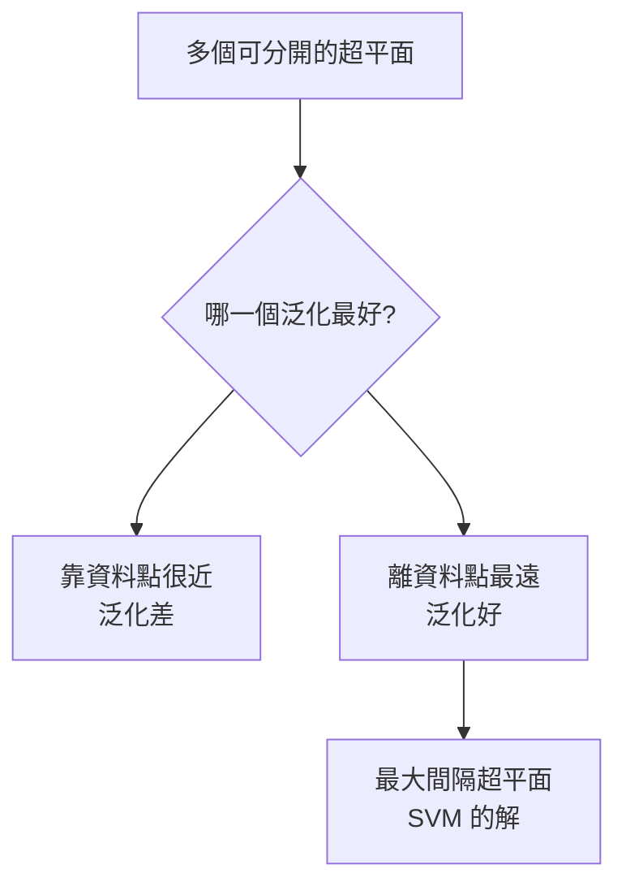
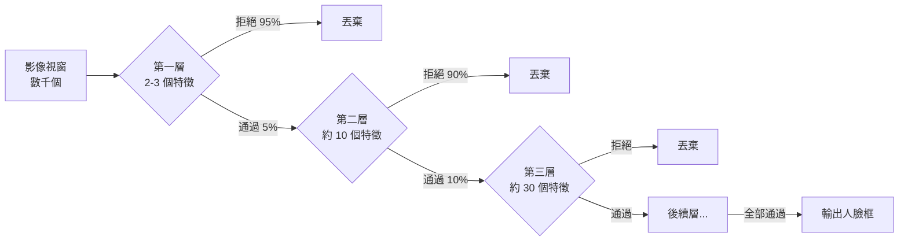
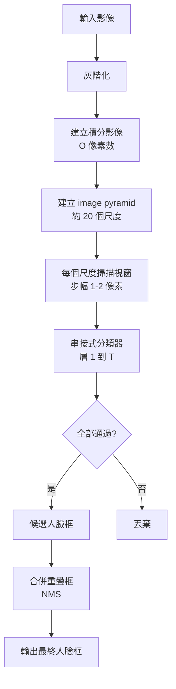

# 3.2 支援向量機與 Viola-Jones 人臉偵測（1995-2001）

3.1 節的 pipeline 末端是一個分類器。為什麼在 2000 年代，幾乎所有影像分類與偵測的競賽冠軍都用同一個演算法？答案是 **支援向量機（SVM）**。本章從 SVM 的幾何出發，說明它為何在數千維稀疏特徵上特別有效，然後轉向它最著名的非分類應用：Viola-Jones 人臉偵測器。

本章的核心論點是：**2000 年代的機器視覺，並不是「深度學習還沒出現」而已，而是「統計學習把當時能榨出的成果榨乾了」**。Viola-Jones 是這條路的頂峰成就——它把人臉偵測帶進了消費電子——同時也是它的極限最明顯的案例。

---

## 3.2.1 SVM 的幾何：最大間隔分離

### 問題設定

給定訓練資料 $ \{ (\mathbf{x}_i, y_i) \}_{i=1}^{n} $，其中 $ \mathbf{x}_i \in \mathbb{R}^d $，$ y_i \in \{-1, +1\} $。要找一個超平面

$$
\mathbf{w}^T \mathbf{x} + b = 0
$$

把兩類分開。決策函數為 $ f(\mathbf{x}) = \mathrm{sign}(\mathbf{w}^T \mathbf{x} + b) $。

**關鍵的洞察**：如果有多個能分開資料的超平面，應該選哪一個？

### 幾何直覺：最大間隔

考慮最靠近超平面的幾個樣本點，它們與決策邊界的距離稱為**間隔（margin）**。其中距離最小的那個點決定了間隔的大小。



為什麼間隔大比較好？可以用 VC 維度說明。SVM 的決策邊界由少數幾個**支援向量（support vectors）**決定，其複雜度受控於 $ \lVert \mathbf{w} \rVert $ 與間隔 $ \gamma = 1/\lVert \mathbf{w} \rVert $ 的乘積：

$$
\text{VC 維度} \lesssim \min\left(d, \frac{R^2}{\gamma^2}\right)
$$

其中 $ R $ 是資料的半徑。間隔越大，$ \gamma $ 越大，VC 維度越小，模型複雜度越低，泛化誤差有保障。

### 硬間隔的優化問題

要讓間隔最大，等價於最小化 $ \lVert \mathbf{w} \rVert $。形式化為：

$$
\min_{\mathbf{w}, b} \frac{1}{2} \lVert \mathbf{w} \rVert^2
\qquad \text{s.t.} \quad y_i(\mathbf{w}^T \mathbf{x}_i + b) \ge 1, \quad i = 1, \dots, n
$$

這個正規化因子選 $ \frac{1}{2} $ 而不是 $ \lVert \mathbf{w} \rVert $ 是為了讓後續對偶問題的拉格朗日乘子恰好等於 $ \frac{1}{2} $ 形式，從而簡化 KKT 條件的表達。

約束的意義：$ y_i = +1 $ 的點必須滿足 $ \mathbf{w}^T\mathbf{x}_i + b \ge 1 $，$ y_i = -1 $ 的點必須滿足 $ \mathbf{w}^T\mathbf{x}_i + b \le -1 $。這兩條邊界即**間隔超平面**。

### 對偶問題

用拉格朗日乘子 $ \alpha_i \ge 0 $ 構造拉格朗日函數：

$$
L(\mathbf{w}, b, \boldsymbol{\alpha}) = \frac{1}{2}\lVert \mathbf{w} \rVert^2 - \sum_{i=1}^{n} \alpha_i \left[ y_i(\mathbf{w}^T \mathbf{x}_i + b) - 1 \right]
$$

對 $ \mathbf{w} $ 與 $ b $ 取偏導並令為零：

$$
\frac{\partial L}{\partial \mathbf{w}} = 0 \implies \mathbf{w} = \sum_{i=1}^{n} \alpha_i y_i \mathbf{x}_i
$$

$$
\frac{\partial L}{\partial b} = 0 \implies \sum_{i=1}^{n} \alpha_i y_i = 0
$$

代回後得對偶問題：

$$
\max_{\boldsymbol{\alpha}} \sum_{i=1}^{n} \alpha_i - \frac{1}{2} \sum_{i=1}^{n} \sum_{j=1}^{n} \alpha_i \alpha_j y_i y_j \, \mathbf{x}_i^T \mathbf{x}_j
\qquad \text{s.t.} \quad \alpha_i \ge 0, \quad \sum_i \alpha_i y_i = 0
$$

KKT 條件告訴我們：**只有對偶乘子 $ \alpha_i > 0 $ 的樣本對原始解有貢獻**，這些樣本就是支援向量。而且對這些樣本，約束是緊的：

$$
y_i(\mathbf{w}^T \mathbf{x}_i + b) = 1
$$

**這意味著決策函數只依賴少量樣本**：

$$
f(\mathbf{x}) = \sum_{i \in SV} \alpha_i y_i \, \mathbf{x}_i^T \mathbf{x} + b
$$

在高維稀疏的視覺特徵上，$ \alpha_i > 0 $ 的樣本比例通常只有 1%-5%，這就是 SVM 訓練快、模型小的原因。

### 核技巧

對偶問題的目標函數只透過內積 $ \mathbf{x}_i^T \mathbf{x}_j $ 依賴資料。這開了一個口子：**只要能定義一個對應到某個特徵空間的內積函數 $ K $**，就可以在原始空間求解一個在特徵空間中線性可分的問題：

$$
\mathbf{x}_T \mathbf{x} \;\longrightarrow\; K(\mathbf{x}, \mathbf{x}')
$$

決策函數變成：

$$
f(\mathbf{x}) = \sum_{i \in SV} \alpha_i y_i \, K(\mathbf{x}_i, \mathbf{x}) + b
$$

**核技巧的直覺**：原始空間中不可分的資料，在某個（通常更高維的）特徵空間中可能線性可分——這正是「把彎的邊界變成直的」的數學版本。SVM 不需要知道特徵映射 $ \phi $ 是什麼，只需要內積值。

常見的核：

| 核 | 定義 | 適用情境 |
|---|---|---|
| 線性核 | $ K(\mathbf{x},\mathbf{x}') = \mathbf{x}^T \mathbf{x}' $ | 高維稀疏特徵、HOG |
| 多項式核 | $ K = (\gamma \mathbf{x}^T\mathbf{x}' + c)^p $ | 特徵間有交互作用 |
| RBF（高斯）核 | $ K = \exp(-\gamma \lVert \mathbf{x}-\mathbf{x}' \rVert^2) $ | 一般分類，決策邊界圓滑 |
| HIK（直方圖交集） | $ K(\mathbf{x},\mathbf{x}') = \sum_k \min(x_k, x'_k) $ | 直方圖特徵，BoVW 標配 |

### 軟間隔與鬆弛變數

真實資料幾乎永遠不是完美可分的（標註雜訊、重疊類別、outlier）。硬間隔 SVM 在這種情況下**無解**（或者間隔被一個離群點壓到極小）。

軟間隔引入鬆弛變數 $ \xi_i \ge 0 $ 與代價參數 $ C $：

$$
\min_{\mathbf{w}, b, \boldsymbol{\xi}} \frac{1}{2}\lVert \mathbf{w} \rVert^2 + C \sum_{i=1}^{n} \xi_i
\qquad \text{s.t.} \quad y_i(\mathbf{w}^T \mathbf{x}_i + b) \ge 1 - \xi_i
$$

- 若 $ \xi_i = 0 $：該點在間隔之外，分類正確且有餘裕。
- 若 $ 0 < \xi_i < 1 $：該點在間隔之內但預測正確。
- 若 $ \xi_i > 1 $：該點被**誤分類**。

**$ C $ 的意義是「容忍多少違規」的價格**。$ C$ 大 → 幾乎不允許違規 → 容易過擬合；$ C$ 小 → 允許更多違規 → 邊界更平滑、泛化更好。在視覺特徵上，$ C = 0.01 \sim 1$ 是常見範圍。

---

## 3.2.2 為什麼 SVM 特別適合視覺高維稀疏特徵

這是本章最重要的實踐性問題。SVM 在 1990 年代中期（Vapnik 與 Chervonenkis）發展時，主流看法是它在中小規模、低維度的資料上表現好。

視覺的處境卻是**高維 + 稀疏 + 小樣本**，這正好是 SVM 的甜蜜點。

### 理由一：維度高 → 間隔機率大

Mhaskar 與 Poggio 的經典分析給出：在 $ n $ 個 $ d $ 維球面上的隨機點上，最大間隔分隔超平面的幾何機率有下界：

$$
P(\text{正確分類}) \ge 1 - n \exp\left(-\gamma^2 \frac{(d-1)}{2}\right)
$$

在 $ d \gg n^2 $ 的情況下，這個界接近 1。**當維度遠高於樣本數時，隨機投影的方向天然就能把資料分開**，這就是「維度災難的另一面」。

對 HOG 的 3780 維特徵用 500 個訓練樣本分類，$ d \gg n^2 $ 輕鬆成立。

### 理由二：稀疏性讓核計算便宜

HOG 特徵的非零比例通常在 5%-20%；BoVW 的 1000 維直方圖非零比例常低於 5%。稀疏表示讓：

- 內積計算只需遍歷非零項
- liblinear 等稀疏感知求解器可用
- 訓練時的有效樣本數受限於非零特徵組合數

### 理由三：正則化是「免費」的

SVM 的 $ \lVert \mathbf{w} \rVert $ 正則化項由對偶問題的結構保證，無需手動做特徵選擇或早停。在「特徵數 >> 樣本數」的 regime 下，這種**結構性正則化**遠優於需要交叉驗證挑_lambda_ 的 L1/L2 正則化模型。

### 理由四：VC 維度界給了理論保證

雖然是鬆散的保證，但它是當時少數能給出的、非經驗性的泛化論述。在一篇 PASCAL VOC 的競賽報告裡寫上「由 VC 維度界給出泛化誤差上界」是很有說服力的。

### 對照：SVM vs 神經網路（2000 年代的主流爭論）

| 面向 | SVM | 前饋式神經網路 |
|---|---|---|
| 泛化理論 | 有（VC 維度） | 弱，當時主要靠經驗驗證 |
| 訓練速度 | 小樣本快；大樣本慢（$ O(n^2) $ 記憶體） | 大樣本相對快 |
| 超參數 | 少（$ C, \gamma $） | 多（架構、初始化、正則、early stop） |
| 特徵表達力 | 核技巧是固定的、非學習的 | 層次特徵是學習的 |
| 硬體需求 | CPU 即可 | 早期 CPU 訓練 CNN 極慢 |
| 2005 年地位 | 影像分類事實標準 | 幾乎被遺棄 |

**這個對照表的右下角就是 3.3 節的主題。**

---

## 3.2.3 核方法在視覺上的應用與加速

### HIK：直方圖交集核（2005）

Histogram Intersection Kernel 由 Shin, Scheuermann, Morros 於 2005 年提出（CVPR 論文《Normalized Histogram Intersection Kernel for Image Classification》），並在 OpenCV 的 `cv::HOGDescriptor` 中作為行人偵測的預設分類器。

定義：

$$
K(\mathbf{a}, \mathbf{b}) = \sum_{k=1}^{D} \min(a_k, b_k)
$$

**它為什麼特別適合直方圖？** 因為直方圖是**非負且總和固定**的稀疏向量，$\min(a_k, b_k)$ 恰好度量了兩張直方圖在每個 bin 上「共同擁有」的量。任何一個 bin 一旦在一方為零，該維貢獻就是零。這個 kernel 可以理解為**兩個分布的 L1 型重疊度量**（正規化後其實是 total variation 的一半）。

HIK 是**正半定**的（可證明），所以可以直接餵給 SVM。它比 RBF 核更好，因為：

- RBF 對高維稀疏向量算距離時，會被大量零維度「稀釋」，距離趨近於常數
- HIK 只看非零維度的重疊

實務上 HIK 常用於 HOG 特徵，效果通常優於 RBF。

### 隨機特徵（Random Fourier Features, 2007）

Rahimi 與 Recht 在 2007 年（NIPS）的《Random Features for Large-Scale Kernel Machines》中提出：既然 RBF 核無法精確計算，可以用隨機投影近似其特徵映射。

RBF 核的特徵映射是無限維的，但它的傅立葉變換在特徵空間中是**平移不變的**。這意味著內積可以寫成對某個隨機特徵映射的期望：

$$
K(\mathbf{x}, \mathbf{y}) = \mathbb{E}_{\boldsymbol{\omega}} \left[ \sqrt{2/D} \cos(\boldsymbol{\omega}^T(\mathbf{x}-\mathbf{y}) + b) \right]
$$

其中 $ \boldsymbol{\omega} $ 從高斯分佈抽樣。取 $ D $ 個隨機樣本，就得到 $ D $ 維的近似特徵：

$$
\mathbf{z}(\mathbf{x}) = \frac{1}{\sqrt{D}} \left[ \cos(\boldsymbol{\omega}_1^T \mathbf{x} + b_1), \dots, \cos(\boldsymbol{\omega}_D^T \mathbf{x} + b_D) \right]^T
$$

使得 $ \mathbf{z}(\mathbf{x})^T \mathbf{z}(\mathbf{y}) \approx K(\mathbf{x}, \mathbf{y}) $。

**為什麼視覺界需要它？** 因為 RBF-SVM 的訓練複雜度是 $ O(n^2) $ 到 $ O(n^3) $，且推論時要計算所有支援向量的核值。當訓練集到 10 萬級（例如行人偵測），RBF-SVM 變得不實用。隨機特徵把核機器轉成**線性模型**，可以用 SGD 訓練、可增量更新、推論只需一次矩陣乘法。

### 直方圖梯度的加速

另一個方向是**改變特徵的計算方式**以配合線性分類器。Felzenszwalb 與 Grinsztajn 提出的 **Histogram of Oriented Gradients 的改進**（HOG 的 fast variant，2008/2013）在行人偵測上有明確優勢：

- 以**列區塊（column block）**為單位計算梯度，只對列做一次差分再沿列累加，減少記憶體存取
- 對 cell 做**雙線性插值**投票，而非硬分割
- 迴圈順序最佳化以利用 cache

這些微最佳化的累積效果，是 HOG + SVM 能在 2008-2012 年成為行人偵測工業界事實標準的直接原因。

### sklearn 的 SVC 與 LinearSVC

```python
from sklearn.svm import SVC, LinearSVC, LinearSVR
```

| 項目 | `SVC` | `LinearSVC` |
|---|---|---|
| 核 | RBF / poly / linear / 自訂 | 僅線性（hinge loss） |
| 求解 | SMO（整合工作集） | liblinear / SGD |
| 支援向量 | 數量隨 $ C $ 與核變化 | 全部樣本稀疏化到 $ w $ |
| 支援向量機多類 | one-vs-one | one-vs-rest |
| 適用 | 小中樣本、$ n < 10^4$ | 大樣本、稀疏高維 |
| 可處理稀疏 X | 支援（CSR） | 支援且更快 |

**視覺上的選擇原則**：HOG + 數千到數萬訓練樣本 → `LinearSVC`（或 `LinearSVC` + HIK）；小樣本、非稀疏 → `SVC(kernel='rbf')`。

---

## 3.2.4 AdaBoost（1996）：把一千個特徵變成幾百個

Viola-Jones 的故事必須先講 AdaBoost，因為它是整個方法的核心機制。

### 演算法

Freund 與 Schapire 於 1996 年提出 Adaptive Boosting。基本想法極簡：**串接許多個弱分類器，每個新的弱分類器專注修正前面所有分類器的錯誤。**

演算法（SAMME 版本， Viola-Jones 使用）：

**初始化**：給每個樣本權重 $ w_i = \frac{1}{n} $，選一個弱分類器 $ h_1 $。

**每一輪 $ t = 1, 2, \dots, T $**：

1. 在當前權重下訓練一個弱分類器 $ h_t $（Viola-Jones 用的是一個特徵 + 閾值）
2. 計算加權錯誤率：

$$
\epsilon_t = \frac{\sum_{i=1}^{n} w_i \left[ h_t(\mathbf{x}_i) \neq y_i \right]}{\sum_{i=1}^{n} w_i}
$$

3. 更新樣本權重：**被分錯的樣本權重乘以 $\beta$**，分對的不變：

$$
w_i \leftarrow w_i \beta^{\mathbb{1}[h_t(\mathbf{x}_i) \neq y_i]}, \qquad
\beta = \frac{1-\epsilon_t}{\epsilon_t}
$$
4. 重新正規化使 $\sum_i w_i = 1 $
5. 記錄弱分類器權重 $ \alpha_t = \log\left(\frac{1-\epsilon_t}{\epsilon_t}\right) $

**最終分類器**：

$$
F(\mathbf{x}) = \mathrm{sign}\left( \sum_{t=1}^{T} \alpha_t h_t(\mathbf{x}) \right)
$$

### 直覺

權重更新讓模型「記住」上一輪錯了什麼。樣本分錯一次，權重乘以 $ \beta = (1-\epsilon)/\epsilon $（當 $\epsilon < 0.5$ 時 $ \beta > 1 $）。若一個樣本被連續錯很多次，它的權重會急遽上升，逼迫下一個弱分類器去關注它。

這是一種**串列式的 boosting**，與隨機森林的 bagging（並行的投票）不同。串列的好處是**每個新分類器都是對殘差的修正**；壞處是錯誤會累積，且必須串行執行。

### 為什麼用它來挑特徵

這是 Viola-Jones 的關鍵設計。Viola-Jones 有數千個候選特徵（不同尺寸的 Haar-like 矩形，在不同位置的灰階總和之差）。在每一輪 boosting 中：

- **候選弱分類器**：取一個特徵 $ f_j $ 和一個閾值 $ \theta $，定義 $ h_{t,j}(\mathbf{x}) = \mathbb{1}[f_j(\mathbf{x}) > \theta] $
- 選出加權錯誤率最低的那一個作為 $ h_t $
- 重複 $ T $ 輪

結果：**數千個候選特徵，最後只選出 $ T $ 個（實作中通常幾百到一千多個）**，而且這幾百個是被 boosting「精挑細選」出來的，每一個都帶著權重 $ \alpha_t $。

這是一種**機制化的特徵選擇**，而且選擇標準與分類目標直接相關——這比 3.1 節的「人手指定方向 bin」前進了一大步，因為**特徵的挑選方向是被資料決定的**。

### 正負樣本極度不平衡的處理

人臉偵測的訓練資料形狀是：正樣本（人臉）可能幾千張，負樣本（非人臉視窗）可能數萬到數十萬張，比率可達 1:100 以上。這會造成兩個問題：

**問題一：多數類別主導損失。** 若全部樣本平均，模型只要一直猜「非人臉」就能達到 99% 準確率。

**問題二：極少數的正樣本不足以覆蓋人臉的變化。** 幾千張人臉無法涵蓋姿勢、光照、膚色、妝容、眼鏡、口罩等組合。

**Viola-Jones 的解法**：

1. **正樣本下採樣（downsampling）**。不使用所有負樣本，而是隨機抽取約 10:1 到 30:1 的負樣本來平衡。理由是負樣本數量對「學到哪些特徵」的影響其實有限——真正提供資訊的是那些**最像人臉但不是人臉**的 hard negatives。
2. **加入 hard negatives（負例挖掘）**。用訓練好的分類器在未使用的自然影像上掃描，把被誤判為人臉的視窗加進負樣本集，重新訓練。這是 boosting 時代的標準技巧。
3. **對正樣本做變形增強**。人工加上小幅平移、旋轉、縮放、亮度變化，把幾千張變成數萬張。
4. **正樣本內再做平衡**：所有正樣本權重相等。

**要點**：$ \beta = (1-\epsilon)/\epsilon $ 的形式要求 $ \epsilon < 0.5 $，否則 $ \beta < 1 $ 會讓權往正確的樣本跑，演算法退化。所以負樣本比例不能太高，**保持 $\epsilon < 0.5$ 是硬性條件**。

---

## 3.2.5 積分影像：讓矩形特徵變成 O(1)

Viola-Jones 的 Haar-like 特徵是這樣的：

```mermaid
flowchart LR
    subgraph HAAR[Haar-like 特徵族]
      A1[兩矩形: 水平<br/>黑-白-黑]
      A2[兩矩形: 垂直<br/>白-黑-白]
      A3[三矩形: 水平<br/>黑-白-黑-白]
      A4[三矩形: 垂直]
      A5[四矩形: 對角<br/>棋盤]
    end
    HAAR --> F[值 = 灰階總和之差]
    F --> II[積分影像<br/>任意矩形和 O(1)]
```

Haar-like 特徵最早來自 Viola 與 Jones 2001 年的論文，其原型是 Papoulis 與 Marr 與 Poggio 提出的 Haar-like 小波（Marr 1982 已在手寫數字辨識中使用過類似特徵）。

一個兩矩形特徵的值是：

$$
f(x,y) = \sum_{p \in \text{left}} I(p) - \sum_{p \in \text{right}} I(p)
$$

若直接計算，單一特徵需要遍歷數百個像素。**積分影像（integral image / summed-area table）** 把這降到 O(1)。

定義：

$$
S(x,y) = \sum_{0 \le x' < x,\; 0 \le y' < y} I(x', y')
$$

遞迴式：

$$
S(x,y) = I(x,y) + S(x-1,y) + S(x,y-1) - S(x-1,y-1)
$$

建表只需 O(像素數)。而任意矩形的總和可由四個積分影像值求得：

$$
\text{Sum}(x_1, y_1, x_2, y_2) = S(x_2, y_2) - S(x_1-1, y_2) - S(x_2, y_1-1) + S(x_1-1, y_1-1)
$$

**於是每個 Haar-like 特徵的計算成本是 4 次查表加 1 次相減**——這是 O(1)，與特徵尺寸無關。這是整個 Viola-Jones 能夠快的技術關鍵。

積分影像的想法由 Viola 與 Jones 在 2001 年論文中提出（Wolfe 與 Rangarajan 的相關工作同期）。**注意：Viola-Jones 論文本身沒有使用像素值正規化（沒有除以面積），這是其後續變體（如 Lienhart 與 Maydt 的改進）修正的重點。**

---

## 3.2.6 Viola-Jones 人臉偵測器（2001）

### 偵測與分類的區別

這是理解 Viola-Jones 的前提。

| | 分類 | 偵測 |
|---|---|---|
| 輸入 | 已經裁切好的影像 | 整張影像，不知道物件在哪 |
| 輸出 | 一個類別標籤 | 一組「框 + 類別」 |
| 核心難題 | 判別 | **搜尋空間的複雜度** |

一張 640×480 的影像，若掃描步幅為 8 像素，就有 $ 80 \times 60 = 4800 $ 個視窗。每個視窗還要考慮多個尺度。**偵測的真正瓶頸不是「分類準不準」，而是「要分類多少次」。**

Viola-Jones 的解法有兩層：**用金字塔處理尺度**，**用串接式分類器處理搜尋效率**。

### 影像金字塔處理尺度

建立一個 image pyramid：把影像縮小成多個尺度（例如每層縮 1.2 倍，共 20 層左右），在每個尺度上用固定的視窗大小掃描，再把偵測到的框映射回原圖座標。

**問題**：金字塔每一層的掃描視窗數不同——小尺度層的視窗數是大尺度層的（1.2² ≈ 1.44）倍。若在每一層都掃描，總視窗數會爆炸。

**Viola-Jones 的解法是尺度相關的特徵尺寸 + 積分影像的 O(1) 特性**：在原始解析度下建立一次積分影像，然後在**縮小的影像**上用**同樣像素尺寸的 Haar-like 特徵**做偵測。Haar-like 特徵本身是「相對尺寸」的（例如 2×2 個基本單位），所以在縮小影像上算出的特徵值，會自動對應到原圖上更大尺度的特徵。這樣積分影像只需建立一次，掃描則在縮小層進行。

**這是整個方法最漂亮的部分**：把尺度處理的負擔從「重新建立特徵」轉移到「特徵的相對性」。

### 串接式分類器（Cascade）

單一 AdaBoost 分類器有幾百到一千多個特徵。若所有視窗都要跑完整個分類器，4,800 個視窗 × 多尺度 × 上千特徵，速度不可接受。

**串接式的想法**：把 $ T $ 個 AdaBoost 分類器串成一條鏈，每個都是前一輪訓練的「弱化版」：



**每層的訓練方式**：

1. 先訓練完整的 $ T $ 層 AdaBoost 分類器（用所有特徵）
2. 計算完整分類器在驗證集上的 ROC 曲線，選擇一個**低偵測率的工作點**（例如偵測率 99.9%）
3. 用這個門檻截斷，分別在各個深度截斷，得到 $ T $ 個「淺版」分類器
4. **關鍵**：把每個截斷後的分類器当作一個獨立的負樣本訓練集，訓練一個**新的、只有 2-3 個特徵的 AdaBoost**來逼近它

第 4 步讓前幾層非常便宜（只有幾個特徵），但仍能維持極高的偵測率。

**機率式思考**：假設每層都接受「前一階段輸出的所有正樣本」與「隨機負樣本中的 50%」。

- 第 1 層：接受所有真實人臉（偵測率 ~100%），拒絕 50% 的背景 → 剩 50%
- 第 2 層：再拒絕 50% → 剩 25%
- 第 3 層：再拒絕 50% → 剩 12.5%
- 第 $ T $ 層：剩 $ 0.5^T $，$ T=10$ 時剩 0.1%

於是只有約 0.1% 的視窗需要跑完整條鏈。而被丟棄的視窗中，被誤判為人臉的比例被控制在極低水準。

**計算量估算**：假設 4,800 個視窗 × 10 個尺度 = 48,000 個視窗。第 1 層只有 3 個特徵，每個特徵 O(1)，所以總成本約 $ 48000 \times 3 = 14.4 $ 萬次查表——在 2001 年的 CPU 上這是毫秒級的。而沒有串接的話，需要 $ 48000 \times 500 = 2400 $ 萬次特徵計算，慢 100 倍以上。

### 完整的 Viola-Jones 架構



### 訓練資料

- **正樣本**：約 350 張人臉影像標註了框與 9 個關鍵點（眼睛、鼻子、嘴角等），經過裁切、縮放、水平翻轉、輕微旋轉、亮度與對比變換，產生約 24,000 個正樣本視窗。
- **負樣本**：從不包含人臉的影像中隨機取樣視窗，最初比例約 1:1（經過平衡處理），最終約 10,000 張。
- **hard negatives**：用初版分類器在更多影像上掃描，加入被誤判的視窗。

**注意正樣本數量的重要性**：24,000 個正樣本視窗來自 350 張原始影像。變形增強增加了數量，但**多樣性的根本限制沒有突破**——這是 3.3 節會回到的資料瓶頸。

### 影響

Viola-Jones 的公開原始碼（`haarcascade_frontalface_default.xml`）隨 OpenCV 發布，成為 2000 年代**最快的人臉偵測器**。

- 2002-2010 年間，幾乎所有消費性數位相機都內建了類似架構的人臉偵測，用於**自動對焦與自動曝光**（把人臉放在畫面中央、依人臉區域測光）
- **照片分組**：Apple iPhoto（2002）與 Google Picasa（2004）用類似技術做「相似照片自動分組」
- 微軟的 Windows Vista / Live 附屬應用、Instant Messaging 的視訊頭像偵測
- 學術影響：Boosting 與串接式架構（後來在 OpenCV 的 `objdetect` 模組、深度框架的 cascade R-CNN 中仍被繼承）

**這是機器視覺第一次大規模走進消費電子產品**——這句話不是修辭。2005 年之前，一台數位相機的對焦系統是純機械或純相位偵測的；2005 年之後，人臉偵測改變了成像流程本身。

---

## 3.2.7 同時代的其他偵測器

### HTemplate（2001）

Ahmed, Torralba, Ponce 於 2001 年 CVPR 提出的稀疏表示偵測框架。核心想法：**用字典 $ D $ 對影像窗做稀疏編碼，稀疏係數中每個非零項對應一個字典元素的位置**——這正是 3.1.4 節 BoVW 的思想，但用於**定位**而非分類。它是 2000 年代初期「特徵 → 稀疏編碼 → 匹配」這條研究路線的重要源頭（後來演化成 sparse coding-based classification，2009-2011）。

### Bag-of-Features / Bag of Visual Words for detection（2007-2009）

把 BoVW 用於偵測的嘗試。代表工作包括 Kumar 與 Grauman 的《Building a better object detector: ...》(2009) 與 Philbin 等人的「Object Detection with Discriminatively Trained Part Based Models」(2008, DPM 的前身)。

**DPM（Deformable Part Models, Felzenszwalb et al., 2010）** 是這條路線的高點，也是深度學習之前的最強方法：在 HOG 之上，用每個部件（part）的 HOG 描述子加上一組**形變成本（deformation cost）**來處理姿態變化。DPM 在 PASCAL VOC 2010 上取得 AP ~0.33，長期是深度方法出現前的冠軍。

DPM 的核心機制值得預先理解，因為它預告了深度方法的對應物：

| DPM 元件 | 深度對應物 |
|---|---|
| HOG 特徵 | 卷積層特徵 |
| 部件的固定位置與高斯分佈 | 隱藏層的平移不變性 |
| 形變成本 | 可變形卷積 / transformer 位移 |
| Latent SVM 訓練 | 端到端反向傳播 |

### HOG + SVM 行人偵測（2005）

Dalal 與 Triggs 的第二篇著名論文（與 HOG 描述子同篇發表，但聚焦於偵測應用）。實驗結論：

- 在 MIT Person Dataset 上，HOG + linear SVM 的 miss rate 遠低於 SIFT + SVM
- 即時性（real-time）可行
- **後續五年，HOG + SVM 成為行人偵測的工業界標準**（Dalal 與 Triggs 2005 論文引用數至今數萬）

**與 Viola-Jones 的一個重要對比**：

| | Viola-Jones | HOG + SVM |
|---|---|---|
| 物件 | 只有人臉 | 行人（後推廣至車輛等） |
| 特徵 | Haar-like 矩形 | 梯度方向直方圖 |
| 分類器結構 | 串接 boosting | 單一線性 SVM |
| 搜尋 | 串接級聯（大量快速否決） | 密集掃描 + 滑窗 |
| 速度 | 極快 | 較慢 |
| 對姿態 | 幾乎無能力 | 需處理（後來靠 DPM） |

兩者共同構成了 2000 年代的偵測器工具箱，也共同暴露了同一個限制：**特徵是手工的、固定的**。

---

## 3.2.8 為什麼 Viola-Jones 被取代

Viola-Jones 的成功建立在一組假設上，而這組假設在 2010 年代一一失效。

### 假設一：Haar-like 特徵足以表達人臉

Haar-like 特徵是**軸對齊矩形內的灰階總和差**。這類特徵能表達的是「水平亮度對比」與「垂直亮度對比」——這確實捕捉到眼睛（水平暗帶）、鼻子（垂直）、嘴巴（水平）等。但它無法表達：

- **旋轉**：45 度歪頭的人臉，軸對齊矩形無法描述
- **尺度**：由金字塔處理，但只是「把同一組特徵放大縮小」，不是尺度自適應的描述子
- **膚色以外的變化**：戴眼鏡、口罩、鬍鬚、陰影、化妝
- **非剛性形變**：笑、張嘴、轉頭

**關鍵的量化事實**： Viola-Jones 在無約束人臉上（如 LFW）的偵測率雖然可以調到很高，但虛報率（false positives）隨影像複雜度急遽上升。在 2000 年代常見的 640×480 消費照片上還能接受，在 2010 年代的手機高解析度照片上就有明顯的誤報。

### 假設二：只有「人臉」這一個類別

Viola-Jones 的標籤空間是 $\{ \text{face}, \text{non-face} \}$，是**二元的**。要偵測人、貓、狗、車，各自要訓練一個獨立的偵測器，各需自己的正樣本、各需自己的串接式鏈、各需自己的 hard negatives。**N 個類別就是 N 倍的工程量**——這與深度時代「一個模型多類別」形成尖銳對比。

### 假設三：特徵必須由人指定

這是三個假設中最根本的一個，也是 3.3 節要清算的對象。

深度學習的偵測器（YOLO、R-CNN 系列、SSD）在結構上是 Viola-Jones 的一個「學術化後裔」：

| Viola-Jones | 深度偵測器 |
|---|---|
| Haar-like 特徵（人工指定） | 卷積核（從資料學出） |
| AdaBoost 選特徵（機制化但仍是離散選取） | 梯度下降連續調整所有核 |
| 串接式否決 | 相同（Fast R-CNN 的 RPN、YOLO 的多尺度預測） |
| 二元分類 | 多類別 softmax |
| 積分影像 O(1) 特徵 | 卷積的高效實作（等價的「共享計算」） |
| 手工正樣本 | 標註框資料 |

**CNN 偵測器並沒有否定 Viola-Jones 的架構——它學會了同一個架構的參數。** 這正是深度學習最迷人的地方：它不是推翻既有方法，而是找到一個方法族，把其中的「設計決策」從人工選擇變成從資料學出。

### 2012 年之後的實際情況

- **2012-2015**：DPM 與其後繼占據 PASCAL VOC 榜首
- **2014**：R-CNN 用 CNN 取代 HOG，DPM 的份額被快速侵蝕
- **2015**：Faster R-CNN 把 Viola-Jones 式的「候選框 + 分類」串接做了端到端
- **2016**：YOLO 走向實時，串接式否決被多尺度回歸取代

---

## 3.2.9 實作

### HOG + SVM 分類（sklearn）

```python
import numpy as np
from sklearn.datasets import load_digits
from sklearn.model_selection import train_test_split
from sklearn.svm import LinearSVC, SVC
from sklearn.metrics import accuracy_score
from sklearn.pipeline import make_pipeline
from sklearn.preprocessing import StandardScaler
from skimage.feature import hog

X, y = load_digits(return_X_y=True)
X = X.reshape(-1, 8, 8)

def hog_feat(img, orientations=9, ppc=(4, 4), cpb=(2, 2)):
    return hog(
        img,
        orientations=orientations,
        pixels_per_cell=ppc,
        cells_per_block=cpb,
        block_norm="L2-Hys",
        transform_sqrt=True,
    )

Xh = np.array([hog_feat(i) for i in X])
Xtr, Xte, ytr, yte = train_test_split(Xh, y, test_size=0.3, random_state=0)

# 稀疏高維 -> LinearSVC
lin = make_pipeline(StandardScaler(), LinearSVC(C=0.1, dual="auto"))
lin.fit(Xtr, ytr)
print("LinearSVC:", accuracy_score(yte, lin.predict(Xte)))

# 小樣本、非稀疏 -> RBF SVC
rbf = make_pipeline(StandardScaler(), SVC(kernel="rbf", C=10, gamma="scale"))
rbf.fit(Xtr, ytr)
print("RBF SVC :", accuracy_score(yte, rbf.predict(Xte)))
```

### 自製 HIK + SVM

```python
from sklearn.base import BaseEstimator, TransformerMixin
from sklearn.svm import SVC

class HistogramIntersectionKernel(BaseEstimator, TransformerMixin):
    """把樣本轉為正規化直方圖，使線性內積等價於 HIK。"""

    def fit(self, X, y=None):
        return self

    def transform(self, X):
        X = np.asarray(X, dtype=float)
        X = X / (X.sum(axis=1, keepdims=True) + 1e-12)
        return X

# HIK(a, b) = sum(min(a_i, b_i))；對正規化非負直方圖可用逐維 clip 近似
class HIKLinearSVC:
    """示範：以正規化 + clip 實作 HIK 風格內積。"""

    def fit(self, X, y):
        self.X = np.asarray(X, float)
        self.X = self.X / (self.X.sum(axis=1, keepdims=True) + 1e-12)
        self.clf = LinearSVC(C=1.0, dual="auto")
        self.clf.fit(self.X, y)
        return self

    def predict(self, X):
        X = np.asarray(X, float)
        X = X / (X.sum(axis=1, keepdims=True) + 1e-12)
        return self.clf.predict(X)
```

### OpenCV Haar cascade 人臉偵測

```python
import cv2

# 內建預訓練 cascade（OpenCV 提供 frontalface / eye / smile 等）
cascade = cv2.CascadeClassifier(
    cv2.data.haarcascades + "haarcascade_frontalface_default.xml"
)

img = cv2.imread("portrait.jpg")
gray = cv2.cvtColor(img, cv2.COLOR_BGR2GRAY)
gray = cv2.equalizeHist(gray)   # 直方圖均衡化常能顯著改善偵測率

faces = cascade.detectMultiScale(
    gray,
    scaleFactor=1.1,   # 金字塔每層縮放比例；越小越準但越慢
    minNeighbors=5,    # 鄰域內鄰接框數的下限；越大越嚴格
    minSize=(30, 30),  # 最小視窗尺寸
)

for (x, y, w, h) in faces:
    cv2.rectangle(img, (x, y), (x + w, y + h), (0, 255, 0), 2)

cv2.imwrite("detected.jpg", img)
print("偵測到人臉數:", len(faces))
```

**這段程式碼裡的每一個參數都對應本章的內容**：

- `scaleFactor` 直接對應 **image pyramid** 設計
- `detectMultiScale` 的內部流程直接對應 **串接式分類器**（`detectMultiScale` 內部呼叫 `cv::HaarEvaluator`）
- `minNeighbors` 是**非極大抑制**（NMS）的參數
- `equalizeHist` 是對應 HOG 的 **block normalization** 的簡化版對策

### 從頭實作 Haar-like 特徵與積分影像

```python
import numpy as np

def integral_image(img):
    """建立積分影像 S[x, y] = sum of I[0:x, 0:y]."""
    S = np.zeros((img.shape[0] + 1, img.shape[1] + 1), dtype=np.float64)
    S[1:, 1:] = img.cumsum(axis=0).cumsum(axis=1)
    return S

def rect_sum(S, x, y, w, h):
    """用四個角查表求任意矩形的灰階總和。"""
    return S[y + h, x + w] - S[y, x + w] - S[y + h, x] + S[y, x]

def haar_two_rect(gray, x, y, w, h, vertical=True):
    """兩矩形 Haar-like 特徵：沿水平或垂直中線切半，取差。"""
    S = integral_image(gray)
    if vertical:
        hw = w // 2
        a = rect_sum(S, x, y, hw, h)
        b = rect_sum(S, x + hw, y, w - hw, h)
    else:
        hh = h // 2
        a = rect_sum(S, x, y, w, hh)
        b = rect_sum(S, x, y + hh, w, h - hh)
    return a - b

def haar_three_rect(gray, x, y, w, h, vertical=True):
    """三矩形 Haar-like 特徵：黑-白-黑或白-黑-白。"""
    S = integral_image(gray)
    if vertical:
        tw = w // 3
        a = rect_sum(S, x, y, tw, h)
        b = rect_sum(S, x + tw, y, tw, h)
        c = rect_sum(S, x + 2 * tw, y, w - 2 * tw, h)
        return a - b + c
    else:
        th = h // 3
        a = rect_sum(S, x, y, w, th)
        b = rect_sum(S, x, y + th, w, th)
        c = rect_sum(S, x, y + 2 * th, w, h - 2 * th)
        return a - b + c
```

`rect_sum` 只做 4 次查表，與矩形大小無關——這正是 Viola-Jones 能夠即時偵測的全部秘密。

### 用自製 boosting 分類器示範串接

```python
import numpy as np

class HaarCascade:
    """概念示範：把多個 boosting 分類器串成級聯。"""

    def __init__(self, stages):
        # stages: list of (feature_fn, threshold, polarity)
        self.stages = stages

    def predict_one(self, gray, x, y, w, h):
        for feat, thr, pol in self.stages:
            v = feat(gray, x, y, w, h)
            keep = (v > thr) if pol > 0 else (v <= thr)
            if not keep:
                return False   # 被此層否決
        return True           # 通過所有層

# 概念上的三層級聯
stage1 = [
    (lambda g, x, y, w, h: haar_three_rect(g, x, y, w, h, vertical=True),  20,  1),
    (lambda g, x, y, w, h: haar_two_rect(g, x, y, w, h, vertical=False),    10,  1),
    (lambda g, x, y, w, h: haar_two_rect(g, x, y, w, h, vertical=True),    30, -1),
]
stage2 = [
    (lambda g, x, y, w, h: haar_three_rect(g, x, y, w, h, vertical=False), 15,  1),
    (lambda g, x, y, w, h: haar_two_rect(g, x, y, w, h, vertical=True),    25, -1),
]
cascade = HaarCascade(stage1 + stage2)

# 掃描
img = cv2.imread("portrait.jpg", cv2.IMREAD_GRAYSCALE)
found = []
step = 4
for y in range(0, img.shape[0] - 30, step):
    for x in range(0, img.shape[1] - 30, step):
        if cascade.predict_one(img, x, y, 30, 30):
            found.append((x, y, 30, 30))
print("候選框數:", len(found))
```

**注意這個「串接式」程式碼的結構意義**：它把「計算昂貴的特徵」推遲到「前一層通過」之後。在真實的 AdaBoost 訓練中，訓練時是**反過來**的——先用完整分類器找出各個截斷點。這個對比值得記住，因為 3.3 節的 DeCAF 與 CNN 之間也有一個類似的「訓練順序 vs 推論順序」的問題。

---

## 3.2.10 小結

1. **SVM** 由最大間隔原則出發，透過對偶問題把問題化為只依賴內積的形式，因此可以嵌入任意核；軟-margin 透過鬆弛變數處理不可分資料。KKT 條件解釋了為什麼只有少數支援向量決定模型。
2. **SVM 特別適合視覺高維稀疏特徵**，原因是維度高時間隔機率大、稀疏性讓計算便宜、正則化是結構性的、以及有 VC 維度的理論保證。
3. **核方法在視覺上**：HIK 對直方圖特別合適；RFF 把核機器轉成可擴展的線性模型；HOG 的直方圖梯度加速讓線性 SVM 真正可用。
4. **AdaBoost** 用加權串列修正的機制，從數千候選特徵中挑出少數帶權特徵；正負樣本不平衡需要下採樣、hard negatives 與增強來處理。
5. **積分影像** 把矩形特徵計算降到 O(1)，是 Viola-Jones 速度的技術基礎。
6. **Viola-Jones (2001)** 以 image pyramid 處理尺度、以 Haar-like 特徵描述、以串接式分類器處理搜尋效率，成為 2000 年代最快的人臉偵測器，並把人臉偵測帶進消費電子。
7. **它被取代的原因**不是速度，而是**特徵由人指定**、**只做單一類別**、**無法處理旋轉與非剛性形變**。深度偵測器保留了它的架構，只把參數改為從資料學出。

下一節我們要正式清算這個「特徵由人指定」的代價，並說明為什麼 **2012 年**是整個領域的分水嶺。
