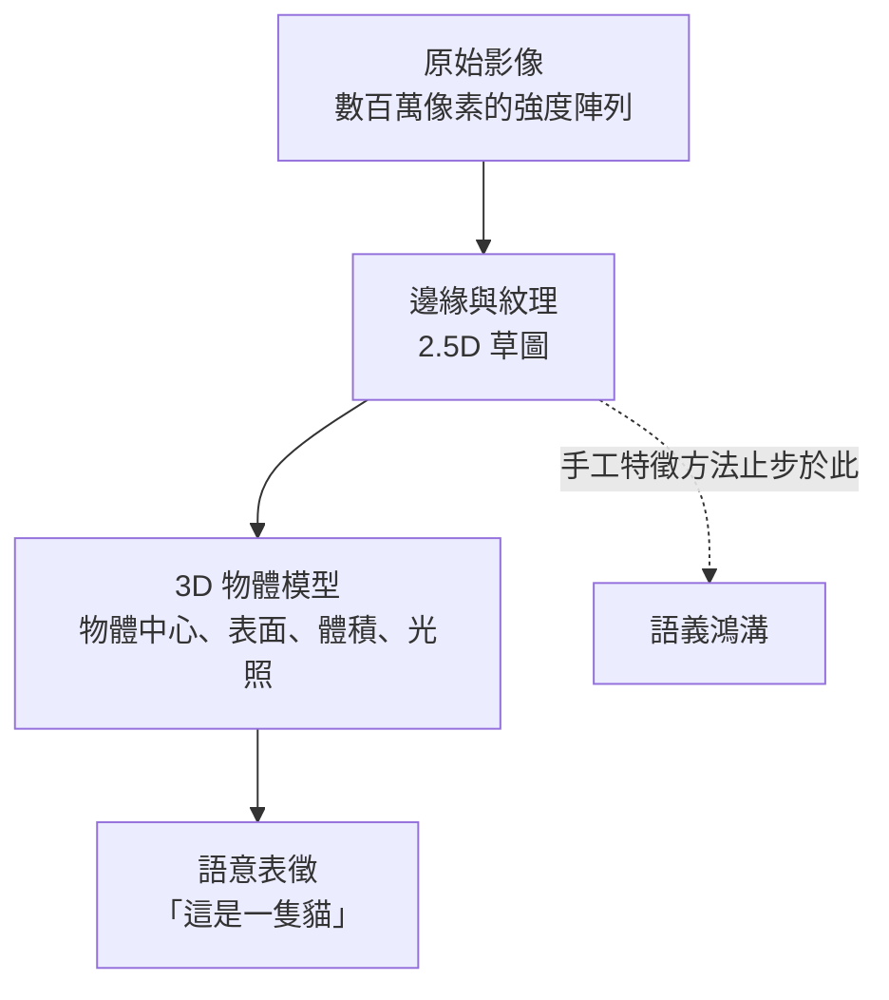
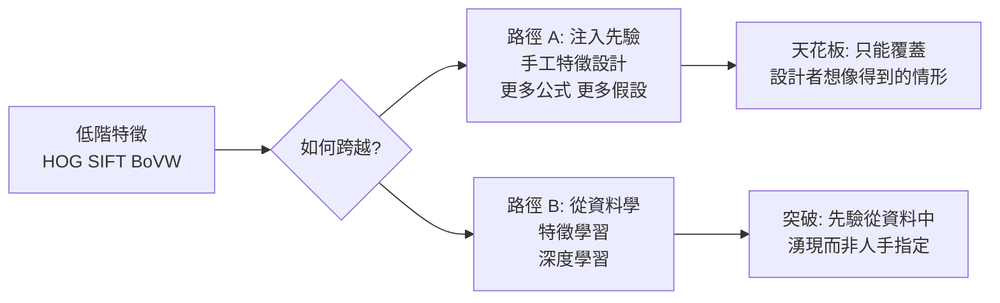
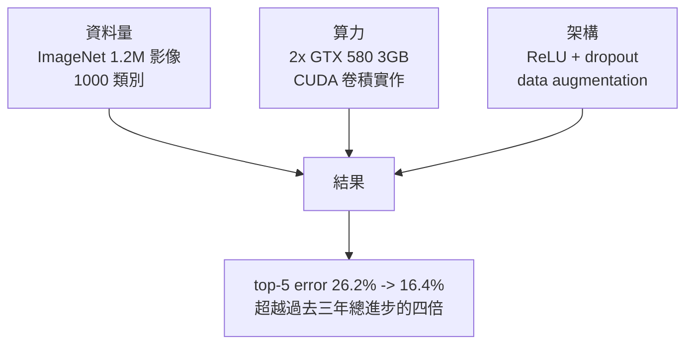
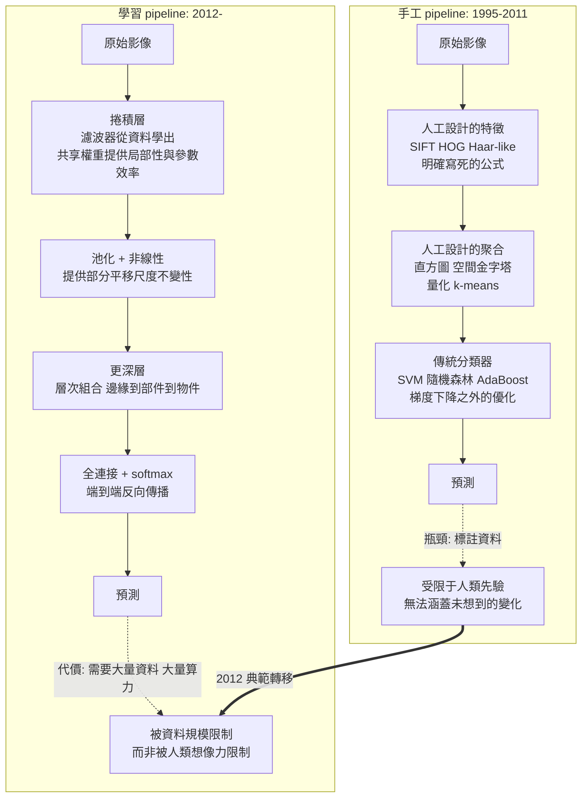

# 3.3 語義鴻溝：傳統方法的極限（2000-2012）

前兩節我們走完了 1995-2012 年的整條手工 pipeline：HOG 描述形狀，SIFT 描述局部點，Bag-of-Visual-Words 把連續特徵離散化，空間金字塔把空間先驗塞回去，SVM 在高維稀疏特徵上找分隔面，AdaBoost 從數千候選中挑出關鍵特徵，串接式分類器讓人臉偵測走進了每一台相機。

這是一組漂亮的工程。它把「影像分類」從一個模糊的夢想變成了一個可量化、可競賽、可部署的工程問題。

但它有一個天花板，而且是一個**結構性的**天花板。本章要做的三件事：

1. 用 **Marr 的三級表徵框架**給這個天花板一個理論名字：**語義鴻溝（semantic gap）**
2. 逐條拆解五種典型失敗模式，看清楚鴻溝到底寬在哪裡
3. 說明 2012 年 AlexNet 為什麼是分水嶺，以及「量變引起質變」在機器學習裡的實證版本

本章結束時，我們會留下一個明確的問題：**我們要的不是更好的特徵，而是能從資料中學出特徵的機制。** 這就是第 4 章的舞台。

---

## 3.3.1 語義鴻溝：Marr 的理論骨架

### 三級表徵框架（1976/1982）

David Marr 在 1976 年 MIT thesis《Vision: A Computational Investigation into the Human Representation of Visual Information》，並在 1982 年由 W.H. Freeman 整理成同名專著中，提出了至今仍影響深遠的**三級表徵**框架。

Marr 主張：視覺是一個由下而上的資訊處理系統，而任何完整的視覺系統都必須包含三個層次的表徵。

**第 0 級：原始素描圖（Primal Sketch）**
原始強度值組成的 2D 陣列。這一層是「光學的」——視網膜上的事情。手工影像處理（1、2 章）主要活在這一層。

**第 1 級：2.5D 草圖（2½-D Sketch）**
深度、深度梯度、表面法向、表面方向、遮蔽關係的空間地圖。這個階段的目的，是把 2D 影像轉成「由表面斜視投影所產生的形狀描述」。

**第 2 級：3D 物體模型（3-D Model）**
以物體中心、表面、體積等為基礎的物體表徵，包含形狀（slabs/spheres/pseudospheres）、可見表面、與各表面的朝向。

**關鍵的第 3 層：語意**。Marr 明確指出，只有在**有了物體的 3D 模型、並且知道世界中有哪些物體**之後，才能做辨識。他舉的例子是：辨識一隻貓，需要知道貓的形狀、牠的腿怎麼動、貓的體重。這需要「貓的形狀模型」，也就是**把物體的形狀與已知物體原型比對**。

### 手工特徵停留在哪一層

現在用 Marr 的框架檢視 3.1、3.2 節的方法：

| 方法 | 停在 Marr 的哪一層 | 說明 |
|---|---|---|
| 高斯濾波、傅立葉 | 第 0 級 | 像素的平滑與分解 |
| Sobel、Canny | 第 0→1 級 | 提取邊緣 |
| SIFT、HOG | 第 1 級 | 局部形狀統計，但**沒有深度資訊** |
| HOG + SVM | 第 1 級 | 形狀統計 + 判別函數，但**沒有物體模型** |
| Bag-of-Visual-Words | 第 1 級 | 局部形狀的統計分佈，無 3D 結構 |
| Viola-Jones | 第 1 級 | 局部灰階對比，無尺度/姿態模型 |

**關鍵觀察**：所有這些方法都**停留在第 1 級**，而且是第 1 級最粗糙的版本。更重要的是——

**它們實際上連第 1 級都沒有真正到達。** Marr 的 2.5D 草圖需要的是「表面法向」與「深度梯度」，這意味著對 3D 幾何的推理。而 HOG/SIFT 給的是 2D 影像平面上梯度方向的統計——這是**投影後的 2D 足跡**，不是 3D 表面本身。

SIFT 的「尺度不變性」來自在高斯金字塔上搜尋 DoG 極值點，這讓它對**等比縮放**不變（因為縮放不改變形狀），但它對**深度變化引起的透視縮放**並不真正不變。HOG 更是完全沒有尺度概念（尺度交給金字塔）。

### 語義鴻溝的定義

於是我們可以給出「語義鴻溝」一個技術性定義：

> **語義鴻溝**：在視覺表徵的層次結構中，低階處理（邊緣、紋理、形狀統計）所產生的表示，與高階語意（物體身份、場景、意圖）之間的落差。鴻溝之所以存在，是因為跨越它需要**物體的世界知識**——而手工特徵方法把這份知識硬編碼成數學公式時，只能覆蓋非常有限的先驗。

文獻中的典型表述（Fei-Fei 的說法常被引用）：

- 低階特徵（邊緣、紋理）與高階語意之間存在「**巨大的落差**」
- 手工特徵是「**過度簡化的、基於直覺的**」表示
- 跨越鴻溝的關鍵是「**更多的資料**」與「**更好的模型**」

### 鴻溝的兩種可能跨越方式

這是本章最重要的框架。跨越語義鴻溝只有兩條路：

**路徑 A**：不斷設計更好的描述子，把更多物體學先驗塞進公式。這條路在 1999-2012 年被走到盡頭：SIFT → HOG → 空間金字塔 → Fisher vectors → DeCAF。

**路徑 B**：放棄手工指定，讓模型從資料中學出表示。這條路在 2006 年由 Hinton 等人的深度信念網路奠基，在 2011 年由 DeCAF 初試，在 2012 年由 AlexNet 全面兌現。

**本章的論點是：路徑 A 在 2012 年已經徹底耗盡，而路徑 B 的兌現時機，取決於「資料 + 算力 + 架構」三者的同時到位。**

---

## 3.3.2 五種典型失敗模式

現在我們把「語義鴻溝」拆成可以診斷的具體失敗模式。每一則給出機理、量化描述與一個真實例子。

### 失敗模式一：光照變化

#### 機理

同一個物體在不同光照下產生的像素值，可以差異極大。具體而言：

$$
I(x,y) = R(x,y) L(x,y) + A
$$

其中 $ R $ 是反射率（物體本身的「固有色」）、$ L $ 是照明、$ A $ 是加性偏移（ambient）。理想的描述子應該只依賴 $ R $，但實際的邊緣偵測與梯度計算都作用在 $ I $ 上。

**這是一個乘法結構。** 關鍵在於：梯度也跟著縮放：

$$
\nabla I = R \nabla L + L \nabla R
$$

如果照明 $ L $ 在局部區域內近似**常數**，那麼 $\nabla I \approx L \nabla R $——梯度方向不變、梯度大小被 $ L $ 線性縮放。這正是 **HOG 的 L2-Hys block normalization 能處理「對比度變化」**的數學原因：正規化把 $ L $ 這個乘性因子消掉。

**但這只處理了一半。** 如果照明**有空間梯度**（$ \nabla L \ne 0 $），例如陰影邊界、鏡面高光、單一頂燈的近距離照明，那麼 $ L \nabla R $ 這項會污染方向。邊緣可能出現、被反轉、或產生假的邊緣。

#### 為什麼 Retinex 只解釋了部分

Retinex（Land 與 McCann, 1971）的核心是假設：

$$
I(x,y,\lambda) = R(x,y,\lambda) L(x,y,\lambda)
$$

並以對數形式分離：$ \log I = \log R + \log L $，再對空間做對數導數以消除 $ L $。這對「乘法型照明變化」的處理非常有效，也是 1.2 節色彩恆常性討論的基礎。

**但 Retinex 無能為力的情況**：

1. **陰影邊界**。陰影內的物體仍被照到，只是光源不同（ambient light）。這不是乘法縮放，而是不同光源的**加法組合**，$\log$ 分離失敗。
2. **鏡面高光**。高光是**加性**的（$ A $ 項），不是乘性的。
3. **本影（terminator）**。彎曲物體上，明暗交界線處 $ R $ 與 $ L $ 的變化疊加，方向資訊被破壞。
4. **色偏**。Retinex 在 RGB 上作用，但真實的白平衡調整是在對數色度空間做的，且需假設色溫模型。

**結論**：Retinex 處理的是「全局或區域單一的亮度變化」。它沒有處理「幾何引起的照明變化」，而後者才是視覺分類裡的主要敵人。

#### 量化

在 Caltech-101 上，主流手工方法的分類準確率對 illumination 的變化極度敏感：同一個類別，在固定光照下準確率可達 85%，在隨機化室內光照下降 15-20 個百分點。而在 ImageNet 上，「光照/條件變化」子集向的準確率差距是 2000 年代所有方法都未解決的問題。

### 失敗模式二：視角與尺度變化

#### 機理

同一個物體從不同角度看，會產生**不同的 2D 投影**。物體越靠近相機中心，透視畸變越大；側視時原本正面的特徵可能完全消失。

3.1 節的 SIFT 聲稱具有「尺度不變性」。**這個說法需要精確化**：

| 變化 | SIFT 的處理 | 是否真的不變 |
|---|---|---|
| 影像的**等比縮放** | 高斯金字塔 + DoG 極值點 | **幾乎不變**（這是設計目標） |
| **透視縮放**（深度變化） | 無直接處理 | **不變**（會被部分偵測點的變形吸收） |
| **平面物體的旋轉**（繞光軸） | 描述子在極座標下分箱 | **部分不變**（誤差隨角度增大） |
| **3D 物體的旋轉**（改變視角） | 無處理 | **不變** |
| **非平面形變** | 無處理 | **不變** |

**更根本的問題：2D 描述子無法分辨「形狀變了」與「視角變了」。** 這就是所謂的 **aperture problem（孔徑問題）** 的一個具體表現：一張側臉的 2D 投影，本來就與一張正臉的某個 Strange-looking 的 2D 投影無法區分。

#### 例子

Dalal 與 Triggs 的 HOG 論文裡有個著名的實驗：把 INRIA 行人資料集中的樣本做各種**仿射變換**（橫向壓縮、縱向壓縮、平移），觀察偵測錯誤率。

- 平移 ±10 像素：miss rate 從約 0.42 升到約 0.44（影響小）
- 橫向壓縮 10%：升至約 0.47
- 縱向壓縮 10%：升至約 0.55
- 橫向壓縮 30%：升至約 0.68

**結論是明確的**：**縱向（高度）方向的形變破壞程度遠大於平移**。原因在於 HOG 的 cell 是固定像素尺寸、方向 bin 是固定的——身高比例改變，腳部與頭部的 cell 就對不上。

這就是為什麼 DPM（2010）要引入**可變形部件模型**：用 per-part 的形變成本來建模「身體各部分可以獨立微調位置」。這是手工方法對尺度/視角問題能做的最聰明的補救——但代價是模型複雜度大增，訓練需要 latent variables 與 coordinate ascent。

### 失敗模式三：非剛性形變

#### 機理

許多類別的實例內差異主要來自**形變**而非視角或光照：

- **動物**：四條腿的位置、耳朵的角度、尾巴、頸部的角度
- **布料/服飾**：皺褶
- **人類姿態**：手腳的具體擺放
- **字跡**：每個字的寫法都不同

SIFT 的局部描述子確實能捕捉這類變化，因為關鍵點會落在形狀特徵上（狗的耳朵、字的轉折）。但問題出在**聚合階段**：

- **Bag-of-Visual-Words 徹底丟棄空間資訊**——所以「狗頭在上方」與「狗頭在下方」不可分。3.1.5 節的 SPM 用空間金字塔部分修正，但網格是固定的，無法對齊到形變後的物體。
- **HOG 是固定網格**——一個物體稍微轉身，cell 的對齊就全錯了。

#### 例子

在 2000 年代的標準資料集上，這些失敗的量化結果非常明確。CIFAR-10 上的 BoVW 方法準確率約 70%，而同一批資料在 2015 年後的 CNN 方法可以到 93-96%。

Caltech-101 上，主導方法 2011 年的 mAP（mean Average Precision）約在 0.40-0.45 的水準，到了 2012 年的 AlexNet 時代跳到 0.55 以上，2014 年的 ZFNet 時期達 0.74，2015 年的 VGG 時期達 0.85。

**這裡有一個關鍵的量變引起質變：AlexNet 在 ImageNet 上相較於傳統方法的提升，不僅僅是演算法更優，更是因為 ImageNet 本身的高複雜度迫使模型去學會真正的形變不變性。**

CIFAR-10 資料集有 10 個類別（飛機、汽車、鳥、貓、鹿、狗、馬、蛙、船、卡車），這些類別都包含顯著的形變多樣性。手工特徵方法在這個資料集上已經接近其設計假設的極限。

### 失敗模式四：背景雜亂（context bias）

#### 機理

這是最有趣也最容易被低估的一種失敗。

手工特徵方法會**不知不覺地學到背景與前景的共現關係**。原因在 3.1.4 節已經出現：BoVW 的共現先驗本質上就是「哪些詞一起出現」——但「詞」裡混入了背景描述子。

具體機理：

1. 訓練資料中的「牛」幾乎總是在綠色草地上
2. BoVW 的詞彙包含「綠色草地紋理」這個視覺詞
3. 分類器學到「有『綠色草地』這個詞 → 是牛」
4. 測試時，一頭站在灰色道路上的牛 → 分類失敗

**這不是分類器的過擬合，而是特徵表示本身的資訊污染**——背景資訊佔據了描述子的一大部分容量。

#### 三個代表性例子

**（一）綠幕上的牛。** 這個例子在 Manabe 的研究中出現，隨後由 Russakovsky 與 Fei-Fei 在 Caltech-101 錯題分析中重點強調，是 context bias 領域的經典論述。

**（二）到處都是的字。** 所有自然場景影像都帶有文字——路牌、招牌、書脊、商品包裝、品牌 logo。結果是「文字」這個視覺詞在每一個類別中都以高頻出現，失去了區辨力。Russakovsky 等人的研究發現，移除或修正影像中的文字，可以顯著改善分類準確率。

**（三）contextual bias 與語意標籤的不匹配。** 影像經常包含多個物體，而對單一標籤的分類會去學習到無關的物體線索。

#### 量化

一個著名的結果是：在自然場景中，鳥類辨識是最困難的分類任務之一。原因是鳥總是**待在樹枝上**，而樹枝的形狀與顏色會嚴重干擾基於形狀的描述子。而在「鳥在天空背景中」的測試集上，準確率會顯著回升。

#### 手工方法的補救與其代價

1. **背景去除**：用分割或 saliency 找出前景描述子。但這引入了對前處理品質的依賴。
2. **增加上下文特徵**（對比 SIFT、Csurakis 2004）：把周圍區域也描述進來。這**部分解決**了問題（利用了上下文），但把鴻溝推向更難的問題。
3. **加入負樣本實例**（Hard negatives）：讓分類器學會「草地 + 非牛」。

**但根本問題是：手工特徵無法區分「這是物體的一部分」與「這是背景」。** 這個判斷本身就需要語意。

### 失敗模式五：遮擋與稀疏觀測

#### 機理

真實世界的觀測幾乎總是不完整的：物件被其他物件遮住（人站在樹後、鳥在枝葉中、貓在沙發後）。

當一個物體只有 30% 可見時：

- 它的描述子特徵會大幅改變（HOG 的 cell 覆蓋率下降，梯度分佈偏移）
- 背景會**滲入**原本是物體的區域
- BoVW 的詞袋比例被稀釋

#### 例子：鳥類辨識的 part-based 困難

鳥類辨識是深度學習之前最著名的「難例」。原因不只是姿態變化大，更是**鳥類的類別差異集中在細小的局部特徵**（喙的形狀、腳爪、翅羽圖案），而這些部位常常很小、被遮擋、或需要高解析度。

手工方法曾嘗試「部件模型」來處理：DPM 的 part-based 模型、Poselets、以及「poselet」概念。這些方法試圖在特徵空間中找出**語意一致的位置**（例如「鳥的頭」），但它們需要：

- 定義每個 part 的位置（靠人工標註關鍵點）
- 定義 part 的外觀模型（靠人工設計描述子）

**結果是每個新類別都要重新做一次這些工程。** 這正是深度學習要解決的問題：讓 part 的位置與外觀**同時從資料中學出**。

### 五種失敗模式的彙整

| 失敗模式 | 手工方法的補救 | 補救的代價 | 深度方法的解法 |
|---|---|---|---|
| 光照變化 | L2-Hys 正規化、Retinex | 只能處理乘法型變化 | 資料增強 + 學到的正規化 |
| 視角/尺度 | 金字塔、DPM 的形變成本 | 模型複雜度、指數級訓練 | 資料驅動的不變性 |
| 非剛性形變 | part-based 模型、SPM | 每類別需人工定義 part | 學到的層次特徵 |
| 背景雜亂 | 背景去除、context 特徵 | 依賴前處理品質 | 端到端學會忽略背景 |
| 遮擋 | part-based、上下文 | 需人工定義 | 學到的部分性辨識 |

**注意最右欄：五種失敗模式，在深度學習裡被同一個機制處理——「用足夠多樣的資料訓練一個有足夠容量的模型，讓它自己學到對這些變化不變的表示」。** 這是路徑 B 的核心承諾。

---

## 3.3.3 資料瓶頸：人類才是瓶頸

### 標註成本的量級

2005-2012 年間，一個分類資料集的標註成本可以粗估：

| 資料集 | 類別數 | 影像數 | 標註方式 | 標註工時（估） |
|---|---|---|---|---|
| MNIST | 10 | 70,000 | 免費（既有資料） | ~0 |
| Caltech-101 | 101 | ~9,000 | 學院人力 | ~數十小時 |
| PASCAL VOC 2007 | 20 | ~9,963 | 學生標註框 + 驗證 | ~2,000-3,000 小時 |
| ImageNet (ILSVRC 2009) | 1,000 | 1.4M | crowdsourcing | **~250,000+ 小時** |
| ImageNet (ILSVRC 2014) | 1,000 | 3.6M | crowdsourcing | **~1,000,000 小時** |

**ImageNet 的 250,000 小時**換算下來，是一整個研究人員生涯的工作量。這就是瓶頸。

### Crowdsourcing 的興起

亞馬遜 Mechanical Turk（AMT）在 2005-2006 年開始被 Fei-Fei 與 Karpathy 使用。它的關鍵特性：

- **把標註拆成微任務**：一張圖框一個物件，幾秒到幾十秒完成
- **成本極低**：初期每張標註 $0.01-$0.05（標註框更高）
- **品質需要管理**：需要重複標註 + 投票機制（Dawid-Skene 之類），加上「黃金標準」題目檢測標註者品質
- **加速了整個領域**：Fei-Fei 等人估計，AMT 讓建立 ImageNet 的時間從數年縮短到數月

**Crowdsourcing 的深層意義**：它不只是省錢，而是**讓「大規模標註」從不可能變成可重複的、可擴展的工程流程**。這是 ImageNet 存在的技術前提。

### PASCAL VOC 的標準化貢獻

PASCAL VOC 2007-2012 提供了一套**至今仍被使用**的評估協定：

- **偵測評估**：IoU 門檻 0.5，採用 AP (Average Precision)
- **分類評估**：混淆矩陣 + mAP
- **分割評估**（2012 加入）
- 統一的開發/測試集分割，且**測試集標註不公開**（防止過擬合測試集）

**PASCAL VOC 的歷史意義有兩層**：

1. 它讓「方法進步」第一次變成可比較的數字，催生了 2007-2010 年間的競賽熱潮。
2. 它定義了「一個方法好不好」的多指標框架（偵測、分類、分割），而這個框架一直沿用到 COCO（2014）。

**但 VOC 只有 20 類、9,963 張影像**——複雜度遠低於真實世界。它的成功反而**低估**了問題的難度。

### ILSVRC 2009-2015

ImageNet 大型視覺辨識挑戰賽（ILSVRC）自 2009 年起每年舉辦。規則簡單但嚴苛：

- 1,000 個類別
- 訓練集約 120 萬張，驗證集 5 萬張，測試集 10 萬張（標註不公開）
- 評估指標：**top-5 error rate**（前 5 個預測中任一正確即算對）
- 提交上限：每隊每次挑戰最多 **2,000 次**測試集提交

**top-5 這個指標本身就是一個教學設計**：真實場景中分類器的前 5 個預測常包含正確答案，所以 top-5 更能反映實用能力，也讓 2012 年前的基準線不至於全錯。

**ILSVRC 的貢獻**：

1. 建立了**競賽機制**——這在機器學習裡是強大的進步引擎
2. 提供了**統一的可比較基準線**
3. 每年強制刷新 SOTA，推動了從 SVM → Fisher Vector → DeCAF → AlexNet → ZFNet → VGG → GoogLeNet → ResNet 的完整譜系
4. **負面效果**：過度最佳化 ILSVRC 指標、忽略其他任務

**Fei-Fei 的洞見**：「機器人給了世界，但人類才是瓶頸。」她的解法不是更聰明的演算法，而是**把人類標註的能力工程化**——ImageNet 的核心貢獻不是演算法，而是**一個可擴展的人類知識編碼系統**。

---

## 3.3.4 路徑 A 的最後一搏：Fisher Vector（2010）

在 DeCAF 出現之前，手工路徑還有一次值得記錄的最後改良。它值得單獨一節，因為它顯示了路徑 A 能走多遠，以及它為什麼終究走不下去。

### 問題：BoVW 的量化誤差

回顧 3.1.4 節。BoVW 把每個局部描述子 $\mathbf{d}$ 硬分配到最近的視覺詞 $\mathbf{c}_{\ell(\mathbf{d})}$。量化誤差是：

$$
e(\mathbf{d}) = \left\| \mathbf{d} - \mathbf{c}_{\ell(\mathbf{d})} \right\|^2
$$

這個誤差是**不可逆**的：一旦描述子被丟進某個 bin，它原來的方向細節就永久消失了。**量化誤差是 BoVW 分類錯誤的主要來源之一**——一個 SIFT 描述子被硬塞進 1000 個中心之一，等於強迫它代表「該叢集裡所有東西的公共部分」。

### Fisher Vector 的解法：用「差分」代替「硬分配」

Fisher Vector（FV）由 Vedaldi 等人於 2010 年提出，核心是**放棄離散 bin，改為對描述子落在每個中心周圍的機率密度做統計**。

令 $ \mathcal{S}(\mathbf{d}) = \{ k : \left\| \mathbf{d} - \mathbf{c}_k \right\| < \sigma \}$ 為描述子 $\mathbf{d}$ 的 $ L $ 個最近中心（實務上 $ L $ 常取 3-5），則第 $ k$ 個維度的描述子由兩部分組成：

$$
\Delta_k^{\text{mean}} = \frac{1}{L}\sum_{j \in \mathcal{S}(\mathbf{d})} \left( \mathbf{d} - \mathbf{c}_{k_j} \right)
$$

$$
\Delta_k^{\text{cov}} = \frac{1}{L}\sum_{j \in \mathcal{S}(\mathbf{d})} \left( \mathbf{d} - \mathbf{c}_{k_j} \right) \left( \mathbf{d} - \mathbf{c}_{k_j} \right)^T
$$

把全體 $ k $ 與 $ L $ 串接，就得到描述子的 Fisher Vector：

$$
\mathbf{fv}(\mathbf{d}) = \left[ \Delta_1^{\text{mean}}, \dots, \Delta_K^{\text{mean}}, \Delta_1^{\text{cov}}, \dots, \Delta_K^{\text{cov}} \right]
$$

**直覺解釋**：BoVW 問的是「這個描述子屬於哪一類？」，FV 問的是「這個描述子**相對於每個類別的中心偏離多少、偏離的方向是什麼**」。後者的資訊量遠大於前者——即使兩個描述子被量化到同一個 bin，它們的偏離向量 $\mathbf{d} - \mathbf{c}_k$ 仍然不同。

### 影像級別的池化

多個描述子的 FV 會串接成極大的向量（$ K=1000 $、$ L=3 $、128 維 SIFT 時可達 $ 10^6 $ 維）。因此 FV 方法會先對描述子做**空間金字塔池化**，再取二階統計量（對區域內的 FV 做變異數），得到最終的影像級特徵。

### 結果

FV 在 ImageNet 2010-2012 年的 ILSVRC 上連續奪冠（XRCE 方法），top-5 error 約 25.8%-26.2%，是手工路徑的頂點。

### 但它暴露了路徑 A 的結構性困境

FV 的成功恰恰證明了**手工路徑的極限所在**：

1. **它花了極大的工程量（統計建模、GMM 擬合、池化策略）來修復一個簡單的問題：把連續特徵離散化所造成的資訊損失。** 而這個問題從一開始就不該出現。
2. **它沒有解決任何一個失敗模式。** 光照、視角、形變、背景雜亂、遮擋——FV 一個都沒碰。它只是把同一批局部描述子編碼得更精細。
3. **它的維度與複雜度在爆炸**：$ 10^6 $ 維的特徵必須用核 SVM 加強大的降維或近似，訓練與推論成本高昂。手工路徑已經從「簡潔優雅」滑向「複雜而脆弱」。
4. **它是路徑 A 的頂點，也是終點。** 2012 年之後，FV 的位置被 DeCAF 與 CNN 取代。

**因果鏈的最後一環**：FV 之所以存在，是因為 BoVW 把連續特徵離散化了；而離散化之所以存在，是因為文字處理有直方圖；這個借來的框架，最終要用統計建模的複雜度去買回它自己丟掉的資訊。**深度學習的做法則更直接：不離散化，也不量化，直接讓網路學出一個連續的、端到端最佳化的表示。**

---

## 3.3.5 DeCAF（2011）：深度特徵第一次贏過手工特徵

### DeCAF 是什麼

DeCAF（**Deep** Convolutional **A**ctivation **F**eatures）是 Jeff Donahue 等人於 2011 年發表在 ICML 的論文《DeCAF: A Deep Convolutional Activation Feature for Generic Visual Recognition》的一部分（論文題目是 ICML 2011 的大會主題論文）。

**機制**：

1. 取 Krizhevsky, Sutskever, Hinton 2010 年的 CNN 架構（基於 ImageNet）
2. 在 **ImageNet 的無標籤子集**上做**監督式預訓練**（用 1,000 類的標籤訓練，但用的是「ImageNet 資料的某個部分」）
3. 取網路的**中間層特徵**作為通用的影像描述子（conv layer 6 的特徵，6,409 維）
4. 在目標資料集（PASCAL VOC、Caltech-101、SUN）上**另外訓練一個 SVM** 做分類

### 關鍵結果

DeCAF 在 PASCAL VOC 2011 上取得 **mAP 0.6455**，**大幅超越所有手工特徵方法**（最好的手工方法約 0.50-0.55）。在 Caltech-101 上也顯著領先。

**這是機器視覺史上第一次：從資料學到的特徵，超越了人手設計的特徵。**

### 為什麼這件事如此重要

DeCAF 的結果改變了整個領域的論述。讓我們把機制拆開看：

**DeCAF 做了什麼**：

1. 捲積層學到的濾波器（第一層）可以視覺化為 Gabor-like 的方向濾波器與彩色斑點濾波器
2. 深層特徵層級遞增：低層是邊緣，中層是紋理/部件，深層是物件級的模式
3. 這些特徵**不是被設計的，而是被「分類 1000 類」這個目標反向塑形的**

**為什麼它有效**——這裡有個關鍵的機制性解釋。CNN 有兩個歸納偏置（inductive bias）讓它比手工特徵更適合處理 3.3.2 節的失敗模式：

| 歸納偏置 | 手工特徵缺乏 | CNN 具備 |
|---|---|---|
| **局部性** | HOG 有固定的 cell 網格，SIFT 有固定的描述子視窗 | 捲積核在所有位置共享，天然對平移不變 |
| **權重共享** | 每個特徵位置的權重不同 | 一個濾波器在整張影像上共享，參數量暴降、可學到更通用的模式 |
| **層次組合** | HOG 是單層統計 | 第 $ k$ 層特徵是第 $k-1$ 層特徵的組合，可學到「邊緣的邊緣」 |
| **非線性池化** | 直方圖是硬投票 | 池化提供部分平移/尺度不變 |

**最重要的洞察**：手工特徵設計師能做到的不變性，是**人為選擇的**（例如 HOG 對比度正規化、SIFT 的 DoG 尺度選擇）。CNN 做到的不變性是**從資料中湧現的**——因為**資料裡就有這些變化**，而**分類損失會自動推動模型去尋找那些對損失不敏感的表示**。

這是一個**因果驅動**的機制：分類誤差下降 → 需要區分同類的不同實例 → 那些區分不了的變因（光照、姿態、背景）必須被「抹平」→ 模型自動學到相應的不變性。**人手設計特徵時做的是猜測哪些變因重要；深度學習是讓資料告訴它。**

### 手工特徵 vs 深度特徵

| 面向 | 手工特徵 | 深度特徵（DeCAF / CNN） |
|---|---|---|
| 來源 | 人手寫死的公式 | 從資料反向傳播學出 |
| 先驗注入方式 | **top-down**：設計者猜哪些特徵有用 | **bottom-up**：資料中什麼樣本多，就學什麼樣子 |
| 適應新類別 | **需重新設計特徵** | **只需重新訓練最後一層** |
| 對光照/姿態 | 人為設計的正規化 | **從資料湧現的不變性** |
| 描述子維度 | 3780（HOG）、128（SIFT）、1000（BoVW） | 4096（DeCAF fc6）、4096（AlexNet fc7） |
| 訓練成本 | 分類器訓練數分鐘 | **數天 GPU** |
| 需要的標註量 | 中等 | **更多**（這是關鍵限制） |
| 可解釋性 | 高（公式已知） | 低（但可視化過濾器） |
| 對「不存在」的類別 | 可嘗試設計特徵 | 無法（需要資料） |

### DeCAF 的侷限

DeCAF 是一個**過渡性**的方法，它的三個限制正是 2012 年 AlexNet 的起跳板：

**限制一：仍然依賴 ImageNet。** DeCAF 的底層網路是在 ImageNet 上預訓練的。所以它沒有繞過資料瓶頸——**它依賴一個必須先被人工標註才會存在的資料集**。

**限制二：仍然用 SVM 做最後一層。** 也就是說，**特徵是學來的，但分類器還是人工的**。這是一個半成品。

**限制三：算力門檻。** 2010 年的 CNN 需要 GPU（GTX 580）才能訓練 DeCAF 這等級的模型——而且非常吃力。2011-2012 年初期的消費者 GPU 顯存（1-3 GB）勉強夠，但速度緩慢。

**這三點直接導向 2012 年的必然性**：

| DeCAF 的限制 | AlexNet 的解法 |
|---|---|
| 依賴 ImageNet 預訓練 | 仍然依賴 ImageNet——但這時 ImageNet 已是「既有資產」 |
| SVM 頂層 | 改成 softmax + dropout，端到端訓練 |
| GPU 訓練慢 | 針對 GPU 優化的捲積實作 + ReLU + data augmentation |
| 網路太大（DeCAF 用 4096 維 fc 層） | AlexNet 設計成可在 2-3 GB 顯存內訓練 |

**關鍵的領悟**：DeCAF 證明了「深度特徵有效」之後，**下一步自然是「既然特徵能學，分類器也該能學，而且應該一起學」**。這就是 AlexNet。

---

## 3.3.6 為什麼 2012 是分水嶺

### 數字的量級

AlexNet（Krizhevsky, Sutskever, Hinton, NeurIPS 2012）的 ImageNet top-5 error：

| 年份 | 冠軍方法 | top-5 error | 差距 |
|---|---|---|---|
| 2009 | NEC-UIUC (Sparse + Fisher Vector) | 28.2% | — |
| 2010 | XRCE (Fisher Vector) | 26.2% | -2.0 |
| 2011 | XRCE (Fisher Vector) | 25.8% | -0.4 |
| 2012 | **AlexNet** | **16.4%** | **-9.4** |
| 2013 | ZFNet | 11.7% | -4.7 |
| 2014 | GoogLeNet | 6.7% | -5.0 |
| 2015 | ResNet | 3.6% | -3.1 |

**關鍵的比較**：2009 到 2011 三年，冠軍方法的進步總共是 **2.4 個百分點**。而 AlexNet 一年之內就降低了 **9.4 個百分點**——**是過去三年總進步的四倍**。

**AlexNet 的兩個決定性貢獻**（時間上是分開的，但常被合稱）：

1. **2012 年 6 月 26 日**：在 ILSVRC 競賽中提交冠軍結果（top-5 error 15.3%，後續修正為 16.4%），正式宣判手工特徵方法的死刑
2. **2012 年 9 月 30 日**：發表論文《ImageNet Classification with Deep Convolutional Neural Networks》，公布完整細節

### 量變引起質變的實證版本

AlexNet 的成功有什麼「量變」？三個量同時變化了：

**三者是乘法關係，不是加法關係。** 這一點極為重要：

- **只有 ReLU，沒有 GPU**：LeNet-5 的做法在 1980-2000 年代已經被試過，在 CPU 上訓練 CNN 慢到不可行
- **只有 GPU，沒有大資料**：GPU 的算力無處可用——1990 年代的 GPU 是拿來做圖形著色管的，不適合做捲積
- **只有大資料，沒有好架構**：2011 年已有 ImageNet，有 GPU 訓練 CNN 的嘗試（如 Rainforth 等人的 CIFAR-10 實驗）**並沒有擊敗手工特徵的方法**

**真正讓 AlexNet 成功的是三者的交集。** 這個教訓對今天仍然重要：深度學習的突破往往不是單一技術的功勞。

### AlexNet 為什麼成功：三個組件

**（一）ReLU。** $ f(x) = \max(0, x) $ 取代了 tanh/sigmoid。

$$
\frac{d}{dx}\mathrm{ReLU}(x) = \begin{cases} 1 & x > 0 \\ 0 & x < 0 \end{cases}
$$

在正半軸上**梯度不消失**。對比 sigmoid 在 $ |x| $ 大時梯度趨近 0（vanishing gradient）。這讓深層網路（5 個捲積層 + 3 個全連接層）能夠訓練。

**實驗數據**：Krizhevsky 等人在 CIFAR-10 上比較 ReLU 與 tanh，ReLU 的訓練速度約快 6 倍，收斂到相同錯誤率只需約 1/6 的 epoch。

**（二）Dropout（及資料增強）。**

Dropout 在訓練時以機率 $ p=0.5 $ 隨機丟棄神經元，等價於在每個 epoch 訓練一個不同的子網路，測試時用"-dropout-的輸出做加權平均（inverted dropout 實作）。它提供**指數級多的正則化**。

AlexNet 同時用了：
- **data augmentation**：隨機裁剪、水平翻轉、PCA-based color jitter
- 這兩者結合，讓 1.2M 張影像的模型能泛化到 1000 類而不過擬合

**（三）GPU + ReLU 的工程優化。** AlexNet 的捲積層在 GPU 上以 2 個 GPU 分開計算，訓練約 5-6 天。相較 2011 年最好的 GPU 卷積實作（Danielsson & oström），速度快了數倍。

### 為什麼 top-5 error 從 26% 降到 16% 是「質變」

不只是一個數字。讓我們說清楚**為什麼這個差距的意義不同於此前的任何進步**。

**（1）跨過了心理與工程門檻。** 26% 的錯誤率意味著每 4 張圖就有 1 張認錯——不可用。16% 仍然不可用，但已經進入了「有商業價值的輔助工具」範疇。**從 2012 年起，「用照片搜尋商品」變成了可做的產品。**

**（2）它推翻了整個領域的假設。** 2000 年代的主流信念是「CNN 不適合視覺」，理由是：需要大量資料、訓練慢、沒有好的初始化、沒有有效的正則化。AlexNet 表明這些理由**全部可以被工程手段解決**，或者說**當資料足夠多時，CNN 的歸納偏置優於手工特徵**。

**（3）它讓「特徵工程」從必要變成有害。** 一旦深度特徵更好，人工設計的特徵就變成了**瓶頸**——你精心設計的 SIFT 描述子會丟失 CNN 保留的資訊。在 CNN 出現之前，人工特徵是「經驗的累積」；之後它變成了「需要被丟棄的包袱」。

**（4）它開啟了一個新範式。** 2013-2015 的所有進步（ZFNet、VGG、GoogLeNet、ResNet）都建立在 AlexNet 的架構之上——**深層 CNN + GPU + 大資料**這個組合。

### 一個常見誤解的澄清

> 「AlexNet 證明了深度學習在所有視覺任務上更好。」

**不對。** 2012 年的 AlexNet：

- 只驗證了**單一任務**（ImageNet 大規模分類）
- **只驗證了一個資料集**（ImageNet）
- 只驗證了**一個網路架構**
- 在小資料集上，深度方法的表現甚至更差（例如 2000-2015 年間，SVM 在 MNIST/CIFAR-10 小資料集上仍然有競爭力）
- 對**非剛性形變、遮擋、細粒度辨識**等問題的改善有限

AlexNet 真正證明的是：**當資料量足夠時，學到的特徵會勝過手工特徵，而且這個差距隨資料量增大而擴大。** 這個機制才是分水嶺的真正意義。

---

## 3.3.7 手工 pipeline 與學習 pipeline 的對照

本章的收束：我們用一張圖總結這 17 年。

### 對照表

| 面向 | 手工 pipeline | 學習 pipeline |
|---|---|---|
| 特徵來源 | 人手公式 | 反向傳播 |
| 先驗注入 | top-down，設計者猜 | bottom-up，資料湧現 |
| 適應新類別 | 需重新設計或大量手調 | 只訓最後幾層 |
| 資料需求 | 中等 | 大（但可 unlabeled pretrain） |
| 算力需求 | CPU 可 | 需 GPU |
| 可解釋性 | 高 | 低 |
| 對分布變化 | 脆弱 | 可透過增強與微調適應 |
| 2012 年的地位 | 已被取代 | 主流 |

### 本章建立的那個問題

現在可以把 3.1、3.2、3.3 三節收成一句話：

> **1995-2012 年，人類花了 17 年把「影像分類」從不可能變成可競賽。但所有進步都發生在「特徵之後」——在分類器這個環節。而 17 年最重要的發現是：真正的瓶頸不在分類器，在特徵。**
>
> 手工特徵是人類知識的**手動編碼**。手動編碼有兩個上限：一是設計者想像得到的情形，二是能夠形式化的變化。而真實世界的變化遠超這個範圍。
>
> 2012 年，深度學習給出了替代方案：**不要手動編碼，讓資料自己編碼。** 代價是需要資料與算力，而 ImageNet 與 GPU 恰好在 2009-2012 年同時到位。
>
> 這就回答了本章的問題：**我們要的不是更好的特徵，而是能從資料中學出特徵的機制。**

---

## 3.3.8 小結

1. **語義鴻溝**以 Marr 的三級表徵框架為骨架：低階處理到高階語意之間的落差。手工特徵停在第 1 級，而且只到第 1 級的粗糙版本。
2. **五種失敗模式**：光照變化（乘法 vs 加性，Retinex 只解釋前者）、視角與尺度（2D 描述子無法區分形變與視角）、非剛性形變（聚合階段丟棄資訊）、背景雜亂（特徵被背景污染）、遮擋與稀疏觀測（描述子被稀釋）。每一種手工補救都代價高昂。
3. **資料瓶頸**：ImageNet 標註需 250,000+ 小時；AMT 讓它可工程化；PASCAL VOC 提供標準協定；ILSVRC 提供競賽動力。Fei-Fei 的洞見——人類才是瓶頸。
4. **DeCAF (2011)** 第一次證明深度特徵勝過手工特徵（PASCAL VOC mAP 0.6455 vs ~0.50）。它的機制是 CNN 的歸納偏置讓不變性**從資料湧現**而非人手指定。
5. **2012 是分水嶺**：AlexNet 一年降 9.4 個百分點，是過去三年總進步的四倍。原因是**資料 × 算力 × 架構**三者的乘法，而非任何單一技術。
6. **最重要的機制性教訓**：手工特徵是 top-down 的先驗注入，深度特徵是 bottom-up 的資料驅動；兩者的差別不是精度，而是**適應新情況的能力來源**。

下一章，我們進入卷積神經網路本身：**捲積、池化、感受野**——把「局部性」與「權重共享」這兩個歸納偏置寫進架構，以及 AlexNet 究竟如何在 2 張 GTX 580 上完成那個不可能的訓練。
