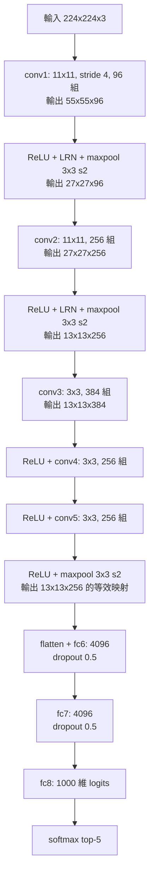

# 4.2 AlexNet 與 ImageNet 競賽的歷史性突破（2012）

---

## 4.2.1 一個不可能的任務：ImageNet 是怎麼來的

### 問題的設定

2006 年，Fei-Fei Li 在 Princeton 開始了一項當時看起來幾乎不切實際的工作：建立一個**包含超過一千四百萬張影像、涵蓋兩萬個類別**、並且每張影像都有**類別標註**的資料集。

為什麼要做這件事？因為深度學習在 2006 年時正處於低潮。許多研究者（包括 Hinton 等人）認為，深度網路難以訓練的根本原因是**資料量不足**——深度模型的參數空間太大，少量資料無法辨識出正確的解。手寫數字（6 萬張）和 MNIST 太小；自然影像的類別數以萬計，但如果每類只有幾十張，再好的架構也無濟於事。

Fei-Fei Li 的洞見是：**資料集的價值不在於影像數量，而在於標註的豐富度與類別數量**。她建立的不只是「一堆照片」，而是一個「帶著答案的照片百科」。

### 標註的成本

ImageNet 的標註過程是純人工的 crowdsourcing：透過 Amazon Mechanical Turk 平台，讓全球大量工人對影像做分類。Fei-Fei Li 在受訪中反覆提到，這個決定是她职业生涯中最重要、也最「非科技」的決定之一——因為它把 ImageNet 從「一個好用的模型」變成「一個社群共享的基礎設施」。

規模數字（ImageNet 常用子集 ILSVRC2012 的官方數字）：

| 項目 | 數量 |
| --- | --- |
| 完整 ImageNet 總影像數 | ~14,000,000 |
| 完整 ImageNet 類別數 | ~20,000 |
| ILSVRC2012 競賽用類別數 | 1,000 |
| ILSVRC2012 訓練集影像數 | ~1,200,000 |
| ILSVRC2012 驗證集影像數 | 50,000 |
| ILSVRC2012 測試集影像數 | 100,000 |
| 每類平均訓練影像數 | ~1,100 |

### ILSVRC：從競賽到標準

ImageNet 大型挑戰賽（ImageNet Large Scale Visual Recognition Challenge, ILSVRC）於 2010 年首次舉辦，每年一次，設五個項目：分類（classification）、偵測（detection）、定位（localization）、分割（segmentation）、以及後來新增的場景理解與追蹤。

分類項目採用的標準設定：

* 1000 個類別（從 2 萬中挑選，每類至少 100 張訓練影像）。
* **top-1 錯誤率**：預測的最高分類別不正確的比例。
* **top-5 錯誤率**：正確類別不在預測的前五名內的比例。

為什麼用 top-5？因為 1000 類的分類任務即使對人類也很難（單張 human-level 的 top-1 錯誤率約 5%，top-5 約 2%），top-5 提供了一個更穩健、更能反映模型「排序能力」的指標。**ILSVRC 的 top-5 錯誤率後來成為深度學習最重要的公開競技場標尺**，也催生了大量後續研究——因為每個新架構的進步都能被一個公開數字直接衡量。

### 競賽的生態

ILSVRC 有個精妙的設計：**參賽者必須在測試集上驗證，但測試標籤不公開**。每年競賽結束後，主辦方才公布測試集標籤並結算成績。這使得競賽成為一個「**一年一次的定時重現的科學實驗**」——每年在同一批資料、同一個指標上直接比較，任何人都能重現。

這個機制的副作用是巨大的：它把整個領域的注意力集中在同一個數字上，也因此製造了**對 top-5 錯誤率的過度重視**。我們在 4.3 節會看到，2015 年 ResNet 的 3.57% 錯誤率甚至超越了人類 ensemble 的 5%——這在物理上意味著 ImageNet 分類這個任務**已經被解決**，研究焦點必須轉移（這正是 Mask R-CNN、YOLO 等第 5 章工作的歷史背景）。

---

## 4.2.2 2012 年的比賽：一個沒有預期的碾壓

### 結果

2012 年 11 月，ILSVRC2012 的分類項目結果揭曉：

| 排名 | 團隊 | 方法 | Top-5 錯誤率 | Top-1 錯誤率 |
| --- | --- | --- | --- | --- |
| 1 | **AlexNet**（Krizhevsky, Sutskever, Hinton） | CNN (ReLU, Dropout, GPU) | **15.3%** | 37.5% |
| 2 | ZFNet / entry 2（Zeiler & Fergus） | 改進 CNN | 26.2% | 42.0% |
| 3 | entry 1（Chang et al.） | Fisher vector + SVM | 27.0% | 47.1% |
| 4 | entry 4（Cai） | 分類+檢索混合 | 29.6% | 51.0% |
| 5 | entry 7（Ulambay et al.） | 稀疏編碼 + Fisher vector | 31.0% | 53.0% |
| 6 | entry 6（Zeiler & Fergus） | 稀疏編碼 + Fisher vector | 32.4% | 53.7% |
| 7 | entry 12（ours, 卷積 + Fisher vector） | — | 33.1% | 54.8% |
| 8 | entry 11 | — | 34.6% | 56.5% |
| 9 | entry 13 | — | 35.3% | 57.7% |
| 10 | entry 16 | — | 37.0% | 60.2% |

AlexNet 相對第二名的絕對改進是 **10.9 個百分點**。這不是「好一點」，而是**換了一個時代**。往後的年份裡，top-5 錯誤率的年度進步幅度都只有 2-4 個百分點。

更關鍵的是**性質的轉變**：AlexNet 是所有參賽者中**唯一**使用純粹端到端學習的深度卷積網路（第二名的 ZFNet 其實也是 CNN，但架構與訓練細節接近 AlexNet）。第三名以後全部是**手工特徵（稀疏編碼、向量量化、Fisher vector）+ 傳統分類器（SVM）** 的混合管線。

### 逐年曲線

| 年份 | 冠軍 | Top-5 錯誤率 | 進步 | 備註 |
| --- | --- | --- | --- | --- |
| 2010 | NEC-UIUC (Lowe et al.) | 28.2% | — | SIFT + Fisher vector |
| 2011 | XRCE (Juric et al.) | 25.8% | 2.4 | Fisher vector + SVM |
| 2012 | **AlexNet** | **15.3%** | **10.5** | 第一個純 CNN 冠軍 |
| 2013 | ZFNet (Zeiler & Fergus) | 11.7% | 3.6 | deconvnet 可視化 |
| 2014 | GoogLeNet (Szegedy et al.) | 6.7% | 5.0 | Inception 多尺度並行 |
| 2015 | **ResNet (He et al.)** | **3.57%** | 3.13 | 152 層，超越人類 ensemble |
| 2016 | Trimps-Soushen | 3.0% | 0.57 | 廣度模型 + 大量增強 |
| 2017 | SENet | 2.25% | 0.75 | 通道注意力 |
| 2018 | NASNet-A | 2.43%（人類 ensemble） | — | 硬體 |

**從 2012 到 2015，三年之內 top-5 錯誤率從 15.3% 降到 3.57%，相對改善超過 4 倍。** 這段曲線是深度學習歷史的核心證據。

### 2012 年的競賽故事：意外與直覺

AlexNet 的作者 Alex Krizhevsky 與 Ilya Sutskever 是 Geoffrey Hinton 的學生。Hinton 當時在多倫多大學擔任教授，也是 2006 年深度信念網路（deep belief nets）重振的關鍵人物。

有兩個廣為流傳但**需要標註真偽**的說法：

* **「AlexNet 是拼湊出來的」**：Krizhevsky 曾在訪談中表示，架構中有一些設計（例如在全連接層之間放 dropout、以及輸入層的 augmentation 方式）是「憑直覺加上去的」，效果比預期好，但並非深思熟慮的理論推導。這是真的——AlexNet 的很多決策是經驗性的。
* **「Ilya 坚持要用 ReLU」**：Hinton 曾說 dropout 和 ReLU 是「我們做的最盲目的兩個決定，卻帶來了巨大的進步」。ReLU 來自 Nair & Hinton 2010 年的實驗工作，在當時算是個冷門選擇。

必須公允地指出：AlexNet 也借用了 ImageNet 的**資料**與 **ILSVRC 的評估框架**。這不是抄襲，這是科學界共享基礎設施的正常機制——但它意味著 2012 年的勝利是**「資料 + 架構 + 硬體 + 演算法」四者同時到位**的結果，而不是單一技巧的奇蹟。

---

## 4.2.3 AlexNet 的架構

### 完整結構



### 特徵圖尺寸演變

| 層 | 輸入 | 核 | stride | 輸出 | 參數量 | MACs |
| --- | --- | --- | --- | --- | --- | --- |
| conv1 | 224×224×3 | 11×11 | 4 | 55×55×96 | 34,944 | 105M |
| conv2 | 55×55×96 | 11×11 | 1 | 55×55×256 | 296,704 | 225M |
| conv3 | 55×55×256 | 3×3 | 1 | 27×27×384 | 884,992 | 50M |
| conv4 | 27×27×384 | 3×3 | 1 | 27×27×256 | 294,912 | 17M |
| conv5 | 27×27×256 | 3×3 | 1 | 13×13×256 | 589,824 | 13M |
| pool5 | — | 3×3 | 2 | 6×6×256 | 0 | — |
| fc6 | 6×6×256 | — | — | 4096 | 37,755,648 | 37.7M |
| fc7 | 4096 | — | — | 4096 | 16,781,312 | 16.8M |
| fc8 | 4096 | — | — | 1000 | 4,097,000 | 4.1M |
| **合計** | | | | | **~60.7M** | **~470M** |

**參數量分解**：fc6 + fc7 + fc8 共佔 $ 58.6M / 60.7M \approx 96.5\% $。

這裡要修正上一節的一個說法：把 conv1–conv5 與 fc 層分開看，全連接層佔了**參數量的 96%**，但只佔 **MACs 的 12.6%**。conv1 雖然參數量最少（34,944，佔 0.06%），卻貢獻了 22% 的計算量——因為它作用在 224×224×3 這麼大的特徵圖上。

**Flatten 尺寸的說明**：conv5 之後經過 maxpool 得到 6×6×256 = 9216 維，flatten 後送入 fc6（9216→4096）。

**輸入尺寸的細節**：ImageNet 官方影像的平均大小是 358×358。ILSVRC 的標準做法是：

1. 從原圖隨機裁出 224×224 的區塊（訓練時每個 epoch 重新裁）。
2. 測試時裁 5 個 224×224 的區塊（4 個角 + 中心），分別預測後**取平均值**。

原文的表格裡 "ImageNet 224×224" 指的是這個 crop 尺寸。PyTorch 的 `transforms.Resize(256)` + `CenterCrop(224)` 是等價的標準做法（測試時）。**若不對原圖做 resize 就直接 crop 224，會損失大量資訊，錯誤率會顯著上升**——這是初學者最常見的實作錯誤。

### 硬體與吞吐量

AlexNet 訓練在一台配 **兩塊 GTX 580 3GB**（Fermi 架構，448 個 CUDA 核心）的機器上完成，耗時約 **5 到 6 天**（六輪 epoch）。

**並列 CNN 的吞吐量計算**：

AlexNet 的 forward pass 約需 470M MACs ≈ 0.94 GFLOPs（乘 2 得 FLOPs）。加權值總和約 2.4 GFLOPs/影像（含 backward 約為 forward 的 2-3 倍，實際取約 7 GFLOPs/影像）。

GTX 580 的 FP32 峰值算力約 1.6 TFLOPS，但卷積在 2012 年的 CUDA 實作中（CuDNN v2）實際利用率大約只有 **5-10%**，因為沒有針對架構最佳化、資料傳輸與 kernel launch 開銷 dominate。

$$
\text{吞吐量} \approx \frac{1.6 \times 10^{12} \times 0.05}{7 \times 10^9} \approx 11\ \text{images/s}
$$

若只用一塊 GPU（論文也報告了單卡結果，錯誤率相近），時間加倍到 10-12 天。

**關鍵對比**：LeNet-5 在 1998 年用 CPU（Pentium）訓練 MNIST，一個 epoch 需要數十分鐘到數小時；AlexNet 一個 epoch 要 $ 1.2M / 11 \approx 30 $ 小時。**GPU 帶來的加速大約是兩個數量級**，而且這不是「同一個演算法跑得快一點」，而是「從根本上讓一個 6000 萬參數的模型變成可訓練」。

---

## 4.2.4 六個關鍵設計及其機理

### 一、ReLU

AlexNet 是首個在 CNN 上大規模使用 ReLU 並公開對比 sigmoid/tanh 的工作。原文的 Table 1 給出 CIFAR-10 上的收斂速度對比：ReLU 的 CNN 在 **5 個 epoch** 內達到 25% 錯誤率（超過 training error rate of 0% 的基準），tanh 版本需要 10 個 epoch，tanh+sigmoid 需要 14 個 epoch。

**機理**：
1. **梯度傳遞**：sigmoid 的導數 $ \sigma'(z) = \sigma(z)(1-\sigma(z)) \le 0.25 $。在深層網路中，若每層的 Jacobians 乘積中每個因子都小於 1，梯度以指數速度衰減。ReLU 在正半軸的導數恆為 1，**正的路徑完全不衰減**。
2. **計算效率**：ReLU 是 max 比較，GPU 上是單一指令；sigmoid 需要 exp。2012 年的 CUDA 沒有任何 fused exp 最佳化，這個差距在實測中相當可觀。
3. **稀疏性**：約 50% 的單元輸出為零，形成稀疏表示，兼具正則化效果。

**常見誤解**：「ReLU 解決了梯度消失，讓深網路可以訓練。」這是**過度簡化**。ReLU 緩解但未根治跨層梯度連乘（見 4.3 節），AlexNet 只有 8 層——在這個深度上，「只要有一條全正的路徑」就足以維持前幾層的有效梯度。當深度升到 20、50、100 層時，ReLU 就不夠了。

### 二、Dropout

在 fc6 與 fc7 使用，保留率 $ p = 0.5 $（即 dropout rate 0.5）。

**機理**：把每個 mini-batch 前隨機丟棄一半單元（並以 $ 1/p $ 縮放），在數學上等價於對 $ 2^n $ 個子網路做平均。由於 subnet 共享權重，這個巨大的集成可以被一個權重張量代表。

**為什麼 $ p = 0.5 $？** 這是一個經驗值。$ p $ 太大（保留太多）正則化不足；$ p $ 太小（保留太少）會讓有效容量暴減、收斂變慢並且訓練時的梯度估計方差變大。$ p = 0.5 $ 在「容量減半」與「梯度估計方差可接受」之間取得平衡，並且實務上被沿用了十幾年。

**現在的評價**：在全連接層上 dropout 的效果今天可以用其他手段取代（更好的初始化 + weight decay + BN + 資料增強）。但 AlexNet 確立了**「在網路裡注入隨機性作為正則化」**這個思想，它後來演化成 dropout variants（DropConnect、DropBlock、R-Drop、stochastic depth）以及第 7 章 GAN 訓練裡的隨機性使用。

### 三、GPU + CuDNN

2012 年的 GPU 程式設計需要寫 CUDA 核心，門檻很高。AlexNet 團隊利用 CuDNN（NVIDIA 的深度學習函式庫，v2 於 2011 年發布）來實作卷積，並利用两块 GPU 進行資料平行（每塊跑一半 mini-batch）。

**為什麼 GPU 適合卷積**：卷積是**資料平行**的——每個輸出位置與其他位置獨立計算，沒有順序依賴。GPU 有上萬個執行緒可以同時處理這些獨立任務，完美對應 SIMT（Single Instruction, Multiple Threads）架構。相反地，矩陣乘法在 GPU 時代初期還要仰賴 cuBLAS 這類高度最佳化的常式庫。

**但硬體不是全部**：AlexNet 的作者也提到，實作上的很多「工程決定」（例如資料預取與增強的 CPU 端 pipeline、避免 CPU-GPU 記憶體傳輸瓶頸）與數學同樣重要。這是 2012 年那批工作的典型特徵——**研究者必須同時是系統工程師**。

### 四、資料增強

AlexNet 使用了三種增強，全部是**標籤保持（label-preserving）**的擾動：

1. **隨機裁剪**：從 256×256 的影像中隨機裁 224×224。
2. **水平翻轉**：把影像左右鏡射。
3. **PCA 色彩擾動**：這是最精巧的一項。

**PCA 色彩擾動的機理**：把影像視為 RGB 空間中的點，取其 $ 3 \times 3 $ 協方差矩陣 $ \Sigma $ 的前三個主成分 $ \lambda_i $（特徵值）與對應特徵向量。原論文的做法是：

$$
\tilde{p} = p + \alpha \cdot \sigma \cdot \lambda
$$

其中 $ p $ 是影像的像素值向量，$ \alpha \sim N(0, 1) $ 是擾動係數，$ \sigma $ 為經驗值 0.1（原文使用 0.1），而 $ \lambda $ 是沿著各主成分方向、以該主成分的標準差 $ \sqrt{\lambda_i} $ 縮放的隨機偏移向量。

**為什麼有效**：自然影像的像素在 RGB 空間高度相關（三個通道高度相關），所以真正的自由度只有 2-3 個。沿著主成分方向擾動，會讓影像的**亮度與對比**產生變化，而**色調**大致保留。這正好對應我們對自然影像變化的直覺：同一個物件在不同光線下會有不同的亮度與顏色平衡，但物體本身不變。

**為什麼只做標籤保持的擾動**：如果做會改變語義的擾動（例如把狗旋轉 90 度、或者把車鏡射成反方向車），標籤就不再正確了，模型會學到錯誤的映射。**增強的本質是「擴大訓練分布，同時保持標籤語義不變」**——這是一個關於「我們認為世界如何變化」的先驗假設，因此增強的設計其實是**把歸納偏誤注入訓練過程**。

**現代的增強**（Mixup、CutMix、RandAugment、TrivialAugment）走得更遠：Mixup 直接對**影像與標籤同時做線性插值**

$$
\tilde{x} = \lambda x_i + (1-\lambda) x_j, \qquad \tilde{y} = \lambda y_i + (1-\lambda) y_j
$$

這等於把「類別邊界」也當成連續的，強制網路學到平滑的決策函數。實驗顯示這能顯著改善校準（calibration）與穩健性（robustness）。

**AlexNet 增強的歷史意義**：在 2012 年，用增強把 120 萬張變成「無限多」是**對抗過擬合的主要手段**。今天有更多手段（更大的資料、更強的正則化、更佳的初始化），但增強仍是影像領域**最有效且最便宜**的技巧之一。

### 五、SGD + momentum + 學習率衰減

**超參數**（AlexNet 論文 §4.1 的設定）：

* 梯下降：**mini-batch SGD**，batch size 128。
* Momentum：0.9。
* Learning rate：0.1，**每 3 個 epoch 衰減為原來的 1/10**（原文寫「divide by 10 every three epochs」），最終降到 $ 10^{-4} $。
* Weight decay：$ 5 \times 10^{-4} $（對參數 $ \ell_2 $ 正則，等效於 SGD 裡的 L2 penalty；原文用 $ \frac{1}{2} \| w \|^2 $ 的慣例）。
* **初始化**：均值为 0、高斯分佈、標準差 0.01 的隨機初始化。

**為什麼用 SGD 而不是 Adam？** 這是今天回頭看最有趣的一點。AlexNet 的成功是用**最樸素的 SGD** 得到的。在 SGD 下，weight decay 對正則化有明確的 L2 語義，且**最優解可以精確對應到權重衰減**；而 Adam 的自適應步長會破壞 weight decay 的這種語義。SGD + momentum 在**充分訓練**時的泛化效能通常優於 Adam。現代實作（尤其是大型 vision transformer）大量改用 AdamW，正是因為 SGD 在**過參數化網路 + 大量增強**下的泛化優勢。

**學習率衰減為什麼重要**：在 mini-batch SGD 中，每一步的梯度只用了 128 個樣本，是**有噪聲的**。若學習率固定，梯度噪聲會讓權重在最優解附近不斷抖動（gradient noise floor），無法收斂到高精度。指數衰減讓早期快速前進（探索）、後期精細收斂（利用），這是至今仍通用的套路。

**在沒有 BN 的年代，AlexNet 的深度（8 層）之所以能穩定訓練，很大程度上靠這個精心設計的 learning rate schedule**——把 lr 從 0.1 降到 0.01 再到 0.001，等效於在不同的尺度上重新調整了有效步長，緩解了梯度尺度的問題。

### 六、Local Response Normalization（LRN）

$$
b_{i,j,l} = a_{i,j,l} \left( k + \alpha \sum_{n=l}^{l + c} (a_{i,j,n}^2)^p \right)^{-\beta}
$$

原文參數：$ k = 2 $、$ \alpha = 10^{-4} $、$ \beta = 0.75 $、$ n = 5 $（即 $ c = 4 $）。

**機理**：在**同一位置**、**鄰近的通道**之間做競爭性抑制——某個通道的響應越大，鄰近通道的增益就越小。這是模仿生物學中 lateral inhibition（側抑制）的機制。

**作者自己的評價**：「LRN 在某些架構上有幫助，但重要性有限。」

**今天的評價**：LRN 已被 **BatchNorm 完全取代**（實驗顯示 BN 的效果顯著優於 LRN，因為 BN 是**跨樣本**統計，提供的是另一種更有效的正則化與尺度控制）。這是一個很好的案例說明深度學習裡**「過時的技巧」不會立刻消失，而是會在新技巧出現後慢慢退場**——LeNet-5 的 average pooling 也經歷了同樣的命運。

---

## 4.2.5 為什麼是 2012，而不是 2007 或 2005？

這個問題是理解深度學習歷史的關鍵。答案不是「某一個想法突然被想到」，而是**三個條件同時成熟**。

### 條件一：GPU 通用運算（CUDA, 2007）

2007 年 NVIDIA 發布 CUDA，讓科學家第一次能**用 C 語言寫自訂的平行程式**在 GPU 上跑。2009 年之後，cuDNN 提供了標準的卷積/池化實作。

對照：1998 年 LeNet-5 用 CPU 訓練 MNIST，一個 epoch 數十分鐘；AlexNet 在 GPU 上把 120 萬張的訓練壓縮到 5 天（單卡 10 天）。**深度學習的可行規模與 GPU 算力幾乎是線性相關的**。

### 條件二：資料（ImageNet, 2009）

如前所述，ImageNet 提供了 120 萬張有標註的影像、1000 個類別。相較於 1998 年的 MNIST（6 萬張、10 類別、單通道），這是**三個數量級**的資料規模提升。

**為什麼 2012 年 AlexNet 仍需要 augmentation？** 因為 1000 個類別意味著每類平均只有 1100 張，而 AlexNet 有 6000 萬參數。**參數量與資料量的比例仍然不匹配**，只是比 1998 年好得多。這正是 2014-2015 年的研究重點（從「更好的架構」到「更好的正則化」再到「更好的資料」）。

### 條件三：更好的演算法元件（ReLU + 初始化 + Dropout + SGD schedule）

* ReLU（2010）：解決梯度傳遞與速度。
* Xavier 初始化（2010）：讓深網路的尺度可控。
* Dropout（2014）：強大的正則化。
* 精心的 lr schedule：在沒有 BN 的年代，讓 8 層網路穩定收斂。

### 為什麼 CNN 在 1998 年輸給 SVM

這是一個值得認真回答的問題。LeNet-5 在 MNIST 上達到 0.95% 錯誤率，但同一時期在 NIST SD-1/SD-3（手寫字元，160 個類別）上，SVM + 方向性特徵表現更好。原因如下：

| 因素 | 1998 年 | 2012 年 |
| --- | --- | --- |
| **資料量** | MNIST 6 萬張，NIST ~1.5 萬張 | ImageNet 120 萬張 / 1000 類 |
| **類別數** | 10 或 160 | 1000 |
| **參數量 vs 資料量** | 小模型或過擬合 | 大模型 + 強正則化可行 |
| **活化函數** | tanh / sigmoid，梯度容易消失 | ReLU |
| **初始化** | 隨機亂猜尺度 | Xavier（He 要到 2015） |
| **正則化** | 幾乎沒有（除了 weight decay） | Dropout + augmentation + LRN |
| **硬體** | CPU，訓練一個 epoch 數十分鐘 | GPU 3 倍到 5 倍加速 |
| **端到端** | SVM 時代特徵與分類器分開 | 全網路 joint training |

**最關鍵的兩條**是資料量與硬體。LeNet-5 在 1998 年不是「錯的架構」，而是**在當時的資料規模與算力下，它的優勢（端到端學習、局部連接、權重共享）還不足以抵銷它的劣勢（資料太少、無法學到足夠複雜的特徵、無法用大模型）**。

### 一個更深的觀察：1998 到 2012 的十三年裡，CNN 並沒有「輸」

LeNet-5 是商業成功：**1998 年起，它被用在美國郵政服務的支票辨識上，每天處理數百萬張支票**。AT&T 的手寫辨識系統也在 90 年代末就部署了 LeNet。CNN 贏的是「**最好的**通用視覺特徵 + 分類器」，而不是「所有視覺應用」。

真正被暫停的是**研究路線**：從 2006 到 2011 年，學術界的注意力集中在 SVM、稀疏編碼、隨機森林、deep belief nets 上，CNN 反而不是主流。2012 年的勝利，讓 CNN 重新成為核心路線。

---

## 4.2.6 可解釋性：CNN 學到了什麼？

### 第一層 filter 的視覺特徵

Zeiler & Fergus 在 2014 年（ZFNet）的論文中回顧了 AlexNet 的第一層權重：

* **96 個 11×11×3 的濾波器**，平均被分成兩組：一組約 64 個以**顏色**為主要特徵（紅、綠、藍、黃色調），另一組約 32 個以**方向與顏色**為主要特徵（水平邊緣、垂直邊緣、對角邊緣）。
* 具體觀察：某些 filter 是「特定方向的邊緣偵測器」（在 RGB 空間呈現為綠-紅-黃的橫向條紋），某些是「特定空間頻率的斑點偵測器」，某些是「彩色 blob 偵測器」。
* 所有 filter 都是**高頻**的（沒有低頻 filter），這符合直覺：低頻資訊（亮度均值）沒有分類價值。

### Deconvnet：把特徵圖「還原」回去

Zeiler & Fergus 的做法（2014, "Visualizing and Understanding Convolutional Networks"）：

1. 給定輸入影像與某個目標特徵圖 $ a_l $，記錄該特徵圖上最大活化的位置。
2. 用**反卷積（deconvnet）**把 $ a_l $ 映射回影像空間：對每層做反池化（把 max pooling 記錄的最大值位置還原）、反 ReLU（用最大化的準則）、反捲積（用轉置卷積，權重是原權重的轉置）。
3. 得到一張「重建影像」，顯示哪些輸入區域貢獻了這個特徵。

**結論**：conv2 到 conv5 的重建顯示，layer 2 對應**紋理與重複的 motif**（例如建築窗格），layer 3 對應**物體部件**（例如車輪、眼睛），layer 4–5 對應**物體部件組合**。

### 遮蔽敏感度實驗（occlusion sensitivity）

同一篇論文的另一個實驗：把影像中的一塊區域（逐漸增大）遮成灰色或模糊，觀察分類機率如何變化。

* 遮住**關鍵區域**（例如狗的臉）→ 分類機率劇烈下降，並轉而機率最高的預測。
* 遮住**無關區域** → 分類機率幾乎不變。

這證明了**分類確實依賴特定區域**，而不是靠全域模糊的平均。

這兩個實驗開啟了 2014-2016 年的**可解釋性研究浪潮**（Grad-CAM 2016、CAM 2016、Guided Backprop 2015、DeepDream 2015、Feature Visualization 2015）。2017 年之後這條線的熱度下降，不是因為問題不重要，而是因為**架構變複雜後，可解釋性方法的有效性開始下降**——Grad-CAM 在 ResNet 上還能用，但在 DenseNet 或 Transformer 上效果明顯變差。第 9 章的 VLM 章節會談到「大模型的可解釋性問題」。

### 產業衝擊

2012 年之後的產業影響大致是這樣的：

* **Google**：2013 年收購 DNNresearch（Ray Kurzweil 加入）、2014 年收購 DeepMind（2015 年公開 Deep Q-Network）。2015 年 Google Brain 發表 "Batch Normalization: Accelerating Deep Network Training by Reducing Internal Covariate Shift"。
* **Facebook**：2013 年成立 FAIR（FAIR 是 2017 年才公開的，但深度學習研究團隊在此之前就已建立）。
* **Microsoft**：2013 年成立 MSR AI，2015 年用 ResNet 贏得 ImageNet（但更早的 2015 年 1 月 Microsoft Research 的 **ResNet 初版就已在 ILSVRC 2015 上取得冠軍**，比官方的 12 月版本還早——這是個有趣的歷史細節）。
* **學術界**：CVPR 2013 起，幾乎所有投稿都使用 CNN。

---

## 4.2.7 實作：精簡版 AlexNet 在 CIFAR-10

由於 ImageNet 的訓練成本對多數讀者不現實，這裡給出一個**結構對應 AlexNet 但尺寸適合 CIFAR-10** 的精簡版，並附上完整訓練程式碼與 filter 可視化。

```python
import torch
import torch.nn as nn
import torch.nn.functional as F


class AlexNetSmall(nn.Module):
    """
    AlexNet 的精簡版：
    - 移除 LRN（已被 BN 取代）
    - 移除 local contrast normalization
    - conv1 改用 stride 1 + padding，保留 5 層卷積 + 2 層 FC 的結構
    - 加入 BatchNorm 讓小 batch 也能穩定訓練
    """

    def __init__(self, num_classes=10):
        super().__init__()
        self.features = nn.Sequential(
            nn.Conv2d(3, 64, kernel_size=5, stride=1, padding=2),   # 32x32x64
            nn.BatchNorm2d(64),
            nn.ReLU(inplace=True),
            nn.MaxPool2d(2, 2),                                     # 16x16x64

            nn.Conv2d(64, 192, kernel_size=5, padding=2),
            nn.BatchNorm2d(192),
            nn.ReLU(inplace=True),
            nn.MaxPool2d(2, 2),                                     # 8x8x192

            nn.Conv2d(192, 384, kernel_size=3, padding=1),
            nn.BatchNorm2d(384),
            nn.ReLU(inplace=True),

            nn.Conv2d(384, 256, kernel_size=3, padding=1),
            nn.BatchNorm2d(256),
            nn.ReLU(inplace=True),

            nn.Conv2d(256, 256, kernel_size=3, padding=1),
            nn.BatchNorm2d(256),
            nn.ReLU(inplace=True),
            nn.MaxPool2d(2, 2),                                     # 4x4x256
        )
        self.classifier = nn.Sequential(
            nn.Flatten(),
            nn.Dropout(0.5),
            nn.Linear(256 * 4 * 4, 512),
            nn.ReLU(inplace=True),
            nn.Dropout(0.5),
            nn.Linear(512, num_classes),
        )

    def forward(self, x):
        x = self.features(x)
        return self.classifier(x)


def alexnet_aware_augment():
    """對應 AlexNet 的三種增強：裁剪、水平翻轉、色彩擾動。"""
    from torchvision import transforms
    return transforms.Compose([
        transforms.RandomCrop(32, padding=4),
        transforms.RandomHorizontalFlip(),
        transforms.ColorJitter(brightness=0.2, contrast=0.2, saturation=0.2),
        transforms.ToTensor(),
        transforms.Normalize((0.4914, 0.4822, 0.4465),
                             (0.2470, 0.2435, 0.2616)),
    ])
```

### 訓練迴圈

```python
import torch
import torch.optim as optim
from torchvision import datasets, transforms
from torch.utils.data import DataLoader

def train_one_epoch(model, loader, criterion, optimizer, device):
    model.train()
    total, correct, loss_sum = 0, 0, 0.0
    for x, y in loader:
        x, y = x.to(device), y.to(device)
        optimizer.zero_grad()
        out = model(x)
        loss = criterion(out, y)
        loss.backward()
        optimizer.step()
        loss_sum += loss.item() * y.size(0)
        correct += out.argmax(1).eq(y).sum().item()
        total += y.size(0)
    return loss_sum / total, correct / total


def evaluate(model, loader, criterion, device):
    model.eval()
    total, correct, loss_sum = 0, 0, 0.0
    with torch.no_grad():
        for x, y in loader:
            x, y = x.to(device), y.to(device)
            out = model(x)
            loss_sum += criterion(out, y).item() * y.size(0)
            correct += out.argmax(1).eq(y).sum().item()
            total += y.size(0)
    return loss_sum / total, correct / total


device = "cuda" if torch.cuda.is_available() else "cpu"

train_set = datasets.CIFAR10(root="./data", train=True, download=True,
                              transform=alexnet_aware_augment())
test_set = datasets.CIFAR10(root="./data", train=False, download=True,
                             transform=transforms.Compose([
                                 transforms.ToTensor(),
                                 transforms.Normalize((0.4914, 0.4822, 0.4465),
                                                      (0.2470, 0.2435, 0.2616)),
                             ]))

train_loader = DataLoader(train_set, batch_size=128, shuffle=True, num_workers=4)
test_loader = DataLoader(test_set, batch_size=256, shuffle=False, num_workers=4)

model = AlexNetSmall().to(device)
criterion = nn.CrossEntropyLoss()
optimizer = optim.SGD(model.parameters(), lr=0.1, momentum=0.9,
                      weight_decay=5e-4, nesterov=True)
scheduler = optim.lr_scheduler.StepLR(optimizer, step_size=15, gamma=0.1)

for epoch in range(30):
    tr_loss, tr_acc = train_one_epoch(model, train_loader, criterion, optimizer, device)
    te_loss, te_acc = evaluate(model, test_loader, criterion, device)
    print(f"[{epoch+1:2d}] train loss {tr_loss:.4f} acc {tr_acc:.4f} | "
          f"test loss {te_loss:.4f} acc {te_acc:.4f}")
    scheduler.step()
```

**預期結果**：CIFAR-10 上測試準確率約 88-91%，訓練時間在現代 GPU 上不到 10 分鐘。

**討論要點**：

1. **為什麼能在 CIFAR-10 上過擬合？** 5 萬張訓練影像、5 萬張測試影像。AlexNet 的原始結構（6000 萬參數）在 CIFAR-10 上一定會嚴重過擬合。你會觀察到 train acc 逼近 100% 而 test acc 停在 85% 左右。這正是我們要說明的：**AlexNet 之所以能在 ImageNet 上工作，關鍵是 120 萬張影像 + augmentation + dropout 的組合**。把它搬到小資料集上，它會失敗。
2. **BatchNorm 的影響**：把 BN 拿掉，改用原版 AlexNet 的 lr schedule（每 30 epoch 衰減 10 倍），準確率會明顯下降且不穩定。這量化了「演算法元件」的價值。
3. ** augmentation 的影響**：拿掉 RandomCrop 與 flip，測試準確率掉約 3-5%。CIFAR-10 的標準增強還包括 **Cutout** 與 **Mixup**，可以加上去再測。

### 第一層 filter 可視化

```python
import matplotlib.pyplot as plt
import numpy as np

def visualize_first_layer(model, n=64, filename="alexnet_filters.png"):
    w = model.features[0].weight.detach().cpu().numpy()   # (64, 3, 5, 5)
    w = w[:n]
    # 正規化到 [0, 1] 以便顯示
    w = (w - w.min(axis=(1, 2, 3), keepdims=True)) / \
        (w.max(axis=(1, 2, 3), keepdims=True) - w.min(axis=(1, 2, 3), keepdims=True) + 1e-8)

    cols = 8
    rows = (len(w) + cols - 1) // cols
    fig, axes = plt.subplots(rows, cols, figsize=(cols * 1.6, rows * 1.6))
    for i, ax in enumerate(axes.flatten()):
        ax.set_axis_off()
        if i < len(w):
            ax.imshow(w[i].transpose(1, 2, 0))
    plt.suptitle("AlexNet conv1 filters (learned)")
    plt.tight_layout()
    plt.savefig(filename, dpi=140, bbox_inches="tight")
    plt.close()

visualize_first_layer(model)
```

**怎麼讀這張圖**：在 CIFAR-10 上訓練的 filter 會顯示明顯的**方向性色帶**（例如紅綠交替的橫條紋 = 偵測水平方向的色彩變化；垂直條紋 = 偵測垂直變化）。在 ImageNet 上訓練的 AlexNet filter 則會顯示更接近人類可辨識的**邊緣與色斑**（Zeiler & Fergus 的結果）。

### 對比實驗：把 CNN 換成 HOG + SVM

為了體會「CNN 贏在哪裡」，可以跑一個對照實驗：

```python
# 傳統管線：HOG + 線性 SVM（對應第 3.1 節）
from sklearn.svm import LinearSVC
from skimage.feature import hog
import numpy as np

def hog_features(dataset):
    feats = []
    for img, _ in dataset:
        img = np.array(img) / 255.0
        f = hog(img, orientations=9, pixels_per_cell=(4, 4),
                cells_per_block=(2, 2), channel_axis=-1)
        feats.append(f)
    return np.array(feats)

# 訓練特徵約需數十分鐘，測試準確率約 45-55%
```

CIFAR-10 上 HOG + LinearSVC 大約 50%，CNN 約 90%。差距 40 個百分點——但這**不只是架構的功勞**：

* HOG 是**手工設計**的局部梯度直方圖，無法表示「車輪」這種概念。
* CNN 是**從資料學**的表示，其豐富度隨資料量與模型容量成長。
* HOG + SVM 的管線中，特徵抽取與分類器是**分開優化**的，端到端無法調整。

這就是第 3 章「語義鴻溝」在實驗層面的確認，也是 4.3 節「深度」與 4.2 節「資料」共同構成的主線。

---

## 4.2.8 本節小結

1. **ImageNet 的貢獻是把「資料的豐富度」提升到研究级别**：1400 萬張、2 萬類別、110 萬張有標註影像，配合 ILSVRC 提供一年一次、可重現的公開競技場。
2. **AlexNet 在 2012 年以 15.3% 的 top-5 錯誤率取勝**，比第二名低 10.9 個百分點，是**典範的轉移**而非微調。
3. **六個關鍵設計**各有明確機理：ReLU（梯度與速度）、Dropout（正則化）、GPU（可行性）、增強（把先驗注入資料）、SGD + schedule（無 BN 時代的穩定性）、LRN（今日已被 BN 取代）。
4. **為什麼是 2012**：資料、算力、演算法三者同時成熟。任何一項單獨到位都不足以造成這次突破。
5. **可解釋性開啟了一條研究線**（deconvnet、occlusion、Grad-CAM），這條線在 2017 年後隨架構複雜化而降溫。
6. **AlexNet 自己的弱點**（全連接層佔 96% 參數、無法接受其他解析度、無法分割、位置偏置）是下一代架構的直接動機：
   * 減少全連接層 → **GoogLeNet 的 global average pooling**（4.3 節）
   * 增加深度 → **VGG**
   * 解決深度帶來的訓練困難 → **ResNet**
   * 保留空間資訊 → **R-CNN、FCN**（第 5 章）
