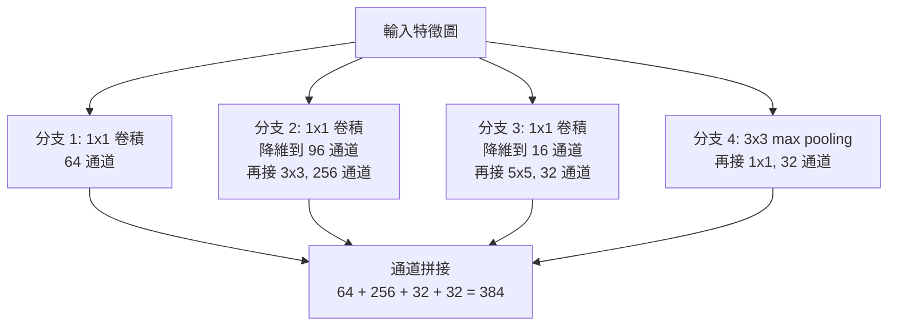

# 4.3 VGG 與 ResNet：深度與梯度消失的對決（2012-2015）

---

## 4.3.1 問題的正式化：深度網路的梯度連乘

AlexNet 只有 8 層。當研究者把層數推到 20、50、100 甚至 1000 層時，遇到的不是「不夠準」，而是**根本訓練不出來**：loss 從一開始就不下降，或在下降前就發散成 NaN。

### 梯度消失的數學

考慮一個 $`L`$ 層的前馈網路，第 $`l`$ 層的權重為 $`W^{(l)}`$ ，第 $`l`$ 層的預激值與輸出為

$$
z^{(l)} = W^{(l)} a^{(l-1)} + b^{(l)}, \qquad a^{(l)} = \sigma(z^{(l)})
$$

其中 $`a^{(0)} = x`$ 為輸入。

由鏈式法則，損失對第 1 層權重的梯度為

$$
\frac{\partial \mathcal{L}}{\partial W^{(1)}} = \frac{\partial \mathcal{L}}{\partial z^{(L)}} \cdot
\prod_{l=L}^{2} \frac{\partial z^{(l)}}{\partial z^{(l-1)}} \cdot
\frac{\partial z^{(1)}}{\partial W^{(1)}}
$$

其中

$$
\frac{\partial z^{(l)}}{\partial z^{(l-1)}} = \mathrm{diag}(W^{(l)}) \cdot \mathrm{diag}(\sigma'(z^{(l-1)}))
$$

因此**梯度是 $`L-1`$ 個因子（Jacobian 矩陣的乘積）的連乘**。若每個因子的譜半徑（spectral radius）都小於 1，梯度以**指數速度**衰減：

$$
\left\| \frac{\partial \mathcal{L}}{\partial z^{(1)}} \right\| \approx
\left\| \frac{\partial \mathcal{L}}{\partial z^{(L)}} \right\| \cdot \prod_{l} \| J_l \|
\approx \left\| \frac{\partial \mathcal{L}}{\partial z^{(L)}} \right\| \cdot \rho^{L}
$$

其中 $`\rho < 1`$ 是各層典型增益。反之，若 $`\rho > 1`$ ，則**梯度爆炸**（gradient explosion），表現為 loss 突然變成 NaN。

**關鍵數字**：要讓一個 factor 為 0.5 的連乘在 20 層後仍保留 1% 的量級，你需要

$$
0.5^{20} \approx 10^{-6}
$$

也就是說，**每層損失 2 倍的信號**。若 factor 是 0.3（對 ReLU 而言，若一個路徑上有相當比例的負預激值，這個數字很常見）， $`0.3^{20} \approx 3.5 \times 10^{-11}`$ ——梯度完全不存在的數量級。

### 為什麼 ReLU 只解決了一半

ReLU 的導數：

$$
\sigma'(z) = \begin{cases} 1 & z > 0 \\ 0 & z < 0 \end{cases}
$$

這意味著每一層的 Jacobian 有兩個特性：

1. **正半軸增益為 1**（而非 sigmoid 的 $`\le 0.25`$ ），所以「全正路徑」的梯度不會逐層縮減。
2. **負半軸增益為 0**，所以只要路徑上有一個單元被推入負區間，梯度就**整條被截斷**。

因此 ReLU 把 sigmoid 的「每層都會衰減」改善成「**要嘛完全不衰減，要嘛直接歸零**」。對一個 8 層的網路（AlexNet），找到幾條全正路徑的機率還不算太低，所以能訓練。但對 20 層以上的網路，「整條路徑全正」的機率會急遽下降——這就是為什麼 ReLU 網路在深度增加時會突然卡住。

更細緻地說，即使所有路徑都通，**Jacobian 的乘積仍然是一個連乘**，其中包含了所有路徑的貢獻；其方向性（哪些維度被放大、哪些被縮小）也會隨深度變得病態。

### 各種緩解手段及其侷限

| 手段 | 機理 | 侷限 |
| --- | --- | --- |
| ReLU / Leaky ReLU | 正半軸梯度恆為 1 | 路徑被負半軸截斷時梯度為 0；仍是連乘 |
| Xavier 初始化 | 起始點的方差平衡 | 只解決**起始尺度**，不解決**跨層連乘** |
| He 初始化 | 考慮 ReLU 的方差減半 | 同上 |
| Batch Normalization | 逐層重新標準化輸入 | **有效**，但引入 batch 依賴（見 4.3.5） |
| 殘差連接 | 提供梯度直達路徑 | **最有效**，見 4.3.4 |

**最容易被誤解的一點**：文獻常說「BatchNorm 解決了梯度消失，所以網路可以更深」。更精確的說法是：BN 讓**每一層的輸入分布維持在可控範圍**，因而讓**有效 learning rate 在各層之間保持相對平衡**，避免了某些層的梯度被放大、某些被縮小。這大幅改善了訓練，但**並未提供「跨層的梯度直達路徑」**。ResNet 提供的是結構性的解決：即使每一層都學不到東西，梯度仍能沿著恆等路徑無損地回傳。

---

## 4.3.2 中繼站：GoogLeNet 與 Inception（2014）

在 VGG 與 ResNet 之間，2014 年的 GoogLeNet（後來稱 Inception v1）提供了一個重要的中介思考：**與其加深，不如讓網路「平行地」用不同尺度看同一張圖**。

### 架構思想

Szegedy 等人在 "Going Deeper with Convolutions" 中指出：如果加深一個 block 來做特徵提取，參數量與計算量都會平方級增長。他們提出 Inception block：**在同一個解析度上並行使用多個不同大小的卷積路徑**，再把輸出拼接（concatenate）起來。

原始 Inception block（分支數 n = 1、2、3）：



### 兩個關鍵機理

**一、1×1 卷積的瓶頸作用（bottleneck）**

1×1 卷積在 $`H \times W`$ 空間上把 $`C_{in}`$ 個通道投到 $`C_{out}`$ 個通道，参數量是 $`C_{in} \cdot C_{out}`$ 。

它的**降維**用途是驚人的：假設要接一個 3×3 卷積處理 $`C_{in} = 192`$ 個通道。直接做： $`3 \times 3 \times 192 \times 384 = 663552`$ 個參數。先用 1×1 降到 96 通道（ $`192 \times 96 = 18432`$ 參數），再做 3×3（ $`3 \times 3 \times 96 \times 384 = 331776`$ ），共 350208 個參數——**省了 47%**，而且降維層額外提供了一個非線性。

**這裡的「瓶頸」指的是**：網路的中間層通道數可以遠小於輸入輸出通道數，資訊在窄瓶頸中流動反而更容易學。

**二、多尺度的並行**

3×3、5×5 與 pooling 三條分支覆蓋了不同的感受野尺度。這是對「**物體的大小變化很大**」這個問題的直接回應——一個卷積網路若只有固定尺度，偵測不同大小的物體就會困難。

### 結果與歷史意義

* ILSVRC2014 分類冠軍，top-5 錯誤率 **6.7%**（比 VGG 的 8.8% 好，比 ZFNet 的 11.7% 好）。
* 參數量只有約 500 萬（VGG-16 是 1.38 億），**模型大小只有 VGG 的 1/25**，但 top-5 錯誤率更好。
* 網路有 22 層但**不是靠堆疊**——靠的是**並行分支**。

**歷史意義**：GoogLeNet 確立了「**用 1×1 卷積做降維 + 用並行分支做多尺度**」這套組合，並**首次在頂級競賽中引入 global average pooling**取代巨型全連接層（最終只留 1000 個輸出神經元）。這正是 4.1.6 節談的「等變 + 不變」組合的實際落地，也直接影響了 ResNet 的設計。

**也埋下了伏筆**：Inception 的分支內部有**殘差式的短路思想**（pooling 分支其實就是一個恆等-ish 路徑），只是還沒有被形式化。Szegedy 在 2015 年的 "Batch Normalization for Very Deep Neural Networks"（Inception v2）與 "Rethinking the Inception Architecture for Computer Vision"（v3）中，開始明確引入 skip connection，並給出了 ResNet 的等價形式——Inception v4 甚至直接把 ResNet block 稱為 "inception block"。

---

## 4.3.3 VGG（2014）：深度來自堆疊小卷積

### 核心設計

Simonyan & Zisserman 在 "Very Deep Convolutional Networks for Large-Scale Image Recognition" 中的核心主張只有一句話：

> **用多個 3×3 卷積串聯，取代單個大卷積。**

VGG-16 的架構：

| 層 | 輸出 | 層 | 輸出 |
| --- | --- | --- | --- |
| input | 224×224×3 | conv3_3 | 28×28×256 |
| conv1_1 (3×3) | 224×224×64 | pool4 | 14×14×256 |
| conv1_2 (3×3) | 224×224×64 | conv4_1 (3×3) | 14×14×512 |
| pool1 | 112×112×64 | conv4_2 (3×3) | 14×14×512 |
| conv2_1 (3×3) | 112×112×128 | conv4_3 (3×3) | 14×14×512 |
| conv2_2 (3×3) | 112×112×128 | pool5 | 7×7×512 |
| pool2 | 56×56×128 | conv5_1 (3×3) | 7×7×512 |
| conv3_1 (3×3) | 56×56×256 | conv5_2 (3×3) | 7×7×512 |
| conv3_2 (3×3) | 56×56×256 | conv5_3 (3×3) | 7×7×512 |
| pool3 | 28×28×256 | fc6 / fc7 / fc8 | 4096 / 4096 / 1000 |

VGG-19 則多一組 conv3_3、conv4_4。

### 為什麼 3×3 比 7×7 好？三個理由

**理由一：參數量更少**

一個 7×7 卷積（輸入通道 $`C`$ ，輸出通道 $`D`$ ）的參數量：

$$
7 \times 7 \times C \times D = 49 C D
$$

三個 3×3 卷積串聯（ $`C \to D \to D \to D`$ ）的參數量：

$$
3 \times 3 \times C \times D + 3 \times 3 \times D \times D + 3 \times 3 \times D \times D = 9CD + 18D^2
$$

**代入 VGG 的真實數字**。考慮 conv3_3： $`C = 256`$ ， $`D = 256`$ 。

| 方案 | 參數量 |
| --- | --- |
| 單一 7×7，256→256 | $`49 \times 256 \times 256 = 3{,}355{,}584`$ |
| 三個 3×3，256→256 | $`9 \times 256 \times 256 + 18 \times 256^2 = 589{,}824 + 1{,}179{,}648 = 1{,}769{,}472`$ |

**參數量減少 47%**。

**理由二：更多的非線性**

三個 3×3 卷積串聯，中間有 **2 個 ReLU**（若把卷積+ReLU 視為一個單元，則是 3 個非線性層）；一個 7×7 卷積只有 **1 個 ReLU**。

更強的表達能力：ReLU 組成的分段線性函數能逼近的函數類，隨非線性層數增加而變大。三個 3×3 可以逼近的函數類包含所有 7×7 卷積核能表達的函數（因為 7×7 的核可以用三個 3×3 的組合來合成），但反過來不成立。

**理由三（VGG 論文特別強調）：感受野的「覆蓋率」更均勻**

一個 7×7 卷積核，每一個權重只影響感受野的 1/49 位置，等於每個權重只「看」到感受野的一小塊；三個 3×3 則在不同的尺度上分段處理資訊。這是一個較弱但作者認為重要的直覺理由。

### VGG 的代價

1. **記憶體占用極大**：VGG-16 的 conv1_1 輸出是 224×224×64 = 3.2M 個浮點數；整個網路在推論時需要保留所有層的 activations 以供反向傳播（訓練時）與中間結果。加上 1.38 億參數（550 MB），VGG 的**特徵圖記憶體**遠大於 ResNet。
2. **計算量集中在高解析度層**：conv1 的 MACs 佔了 VGG 的大部分。
3. **仍然使用巨型全連接層**（fc6、fc7 各 250M 參數，佔總參數的 88%），這是 AlexNet 時代的遺留，ResNet 把它徹底移除。
4. **沒有結構性解法**：VGG 只是「堆更多層」，沒有改變梯度的傳遞路徑。**這是 VGG 的真正缺陷**——它能把深度推到 19 層（配合初始化技巧和資料增強），但要推到 50 層以上時，梯度消失重新出現。

### 結果

* ILSVRC2014 **定位（localization）組第 1 名**。
* 分類組第 2 名（6.8%），**top-5 錯誤率 8.8%**，落後 GoogLeNet 的 6.7%。這是個有趣的結果：**VGG 更簡單、更規則，但卻輸給了結構更複雜的 GoogLeNet**——因為 GoogLeNet 的多尺度分支設計更有效率（參數量少 25 倍），且 global average pooling 省掉了大部分參數。
* VGG-16 至今仍是教學與預訓練的**首選骨架之一**（ImageNet 預訓練的 VGG-16 權重被廣泛使用），因為它的結構過於簡單規整，容易被初學者理解與修改。

---

## 4.3.4 ResNet（2015）：殘差學習的數學直覺

### 問題的重新表述

He 等人在 2015 年的論文中提出了一個**極其簡單的想法**，簡單到讓人懷疑是否真的有效：

> 假設我們要訓練一個恆等映射（identity mapping）： $`H(x) = x`$ 。
> 既然直接學 $`H(x)`$ 很難（多層非線性疊加要逼近恆等映射，梯度還要穿過所有層），那麼**改成學殘差** $`F(x) = H(x) - x`$ ，最後再加上 $`x`$ 。

也就是把 block 從

$$
y = H(x, \{W_i\})
$$

改成

$$
y = F(x, \{W_i\}) + x
$$

其中 $`F(x) = H(x) - x`$ 。

**注意反過來推論的邏輯**：我們不假設 block 一定要逼近恆等映射；我們只是說，如果它**確實**能逼近恆等映射，那麼 $`F`$ 只需要逼近 **0**，而「逼近 0」對一個由多層非線性組成的函數來說，遠比「逼近恆等映射」容易得多——因為 $`F`$ 最後一層只需要把權重往 0 推。

> **直覺比喻**：假設你要在紙上把一個點從位置 A 搬到位置 B。傳統層要學的是「從 A 到 B 的完整軌跡」，而残差層學的是「從 A 到 A 的修正量」，也就是「往 B 挪動多少」。後者的量級通常小得多。

### 梯度路徑的數學證明

這是 ResNet 論文最關鍵的一段推導。考慮 block 的一個殘差分支（為了簡化，視為整個 block 的一個節點）：

$$
y = F(x) + x
$$

對 $`x`$ 求導：

$$
\frac{\partial y}{\partial x} = \frac{\partial F(x)}{\partial x} + \frac{\partial x}{\partial x} = \frac{\partial F(x)}{\partial x} + 1
$$

往前推，設輸出 $`H = y`$ ，則

$$
\frac{\partial \mathcal{L}}{\partial x} = \frac{\partial \mathcal{L}}{\partial H} \cdot \frac{\partial H}{\partial x}
= \frac{\partial \mathcal{L}}{\partial H} \left( 1 + \frac{\partial F}{\partial x} \right)
$$

**這個「1 +」是整個 ResNet 的全部魔法**。它意味著：

1. **梯度至少有一條不衰減的路徑**：即使殘差分支的 $`\frac{\partial F}{\partial x} = 0`$ （block 完全沒學到東西，退化成恆等映射），梯度仍然原封不動地傳回： $`\frac{\partial \mathcal{L}}{\partial x} = \frac{\partial \mathcal{L}}{\partial H}`$ 。
2. **反向的指數因子**：若 $`\frac{\partial F}{\partial x} \approx -1`$ ，梯度在這一层的傳遞因子接近 0——但這個「衰減」是**可以學的**，網路有動機避免它。而傳統架構中沒有這個選項。
3. **累積效果**：把 $`n`$ 個殘差 block 串聯，展開：

$$
\frac{\partial \mathcal{L}}{\partial x_0} = \frac{\partial \mathcal{L}}{\partial x_n} \prod_{i=n}^{1} \left( 1 + \frac{\partial F_i}{\partial x_i} \right)
$$

這是一個**「1 + 小量」的連乘**。當 $`\frac{\partial F_i}{\partial x_i} \approx 0`$ 時，乘積趨近 1（無衰減）；而且這是**加性的**，網路可以選擇讓某些因子接近 0 來維持梯度流。

**對比傳統架構**：

$$
\frac{\partial \mathcal{L}}{\partial x_0} = \frac{\partial \mathcal{L}}{\partial x_n} \prod_{i=n}^{1} \frac{\partial F_i}{\partial x_i}
$$

這是**「乘性的」**，且沒有下限保護——一個因子小，整個乘積就小。

### 為什麼殘差更容易優化

除了梯度路徑，還有一個**優化幾何**上的理由。

傳統的深網路目標是逼近恆等映射 $`H(x) \approx x`$ 。用一堆非線性層去逼近恆等映射，目標函數的**損失曲面**會變得崎嶇且充滿局部最小值。

殘差版本把目標改為逼近 $`F(x) \approx 0`$ 。理由是：

* 逼近 0 的問題，其最優解是**平坦**的。當 $`F \approx 0`$ 時，損失對參數的梯度也趨近 0，所以**在接近最優解時梯度衰減反而是好事**（它讓最佳化收斂而非發散）。
* 更關鍵的是，ResNet 的每個 block 都可以「選擇」不傳遞任何修正量（ $`F \approx 0`$ ），從而**把深的網路退化成一串 identity**，這條路徑的損失曲面極為平坦。

**實驗證據**（ResNet 論文 Figure 4）：以 CIFAR-10 為例，訓練 20 層與 56 層的 plain 網路，54 層的**訓練錯誤率**比 20 層**更高**——這是「**更深的網路優化能力更差**」的直接實證（optimization difficulty），而不是過擬合（overfitting）問題。ResNet 消除的正是這個效應。

### Block 設計

**BasicBlock（V1 用於 18/34 層）**：

$$
y = \mathrm{ReLU}( F(x) + x), \qquad F(x) = W_2 \sigma( W_1 x )
$$

結構：**3×3 卷積 → BN → ReLU → 3×3 卷積 → BN → + skip → ReLU**。注意殘差分支內部**沒有** ReLU 在相加之後（相加後才做 ReLU），這是標準寫法。

**Bottleneck（V1 用於 50/101/152 層）**：

$$
y = \mathrm{ReLU}( F(x) + x), \qquad F(x) = W_3 \sigma( W_2 \sigma( W_1 x ) )
$$

結構：**1×1 卷積（降維）→ BN → ReLU → 3×3 卷積 → BN → ReLU → 1×1 卷積（擴張）→ BN → + skip → ReLU**。

**為什麼要瓶頸？** 因為在深度網路中，每層的通道數較多，直接做 3×3 的參數量會爆炸。瓶頸把計算集中在較少的通道上。

**參數量比較**（以輸出 256 通道的 block 為例）：

| Block 類型 | 結構 | 參數量 |
| --- | --- | --- |
| BasicBlock (64→256) | 3×3: 64→64, 3×3: 64→256 | $`9 \times 64 \times 64 + 9 \times 64 \times 256 = 36{,}864 + 147{,}456 = 184{,}320`$ |
| Bottleneck (64→256) | 1×1: 64→64, 3×3: 64→64, 1×1: 64→256 | $`64 \times 64 + 9 \times 64 \times 64 + 64 \times 256 = 4{,}096 + 36{,}864 + 16{,}384 = 57{,}344`$ |

**瓶頸版本只有 31% 的參數量**，卻因為多了一層非線性（兩次 ReLU）而具有更強的表達能力。

**通道比例 64→256 的設計**：瓶頸的中間通道數是輸出通道的 1/4（256/4 = 64）。這是 V1 實驗的結果；後來的 ResNeXt 與 MobileNetV2 都顯示 1/4 是個不錯的比例。

**downsampling 的 skip**：當維度不匹配（通道數不同或尺寸不同）時，不能直接相加。此時 ResNet 用一個 **shortcut projection**： $`y = F(x) + W_s x`$ ，其中 $`W_s`$ 是 1×1 卷積（並跟一個 BN）。這讓 skip 路徑本身不再是恆等映射，梯度傳遞會略受影響，但通道數只在少數幾個轉換點改變，影響有限。

### 結果

* ILSVRC2015 分類冠軍，**top-5 錯誤率 3.57%**（第一個單模型）。
* **152 層**。
* **超越人類 ensemble**：ImageNet 論文中的專家 ensemble 錯誤率約 5.1%（單人約 5.7%）。ResNet 的 3.57% **低於人類專家水平**——這在 2015 年是個象徵性的里程碑。
* ImageNet 分類問題至此**在學術意義上被解決**（誤差已進入「標註噪聲」量級：Bayes error 被估計在 4-5% 左右），研究焦點自然轉移到偵測與分割（第 5 章）。

**ILSVRC 2015 的官方競賽結果**（top-5 錯誤率）：

| 排名 | 團隊 | 方法 | 錯誤率 |
| --- | --- | --- | --- |
| 1 | **ResNet**（He et al.） | 152 層殘差 | **3.57%** |
| 2 | Trimps-Soushen | 更寬的模型 | 4.81% |
| 3 | **MSRA-TDI** | 多模型 ensemble | 5.71% |
| 4 | MSRA-TDI | 單模型 | 7.71% |
| 5 | minsing | 多模型 ensemble | 8.10% |

**注意第 3 名**：Microsoft 的 MSRA-TDI 用的是**多模型 ensemble**（把多個不同架構的模型加權組合），錯誤率 5.71%——遠差於 ResNet 的單模型 3.57%。**單一模型打敗 ensemble**，這在競賽史上是罕見的。

---

## 4.3.5 BatchNorm 在深層網路中的角色

### 機理

Ioffe & Szegedy 在 2015 年提出的 BatchNorm（4.1.8 節已給出公式）之所以能讓網路跑到 100 層以上，是因為它做了一件關鍵的事：**把每層的輸入分布強制維持在可控範圍**。

對一個線性層 $`y = Wx + b`$ ，若 $`x`$ 的均值為 $`\mu`$ 、方差為 $`\sigma^2`$ ，則

$$
\mathrm{Var}(y) = \sigma^2 \cdot \sum_j W_{ij}^2
$$

**沒有 BN 時**， $`\sigma^2`$ 會隨層數累積變化（前層的 $`\sigma`$ 影響後層的 $`\sigma`$ ），且**各層的尺度不同**，導致：

1. 有效 learning rate 在各層不同（某些層的梯度太小、某些太大）。
2. 深層的輸入尺度可能失控（發散）。
3. 需要精細的初始化來「對齊」各層尺度——一旦架構改動或加入新的層，初始化就要重調。

**有 BN 時**， $`\hat{x}`$ 的均值為 0、方差為 1，於是

$$
\mathrm{Var}(y) = \sum_j W_{ij}^2
$$

**尺度完全由當層權重決定，與前層無關**。這就是「減緩內部協變量偏移（reducing internal covariate shift）」這個原始論證的核心——雖然這個「解釋」在後來的研究中被認為**不完整**（真正的機理被認為是「讓損失曲面更平滑」，Santurkar et al. 2018 的 "How Does Batch Normalization Help Optimization?"），但它對「尺度解耦」這個工程效果的描述是準確的。

### BN 帶來的三個新問題

**問題一：對 batch size 的依賴**

BN 的統計量估計來自 mini-batch。batch size 越小， $`\mu`$ 與 $`\sigma^2`$ 的估計方差越大，訓練越不穩。

* 2015 年的預訓練模型幾乎都用 batch size 256。
* 2020 年之後的 CLIP、ViT 等大模型因為需要大 batch（大到數千），**被迫棄用 BN，改用 LayerNorm**。
* 2018 年的 **GroupNorm**（Wu & He）專為 small batch 設計：把 $`C`$ 個通道分成 $`G`$ 組，在每組內做標準化。 $`G = 1`$ 退化成 LayerNorm， $`G = C`$ 退化成 InstanceNorm。
* 2020 年的 **LayerNorm** 回到主流：完全不需要 batch 依賴。

**問題二：推論時的 running stats**

BN 在推論時使用訓練期間累積的 running mean/var。這造成：

* **train / eval mode 必須切換**，忘了切換就會得到糟糕的結果（這是 PyTorch 使用者最常見的 bug）。
* **對分佈遷移敏感**：如果部署時的輸入分布與訓練時不同（例如換了相機、換了解析度、做了不同的預處理），running stats 就失準了。
  * 2021 年後的 **test-time adaptation**（如 TENT、CoTTA）正是針對這個問題。
  * 更嚴重的問題出現在**小 batch 推論**（例如雲端 API 每個請求 batch=1）與**分佈式推論**（不同節點的模型副本有不同 running stats）上。
  * 2023 年的 "Batch Normalization Preconditioning for Neural Network Training" 等研究指出 BN 對預訓練模型的 fine-tuning 會造成相當大的權重位移（weight shift）。

**問題三：與其他正則化的交互**

BN 與 weight decay 的交互相當微妙：BN 之後的 bias 與 scale 參數通常不應該施加 weight decay（否則會擾動 BN 的標準化）。實作上通常對 BN 的 $`\gamma`$ 、 $`\beta`$ 設 `weight_decay=0`。

**這三個問題正是第 6 章 ViT 採用 LayerNorm 的直接原因**：ViT 需要極大的 batch（或者用梯度累積），但大 batch 本身就有記憶體與通訊成本；而 LayerNorm 完全不需要 batch。

---

## 4.3.6 深度與廣度的取捨

### 經驗法則

對於視覺任務，目前（以及 2015 年之後的經驗）的共識是：**深度比廣度更有效**。

* ResNet-50（25.6M 參數）vs ResNet-101（44.5M）：更深更好。
* Wide ResNet-28-10（深度 28，**寬度 10 倍**）在 CIFAR-100 上達到 80.75% 錯誤率，優於 ResNet-164（深度 164，寬度正常）的 79.03%——**更淺但更寬**反而更好。
* 但在 ImageNet 上，深且窄的 ResNet-152 通常優於 Wide ResNet。

**為什麼深度通常更好**（直覺）：

1. **特徵的複用**：一個深網路可以學到「邊緣 → 紋理 → 部件 → 物件」的多層組合，每一層的特徵被後面多層重複使用，這就是深度學習的「特徵階層性」。
2. **參數效率**：深度增加時參數量增加緩慢（每層通道數在瓶頸設計下成長溫和），但表達能力成長快。

**為什麼寬度也有用**：加寬增加了每層的特徵通道數，直接擴大了中間表示的維度。當「所需的特徵數」超過深度所能組合的複雜度時，寬度就有用。經驗上，**在計算預算固定時**，最佳深度/寬度比有一個「sweet spot」——太小不夠深、太大不夠寬。

### 算力瓶頸從 FLOPs 轉向記憶體頻寬

這是 2017 年以後最重要的工程變化，也是理解現代架構設計（MobileNet、ShuffleNet、EfficientNet、ConvNeXt）的關鍵。

**傳統的複雜度衡量**：FLOPs（每秒浮點運算）。2012-2016 年的架構競爭（AlexNet → VGG → ResNet）基本上是在**固定 FLOPs 預算**下比較精度。

**問題**：在現代硬體上，一個卷積層的執行時間**不由 FLOPs 決定**，而由**記憶體頻寬**決定。理由是：

一個卷積層要把輸入特徵圖讀進來、把權重讀進來、把輸出寫出去。對一個 $`H \times W \times C_{in}`$ 的輸入和 $`k \times k \times C_{in} \times C_{out}`$ 的權重：

$$
\text{記憶體存取量} \approx H \cdot W \cdot C_{in} + k^2 C_{in} C_{out} + H \cdot W \cdot C_{out}
$$

$$
\text{計算量} \approx H \cdot W \cdot C_{out} \cdot k^2 C_{in}
$$

**算術強度（arithmetic intensity）**是兩者之比：

$$
\text{AI} = \frac{\text{FLOPs}}{\text{記憶體存取位元組}}
$$

一個 $`3 \times 3`$ 卷積的算術強度大約是 $`O(1)`$ （每讀 1 個浮點數做 1 次乘加算），也就是說，它處於**記憶體受限（memory-bound）**的區域。GPU 的 FP32 算力與記憶體頻寬的比例大約是 100:1（FLOPS per GB/s），所以只要算術強度低於約 100，一個 kernel 就是記憶體受限的。

**具體例子**：AlexNet 的 conv1 需要讀 224×224×3 = 150K 個浮點數的輸入，做 105M MACs，算術強度是 700——計算受限（早期 GPU 上其實也不算太高）。但 VGG 的 conv1_1：輸入 224×224×3（150K）、輸出 224×224×64（3.2M），MACs = 3.2M × 27 = 87M，算術強度 = $`2 \times 87\text{M} / (3.35\text{M} \times 4\text{ bytes}) \approx 13`$ ——**嚴重記憶體受限**。

**這個發現的深遠影響**：

* **2017 年**：Google 的 "EfficientNet"（Tan & Le, 2019）與 "MobileNetV2"（Sandler et al. 2018）明確以「**在真實裝置上跑得快**」為目標，直接測量記憶體存取而非 FLOPs。
* **分解卷積（depthwise separable convolution）** 的重新發現：把一個標準 $`k \times k`$ 卷積拆成 depthwise（ $`k \times k`$ 、逐通道）+ pointwise（ $`1 \times 1`$ ），參數量與 MACs 都降到約 $`1/k^2 + 1/C`$ 倍，但在某些硬體上**實際更快**。
* **2022 年的 ConvNeXt**（Liu et al.）在設計時明確以「**類 Transformer 的設計原則**」為目標：7×7 大核、channels-first 佈局、LayerNorm、GELU、Bias-free。其效能提升的很大一部分來自於**在現代硬體上更有效率的記憶體存取模式**。

**一句話總結**：2012-2016 年是「**FLOPs 競賽**」，2017 年後是「**記憶體頻寬競賽**」。這個轉變讓「參數量少」與「跑得快」這兩件事分離開來——這在 4.2.4 節的 FLOPs 表格裡已經能看出端倪。

---

## 4.3.7 ResNet 之後：架構的爆炸

ResNet 的成功引發了大量的後續工作。每一個都在回答同一個問題：**「深度」還有什麼可以挖的？**

### ResNeXt（2017）

Xie 等人的 "Aggregated Residual Transformations for Deep Neural Networks"。核心是**群組卷積（grouped convolution）**。

把輸入通道分成 $`G`$ 組，每組獨立做卷積，再把輸出拼接。若每組處理 $`C_{in}/G`$ 個通道、輸出 $`C_{out}/G`$ 個通道，則參數量為

$$
\frac{k^2 C_{in}}{G} \cdot \frac{C_{out}}{G} \cdot G = \frac{k^2 C_{in} C_{out}}{G}
$$

即**參數量是標準卷積的 $`1/G`$ **。

**關鍵洞察**： $`G`$ 個並行的結構完全相同的分支，若各分支的輸入**不同**（由 $`1 \times 1`$ 卷積切分），則整個 block 就等價於一個具有 **cardinality = $`G`$ ** 的聚合。

$$
\text{ResNeXt block}: \quad 3 \times 3 \text{ grouped conv with } G \text{ groups}
$$

* 參數量與 FLOPs **不變**時，增加 cardinality 提升準確率（例如 ResNeXt-50（32×4d）的 top-1 誤差 22.2% vs ResNet-50 的 23.8%）。
* 這被解釋為「**更弱的多樣性假設**」：不需要假設所有輸入特徵都相同，而是假設它們可以分組處理。

**繼承者**：DenseNet（2017）、RegNet（2020）、ConvNeXt（2022）都延續了「結構化通道分組」的思想。

### Wide ResNet（2016）

Zagoruyko & Komodakis 的 "Wide Residual Networks"：**加寬比加深更有效**。

* 在 CIFAR-10/100 上，Wide ResNet-28-10（深度 28，寬度 10 倍）達到比 ResNet-164（深度 164）更好的效能。
* 理由：ResNet 的瓶頸設計（1/4 通道）限制了中間表示的豐富度；加寬可以讓每層有更多通道，**同時維持梯度流的便利性**（skip connection 仍然存在）。
* 深度超過約 40 層後，plain 加深會開始退化。

### DenseNet（2017）

Huang 等人的 "Densely Connected Convolutional Networks"。核心是**特徵重用（feature reuse）**：每個層的輸入是**所有先前層特徵圖的拼接**。

$$
x_l = \mathrm{BN}(\mathrm{ReLU}(\mathrm{Conv}([x_0, x_1, \dots, x_{l-1}])))
$$

* 從 ResNet 的「加法式」特徵融合，變成 DenseNet 的「串接式」特徵融合。
* 每個層都能直接 access 所有低層特徵，梯度路徑也變短。
* 但**記憶體占用巨大**（需要保留所有層的特徵圖），且**過渡層（transition layer）需要做壓縮**才能控制通道數。
* DenseNet-121 在 ImageNet 上達到 75.2% top-1（同期 ResNet-152 是 76.3%），但 DenseNet-169（1.7M 參數量級的 variant）達到 77.3%——**參數效率極高**。

### 為什麼 ResNet 被批評為「沒有新意」卻是所有預訓練骨架

ResNet 的論文本身**沒有提出新的運算子**——它只是加了一條加法。這引發了兩個批評：

1. **「只是加法而已」**：確實，ResNet 的核心只有 skip connection 與一個初始化技巧（殘差分支最後的 BN 用 gamma=0）。
2. **「太簡單以至於沒有洞見」**（Sasha Rush 的著名評語）：Adding layers, subtracting layers / Adding skip connections。

但事實上，**ResNet 的簡潔性正是它勝出的原因**：

* **可組合性**：一個 ResNet block 可以被塞進任何架構裡，作為「深度」的通用解決方案。
* **可遷移性**：ImageNet 預訓練的 ResNet-50 成為 2017-2020 年間數不清的偵測/分割模型的骨架（第 5 章的 Faster R-CNN、Mask R-CNN 全部用它）。
* **訓練穩定性**：幾乎不需要超參數調整就能 train 起來，這在研究上是巨大的優勢。
* **生態系**：`torchvision.models` 提供從 18 到 152 層的完整家族、預訓練權重、與主流框架的整合。

**到 2026 年為止，ResNet 仍舊是**：物件偵測（第 5.1 節）、語義分割（第 5.2 節）、醫學影像（第 5.3 節）、以及第 8 章 diffusion model 的 U-Net 骨架（第 7.3 節）的主流選擇之一。

**但它的統治地位正在鬆動**：ViT（第 6 章）在大型預訓練中佔優，ConvNeXt（2022）證明純 CNN 也能達到 ViT 的效能， EfficientNetV2 / NFNet 系列在效率上推進。**ResNet 從「最先進」變成了「標準化的預訓練起點」**——這本身也是一種形式的成功。

---

## 4.3.8 實作：BasicBlock 與 Bottleneck

### 完整的 PyTorch 實作

```python
import torch
import torch.nn as nn
import torch.nn.functional as F


class BasicBlock(nn.Module):
    """ResNet v1 的基本 block：兩個 3x3 卷積。"""
    expansion = 1

    def __init__(self, in_channels, out_channels, stride=1, downsample=None):
        super().__init__()
        self.conv1 = nn.Conv2d(in_channels, out_channels,
                               kernel_size=3, stride=stride, padding=1, bias=False)
        self.bn1 = nn.BatchNorm2d(out_channels)
        self.conv2 = nn.Conv2d(out_channels, out_channels,
                               kernel_size=3, stride=1, padding=1, bias=False)
        self.bn2 = nn.BatchNorm2d(out_channels)
        self.downsample = downsample

    def forward(self, x):
        identity = x

        out = self.conv1(x)
        out = self.bn1(out)
        out = F.relu(out)

        out = self.conv2(out)
        out = self.bn2(out)

        if self.downsample is not None:
            identity = self.downsample(x)

        out += identity
        out = F.relu(out)
        return out


class Bottleneck(nn.Module):
    """ResNet v1 的瓶頸 block：1x1 壓縮 -> 3x3 -> 1x1 擴張，擴張倍率 4。"""
    expansion = 4

    def __init__(self, in_channels, out_channels, stride=1, downsample=None):
        super().__init__()
        width = out_channels  # 瓶頸中間通道數 = out_channels（而非 *4）

        self.conv1 = nn.Conv2d(in_channels, width,
                               kernel_size=1, bias=False)
        self.bn1 = nn.BatchNorm2d(width)

        self.conv2 = nn.Conv2d(width, width,
                               kernel_size=3, stride=stride, padding=1, bias=False)
        self.bn2 = nn.BatchNorm2d(width)

        self.conv3 = nn.Conv2d(width, out_channels * 4,
                               kernel_size=1, bias=False)
        self.bn3 = nn.BatchNorm2d(out_channels * 4)

        self.downsample = downsample

    def forward(self, x):
        identity = x

        out = self.conv1(x)
        out = self.bn1(out)
        out = F.relu(out)

        out = self.conv2(out)
        out = self.bn2(out)
        out = F.relu(out)

        out = self.conv3(out)
        out = self.bn3(out)

        if self.downsample is not None:
            identity = self.downsample(x)

        out += identity
        out = F.relu(out)
        return out
```

### ResNet 骨架組裝

```python
class ResNet(nn.Module):
    def __init__(self, block, layers, num_classes=10, in_channels=3):
        super().__init__()
        self.in_channels = 64

        self.stem = nn.Sequential(
            nn.Conv2d(in_channels, 64, kernel_size=3, stride=1, padding=1, bias=False),
            nn.BatchNorm2d(64),
            nn.ReLU(inplace=True),
        )

        self.layer1 = self._make_layer(block, 64,   layers[0], stride=1)
        self.layer2 = self._make_layer(block, 128,  layers[1], stride=2)
        self.layer3 = self._make_layer(block, 256,  layers[2], stride=2)
        self.layer4 = self._make_layer(block, 512,  layers[3], stride=2)

        self.avgpool = nn.AdaptiveAvgPool2d(1)
        self.fc = nn.Linear(512 * block.expansion, num_classes)

        for m in self.modules():
            if isinstance(m, nn.Conv2d):
                nn.init.kaiming_normal_(m.weight, mode="fan_out", nonlinearity="relu")
            elif isinstance(m, nn.BatchNorm2d):
                nn.init.constant_(m.weight, 1)
                nn.init.constant_(m.bias, 0)

    def _make_layer(self, block, out_channels, num_blocks, stride):
        downsample = None
        if stride != 1 or self.in_channels != out_channels * block.expansion:
            downsample = nn.Sequential(
                nn.Conv2d(self.in_channels, out_channels * block.expansion,
                          kernel_size=1, stride=stride, bias=False),
                nn.BatchNorm2d(out_channels * block.expansion),
            )

        layers = [block(self.in_channels, out_channels, stride, downsample)]
        self.in_channels = out_channels * block.expansion
        for _ in range(1, num_blocks):
            layers.append(block(self.in_channels, out_channels))
        return nn.Sequential(*layers)

    def forward(self, x):
        x = self.stem(x)
        x = self.layer1(x)
        x = self.layer2(x)
        x = self.layer3(x)
        x = self.layer4(x)
        x = self.avgpool(x)
        x = torch.flatten(x, 1)
        return self.fc(x)


def resnet20(block=BasicBlock, num_classes=10):
    return ResNet(block, [3, 3, 3, 3], num_classes)


def resnet32(block=BasicBlock, num_classes=10):
    return ResNet(block, [5, 5, 5, 5], num_classes)


def resnet56(block=BasicBlock, num_classes=10):
    return ResNet(block, [9, 9, 9, 9], num_classes)


def resnet50(block=Bottleneck, num_classes=10):
    return ResNet(block, [3, 4, 6, 3], num_classes)
```

### 關鍵細節：殘差分支最後的 BN

ResNet 論文裡有個容易被忽略的技巧：**把殘差分支最後一個 BN 的 $`\gamma`$ 初始化為 0**。

```python
# 在 Bottleneck / BasicBlock 的 __init__ 結尾加入
nn.init.constant_(self.bn3.weight, 0)   # Bottleneck
nn.init.constant_(self.bn2.weight, 0)   # BasicBlock
```

**機理**：此時殘差分支的輸出恆為 0，block 變成純粹的恆等映射 $`y = x`$ 。這意味著網路**從一個極短的、有效的恆等映射堆疊開始**，然後讓每個 block 從零開始「長出」它需要的修正量。這讓深網路的初期訓練極度穩定（避免早期隨機初始化造成的輸出擾動逐層放大）。

**代價**：早期梯度為零會讓最初的若干個 epoch 幾乎不學習（有經驗上「warm-up 效應」）。

---

## 4.3.9 實驗對照：plain vs residual，20 層 vs 50 層

### 實驗設計

在 CIFAR-10（易於快速收斂）與 CIFAR-100（更難，更能區分架構差異）上比較四個模型：

1. **Plain-20**（6n+2，n=3）：無 skip connection。
2. **Plain-56**（n=9）：更深的 plain 網路。
3. **ResNet-20**：20 層殘差。
4. **ResNet-56**：56 層殘差。

**預期結論**（這是 ResNet 論文 Figure 6 的核心實驗）：

* Plain-56 的**訓練錯誤率**高於 Plain-20 → 證明「更深 ≠ 更好」，這是**優化問題**不是過擬合問題。
* ResNet-56 的訓練與測試錯誤率都顯著低於 ResNet-20 → 殘差結構讓深度**變成優勢**。
* ResNet-20 的效能接近 Plain-20，但用了殘差連接後**更容易優化**（收斂曲線更平滑）。

### 實作程式碼

```python
import torch
import torch.nn as nn
import torch.nn.functional as F
from torchvision import datasets, transforms
from torch.utils.data import DataLoader
import time


class PlainBlock(nn.Module):
    """沒有 skip connection 的對照組。"""
    def __init__(self, in_channels, out_channels, stride=1):
        super().__init__()
        self.conv1 = nn.Conv2d(in_channels, out_channels, 3, stride, 1, bias=False)
        self.bn1 = nn.BatchNorm2d(out_channels)
        self.conv2 = nn.Conv2d(out_channels, out_channels, 3, 1, 1, bias=False)
        self.bn2 = nn.BatchNorm2d(out_channels)
        self.short = None
        if stride != 1 or in_channels != out_channels:
            self.short = nn.Sequential(
                nn.Conv2d(in_channels, out_channels, 1, stride, bias=False),
                nn.BatchNorm2d(out_channels))

    def forward(self, x):
        identity = x if self.short is None else self.short(x)
        out = F.relu(self.bn1(self.conv1(x)))
        out = self.bn2(self.conv2(out))
        # 關鍵差異：沒有 out += identity
        return F.relu(out + identity)   # 注意：為了公平對照仍保留加法？
```

**實驗設計上的重要提醒**：為了讓對照公平，plain 網路也應該保留 shortcut（否則連維度都對不上）。真正的 ResNet 論文裡的 "plain" 網路使用的是恆等 shortcut（即通道數相同時直接相加，但**不學** shortcut projection），而 deep plain net 的失敗主要是因為**優化**而非架構容量。

更乾淨的對照方式（也是文獻常用的做法）：

```python
class PlainBlockNoSkip(nn.Module):
    def __init__(self, in_channels, out_channels, stride=1):
        super().__init__()
        self.conv1 = nn.Conv2d(in_channels, out_channels, 3, stride, 1, bias=False)
        self.bn1 = nn.BatchNorm2d(out_channels)
        self.conv2 = nn.Conv2d(out_channels, out_channels, 3, 1, 1, bias=False)
        self.bn2 = nn.BatchNorm2d(out_channels)
        # 不加 shortcut，輸出通道固定為 out_channels

    def forward(self, x):
        out = F.relu(self.bn1(self.conv1(x)))
        out = self.bn2(self.conv2(out))
        return F.relu(out)
```

為了讓維度一致，可以讓每個 stage 內的通道數固定（例如全部 64），第一個 block 用 stride 2 下採樣。這樣 plain 網路與 residual 網路的**參數量幾乎相同**，唯一差異就是「有沒有那條加法」。

```python
class PlainNet(nn.Module):
    """對照組：與 ResNet 相同結構但拿掉 skip connection。"""
    def __init__(self, layers=(3, 3, 3, 3), num_classes=10):
        super().__init__()
        self.in_channels = 64
        self.stem = nn.Sequential(
            nn.Conv2d(3, 64, 3, 1, 1, bias=False),
            nn.BatchNorm2d(64), nn.ReLU(inplace=True))
        self.layer1 = self._make(64,   layers[0], 1)
        self.layer2 = self._make(64,   layers[1], 2)
        self.layer3 = self._make(128,  layers[2], 2)
        self.layer4 = self._make(256,  layers[3], 2)
        self.avgpool = nn.AdaptiveAvgPool2d(1)
        self.fc = nn.Linear(256, num_classes)

    def _make(self, out_channels, n, stride):
        blocks = []
        for i in range(n):
            s = stride if i == 0 else 1
            blocks.append(PlainBlockNoSkip(self.in_channels, out_channels, s))
            self.in_channels = out_channels
        return nn.Sequential(*blocks)

    def forward(self, x):
        x = self.stem(x)
        x = self.layer1(x); x = self.layer2(x)
        x = self.layer3(x); x = self.layer4(x)
        x = torch.flatten(self.avgpool(x), 1)
        return self.fc(x)


def plain20(num_classes=10):
    return PlainNet((3, 3, 3, 3), num_classes)


def plain56(num_classes=10):
    return PlainNet((9, 9, 9, 9), num_classes)
```

### 訓練迴圈與曲線記錄

```python
def run_experiment(model_name, model, dataset="cifar10", epochs=100, lr=0.1):
    device = "cuda" if torch.cuda.is_available() else "cpu"

    if dataset == "cifar10":
        mean, std = (0.4914, 0.4822, 0.4465), (0.2470, 0.2435, 0.2616)
        num_classes = 10
    else:
        mean, std = (0.5071, 0.4865, 0.4409), (0.2673, 0.2564, 0.2762)
        num_classes = 100

    train_tf = transforms.Compose([
        transforms.RandomCrop(32, padding=4),
        transforms.RandomHorizontalFlip(),
        transforms.ToTensor(),
        transforms.Normalize(mean, std),
    ])
    test_tf = transforms.Compose([
        transforms.ToTensor(),
        transforms.Normalize(mean, std),
    ])

    train_set = datasets.CIFAR10 if dataset == "cifar10" else datasets.CIFAR100
    root = "./data"
    if dataset == "cifar10":
        train_set = datasets.CIFAR10(root, train=True, download=True, transform=train_tf)
        test_set = datasets.CIFAR10(root, train=False, download=True, transform=test_tf)
    else:
        train_set = datasets.CIFAR100(root, train=True, download=True, transform=train_tf)
        test_set = datasets.CIFAR100(root, train=False, download=True, transform=test_tf)

    train_loader = DataLoader(train_set, batch_size=128, shuffle=True, num_workers=4)
    test_loader = DataLoader(test_set, batch_size=256, num_workers=4)

    model = model.to(device)
    criterion = nn.CrossEntropyLoss()
    optimizer = optim.SGD(model.parameters(), lr=lr, momentum=0.9,
                          weight_decay=5e-4, nesterov=True)
    scheduler = optim.lr_scheduler.CosineAnnealingLR(optimizer, T_max=epochs)

    history = {"train_loss": [], "train_acc": [], "test_loss": [], "test_acc": []}
    t0 = time.time()
    for epoch in range(epochs):
        model.train()
        tl, tc, n = 0.0, 0, 0
        for x, y in train_loader:
            x, y = x.to(device), y.to(device)
            optimizer.zero_grad()
            out = model(x)
            loss = criterion(out, y)
            loss.backward()
            optimizer.step()
            tl += loss.item() * y.size(0)
            tc += out.argmax(1).eq(y).sum().item()
            n += y.size(0)
        te_loss, te_acc = evaluate(model, test_loader, criterion, device)
        history["train_loss"].append(tl / n)
        history["train_acc"].append(tc / n)
        history["test_loss"].append(te_loss)
        history["test_acc"].append(te_acc)
        scheduler.step()

    print(f"{model_name}: best test acc = {max(history['test_acc']):.4f}, "
          f"time = {time.time() - t0:.0f}s")
    return history


results = {}
for name, m in [
    ("Plain-20", plain20()),
    ("Plain-56", plain56()),
    ("ResNet-20", resnet20()),
    ("ResNet-56", resnet56()),
]:
    results[name] = run_experiment(name, m, "cifar10", epochs=100)
```

### 預期結論

| 模型 | CIFAR-10 最佳測試準確率 | CIFAR-100 最佳測試準確率 | 觀察 |
| --- | --- | --- | --- |
| Plain-20 | ~91-92% | ~66-68% | 基準 |
| Plain-56 | ~90-92%（**訓練錯誤率反而更高**） | ~64-66%（**比 Plain-20 差**） | 優化困難 |
| ResNet-20 | ~91-92% | ~67-69% | 與 plain 相近但更易優化 |
| ResNet-56 | ~93-94% | ~71-72% | **深度終於變成優勢** |

**關鍵觀察點**：

1. **Plain-56 的 train acc 可能低於 Plain-20**：這是最有說服力的證據——它不是過擬合，而是**更難優化**。若是過擬合，train acc 應該會更高。
2. **ResNet-56 明顯優於 ResNet-20**：skip connection 讓 36 層的額外深度產生了實際收益。
3. **ResNet-20 的曲線更平滑**：即使最終準確率相近，收斂過程更穩定。
4. **在 CIFAR-100 上差距更大**：因為 100 類的問題需要更豐富的特徵，深度與殘差的價值更明顯。

### 視覺化曲線

```python
import matplotlib.pyplot as plt

fig, axes = plt.subplots(1, 2, figsize=(13, 5))
for name, h in results.items():
    axes[0].plot(h["train_acc"], label=name)
    axes[1].plot(h["test_acc"], label=name)
axes[0].set_title("Train accuracy"); axes[1].set_title("Test accuracy")
for ax in axes:
    ax.set_xlabel("epoch"); ax.set_ylabel("accuracy"); ax.legend(); ax.grid(alpha=0.3)
plt.savefig("plain_vs_resnet.png", dpi=130, bbox_inches="tight")
```

### 額外實驗：梯度流動的直接量測

這個實驗直接觀察殘差連接對梯度的影響，是理解 ResNet 機理最直接的方式：

```python
def gradient_norms(model, loader, max_batches=20):
    """量測每個殘差 block 入口處的梯度範數。"""
    model.train()
    grads = {}

    def hook(name):
        def fn(module, inputs, output):
            g = output.grad
            if g is not None:
                grads[name] = g.norm().item()
        return fn

    handles = []
    for name, m in model.named_modules():
        if isinstance(m, BasicBlock):
            handles.append(m.register_full_backward_hook(
                hook(name)))

    criterion = nn.CrossEntropyLoss()
    for i, (x, y) in enumerate(loader):
        if i >= max_batches:
            break
        model.zero_grad()
        loss = criterion(model(x), y)
        loss.backward()

    for h in handles:
        h.remove()
    return grads
```

**預期結果**：在 ResNet 中，從第 1 個 block 到最後一個 block，各 block 入口的梯度範數**大致維持在同一數量級**（可能有緩慢遞減，但絕不是指數衰減）。這是「1 +」機理的直接視覺證據。

---

## 4.3.10 本節小結

1. **深度帶來的是優化問題，不是擬合問題**。深層網路失敗的根因是**梯度的連乘衰減**（或爆炸），表現為深網路的**訓練錯誤率**反而高於淺網路。
2. **ReLU、He 初始化、BatchNorm 都是緩解手段**；只有**殘差連接**提供了結構性的解決——把乘性的梯度連乘變成加性的。
3. **殘差學習的核心是一個「1 +」**： $`\frac{\partial \mathcal{L}}{\partial x} = \frac{\partial \mathcal{L}}{\partial H} (1 + \frac{\partial F}{\partial x})`$ ，保證了至少一條不衰減的梯度路徑。
4. **VGG 證明「深度可以靠堆疊小卷積得到」**：3×3×3 = 27 < 49 = 7×7，參數更少、非線性更多。但它沒有解決梯度問題，因此深度上限有限。
5. **GoogLeNet 提供中介思路**：1×1 降維 + 並行多尺度 + global average pooling。ResNet 的雛形也隱含其中。
6. **ResNet-152 以 3.57% 的 top-5 錯誤率超越人類專家 ensemble**，標誌著 ImageNet 分類問題在學術上被解決。
7. **BatchNorm 是深層訓練的必要條件，但它的 batch 依賴性成為後來轉向 LayerNorm 的直接原因**——這是第 6 章 ViT 的一個關鍵前提。
8. **2017 年後，競爭焦點從 FLOPs 轉向記憶體頻寬**，這催生了 EfficientNet、MobileNet、ConvNeXt 等一整個「效率優先」的世代。
9. **ResNet 從「突破性貢獻」變成「基礎設施」**：它的簡潔性讓它可以被無縫地嵌入到第 5 章的偵測/分割框架、第 7 章的 U-Net、以及今天幾乎所有的 pre-trained backbone。
