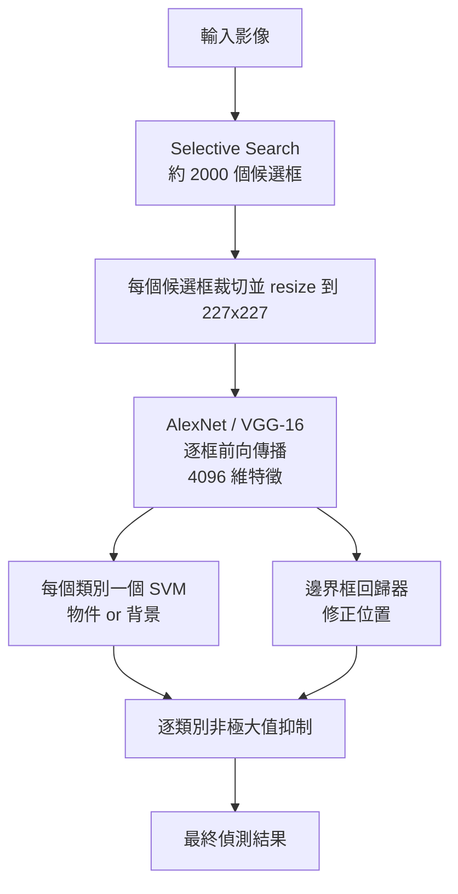
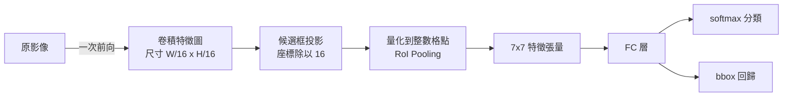
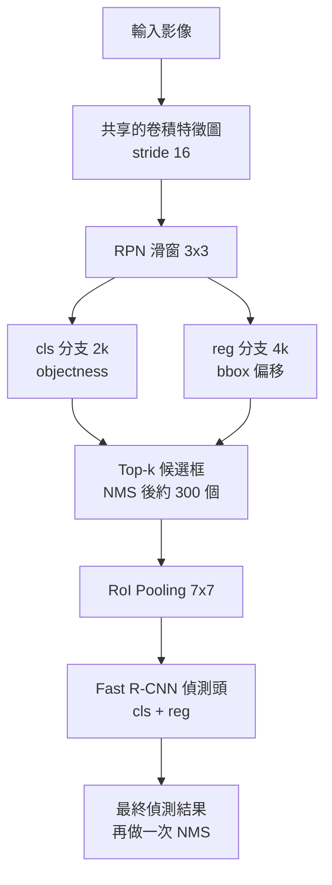

# 5.1 從 R-CNN 到 YOLO：偵測框架的效率革命（2014-2016）

## 一、偵測到底是什麼：四個層級的視覺任務

第 4 章解決了「這張圖裡是什麼」的問題（分類），但真實世界的圖片裡幾乎永遠同時存在多個物件、而且我們不只知道它是什麼，還要知道它在哪裡。**偵測（Object Detection）** 就是這件事。

### 1.1 分類、定位、偵測、分割的層次關係

| 任務 | 輸入 | 輸出 | 每一張圖的答案數 |
| --- | --- | --- | --- |
| 分類 Classification | 單張裁切好的影像 | 一個類別機率分布 | 1 |
| 定位 Localization | 單張裁切好的影像 | 一個類別 + 一個外接框 | 1 |
| 偵測 Detection | 整張影像 | 一組（類別, 外接框） | 0 到數百 |
| 分割 Segmentation | 整張影像 | 像素級標籤圖 | 1 張標籤圖 |

這四個層次的關係是**嵌套的**：偵測可以理解為「在整張圖上做的定位」，分割可以理解為「在整張圖上做的密集分類」。理解這個嵌套關係有助於解釋為什麼後來的演算法會互相借用：

* **偵測借用了分類**：R-CNN（2014）的做法是「先找出候選框，把每個候選框當成一張小圖丟給分類器」——這是把偵測降維成 2000 次分類問題。
* **分割借用了分類**：FCN（2015）把全連接層改成卷積層，把「一張圖一個標籤」變成「一張圖每個像素一個標籤」，同樣是密集分類的思路。
* **YOLO 反過來把偵測變成分割式的全域問題**：直接把整張圖切成網格，每格做分類與回歸。

### 1.2 偵測的兩個根本困難

**困難一：搜尋空間的爆炸。** 若影像為 $ H \times W $，最細的步幅是 1 像素，那麼所有可能的邊界框數量為

$$
N_{\text{all}} = \frac{H(H+1)}{2} \cdot \frac{W(W+1)}{2}
$$

對一張 $ 1000 \times 1000 $ 的影像，這是約 $ 2.5 \times 10^{11} $ 個候選框。窮舉顯然不可行。因此**所有偵測演算法本质上都在做同一件事：設計一個能把 $ 10^{11} $ 個候選壓縮到數百甚至數十個的機制**。R-CNN 用 Selective Search，SSD 用 default box，YOLO 用網格單元，DETR 用物件查詢——機制不同，目標相同。

**困難二：前景與背景的極端不平衡。** 一張典型的街景圖中，95% 以上的區域是天空、路面、建築物牆面，也就是「背景」。這意味著：

1. 分類器會被大量易分的負例訓練得很好，導致**正例的召回率下降**；
2. 交叉熵損失會被負例主導，模型傾向於預測「背景」；
3. 這就是為什麼一階段偵測器需要 **focal loss**，而兩階段偵測器可以用「先粗篩再精修」的結構來天然化解（見 5.2 節）。

### 1.3 IoU：所有偵測指標的地基

兩個邊界框 $ B $ 與 $ B' $ 的 **IoU（Intersection over Union）** 定義為

$$
\mathrm{IoU}(B, B') = \frac{| B \cap B' |}{| B \cup B' |} = \frac{\mathrm{area}(B \cap B')}{\mathrm{area}(B) + \mathrm{area}(B') - \mathrm{area}(B \cap B')}
$$

IoU 是偵測領域最重要的量，因為它同時扮演三個角色：

1. **匹配準則**：預測框與真值框的 IoU 超過門檻（傳統上 $ 0.5 $）才算「命中」（TP），否則算錯誤正例（FP）。
2. **回歸目標**：bbox 回歸的 loss 直接以 IoU 為基礎（IoU loss）或以其平滑近似為基礎（GIoU / DIoU / CIoU，見 1.9 節）。
3. **評估指標**：AP 是在不同 IoU 門檻下的查詢率-精確率曲線面積。

**常見誤解**：IoU 是尺度不變但**位置敏感**的量。兩個框面積差 10 倍時，只要位置也差 10 倍，IoU 就會很低；反之兩個中等大小的框只要稍微錯開，IoU 就會急遽下降。這是「中心點誤差」在幾何上的反映，也是 GIoU 等變體要修正的對象。

### 1.4 從 PASCAL VOC 到 COCO：指標的演進

| 基準 | 年份 | 類別數 | 影像數 | 評估慣例 |
| --- | --- | --- | --- | --- |
| PASCAL VOC 2007 | 2007 | 20 | 9,963 | IoU 門檻 0.5，11 點插值 AP |
| PASCAL VOC 2012 | 2012 | 20 | 11,530 | IoU 門檻 0.5，11 點插值 AP |
| ImageNet 偵測挑戰 | 2014 | 200 | 約 450K | 各類別 AP 再取平均 |
| MS COCO | 2015 | 80 | 123K（train）／20K（val） | AP@[0.50:0.95] 平均 |

**VOC 的 11 點插值法**：把查詢率固定為 11 個等距點 $ \{0, 0.1, \dots, 1.0\} $，每點取精確率的**插值最大值**（即往右看、precision 不下降的最大值），再對這 11 個值取平均。這個方法偏向保守（underestimate），後來被連續積分法取代。

**連續積分法（COCO 的做法）**：給定一條 precision-recall 曲線 $ p(r) $，AP 定義為

$$
\mathrm{AP} = \int_{0}^{1} p(r)\, dr
$$

實作上是把 precision 對 recall 做「右側最大值」包絡（monotonically decreasing envelope），再用梯形法數值積分。

**$ \mathrm{mAP}@0.5 $ 與 $ \mathrm{mAP}_{50:95} $ 的關鍵差異**：這兩個數字之間的落差，是理解偵測演算法進步本質的最重要指標。

* $ \mathrm{mAP}@0.5 $ 只要求預測框與真值框重疊一半以上就算對。它衡量的是「**找到沒有**」。
* $ \mathrm{mAP}_{50:95} $ 是 IoU 門檻從 0.50 到 0.95、每 0.05 取一點，共 10 個門檻的 AP 平均。它額外衡量「**框得準不準**」——定位精度（Localization Accuracy）。

兩者之間有一個系統性的差距：分類式預測的 $ \mathrm{mAP}@0.5 $ 很高，但 $ \mathrm{mAP}_{50:95} $ 偏低。這說明**長尾誤差中，很大一部分並非「漏掉」，而是「框得鬆散」**。後續的推動力量（大感受野的空洞卷積、anchor 的尺寸設計、更高解析度的特徵圖、box 回歸 loss 的改進）幾乎都在攻擊「框得準不準」這一端。

---

## 二、兩階段偵測的開端：R-CNN 家族

### 2.1 Selective Search：把尋找交給傳統視覺

2011 年，Uijlings 等人提出 **Selective Search**。它的想法是：物件可能以任意尺度、任意比率出現在任意位置，所以與其枚舉所有矩形，不如用多種「分群」策略從低層特徵出發，遞迴地合併區域成候選框。

具體流程：

1. 先建立影像金字塔（多尺度）與顏色直方圖、梯度直方圖（HOG）、邊緣、區域連通性等低層特徵。
2. 初始狀態是像素級分割後的過分割（over-segmentation）區域，數量約 1000 到 2000。
3. 反覆計算每一對相鄰區域的相似度，合併最相似者，直到只剩約 2000 個候選框。

相似度度量融合了顏色、紋理、尺寸與包含關係（overlap）四個線索：

$$
S = \alpha S_{\text{color}} + \beta S_{\text{texture}} + \gamma S_{\text{size}} + \delta S_{\text{overlap}}
$$

**這裡有一個重要的歷史定位**：Selective Search 是第 2 章與第 3 章方法的集大成者——它把第 3 章的 HOG/Bag-of-Visual-Words 風格特徵與第 2 章的分割/合併概念組合起來，用「過分割 + 階層式合併」這種純粹的**組合式搜索**來處理多尺度問題。

Selective Search 的致命弱點是**速度**：CPU 上每張圖要 1 到 2 秒，而且它是不可學習的（沒有端到端梯度可傳），這兩點直接導致了 R-CNN 系列的所有瓶頸。

### 2.2 R-CNN（2014, Girshick et al.）

R-CNN 的核心命題是：**把 CNN 的特徵能力接到 Selective Search 的候選框上**。流程是：



三個關鍵設計：

1. **特徵抽取**：對每個候選框，先裁切、加邊框擴展（擴展比例約 1.2 倍，避免切掉物體邊緣），resize 成 $ 224 \times 224 $，丟進 ImageNet 上預訓練的 AlexNet，取 fc7 層的 4096 維特徵。
2. **分類**：每一類別訓練一個**二元 SVM**（是 / 不是該類別）。不用 softmax 的理由是：VOC 的測試集包含未見過的類別樣本，而 SVM 的 decision function 可以對「都不像」給出明確的低分，softmax 做不到。
3. **回歸**：用最小二乘回歸修正 bbox 的位置誤差。

**訓練流程的三段式**：先做「region proposal 的選擇」（用 ground truth 的 IoU 門檻 0.5 挑出正例、0.3 以下挑出負例）→ 再微調 CNN（正例與高 IoU 的難負例）→ 最後才訓練 SVM 與 bbox 回歸器。這個流程複雜但有效。

**瓶頸（必須記住的第一個數字）**：一張圖有約 2000 個候選框，每個都要跑一次 CNN 前向傳播。在 2014 年的 GPU（單張 GTX Titan）上，**測試一張圖需要數十秒**；訓練一張圖要跑三個 epoch × 2000 框 = 6000 次前向傳播，花費約 1.5 天（多個 GPU 共享一個影像時要串行化）。這在實務上是不可接受的。

R-CNN 在 VOC 2012 上取得 $ \mathrm{mAP}@0.5 = 62.4 $（0.3 個百分點的提升），但**它的價值不在速度，而在證明了一件關鍵的事**：ImageNet 上預訓練的 CNN 特徵是通用且可遷移的。這正是第 3 章「語義鴻溝」被深度學習跨越的第一個實證。

### 2.3 Fast R-CNN（2015, Girshick）

Fast R-CNN 的問題定義非常清晰：**R-CNN 慢在哪裡？因為每個候選框都獨立跑一次完整的 CNN。** 解法有兩步。

**第一步：共享卷積。** 把整張影像**只跑一次**卷積層，得到特徵圖 $ \phi $ ；每個候選框只是這個特徵圖上的一個子區域。所以 2000 次前向傳播變成 1 次。

**第二步：RoI Pooling。** 問題是特徵圖與原影像比例不同（VGG-16 為 1/16，AlexNet 為 1/8），候選框在原圖的座標要換算成特徵圖的座標，而且這個換算會產生**量化誤差**（非整數座標被取整）。

RoI Pooling 的做法是：把候選框在特徵圖上對應的區域，用**分數格（bin）量化**的方式分成 $ 7 \times 7 $ 個格，每格取其內特徵的最大值（max pooling）。量化後除以 7（整除），直接得到 $ 7 \times 7 $ 的特徵張量。



**Fast R-CNN 的三項其他改進**：

1. **用單一 softmax 取代多個 SVM**：輸出 $ K+1 $ 個機率（$ K $ 個類別 + 背景），訓練時用交叉熵。這使得訓練端到端化。
2. **bbox 回歸改用 smoother L1 loss**：R-CNN 用 $ \ell_2 $ loss，梯度量級隨誤差線性增長，在大誤差時會造成梯度爆炸。smoother L1 loss 在誤差小於 1 時退化成 $ \ell_2 $（二次增長、平滑），大於 1 時退化成 $ \ell_1 $（一次增長、有界），既保留小誤差下的精細梯度，又避免了大誤差下的不穩定。
3. **多任務訓練**：分類與回歸共享 FC 層的特徵。

**結果與殘留瓶頸**：Fast R-CNN 把測試速度提升了約 **200 倍**（R-CNN 為 50 ms/圖，Fast R-CNN 約 0.2 s/圖的測試總時間，但主要是候選框生成佔用了大部分）。VOC 2012 上 $ \mathrm{mAP} = 66.9 $。**然而 RoI Pooling 的量化誤差成為新的問題**，並且最重要的限制依舊存在：**Selective Search 每張圖 1 到 2 秒的開銷沒有被消除**，這使得整體速度仍受限於 region proposal 階段。

### 2.4 Faster R-CNN（2015, Ren et al.）與 RPN

Faster R-CNN 的問題定義更尖銳：**既然 region proposal 是瓶頸，那就讓網路自己學會產生 proposal。** 而且——關鍵的因果推理——既然 proposal 和偵測都需要特徵圖，那為什麼要跑兩次卷積？讓它們共用同一張特徵圖。

**Region Proposal Network (RPN) 的設計**：

* 在共享特徵圖上滑動一個 $ 3 \times 3 $ 的卷積核。
* 每個位置輸出兩個分支：
  * **分類分支**：$ 2k $ 通道，$ k $ 個 anchor 各自的 objectness 分數（前景/背景二分類）。
  * **回歸分支**：$ 4k $ 通道，$ k $ 個 anchor 各自的邊界框偏移量 $ (\Delta x, \Delta y, \Delta w, \Delta h) $。
* **anchor 的設定**：以每個滑動位置為中心，採用 3 種尺度（$ \{128, 256, 512 \} $）與 3 種長寬比（$ \{1:1, 1:2, 2:1 \} $），共 $ 3 \times 3 = 9 $ 個 anchor。

anchor 的引入是一個**極其關鍵的設計決策**：傳統的候選框生成靠的是「邊界的統計特性」（如邊框與顏色梯度的關聯），而 anchor 把這個先驗**寫進了網路的輸出空間**——網路不需要學會「物體大概是什麼形狀大小」，只需要學會「這個 anchor 該往哪個方向調、調多少」。這大幅降低了學習難度。

anchor 的尺寸是相對特徵圖座標而言的：特徵圖 stride 為 16，所以特徵圖上一格對應原圖 16 像素。

**RPN 的損失函數**：

$$
\mathcal{L}_{\text{RPN}} = \lambda_{\text{cls}} \mathcal{L}_{\text{cls}} + \lambda_{\text{reg}} \mathcal{L}_{\text{reg}}
$$

其中分類損失是標準的二元交叉熍（objectness），回歸損失是 smooth L1，作用於 anchor 與真值框之間的偏移量。

**RPN 的損失只在正負 IoU 門檻之間計算**：IoU > 0.7 的 anchor 為正例（每個 ground truth 最多選 4 個以避免失衡），IoU < 0.3 為負例，介於兩者之間的 anchor **不參與分類損失**（被視為「模糊」，忽略）。

**兩階段的分工**：



**為什麼 RPN 有效？** 三個原因：

1. **共用特徵圖**：RPN 與偵測頭共用卷積基座，proposal 的生成成本幾乎為零（RPN 只在特徵圖上跑 3×3 卷積）。
2. **尺度與比率先驗**：9 個 anchor 覆蓋了常見的物件尺寸與形狀，把組合搜尋問題變成一個**局部**的二元分類加回歸問題。
3. **訓練是端到端交替的**：RPN 與偵測頭共享特徵，兩者的梯度會互相塑造——偵測頭讓特徵圖更「有利於辨識」，RPN 讓特徵圖更「有利於找邊界」。

**結果**：Faster R-CNN 在 VOC 2012 上達 $ \mathrm{mAP} = 70.3 $，COCO 上 $ \mathrm{mAP}@0.5 = 73.9 $、$ \mathrm{mAP}_{50:95} = 36.7 $。測試速度提升到約 0.05 秒/圖（GPU）。**RPN 從此成為兩階段偵測器的標準配備**，並確立了一個延續至今的架構範式：**共享特徵 + 候選框 + 精修**。

### 2.5 兩階段方法的本質與侷限

把 R-CNN → Fast R-CNN → Faster R-CNN 的改進整理成一句話：**每一次改進都在消除「重複計算」**。

| 方法 | 卷積前向次數/圖 | 候選框來源 | 特徵是否共享 | 端到端 |
| --- | --- | --- | --- | --- |
| R-CNN | 約 2000 | Selective Search | 否 | 否 |
| Fast R-CNN | 1 | Selective Search | 是 | 部分 |
| Faster R-CNN | 1 | RPN（可學） | 是 | 是 |

**殘留的結構性侷限**：

1. **速度仍受候選框數量支配**。RPN 產生約 300 個 proposal，每個都要走偵測頭（通常是一個 2 層的 FC 或 head），在實作上仍佔可觀時間。
2. **無法做到即時**。工業需求是 30 FPS 以上（車載），RPN 版本的實測通常在 5 到 15 FPS（GPU 上）。
3. **正負樣本不平衡依然存在**，只是在 proposal 階段被部分過濾。

這些缺陷正是 YOLO 出現的直接動機。

---

## 三、一階段偵測：YOLO 與 SSD

### 3.1 YOLO（2016, Redmon et al.）的核心思想

YOLO（You Only Look Once）的命題是一次極度簡化的反轉：**既然分類網路一次前向就能看完整張圖，為什麼偵測不能？**

YOLO 把物件偵測重新表述為一個**純迴歸問題**：

* 把輸入影像縮放到 $ S \times S $（原版 $ S = 448 $），切成 $ S \times S $ 個網格。
* 網路輸出一個 $ S \times S \times (5B + C) $ 的張量（$ B $ 為 anchor 數，原版 $ B = 2 $，$ C $ 為類別數，VOC 為 20）。
* 每個網格單元負責預測若干個 bounding box，每個 box 包含 5 個數值加 $ C $ 個類別機率。

每個 bounding box 的 5 個數值是：

$$
\left( t_x, t_y, t_w, t_h, t_o \right)
$$

其中 $ (t_x, t_y, t_w, t_h) $ 是相對於該網格中心的偏移與尺寸（皆為正規化到 $ [0,1] $ 的量），$ t_o $ 是「此框包含物件」的置信度（objectness）。

**YOLO 論文中特別強調「在**一個**網格中只預測一組類別機率」**（rather than one per box）。這是速度的來源，也是它最大的缺陷來源。

**損失函數**分三塊，全部基於**物件中心點落在哪個網格**的分配規則：

$$
\mathcal{L} = \lambda_{\text{box}} \mathcal{L}_{\text{box}} + \lambda_{\text{obj}} \mathcal{L}_{\text{obj}} + \lambda_{\text{cls}} \mathcal{L}_{\text{cls}}
$$

$$
\mathcal{L}_{\text{box}} = \sum_{\text{responsible boxes}} \left[ \lambda_{\text{coord}} (t_x - \hat{t}_x)^2 + \lambda_{\text{coord}} (t_y - \hat{t}_y)^2 + \lambda_{\text{coord}} (t_w - \hat{w})^2 + \lambda_{\text{coord}} (t_h - \hat{h})^2 \right]
$$

其中 $ \hat{w} = \sqrt{t_w} $ 、$ \hat{h} = \sqrt{t_h} $，即**對寬高開根號**。這個看似任意的變換有一個漂亮的理由：寬高是尺度量，直接的 $ \ell_2 $ loss 會讓大框的 loss 遠大於小框（尺度不變性問題），開根號後 $ \mathrm{d}\sqrt{w}/\mathrm{d}w = 1/(2\sqrt{w}) $，使 loss 對「相對尺度誤差」而非「絕對尺度誤差」敏感，等價於把寬高的誤差解釋為**對數尺度上的誤差**。

**YOLO 的三個設計支柱**（論文明確列出）：

1. **全域推論（Global predictions）**：一次前向看整張圖，每個網格單元都做預測。相較於 R-CNN 這種「先看圖再逐一裁切」的方式，資訊不再被割裂。
2. **一次前向（Single shot）**：不像兩階段那樣需要第二輪精修。
3. **bounding box 回歸（Regressing bounding boxes）**：用迴歸直接預測框，而非用分類器 + 分數。

**YOLO 的三個訓練細節與設計取捨**：

* **每個格子只負責預測一個物件**：一個格子有 $ B=2 $ 個 anchor，但**這兩個 anchor 共用同一組類別機率**。
* **正樣本指派**：真值框的中心落在哪個網格，那個網格的前兩個 anchor（YOLOv1）就負責預測它。
* **objectness 的定義**：$ t_o $ 的目標值是 1（若該格有物件）或 0（若該格無物件）。這個「該格是否有物體中心」的定義實際上是一個**弱標籤**，它告訴網絡「這裡有東西」，但沒說是什麼——這是一階段方法的語義模糊性根源。

### 3.2 YOLO 的兩個致命缺陷

**缺陷一：小物件偵測差。** 原因有兩層：

1. **量化誤差**：網格中心被固定在格點上。一個 30×30 像素的行人（$ 416 \times 416 $ 輸入時約 3 個網格寬）的中心可能距離最近的格點有 10 像素，迴歸預測的誤差上限被限制住了。
2. **特徵圖解析度不足**：YOLOv1 的輸出是 $ 7 \times 7 $，對 448 的輸入而言 stride 為 64——一個小物件可能只佔不到一個格子。

**缺陷二：每格只能預測一個物件。** 如果一張圖有兩個人並肩站在同一個格子裡（或緊鄰的格子），只會有一個被偵測到，另一個被完全遺漏。這在人群、街道、餐桌場景中極為常見。**這是架構性的，不是超參數可以解決的**——輸出張量的結構本身就不允許一個格子獨立地表達兩個不同類別的物件。

這兩個缺陷定義了 2016 到 2018 年偵測研究的兩個主要方向：**（a）多尺度特徵金字塔**（SSD、YOLOv2/v3）與 **（b）anchor-free / 密集預測**（FCOS、CenterNet）。

### 3.3 SSD（2016, Liu et al.）：多尺度特徵金字塔

SSD 的洞見非常直接：**小物件問題的根源是特徵圖解析度不足與語義不足，因此要在多個解析度的特徵圖上做預測。**

具體做法：

1. 在網路的第 4、5、6、7 階段各抽一個特徵圖，這些特徵圖的解析度是 $ 38 \times 38 $、$ 19 \times 19 $、$ 10 \times 10 $、$ 5 \times 5 $（以 $ 300 \times 300 $ 輸入、VGG-16 為例）。
2. 每個特徵圖的每個位置上有 $ k $ 個 **default box**（形狀先驗，與 anchor 概念相同但由 SSD 命名並固定）。
3. 對每個 default box 預測 class score 與相對偏移。
4. 不同特徵圖上的 default box 尺寸不同：$ 38 \times 38 $ 特徵圖上的 default box 很小，$ 5 \times 5 $ 上的很大，形成一個**特徵金字塔**。

default box 的匹配規則與 RPN 類似：IoU > 0.5 為正，< 0.3 為負，之間忽略。

SSD 在 VOC 上 $ \mathrm{mAP} = 72.4 $，在 $ 300 \times 300 $ 輸入下可以達到 30 FPS 以上（含 NMS），**首次達到了「即時」的水準**。SSD 與 YOLO 幾乎同時發表，但 SSD 在小物件上明顯更好（$ \mathrm{mAP}@0.5 $ 上 YOLOv1 為 63.4，SSD 為 72.4），這直接驗證了「多尺度特徵金字塔」是解決 YOLO 缺陷一的有效路徑。

### 3.4 YOLOv2（2017）與 YOLOv3（2018）

**YOLOv2（"Better"）的改進清單**：

1. **Batch Normalization**：加入 BN 提升收斂速度與 mAP（但**去掉了 dropout**）。
2. **改用 darknet-19 架構**（加入殘差塊）。
3. **移除 fully connected layers**，改用 global average pooling。
4. **引入 anchors**：在 VOC 與 COCO 的 ground truth box 上用 **k-means 聚類**得到 anchor 的數量、寬高比與面積設定，而不是人工指定。這個做法本身就是全書反覆出現的「**讓資料決定結構**」的思想。
5. **多尺度訓練**：每 10 個 epoch 換一次輸入尺寸，讓模型學會尺度泛化。
6. **引入 direct box prediction**（相對於 anchor 預測偏移）。
7. **Word Embedding 層**用來預測更細的類別屬性。

結果：$ \mathrm{mAP}@0.5 $ 從 63.4 提升到 76.8。

**YOLOv3（2018）的三項核心改進**：

1. **Darknet-53** 作為 backbone（含殘差連接）。
2. **多尺度預測（FPN 風格）**：在 3 個尺度上分別預測（對應輸入的 3 個下採樣層），每個尺度用 3 個 anchor（總共 9 個），分別負責小、中、大物件。**這是 FPN 思想第一次大規模進入偵測領域**（FPN 原是 2017 年的偵測/分割通用技術）。
3. **物件分類改用 logistic 回歸**（每個類別獨立），而不是 softmax，允許一個物件同時屬於多個標籤。

結果：$ \mathrm{mAP}@0.5 = 78.6 $（COCO），$ \mathrm{mAP}_{50:95} = 43.0 $。

**AP 從 63.4 到 78.6 的推進拆解**：這個 15 個百分點的提升，值得拆解來源以理解「哪些改進最值錢」：

| 來源 | 提升量級 | 機制 |
| --- | --- | --- |
| Batch Norm | 約 +2 | 穩定訓練、正則化效應 |
| Anchors + k-means | 約 +4 | 引入尺度/比率先驗，替換掉最弱的一環 |
| 多尺度訓練 | 約 +1 | 尺度泛化 |
| 多尺度預測（FPN） | 約 +6 | **小/中物件大幅受益** |
| Darknet-53 骨幹 | 約 +2 | 更強特徵 |

**結論：多尺度預測帶來最大收益**——這再次印證了 3.2 節「小物件是 YOLO 的主要弱點」的診斷。

---

## 四、橫切技術：所有偵測器共用的工具箱

以下技術跨越了個別架構，從 Faster R-CNN 到 YOLO 系列都在使用。

### 4.1 NMS 與 Soft-NMS

**非極大值抑制 (NMS)**：由於候選框會重疊，同一個物件可能產生多個高分的框。NMS 對每個類別分別執行：

```
排序所有框 by score 遞減
while 還有框:
    取最高分的框 B 加入輸出
    移除所有與 B 的 IoU > threshold 的框
```

**NMS 的一個常見誤解**：NMS 的門檻通常設在 $ 0.5 $ 到 $ 0.7 $ 之間。門檻太低會壓掉密集排列的不同物件（例如棋盤上相鄰的棋子），門檻太高會讓同一物件殘留重複框。

**Soft-NMS（2017, Bodla et al.）** 的洞見是：NMS 的「移除」是**硬性且不可微**的，而且它假設重疊框一定來自同一物件。Soft-NMS 改成對重疊框的**分數做衰減**：

$$
s_i \leftarrow \begin{cases}
s_i, & \mathrm{IoU}(M, b_i) \le N_t \\
s_i \cdot \exp\left( -\frac{\mathrm{IoU}(M, b_i)^2}{\sigma} \right), & \mathrm{IoU}(M, b_i) > N_t
\end{cases}
$$

然後重新排序，重複上述過程。**效果**：重疊的分數被連續地壓低而非直接刪除，因此 NMS 門檻的敏感性下降，且密集場景的召回率提升。

### 4.2 IoU 的變體：GIoU、DIoU、CIoU

**$ \ell_2 $ 回歸 loss 的問題**：它對「框的大小」敏感，並且**無法對沒有重疊的框給出有效的梯度**（因為此時 IoU 為 0，loss 與位置無關）。所以早期方法用 $ \ell_1 $ / smooth L1，但這些 loss 與評估指標（IoU）不一致。

**IoU loss**：直接以 $ -\log(\mathrm{IoU}) $ 為 loss。但 IoU 在完全不重疊時梯度為零——這是最嚴重的問題。

**GIoU（2019, Rezatofighi et al.）** 引入最小包圍框：

$$
\mathrm{GIoU} = \mathrm{IoU} - \frac{| C \setminus (B \cup B')|}{| C |}
$$

其中 $ C $ 是包住 $ B $ 與 $ B' $ 的最小矩形。GIoU 的值域是 $ [-1, 1] $，且**即使完全不重疊，loss 仍會把兩個框往彼此拉近**——這就是「非重疊也有梯度」的修正動機。

**DIoU（2020, Zheng et al.）** 改為直接最小化**中心距離**：

$$
\mathrm{DIoU} = \mathrm{IoU} - \frac{\rho^2(B, B')}{c^2}
$$

其中 $ \rho $ 是兩框中心的歐氏距離，$ c $ 是對角線長度。**修正動機**：DIoU 同時考慮了 IoU 與中心距離，因此在**非重疊情況**下可以提供明確的「把中心拉近」的梯度，且收斂速度比 GIoU 快。

**CIoU（2020）** 再加入長寬比一致性：

$$
\mathrm{CIoU} = \mathrm{DIoU} - \frac{v^2}{(1 + v)^2} + \alpha v
$$

$$
v = \frac{4}{\pi^2} \left( \arctan\frac{w'}{h'} - \arctan\frac{w}{h} \right)^2
$$

**修正動機**：DIoU 只管中心，不管形狀。CIoU 保證在中心與 IoU 都相同的情況下，長寬比一致的預測會得到更高的分數——這解決了「框的位置對了但形狀歪了」的常見失效模式。

**三者的修正邏輯是一條清晰的遞進線**：IoU（只看重疊）→ GIoU（加入包圍框的空間約束）→ DIoU（改用中心距離，更直接的幾何量）→ CIoU（再加上形狀）。**每一代都在補上一個「IoU 看不到但幾何上重要」的維度。**

### 4.3 Focal Loss（2017, Lin et al.）

Focal Loss 論文的開篇即是本章 1.2 節的問題：**一個 stage 的分類器面對的是數萬個候選框，其中正例可能只有幾十個。**

$$
\mathrm{FL}(p_t) = -\left( 1 - p_t \right)^{\gamma} \log\left( p_t \right)
$$

其中 $ p_t $ 是預測在正確類別上的機率（正例取預測為前景的機率，負例取預測為背景的機率）。

* 當 $ \gamma = 0 $ 時退化成標準交叉熵。
* $ \gamma $ 越大，越是**易分樣本**（$ p_t \approx 0.95 $）的貢獻被抑制得越厲害。$ \gamma = 2 $ 時權重為 $ 0.05^2 = 0.0025 $。
* 這使得梯度集中在**難的樣本**上。

Focal Loss 有兩個套用位置：(a) RetinaNet 的分類分支；(b) CenterNet 的中心點 heatmap 損失（用「高斯衰減」的 penalty map 代替硬性正負標籤）。

**與 anchor-free 的因果關係**：CenterNet（2019）的核心論點是「anchor 的框大小與長寬比數量太多，造成巨大的正負樣本不平衡，且不同 IoU 閾值的定義會讓一個格子同時被視為正例又視為負例」。CenterNet 把偵測改為**中心點 heatmap 回歸**：只預測中心點是否存在（極度不平衡，用 focal loss 處理），尺寸與偏移由中心點單獨回歸。

### 4.4 Label smoothing

分類器若在訓練中不斷被推向概率 1（one-hot），會導致過度自信（over-confidence）與過擬合。Label smoothing 將目標從 one-hot 改成

$$
q_k = (1 - \epsilon)\, y_k + \frac{\epsilon}{K}
$$

這會限制模型的最大預測概率從 1 降到 $ 1 - \epsilon + \epsilon/K $。在偵測中，它同時作用於分類分支與 objectness 分支，帶來約 1 個百分點的 mAP 提升。

### 4.5 一句話總結：偵測本質上是一個正則化的分類問題

把以上所有技術串起來，可以得到一個統一的視角：

> **偵測 = 在大量候選位置上做分類，並對被判定為正例的少數候選做精細回歸。**

所有困難都源自「大量候選位置中只有少數是正例」這一件事：

* **Focal Loss**：在分類損失中重新分配權重。
* **RPN 的 IoU 閾值分層**（0.3/0.7）：把模糊樣本排除在分類之外。
* **兩階段**：先用一個不平衡的粗篩器縮小到數百個候選，再在平衡的環境下做精修。
* **Soft-NMS**：讓抑制機制變得連續、可微。
* **CIoU loss**：讓回歸 loss 與評估指標對齊，並提供非重疊情況下的梯度。

**這個視角的重要性在於**：它讓我們預測接下來的發展。當我們看到 DETR（2020）把偵測表述為「集合預測 + 匈牙利匹配」時，我們能立刻理解：**它是在試圖用一個雙一一匹配的 loss，同時解決分類不平衡與 NMS 的存在必要性**（因為一對一匹配天然保證每個真值只有一個預測，不需要 NMS 來去重）。**這是通向第 6 章的橋樑。**

---

## 五、工程取捨與後續方向

### 5.1 FPS 與精確率的取捨

實務上不存在「最好」的偵測器，只存在「在給定延遲預算下最好」的偵測器。常見的取捨點：

| 手段 | FPS 影響 | mAP 影響 | 機制 |
| --- | --- | --- | --- |
| 降低輸入解析度 | 大幅提升 | 明顯下降 | 特徵圖變粗，小物件受害最大 |
| 減少 proposal 數量 | 提升 | 小幅下降 | 少數高分的 proposal 仍覆蓋主要物件 |
| 用 depthwise separable conv | 提升 | 小幅下降 | 參數與計算量大幅減少 |
| anchor-free（FCOS/CenterNet） | 提升 | 上升 | 少掉 anchor 的數量膨脹與 NMS |
| 量化 (INT8) | 2 到 4 倍 | 幾乎不變 | 需 QAT 校準 |

**INT8 量化是部署端的關鍵技術**：偵測器的瓶頸常常不在算力而在**記憶體頻寬**（尤其 depthwise conv 這種計算量小但存取密集的層），量化可以同時解決兩者。

### 5.2 TensorRT 與 NMS 的實作難題

**NMS 在 GPU 上並不友善**，原因是：

1. NMS 有**資料相依的分支**（每個框是否被抑制取決於其他框的分數），這使得它難以在 SIMD/GPU 上並行化。
2. 排序是 O(n log n) 且 n 很大。

常見的工程解法：

* **GPU 上的兩階段 NMS**：先用硬體友好的方式（如排序 + 位元遮罩）做一次粗略抑制。
* **把 NMS 移到 CPU**：從 GPU 傳回分數最高的數百個框，在 CPU 上做精確 NMS。現代實作（如 TensorRT 的 `EfficientNMS_TensorRT` plugin）就是這麼做的。
* **Matrix NMS**（2020, Zheng et al.）：把 NMS 重寫成矩陣運算，完全向量化，可留在 GPU 上，AP 還略高於傳統 NMS。

### 5.3 Anchor-free 的趨勢

**FCOS（2020, Tian et al.）** 的論證非常清晰：

1. 對每個位置 $ (x, y) $，直接預測到物件四邊的**距離** $ (l, t, r, b) $，而不是相對 anchor 的偏移。
2. **Center-ness** 定義為

$$
\text{center-ness} = \left( \frac{\min(l, r)}{\max(l, r)} \right)^{a} \cdot \left( \frac{\min(t, b)}{\max(t, b)} \right)^{a}
$$

用來抑制離物件中心太遠的預測。
3. **FPN 層的適當分配**：在 FPN 的每一層分配不同大小的物件，而不是像 anchor 方法那樣用 anchor 尺寸來篩選。
4. 最終只需一個 NMS。

FCOS 在 COCO 上達 $ \mathrm{mAP}_{50:95} = 37.4 $，且模型更簡潔。**anchor-free 的實質是：把「形狀與尺度的先驗」從網路結構搬到網路輸出的參數化方式裡**——不再需要為每個位置配置多個 anchor，負樣本數量驟降，訓練更穩定。

**CenterNet（2019, Zhou et al.）** 走得更遠：連 bbox 回歸都省掉，直接在中心點 heatmap 上做高斯peak 檢測，尺寸與偏移另外回歸。CenterNet 在 CrowdHuman 上顯示出顯著的**密集場景優勢**（人群不漏檢），因為它徹底擺脫了「一格一物」的架構限制。

### 5.4 DETR（2020）：集合預測與匈牙利匹配

DETR（End-to-End Transformer Detection）的核心改變是**損失函數的形式**：

* 網路輸出固定數量（通常 100）的物件查詢，每個查詢輸出一組 (class, box)。
* 用**匈牙利演算法**在預測集合與真值集合之間求**一對一最佳匹配**：

$$
\hat{\sigma} = \arg\min_{\sigma \in \mathfrak{S}_N} \sum_{i=1}^{N} \mathcal{C}_{\text{match}}\left( y_i, \hat{y}_{\sigma(i)} \right)
$$

* 匹配損失為分類交叉熵 + $ \ell_1 $ 框損失 + GIoU 損失。

**一對一匹配的深遠意義**：

1. **NMS 不再需要**。因為每個真值只對應一個預測，天然沒有重複框。這是對「NMS 是一個不可微的、資料相依的 hack」的 elegant 消除。
2. **正負樣本不平衡自動解決**。所有查詢都在參與匹配（沒匹配上的視為「無物件」類別），且沒有 anchor 數量膨脹。
3. **集合預測帶來端到端的簡潔**。

**代價**：DETR 的訓練極慢（500 epoch），小物件偵測長期偏弱（這直到 DINO、DN-DETR 等 2022 年之後的工作才逐步解決）。**但它改變了整個領域的思考方式**，並直接引出第 6 章的 Transformer 主題。

---

## 六、實作：一個可運行的簡化版 YOLO

### 6.1 模型結構

```python
import torch
import torch.nn as nn


class ConvBNReLU(nn.Module):
    """Conv -> BatchNorm -> LeakyReLU 的基本組合單元。"""

    def __init__(self, in_ch, out_ch, k=3, s=1, p=1):
        super().__init__()
        self.block = nn.Sequential(
            nn.Conv2d(in_ch, out_ch, k, s, p, bias=False),
            nn.BatchNorm2d(out_ch),
            nn.LeakyReLU(0.1, inplace=True),
        )

    def forward(self, x):
        return self.block(x)


class TinyYOLO(nn.Module):
    """
    簡化版 YOLO（YOLOv1 風格）。

    輸入 : (B, 3, S, S)，S 必須是 32 的整數倍
    輸出 : (B, S, S, 5*B + num_classes)
           每一格 B 個框，每個框 5 個數值 + num_classes 個類別機率
    """

    def __init__(self, num_classes=20, S=32, B=2):
        super().__init__()
        self.S = S
        self.B = B
        self.num_classes = num_classes

        # 骨幹：八次下採樣，輸出 stride 32 的特徵圖
        self.backbone = nn.Sequential(
            ConvBNReLU(3, 16, 3, 2, 1),    # /2
            ConvBNReLU(16, 32, 3, 2, 1),   # /4
            ConvBNReLU(32, 64, 3, 2, 1),   # /8
            ConvBNReLU(64, 128, 3, 2, 1),  # /16
            ConvBNReLU(128, 256, 3, 2, 1), # /32
            ConvBNReLU(256, 512, 3, 2, 1),
            ConvBNReLU(512, 1024, 3, 2, 1),
            ConvBNReLU(1024, 1024, 3, 1, 1),
        )

        # 偵測頭：1x1 卷積（等同原本的 fully connected 層）
        out_dim = 5 * B + num_classes
        self.head = nn.Conv2d(1024, out_dim, kernel_size=1)

    def forward(self, x):
        feat = self.backbone(x)                # (B, 1024, S/32, S/32)
        out = self.head(feat)                  # (B, out_dim, S/32, S/32)
        out = out.permute(0, 2, 3, 1)          # (B, S', S', out_dim)
        return out.reshape(out.shape[0], self.S, self.S, out_dim)
```

### 6.2 損失函數

```python
import torch
import torch.nn as nn


def yolo_loss(pred, targets, S=32, B=2, num_classes=20,
              lambda_coord=5.0, lambda_obj=1.0, lambda_cls=1.0):
    """
    pred    : (B, S, S, 5*B + C) 網路輸出（未經 sigmoid）
    targets : list of (num_obj, 5) 每張圖的真值 [cx, cy, w, h, class]，皆正規化到 [0,1]
    """
    device = pred.device
    b_idx, s_idx, a_idx = [], [], []

    for i, t in enumerate(targets):
        if t.numel() == 0:
            continue
        cx = t[:, 0] * S
        cy = t[:, 1] * S
        cell_x = cx.floor().long().clamp(0, S - 1)
        cell_y = cy.floor().long().clamp(0, S - 1)
        for j in range(t.shape[0]):
            b_idx.append(i)
            s_idx.append(cell_y[j])
            a_idx.append(0)  # 簡化：所有真值都由第 0 個 anchor 負責

    b_idx = torch.tensor(b_idx, device=device)
    s_idx = torch.tensor(s_idx, device=device)
    a_idx = torch.tensor(a_idx, device=device)

    # 切出各個部分
    pred = pred.reshape(-1, B, 5 + num_classes)
    noobj = pred[..., 4]
    obj_mask = torch.zeros_like(noobj, dtype=torch.bool)
    if len(b_idx) > 0:
        obj_mask[b_idx, s_idx, a_idx] = True
        # 只有含物件的格子計算框回歸與分類損失
        po = pred[b_idx, s_idx, a_idx]
        tbox = torch.zeros_like(po[:, :4])
        for k, (i, sy, sx) in enumerate(zip(b_idx.tolist(), s_idx.tolist(), a_idx.tolist())):
            g = targets[i][k]
            tbox[k, 0] = (g[0] * S) - sx
            tbox[k, 1] = (g[1] * S) - sy
            tbox[k, 2] = g[2] * S
            tbox[k, 3] = g[3] * S
        loss_coord = (po[:, :2] - tbox[:, :2]).pow(2).sum(1)
        loss_coord = loss_coord + ((po[:, 2:4].sqrt() - tbox[:, 2:4].sqrt()).pow(2).sum(1))
        loss_box = lambda_coord * loss_coord.mean() if len(b_idx) else pred.new_zeros(())

        cls_target = torch.zeros_like(po[:, 5:])
        cls_target[torch.arange(len(b_idx)), targets[b_idx][:, 4].long()] = 1.0
        loss_cls = lambda_cls * nn.functional.binary_cross_entropy_with_logits(
            po[:, 5:], cls_target)

        po_all = pred[..., 4]
        po_obj = po_all[b_idx, s_idx, a_idx]
        loss_obj = lambda_obj * (
            nn.functional.binary_cross_entropy_with_logits(po_obj, torch.ones_like(po_obj))
            + 0.5 * nn.functional.binary_cross_entropy_with_logits(
                po_all[~obj_mask], torch.zeros_like(po_all[~obj_mask])))
    else:
        loss_box = pred.new_zeros(())
        loss_cls = pred.new_zeros(())
        loss_obj = lambda_obj * nn.functional.binary_cross_entropy_with_logits(
            noobj, torch.zeros_like(noobj))

    return loss_box + loss_obj + loss_cls
```

### 6.3 NMS 的完整實作

```python
import torch


def box_iou(box1, box2):
    """
    box1: (N, 4) = (x1, y1, x2, y2)
    box2: (M, 4)
    回傳: (N, M) 的 IoU 矩陣
    """
    area1 = (box1[:, 2] - box1[:, 0]).clamp(min=0) * (box1[:, 3] - box1[:, 1]).clamp(min=0)
    area2 = (box2[:, 2] - box2[:, 0]).clamp(min=0) * (box2[:, 3] - box2[:, 1]).clamp(min=0)

    lt = torch.max(box1[:, None, :2], box2[None, :, :2])
    rb = torch.min(box1[:, None, 2:], box2[None, :, 2:])
    wh = (rb - lt).clamp(min=0)
    inter = wh[..., 0] * wh[..., 1]

    union = area1[:, None] + area2[None, :] - inter
    return inter / union.clamp(min=1e-9)


def nms(boxes, scores, iou_threshold=0.45):
    """
    標準非極大值抑制。boxes: (N,4)，scores: (N,)
    回傳保留的索引（依分數遞減）。
    """
    if boxes.numel() == 0:
        return torch.empty((0,), dtype=torch.long, device=boxes.device)

    order = scores.argsort(descending=True)
    keep = []
    while order.numel() > 0:
        i = order[0]
        keep.append(i.item())
        if order.numel() == 1:
            break
        ious = box_iou(boxes[i].unsqueeze(0), boxes[order[1:]])[0]
        order = order[1:][ious <= iou_threshold]

    return torch.tensor(keep, dtype=torch.long, device=boxes.device)


def soft_nms(boxes, scores, iou_threshold=0.5, sigma=0.5, score_threshold=0.001):
    """
    Soft-NMS (Bodla et al. 2017)：以分數衰減取代硬性移除。
    """
    if boxes.numel() == 0:
        return boxes, scores

    idxs = torch.arange(boxes.shape[0], device=boxes.device)
    keep_boxes, keep_scores = [], []

    while idxs.numel() > 0:
        best = scores[idxs].argmax()
        i = idxs[best]
        keep_boxes.append(boxes[i])
        keep_scores.append(scores[i])

        ious = box_iou(boxes[i].unsqueeze(0), boxes[idxs])[0]
        idxs = idxs[ious <= iou_threshold]

        if idxs.numel() > 0:
            decay = torch.exp(-(ious[ious > iou_threshold] ** 2) / sigma)
            scores[idxs[ious > iou_threshold]] *= decay

    return torch.stack(keep_boxes), torch.stack(keep_scores)
```

### 6.4 從網格輸出還原成絕對座標

```python
@torch.no_grad()
def decode_yolo_output(pred, conf_threshold=0.3, iou_threshold=0.45, num_classes=20):
    """
    pred: (B, S, S, 5*B + C)，S 為輸入影像邊長
    回傳: list of dict，每張圖含 'boxes' (N,4) 與 'scores' (N)
    """
    B, S, _, _ = pred.shape
    nb = (pred.shape[-1] - num_classes) // 5
    results = []

    pred = pred.reshape(B, S, S, nb, 5 + num_classes)
    for b in range(B):
        boxes, scores, labels = [], [], []
        for y in range(S):
            for x in range(S):
                for a in range(nb):
                    p = pred[b, y, x, a]
                    obj = torch.sigmoid(p[4])
                    if obj < conf_threshold:
                        continue
                    cls_scores = torch.sigmoid(p[5:])
                    c, cls_score = cls_scores.max(0)
                    score = obj * cls_score
                    if score < conf_threshold:
                        continue
                    cx = (x + torch.sigmoid(p[0])) / S
                    cy = (y + torch.sigmoid(p[1])) / S
                    w = torch.exp(p[2]) / S
                    h = torch.exp(p[3]) / S
                    boxes.append(torch.tensor([cx - w / 2, cy - h / 2,
                                               cx + w / 2, cy + h / 2]))
                    scores.append(score)
                    labels.append(c.item())

        if boxes:
            boxes = torch.stack(boxes)
            scores = torch.stack(scores)
            keep = nms(boxes, scores, iou_threshold)
            results.append({"boxes": boxes[keep],
                            "scores": scores[keep],
                            "labels": [int(labels[i]) for i in keep.tolist()]})
        else:
            results.append({"boxes": torch.zeros((0, 4)),
                            "scores": torch.zeros((0,)),
                            "labels": []})

    return results
```

### 6.5 評估指標：mAP 計算

```python
import numpy as np


def voc_ap(rec, prec):
    """
    VOC 2007 的 11 點插值法。rec / prec 為遞增的 recall 與對應的 precision。
    """
    mrec = np.concatenate(([0.0], rec, [1.0]))
    mpre = np.concatenate(([0.0], prec, [0.0]))
    for i in range(len(mpre) - 2, -1, -1):
        mpre[i] = max(mpre[i], mpre[i + 1])
    idx = np.where(mrec[1:] != mrec[:-1])[0]
    return np.sum((mrec[idx + 1] - mrec[idx]) * mpre[idx + 1])


def average_precision(tp, fp, n_gt):
    """
    tp / fp 為按分數排序的累積真/假陽性數列，n_gt 為真值總數。
    """
    tp = np.asarray(tp, dtype=float).cumsum()
    fp = np.asarray(fp, dtype=float).cumsum()
    rec = tp / max(n_gt, 1)
    prec = tp / np.maximum(tp + fp, 1e-9)
    return voc_ap(rec, prec)
```

---

## 七、本節小結：效率革命的邏輯鏈

2014 到 2016 這三年，偵測領域的進步可以用一句話概括：**「把所有重複的計算消除掉，然後把剩下的計算變成可學習的。」**

1. **R-CNN（2014）** 證明了 ImageNet 預訓練的 CNN 特徵可以遷移到偵測，但 2000 次前向傳播讓它無法實用。
2. **Fast R-CNN（2015）** 用共享卷積 + RoI Pooling 消除重複，一次前向處理所有候選框，但被 Selective Search 的速度卡住。
3. **Faster R-CNN（2015）** 用 RPN 把候選框生成變成可學習、與偵測共享特徵的網路層，確立了延續至今的兩階段範式。
4. **YOLO（2016）** 走另一條路：完全拋棄候選框，把偵測當成密集迴歸，實現即時偵測， 代價是小物件與密集場景的弱點。
5. **SSD（2016）** 用多尺度特徵金字塔修補了 YOLO 的小物件缺陷，證明「特徵層級」比「單一特徵圖」更適合偵測。

**貫穿全節的因果律是**：偵測的難度本質上是一個**正則化的分類問題**——正例稀少、背景龐大。因此每一代方法都在回答同一個問題的不同版本：*「如何讓少數正例的訊號不被海量背景淹沒？」* Focal Loss 用加權回答，兩階段用分工回答，anchor 用先驗回答，Soft-NMS 用連續化回答，DETR 用一對一匹配回答。

下一節（5.2）把視線從「框在哪裡」轉向「像素屬於什麼」，並帶來一個關鍵的架構觀察：**分割是 CV 中最能體現卷積等變性價值的任務**——因為平移等變讓預測天然與影像對齊，不需要任何對齊機制。這個觀察將在 5.2 節的 U-Net 與 Mask R-CNN 中具體化，並在第 6 章的 ViT 中被重新挑戰。
