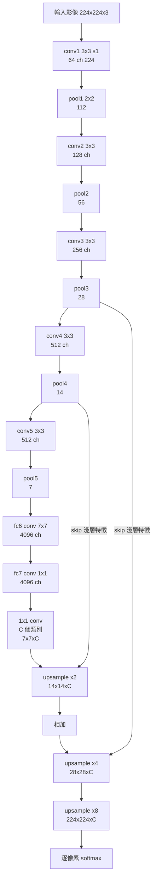
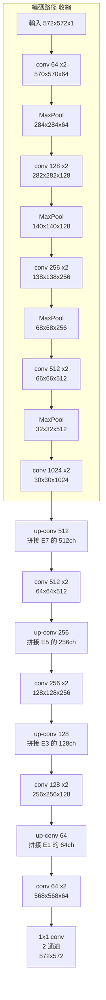
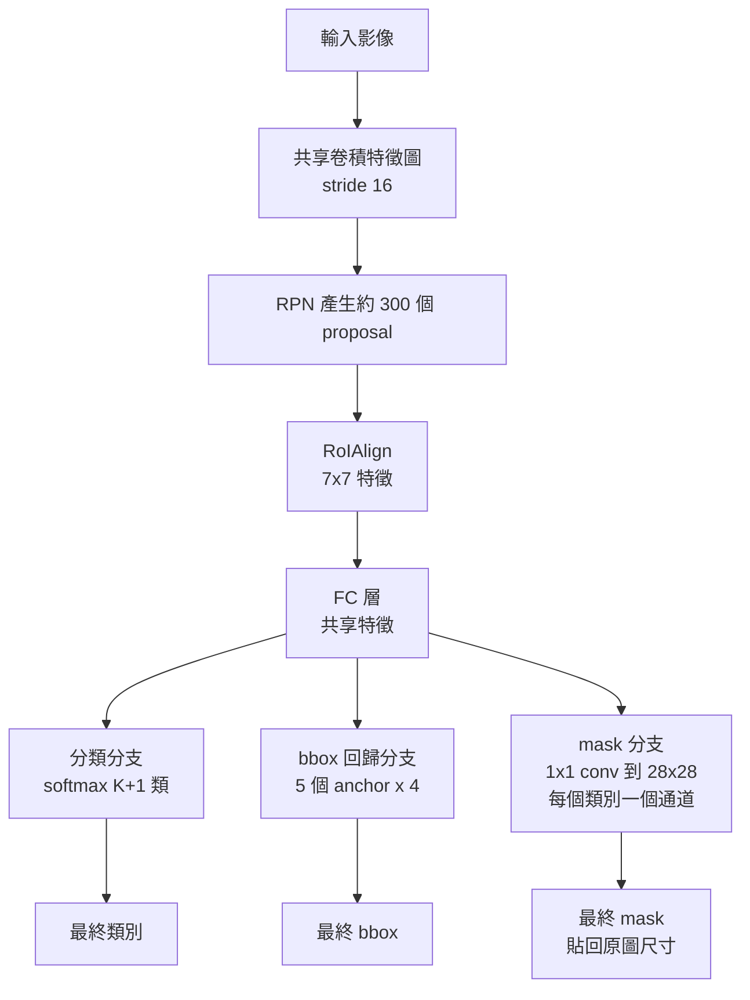

# 5.2 語義分割與個體分割：FCN 與 Mask R-CNN（2015-2017）

## 一、分割的三個層次與任務定義

### 1.1 語義、實例、全景

第 5.1 節的偵測把每個物件壓縮成一個矩形框。但一個人被框住時，框內的像素其實包含「人」、「褲子」、「背包」，甚至「背景的牆」。**分割（Segmentation）** 就是要給每一個像素一個標籤。

依標籤的細度，分割有三個層次：

| 層次 | 標籤規則 | 例：街道場景 | 輸出通道 |
| --- | --- | --- | --- |
| 語義分割 Semantic | 同類像素共用標籤 | 所有車輛都叫「車」 | $ C $ 通道 |
| 實例分割 Instance | 同類不同物體各有標籤 | 第 1 輛車 / 第 2 輛車 | $ C + N $ 通道（mask + 類別） |
| 全景分割 Panoptic | 兩者兼具 | 「可數」物體分實例，「不可數」stuff 共標籤 | 統一的 ID 映射 |

**「stuff」與「thing」的分界**（Kirillov et al. 2019 的正式定義）：

* **stuff 類**：像素的區域性、可數性不重要。天空、道路、牆壁、草地、天空。「有 3 棟房子」和「有 4 棟房子」對語義沒有區別。
* **thing 類**：可數、有明確邊界與獨立性。車、人、貓。「這張圖有 2 隻貓」是有意義的資訊。

這個區分不是美學偏好，而是**由人類的物體概念（objecthood）決定的**：一個可數物件有明確的「邊界」，而背景區域沒有。分割模型如果把一張長椅切成兩張長椅，語義上是錯的，但把草地切開則無傷大雅。

### 1.2 像素級的 IoU 與 mIoU

分割的評估指標是像素級的 IoU：

$$
\mathrm{IoU}_{\text{class}} = \frac{\mathrm{TP}_c}{\mathrm{TP}_c + \mathrm{FP}_c + \mathrm{FN}_c}
$$

其中 $ \mathrm{TP}_c $ 是類別 $ c $ 被正確預測的像素數，$ \mathrm{FP}_c $ 是被錯判為 $ c $ 的像素數（通常是背景誤判），$ \mathrm{FN}_c $ 是 $ c $ 被漏判的像素數。

**mIoU** 為各類別 IoU 的平均：

$$
\mathrm{mIoU} = \frac{1}{C} \sum_{c=1}^{C} \mathrm{IoU}_{\text{class}}
$$

**mIoU 的常見誤用**：mIoU 對「稀有類別」過度敏感。若一個稀有類別只有 100 個像素但全部錯分，該類 IoU 為 0，會把 mIoU 拉低 10 個百分點（假設有 10 類）。因此實務上常同時報告 **fwIoU**（frequency-weighted IoU，依像素頻率加權）與 **fwIoUacc**，以及像素準確率（pixel accuracy）。**Pixel accuracy 的一個致命弱點是它會被大類別支配**：一張圖中 90% 是背景，模型全猜背景就能得到 90% accuracy。因此分割研究社群普遍以 mIoU 為主指標。

**分割的另一個重要指標是 boundary F1 score**：在邊界帶（通常 3 到 5 像素寬）上計算精確率。分割模型在 mIoU 上幾乎不變時，boundary F1 可能變動 10 個百分點——這是因為 IoU 是區域量，對邊界的**微觀位置誤差**不敏感。

---

## 二、從滑動窗到 FCN：把分類網路變成分割網路

### 2.1 滑動窗方法的瓶頸

在深度學習之前，分割的主流做法是 **sliding window + per-pixel classification**：把影像切成重疊的 patch（例如 $ 41 \times 41 $），每個 patch 丟給一個 SVM 或小型 CNN 判斷中心像素的類別，然後把 patch 的預測平均回去。

這種方法的問題在於：

1. **計算量與 patch 數量成正比**，一張影像需要上千次前向傳播；
2. **patch 很小 → 感受野受限**，分類器根本看不到物體的全貌，一個 41×41 的 patch 無法判斷「這是貓的頭還是狗的頭」；
3. **推理結果依賴 patch 大小與滑動步幅**，不是端到端學到的。

**解決方向**：既然 CNN 的全連接層本質上就是一個大尺寸的卷積核，那麼把它換成卷積層，網路就能接受任意尺寸的輸入並且**一次前向輸出整張圖的預測**。這就是 Fully Convolutional Network。

### 2.2 FCN（2015, Shelhamer et al.）的結構

FCN-8s 的結構（最完整的版本）：



**三個關鍵機制**：

**（1）1×1 卷積取代全連接層。** 原本 fc7 是 $ 4096 \times 4096 $ 的全連接，等價於一個 $ 4096 \times 4096 $ 大的卷積核；改成 1×1 卷積後，參數量完全不變，但**可以套用在任意位置的特徵圖上**。這是一個純粹的、優雅的架構變換——沒有任何新的數學，只有把「位置無關的參數」換成「位置共享的參數」。

**（2）輸出尺寸的推導。** 對 $ H \times W $ 的輸入，五次池化後特徵圖為 $ \lceil H/32 \rceil \times \lceil W/32 \rceil $。FCN-32s 直接把這個粗糙的預測上採樣 32 倍回原尺寸；FCN-16s 先上採樣 2 倍到 $ H/16 $，與 pool4 的輸出相加，再上採樣 16 倍；FCN-8s 再多一次與 pool3 的相加。

FCN-8s 的分數為 $ 77.6 $（PASCAL VOC），FCN-16s 為 $ 79.0 $，FCN-32s 為 $ 71.0 $（均為 $ \mathrm{mIoU} $）。**FCN-32s 反而最差**，原因如下。

**（3）Skip connection：結合語義與細節。** 這是 FCN 最重要的設計。

深層特徵圖（$ H/32 $）經過很多次卷積與池化，具有**大感受野**，能判斷「這整塊是道路還是建築物」——**語義強**。但它的解析度只有 1/32，**邊界被量化得很粗**：一個物體的輪廓在這個解析度下可能只佔 1 到 2 個格子。

淺層特徵圖（$ H/16 $ 或 $ H/8 $）解析度高，保留了大量**邊界細節**，但因為感受野小，語義判斷力弱。

FCN 的做法是**把兩者相加**：

$$
F_{16}(x, y) = F_{\text{coarse}}^{\uparrow 2\times}(x, y) + F_{\text{fine}}(x, y)
$$

**因果解釋**：加法把「這裡應該是什麼東西（深層给的粗略類別機率）」與「這裡的邊界在哪裡（淺層給的局部證據）」兩種互補資訊結合起來。若只有深層，語義對但邊界糊；若只有淺層，邊界清楚但不知道是什麼。

### 2.3 FCN 的剩餘問題與 CRF 後處理

**問題一：輸出模糊。** FCN-32s 在 1/32 解析度上預測再上採樣，結果是邊界極度模糊，邊界 F1 分數很低。FCN-8s 改善了這點，但仍然是「先生成低解析度機率圖再上採樣」。

**問題二：沒有像素間的相關性。** FCN 逐像素獨立預測，某個像素被判為「天空」不會影響鄰居。但分割結果在空間上應該是**連通且平滑**的。傳統做法是 **CRF（條件隨機場）** 後處理：

DenseCRF 的能量函數（Potts 模型）：

$$
E(\mathbf{x}) = \sum_{i} \psi_u(x_i) + \sum_{i<j} \psi_p(x_i, x_j)
$$

單項項是資料項（來自 CNN 的 $ -\log p(x_i) $），成對項是平滑項：

$$
\psi_p(x_i, x_j) = \mu \left[ x_i \ne x_j \right] \exp\left( -\theta_\alpha \left\| p_i - p_j \right\|^2 - \theta_\beta \left\| g_i - g_j \right\|^2 \right)
$$

其中 $ p_i, p_j $ 是像素的位置，$ g_i, g_j $ 是像素的 RGB 值。直覺上：**位置接近且顏色相似的像素，應該被標成同一類**。這正是第 2 章的邊緣/區域分割思想（見 2.3 節的 SIFT 區域論與 1.3 節的「區域」概念）在語義層級的重現。

**DeepLab（2014/2016）的貢獻**：把 CRF 整合進網路並可微化（DeepLab-CRF 用 CRF-RNN，把高斯過濾器實作為可微的 RNN；DenseCRF 則用近似的高斯過濾）。DeepLab v2（2017）提出了 **ASPP** 與空洞卷積（見 4.3 節），DeepLab v3+（2018）加入了解碼器模組。

---

## 三、U-Net（2015, Ronneberger et al.）：Skip Connection 的極致

### 3.1 結構：完全對稱的編碼器-解碼器

U-Net 放棄了 FCN 的「全連接層轉 1×1 卷積 + 逐級相加」的路線，改用一個**完全對稱的 encoder-decoder**，並且 **skip connection 是通道維的拼接（concatenation）而非相加**。



**四條 skip connection**，每一條把編碼路徑中某層的特徵圖（通道數分別為 512、256、128、64）**沿通道維拼接**到解碼路徑的對應層。

### 3.2 為什麼 skip 能救回細節：三個層面的解釋

**（1）資訊論的解釋。** 池化與 strided 卷積是**不可逆的降採樣**：細節被丟棄。在 30×30 的 bottleneck 上，邊界資訊在數學上已經不存在，任何後續的上採樣都只能「猜」。skip connection 讓**原始細節以旁路直達輸出**，繞過了瓶頸層的資訊損耗。這與自編碼器的 skip connection、以及 ResNet 的恆等映射共享同一個動機：**給資訊一條不經過瓶頸的捷徑。**

**（2）拼接 vs 相加的差異。** FCN 用相加（channel-wise sum），U-Net 用拼接（channel-wise concat）。差別在於：

* 相加是**線性壓縮**：$ C $ 個通道被混合成 $ C $ 個通道，語義資訊與細節資訊互相干擾，網路必須「決定」保留哪個。
* 拼接是**保留**：解碼器同時拿到 $ 2C $ 個通道（$ C $ 個語義 + $ C $ 個細節），網路可以**在後續卷積中學會如何融合**。這是 U-Net 在細節精度上勝過 FCN 的重要原因之一。

**（3）幾何對齊的解釋。** U-Net 的 encoder 與 decoder 層數嚴格對稱，因此第 $ i $ 層 skip 的特徵圖與解碼路徑第 $ i $ 層的特徵圖**空間尺寸完全一致**（$ 572 \to 570 \to 568 $ 的「偶數-2」設計保證了精確對齊）。相較之下 FCN-8s 中，pool3 的輸出是 28×28 而上採樣後的特徵是 28×28 但語義來自完全不同深度的路徑——**skip 的兩端是在同一個抽象層級上對齊的，這讓拼接的語義更自然。**

### 3.3 為什麼 U-Net 在小資料的醫學影像上勝出

U-Net 論文本身就是在生物醫影像分割的背景下提出的，它在只有約 30 張訓練影像（細胞膜分割）的情況下達到 SOTA。三個原因：

**（1）參數效率。** U-Net 約 31M 參數，看起來不小，但相對於輸入是 $ 224 \times 224 $ 的分類網路（如 ResNet-50 有 25M），U-Net 的**每參數承載的空間資訊密度**高得多：分類網路把整張圖壓成 1×1×2048，U-Net 則保留了每個位置的高解析度特徵。

**（2）密集的監督訊號。** U-Net 的 loss 直接在 $ 572 \times 572 $ 的全解析度上計算（FCN-32s 則是在 1/32 解析度上），**每個像素都提供梯度**。這相當於把訓練樣本數乘上了 $ 572^2 $ 倍。

**（3）影像增強策略。** U-Net 論文特別強調：由於資料少，必須用**任意形變（elastic deformation）**做增強。做法是對影像與標註施加隨機的平滑隨機位移場（random displacement field），使網路學到形狀不變性。這在醫學影像上特別有效，因為器官形狀的變異遠大於自然影像。

**（4）邊界貼齊的設計。** 輸入 572 而輸出 572，是因為四層池化每次都會因奇偶性產生 1 像素的捨去；作者把輸入加大 4 像素（$ 570 \to 572 $），使得**最後的 crop 剛好把這個偏移切掉**，使預測與輸入的像素嚴格對齊。**這種「為了對齊而精心設計的尺寸」是分割網路中常見但容易被忽略的細節。**

### 3.4 U-Net 的延伸

U-Net 開啟了一整個「編碼器-解碼器 + skip」的研究路線：

* **UNet++（2019, Zhou et al.）**：在 U-Net 的 skip 之間再加入密集的巢狀連接，緩解「編碼器與解碼器之間的**語義落差（semantic gap）**」問題。U-Net 的 skip 直接把淺層（低語義）接到深層解碼器（高語義需求），中間缺少過渡；UNet++ 用密集 skip 讓每一層都能經由短的連接路徑獲得深層語義。代價是計算量增加約 4 倍。
* **Attention U-Net（2018）**：在 skip 上加注意力閘門，抑制無關的 skip 資訊（例如背景的 skip 傳到前景區域）。
* **ResUNet / SE-UNet**：把殘差塊與通道注意力引入編碼器。

---

## 四、DeepLab 系列與空洞卷積

### 4.1 空洞卷積（Dilated / Atrous Convolution）

**要解決的取捨**：分割需要**高解析度**的輸出（每像素預測）與**大感受野**（判斷語義）。但標準卷積在高解析度下做 stride 會降低解析度，而池化降解析度又損失細節。標準做法是「先池化降解析度，用大 kernel 撐大感受野，最後上採樣」——**但上採樣時細節已經沒了**。

**空洞卷積**（正式名稱為 atrous convolution，源自小波理論中的「à trous」濾波，即跳過若干採樣點）的做法：在 $ k \times k $ 的核中，**只在每隔 $ d $ 個位置放權重**，其中 $ d $ 稱為**膨脹率（dilation rate）**或 **空洞率**。

$ 3 \times 3 $ 核、膨脹率 $ d $ 的空洞卷積，其**有效感受野（effective receptive field）**為

$$
k_{\text{eff}} = k + (k - 1)(d - 1)
$$

**感受野的增長是線性的**，而參數量**完全不變**（仍是 $ k^2 $ 個權重）。這就是它的全部魔法。

三層膨脹率皆為 $ d $ 的空洞卷積串接，其有效感受野為

$$
k_{\text{eff}}^{(3)} = k + 2(k-1)(d-1)
$$

例如 $ k=3 $、$ d = 2, 4, 8 $ 時，有效感受野分別為 5、9、17，串接後的理論感受野為

$$
3 + 2(3-1)(2-1) + 2(3-1)(4-1) + 2(3-1)(8-1) = 3 + 4 + 12 + 14 = 33
$$

**而參數量只有 $ 3 \times 9 = 27 $ 個權重**（對比之下，標準卷積要達到 33 的感受野需要 11×11 的核，121 個權重，且只有一層）。

**空洞卷積的代價**：**網格效應（gridding artifact）**。膨脼率太大時，卷積核的採樣點在空間上變得稀疏，會出現「棋盤格」狀的盲區，而且的感受野覆蓋不均勻。解法是混合不同膨脹率的分支——這就是 **ASPP**。

### 4.2 ASPP：多尺度空洞卷積

**ASPP（Atrous Spatial Pyramid Pooling, DeepLab v2/v3）** 對同一層特徵圖並聯多個分支：

* 一個 $ 1 \times 1 $ 卷積（通道降維）
* 膨脹率為 $ 6, 12, 18 $ 的三個 $ 3 \times 3 $ 空洞卷積
* 一個**全局平均池化**分支（影像級別的語意脈絡）

各分支的結果**沿通道拼接**後，再接一個 $ 1 \times 1 $ 卷積融合。

**為什麼需要影像級別的分支**：在自駕駛影像中，幾乎所有畫面都有「天空」和「道路」這兩個概念。空洞卷積再大，感受野仍是有限的；全局平均池化分支提供了「整張影像看起來是什麼場景」的全域資訊。

### 4.3 DeepLab v1 到 v3+ 的演進

| 版本 | 年份 | 關鍵貢獻 |
| --- | --- | --- |
| DeepLab v1 | 2014 | 空洞卷積 + 可微 CRF |
| DeepLab v2 | 2017 | ASPP 多尺度聚合，達到 SOTA |
| DeepLab v3 | 2018 | **Multi-grid + 串聯 ASPP**，處理膨脹率過大的網格效應 |
| DeepLab v3+ | 2018 | 加入**解碼器模組**與低層特徵的 skip，並用深度可分離卷積節省計算 |

DeepLab v3 的 multi-grid 技術特別值得注意：把膨脼率組合為 $ \{1, 2, 4\} $ 的 grid（即每個分支用不同的小膨脹率並聯），再串接各 grid 的結果。**這是針對「網格效應」的直接補救**：用多個小膨脹率覆蓋密集採樣點，而不是靠單一大膨脹率。

---

## 五、實例分割：Mask R-CNN 與 RoIAlign

### 5.1 問題：框不足以表達形狀

偵測輸出的 bbox 有兩個不可迴避的缺陷：

1. **形狀資訊全失**：一個彎曲的人被框成矩形，框內包含大量背景像素，IoU 天然偏低。
2. **無法區分重疊實例**：兩個重疊的人，bbox 幾乎相同。

要解決這兩點，就必須預測**像素級的 mask**。但直接對整張圖做實例分割會回到「一張圖多個物件」的難題。

**Mask R-CNN（2017, He et al.）** 的方案極為優雅：**沿用 Faster R-CNN 的兩階段結構，在偵測頭旁邊平行加上一個 mask 分支。**



### 5.2 RoIAlign：量化誤差的精確數學

**RoI Pooling 的問題（源自 Fast R-CNN）**：

RoI 在特徵圖上的座標為 $ (x, y, w, h) $（連續值）。RoI Pooling 把它**量化**為

$$
x' = \left\lfloor \frac{x}{s} \right\rfloor, \qquad w' = \left\lfloor \frac{w}{s} \right\rfloor
$$

其中 $ s $ 是 stride。接著把這個量化後的區域切成 $ 7 \times 7 $ 的格，每格取最大值。

**量化誤差的幾何意義**：真實的物件邊界落在特徵圖上的位置是 $ x $ ，被量化成 $ x' $ ，誤差最多可達 **$ s $ 像素（在原圖尺度上）**。當 $ s = 16 $ 時，誤差可達 16 原圖像素。

**對 mask 分支而言這是災難性的**：mask 分支要預測 28×28 的像素級精細形狀，若 RoI 本身有 16 像素的偏移，那麼 mask 的每個像素都對不準。

**RoIAlign（2017, He et al.）的解法**：

1. **不量化座標**。把 RoI 的邊界映射到特徵圖上時，**保留小數部分**。
2. **用雙線性插值代替 max pooling**。對每個輸出格，取其 $ 4 $ 個鄰近的特徵圖位置（$ x_{i-1}, x_i, y_{j-1}, y_j $），以**雙線性插值**計算精確位置的特徵值。
3. **關鍵的一步：先取樣再池化（sample-then-pool）**。RoI Pooling 是「先量化區域、再在量化後的區域上池化」；RoIAlign 是「在精確位置上取樣出所有需要的特徵值、再對這些取樣值做 max」。

用公式表達：RoIAlign 的第 $ (i, j) $ 個輸出格對應原圖上的連續區間

$$
x_1 = x + \frac{w}{7} (i - 1), \qquad x_2 = x + \frac{w}{7} i
$$

在每個 $ x_1, x_2 $ 處（映射到特徵圖後）做雙線性插值取樣，得到 $ \hat{x}_1, \hat{x}_2 $，然後取

$$
v_{ij} = \max\left( v_{ij}^{\text{interp}}, v_{ij}^{\text{interp}} \right)
$$

即對 $ x \in \{x_1, x_2\} $、$ y \in \{y_1, y_2\} $ 四個插值值的最大值。

**RoIAlign 與 RoI Pooling 的差異總結**：

| | RoI Pooling | RoIAlign |
| --- | --- | --- |
| 座標 | 量化到整數格點 | 保留小數 |
| 取樣 | 量化區域內 max | 精確位置的雙線性插值 |
| 順序 | pool-then-sample | **sample-then-pool** |
| 對 mask 分支 | 誤差 up to $ s $ 像素 | 誤差 < 1 特徵像素 |

**這是本章最精細的一個數學細節，也是「Mask R-CNN 的 AP 提升有多少來自 mask 分支、有多少來自 RoIAlign」的答案**：實驗顯示用 RoI Pooling 做 mask 分支時，mask 分支的 AP 增益只有 +1.1，而換成 RoIAlign 後增益變成 +2.9。**RoIAlign 是讓 mask 分支真正生效的前提條件。**

### 5.3 為什麼 mask 分支用 mask loss 而不是 bbox loss

Mask R-CNN 的 mask 分支**不使用 bbox loss**，而是在 $ 28 \times 28 $ 的 mask 上用平均二元交叉熵：

$$
\mathcal{L}_{\text{mask}} = \frac{1}{N} \sum_{i=1}^{N} \left[ - y_i \log \hat{y}_i - (1 - y_i) \log(1 - \hat{y}_i) \right]
$$

其中 $ N $ 只計算**被分配給真值實例的 RoI**（即那些與真值 IoU > 0.5 的 proposal），其他 RoI 不參與 mask loss。

**這個設計有三個理由**：

1. **任務解耦**。分類分支回答「這是什麼」，bbox 分支回答「它多大、在哪」，mask 分支回答「它的形狀是什麼」。三者互不干涉。對比之下，直接用分割網路做實例分割時，mask 的預測與分類綁在一起，容易互相拖累。
2. **幾何對齊的嚴謹性**。bbox loss 是一個粗糙的代理指標（IoU loss 對形狀幾乎不敏感）；mask loss 卻是**逐像素的**，能提供更豐富的梯度訊號。**用 mask loss 訓練出的 mask 分支，反過來讓共享的 FC 特徵更好**，因為網路被要求在 RoI 內部區分前景與背景的細粒度差異。
3. **28×28 的解析度取捨**。mask 分支只在 $ 28 \times 28 $ 上預測，而不是原圖尺寸。這是**速度與精確度的取捨**：RoI 的典型尺寸是約 $ 224 \times 224 $，在 $ 28 \times 28 $ 的 mask 上做逐像素 loss 已經能提供很強的約束；而輸出到原圖解析度會讓 loss 變得極度稀疏（正例像素占比很低）且計算昂貴。**最終的 mask 是由 $ 28 \times 28 $ 的預測經雙線性插值放大到 RoI 尺寸後，再貼到畫布上。** 這個取捨在高 IoU 門檻下的代價是明顯的：mask 的 IoU 上限被解析度限制，所以 Mask R-CNN 在 $ \mathrm{mAP}_{50:95} $ 上的增益（+2.9）小於在 $ \mathrm{mAP}@0.5 $ 上的增益（+3.3）。

### 5.4 Mask R-CNN 的完整損失

$$
\mathcal{L} = \mathcal{L}_{\text{cls}} + \mathcal{L}_{\text{bbox}} + \mathcal{L}_{\text{mask}}
$$

* $ \mathcal{L}_{\text{cls}} $：分類交叉熵。
* $ \mathcal{L}_{\text{bbox}} $：bbox 回歸（smooth L1 或 IoU loss）。
* $ \mathcal{L}_{\text{mask}} $：只對正 RoI 計算的 mask BCE。

Mask R-CNN 在 COCO 上 $ \mathrm{mAP} = 37.1 $，並因此獲得了 2018 年 PASCAL VOC 分割挑戰賽的第一名。**它的重要性在於：一個簡單的、概念上清晰的架構擴展，把「偵測」與「分割」這兩個看起來不同的任務統一在同一個框架下**，並且在偵測基準上同時提升了精度——這在之前是不可想像的。

---

## 六、全景分割

**問題**：語義分割與實例分割各有各的模型，要在一張圖上同時得到「車 1、車 2、卡車 3」與「天空、道路、建物」需要跑兩個系統再合併，結果是兩套標籤空間無法協調。

**Panoptic FPN（2019, Kirillov et al.）** 的解法極為簡潔：

* 用 FPN 產生多尺度的特徵金字塔。
* 在每個 FPN 層上接**兩條分支**：
  * **thing 分支**：輸出每個位置的 instance embedding（$ 64 $ 維），再由後處理把同實例的像素聚成一簇。
  * **stuff 分支**：輸出每個位置的語義類別機率（$ C $ 通道）。
* 合併輸出：一個統一的 segment ID 空間，thing 實例各自有唯一 ID，stuff 區域共用類別 ID。

**UPSNet（2019）** 走的是**聯合訓練**的路線：用一個統一的網路同時預測 thing 與 stuff，並引入一個「thing-stuff confusion loss」來處理兩者邊界的模糊性。

**全景分割的評估指標 PQ（Panoptic Quality）**：

$$
\mathrm{PQ} = \mathrm{SQ} \times \mathrm{RQ}
$$

$$
\mathrm{RQ} = \frac{\sum_{j \in \text{GT}} |S_j|}{|\text{GT}| + |S| - |\text{matched}|}
$$

$$
\mathrm{SQ} = \frac{1}{|\text{matched}|} \sum_{j \in \text{matched}} \frac{\sum_{i \in j} |P_i \cap G_j|}{ |P_i \cup G_j |}
$$

其中 $ \mathrm{RQ} $ 衡量「有多少 segment 被正確匹配」（偵測層面的品質），$ \mathrm{SQ} $ 衡量「匹配上的 segment 形狀有多準」（分割層面的品質）。

**全景分割是本章與第 6 章的接點**：thing 分支的 instance embedding + 聚類的做法，與 DETR 的集合預測是同一個思想的不同實作；兩者都在追問「**如何用一組離散的、全域的查詢（queries）來統一表示不定數量的物件**」。

---

## 七、歷史呼應：從邊緣到區域，從等變到分割

### 7.1 分割是第 1 章與第 2 章的自然後繼

回顧第 1.3 節（傅立葉）與第 2.2 節（Canny）：

* **傅立葉給出了「區域」的概念**：低頻成分對應緩慢變化的區域（天空），高頻成分對應邊界。分割正是「把影像劃分成語義一致的區域」——這在傅立葉的語言裡就是把頻譜劃分成「低頻為一類、高頻為另一類」的推廣。
* **Canny 給出了邊緣**作為區域的邊界。但邊緣偵測輸出的只是一條條曲線，**不說哪條線是物件的邊界、哪條只是紋理**。語義分割就是在邊緣之上加上「這條邊界兩側是什麼」的語義。
* **Canny 的非極大值抑制**是第 2 章中第一次出現的「**在候選之中做貪婪的抑制**」。這個機制在第 5.1 節的 NMS 中以幾乎相同的形式再次出現——**五十年後的偵測器，仍然在用同一個抑制的思想去除冗餘**。這個呼應說明：局部演算法中的「結構性原則」比具體的實作形式更長久。

### 7.2 卷積等變性：分割是最能體現其價值的任務

第 4.1 節說過，卷積具有**平移等變性**：

$$
(f * k)(x + \delta) = (f * k)(x) + \delta
$$

這個性質在不同任務上的價值天差地別：

* **分類任務**：平移等變幾乎沒用，因為最終全域池化把位置資訊丟掉了；分類的本質是「這張圖有什麼」，對位置不敏感。
* **偵測任務**：有用，但需要 mechanism 來維持（anchor 的位置繫結、NMS 的座標處理）。
* **分割任務**：**等變性直接變成了免費的對齊**。卷積網路對影像平移 $ \delta $ 像素，輸出標籤圖也平移 $ \delta $ 像素——像素級的預測**天然就與影像對齊**，不需要任何额外的對齊機制。

**這解釋了為什麼分割是「最乾淨」的深度學習任務**：分類要處理位置的任意性，偵測要處理位置的離散化，但分割只要「每個位置預測自己的類別」，網路的等變性就自動完成了對齊。**這也是分割模型能如此精準的根本原因。**

而**這個「等變性红利」在第 6 章會被重新挑戰**：ViT 用 patch embedding + 位置編碼取代卷積，等變性不再免費提供（位置編碼是絕對的，不是相對的），分割任務因而成為 ViT 最早的試金石之一。第 6.2 節會回到這個問題。

---

## 八、實作

### 8.1 U-Net 的 PyTorch 實作

```python
import torch
import torch.nn as nn
import torch.nn.functional as F


class DoubleConv(nn.Sequential):
    """(Conv -> BatchNorm -> ReLU) x 2"""

    def __init__(self, in_ch, out_ch, mid_ch=None):
        super().__init__()
        mid_ch = mid_ch or out_ch
        self.block = nn.Sequential(
            nn.Conv2d(in_ch, mid_ch, 3, padding=1, bias=False),
            nn.BatchNorm2d(mid_ch),
            nn.ReLU(inplace=True),
            nn.Conv2d(mid_ch, out_ch, 3, padding=1, bias=False),
            nn.BatchNorm2d(out_ch),
            nn.ReLU(inplace=True),
        )

    def forward(self, x):
        return self.block(x)


class Down(nn.Sequential):
    """MaxPool2d(2) -> DoubleConv"""

    def __init__(self, in_ch, out_ch):
        super().__init__()
        self.block = nn.Sequential(nn.MaxPool2d(2), DoubleConv(in_ch, out_ch))

    def forward(self, x):
        return self.block(x)


class Up(nn.Module):
    """上採樣並與 skip 沿通道拼接"""

    def __init__(self, in_ch, skip_ch, out_ch, bilinear=True):
        super().__init__()
        if bilinear:
            self.up = nn.Upsample(scale_factor=2, mode="bilinear", align_corners=True)
            conv_in = in_ch + skip_ch
        else:
            self.up = nn.ConvTranspose2d(in_ch, in_ch // 2, kernel_size=2, stride=2)
            conv_in = in_ch // 2 + skip_ch
        self.conv = DoubleConv(conv_in, out_ch)

    def forward(self, x, skip):
        x = self.up(x)
        # 尺寸不一致時（例如輸入奇數邊長）先對齊
        if x.shape[-2:] != skip.shape[-2:]:
            x = F.pad(x, [0, skip.shape[-1] - x.shape[-1],
                          0, skip.shape[-2] - x.shape[-2]])
        return self.conv(torch.cat([skip, x], dim=1))


class UNet(nn.Module):
    def __init__(self, in_ch=1, num_classes=2, features=(64, 128, 256, 512, 1024),
                 bilinear=True):
        super().__init__()
        self.inc = DoubleConv(in_ch, features[0])
        self.downs = nn.ModuleList()
        self.ups = nn.ModuleList()

        for i in range(len(features) - 1):
            self.downs.append(Down(features[i], features[i + 1]))

        for i in range(len(features) - 1, 0, -1):
            self.ups.append(Up(features[i], features[i - 1], features[i - 1], bilinear))

        self.outc = nn.Conv2d(features[0], num_classes, kernel_size=1)

    def forward(self, x):
        skips = []
        x = self.inc(x)
        for down in self.downs:
            x = down(x)
            skips.append(x)
        skips = skips[::-1]  # 反轉，方便逐一配對

        for i, up in enumerate(self.ups):
            x = up(x, skips[i])

        return self.outc(x)
```

### 8.2 分割的評估指標實作

```python
import numpy as np


def confusion_matrix(y_true, y_pred, num_classes):
    """
    y_true / y_pred: (H, W) 的整數標籤陣列
    回傳 (num_classes, num_classes) 的混淆矩陣，
    對角線為 TP，第 i 列第 j 欄為真值 i 被預測為 j 的像素數。
    """
    mask = (y_true >= 0) & (y_true < num_classes)
    hist = np.bincount(
        num_classes * y_true[mask].astype(int) + y_pred[mask].astype(int),
        minlength=num_classes ** 2,
    )
    return hist.reshape(num_classes, num_classes)


def iou_from_confusion(cm):
    """各類別的 IoU 與 mIoU"""
    tp = np.diag(cm).astype(float)
    fp = cm.sum(axis=0) - tp
    fn = cm.sum(axis=1) - tp
    denom = tp + fp + fn
    iou = np.where(denom > 0, tp / np.maximum(denom, 1e-9), np.nan)
    return iou, np.nanmean(iou)


def pixel_accuracy(cm):
    return np.diag(cm).sum() / max(cm.sum(), 1)


def fwiou(cm):
    """依像素頻率加權的 IoU"""
    tp = np.diag(cm).astype(float)
    denom = tp + (cm.sum(axis=0) - tp) + (cm.sum(axis=1) - tp)
    iou = np.where(denom > 0, tp / np.maximum(denom, 1e-9), 0.0)
    freq = cm.sum(axis=1) / max(cm.sum(), 1)
    return float((iou * freq).sum())


def dice_from_confusion(cm):
    """各類別 Dice 係數（F1）"""
    tp = np.diag(cm).astype(float)
    denom = 2 * tp + (cm.sum(axis=0) - tp) + (cm.sum(axis=1) - tp)
    dice = np.where(denom > 0, 2 * tp / np.maximum(denom, 1e-9), np.nan)
    return dice, np.nanmean(dice)
```

### 8.3 Dice 與 IoU Loss

```python
class DiceBCELoss(nn.Module):
    """
    BCE + Dice Loss 的加權組合。Dice 對類別不平衡更穩健。
    """

    def __init__(self, num_classes, smooth=1.0, bce_weight=0.5):
        super().__init__()
        self.smooth = smooth
        self.bce_weight = bce_weight

    def forward(self, logits, targets):
        # logits: (B, C, H, W)；targets: (B, H, W) 的整數標籤
        probs = torch.softmax(logits, dim=1)
        bce = F.cross_entropy(logits, targets)

        one_hot = F.one_hot(targets, num_classes=logits.shape[1])
        one_hot = one_hot.permute(0, 3, 1, 2).float()

        dims = (0, 2, 3)
        intersection = (probs * one_hot).sum(dims)
        cardinality = probs.sum(dims) + one_hot.sum(dims)
        dice = (2 * intersection + self.smooth) / (cardinality + self.smooth)
        dice_loss = 1 - dice.mean()

        return self.bce_weight * bce + (1 - self.bce_weight) * dice_loss
```

### 8.4 視覺化 mask 預測

```python
import numpy as np


def colorize_mask(mask, palette=None):
    """把 (H, W) 的整數標籤圖轉成 (H, W, 3) 的 uint8 影像"""
    if palette is None:
        rng = np.random.RandomState(0)
        palette = rng.randint(0, 255, size=(256, 3), dtype=np.uint8)
    return palette[np.asarray(mask).astype(np.int32)]


def overlay_mask(image, mask, alpha=0.5):
    """把彩色 mask 半透明疊在原圖上"""
    color = colorize_mask(mask).astype(float)
    img = image.astype(float)
    blended = (1 - alpha) * img + alpha * color
    return blended.clip(0, 255).astype(np.uint8)


def boundary_f1(pred, gt, tol=5):
    """
    邊界 F1 分數：比較預測與真值的邊界帶，
    落在 tol 像素內的邊界像素視為匹配。
    """
    import cv2
    b_pred = cv2.Canny(pred.astype(np.uint8), 50, 150) > 0
    b_gt = cv2.Canny(gt.astype(np.uint8), 50, 150) > 0
    if b_pred.sum() == 0 and b_gt.sum() == 0:
        return 1.0
    if b_pred.sum() == 0 or b_gt.sum() == 0:
        return 0.0

    # 以距離變換建立容差帶
    d_gt = cv2.distanceTransform((~b_gt).astype(np.uint8), cv2.DIST_L2, 3)
    d_pred = cv2.distanceTransform((~b_pred).astype(np.uint8), cv2.DIST_L2, 3)

    precision = float((d_gt[b_pred] <= tol).sum()) / max(b_pred.sum(), 1)
    recall = float((d_pred[b_gt] <= tol).sum()) / max(b_gt.sum(), 1)
    if precision + recall == 0:
        return 0.0
    return 2 * precision * recall / (precision + recall)
```

### 8.5 一個完整的訓練迴圈骨架

```python
import torch
from torch.utils.data import DataLoader


def train_segmentation(model, train_loader, val_loader, device, epochs=100, lr=1e-3):
    model = model.to(device)
    criterion = DiceBCELoss(num_classes=2, bce_weight=0.5)
    optimizer = torch.optim.AdamW(model.parameters(), lr=lr, weight_decay=1e-4)
    scheduler = torch.optim.lr_scheduler.CosineAnnealingLR(optimizer, T_max=epochs)

    best_miou = 0.0
    for epoch in range(epochs):
        model.train()
        for images, masks in train_loader:
            images = images.to(device)
            masks = masks.to(device).long()
            logits = model(images)
            loss = criterion(logits, masks)
            optimizer.zero_grad()
            loss.backward()
            optimizer.step()
        scheduler.step()

        # 驗證
        model.eval()
        cm = np.zeros((2, 2), dtype=np.int64)
        with torch.no_grad():
            for images, masks in val_loader:
                logits = model(images.to(device))
                preds = logits.argmax(dim=1).cpu().numpy()
                for p, g in zip(preds, masks.numpy()):
                    cm += confusion_matrix(g, p, 2)
        iou, miou = iou_from_confusion(cm)
        print(f"epoch {epoch}: mIoU={miou:.4f} IoU_bg={iou[0]:.4f} IoU_fg={iou[1]:.4f}")

        if miou > best_miou:
            best_miou = miou
            torch.save(model.state_dict(), "unet_best.pth")

    return best_miou
```

---

## 九、本節小結

1. **分割的三個層次**由「像素標籤的細度」區分：語義分割（同類合併）、實例分割（同類分離）、全景分割（兩者統一）。stuff 與 thing 的區分反映人類的物體概念。
2. **FCN（2015）** 的核心是把全連接層變成 1×1 卷積，並用 **skip connection** 結合深層語義與淺層細節。但它的輸出在低解析度上預測，邊界模糊，需要 CRF 後處理。
3. **U-Net（2015）** 把 skip 做到極致：對稱的 encoder-decoder、通道維拼接、在全解析度上計算 loss。這三點讓它在資料極少的醫學影像上勝出。**skip 的價值在於為資訊提供一條繞過降採樣瓶頸的捷徑。**
4. **DeepLab 系列** 用空洞卷積解決「高解析度 vs 大感受野」的取捨，有效感受野隨膨脹率線性增長而參數量不變；ASPP 用多尺度並聯解決網格效應。
5. **Mask R-CNN（2017）** 在 Faster R-CNN 上平行加一個 28×28 的 mask 分支，用 **RoIAlign** 消除量化誤差（保留小數 + 雙線性插值 + sample-then-pool），並以 **mask loss 而非 bbox loss** 提供更細緻的梯度。
6. **全景分割**（Panoptic FPN、UPSNet）統一了兩套標籤空間，其 instance embedding 與聚類的做法與 DETR 的集合預測同源。
7. **歷史呼應**：分割把第 2 章的邊緣/區域概念推到了語義層級；Canny 的非極大值抑制在六十年後以 NMS 的形式重回來；**卷積的平移等變性在分割任務上價值最高，因為它讓像素級預測天然對齊**——這個紅利將在第 6 章的 ViT 中受到挑戰。

下一節（5.3）把分割帶到兩個真實世界的重災現場：**醫學影像**（資料稀缺、容錯率低、3D 連續性要求）與**自動駕駛**（相機與 LiDAR 的多感測器融合、稀疏資料結構、即時性要求）。這兩個場景會逼出許多分割以外的新問題：3D 連續性約束、稀疏卷積、Bird's-Eye-View 表示、跨感測器校準、以及多目標追蹤。
