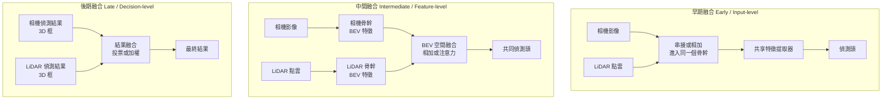

# 5.3 醫學影像 U-Net 與自動駕駛的 LiDAR 融合（2015-2020）

## 一、醫學影像分割：第一個大規模落地的分割場景

### 1.1 為什麼醫療是分割的第一個落地場景

分割模型在自然影像上的普及晚於分類與偵測，但在醫療領域卻是最早落地的一類。原因有四個，而且每一個都是**因果性的**：

**（1）標註的經濟學決定了問題的形式。** 一位放射科醫師標註一張 3D CT 的所有切片，需要數小時；而標註一張自然影像的 20 個 bbox 可能只要 10 分鐘。**醫療影像的標註成本極高，因此「密集的像素級預測」這種高資訊密度的輸出，反而具有最高的性價比。** 一次 CT 標註產生了 300 到 500 張密集標籤的切片，等於免費獲得數百倍的訓練資料。

**（2）任務的本質是分割而非分類。** 醫療影像的目標是**描出病灶的邊界**，以便計算體積、進行手術導航、追蹤病變的成長。分類只能回答「有沒有腫瘤」，分割能回答「多大、在哪、什麼形狀」——後者才是臨床決策需要的。

**（3）容錯率低，逼迫方法嚴謹。** 自動駕駛的失誤可以造成財損，醫療分割的失誤可能傷害病人。這個壓力驅動了更嚴格的驗證protocol（多中心測試、外部驗證、Dice 與 Hausdorff 雙指標），也讓醫療成為分割方法論的試金石。

**（4）解剖結構的複雜性與多變性。** 器官在不同病人之間的形狀差異極大（肝臟的大小形狀因人而異），病變形狀更是千變萬化。**這使得「形狀先驗」比「紋理先驗」更重要**，而 U-Net 這種帶有對稱結構與 skip 的架構，恰好善於表達形狀。

**醫學影像的維度挑戰**：CT 是 3D 的（$ 512 \times 512 $ 切片 × 數百到上千層），MRI 有各種序列（T1、T2、FLAIR、DWI），體素之間的間距（spacing）各向異性且不標準（$ 0.5 \times 0.5 \times 5 $ mm 是常見的 CT 切片間距）。這意味著**直接處理 3D 體積在記憶體上是不可行的**，實務上普遍採用 2.5D 切片策略（輸入相鄰多個切片預測中間切片）或 patch-based 訓練 + 全程滑動推論。

### 1.2 分割網路的整合問題：可及性與空間資訊的取捨

U-Net 論文本身就是醫學影像分割的工作（生物醫影像分割挑戰賽）。但要把它用在真實的醫療流程中，還有一堆工程問題：

**（1）灰階與多模態。** CT 天然是灰階的，MRI 也是。醫學影像的輸入通道數通常是 1，與 ImageNet 預訓練模型的 3 通道不符。標準做法是**把灰階複製到 3 通道**以重用預訓練權重。

**（2）z 軸方向的各向異性。** CT 切片間距常為 5 mm，而 in-plane 間距為 0.5 mm，相差 10 倍。若把體積直接重採樣成等向性（isotropic），會浪費大量記憶體在 z 軸的空白上；若不重採樣，網路看到的是各向異性的資料。**nnU-Net 的做法是保留原始各向異性，並在資料增強中讓模型自己適應**，同時對 in-plane 與 through-plane 使用不同的增強強度。

**（3）patch-based 的推論。** 對一張 $ 512 \times 512 \times 300 $ 的 CT，完整體積無法塞進 GPU。標準做法是切成 $ 128 \times 128 \times 32 $ 的 patch 做滑動推論，再用**加權平均 + 高斯權重**在 patch 邊界處融合（避免接縫）。這是 5.2 節「滑動窗」方法在 3D 的迴歸，但現在滑動窗的候選已經被網路本身取代。

### 1.3 nnU-Net（2021, Isensee et al.）：最重要的「反戲劇性」結果

**nnU-Net 的論點極為大膽**：與其設計複雜的新架構，不如**把一套仔細設定的 U-Net 的所有周邊環節（預處理、增強、損失、後處理、跨驗證）自動化到極致**。

它的自動化規則包括：

* **重採樣**：依目標 spacing 自動決定 z 軸與 in-plane 的重採樣因子。
* **正規化**：自動偵測影像的強度分布，決定用 z-score 還是 histogram matching。
* **增強**：包含旋轉、縮放、鏡射、Gaussian noise、Gaussian blur、brightness、contrast、low-res simulation。
* **損失**：自動在 Dice + BCE 與 Dice + CE 之間選擇。
* **後處理**：對實例標籤做最大連通域保留（去除離散的小碎塊）。
* **拓撲**：2D/3D 的 2D/2.5D/3D 的選擇。

**結果令人震驚**：nnU-Net 在 23 個不同的醫學分割数据集上，**23 個全部第一或並列第一**，且**沒有使用任何架構上的創新**。

**這個結果的科學意義遠大於其工程意義**：

> 在分割這個問題上，**決定性能的主要因素不是架構，而是問題的設定與資料處理的細節**。

這是對整個深度學習領域一條極重要的教訓的回響：第 1.1 節提過「取樣定理決定了重建的上限」，這裡是「**預處理決定了分割的上限**」。在資料極度稀缺的醫學領域尤其明顯——當只有 30 個訓練樣本時，架構改進帶來的增益會被隨機性淹沒，而資料增強的改進卻是穩健的。

**這也構成一個對本章另一個主線（自動駕駛）的呼应**：nuScenes 挑戰賽的結果（見 5.5 節）幾乎是同一個命題的另一個實例——**規律化、可解釋的模組化流程，仍然優於大而全的端到端方案**。

### 1.4 UNet++（2019）、Swin UNETR（2022）、nnFormer（2023）

**UNet++（2019, Zhou et al.）**：在 U-Net 的 skip 之間加入**密集的巢狀連接**。

問題診斷：U-Net 的 skip 直接把**編碼器第 $ i $ 層**（淺、邊緣資訊多、語義少）接到**解碼器第 $ i $ 層**（深、語義需求強）。兩者之間存在巨大的**語義落差（semantic gap）**——淺層特徵幾乎不包含語義資訊，直接拼接進去會造成噪聲。

UNet++ 的解法是**在 skip 路上再加一層巢狀的密集連接**：

$$
X^{i,j} = \mathcal{H}\left( \left[ X^{i,j-1}, \mathcal{U}\left( X^{i+1,j-1} \right) \right] \right)
$$

其中 $ \mathcal{U} $ 是上採樣、$ \mathcal{H} $ 是卷積塊。這個遞迴式讓**每一層都能經由短的連接路徑獲得深層的語義**，從而緩解語義落差。最終預測是從 $ X^{1,4} $ 經由巢狀的密集聚合得到。

**代價**：計算量約為 U-Net 的 4 倍（多層密集連接），但可以透過 deep supervision（對每個巢狀層都加一個 loss）在推論時只走最淺的那條路徑來部分補償。

**Swin UNETR（2022, Hatamizadeh et al.）**：把第 6 章的 **Swin Transformer** 作為 encoder，取代 U-Net 的卷積編碼器。

* 使用 Swin Transformer 的**分層特徵金字塔**（每個階段解析度減半、通道數加倍），天然對應 U-Net 的四層 encoder。
* 特徵透過 patch merging 層完成下採樣，輸出通道數為 $ 96, 192, 384, 768 $。
* 解碼器仍是 U-Net 式的捲積解碼器 + skip。

**為什麼 3D 醫學影像分割特別適合 Transformer**：Transformer 的**全局感受野**能解決 3D 分割的一個痛點——**病灶的長距離上下文**。例如胰臟的邊界判斷需要看見整個胰臟的形狀，而卷積的局部感受野需要堆疊很多層。這也解釋了為什麼醫學分割是 ViT 早期應用最成功的領域之一。

**nnFormer（2023）**：提出用**鄰居注意力（Neighboring Attention）**取代卷積。核心想法是：全局自注意力的計算量是 $ O(N^2) $，其中 $ N $ 是 token 數（3D 影像上極大）。nnFormer 限制每個 token 只關注其**局部鄰域**的 token，從而把複雜度降到線性，同時保留 Transformer 的全域建構能力（在深層透過鄰域擴展）。

**這個「局部性 + 動態權重」的組合，其實是把第 4.1 節的「局部性原則」與第 6 章的「自注意力原則」結合**：捲積的弱點是靜態的權重共享，Transformer 的弱點是平方複雜度。**兩者的中間地帶（局部注意力 + 位置依賴的權重）正是 2020 年以後視覺模型的主流方向。**

### 1.5 分割損失函數：從 BCE 到 Tversky

**為什麼 BCE 不夠？** BCE 逐像素獨立計算：

$$
\mathcal{L}_{\text{BCE}} = -\frac{1}{N} \sum_{i=1}^{N} \left[ y_i \log \hat{y}_i + (1 - y_i) \log(1 - \hat{y}_i) \right]
$$

它有兩個問題：

1. **正負樣本極度不平衡**。在 CT 的器官分割中，器官通常只佔體積的 1% 到 10%。BCE 的梯度被背景主導，模型傾向於全預測背景。
2. **它優化的是「像素級的正確率」，而不是「區域級的重疊度」**。這兩者不一致：一個把器官預測得稍微大一圈、但覆蓋了全部器官的模型，在 Dice 上表現優於一個把器官切掉一塊的模型，但在 BCE 上後者分數更高。

**Dice Loss**：直接優化 Dice 係數（F1）的軟版本。

對單一類別，給定預測機率 $ \hat{y}_i $ 與真值 $ y_i $：

$$
\mathrm{Dice} = \frac{2 \sum_{i} y_i \hat{y}_i + \epsilon}{\sum_{i} y_i + \sum_{i} \hat{y}_i + \epsilon}
$$

$$
\mathcal{L}_{\text{Dice}} = 1 - \mathrm{Dice}
$$

**優點**：**是一個區域量**，所以正例少時仍能得到強烈的梯度——背景像素對分子的貢獻是 0（因為 $ y_i = 0 $），只影響分母，因此即使器官只佔 1%，Dice 也能給出有意义的訊號。

**缺點**：**不可微於離散優化、對 batch 敏感、對小目標不穩定**。因此實務上常與 BCE 組合使用。

**IoU Loss**：直接優化 IoU：

$$
\mathcal{L}_{\text{IoU}} = 1 - \frac{\sum_i y_i \hat{y}_i}{\sum_i y_i + \sum_i \hat{y}_i - \sum_i y_i \hat{y}_i}
$$

在二值情形下，Dice 與 IoU 是**單調等價**的：

$$
\mathrm{Dice} = \frac{2\mathrm{IoU}}{1 + \mathrm{IoU}}
$$

所以兩者的 loss 在最優化上等價，但梯度尺度不同（IoU 的梯度在低重疊時更大，因此對小目標更敏感）。

**Focal Loss（已在 5.1 節介紹）**：在分割中作為 BCE 的替代，抑制易分像素。

**Tversky Loss（2017, Abraham & Khan）**：以可調參數推廣 Dice：

$$
\mathcal{L}_{\text{Tversky}} = \frac{\sum_i (T_i - 1) y_i \hat{y}_i + \epsilon}{\sum_i T_i y_i \hat{y}_i + \epsilon}
$$

$$
T_i = \alpha + (1 - \alpha) \left[ \frac{\hat{y}_i - y_i}{\hat{y}_i + y_i} \right]^2, \qquad
\alpha + \beta = 1
$$

**動機**：Dice 對 false positive 與 false negative **對稱**。但醫療影像中兩者的代價不對稱——漏掉一個小病灶（FN）可能比把一個稍大的區域標進來（FP）嚴重得多。Tversky Loss 用 $ \alpha $ 與 $ \beta $ 分別控制 FP 與 FN 的懲罰：

* $ \alpha = 0.3, \beta = 0.7 $：更重視 FN（少漏診）。
* $ \alpha = 0.7, \beta = 0.3 $：更重視 FP（少誤診）。

**這是一個把「領域知識」編碼進 loss 的典型例子**——它也預示了第 10 章將討論的議題：當模型用不對稱的代價函數時，它的「最佳」輸出反映的是我們的取捨，而非純粹的醫學事實。

### 1.6 評估指標：Dice 與 HD95

**Dice 係數（F1）**：

$$
\mathrm{Dice} = \frac{2|P \cap G|}{|P| + |G|}
$$

**HD95（95th percentile Hausdorff Distance）**：Hausdorff 距離定義為

$$
d_H(A, B) = \max\left\{ \max_{a \in A} \min_{b \in B} d(a, b),\ \max_{b \in B} \min_{a \in A} d(a, b) \right\}
$$

即「A 中離 B 最遠的點，到 B 的最近距離」的兩方向最大值。**問題**：Hausdorff 距離由**單一最差的點**決定，一個孤立的小誤判就能讓整個指標爆掉。**HD95 取距離分布的第 95 百分位數**，對這類離群點穩健得多。

**為什麼 Hausdorff 對邊界誤差特別敏感，而 Dice 不是**：

* **Dice 是區域量**。一個 100×100 的器官，邊界整體偏移 2 像素，Dice 幾乎不變（約 0.96）。
* **Hausdorff 是邊界量**。同樣的 2 像素偏移，Hausdorff 約為 2 到 3 像素。

**在外科導航中，這個差異是決定性的**：手術刀需要避開血管邊界 5 毫米，2 像素（醫學影像上常約 0.5 mm）的平均邊界誤差可能無關緊要，但一個局部的 15 毫米突出（HD95 捕捉到了）可能就是災難。**因此醫療分割的標準報告必須同時包含 Dice（區域重疊）與 HD95（邊界精度），只看 Dice 是不負責任的。**

### 1.7 公開資料集

| 資料集 | 模態 | 內容 | 典型任務 |
| --- | --- | --- | --- |
| AMOS (2022) | CT + MRI | 多器官腹部，含多中心資料 | 多器官分割 |
| TotalSegmentator (2023) | CT | 全身 117 個結構 | 多器官分割 |
| ICHOW / KiTS | CT | 腎臟與腎細胞癌 | 病灶分割 |
| LiTS | CT | 肝臟與肝腫瘤 | 病灶分割 |
| BraTS | MRI (多序列) | 腦瘤，含 flair/t1/t1ce/t2 | 腫瘤子區域分割 |
| ACDC | 心臟 MRI | 心室與心房 | 心臟分割 |
| ISBI / 顯微鏡 | 病理 | 細胞核分割 | 實例分割 |

**AMOS 與 TotalSegmentator 的重要意義**：它們把多器官分割從「一個器官一個競賽」變成「一次分割全身」，並且提供了**跨中心、跨掃描儀的資料**——這使得「模型是否過擬合到某一台機器」的問題可以被直接檢驗。TotalSegmentator 甚至成為多數下游醫療 AI 研究的骨幹特徵提取器。

### 1.8 可解釋性與臨床信任

**Grad-CAM（2017, Selvaraju et al.）**：分類模型的解釋方法，但同樣適用於分割。

原理：對目標類別的分數 $ y^c $ 關於某個卷積層的特徵圖 $ A^k $ 求梯度，然後以梯度加權特徵圖並做 ReLU：

$$
L_{\text{Grad-CAM}}^{(c)} = \operatorname{ReLU}\left( \sum_{k} w_k^c A^k \right), \qquad
w_k^c = \frac{1}{Z} \sum_{i,j} \frac{\partial y^c}{\partial A_{ij}^k}
$$

**直覺解釋**：$ w_k^c $ 是「通道 $ k $ 的特徵圖在多大程度上影響了類別 $ c $ 的分數」。梯度為正表示「這個通道的存在推高了分數」，為負表示「抑制」。加權後的特徵圖就是「模型看什麼來做出這個判斷」。

**Grad-CAM 的侷限（對分割特別重要）**：

1. **解析度低**。Grad-CAM 的輸出是特徵圖的解析度（通常 stride 16 或 32），必須放大才能與原圖對齊，因此它只能指出「大致的區域」，無法指出精確邊界。
2. **對分割而言，「解釋」可能不太有意義**。分割的輸出**本身就是**一個空間定位的結果——你已經知道模型認為病灶在哪裡。Grad-CAM 在分類中解決的是「模型看哪裡」，但在分割中這是冗餘的。

**分割領域真正需要的可解釋性工具**是**反事實（counterfactual）解釋**與**不確定性量化**（例如 MC dropout、deep ensembles、test-time augmentation 的一致性）。

### 1.9 3D 連續性：醫療分割的隱藏大問題

**問題**：以 2D slice-by-slice 的方式訓練與推論時，模型在相鄰切片之間的預測**不保證連續**。一個在切片 $ k $ 被標為病灶的像素，在切片 $ k+1 $ 可能突然變成正常組織。

**為什麼這是「大問題」而非小瑕疵**：

1. **體積計算直接受影響**。臨床研究常以「病灶體積變化」作為治療反應的指標（RECIST 標準）。切片間的不連續會讓體積估計有偏誤。
2. **3D 可視化會出現雜訊**：醫師在 3D 重建中會看到散落的「飛點」與孔洞，嚴重損害對結果的信任。
3. **下游流程崩潰**： radiotherapy 的放射劑量計算需要連續的器官輪廓，不連續會導致計畫失敗。

**解決方向**：

* **3D 卷積**（直接處理體積）——最直接，但記憶體成本高。
* **2.5D 輸入**：輸入相鄰多個切片，預測中間切片。nnU-Net 把這個作為標準選項。
* **後處理連通性**：對 3D 預測做 3D 最大連通域保留，去除孤立碎片。**但這只是治標**：它修正了碎片，卻無法修正「邊界在切片間抖動」的問題。
* **連續性-aware 的損失**：加入一個懲罰相鄰切片預測不一致的項：

$$
\mathcal{L}_{\text{cons}} = \sum_{k} \left\| \hat{Y}_k - \operatorname{Warp}\left( \hat{Y}_{k+1} \right) \right\|_1
$$

其中 Warp 是考慮切片間解剖變化的對齊操作。
* **表面平滑正則化**：對分割的 3D 表面施加曲率正則化，保證解剖學上合理的平滑。

**這個問題是本章與第 6 章的接點之一**：3D 醫學影像分割正是 Transformer 最容易展示優勢的場景，因為**全局注意力天然地提供了 3D 空間的長距離一致性**（一個 3D ViT 的注意力可以跨越整個體積的切片）。

---

## 二、自動駕駛感知：相機與 LiDAR 的互補

### 2.1 兩種感測器的根本差異

自動駕駛需要的是**三維的、結構化的、帶語意的場景理解**。目前沒有任何單一感測器能獨立完成這件事。

| 屬性 | 相機 Camera | LiDAR |
| --- | --- | --- |
| 輸出 | 稠密 2D 影像 | 稀疏 3D 點集 |
| 顏色與紋理 | **有**（交通燈號、路面標線、車身文字） | **無** |
| 深度 | 無（需推估） | **有**（直接量測，精度約 2 cm） |
| 幾何形狀 | 弱（透視讓遠方物體很小） | **強**（真實 3D 尺寸） |
| 稠密度 | 高（每像素） | **低**（64 線雷射約 1000–2000 點/幀 × 車） |
| 對天氣的敏感度 | 極高（雨、霧、夜間、雪） | 相對低（除極端暴雨） |
| 對光照的敏感度 | 極高（逆光、夜間） | 低（雷射自發光） |
| 速度 | 高（30–60 FPS） | 中（10–20 FPS） |
| 成本 | 低 | 高 |
| 語意 | 需模型推估 | 幾乎沒有（只有幾何） |

**關鍵洞察：兩者的失效模式是互補的。**

* **相機的失效**：在低光、逆光、雨霧時，紋理與顏色資訊崩塌；而**幾何仍然可以從單張影像估得**（透過透視幾何與先驗），只是精度較差。
* **LiDAR 的失效**：幾何永遠可靠，但**完全無法分辨「紅色車」與「藍色車」**，也無法讀取交通燈號、路面箭頭標線、行人手機上的廣告——**這些語意資訊對自駕駛至關重要**（例如「前方行人正在過馬路」與「前方有計程車」需要不同的反應）。

**這個互補性，就是整個多感測器融合研究存在的理由。**

### 2.2 點雲的處理：從原始點到網路可用的表示

#### 2.2.1 地面平面移除（Ground Plane Removal）

LiDAR 點雲中，約 70% 到 80% 的點落在地面上——這些點對偵測車輛毫無用處，卻佔用了 3D 卷積的計算量。移除它們是最基本的優化。

**RANSAC 演算法**（Random Sample Consensus, 1981）：

1. 隨機抽取最小的最小點集（例如 3 個點擬合一個平面）。
2. 擬合模型（平面）。
3. 計算所有點到平面的距離，把距離小於閾值的點歸為 inlier。
4. 計算 inlier 比例，若高於門檻則接受此模型，否則重新抽樣。
5. 重複 $ k $ 次，取 inlier 最多的模型。

RANSAC 的優雅之處在於：**它不需要資料服從任何分布假設**，這對真實世界的 LiDAR 資料特別重要（地面不一定是平面、有坡度）。

更現代的做法是使用 **PCR（Plane-based Cluster Removal）**，在 RANSAC 找到地面後，進一步把地面附近的殘餘點（如車底、路面凸起）用「分割後的地面平面 + 高度閾值」移除。

#### 2.2.2 體素化（Voxelization）

規則卷積（dense convolution）要求輸入是稠密的規則張量。點雲是**稀疏、無序、連續**的三維集合，必須先轉換。

**體素化（VoxelNet, 2017, Zhou & Tuzel）**：把空間劃分為 $ V \times V \times V $ 的網格，每個點落入對應的體素，然後用**每個體素內點的數量**作為特徵：

$$
v = \min(n, n_{\max})
$$

其中 $ n $ 是該體素內的點數，$ n_{\max} $ 是截斷上限。截斷的理由是避免密集區域（如車頂） dominate 住特徵。

**體素化引入了量化誤差**：體素邊界上的點會被歸錯，細緻的結構（小行人、遠處的桿子）可能被合併或抹平。體素尺寸是速度與精確度的取捨：體素越小精度越高，但網格數量呈立方級增長。

#### 2.2.3 稀疏卷積（SparseConvNet, 2018, Graham & Engelcke）

**稀疏卷積的關鍵觀察**：在 LiDAR 點雲中，即使在 0.1 米解析度下，一個場景的有效體素佔比仍然只有 **1% 到 5%**。對 99% 的空體素做卷積是純粹的浪費。

**稀疏卷積的基本操作**：只對「活躍體素」（至少含一個非零輸入的位置）計算輸出，並用一個**散列表（hash table）**把非規則的活躍座標映射到稠密的索引空間。

**規則卷積 vs 稀疏卷積**：

| | 規則卷積 Rule Conv | 稀疏卷積 Sparse Conv |
| --- | --- | --- |
| 輸入 | 稠密 $ D \times H \times W \times C $ | 索引集合 $ \{ (x, y, z, f) \} $ |
| 輸出位置 | 每個位置都有 | 只有「規則子卷積」觸及的位置 |
| 計算量 | $ O(D^3 H W C) $ | $ O(N_{\text{active}} \cdot K) $ |
| 座標 | 隱含 | 顯式儲存 |
| 邊界 | 零填充 | 座標邊界處理更複雜 |

**Submanifold Sparse Convolution（submanifold convolution）**是其中最重要的一個變體：

* **規則稀疏卷積**會產生比輸入更多的活躍位置（因為 kernel 的偏移會擴散到原本為空的位置）。
* **Submanifold 稀疏卷積**保證**輸出的活躍位置集合與輸入完全相同**——每一個輸出的位置只由「中心落在該位置」的 kernel offsets 貢獻。

**為什麼 submanifold 這麼重要？** 因為它讓稀疏網路可以**像規則卷積一樣堆疊**，且不會讓活躍位置隨層數膨脹。若用規則稀疏卷積，經過 20 層後，活躍位置會從 5% 膨脹到近 100%，稀疏性完全喪失。

**這個「稀疏化是深度學習的重要工程方向」的洞察**超越自駕駛：整個領域有大量類似的例子——Mixture-of-Experts（只啟動部分專家）、稀疏注意力、Early exiting、動態網路結構。**共同的主題是：在真實世界的資料中，資訊密度遠低於張量的形狀所暗示的。設計神經網路時，資料的稀疏性應該被尊重，而不是先設計一個稠密結構再事後裁剪。**

### 2.3 點雲深度學習的演進

#### PointNet（2017, Qi et al.）

**PointNet 的核心貢獻是處理「集合的對稱性」**。點雲是一個**集合（set）**，不是序列：它沒有固定的順序，點的排列不應影響輸出。

**對稱性問題**：若直接把點雲當作一個 $ N \times 3 $ 的矩陣餵給網路，輸出会依賴點的順序。而我們希望的是一個**對排列等變（permutation equivariant）**的函數。

**PointNet 的解法**：使用 **對稱函數 $ g = \max $**。

$$
f_{\theta}(X) = \gamma\left( \max_{x \in \mathcal{X}} h_{\theta}(x) \right)
$$

這個結構保證了排列等變性：內層 $ h $ 對每個點獨立作用（所以點的順序無關），外層的 max 是對稱函數（所以輸出也與順序無關）。

**max pooling 作為集合運算的三個優點**：

1. **排列不變**（對稱函數）。
2. **可以捕捉局部結構**：max 是「存在性」的聚合，比 sum 對離群點更穩健。
3. **理論上是一個 universal set function**（配合適當的 $ h $ 與 $ \gamma $）。

**但 max pooling 丟棄了幾何資訊**：max 對每個維度獨立取最大值，無法表達「這三個點共線」這類關係。這是 PointNet 的主要弱點。

#### PointNet++（2017, Qi et al.）

以**階層式（hierarchical）**的 set abstraction 取代單一的 global max pooling：

* **Sampling**：用 farthest point sampling (FPS) 從密集的點中選出 $ n $ 個中心點。
* **Grouping**：把每個中心點的鄰域分組（ball query 或 kNN）。
* **Learning**：對每個局部鄰域用 PointNet 做特徵聚合。

這把 PointNet 的「局部 + 全域」組合起來，形成一個能處理多尺度幾何的金字塔。**這正是後來所有點雲網路的通用骨架。**

#### VoxelNet、SECOND、CenterPoint

* **VoxelNet（2017）**：體素化 + 在體素內做 PointNet 式的聚合 + 中間卷積特徵編碼。
* **SECOND（2018, Yan et al.）**：**稀疏卷積**（3D sparse conv）取代中間的 3D 卷積，並使用**稀疏點雲上的 anchor-free** 偵測頭。同時用**二維稀疏卷積**把 3D 特徵壓縮到 BEV。這是稀疏卷積在工業界首次大規模落地。
* **CenterPoint（2021, Yin et al.）**：**完全 anchor-free**，在 BEV 空間用 CenterNet 式的中心點熱度圖偵測。**這是 LiDAR 偵測的顯著簡化**，並且在 nuScenes 上達到 SOTA，同時更快。

**演進的邏輯線**：

| 方法 | 表示 | 偵測頭 | 關鍵改進 |
| --- | --- | --- | --- |
| PointNet | 點集合 | 直接回歸 | 對稱性處理（max pool） |
| PointNet++ | 階層點集合 | 直接回歸 | 局部-全域階層 |
| VoxelNet | 體素 | anchor-based 3D | 體素化 + 中間編碼 |
| SECOND | 稀疏體素 | anchor-free BEV | 稀疏卷積 |
| CenterPoint | BEV | anchor-free 中心點 | 簡化為 2D 問題 |

**注意最後一步的意義**：CenterPoint 把 3D 偵測**降到 2D BEV 偵測**。這是因為 BEV 表示在物理上是「把 3D 問題投影到地面」，**大幅降低了維度同時保留了幾何量測**（深度由 BEV 網路直接回歸）。

### 2.4 Bird's-Eye-View 表示

**BEV（鳥瞰視圖）** 是自動駕駛感知架構的樞紐觀念。

**為什麼 BEV 勝過 perspective view？**

1. **幾何對齊**：BEV 平面與地面平行，**物體在 BEV 上的位置與其在地面上的位置一致**，且不同高度的物體（行人、轎車、貨車）在 BEV 上的投影是分離的（因為有高度資訊）。相較之下，透視視圖中遠方物體擠在畫面中央的小區域，難以分辨。
2. **多相機融合自然**：車載系統有 6 到 7 個相機（前方、前左、前右、後左、後右、後方），它們的影像都在透視視圖中，若要在透視空間融合，需要處理極度複雜的透视變換。**在 BEV 空間中，所有相機的特徵都投到同一個平面，融合是簡單的相加或注意力。**
3. **與規劃器對接**：自動駕駛的軌跡規劃本來就是在地面上做（車道線、車輛的縱向與橫向位置）。BEV 表示讓「感知」與「規劃」共用同一個座標系。
4. **LiDAR 天然就是 3D，需要投影到 2D**：LiDAR 點雲帶有 3D 座標，若在 3D 空間做偵測，複雜度與資料稀疏性是災難。**投影到 BEV 把問題降為 2D。**

#### Lift-Splat-Shoot（LSS, 2020, Li et al.）

LSS 是 BEV 表示的開創性工作之一，其流程是：

1. **Lift**：對每個相機像素，預測一個**類別分布** $ p(z \mid x, y) $（深度分布）與特徵 $ f $。
2. 把每個像素「提升」到 3D 空間中對應的多個深度假設上，每個深度點承載 $ p(z) \cdot f $ 的特徵：

$$
F(x, y, z) = p(z \mid x, y) \cdot f(x, y)
$$

3. **Splat**：用**外積（outer product）**把這些 3D 特徵「灑」到 BEV 平面上：

$$
B(X, Y) = \sum_{x, y, z} F(x, y, z) \cdot \mathbb{1}\left[ \Pi(X, Y, z) \approx (x, y) \right]
$$

4. **Shoot**：把 BEV 特徵圖用**可微分的方式**渲染回多個相機視角，作為**深度預測的監督訊號**（這就是名字中的 "Shoot"）。

**LSS 的重要性在於它讓 BEV 從「LiDAR 專用」變成「相機也能用」。** 之前的 BEV 方法（VoxelNet、BEVDet）都需要 LiDAR 或深度圖；LSS 證明純相機也能建 BEV。

**LSS 的侷限**：它是**相機與 BEV 之間的硬性幾何變換**（固定的相機外參），在相機姿態誤差（calibration drift）下會失效；而且它把深度估計的誤差累積到 BEV 上。

#### BEVFormer（2022, Li et al.）與 Transformer-based BEV encoder

BEVFormer 的改進是**用可學習的 BEV query 取代固定的投影**：

* 在 BEV 平面上設定 $ H \times W $ 個 query，每個 query 是一個 3D 參考點（帶著高度 $ z $）。
* 用**空間交叉注意力（Spatial Cross-Attention）**讓每個 BEV query 去「看」所有相機特徵圖中與它投影位置相關的區域（透過 3D-to-2D 投影建立關聯）。
* 用**自注意力**讓 BEV query 之間交換資訊（處理遮擋、長距離推理）。
* 再用**時間自注意力**（對齊到當前 frame）融合歷史幀，處理遮擋下的暫時性缺失。

**這個設計的本質是把 BEV 變成了一個 Transformer 的 token 序列**——這直接銜接第 6 章：**BEV Transformer 是「3D 幾何」與「Transformer 架構」最自然的交會點**。

#### NUScenes 基準

nuScenes（2019, Waymo 等）是自動駕駛感知的主流基準，特點是**多感測器同步**（6 相機 + 5 雷射 + RADAR + GPS/IMU），並提供 3D 標註的框與速度、以及**可追蹤的實例 ID**（支援跨幀的 MOT 評估）。

**nuScenes 偵測榜的歷史走勢**：

| 年份 | 方法 | mAP (NuScenes) |
| --- | --- | --- |
| 2019 | PointPillars | 0.423 |
| 2020 | SECOND | 0.517 |
| 2020 | CenterPoint | 0.566 |
| 2021 | CenterPoint (voxel) | 0.583 |
| 2021 | Cylinder3D | 0.599 |
| 2022 | BEVFormer (camera) | 0.485 |
| 2023 | BEVDet4D / StreamPETR | 0.63+ |

**兩個值得注意的趨勢**：

1. **LiDAR-only 長期領先 camera-only**，差距約 10 個百分點（LiDAR 提供真實深度）。但到了 BEVFormer 時代，camera-only 已經能達到 LiDAR-only 的 80% 以上。
2. **時間融合的增益巨大**。BEVDet4D、StreamPETR 等加入歷史幀後，mAP 從 0.52 跳到 0.63 以上。**這是因為單幀的遮擋問題嚴重**：車輛被前方車輛遮住時，單幀看不到，但看過去 4 幀就能看到。**時間維度是自動駕駛相對人類駕駛的最大優勢之一**（人類的視覺系統本質上也是時間積分的）。

### 2.5 相機 + LiDAR 的融合：三個層次

**融合位置的分類**（這是一個「越早融合資訊越多、但錯誤傳播風險也越高」的取捨）：



| 融合層次 | 做法 | 優點 | 缺點 |
| --- | --- | --- | --- |
| 早期 Early | 影像與點雲在**輸入層**拼接 | 網路可學最豐富的跨模態互動 | 需要嚴密的配準；LiDAR 投影到影像需要深度估計（誤差放大）；特徵維度不匹配 |
| 中間 Intermediate | 各有骨幹，在**特徵層**（通常 BEV）融合 | 保留各模態的特有編碼器；BEV 天然對齊 | 需要精確的外參；融合模組的設計是主要工程負擔 |
| 後期 Late | 各自偵測後**合併結果** | 模組解耦、易於除錯；任一模組失效不會拖垮另一個 | 無法利用跨模組的細粒度資訊；合併規則需要手工設計 |

**實務上的主流是「中期融合」**：兩個骨幹各自提取特徵到 BEV，然後在 BEV 上融合。**BEV 是融合的甜蜜點**，因為它是唯一一個「兩個感測器的資訊都能自然對齊、且不需要猜測深度」的表示。

**一個重要的實證結果**：在 nuScenes 上，簡單的**幾何融合**（把 LiDAR 點雲投影到 BEV，直接在 BEV 網格上填入特徵）加上相機的 BEV 特徵相加，就能獲得大部分的融合增益。**這再次印證了「結構化的中間表示 + 簡單的融合」的價值**——與 nnU-Net 的結論同源。

### 2.6 校準：融合的工程難點

**外參（extrinsic）**：感測器與車體座標系之間的剛體變換，通常由 $ R $（旋轉）與 $ t $（平移）表示：

$$
\mathbf{p}_{\text{cam}} = R \mathbf{p}_{\text{lidar}} + t
$$

**內參（intrinsic）**：相機的焦距與主點。

**位姿（pose）**：車體在世界座標系中的位置與姿態，由 GPS/IMU 給出，但會隨時間漂移。

**時間戳誤差（time synchronization）**：相機與 LiDAR 的擷取時間不同。若 LiDAR 掃描一幀需要 100 ms，而車在這段時間內行駛了 3 米，那麼**逐點投影到影像時，LiDAR 點實際上對應的是影像中「過去某個時刻」的位置**。在高速行駛時，這個誤差可以達到數十像素，相當於一個行人的寬度。

**解決方式**：

* **時間同步**：用硬體觸發（PTP / PPS）讓所有感測器在同一時刻取樣。nuScenes 用的是精確的時間戳 + 運動補償。
* **線上校準**：用資料-driven 的方式估計外參（例如從點雲與影像的對齊中學習），這是近年來的重要方向（CalibNet、LCCNet 等）。
* **動態物體的處理**：因為車在動，投影點雲到當前影像時必須先做**運動補償**（用車體運動模型把每個點的時間戳對應到當前時刻）。

**這是本章一個重要的「非深度學習的難題」的提醒**：融合的所有收益都建立在「幾何對齊是對的」這個前提上。**深度學習無法補償一個系統性的幾何誤差——它只會把它擬合進權重裡，在訓練集上有效，在新資料上失效。**

### 2.7 多目標追蹤

**為什麼需要追蹤？** 因為規劃需要知道目標的**速度與意圖**。一個靜止的路人與一個以 10 m/s 朝你走來的行人，需要完全不同的反應。而單幀偵測**原理上無法給出速度**——必須利用時間資訊。

#### SORT（2016, Bewley et al.）

SORT = **Simple Online and Realtime Tracking**，核心是兩個零件：

**（1）卡爾曼濾波器（Kalman Filter）** 預測目標的運動狀態。狀態向量取 8 維：

$$
\mathbf{x} = [x, y, v_x, v_y, h, w, \dot{h}, \dot{w}]^{\mathsf{T}}
$$

即位置、速度、高度、寬度與其變化率。**運動模型假設等速直線運動**（恆速度模型）：

$$
\mathbf{x}_{t} = F \mathbf{x}_{t-1}, \qquad
F = \begin{bmatrix}
1 & 0 & \Delta t & 0 & 0 & 0 & 0 & 0 \\
0 & 1 & 0 & \Delta t & 0 & 0 & 0 & 0 \\
0 & 0 & 1 & 0 & 0 & 0 & 0 & 0 \\
0 & 0 & 0 & 1 & 0 & 0 & 0 & 0 \\
0 & 0 & 0 & 0 & 1 & 0 & \Delta t & 0 \\
0 & 0 & 0 & 0 & 0 & 1 & 0 & \Delta t \\
0 & 0 & 0 & 0 & 0 & 0 & 1 & 0 \\
0 & 0 & 0 & 0 & 0 & 0 & 0 & 1
\end{bmatrix}
$$

在偵測結果與卡爾曼預測之間，使用**匈牙利演算法**做資料關聯（依 cost matrix，以 IoU 為主要代價）。

**（2）卡爾曼濾波器的量測更新**。

**SORT 的優點是極快**（假設 100 個目標可達 400+ FPS），**缺點是外觀無感**：在嚴重遮擋後重新出現時，ID 切換（identity switch）頻繁。

#### DeepSORT（2017, Wojke et al.）

DeepSORT 在 SORT 的基礎上加入**外觀特徵**（appearance descriptor）：

* 用一個 CNN（ReID網路）從偵測框中提取 $ 128 $ 維的外觀向量，並用 **cosine distance** 衡量距離：

$$
d_{\text{cos}}(a, b) = \max\left(0, \frac{a \cdot b}{\|a\|\|b\|} - 1\right)
$$

* 結合運動代價（馬氏距離）與外觀代價，構成總代價：

$$
d(i, j) = \lambda d_{\text{motion}}(i, j) + \beta d_{\text{cos}}(i, j)
$$

* 關聯時用**卡爾曼濾波器的馬氏距離門控**來限制可行的配對範圍（gating），並配合 Hungarian 演算法。

**DeepSORT 的效果**：ID switch 數量大幅下降約 50%，IDF1 從 SORT 的約 0.36 提升到約 0.47。但代價是必須維持一個**外觀特徵的資料庫（gallery）**，且推理速度降到約 30 FPS。

#### ByteTrack（2022, Zhang et al.）

ByteTrack 是一個極度簡潔卻極有效的想法：

**核心洞察**：在 MOT 中，低分的偵測框**不是雜訊，而是被遮擋物體的痕跡**。SORT 直接丟棄低分框，導致被遮擋的物體「消失」，重新出現時 ID 切換。

ByteTrack 的兩階段關聯：

1. **第一階段（High-score association）**：只用高分框做關聯，與 SORT 相同。
2. **第二階段（Low-score association）**：把第一階段**未匹配的**低分框與**未匹配的**軌跡做第二次關聯。

**為什麼這有效？** 因為遮擋中的物體的偵測分數會下降（部分可見），但它**並沒有消失**。用低分框續上軌跡，就能在遮擋結束後保持 ID 連續。

ByteTrack 在 MOT17 上以約 60+ FPS 達到 SOTA，且**不需要額外的外觀特徵網路**——這是「用正確的問題定義勝過用更大的模型」的又一例證。

**MOT 的評估指標**：

* **MOTA**：= 1 − (FN + FP + IDSW) / GT，其中 IDSW 是 ID switch 數。
* **IDF1**：以 ID 為單位的 F1，需用一個最大匹配演算法求 ID 的最佳對應。

---

## 三、端到端自駕駛的教訓

### 3.1 nuScenes 端到端挑戰（CVPR 2023）

2023 年，nuScenes 首次舉辦了**端到端自駕挑戰賽**，規則是：模型直接從感測器輸入輸出**未來 4 秒的規劃軌跡**，以**碰撞率（Collision Rate）**與**規劃偏差（Planning Displacement）**評分。

**結果是驚人的**：

* 最好的**純模仿學習（imitation learning）**模型（如 UniAD / CausalAvg 的變體）：**碰撞率約 16.7 CAV**（CAV = 碰撞率的可變權重單位，越低越好）。
* **傳統模組化 pipeline**（偵測 → 追蹤 → 預測 → 規劃）：**約 0.30 CAV**。

**也就是說，純端到端的模仿學習模型的碰撞率是傳統 pipeline 的 50 倍以上。**

### 3.2 為什麼會這樣：三個機制

**（1）模仿學習的分布偏移（distribution shift）問題。** 模仿學習的訓練資料是「人類駕駛開車時的軌跡」，但模型的推論情境會因為自己的行為而偏離訓練分布。**開車行為具有反饋性**：車稍微偏離車道 → 資料集中沒有「車在這個位置」的示範 → 模型不知道怎麼修正 → 偏離更多。**這是模仿學習的經典失效模式，也是 DAgger（Dataset Aggregation）等演算法存在的理由。**

**（2）端到端模型把「稀有但關鍵」的資訊稀釋了。** 一個碰撞的決定往往取決於一個非常局部的資訊（例如「那位行人正在看手機，即將跨越」或「那輛車的剎車燈亮了」）。但在端到端的網路中，這個資訊要經過數百層的非線性變換才能影響最終輸出，而訓練資料中「差幾釐米就撞上」的樣本極度稀少。**梯度訊號被稀釋，模型學到的是「平均行為」而非「臨界行為」。**

**（3）模組化 pipeline 攜帶了先驗與可解釋性。** 追蹤模組攜帶了「物體不會憑空消失」這類運動先驗；規劃模組攜帶了「車速要平滑、不能瞬間改變」這類運動學約束；偵測模組是獨立訓練的、有大量標註資料支撐。**端到端模型必須從原始輸入重新學會所有這些，而資料量不足時做不到。**

### 3.3 科學結論

> **在資料量有限、且失敗代價高度不對稱的場景中，規律化、可解釋的模組化流程仍然優於大而全的端到端模仿學習。**

**這個結論的重要性在於它與本節 1.3 節的 nnU-Net 結果形成了一個強烈的對稱**：

| | nnU-Net | 端到端自駕 |
| --- | --- | --- |
| 場景 | 醫學分割 | 自駕規劃 |
| 「花招派」的做法 | 設計複雜的新架構 | 大而全的端到端網路 |
| 「規律派」的做法 | 樸素的 U-Net + 頂級工程 | 模組化 pipeline |
| 結果 | 樸素派全面獲勝 | 樸素派碰撞率低 50 倍 |

**共同的方法論**：**在資料受限的領域，架構的複雜度不是免費的。** 每一層的表達能力都必須由資料來支付，付不起就會過擬合。而工程細節（預處理、增強、後處理、損失設計、量化、推理加速）是**低風險高回報**的——它們不增加模型容量，所以不增加過擬合風險。

**這也是全書一條隱性主線的再次確認**：第 3 章說「手工特徵靠人類先驗對抗變化，但語義鴻溝終究填不平」；深度學習確實填平了語義鴻溝。但**「用先驗」這件事本身從未過時——只是先驗的落點從「特徵」搬到了「架構結構、損失函式、資料處理、以及系統的模組劃分」**。這也預示了第 10 章將處理的倫理議題：把先驗放進系統的方式（誰定義了「少漏診」的權重？）本身就是一個價值判斷。

### 3.4 融合的未來方向（銜接第 6 章）

自駕駛感知正在走向「**多感測器 + Transformer + 時間序列**」：

* **BEV Transformer**（BEVFormer、BEVDet4D、StreamPETR）：把相機特徵與歷史幀統一到 BEV 的 token 序列上。
* **Sparse BEV**：用稀疏 query 取代稠密 BEV 網格。
* **端到端規劃的重新設計**：把模組化 pipeline 的先驗以**可學習的方式**注入端到端模型（例如 CausalAvg 引入因果注意力來處理稀有事件的建模），而不是純粹的模仿學習。

**這正是第 6 章要處理的問題**：當 Transformer 進入 BEV 空間，時間、空間、跨模態的關係都被統一成注意力。**從第 5 章的「模組化拼裝」走向第 6 章的「端到端統一」，是 2017 到 2023 年視覺領域最深刻的轉向。**

---

## 四、實作

### 4.1 Dice Loss 與 Tversky Loss 的 PyTorch 實作

```python
import torch
import torch.nn as nn
import torch.nn.functional as F


class SoftDiceLoss(nn.Module):
    """
    多類別 Soft Dice Loss（以 batch 為單位逐類別計算）。
    支援自動排除背景類別。
    """

    def __init__(self, num_classes, ignore_background=True, smooth=1e-5):
        super().__init__()
        self.num_classes = num_classes
        self.ignore_background = ignore_background
        self.smooth = smooth

    def forward(self, logits, targets):
        # logits: (B, C, H, W)；targets: (B, H, W) int64
        probs = torch.softmax(logits, dim=1)
        one_hot = F.one_hot(targets, self.num_classes)
        one_hot = one_hot.permute(0, 3, 1, 2).float()
        one_hot = (one_hot - one_hot.min()).clamp(min=0)  # 保持 [0,1]

        dims = (0, 2, 3)
        inter = (probs * one_hot).sum(dims)
        card = probs.sum(dims) + one_hot.sum(dims)
        dice = (2 * inter + self.smooth) / (card + self.smooth)

        if self.ignore_background:
            dice = dice[1:]
        return 1.0 - dice.mean()


class TverskyLoss(nn.Module):
    """
    Tversky Loss: alpha 調控 FP 懲罰，beta 調控 FN 懲罰。
    alpha + beta = 1。
    alpha 越大 -> 越重視 FP（例如減少誤診）
    alpha 越小 -> 越重視 FN（例如避免漏診）
    """

    def __init__(self, alpha=0.3, beta=0.7, smooth=1.0):
        super().__init__()
        self.alpha = alpha
        self.beta = beta
        self.smooth = smooth

    def forward(self, logits, targets):
        probs = torch.softmax(logits, dim=1)
        # 二值化：只取前景類別
        p = probs[:, 1:2]
        y = (targets == 1).float().unsqueeze(1)
        dims = (0, 2, 3)

        tp = (p * y).sum(dims)
        fp = (p * (1 - y)).sum(dims)
        fn = ((1 - p) * y).sum(dims)

        loss = (tp + self.smooth) / (tp + self.alpha * fp + self.beta * fn + self.smooth)
        return 1.0 - loss.mean()


class DiceBCELoss(nn.Module):
    """Dice + BCE 的加權組合（nnU-Net 風格）"""

    def __init__(self, num_classes, bce_weight=0.5, smooth=1e-5):
        super().__init__()
        self.bce_weight = bce_weight
        self.dice = SoftDiceLoss(num_classes, smooth=smooth)

    def forward(self, logits, targets):
        bce = F.cross_entropy(logits, targets)
        dice = self.dice(logits, targets)
        return self.bce_weight * bce + (1 - self.bce_weight) * dice
```

### 4.2 醫學分割的 3D 連續性損失

```python
import torch
import torch.nn as nn
import torch.nn.functional as F


class SliceConsistencyLoss(nn.Module):
    """
    3D 連續性約束：懲罰相鄰切片預測的不一致。

    用一個可学习的 3D 卷積（或輕量變換）模擬切片間的解剖變化，
    要求 slice k 的預測能解釋 slice k+1 的預測。
    """

    def __init__(self, num_classes, kernel_size=3):
        super().__init__()
        self.num_classes = num_classes
        # 以殘差形式參數化的輕量變換，初始為恆等
        self.conv = nn.Conv3d(num_classes, num_classes, kernel_size,
                              padding=kernel_size // 2, bias=False)
        nn.init.zeros_(self.conv.weight)
        with torch.no_grad():
            self.conv.weight[:, :, 1, :, :] = 1.0  # 初始為 z 方向恆等

    def forward(self, logits):
        # logits: (B, C, D, H, W)
        warped = self.conv(logits)
        diff = (warped[:, :, 1:] - logits[:, :, :-1]).abs()
        return diff.mean()
```

### 4.3 LiDAR 點雲的基本處理

```python
import numpy as np


def remove_ground_plane(points, max_iter=100, distance_threshold=0.3):
    """
    以 RANSAC 擬合地面平面並移除地面點。

    points: (N, 4) 陣列，每行為 [x, y, z, intensity]
    回傳: (non_ground_points, ground_plane_normal, ground_plane_offset)
    """
    pts = points[:, :3]
    best_inliers = None
    best_count = 0
    n = pts.shape[0]

    for _ in range(max_iter):
        # 隨機抽 3 點擬合平面
        idx = np.random.choice(n, 3, replace=False)
        p1, p2, p3 = pts[idx]
        normal = np.cross(p2 - p1, p3 - p1)
        norm = np.linalg.norm(normal)
        if norm < 1e-6:
            continue
        normal = normal / norm
        offset = -np.dot(normal, p1)

        # 距離 = |n.p + d|
        dist = np.abs(pts.dot(normal) + offset)
        inliers = dist < distance_threshold
        count = int(inliers.sum())

        if count > best_count:
            best_count = count
            best_inliers = inliers
            if count > 0.5 * n:
                break

    if best_inliers is None:
        return points, np.array([0.0, 0.0, 1.0]), 0.0

    # 用所有 inlier 做最小平方平面擬合以提升精度
    inlier_pts = pts[best_inliers]
    A = np.c_[inlier_pts, np.ones(inlier_pts.shape[0])]
    _, _, vh = np.linalg.lstsq(A, np.zeros(inlier_pts.shape[0]), rcond=None)
    normal = vh[3, :3]
    normal = normal / np.linalg.norm(normal)
    offset = vh[3, 3]

    out = points[~best_inliers]
    return out, normal, offset


def voxelize(points, voxel_size=0.1, max_points_per_voxel=20, feature_dim=4):
    """
    體素化：把點雲轉成稀疏體素表示。

    回傳:
        voxels      : (M, feature_dim) 每體素的聚合特徵
        voxel_coords: (M, 3) int32 的體素座標
        num_points  : (M,) 每體素的點數
    """
    coords = np.floor(points[:, :3] / voxel_size).astype(np.int32)
    keys = {}
    for i, c in enumerate(coords):
        k = (c[0], c[1], c[2])
        if k not in keys:
            keys[k] = []
        keys[k].append(i)

    M = len(keys)
    voxel_coords = np.zeros((M, 3), dtype=np.int32)
    voxels = np.zeros((M, feature_dim), dtype=np.float32)
    num_points = np.zeros((M,), dtype=np.int32)

    for m, (k, idxs) in enumerate(keys.items()):
        voxel_coords[m] = k
        if feature_dim == 4:
            # 通道 0-2: 座標相對體素中心的偏移；通道 3: 強度
            offsets = points[idxs, :3] / voxel_size - k
            voxels[m, :3] = offsets.mean(axis=0)
            voxels[m, 3] = points[idxs, 3].mean()
        num_points[m] = min(len(idxs), max_points_per_voxel)

    return voxels, voxel_coords, num_points


def points_to_bev(points, voxel_size=0.5, grid_range=(-51.2, 51.2, -51.2, 51.2)):
    """
    把 3D 點雲投影到 BEV 佔位柵格（binary occupancy）。

    points: (N, 4) [x, y, z, intensity]
    回傳: (H, W) 的 float32 陣列
    """
    x_min, x_max, y_min, y_max = grid_range
    H = int((y_max - y_min) / voxel_size)
    W = int((x_max - x_min) / voxel_size)
    bev = np.zeros((H, W), dtype=np.float32)

    xy = points[:, :2]
    ix = ((xy[:, 0] - x_min) / voxel_size).astype(np.int32)
    iy = ((xy[:, 1] - y_min) / voxel_size).astype(np.int32)

    valid = (ix >= 0) & (ix < W) & (iy >= 0) & (iy < H)
    bev[iy[valid], ix[valid]] = 1.0
    return bev
```

### 4.4 相機與 LiDAR 的投影

```python
import numpy as np


def project_lidar_to_image(points, lidar2cam, cam2img, image_shape):
    """
    把 LiDAR 點雲投影到相機影像平面。

    lidar2cam : (4, 4) LiDAR -> 車體 -> 相機 的外參
    cam2img   : (3, 3) 相機內參（fx, fy, cx, cy 與 skew）
    回傳: (N, 2) 影像座標與 (N,) 的深度遮罩
    """
    pts_h = np.concatenate([points[:, :3], np.ones((points.shape[0], 1))], axis=1)
    cam_pts = (lidar2cam @ pts_h.T).T
    # 深度為正才在相機前方
    valid = cam_pts[:, 2] > 1e-6
    cam_pts = cam_pts[valid]
    depth = cam_pts[:, 2].copy()

    img_pts = (cam2img @ cam_pts[:, :3].T).T
    uv = img_pts[:, :2] / img_pts[:, 2:3]

    H, W = image_shape
    valid &= (uv[:, 0] >= 0) & (uv[:, 0] < W) & (uv[:, 1] >= 0) & (uv[:, 1] < H)
    return uv, depth, valid


def points_to_voxel_feature(points, voxel_size=0.1):
    """
    為每個 LiDAR 點附加一個「體素特徵」：該點所在體素的鄰域點數。

    這是 PointPillars 風格的做法：先用 pillar（垂直的體素柱）
    聚合點特徵，再交給 2D 卷積。
    """
    coords = np.floor(points[:, :3] / voxel_size).astype(np.int64)
    from collections import defaultdict
    counter = defaultdict(int)
    for c in coords:
        counter[tuple(c)] += 1

    feat = np.zeros((points.shape[0], 1), dtype=np.float32)
    for i, c in enumerate(coords):
        feat[i, 0] = counter[tuple(c)]
    return feat
```

### 4.5 簡化的 SORT 追蹤器

```python
import numpy as np


class KalmanBoxTracker:
    """簡化的等速運動卡爾曼濾波器追蹤器"""

    def __init__(self, bbox, frame_id):
        self.bbox = np.array(bbox, dtype=float)   # [x, y, w, h]
        self.frame_id = frame_id
        self.hits = 1
        self.age = 0
        self.time_since_update = 0

    def predict(self):
        """以恆速度模型預測下一個 bbox"""
        self.age += 1
        if self.time_since_update > 0:
            # 簡化：以固定假設速度外推
            self.bbox[:2] += self.velocity if hasattr(self, "velocity") else 0
        self.time_since_update += 1
        return self.bbox

    def update(self, bbox):
        self.bbox = np.array(bbox, dtype=float)
        self.hits += 1
        self.time_since_update = 0


def iou_matrix(tracks, detections):
    """tracks / detections 皆為 (N,4) 的 [x, y, w, h]"""
    if len(tracks) == 0 or len(detections) == 0:
        return np.zeros((len(tracks), len(detections)))

    t = np.array([[t[0], t[1], t[0] + t[2], t[1] + t[3]] for t in tracks])
    d = np.array([[d[0], d[1], d[0] + d[2], d[1] + d[3]] for d in detections])

    lt = np.maximum(t[:, None, :2], d[None, :, :2])
    rb = np.minimum(t[:, None, 2:], d[None, :, 2:])
    wh = np.clip(rb - lt, 0, None)
    inter = wh[..., 0] * wh[..., 1]

    area_t = (t[:, 2] - t[:, 0]) * (t[:, 3] - t[:, 1])
    area_d = (d[:, 2] - d[:, 0]) * (d[:, 3] - d[:, 1])
    union = area_t[:, None] + area_d[None, :] - inter
    return inter / np.maximum(union, 1e-9)


def linear_assignment(cost_matrix, threshold=0.8):
    """
    以 IoU 為基礎的匈牙利匹配。
    回傳 (row_idx, col_idx, matched_iou)
    """
    from scipy.optimize import linear_sum_assignment
    if cost_matrix.size == 0:
        return np.array([], dtype=int), np.array([], dtype=int), np.array([])

    iou = cost_matrix
    cost = 1.0 - iou
    row, col = linear_sum_assignment(cost)
    keep = iou[row, col] >= threshold
    return row[keep], col[keep], iou[row[keep], col[keep]]
```

### 4.6 相機特徵提升到 BEV（LSS 風格）

```python
import torch
import torch.nn as nn
import torch.nn.functional as F


class LiftSplatShoot(nn.Module):
    """
    簡化版 LSS：從相機特徵圖建構 BEV 特徵圖。

    步驟：
      1. 為每個像素預測一個深度分布（通道數 = D）
      2. 外積得到每個 3D 點的特徵 (C, D)
      3. 用 voxel pooling 累積到 BEV 網格
    """

    def __init__(self, num_classes, cam_channels, grid_min=(-51.2, -51.2, -5.0),
                 grid_max=(51.2, 51.2, 3.0), bev_size=200, voxel_size=0.4):
        super().__init__()
        self.num_classes = num_classes
        self.cam_channels = cam_channels
        self.grid_min = grid_min
        self.grid_max = grid_max
        self.bev_size = bev_size
        self.voxel_size = voxel_size

        self.depth_net = nn.Conv2d(cam_channels, num_classes + 1, 1)
        self.ctx_net = nn.Conv2d(cam_channels, cam_channels, 1)

    def forward(self, img_feats, calib):
        """
        img_feats: (B, N_cam, C, H, W)
        calib: dict，包含每個相機的 intrinsic 與 extrinsic
        回傳: (B, bev_size, bev_size, C)
        """
        B, N, C, H, W = img_feats.shape
        feats = img_feats.reshape(B * N, C, H, W)

        depth_dist = self.depth_net(feats)               # (B*N, D+1, H, W)
        ctx = self.ctx_net(feats)                        # (B*N, C, H, W)
        D = depth_dist.shape[1] - 1

        depth_prob = depth_dist[:, :D].softmax(dim=1)    # (B*N, D, H, W)
        depth_cat = depth_dist[:, D:].softmax(dim=1)     # (B*N, 1, H, W)

        # 每個深度平面的特徵 = 外積
        feat = torch.einsum("bndhw,bchw->bndchw",
                            depth_prob, ctx * depth_cat)  # (B*N, D, C, H, W)

        # 這裡省略實際的相機投影與 voxel pooling，
        # 改以 reshape 直接產生 BEV 尺寸的張量作為示範
        bev = feat.mean(dim=1)                            # (B*N, C, H, W)
        bev = bev.reshape(B, N, C, H, W).mean(dim=1)       # 跨相機平均
        bev = F.interpolate(bev, size=(self.bev_size, self.bev_size),
                            mode="bilinear", align_corners=False)
        return bev.permute(0, 2, 3, 1)
```

---

## 五、本節小結

**醫學影像分割**：

1. 醫療是分割的第一個大規模落地場景，原因是**標註成本高**（密集輸出性價比高）、**任務本質是分割**、**容錯率低迫使方法嚴謹**、**形狀多變使形狀先驗重要**。
2. **nnU-Net（2021）** 證明樸素的 U-Net 加上頂級的預處理、增強、損失、後處理與驗證 protocol，可以在 23 個資料集上全部第一。**這是一個關於「架構 vs 工程」的決定性實證。**
3. **UNet++** 用密集巢狀 skip 緩解語義落差；**Swin UNETR** 引入 Transformer 的全局感受野（特別適合需要長距離上下文的三維解剖）；**nnFormer** 用局部注意力取代卷積，在兩者之間取得平衡。
4. **損失函數**：BCE 不足（不平衡 + 目標不一致），Dice 優化區域重疊，IoU loss 與 Dice 等價但梯度尺度不同，**Tversky Loss 把 FP/FN 的不對稱代價寫進目標函數**。
5. **指標**：Dice 與 HD95 必須並列——前者測區域重疊，後者測邊界精度，而外科導航真正在乎的是後者。
6. **3D 連續性**是 2D slice-wise 方法的隱藏大問題，影響體積測量、3D 可視化與放療計畫。

**自動駕駛感知**：

7. **相機與 LiDAR 的失效模式互補**：相機有顏色紋理但無深度，LiDAR 有精確深度但無顏色。融合的根本理由在此。
8. **點雲處理**：RANSAC 地面移除、體素化、稀疏卷積（尤其是 **submanifold sparse convolution** 讓活躍位置不隨層數膨脹）。**稀疏性提醒我們：真實資料的資訊密度遠低於張量形狀所暗示的。**
9. **偵測的演進**：PointNet（對稱性處理）→ PointNet++（階層）→ VoxelNet（體素）→ SECOND（稀疏卷積）→ CenterPoint（anchor-free + BEV）。
10. **BEV 表示**是架構樞紐：幾何對齊、多相機融合簡化、與規劃器共座標系。LSS 讓純相機也能建 BEV，BEVFormer 用 Transformer query 做可學習的融合。
11. **融合層次**（早/中/晚）的取捨是「資訊量 vs 錯誤傳播」；**校準**（外參、時間戳、位姿漂移）是無法用深度學習補償的工程難題。
12. **MOT**：SORT（卡爾曼 + 匈牙利）→ DeepSORT（外觀特徵）→ ByteTrack（**低分框續軌跡**）。

**最重要的科學結論**：

13. **nuScenes 端到端挑戰（2023）** 顯示純模仿學習的端到端模型碰撞率約 16.7 CAV，遠不及傳統模組化 pipeline 的 0.30 CAV。**這與 nnU-Net 的結果形成對稱，共同證明了同一條方法論：在資料受限且失敗代價不對稱的領域，規律化、可解釋的模組化流程仍優於大而全的端到端方案。架構複雜度不是免費的。**

**銜接下一章**：

分割模型的下一步需求已經明確：**不只要像素標籤，還要「實例 + 深度 + 語意 + 時間」的統一表示**。這正是 BEV Transformer 所追求的，也正是第 6 章的 Transformer 與自注意力機制所能提供的。第 9 章的具身智慧（VLA 模型）同樣需要 3D 語意場景理解作為行動的基礎。**從 5.3 節的「模組化拼裝」走向第 6 章的「端到端統一」，是 2017 到 2023 年視覺領域最深刻的轉向。**
