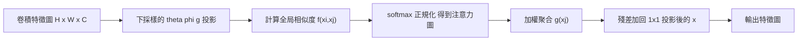
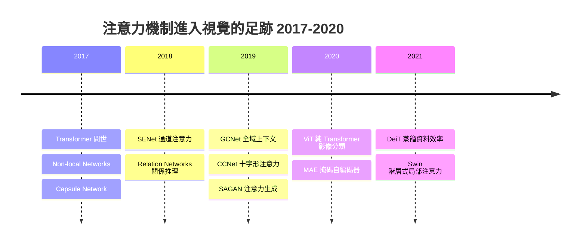

# 6.1 注意力機制如何跨界進入視覺領域（2017-2020）

## 一、起點不在視覺：Transformer 的宣言（2017）

2017 年 6 月，Google Brain 與 Google Research 發表的 *Attention Is All You Need*（Vaswani et al., 2017）並不是一篇「把 NLP 做深」的論文，而是一篇**架構宣言**。它的論點可以濃縮成一句話：**序列建模不需要任何帶順序偏置的算子，只要給予每一個元素一個「可以自己去看別人」的權限，就足以表達序列中的依賴關係。**

這句話為什麼重要？在 2017 年之前，序列建模有兩條主流路線：

* **循環路線（RNN/LSTM/GRU）**：以時間步為外層迴圈。優點是狀態是固定維度的向量，記憶體需求與序列長度無關；缺點是**路徑長度問題**——要讓第 1 個 token 的資訊影響第 1000 個 token 的輸出，必須經過 999 個時間步的梯度傳遞。這不只是收斂慢的問題，在硬體上也意味著**無法平行**，GPU 的算力閒置。
* **卷積路線（ConvS2S, ByteNet）**：以卷積核在序列上滑動，天然可平行，但感受野隨層數線性增長，要覆蓋長序列需要 $`O(L)`$ 層。CNN 的歸納偏誤（局部性、平移等變）在視覺是優點，在語言卻是**包袱**：詞與詞的關係是長距離、稀疏、語意相關的，而不是「相鄰才算相關」。

Transformer 的做法是直接廢棄這兩條路線：**既不用迴圈，也不用卷積**。它讓序列中每一個位置都能直接看到所有其他位置。

### 1.1 Scaled Dot-Product Attention 的完整形式

Transformer 的核心運算子是 **scaled dot-product attention（Scaled Dot-Product Attention）**。給定查詢矩陣 $`Q \in \mathbb{R}^{N \times d_k}`$ 、鍵矩陣 $`K \in \mathbb{R}^{N \times d_k}`$ 、值矩陣 $`V \in \mathbb{R}^{N \times d_v}`$ ，其定義為

$$
\mathrm{Attention}(Q, K, V) = \mathrm{softmax}\!\left( \frac{Q K^{\top}}{\sqrt{d_k}} \right) V
$$

逐行拆解成三個步驟（這個三段式結構在第 6.2、6.3 節會一直出現，值得記牢）：

1. **打分（Score）**： $`Q K^{\top}`$ 是一個 $`N \times N`$ 的矩陣，其第 $`(i,j)`$ 項為 $`q_i \cdot k_j`$ ，即第 $`i`$ 個 query 與第 $`j`$ 個 key 的內積。內積越大，代表兩者在某個抽象特徵空間中越相似。
2. **縮放與正規化（Scaled & Normalized）**：除以 $`\sqrt{d_k}`$ 後（推導見 1.2），沿著 key 那一維做 **softmax**，得到一個總和為 1 的注意力分佈 $`A \in \mathbb{R}^{N \times N}`$ 。第 $`i`$ 行 $`A_{i,:}`$ 就是「query $`i`$ 應該把多少權重分配給每一個 key $`j`$ 」。
3. **加權求和（Aggregate）**： $`A V`$ 讓每一個位置 $`i`$ 輸出的是所有 value 依注意力權重的加權平均。

由於 softmax 是沿 key 維度做的，** $`A`$ 的每一行都機率總和為 1**。這意味著注意力機制的輸出是「凸組合」，它的量綱與 $`V`$ 相同——這在實作上極為重要：整個網路不需要額外的 learned 縮放因子來穩定尺度。

### 1.2 為什麼必須除以 $`\sqrt{d_k}`$ ：一個方差推導

這個縮放因子是 Transformer 論文中一個看起來微不足道的細節，但若拿掉它，訓練會在少數步內發散。它值得完整推導，因為它是全書第一個「**為什麼這個常數長這樣**」的示範，也是訓練動態（training dynamics）如何影響架構設計的第一個證據。

**假設**： $`q, k \in \mathbb{R}^{d_k}`$ ，各分量彼此獨立，且每個分量在訓練初期都近似為**均值 0、變異數 1** 的隨機變數（這是初始化器與 Xavier/He 初始化的直接結果）。

**第一步：內積的期望**。

$$
\mathbb{E}[q \cdot k] = \sum_{i=1}^{d_k} \mathbb{E}[q_i]\mathbb{E}[k_i] = 0
$$

**第二步：內積的變異數**。由於各項獨立，

$$
\mathrm{Var}[q \cdot k] = \sum_{i=1}^{d_k} \mathrm{Var}[q_i k_i]
$$

而

$$
\mathrm{Var}[q_i k_i] = \mathbb{E}[q_i^2 k_i^2] - (\mathbb{E}[q_i k_i])^2 = \mathbb{E}[q_i^2]\mathbb{E}[k_i^2] - 0 = 1 \cdot 1 = 1
$$

因此

$$
\mathrm{Var}[q \cdot k] = d_k, \qquad \mathrm{std}[q \cdot k] = \sqrt{d_k}
$$

**第三步：softmax 為什麼怕大 logits**。令 $`s_j = q \cdot k_j`$ ，softmax 為

$$
p_j = \frac{\exp(s_j)}{\sum_{l=1}^{N}\exp(s_l)}
$$

其對第 $`m`$ 個 logit 的導數為

$$
\frac{\partial p_m}{\partial s_m} = p_m(1 - p_m)
$$

這是個關鍵公式：**梯度的上界是 $`1/4`$ **，且當 $`p_m \to 1`$ （即某個 logit 獨佔）時，梯度趨近於 0——這就是**softmax 飽和導致梯度消失**。

現在回到變異數：若 $`s_j`$ 的標準差是 $`\sqrt{d_k}`$ ，當 $`d_k = 64`$ 時標準差是 8；softmax 的指數函數是**極度非線性**的，標準差 8 的 logits 分佈會讓 softmax 的輸出迅速退化為 one-hot（最大 logit 與次大 logit 的差距常常超過 8 個單位差， $`e^{8} \approx 3000`$ ），此時 $`p_m(1-p_m) \to 0`$ ，梯度消失。

**第四步：縮放的修正**。若把 logits 除以 $`\sqrt{d_k}`$ ，變異數變為

$$
\mathrm{Var}\!\left[\frac{q \cdot k}{\sqrt{d_k}}\right] = \frac{d_k}{d_k} = 1
$$

標準差回到 1。logits 落在合理範圍內，softmax 不會立刻飽和，梯度得以存活。

**結論與延伸**：縮放的目的是讓 logits 的分佈**與維度無關**。這個思路後來在 modern NLP 中被更徹底地推廣——例如用 LayerNorm 替代 BatchNorm、用 Pre-LN 替代 Post-LN、用 QK-Norm 強制約束 logits 的範圍（見 6.3 節 Swin V2 對 pre-LN 的討論），全都是同一個家族：*在深層網路中，歸一化與縮放不是裝飾，而是訓練能不能收斂的分水嶺*。

**常見誤解**：「除以 $`\sqrt{d_k}`$ 是為了讓數值不溢出。」這是對的但不重要——雙精度浮點不會溢出。真正的原因是**softmax 飽和造成的梯度消失**，這是一個**優化問題**而不是**數值問題**。

### 1.3 多頭注意力

單一注意力頭只能學到一種關係模式。多頭注意力（Multi-Head Attention）把 $`d`$ 維的表示切成 $`h`$ 份，各自獨立做注意力，再把結果拼接回來：

$$
\mathrm{MultiHead}(Q, K, V) = \mathrm{Concat}(\text{head}_1, \dots, \text{head}_h) W^O
$$

其中

$$
\text{head}_i = \mathrm{Attention}(Q W_i^Q,\, K W_i^K,\, V W_i^V)
$$

且 $`W_i^Q, W_i^K, W_i^V \in \mathbb{R}^{d \times d_h}`$ 、 $`d_h = d / h`$ 。

**直覺：不同的頭學習不同的關係子空間。** 這是理解注意力視覺化時最重要的一件事。實驗上人們觀察到，注意力圖往往呈現分工：

* 某些頭只關注**句法依存**（例如代名詞指向哪個名詞）；
* 某些頭只關注**共指**（例如兩個實體是否同一個）；
* 某些頭表現為**位置偏移模式**（attend to the previous token），看起來像語言模型裡的 n-gram 特徵。

在視覺上同樣成立：**一個頭可能專門追蹤「同一物體的不同部分」，另一個頭專門追蹤「邊界框邊緣」，還有一個頭負責「找同類別的其他實例」**。這些關係在特徵空間的**不同子空間**裡，因此需要多個頭。

**複雜度分析**。多頭注意力的總計算量：

* 投影： $`4 \times O(N d^2)`$ （ $`Q,K,V`$ 投影加輸出投影）
* 注意力分數： $`O(N^2 d)`$
* 加權求和： $`O(N^2 d)`$

因此總計

$$
O\left(N d^2 + N^2 d\right)
$$

這裡出現了本章的第一個重要張力：**注意力矩陣的計算量與序列長度平方成正比**。若 $`N \gg d`$ （視覺中正是如此：224×224 影像若用 16×16 的 patch， $`N = 196`$ 而 $`d = 768`$ ；高解析度醫學影像的 $`N`$ 可達數萬），則 $`O(N^2 d)`$ 項將主導。這個瓶頸會在 6.3 節由 Swin Transformer 正面處理。

---

## 二、自注意力的三個關鍵性質（全書的理論骨架）

自注意力（self-attention）就是把 $`Q, K, V`$ 全部取自同一個序列的操作：

$$
Q = X W^Q, \quad K = X W^K, \quad V = X W^V
$$

接下來的三個性質，是理解「Transformer 為何能改造視覺」以及「ViT 為何需要位置編碼」的理論骨架。它們不是彼此獨立的觀察，而是一組互相咬合的推論鏈。

### 2.1 性質一：置換等變性（Permutation Equivariance）

**定理 2.1（置換等變性）**：設 $`f_\theta`$ 為自注意力層（不含位置編碼）， $`P \in \mathbb{R}^{N \times N}`$ 為任意置換矩陣。則

$$
f_\theta(PX) = P f_\theta(X)
$$

也就是說，自注意力本身**無法分辨 token 的順序**。

**證明**。自注意力可分為兩步：投影與分數計算。

第一步，投影： $`Q = XW^Q`$ ， $`K = XW^K`$ ， $`V = XW^V`$ 。置換矩陣 $`P`$ 滿足 $`P^{\top} P = I`$ ，因此

$$
Q' = (PX)W^Q = P(XW^Q) = P Q
$$

同理 $`K' = P K`$ 、 $`V' = P V`$ 。

第二步，分數：注意力權重矩陣為

$$
A' = \mathrm{softmax}\!\left(\frac{Q' K'^{\top}}{\sqrt{d_k}}\right) = \mathrm{softmax}\!\left(\frac{P Q (P K)^{\top}}{\sqrt{d_k}}\right)
$$

$`(PK)^{\top} = K^{\top} P^{\top}`$ ，所以

$$
Q' K'^{\top} = P Q K^{\top} P^{\top}
$$

即 $`A' = P A P^{\top}`$ 。這是正確的： $`A'_{i,j} = A_{\pi(i), \pi(j)}`$ ，其中 $`\pi`$ 是對應的置換。

第三步，輸出：

$$
Y' = A' V' = (P A P^{\top})(P V) = P A (P^{\top} P) V = P A V = P Y
$$

證畢。 $`\square`$

**這個定理的直覺版本**：注意力是對 token **集合**的加權平均。加權平均對集合的排列順序完全不敏感——就像求和與求平均不在乎你把數字排成什麼順序。模型因此**內在地缺少「這是第 3 個詞，那是最後一個詞」這類資訊**。

**對第 6.2 節的推論（伏筆）**：既然順序資訊不在架構裡，就必須**額外注入**。這就是**位置編碼（positional encoding）**存在的唯一理由，不是「讓模型效果更好」的經驗性技巧，而是**架構的必然補完**。Transformer 原論文用正弦/餘弦函數生成位置編碼，ViT 則改用**可學習的位置嵌入**（6.2 節詳述）。

**常見誤解**：「CNN 的卷積不具備平移等變性，所以它順序敏感。」這是錯的。卷積本身是**平移等變**（translation-equivariant）的，恰恰因為如此，CNN **不需要**位置資訊就能知道物體的相對位置——這是它內建的歸納偏誤。對比之下，ViT 的注意力是**位置無知**（position-agnostic）的，必須靠位置編碼把位置資訊「補回來」。這個對比是理解 CNN 與 Transformer 兩種架構風格的最短路徑。

### 2.2 性質二：內容感知定址 vs 位置感知定址

這是 CNN 與 Transformer 最根本的架構差異，也是全書反覆出現的主題。

| | CNN（位置感知定址 location-based addressing） | 自注意力（內容感知定址 content-based addressing） |
| --- | --- | --- |
| 資訊如何被取用 | 固定偏移的鄰域（ $`3\times3`$ 、 $`5\times5`$ 窗口） | 由 Q–K 相似度決定，**距離無關** |
| 感受野隨深度增長 | 每層擴大 $`k`$ 倍， $`L`$ 層後為 $`k^L`$ | 第 1 層即為全域 |
| 對物體尺度/位置 | 需靠多尺度池化、金字塔處理 | 天然尺度不變（若尺度在 patch 尺度內） |
| 能表達「這兩塊是同一物體」 | 需深層堆疊或額外模組 | 一層內即可 |

用一個具體例子說明：在影像中判斷「這根柱子的頂端與底端屬於同一根柱子」，兩者可能相隔上百像素。CNN 的路徑長度問題（路徑長度 $`L`$ ）與感受野增長都被迫讓這件事變得昂貴；而自注意力只要一次 Q–K 點積就能建立這個連結。

**更進一步的精確論述**：CNN 的每個感受野是**位置決定的**——第 $`(i,j)`$ 個位置的神經元「永遠只看得到」以 $`(i,j)`$ 為中心的一塊固定區域，其權重索引與位置綁定。而自注意力的每個神元的輸入集合是**內容決定的**——同一個投影權重套用到所有位置，但「看誰」由輸入內容決定。這兩種設計在第 4.1 節討論的「共享權重 vs 位置特定權重」光柵圖繪製上，就是 Kronecker delta 與 circulant 結構的差別。

**代價**：內容感知定址需要一個**全局的兩兩比較**，這正是 $`O(N^2)`$ 複雜度的來源。局部性（ $`O(N)`$ ）與全局性（ $`O(N^2)`$ ）之間的取捨是整個章節的主軸。

### 2.3 性質三： $`O(N^2)`$ 複雜度與其在高解析度影像上的瓶頸

把 CNN 與 Transformer 放在同一個「計算量 vs 全局感受野」的座標軸上比較：

* CNN 的第 $`L`$ 層卷積（kernel $`k \times k`$ ）計算量為 $`O(N k^2)`$ ，其中 $`N`$ 是特徵圖的**位置總數**（ $`H \times W`$ ）。感受野隨深度增長。
* 自注意力的計算量為 $`O(N^2 d)`$ ，與位置總數平方成正比。

**具體數字對照**。以 224×224 的影像、patch 大小 16 為例， $`N = (224/16)^2 = 14^2 = 196`$ 個 token。此時注意力矩陣是 $`196 \times 196`$ ，很小，完全沒有問題。

但若解析度提高：

| 影像解析度 | patch 16 的 token 數 $`N`$ | 注意力矩陣項數 $`N^2`$ | 注意力矩陣大小（fp16，單頭） |
| --- | --- | --- | --- |
| 224×224 | 196 | 38,416 | 75 KB |
| 448×448 | 784 | 614,656 | 1.2 MB |
| 1024×1024 | 4,096 | 16,777,216 | 32 MB |
| 2048×2048 | 16,384 | 268,435,456 | 512 MB |

這就是瓶頸的具體化。**在 224×224 的 ImageNet 分類上，全域注意力「很便宜」；一旦進入高解析度場景——高解析度影像分類、醫學影像（切片動輒 512×512 或 1024×1024）、遙感衛星影像——全域注意力就會爆掉。** 更糟的是，即使最終輸出只需要粗略的分類結果，中間的 $`N \times N`$ 注意力矩陣仍然必須被完整算出。

**這是 6.3 節 Swin Transformer 的存在理由**，也是本章與下一節必須記住的因果鏈：

**CNN 的局部性** → **感受野受限** → **需要全局關聯** → **引入注意力** → **複雜度變成 $`O(N^2)`$ ** → **高解析度不可行** → **必須折衷**

用符號表示這條因果鏈的骨架：

$$
\mathrm{locality} \Rightarrow \mathrm{limited\ RF} \Rightarrow \mathrm{global\ relation} \Rightarrow \mathrm{attention} \Rightarrow O(N^2) \Rightarrow \mathrm{resolution\ bottleneck} \Rightarrow \mathrm{tradeoff}
$$

---

## 三、視覺領域的先行者（2017-2019）：注意力進入 CNN 的內部

注意力機制進入視覺並非一蹴而就。在 Transformer 之前，**「注意力」這個概念已經在 CNN 內部以多種形式悄悄出現**，這是理解歷史的關鍵：ViT 不是憑空降臨，而是站在一批「注意力化的 CNN」的肩上。

### 3.1 Non-local Neural Networks（Wang et al., 2017）

CVPR 2017 的 Non-local Neural Networks 是第一批系統性地把「全局關聯算子」塞進 CNN 的工作，也是**最接近自注意力的先驅**。

**動機**：標準卷積在 $`3\times3`$ 的 kernel 下只有局部感受野；要建模遠距離關係（例如影片中的動作關聯、影像中兩端的語意一致性），傳統做法是堆疊深層網路，但這樣路徑太長、難以優化。

**做法**：在 CNN 的某個特徵圖 $`X \in \mathbb{R}^{H \times W \times C}`$ 內部，引入一個非局部運算子：

$$
y_i = \frac{1}{\mathcal{C}(x)} \sum_{j=1}^{N} f(x_i, x_j)\, g(x_j)
$$

其中 $`N = H \times W`$ 為所有位置數， $`i, j`$ 索引位置。

* $`g(x_j) = W_g x_j`$ ：**值**的嵌入（對應 self-attention 的 $`V`$ ）。
* $`f(x_i, x_j) = \exp(\theta(x_i)^{\top} \phi(x_j))`$ ：**相似度**函數（對應 $`QK^{\top}`$ 再 softmax）。
* $`\mathcal{C}(x) = \sum_j \exp(\theta(x_i)^{\top}\phi(x_j))`$ ：**正規化因子**，讓 $`y_i`$ 成為加權平均（對應 softmax 的分母）。

**與 self-attention 的關係**（這是理解本章歷史的關鍵連線）：若令 $`\theta(x) = W_\theta x`$ 、 $`\phi(x) = W_\phi x`$ 、 $`g(x) = W_g x`$ ，則 $`f`$ 正是 scaled dot-product attention 的**指數核**（除了 $`\sqrt{d_k}`$ 的縮放因子）。也就是說：

> **Non-local 層 = 一個作用於單一特徵圖內部位置集合的 self-attention。**

差別在於 Transformer 把「位置集合」換成了「token 序列」，並且允許跨層次、跨語料共享同一套算子。

**計算量的處理**：Non-local 的計算量是 $`O(N^2)`$ ，對高解析度影像代價昂貴。論文的解法是**在特徵圖上插入下採樣**（例如把 $`H\times W`$ 降為 $`H/2 \times W/2`$ ）來計算注意力圖，再上採樣回來，這樣計算量降為 $`O((N/4)^2) = O(N^2/16)`$ 。

**結果與影響**：在影片分類（Something-Something v2、Charades）、影像分類與偵測上都帶來提升，並獲得 CVPR 2018 的「PAMI 論文獎」。這是「注意力進 CNN」的第一步。

### 3.2 SENet（Squeeze-and-Excitation Network, Hu et al., 2018）

SENet 是 CVPR 2018 的冠軍作品，但它與 Non-local 的關係是**互補而非競爭**的：Non-local 處理**空間**維度的全局關聯，SENet 處理**通道**維度的全局關聯。

**結構**（極簡，只有兩步）：

1. **Squeeze（壓縮）**：沿空間維做全域平均池化，把 $`H \times W \times C`$ 壓成 $`C`$ 維向量

$$
z_c = \frac{1}{H W} \sum_{i=1}^{H} \sum_{j=1}^{W} x_{i,j,c}
$$

2. **Excitation（激發）**：用兩個 FC 層 + ReLU + Sigmoid 產生通道權重

$$
s = \sigma\!\left(W_2\, \delta\!\left(W_1 z\right)\right), \qquad y_c = s_c \cdot x_c
$$

**為什麼這算「注意力」**： $`s_c \in [0,1]`$ 是每個通道的**重加權係數**，由全域上下文決定。這正是自注意力的精神——用全局資訊決定「該看哪裡」——但作用在通道而非空間上。

**與本章主題的關聯**：SENet 證明了「**注意力即重加權**」這個模式在視覺中幾乎零成本就能獲得可觀的增益。更重要的是，它確立了「**先全域聚合、再動態重加權**」這個模式，後來被無數模型（包括 Non-local、Swin 的相對位置偏置、多模態模型中的 cross-attention）反覆使用。**它是「注意力在視覺中有效」的第一個低風險證據**，讓整個領域願意接受更激進的架構改變。

### 3.3 GCNet（2019）：一個重要的反面發現

GCNet（Global Context Network, Yang et al., CVPR 2019）提出了一個在學術史上非常有價值的**反證**。

**命題**：Non-local 網路的全局上下文建模能力，其實可以由「**單純的全域平均池化 + 位置加權的加權和**」以極小的代價達成。

具體而言，GCNet 用一個**共享的 1×1 卷積**產生 query，再把它與全域平均池化後的 context 做外積，再施以 softmax 位置權重：

$$
y_i = \frac{1}{\mathcal{C}(x)} \sum_j \alpha_{i,j} \cdot \mathrm{Context}(x)
$$

$$
\alpha_{i,j} = \frac{\exp(w_j^{\top} x_i)}{\sum_{j'} \exp(w_{j'}^{\top} x_i)}
$$

**這個結果的深意**：Non-local 的 $`O(N^2)`$ 計算中，注意力圖 $`f(x_i,x_j)`$ 其實**可以近似為只依賴 $`j`$ 的權重**（即「這張圖的第 $`j`$ 個位置平均而言有多重要」）**乘上一個依賴 $`i`$ 的縮放**。換言之，Non-local 學到的「位置敏感」成分，其貢獻遠小於它的計算代價所暗示的程度。

**這個發現的三層重要性**：

1. **架構層面**：它說明「非局部性」本身不是難點——只要給予全域統計量，模型就能受益。難的是**位置敏感的非局部性**：即「對位置 $`i`$ ，應該特別關注位置 $`j`$ 」。
2. **研究方法層面**：它示範了如何用**更簡單的模型去逼近更複雜的模型**來診斷機制——這是 Goodhart 定律在架構研究中的具體體現。
3. **歷史敘事層面**：它預告了 Transformer 時代的核心命題——**架構的複雜度不等於能力的來源**。3.5 節的 ConvNeXt（6.3 節詳述）是這條線的最終爆發。

### 3.4 CCNet 與 Criss-Cross Attention（2019）

CCNet（CCNet: Criss-Cross Attention for Semantic Segmentation, Yuan et al., ICCV 2019）針對語義分割的**全局上下文化**需求，提出 **Criss-Cross Attention**，把注意力的計算範圍從「全圖」縮減為「**十字形**」。

**核心想法**：對位置 $`i = (x, y)`$ ，只在**同一行**與**同一列**的所有位置 $`j`$ 上計算注意力。也就是說，一個位置只需要看它那一橫列與那一縱列上的所有像素（cross 形），而不需要看整張圖。

**複雜度**：從 $`O(N^2)`$ 降到 $`O(N \cdot (H + W))`$ ，在 $`H = W`$ 時約為 $`O(N^{1.5})`$ ——**仍不是線性，但已經大幅改善**。

**代價**：十字形注意力**不是置換等變的**（它隱含地依賴了空間的行列結構），而且它無法建模**對角線**方向的關係（例如一條 45 度斜線上的物體）。CCNet 論文用兩次 criss-cross 交叉來部分補償方向偏見。

**歷史定位**：CCNet 是「**注意力範圍的局部化**」這條技術路線的第一個重要成果——把全域注意力縮到一個結構化的子空間。6.3 節的 Swin Transformer 屬於同一條路線的另一種極端（把注意力縮到方形的局部窗口），但 Swin 用**移位窗口**保留了嚴格的可平移等變性與完整的跨窗口資訊流，這是 CCNet 沒做到的。

### 3.5 Self-Attention GAN（SAGAN, Zhang et al., 2019）

SAGAN 把自注意力直接嵌入 **StyleGAN 的生成器**，用來解決 GAN 最典型的失效模式：**長距離結構的一致性**。

**問題**：在 GAN 中，生成器是**逐層上採樣**的。要畫出「一個長椅上的四條腿分別位於正確位置」，或「一張臉的兩眼對稱」，需要遠距離的像素之間協調。傳統卷積生成器的感受野隨層數緩慢增長，長距離一致性經常崩壞，表現為臉部器官錯位、多餘肢體等典型 GAN 瑕疵。

**做法**：在生成器的某一層之後插入一個自注意力模組，讓該層的所有空間位置互相看看：

$$
y_i = \sum_{j} \alpha_{i,j} v_j, \qquad \alpha_{i,j} = \mathrm{softmax}_j(q_i^{\top} k_j / \sqrt{d})
$$

**結果**：在 CelebA-HQ 與 LSUN Bedroom 上，FID 明顯優於同層級的 BigGAN（不含注意力版），並且大幅改善了**長距離一致性**。這是注意力第一次在**生成**任務上展現不可替代的價值。

**為什麼這是伏筆**：第 7 章將處理 GAN 與擴散模型，第 8 章則會處理 Stable Diffusion。**SD 的 U-Net 中同樣使用了 Transformer 的注意力模組**，而 SAGAN 是這條技術路線的先行者之一。更深層的伏筆是：自注意力能表達**關係**（哪個像素和哪個像素屬於同一物體），這在生成的意義上比在辨識的意義上更令人興奮——它是「關係式生成」的開端。

### 3.6 Relation Networks（2018）：注意力作為關係推理

Relation Networks（Relation Networks, Sung et al., CVPR 2018）把「關係模組」用於**視覺推理**與**少樣本分類**。

**關係模組**：給定一組物件特徵 $`\{f_i\}`$ ，計算所有成對關係

$$
r_{ij} = g(f_i, f_j)
$$

再把所有關係向量聚合（取平均）成一個全域特徵送進分類器。這個 $`r_{ij}`$ 本質上就是「注意力矩陣的一列」，只是沒有 softmax 正規化。

**少樣本分類**：在 5-shot 1-way 分類上，Relation Networks 在 miniImageNet 上達到約 62% 準確率，優於同時期的 Prototypical Networks 等方法。

**歷史定位**：Relation Networks 把「**顯式建模物件之間的關係**」這件事推到了模型設計的中心。它是 CapsNet（3.7 節）與 Transformer 之間的重要橋樑，也是第 9 章多模態模型中「**關係建模**」思路（物件—區域關係、區域—文字關係）的先聲。

---

## 四、最後一塊拼圖：Capsule Network 與動態路由（2017）

在 Transformer 之前，另一條挑戰 CNN 歸納偏誤的平行路線是 **Capsule Network**。

### 4.1 問題診斷：CNN 的「平移等變」是優點也是陷阱

Capsule Network（Sablayrolles et al., 2017, *Neural Information Processing Systems*）由 Hinton 推動，其核心批判是：

> CNN 判定「這張圖是貓」的機制是**辨識貓的某個特徵（例如耳朵的形狀）是否存在於某個位置**，而不是**辨識「貓這個物體」的存在**。CNN 是「圖像存在性偵測器」，不是「物體存在性偵測器」。

Hinton 用一個著名的例子說明：一張圖片裡有貓的**碎片**（耳朵、腳、尾巴的紋理隨機散落），CNN 會判定為「貓」；而一張稍微偏斜的貓，CNN 可能判不出來。

**根本原因**：CNN 的池化（pooling）會**丟棄位置資訊**。「耳朵的紋理出現在影像的哪裡」在 CNN 的最終特徵中被抹除了——這是為了獲得平移等變性而**主動支付**的代價。

### 4.2 膠囊與動態路由

**膠囊（Capsule）**是一組向量 $`\mathbf{s} \in \mathbb{R}^{d}`$ ，其**方向**代表物體（或部分）的存在性與屬性，其**模長**代表「該物體存在的機率」。每個膠囊接收下層膠囊送來的預測向量 $`\hat{\mathbf{u}}_{j \to i}`$ ，並用**動態路由（Dynamic Routing）**決定把多少權重分配給各個上層膠囊。

路由的更新規則（非負權重、歸一化的 softmax 形式）：

$$
c_{ij} \leftarrow c_{ij} + \hat{\mathbf{u}}_{j \to i} \cdot \mathbf{s}_i, \qquad
w_{ij} = \frac{\exp(c_{ij})}{\sum_{k} \exp(c_{ik})}
$$

$$
\mathbf{s}_i = \sum_j w_{ij} \hat{\mathbf{u}}_{j \to i}
$$

**關鍵差異**：路由是**逐路由步驟的動態協商**（iterative agreement），而不是一次性的權重分配。這個過程在功能上扮演了「**找出一致同意的物體組裝**」的角色。

### 4.3 為什麼 CapsNet 沒有勝出？

CapsNet 在小資料集（如 MNIST 加權基線）上表現優異，但在 CIFAR-10 等較大的基準上**並沒有超越 ResNet**，且**訓練不穩定**。常見的診斷：

* **資料效率低**：每個膠囊的高維向量表示需要大量資料才能學到穩定的「姿態編碼」。
* **動態路由的訓練動態不友善**：路由的 softmax 與迭代讓梯度路徑複雜，容易陷入不穩定或特徵塌陷。
* **無現成的硬體友好實現**：路由涉及迭代迴圈與不規則的資料流，不像卷積那樣能整塊並行。

**但它的思想影響深遠**。「顯式建模**部分—整體關係**」這件事，在 Transformer 中以另一種形式獲得新生：

| Capsule Network | Transformer |
| --- | --- |
| 膠囊 = 一組實例化的部分 | token = 一個 patch（或其投影） |
| 部分—整體關係 = 動態路由的權重 | 注意力權重 = token 之間的關聯 |
| 路由的「一致同意」 | 多頭注意力的「不同關係子空間」 |
| 物體的存在性與姿態 | token 的語意內容與位置編碼 |

換句話說，**ViT 的 token 化把「部分—整體關係」的建模從一個動態過程，改成了一個靜態的全域注意力**，簡單、可並行、可微、且享有 GPU 的全部好處。這是本章一個重要的思想史閉環。

---

## 五、為什麼 Transformer 必須在視覺上「重塑」？

到 2019 年底，注意力在視覺中「有效」這件事已經確立，但沒有人敢說「**用 Transformer 取代 CNN**」。原因是 CNN 的歸納偏誤實在太強大了。

### 5.1 CNN 歸納偏誤的四項優點

| 歸納偏誤 | CNN 的機制 | 帶來的好處 |
| --- | --- | --- |
| **局部性**（locality） | $`k \times k`$ 卷積核 | 參數共享於空間，參數量少，樣本效率高 |
| **平移等變性**（translation equivariance） | 共享核 + 池化 | 對平移不敏感，資料效率高 |
| **層級式特徵**（hierarchical features） | 層層下採樣加深 | 越深層的感受野越大、特徵越抽象 |
| **尺度不變性**（部分） | 影像金字塔 / 多尺度訓練 | 對物體大小變化更穩健 |

這些優點總結為一句話：**CNN 把「世界是空間局部、且平移等變的」這個先驗直接寫進了架構裡**。因此：

* 參數共享讓 CNN 只需要相對少的樣本就能學到合理的特徵；
* 平移等變讓同一個「貓」的數千個不同位置版本共享同一套偵測器，**等價於資料增強**；
* 層級結構讓模型天然支援多尺度偵測（第 5 章的 FPN 就是建立在此）。

### 5.2 CNN 歸納偏誤的失效場景

但在下列任務上，這些優點變成了限制：

1. **語義分割的全局上下文需求**：ADE20K、COCO-Stuff 這類語意分割中，「天空」這個類別的判斷需要參照整張圖（如果圖的上半部都是天空，整張圖就是天空）。CNN 的局部感受野是硬性障礙，全域資訊只能靠非常深的堆疊與膨脹卷積（dilated convolution）勉強達成。
2. **長距離幾何關係**：一輛車的車頭與車尾、柱子的頂與底、棋盤的對角線關係，都可能跨越整張影像。這些關係在 CNN 中需要路徑長度 $`O(\text{距離})`$ 的訊息傳遞。
3. **多標籤 / 密集預測**：需要每個位置同時考慮遠端線索。
4. **動態的、可資料適應的結構**：CNN 的特徵偵測器（同一組卷積核）是**固定**的，不同類別共用；而「物體由哪些部分構成」在不同類別間差異極大（狗有尾巴，車有輪子）。

### 5.3 Transformer 的代價：更少的先驗 → 需要更多資料

Transformer 的答案是**把所有結構性先驗拿掉**，只留下「注意力 + 位置編碼」。代價直接體現在**資料效率**上：

$$
\mathrm{Capacity} \;\sim\; \mathrm{Hypothesis\ Space\ Size} \times \mathrm{Data\ Amount}
$$

移除歸納偏誤 = 擴大假設空間 = 需要更多資料來把空間收斂到好解。

這是 ViT 時代的**核心張力**，也是 6.2 節的主題：

* ViT 用 ImageNet-1k（130 萬張）訓練，**不如** ResNet。
* ViT 用 JFT-300M（3 億張）預訓練後，**大幅超越** ResNet。

換言之，**Transformer 並沒有使歸納偏誤變得無用，而是把它從「硬編碼在架構裡」改成了「必須從資料裡學」。** 這個改變在資料豐富時是純利（模型更通用、遷移更強），在資料貧乏時是純損（這也是為什麼在同一張 ImageNet 上，ResNet 更受歡迎的實務原因，也是為什麼 DeiT 需要蒸餾）。

### 5.4 視覺 Transformer 需要解決的三個「翻譯」問題

把 NLP 的 Transformer 搬到影像上，需要解決三個不對等：

| NLP | 影像 | 需要的改變 |
| --- | --- | --- |
| 序列 = 詞的序列，長度 $`10^2 \sim 10^4`$ | 序列 = 像素，長度 $`10^4 \sim 10^6`$ | 必須切塊降維 → **patch embedding**（6.2 節） |
| 詞有明確的先後順序 | 像素是空間網格，順序由座標定義 | 必須注入位置 → **位置編碼**（6.2 節） |
| Transformer 只有幾層、 $`N`$ 小 | 需要多尺度特徵以支援偵測/分割 | 需要階層式架構 → **hierarchical design**（6.3 節） |

---

## 六、本節小結

1. **Transformer（2017）提供了三樣東西**：scaled dot-product attention、多頭機制、以及「**用內容驅動的定址取代位置驅動的定址**」這個根本轉向。
2. **除以 $`\sqrt{d_k}`$ 的原因是梯度而非數值**：內積變異數為 $`d_k`$ ，softmax 在大 logits 下飽和、 $`\partial p_m / \partial s_m = p_m(1-p_m) \to 0`$ 。縮放使 logits 方差回到 1。
3. **三個關鍵性質**：置換等變（⇒ 必須有位置編碼）、內容感知定址（⇒ 能建模長距離與形狀）、 $`O(N^2)`$ 複雜度（⇒ 高解析度瓶頸 ⇒ 6.3 節的折衷）。
4. **先行者不是可有可無的**：Non-local（自注意力進 CNN）、SENet（通道重加權）、GCNet（重要反面發現）、CCNet（注意力範圍局部化）、SAGAN（注意力進生成）、Relation Networks（關係推理）、Capsule（部分—整體建模）共同鋪平了道路。
5. **核心張力**：Transformer 用「移除歸納偏誤」換取「更高的上限」，代價是資料效率；這將在 6.2 節以 JFT-300M vs ImageNet-1k 的對比被量化。

### 本節參考文獻

* Vaswani, A., et al. (2017). *Attention Is All You Need.* NeurIPS 30.
* Wang, X., et al. (2017). *Non-Local Neural Networks.* CVPR 2017.
* Sablayrolles, S., et al. (2017). *Dynamic Routing Between Capsules.* NeurIPS 2017.
* Hu, J., Shen, L., & Sun, G. (2018). *Squeeze-and-Excitation Networks.* CVPR 2018.
* Sung, H., et al. (2018). *Learning to Compare: Relation Network for Few-Shot Learning.* CVPR 2018.
* Yang, Y., et al. (2019). *GCNet: Global Context Networks.* CVPR 2019.
* Yuan, Y., & Wang, J. (2019). *CCNet: Criss-Cross Attention for Semantic Segmentation.* ICCV 2019.
* Zhang, H., et al. (2019). *Self-Attention Generative Adversarial Networks.* ICML 2019.
* Dosovitskiy, A., et al. (2020). *An Image Is Worth 16x16 Words.* ICLR 2021.
* He, K., et al. (2021). *Masked Autoencoders Are Scalable Vision Learners.* CVPR 2022.
* Touvron, H., et al. (2021). *Training Data-Efficient Image Transformers & Distillation Through Attention.* ICML 2021.
* Liu, Z., et al. (2021). *Swin Transformer: Hierarchical Vision Transformer using Shifted Windows.* ICCV 2021.
