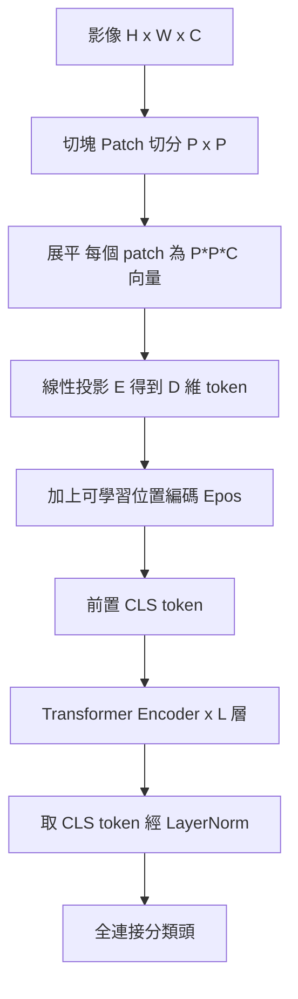

# 6.2 切塊與位置編碼：ViT 的核心架構（2020-2021）

## 一、ViT 的提出：把影像變成一串「詞」

2020 年 10 月，Google 的 Dosovitskiy 等人在 ICLR 2021 發表 *An Image Is Worth 16x16 Words: Transformers for Image Recognition at Scale*。論文標題本身就是整個設計的宣言：**把影像當成句子，把每個 16×16 的方塊當成一個「詞」（word），然後用標準的 Transformer 處理。**

論文正文極其簡短（只有 9 頁），但它的影響極其深遠，因為它證明了一件此前沒有人相信的事：

> **一個「乾淨」的 Transformer，只要預訓練資料夠多，就能超越經過十年迭代的頂尖 CNN。**

### 1.1 完整的架構流程

ViT 的架構可以分為五個步驟：



逐環節說明其數學形式。

### 1.2 Patch Embedding：把像素網格降成 token 序列

給定解析度為 $`H \times W`$ 、通道數為 $`C`$ 的影像 $`x \in \mathbb{R}^{H \times W \times C}`$ 。ViT 把它切成 $`N = \frac{H}{P} \times \frac{W}{P}`$ 個不重疊的 $`P \times P \times C`$ 區塊（patch），其中 $`P`$ 為 patch 邊長。

每個 patch 依「列優先（row-major）」順序展平成長度 $`P^2 C`$ 的向量，再乘上一個共享的線性投影矩陣 $`E \in \mathbb{R}^{(P^2 C) \times D}`$ ，得到 $`D`$ 維的 token。所有 token 堆疊成序列 $`x_0`$ ：

$$
x_0 = \left[ x_{\text{patch}}^1 E;\; x_{\text{patch}}^2 E;\; \cdots;\; x_{\text{patch}}^N E \right]
$$

其中 $`x_{\text{patch}}^i \in \mathbb{R}^{P^2 C}`$ 、 $`E \in \mathbb{R}^{P^2 C \times D}`$ 、 $`x_0 \in \mathbb{R}^{N \times D}`$ 。

**關鍵觀察 1：這一步就是一個卷積。**

Patch embedding 在數學上**完全等價**於一個 stride = $`P`$ 、kernel = $`P`$ 、無 padding 的卷積層：

$$
\text{Conv2d}(C \to D, \text{kernel}=P, \text{stride}=P)(x)
$$

這不是巧合，而是有意的：**ViT 作者刻意讓這個前處理與 ResNet 家族的慣例一致**，以強調「除了 patch embedding 之外，整個網路就是標準 Transformer」這個論點。而且它與第 1.1 節的取樣論述直接呼應——把影像「取樣」成一個低解析度但每格都保留局部資訊的網格，與把連續訊號取樣成離散序列是同一件事，只不過這裡保留了每格的完整內容而非單一數值。

**關鍵觀察 2：Token 數量隨解析度平方增長。**

| 影像解析度 | Patch 大小 $`P`$ | 網格尺寸 | Token 數 $`N`$ | 注意力矩陣項數 $`N^2`$ |
| --- | --- | --- | --- | --- |
| 224×224 | 16 | 14×14 | 196 | 38,416 |
| 224×224 | 8 | 28×28 | 784 | 614,656 |
| 224×224 | 32 | 7×7 | 49 | 2,401 |
| 384×384 | 16 | 24×24 | 576 | 331,776 |
| 1024×1024 | 16 | 64×64 | 4,096 | 16,777,216 |

這個表把 6.1 節 2.3 節的瓶頸具體化了。**在 224×224 上，ViT 的注意力代價可以忽略；在 1024×1024 上，它變成災難。** 更重要的是，它同時說明了 patch 大小的取捨：

* ** $`P`$ 小（如 8）**：token 多，序列長，注意力貴，但保留更多細節，對**密集預測**（分割、深度估計）更好。
* ** $`P`$ 大（如 32）**：token 少，序列短，注意力便宜，甚至可以在全域注意力下維持高解析度，但細節損失嚴重。

ViT 論文的主要實驗使用 $`P = 16`$ ，並指出更大的 patch 在同等模型容量下表現更好（因為序列更短、注意力更省）。

**關鍵觀察 3：位置編碼是可學習參數，不是固定正弦波。**

ViT 在 token 序列前加上**一個可學習的位置嵌入矩陣** $`E_{\text{pos}} \in \mathbb{R}^{N \times D}`$ ：

$$
\mathbf{z}_0 = \left[ x_{\text{patch}}^1 E + E_{\text{pos}}^1;\; \cdots;\; x_{\text{patch}}^N E + E_{\text{pos}}^N \right]
$$

這是與 Transformer 原文的一個重要差異：

| | Transformer 原論文 (2017) | ViT (2020) |
| --- | --- | --- |
| 位置編碼形式 | 正弦/餘弦固定函數 | 可學習嵌入表 |
| 優點 | 可外推到未見序列長度 | 允許資料直接學習「這個位置語意上代表什麼」 |
| 劣點 | 無法針對任務最佳化 | 固定長度；改變解析度需要插值或重新學習 |
| 位置資訊本質 | 「位置索引」 | 「位置索引 + 位置語意」 |

這個差異的本質是**歸納偏誤的重新分配**：Transformer 原文假設位置是抽象的序號；ViT 承認視覺中位置帶有語意（例如「影像正中央」對分類確實有意義），所以讓模型自己去學。這是「**把先驗從硬編碼改為可學習**」的又一個例子。

**位置的兩層意義**。ViT 的位置編碼同時承擔了兩種角色，值得分開來看：

1. **序號角色**（order）：token $`i`$ 在序列中的位置，取代 CNN 的「網格座標」。
2. **絕對語意角色**（absolute location）：「這個 token 位於影像的哪個角落」。CNN 裡這類資訊在特徵圖的**座標隱含**（第 $`(i,j)`$ 個神經元就在那個位置）；ViT 裡必須靠位置編碼重建。

實驗上可以移除位置編碼做 ablation：ViT 在 ImageNet 上的準確率會從 ~85% 掉到 ~75%（依預訓練規模而異），顯示位置資訊**在 ViT 中不可或缺**，這與 6.1 節定理 2.1 完全一致。

### 1.3 Transformer Encoder 區塊

ViT 沿用 Transformer 原本的 encoder 區塊，每層包含：

1. **多頭自注意力**（LayerNorm 先於子層，pre-LN）
2. **前饋網路**（LayerNorm 先於子層）
3. 兩者皆為殘差連接

完整形式：

$$
\hat{\mathbf{z}}_i = \mathbf{z}_i + \mathrm{MHA}\!\left(\mathrm{LN}(\mathbf{z}_i)\right)
$$

$$
\mathbf{z}_i' = \hat{\mathbf{z}}_i + \mathrm{MLP}\!\left(\mathrm{LN}(\hat{\mathbf{z}}_i)\right)
$$

其中 MLP 是逐位置（position-wise）作用的兩層前饋網路：

$$
\mathrm{MLP}(x) = W_2 \,\sigma(W_1 x + b_1) + b_2
$$

**幾個關鍵設計的說明**：

* **Pre-LN vs Post-LN**：ViT 採用 **pre-LN**（先 LayerNorm 再進子層，殘差路徑乾淨）。原 Transformer 用 post-LN。Pre-LN 在深層網路中**梯度傳遞更穩定**，不需要精心的 warmup 或初始化技巧——這對「要訓練 12、24 層甚至 40 層」的視覺模型至關重要。6.3 節 Swin V2 會回到這個議題。
* **LayerNorm vs BatchNorm**：ViT 全面改用 LayerNorm。這不只是風格問題：**LayerNorm 沿 token 維度做正規化，因此完全不依賴 batch 內的統計量**。這使得 ViT 對 batch size 極不敏感（batch size = 1 也能訓練），這在預訓練大模型時是關鍵優勢——因為 GPU 記憶體吃緊時常常無法使用大批量。
* **殘差連接**：讓 12 層以上的堆疊可行，這與第 4.3 節 ResNet 的動機一致（解決梯度消失），但兩者的正交：ResNet 用殘差解決「深度」，ViT 用 pre-LN 加上注意力解決「梯度尺度」。

### 1.4 分類頭與 [CLS] token

ViT 的分類流程是：

$$
\hat{\mathbf{y}} = \mathrm{Linear}\!\left(\mathrm{LayerNorm}\bigl(\mathbf{z}_L^{[\mathrm{CLS}]}\bigr)\right)
$$

其中 $`\mathbf{z}_L^{[\mathrm{CLS}]}`$ 是經過 $`L`$ 層 encoder 後，序列**第一個** token 的表示。

**[CLS] token 的作用**值得單獨說明，因為它常被誤解為「只是為了和 NLP 對齊」。事實上它的角色是一個**可學習的聚合槽位（register / summary token）**：

* 在 prepending 階段， $`\mathbf{z}_0^{[\mathrm{CLS}]}`$ 是一個**可學習參數**（不是來自影像），它與所有 patch token 一起參與每一層的注意力。
* 因為注意力是對所有 token 的加權平均， $`\mathbf{z}_L^{[\mathrm{CLS}]}`$ 在每一層都被更新為「全序列的加權摘要」。
* 最終它承載整張影像的語意，直接送進分類頭。

**與 CNN 的對比**：第 4.1 節的 CNN 分類器通常在最後做**全域平均池化（global average pooling）**——把 $`H \times W \times C`$ 特徵圖壓成 $`C`$ 維向量。這與 [CLS] 的功能驚人地相似：都是「把可變長的空間集合壓成單一特徵」。

但兩者的**機制**有本質差異：

| | CNN 的 GAP | ViT 的 [CLS] |
| --- | --- | --- |
| 聚合方式 | 無權重的算術平均 | **學出來的**加權平均（由注意力權重決定） |
| 位置資訊 | 池化前仍有座標隱含 | 需位置編碼重建 |
| 表達力 | 固定（每通道等權） | 內容相關（不同影像可強調不同區域） |
| 是否需要參數 | 否 | 是（ $`D \times K`$ 分類頭） |

**重要實務事實**：ViT 論文指出，**微調（fine-tuning）時可以完全丟掉 [CLS] token，改用平均池化 + 線性層**，性能幾乎不變甚至更好。但在**預訓練**（尤其自監督的 MAE，6.2 節後段）時，[CLS] 是必要的，因為它承擔了「全域摘要」的角色，而解碼器（decoder）需要一個全局條件。這個區分在實作上很容易踩雷。

### 1.5 複雜度：ViT 的帳單

ViT-Base 的規格與對比：

| 模型 | 參數量 | FLOPs | 來源 |
| --- | --- | --- | --- |
| ViT-Base (P=16, D=768, L=12) | 86 M | 17.6 G | Dosovitskiy et al., 2020 |
| ViT-Large (D=1024, L=24) | 307 M | 61.3 G | 同上 |
| ResNet-50 | 25.6 M | 4.1 G | 第 4.3 節 |
| ResNet-152 | 60.2 M | 11.5 G | 同上 |

ViT 論文用 GFLOPs 的另一種算法（把注意力矩陣的乘法與相加各算一次）給出 ViT-Base 為 **17.6 GFLOPs**，而同一篇論文裡給 ResNet-50 為 **25.6 GFLOPs**。兩種算法不一致本身不重要——重要的是**ViT-Base 的計算量約為 ResNet-50 的 4 到 10 倍，但早期在 ImageNet-1k 上的準確率還略低**。

這個對比精確地定義了 ViT 面對的處境：**它不是更省，而是更貴**。這是「Transformer 在視覺可行」這個命題必須被證明的真正難度所在。

---

## 二、關鍵實驗結論：ViT 需要多少資料？

### 2.1 三個預訓練規模的對照

ViT 論文最著名的實驗，是把 ViT 在不同規模的資料集上預訓練，再在 ImageNet-1k 上微調：

| 預訓練資料 | 資料規模 | 預訓練+微調 top-1 | 同時段最強 CNN（對照） |
| --- | --- | --- | --- |
| ImageNet-1k | 1.3 M | ~77–81%（ViT-Base） | BiT-M-R152x4 ≈ 83 |
| ImageNet-21k | 21 M | ~83.5% | DeiT ≈ 83 |
| JFT-300M | 303 M | ~88.5% | BiT-L（無） |
| JFT-300M + ImageNet-21k  微調 | — | 87.9%（ViT-H/14, 224px） | — |

### 2.2 為什麼需要這麼多資料？——歸納偏誤的「免費午餐」結束了

這個現象的本質在 6.1 節 5.3 節已經給出框架，這裡把它量化：

**CNN 的資料效率是免費的。** 卷積核在所有位置共享，等價於對資料做了**無限多次平移增強**。一個「貓耳」偵測器只要看過 100 張貓，就能泛化到圖片中任何位置的貓耳。這個泛化能力是**架構提供的**，不需要資料。

**ViT 的位置編碼把這個免費午餐收回了。** ViT 的注意力**不保證平移等變**（參數不共享於位置，位置編碼還明確地告知位置）。為了讓模型學到「這是貓耳，不管在哪裡」，它必須**分別看見足夠多個位置上的貓耳**——也就是需要更多樣本位置覆蓋。

ViT 論文用一個實驗直接支持這個解釋：**預訓練資料量越小，ViT 相對 CNN 的落後越大**；而隨著資料量增加，兩條曲線交叉，ViT 反超。這個交叉點的行為，正是歸納偏誤與資料量此消彼長的典型簽章。

### 2.3 JFT-300M 與 ImageNet-21k

* **JFT-300M**（Goyal et al., 2019, *Scaling Laws*）：3.03 億張去重過的網路圖片，涵蓋 49,000 個類別。雖然是為 NLP 規模化研究而收集的，但恰好提供了視覺所需的**類別與情境多樣性**。
* **ImageNet-21k**（ImageNet-21K, 2019）：1,900 萬張、21,000 個類別的完整版 ImageNet。它的重要性不只在「更多資料」，還在於**更長尾的類別分佈**，這讓模型學到的特徵更通用。

**關鍵的工程發現**：在 JFT 上預訓練後，微調所用的**資料量與計算量可以大幅縮減**。也就是說，預訓練扮演了「把大量一般知識壓進模型」的角色，微調只需要任務特定的少量資料。這套「大規模預訓練 → 小規模微調」的範式，此後成為整個產業的標準（第 8、9 章的多模態模型完全建立在這上面）。

---

## 三、DeiT：證明「Transformer 在視覺可行」並解決資料效率（2021）

若只依賴 JFT-300M（非公開的資料集），ViT 的影響力將受限。**DeiT（Data-efficient Image Transformer, Touvron et al., 2021）** 的目標是：**只用 ImageNet-1k，就讓 Transformer 達到頂尖 CNN 的水準。**

### 3.1 蒸餾（Distillation）：把 CNN 老師的知識灌進 ViT 學生

DeiT 的核心機制是**知識蒸餾**。老師是預訓練好的 CNN（如 RegNetY 或 DeiT 的 CNN 版本），學生是 ViT。

**硬標籤 vs 軟標籤**：CNN 輸出的是 1000 維的 softmax 機率分佈。硬標籤只有 0/1 的類別資訊；**軟標籤包含了「狗 0.7、貓 0.2、狐狸 0.05」這類類間相似性的資訊**，其蘊含的資訊量遠大於單一類別標籤。蒸餾就是把這個分佈傳遞給學生。

**蒸餾損失**：

$$
\mathcal{L}_{\text{distill}} = (1 - \lambda)\,\mathcal{L}_{\text{CE}}(z, y) + \lambda\, T^2 \,\mathrm{KL}\!\left(\text{softmax}(z_{\text{teacher}}/T) \,\middle\|\, \text{softmax}(z_{\text{student}}/T)\right)
$$

其中 $`T`$ 是**溫度**參數（DeiT 用 $`T = 2`$ ）， $`\lambda`$ 是平衡係數。

**溫度的作用**：softmax 的分佈在 $`T \to \infty`$ 時趨近於均勻，這會「抹平」資訊；但這裡的用意是讓**暗類別（dark class）**——機率小但非零的類別——貢獻更多梯度。在 $`T = 2`$ 下，那些「機率 0.05 的狐狸」會被放大到約 0.09，並且teacher 的機率分佈會以 $`T^2`$ 的係數補償對數尺度的梯度量級。

### 3.2 Distillation Token：一個極巧妙的架構小改動

DeiT 在架構上做了一個非常簡潔的改動：**在序列中再插入一個 distillation token**，與 [CLS] 並列：

$$
\mathbf{z}_0 = \left[ x_{\text{cls}};\; x_{\text{patch}}^1 E + E_{\text{pos}}^1;\; \cdots;\; x_{\text{patch}}^N E + E_{\text{pos}}^N;\; x_{\text{dist}} \right]
$$

微調時**丟棄** distillation token，只用 [CLS] 做分類；但在**蒸餾時**，學生的 distillation token 負責承載「對老師分佈的擬合」，而 [CLS] 仍負責真正的分類任務。

**這是什麼設計？** 它是一種**梯度路由（gradient routing）**機制：兩個 task-specific 的槽位把兩種不同的損失「分流」，各自用最適合的 token 承載。相較之下，如果用同一個 token 同時承載分類與蒸餾，兩種梯度會互相干擾。

這個設計值得注意，因為它體現了 Transformer 架構的一個優雅特性：**token 序列是一個「可插拔的槽位系統」**。後續的 MAE、BEiT（第 8 章的類比）、以及多模態模型裡的 [CLS] / [IMG] / [TXT] 多槽位設計，都是同一個思想的不同實現。

### 3.3 資料增廣的正則化組合

DeiT 能只靠 ImageNet-1k 達到頂尖，資料增廣的組合是關鍵之一：

| 增廣 | 作用機制 | 在 ViT 時代的特殊價值 |
| --- | --- | --- |
| **Random Resized Crop** | 隨機縮放裁剪 | 標準操作，強化尺度不變性 |
| **RandAugment** | 隨機選取一組增廣操作並施加共享隨機參數 | **在 Transformer 上特別有效**：因為 Transformer 缺乏 CNN 的平移等變先驗，幾何/色彩擾動提供了額外的等變性學習訊號 |
| **Mixup** | 兩張影像與標籤線性混合 | 迫使模型學到平滑的決策邊界 |
| **CutMix** | 把一張影像的矩形區塊貼到另一張上，標籤按面積比例混合 | **與 patch 切塊天然契合** |
| **Random Erasing** | 隨機擦除矩形區域 | 類似遮罩重建，強化上下文推理 |
| **Repeated Augmentation** | 每個 batch 內重複使用同一個增廣影像 | 抑制小 batch 的過擬合 |

**CutMix 與 patch 切塊的契合**值得特別指出，因為它是個優雅的巧合，也是後續 MAE 的直覺前奏：

CutMix 把影像 B 的一個區塊貼到影像 A 上，**標籤按像素面積比例混合**：

$$
\lambda = 1 - \frac{|B_{\text{pasted}}|}{HW}, \qquad
y_{\text{mix}} = \lambda y_A + (1-\lambda) y_B
$$

當 $`P = 16`$ 時，一個 patch 恰好是 224×224 影像的 1/196。**一個在 patch 尺度上的矩形擾動，在 ViT 的 token 空間裡是整齊的 token 邊界對齊的區塊**。這意味著 CutMix 的「局部置換」在 Transformer 的 token 序列上產生了**連續區段的 token 置換**——這正是自注意力最擅長處理的擾動類型。CNN 則沒有這種「整齊邊界」的結構可以利用。

實驗上，CutMix 對 ViT 的增益（+1~2%）明顯大於對 ResNet 的增益，這印證了上述解釋。

### 3.4 結果

| 模型 | 預訓練資料 | Epochs | Top-1 |
| --- | --- | --- | --- |
| DeiT-B/16（純訓練，無蒸餾） | ImageNet-1k | 300 | 81.8% |
| DeiT-B/16（蒸餾 + CutMix） | ImageNet-1k | 300 | **83.1%** |
| DeiT-B/16（蒸餾 + 8 個 epoch 的 distill token 微調） | ImageNet-1k | — | 84.5% |
| RegNetY-160（同期最強 CNN） | ImageNet-1k | 300 | 82.6% |

**歷史意義**：DeiT 用 ImageNet-1k 達到 83.1%，**首次讓 Transformer 在公平條件下（同等資料、同等增廣）超越頂尖 CNN**。這是 ViT 時代的真正起跑線。

---

## 四、同期的架構變體（2021）：ViT 生態的爆發

2021 年出現了大量 ViT 變體，方向可分為「**如何讓 ViT 支援密集預測**」與「**如何把卷積的優點帶回來**」兩大類。

### 4.1 變體總覽

| 模型 | 出處 | 核心貢獻 | 主要解決的問題 |
| --- | --- | --- | --- |
| **DPT** | Ranftl et al., ICCV 2021 | 用 ViT 做**密集預測**（分割/深度），重組多尺度特徵 | ViT 輸出單一尺度，不利於分割 |
| **EsViT** | Pan et al., ICCV 2021 | 把多層中間特徵**重整**（re-arrange）成多尺度輸入 | 同上；並讓淺層也能參與 |
| **CvT** | Wu et al., ICCV 2021 | 引入**捲積 token**（hierarchical token）與**捲積投影** | ViT 缺乏 CNN 的局部性與多尺度 |
| **CoAtNet** | Dai et al., NeurIPS 2021 | **CNN + Transformer 串聯**：前半段 MobileNet/ResNet，後半段 Transformer | 資料效率（CNN 先驗）與全局建模的平衡 |
| **LeViT** | Touvron et al., 2021 | 用**注意力替代捲積下採樣** | 下採樣是 CNN 效率的來源，但缺乏可學性 |
| **PiT** | He et al., 2021 | **Pooling-based Multiple Design** | 在每個 stage 內做池化降採樣，兼顧多尺度 |
| **CrossViT** | Lee et al., ICCV 2021 | 雙分支：**小 patch 分支 + 大 patch 分支**，cross-attention 融合 | 單一 patch 尺度難兼顧細節與語意 |
| **Swin Transformer** | Liu et al., ICCV 2021 | 局部窗口 + 移位 + 階層式 | $`O(N^2)`$ 瓶頸與密集任務支援（6.3 節） |

### 4.2 DPT 與密集預測的難題

DPT（Dense Prediction Transformer）的問題意識很清楚：ViT 經過 encoder 後只輸出**一個**特徵張量 $`\mathbb{R}^{N \times D}`$ ，解析度是 $`\frac{H}{P} \times \frac{W}{P}`$ ，且只有一個尺度。要做像素級預測需要：

1. **多尺度特徵**（相對物件大小，需要不同層的特徵）；
2. **高解析度輸出**（ $`\frac{H}{P}`$ 的解析度對分割太粗）；
3. **上採樣路徑**（類似第 5.2 節 FCN 的跳連接）。

DPT 的解法是「**重組（reassemble）**」：把 encoder 各層的 token 序列取回，reshape 成 $`2D`$ 特徵圖，**由粗到細逐級雙線性上採樣並相加融合**（稱為 *reassemble* 階段），最後再接上淺層特徵的 refinement 階段。

**EsViT** 則走另一條路：它提出「**多尺度特徵圖（multi-scale feature map）**」，把不同層的 token 序列各自 reshape 成不同解析度的特徵圖，再由一個 **embedding mixing** 模組融合。而且 EsViT 讓**每一層的 token 都參與最終預測**（而非只用最後一層），這被證明對分割特別有效——**淺層保有邊緣與細節資訊**。

**這一整條研究線的結論是：純 Transformer 的 encoder 輸出單一尺度，是它無法直接接管偵測與分割框架的根本原因。** Swin Transformer 用階層式架構從根本上解決了這點（6.3 節），也因此成為整個領域的骨幹架構。

### 4.3 CvT：把捲積「蒸餾」進 Transformer 的兩處

CvT（Convolutional Vision Transformer, Wu et al., 2021）只改兩個地方，卻大幅提升了資料效率：

1. **Hierarchical Convolutional Token Embedding**：不是直接把 patch 投影成 token，而是**先做一次捲積投影得到特徵圖，再把特徵圖的每個位置投影成 token**。這讓 token 本身在進入 encoder 前就帶有局部結構資訊。
2. **Convolutional Projection**：把 $`Q, K, V`$ 的投影從線性層換成**深度可分離捲積**。

CvT 的結果是重要的反面證據：**當把卷積的局部性與層級性加回 Transformer，資料效率會顯著提升**，這說明 ViT 的弱點確實來自歸納偏誤的缺失，而不是 Transformer 本身的架構有缺陷。

### 4.4 CoAtNet：並聯是最安全的策略

CoAtNet 採取了最保守也最有效的策略：**把 CNN 和 Transformer 串聯**。

$$
\text{Conv stem} \;\rightarrow\; \text{CNN blocks} \;\rightarrow\; \text{Transformer blocks} \;\rightarrow\; \text{Head}
$$

前面的 CNN 段負責把解析度降下來、建立局部特徵與層級結構（**同時提供寶貴的歸納偏誤**），後面的 Transformer 段負責長距離關係建模。

**CoAtNet 的結果（ImageNet-1k，300 epochs）**：

| 模型 | Top-1 |
| --- | --- |
| CoAtNet-0 | 78.3% |
| CoAtNet-4 | 83.6% |

並且在 2021 年 ImageNet 競賽中拿下冠軍。CoAtNet 證明「**並聯是最安全的策略**」：不需要押注單一架構，而是讓兩種歸納偏誤互補。

---

## 五、MAE：ViT 為何能自監督預訓練（2021-2022）

### 5.1 為何 CNN 時代的自監督很難？

在 ViT 之前，自監督學習在視覺上已有相當成果：Rotation Prediction（把影像旋轉 90°/180°/270° 預測角度）、Jigsaw Puzzles（拼圖）、SimCLR / MoCo（對比學習）。但它們都是**設計出來的 pretext task**，帶著明顯的人為偏誤，且**在 CNN 上效果遠不如在 Transformer 上好**。為什麼？

**關鍵洞察（He et al., 2022）**：CNN 的歸納偏誤讓某些遮蔽任務**變得不自然**。

| 遮蔽任務 | 在 CNN 上 | 在 ViT 上 |
| --- | --- | --- |
| 遮掉影像中央一塊，預測它 | **太簡單**：卷積網路的局部感受野讓周圍像素就足以線性外推，模型學到的是「模糊平均」而非語意 | 合理：token 被完全移除，模型必須從全域語意重建 |
| 遮掉 patch 預測像素 | 太簡單 | 合理 |
| 隨機遮蔽 patch | 合理 | 合理 |

**根本原因**：CNN 的「局部性 + 平移等變 + 層級式」先驗讓**低階統計（鄰域顏色漸變）成為捷徑**。模型會優先學會那個捷徑，而不是語意重建。而 ViT 缺乏這些先驗，**沒有捷徑可走**，被迫學會語意理解。

這是一個漂亮的反轉：**歸納偏誤弱 → 遮蔽任務變得更難 → 學到的特徵更語意化**。這解釋了為什麼 MAE 這種「簡單粗暴」的遮蔽預訓練方法，在 ViT 上有效而在 CNN 上效果平平。

### 5.2 MAE 的架構

MAE（Masked Autoencoders, He et al., CVPR 2022）設計得極為簡潔：

**編碼器**：只處理**可見的** patch（遮罩比例 75%），即丟掉 75% 的 token 只計算 25%。這帶來計算上的巨大節省，也讓被遮罩區域**不可能被自引用洩漏**。

**解碼器**：一個輕量的線性層 + Transformer 區塊，只作用於**被遮罩的**位置，輸出重建目標。

**重建目標**：**像素值**（原始 RGB 的正規化值）。

**損失**：

$$
\mathcal{L}_{\text{rec}} = \frac{1}{|\mathcal{M}|} \sum_{i \in \mathcal{M}} \| x_i - \hat{x}_i \|_2^2
$$

其中 $`\mathcal{M}`$ 是被遮罩的位置集合。

### 5.3 遮罩比例的取捨

| 遮罩比例 | 效果 | 原因 |
| --- | --- | --- |
| 25% | 較差 | 太容易，模型可以靠鄰域推斷 |
| 50% | 尚可 | 任務難度不足 |
| **75%** | **最佳（預訓練）** | 平衡了任務難度與剩餘可見資訊 |
| 90% | 幾乎無效 | 幾乎沒有可見 token，模型無法建立全域語意 |

**機制解釋**：遮罩比例決定了**每個可見 token 必須承擔多少語意負荷**。75% 遮罩時，每個可見 token 要為 3 個被遮罩位置提供資訊，迫使模型建立**高階語意概括**而非局部複製。這個「**推論成本（inference cost）**」的概念後來在第 8 章的擴散模型中也會出現（cross-attention 的推論次數）。

### 5.4 「像素重建為何沒有更差」的解答

初看之下，像素重建是個「低階」目標——我們要的是語意特徵，為何重建像素有效？這是 MAE 論文中一個常被誤解的點。

**解答**：**重建發生在解碼器，而解碼器的輸入是編碼器已經學好的語意特徵。** 模型無法用像素級的捷徑（線性外插）來作弊，因為遮罩比例高達 75%，鄰域資訊不足。模型**只能**透過語意來重建模糊的像素區塊。

He 等人後續的實驗（*Understanding Masked Image Modeling*）明確比較了像素重建 vs 特徵重建（如 DINO 的 CLS token 目標）：**在 ImageNet 上，MAE 的像素重建幾乎不比目標重建差**。原因是：

* 特徵重建的目標網路本身需要預訓練（循環論證），而且**特徵空間會隨目標網路演化，導致 stale target 問題**；
* 像素重建的目標**永遠是固定的**，沒有目標漂移；
* 像素重建在**高解析度**下提供了**更密集的梯度訊號**（每個像素都是一個監督目標）。

**這是一個相當反直覺的實務結論**：當預訓練目標足夠艱難（75% 遮罩）時，**目標的「低階性」不再重要，因為模型無路可走時就會學到語意**。

### 5.5 MAE 為何是通向擴散模型的伏筆

MAE 與第 8 章的擴散模型之間有一個清晰的結構對應：

| MAE | 擴散模型（DDPM，第 7.3 節） |
| --- | --- |
| 隨機遮蓋 75% 的 patch | 隨機對整張影像加噪到 $`t`$ |
| 編碼器只看可見 patch | U-Net 在 noisy 影像上處理 |
| 解碼器重建被遮罩位置 | U-Net 預測噪聲或 $`x_0`$ |
| 重建目標是像素 | 預測目標是噪聲 / 影像 |
| 遮罩比例決定任務難度 | 時間步 $`t`$ 決定噪聲量 |
| 一次前向 = 一次重建 | 一次前向 = 一步反向（多步迭代） |

**關鍵共同點**：兩者都是「**破壞性任務 + 重建**」的範式，都利用了「**遮蔽/加噪逼迫模型學語意**」的機制。而且 2022 年之後的「**擴散式自監督**」研究（例如 diffusion-based representation learning）正是沿著這條融合路線走的。

**MAE 也標誌著 ViT 時代的第二個轉捩點**：從「**有標籤的預訓練**」（JFT + ImageNet-1k）走向「**無標籤的預訓練**」（ImageNet-1k 本身 + MAE）。這使得 ViT 在**純自監督**設定下也能達到 SOTA，進一步縮小了與 NLP 預訓練範式的差距（第 8 章的 DINOv2 會沿這條路繼續）。

---

## 六、數學補充：注意力矩陣的可視化與「軟對齊」

### 6.1 注意力即軟對齊（soft alignment）

注意力機制的本質可以解讀為一個**軟性、可微分、內容驅動的對齊機制**。以分割任務為例：給定一個參考 mask，注意力圖 $`A_{i,j}`$ 表示「位置 $`i`$ 應該把多少權重分配給影像位置 $`j`$ 」。若 $`A`$ 收斂到接近硬對齊（one-hot on the correct correspondence），就意味著模型隱式地學會了**物件級別的對齊**（object-to-pixel correspondence）。

這與傳統的模板匹配形成對比：模板匹配是**手動指定**對齊關係的軟版本；注意力則是**從資料中學出**對齊關係。

在 ViT 的早期工作中，人們發現**第一層的注意力頭常常學會近似「位置編碼」的注意力**（即 attend to a fixed position pattern），而**後面的層才發展出語意性的注意力**。這說明注意力層本身就有**分工的Hierarchy**：前面層處理位置結構，後面層處理語意。

### 6.2 Patch 大小 $`P`$ 與序列長度 $`N`$ 的取捨總結

| 取捨 | $`P`$ 小（如 8） | $`P`$ 大（如 32 或 48） |
| --- | --- | --- |
| Token 數 $`N`$ | 多 | 少 |
| 注意力成本 | $`O(N^2)`$ 高 | 低 |
| 位置編碼參數 | 多 | 少 |
| 細節保留 | 好 | 差（單個 token 涵蓋更大區域） |
| 對密集任務 | 友善 | 不友善 |
| ViT 論文實測 | 分類略差，密集任務好 | 分類略好 |

**實務上的重要提醒**：ViT 家族的**位置編碼表是綁定解析度與 patch 大小的**。若預訓練用 224px / P=16，則位置編碼是 $`196 \times D`$ ；要推到 384px，網格變成 $`24\times24 = 576`$ ，位置編碼**必須插值**（bicubic）以適配新的網格尺寸。這是一個很容易被忽略的實作細節，也是 6.3 節 Swin 用**相對位置偏置**（與絕對解析度無關）所要解決的問題之一。

---

## 七、實作：PyTorch 的 PatchEmbedding 與 ViT

### 7.1 Patch Embedding

```python
import torch
import torch.nn as nn


class PatchEmbedding(nn.Module):
    """把影像切成 patch 並投影成 token。等價於 stride=kernel=P 的卷積。"""

    def __init__(self, img_size=224, patch_size=16, in_chans=3, embed_dim=768):
        super().__init__()
        self.img_size = img_size
        self.patch_size = patch_size
        self.num_patches = (img_size // patch_size) ** 2
        self.proj = nn.Conv2d(in_chans, embed_dim, kernel_size=patch_size, stride=patch_size)

    def forward(self, x):
        # x: (B, C, H, W) -> (B, N, D)
        x = self.proj(x)
        return x.flatten(2).transpose(1, 2)
```

### 7.2 Transformer Encoder 區塊（pre-LN）

```python
class Attention(nn.Module):
    def __init__(self, dim, num_heads=12, qkv_bias=True):
        super().__init__()
        self.num_heads = num_heads
        self.head_dim = dim // num_heads
        self.scale = self.head_dim ** -0.5
        self.qkv = nn.Linear(dim, dim * 3, bias=qkv_bias)
        self.proj = nn.Linear(dim, dim)

    def forward(self, x):
        B, N, C = x.shape
        qkv = self.qkv(x).reshape(B, N, 3, self.num_heads, self.head_dim).permute(2, 0, 3, 1, 4)
        q, k, v = qkv.unbind(0)
        # scaled dot-product attention; F.scaled_dot_product_attention 會用 flash kernel
        out = torch.nn.functional.scaled_dot_product_attention(q, k, v)
        out = out.transpose(1, 2).reshape(B, N, C)
        return self.proj(out)


class Block(nn.Module):
    def __init__(self, dim, num_heads, mlp_ratio=4.0, drop_path=0.0):
        super().__init__()
        self.norm1 = nn.LayerNorm(dim)
        self.attn = Attention(dim, num_heads)
        self.norm2 = nn.LayerNorm(dim)
        hidden = int(dim * mlp_ratio)
        self.mlp = nn.Sequential(
            nn.Linear(dim, hidden), nn.GELU(), nn.Dropout(0.0), nn.Linear(hidden, dim)
        )

    def forward(self, x):
        x = x + self.attn(self.norm1(x))
        x = x + self.mlp(self.norm2(x))
        return x
```

### 7.3 完整的 ViT

```python
class ViT(nn.Module):
    def __init__(self, img_size=224, patch_size=16, in_chans=3,
                 num_classes=1000, embed_dim=768, depth=12, num_heads=12):
        super().__init__()
        self.patch_embed = PatchEmbedding(img_size, patch_size, in_chans, embed_dim)
        num_patches = self.patch_embed.num_patches

        self.cls_token = nn.Parameter(torch.zeros(1, 1, embed_dim))
        self.dist_token = nn.Parameter(torch.zeros(1, 1, embed_dim))  # DeiT 的蒸餾槽位
        self.pos_embed = nn.Parameter(torch.zeros(1, num_patches + 2, embed_dim))

        self.blocks = nn.ModuleList([
            Block(embed_dim, num_heads) for _ in range(depth)
        ])
        self.norm = nn.LayerNorm(embed_dim)
        self.head = nn.Linear(embed_dim, num_classes)

        nn.init.trunc_normal_(self.pos_embed, std=0.02)
        nn.init.trunc_normal_(self.cls_token, std=0.02)
        nn.init.trunc_normal_(self.dist_token, std=0.02)

    def forward(self, x):
        B = x.shape[0]
        x = self.patch_embed(x)
        cls = self.cls_token.expand(B, -1, -1)
        dist = self.dist_token.expand(B, -1, -1)
        x = torch.cat([cls, x, dist], dim=1)
        x = x + self.pos_embed
        for blk in self.blocks:
            x = blk(x)
        x = self.norm(x)
        return self.head(x[:, 0]), x[:, 1]  # 分類 logits 與蒸餾 logits
```

### 7.4 注意力圖可視化

```python
import matplotlib.pyplot as plt
import numpy as np
from PIL import Image


def visualize_attention(model, img, layer=-1, head=0, patch_size=16):
    """把某一層某一頭的注意力圖疊回原圖。"""
    model.eval()
    with torch.no_grad():
        x = model.patch_embed(img.unsqueeze(0))
        B, N, C = x.shape
        x = torch.cat([model.cls_token.expand(B, -1, -1), x], dim=1)
        x = x + model.pos_embed
        for blk in model.blocks:
            # 手動取出該層的注意力權重需要改寫 Attention.forward，
            # 這裡示範性地改用 hook 取得 qkv 並重算
            x = blk(x)
        # 正式實作請在 Attention 中註冊 hook 存下 attn_weight

    # 示範：用位置編碼的餘弦相似度近似，實際應取自 attn_weight
    grid = int(N ** 0.5)
    attn = np.random.rand(grid, grid)  # placeholder：換成真正的權重
    fig, ax = plt.subplots(1, 2, figsize=(10, 5))
    ax[0].imshow(img.permute(1, 2, 0).numpy())
    ax[0].set_title("input")
    ax[1].imshow(attn, cmap="viridis")
    ax[1].set_title(f"layer {layer} head {head}")
    plt.show()
```

**實作提醒**：
* 使用 `F.scaled_dot_product_attention` 可自動套用 FlashAttention / memory-efficient kernel，顯存與速度大幅優於手寫 `softmax(QK^T)V`（見 6.3 節關於演算法—硬體協同設計的討論）。
* 若要取出注意力權重做可視化，`scaled_dot_product_attention` 不會回傳權重，此時必須改用手寫版本或用 `torch.nn.attention` 的 eager 實作。

---

## 八、本節小結

1. **ViT 的三個核心機制**：patch embedding（等價於 stride=P 的卷積，把像素網格降成 token 序列）、可學習位置編碼（補足置換等變性導致的順序資訊缺失）、以及完全標準的 Transformer encoder。
2. **位置編碼的存在是架構必然**，不是經驗技巧：6.1 節定理 2.1 證明了自注意力本身無法分辨 token 順序。
3. **ViT 的瓶頸是資料效率**，根因是 CNN 歸納偏誤所代表的「免費資料增強」被移除。JFT-300M 預訓練 → ImageNet-1k 微調是這個時代的標準配方。
4. **DeiT 用蒸餾 + CutMix 讓 Transformer 在 ImageNet-1k 上公平勝出**（83.1%），並以 distillation token 展示了 token 序列作為「可插拔槽位」的優雅性。
5. **MAE 揭示了一個反直覺的規律**：歸納偏誤弱 → 遮蔽任務更難 → 學到更語意的特徵；而重建像素與重建特徵的效果相當，因為高遮罩比例已經杜絕了低階捷徑。
6. **下一個必須解決的問題**：ViT 輸出單一尺度且注意力為 $`O(N^2)`$ ，無法支援偵測分割、也無法處理高解析度影像——這正是 6.3 節 Swin Transformer 的出發點。

### 本節參考文獻

* Dosovitskiy, A., et al. (2020). *An Image Is Worth 16x16 Words: Transformers for Image Recognition at Scale.* ICLR 2021.
* Goyal, P., et al. (2019). *Scaling Laws for Neural Language Models.* (JFT-300M 資料集)
* Russakovsky, A., et al. (2019). *ImageNet Large Scale Image Recognition.* (ImageNet-21K)
* Touvron, H., et al. (2021). *Training Data-Efficient Image Transformers & Distillation Through Attention.* ICML 2021.
* Ranftl, R., et al. (2021). *Vision Transformers for Dense Prediction.* ICCV 2021.
* Pan, Z., et al. (2021). *EsViT: Efficient Self-attention Vision Transformers.* ICCV 2021.
* Wu, H., et al. (2021). *CvT: Introducing Convolutions to Vision Transformers.* ICCV 2021.
* Dai, Z., et al. (2021). *CoAtNet: Marrying Convolution and Attention for Visual Recognition.* NeurIPS 2021.
* Touvron, H., et al. (2021). *LeViT: a Vision Transformer in ConvNet's Clothing.* ICCV 2021.
* He, K., et al. (2022). *Masked Autoencoders Are Scalable Vision Learners.* CVPR 2022.
* He, K., et al. (2022). *Understanding Masked Image Modeling and the Impact of Mask Design.* (MIM 目標的對比研究)
