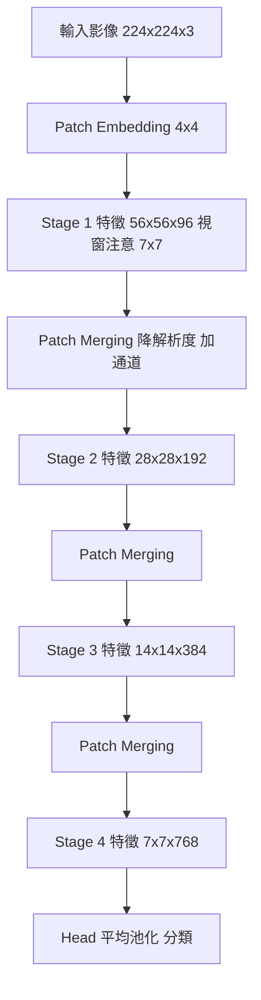
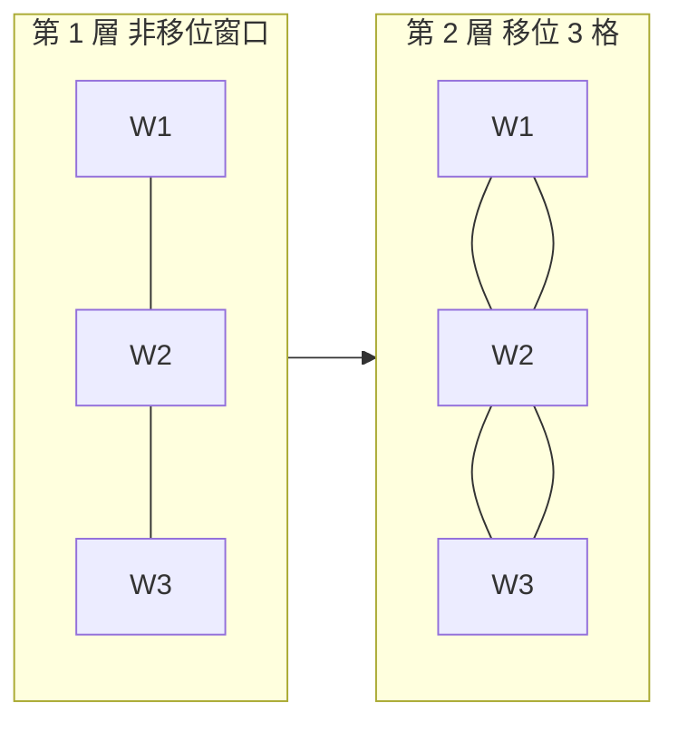
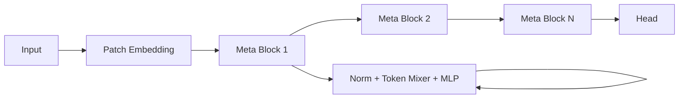

# 6.3 Swin Transformer：區域 CNN 與全域注意力的融合（2021-2023）

## 一、瓶頸的具體化： $`O(N^2)`$ 在真實場景中的代價

第 6.1 節 2.3 節用表格說明了 $`O(N^2)`$ 的瓶頸，第 6.2 節 1.2 節把它映射到具體的 patch 數量。本節要做的是把這些數字換成**真實的訓練與部署場景**，看它們為何讓 ViT 無法直接落地。

### 1.1 數字對照

以常見的 patch 大小 $`P = 16`$ 為例：

| 應用場景 | 影像解析度 | Token 數 $`N`$ | 注意力矩陣項數 $`N^2`$ | 單頭注意力矩陣（fp16） | 12 頭合計 |
| --- | --- | --- | --- | --- | --- |
| ImageNet 分類 | 224×224 | 196 | 38,416 | 75 KB | 0.9 MB |
| 高解析度分類 | 512×512 | 1,024 | 1,048,576 | 2 MB | 24 MB |
| 醫學影像切片 | 1024×1024 | 4,096 | 16,777,216 | 32 MB | 384 MB |
| 遙感衛星影像 | 2048×2048 | 16,384 | 268,435,456 | 512 MB | 6 GB |
| 顯微影像 / 病理全切片 | 8192×8192 | 262,144 | 68,719,476,736 | 128 GB | 1.5 TB |

最後一列的意義：**一張病理全切片影像上的單層注意力矩陣，在 fp16 下就要 128 GB**。這不是「慢一點」的問題，而是**根本無法配置**的問題。

### 1.2 瓶頸的真正來源：注意力矩陣的「中間物化」

這個瓶頸有一個容易被忽略的細節：即使最終只需要每個 token 的輸出（ $`N \times d`$ 的矩陣），標準的注意力實作**必須把 $`N \times N`$ 的注意力權重矩陣完整寫入顯存**，才能做 softmax。這就是為什麼複雜度是 $`O(N^2)`$ 而不只是「多做一些乘法」。

這帶來三個後果：

1. **顯存**是瓶頸（ $`O(N^2)`$ ），不是計算量（ $`O(N^2 d)`$ ）。
2. **IO 是瓶頸**： $`N \times N`$ 的注意力矩陣需要在 HBM（高頻寬記憶體）與晶片上的 SRAM 之間來回搬運。相較之下， $`O(N d^2)`$ 的矩陣乘法幾乎全在晶片內完成。**注意力是「IO bound」而非「compute bound」**——這是 6.3 節 4.2 節 FlashAttention 的切入點。
3. **不隨解析度可控**：CNN 可以用「先下採樣再處理」來控制成本，ViT 的全域注意力沒有這種逃生門，因為注意力是**在解析度最低的那一層**被要求的。

**結論**：ViT 的架構假設「影像是一個中等長度的序列」，這個假設在分類任務上勉強成立，在偵測、分割、醫學影像、衛星影像上一律不成立。**必須有一個機制，能把全局建模的能力與序列長度解耦。**

---

## 二、Swin Transformer 的四大設計（ICCV 2021）

Swin Transformer（Liu et al., ICCV 2021）的核心貢獻是：**用「局部注意力 + 移位窗口」取代全域注意力，同時用階層式架構恢復多尺度輸出**，使得 Transformer 第一次能同時滿足分類、偵測、分割的需求。



### 2.1 設計一：局部注意力與複雜度分析

**局部窗口注意力（Window-based Attention）**：把 $`H \times W`$ 的特徵圖切成不重疊的 $`M \times M`$ 窗口，每個窗口內獨立做自注意力。窗口總數為 $`\frac{HW}{M^2}`$ 。

**複雜度計算**。單一窗口內的注意力：

* 分數計算： $`M^2 \times M^2 = M^4`$ 次內積，總共 $`\frac{HW}{M^2}`$ 個窗口，因此總計為

$$
\frac{HW}{M^2} \cdot M^4 = HW \cdot M^2
$$

* 因此總計算量為 $`O(N M^2 C)`$ ，其中 $`N = HW`$ 是總 token 數， $`C`$ 是通道數， $`M`$ 是窗口邊長。

**與全域注意力的對比**：

| | 全域注意力 | 局部窗口注意力 |
| --- | --- | --- |
| 計算量 | $`O(N^2 C)`$ | $`O(N M^2 C)`$ |
| 與影像尺寸的關係 | 隨 $`N`$ **平方**增長 | **線性**增長（ $`N`$ 只作為乘法因子） |
| 注意力矩陣大小 | $`N \times N`$ | $`\frac{N}{M^2}`$ 個 $`M \times M`$ |
| 感受野 | 第 1 層即全域 | 第 1 層僅 $`M \times M`$ |

**關鍵數字對照**（ $`M = 7`$ ）：

| 解析度 | Token 數 $`N`$ | 全域注意力 $`O(N^2)`$ | 局部注意力 $`O(N M^2)`$ | 倍率 |
| --- | --- | --- | --- | --- |
| 224×224（Stage 1） | 12,544 | 157 M | 614 K | 256× |
| 512×512（Stage 1） | 50,176 | 2,518 M | 2,458 K | 1024× |
| 1024×1024（Stage 1） | 200,704 | 40,282 M | 9,834 K | 4096× |

**注意這裡的關鍵**：Swin Transformer 的第一個 stage 是在 224/4 = 56×56 = 3136 個 token 上做 $`7\times7`$ 窗口注意力。所以即使在 1024×1024 的高解析度輸入下，Stage 1 也只是 200K 個 token、每窗口 49 個 token——**注意力矩陣永遠維持在 $`M^2 = 49`$ 的規模**，完全與解析度無關。

**這就是 Swin 的核心承諾：把注意力的成本從「影像尺寸」中解耦出來。** 計算量變成 $`O(N)`$ 對 $`N`$ （線性），而不是 $`O(N^2)`$ 。

**窗口大小的選擇**： $`M = 7`$ 而非 8，是因為 Swin 要用 **shift size = 3**（窗口大小的一半再減一，即 $`\lfloor M/2 \rfloor = 3`$ ）。用 7 而非 8 讓 shift 後的窗口邊界落在特徵圖內部而不產生 padding，節省計算。

### 2.2 設計二：為什麼需要 Shifted Window

**問題診斷**：如果窗口固定不動，每個 token 在它的窗口內做注意力。那麼 **A 窗口的 token 永遠只能看到 A 窗口的 token**。跨越窗口邊界的物體——例如一個橫跨兩窗的人臉——永遠無法被整合成一體。**這相當於給 Transformer 加了一個固定的、人造的局部性偏誤，而這正是我們想擺脫的東西。**

**解法**：在**相鄰兩層**之間，把窗口**移位**（shift）一個量。

* **第 $`2k`$ 層（偶數層）**：使用常規窗口劃分（patch merge 後的網格對齊）。
* **第 $`2k+1`$ 層（奇數層）**：把特徵圖**循環移位**（cyclic shift） $`\lfloor M/2 \rfloor = 3`$ 個 patch，再做常規窗口劃分，最後把結果移回來（cyclic shift back）。

**循環移位的必要性**：一般的移位會讓邊緣的窗口不完整（需要 padding，浪費算力且引入邊界效應）。**循環移位（cyclic shift）**讓移位後的窗口全部保持完整 $`M \times M`$ ，只是在影像邊界處會有「跨邊界」的 token 被接到另一側——這在 Transformer 裡是安全的，因為注意力機制本身沒有「邊界」的概念，所有 token 都是平等對待的。

**連通性證明（直覺版）**。這是 Swin 論文中最漂亮的一個論證。令 patch 網格的座標為 $`(i, j)`$ ，窗口大小 $`M = 7`$ ，shift 量 $`s = 3`$ 。

**第一層（非移位）**： $`(i,j)`$ 可以連到 $`[i, i+6] \times [j, j+6]`$ 範圍內的所有 patch（在自己的窗口內）。

**第二層（移位）**： $`(i,j)`$ 的窗口中心移動了 3 格，所以它現在可以連到 $`[i-3, i+3] \times [j-3, j+3]`$ 。

**複合**：把兩層串起來， $`(i,j)`$ 先透過第二層連到 $`[i-3,i+3]`$ 範圍，再透過第一層連到更遠。兩層的聯集覆蓋了 $`[i-6, i+9] \times [j-6, j+9]`$ ——**等效感受野擴大到了約 $`15 \times 15`$ **。

**遞推性質**：可以證明，每經過一個「移位 + 非移位」的區塊對，等效感受野就向外擴大 $`2 \times 7 = 14`$ 個 patch。因此在 Swin-B 的四個 stage（共 12 層）中：

$$
\mathrm{RF}_{\mathrm{eff}} \;\approx\; M \times 2^{(L/2)} \times 2^{(S-1)}
$$

其中 $`L`$ 是區塊總數、 $`S`$ 是 stage 數、 $`M`$ 是窗口邊長。

由於每個 stage 的解析度都減半，**最終在原圖座標上的等效感受野可以覆蓋整張影像**。這就是 Swin Transformer 能做**全局推理**的完整論證——不是靠某一層的全域注意力，而是靠**多層的局部連通性累積**。

**類比**：這與 CNN 用**堆疊層數擴大感受野**是同一個原理，但 Swin 的效率高得多。CNN 的 $`3\times3`$ 卷積在 4 個 stage 後感受野只有約 100 像素；Swin-B 在同樣的層數下能覆蓋整張 224×224 影像。



（移位後，原本在不同窗口的 W1 與 W3 會落在同一個新窗口中，因而可以互動。）

**設計三的伏筆**：shifted window 的另一個副作用是——**相對位置關係在移位後改變了**。這使得 Swin 需要引入**相對位置偏置**來處理位置資訊（下一節），而不是像 ViT 那樣用絕對位置編碼。

### 2.3 設計三：相對位置偏置（Relative Position Bias）

**問題**：ViT 用絕對位置編碼 $`E_{\text{pos}} \in \mathbb{R}^{N \times D}`$ 。但這有兩個問題：

1. **綁定解析度**：位置編碼表的尺寸是 $`N \times D`$ ，改變輸入解析度就必須插值（6.2 節 6.2 節已提及）。
2. **違背平移等變先驗**：CNN 的先驗是「物體在哪裡不重要，重要的是什麼」。絕對位置編碼卻明確地告訴模型「你在正中央」。

**解法**：不用位置嵌入，而是**在注意力 logits 上加一個相對位置偏置**。

令 $`\hat{M} \in \mathbb{R}^{M^2 \times M^2}`$ 為視窗內的相對位置索引矩陣，其中 $`\hat{M}_{ij} = (i_x - i_y, i_y - i_y)`$ ，即兩 patch 座標差。注意這是**二維的**，所以偏置表需要二維。

**偏置表**： $`\hat{B} \in \mathbb{R}^{(2M-1) \times (2M-1) }`$ ，可學習參數。

**注意力的計算**：

$$
\mathrm{Attention}(Q, K, V) = \mathrm{softmax}\!\left( \frac{Q K^{\top}}{\sqrt{d}} + \hat{B} \right) V
$$

其中 $`\hat{B}`$ 透過查表（gather）從二維偏置表中取出對應的 $`M^2 \times M^2`$ 子矩陣。

**為什麼這比絕對位置編碼更適合視覺**：

| | 絕對位置編碼（ViT） | 相對位置偏置（Swin） |
| --- | --- | --- |
| 表達的是 | 「我在序列的第 $`i`$ 個位置」 | 「我在你的左邊 3 格、上方 2 格」 |
| 平移等變 | 違反 | 近似保持（相對關係不變） |
| 與解析度的關係 | 綁定 | **無關**（只要相對距離在範圍內） |
| 參數量 | $`N \times D`$ （隨解析度增長） | $`(2M-1)^2`$ （固定） |
| 外推能力 | 差 | 好（可直接推廣到更大解析度） |
| 參數型態 | 加在 token 表示上 | 加在 attention logits 上 |

**第三行的差異在實務上非常重要**：Swin 的相對位置偏置表大小固定為 $`(2\times7-1)^2 = 169`$ 個參數，**與輸入解析度完全無關**。這意味著同一個預訓練權重可以直接推廣到 1024×1024 甚至更大的影像，只需在需要時把相對座標對映到最近的偏置索引（用 `torch.nn.functional.interpolate` 對偏置表做插值，這正是 Swin V2 的做法）。

**與 T5 的相對位置偏置（relative position bias, Shazeer et al., 2020）的關係**：這是 NLP 裡已有的技術（用 bucketing 把相對距離離散化），Swin 把它帶到視覺並改為二維版本。**這再次印證 6.1 節的歷史敘事：視覺領域的每一次「突破」，往往是把 NLP 的技術重新發明一遍。**

### 2.4 設計四：階層式架構與 Patch Merging

ViT 的致命結構缺陷：**所有 stage 的解析度都一樣**。這讓它無法輸出多尺度特徵圖，因此無法直接餵給第 5 章的偵測與分割框架（FPN 需要 P2/P3/P4/P5 四個尺度）。

**Swin 的解法**：把網路分成 4 個 stage，每個 stage 內部解析度固定，**stage 之間用 Patch Merging 降採樣**。

**Patch Merging 的操作**（以 $`H \times W \times C`$ 為例）：

1. 把特徵圖中 **2×2 相鄰**的四個 patch 攤平拼接成一個長度 $`4C`$ 的向量。
2. 用線性層把 $`4C`$ 投影成 $`2C`$ 。

數學上，若 $`x \in \mathbb{R}^{N \times C}`$ 為 token 序列，先 reshape 成 $`\frac{H}{2} \times \frac{W}{2} \times 4C`$ ，再線性投影到 $`\frac{H}{2} \times \frac{W}{2} \times 2C`$ 。

**Swin-T 各 stage 的規格**：

| Stage | 輸入解析度 | 輸出解析度 | 通道數 | 區塊數 | Token 數 | 注意力窗口 |
| --- | --- | --- | --- | --- | --- | --- |
| Patch Embed | 224×224 | 56×56 | 96 | — | 3,136 | — |
| Stage 1 | 56×56 | 56×56 | 96 | 2 | 3,136 | 7×7 |
| Stage 2 | 56×56 | 28×28 | 192 | 2 | 784 | 7×7 |
| Stage 3 | 28×28 | 14×14 | 384 | 6 | 196 | 7×7 |
| Stage 4 | 14×14 | 7×7 | 768 | 2 | 49 | 7×7 |

**注意注意力矩陣大小的恆定性**：每個 stage 內的注意力都是 $`\frac{N}{M^2}`$ 個 $`49 \times 49`$ 的矩陣。Stage 1 有 64 個窗口、Stage 4 只有 1 個窗口（7×7 剛好等於整張特徵圖，此時退化成全局注意力）。**這個設計讓 Swin 天然地從「局部細節」過渡到「全局語意」，完全不需要全域注意力層。**

**Patch Merging 與 CNN 的 stride-2 卷積的比較**：功能相似（解析度減半、通道加倍），但 Patch Merging 是**固定的線性操作、不含可學習的空間濾波**。這是一個值得注意的設計選擇：ViT 系列的「patch merging」保留了 token 化風格的純粹性，但也意味著降採樣不像 CNN 那樣能學到最優的聚合方式（這是後續工作如 ConvNeXt、Hiera 要探討的點）。

**為什麼階層式對分割與偵測至關重要**：

* **分割**：第 5.2 節的 FCN/U-Net 需要多尺度特徵做跳連接。Swin 直接輸出 1/4、1/8、1/16、1/32 四個尺度的特徵圖，可以輕易接上 FPN 或 U-Net 解碼器。
* **偵測**：第 5 章的 Faster R-CNN / RetinaNet 都依賴 FPN 的多尺度金字塔。Swin-B 的 4 個 stage 天然對應 P2–P5。
* **多尺度物體**：同一張影像中，小車需要高解析度特徵、大樓需要低解析度特徵。**單一尺度的 ViT 沒有這種機制**。

**這就是為什麼 Swin Transformer 能統治整個偵測分割榜單——不是因為它的注意力更強，而是因為它產生了正確的介面。**

---

## 三、結果與產業影響

### 3.1 主要基準結果

| 任務 | 資料集 | Swin-T | Swin-S | Swin-B | 同期 CNN 對照 |
| --- | --- | --- | --- | --- | --- |
| 影像分類 | ImageNet-1k (top-1) | 81.3% | 83.0% | **87.3%** | DeiT-S 79.8%、ConvNeXt-T 82.1% |
| 影像分類 | ImageNet-22k 預訓練後 | 83.3% | 84.5% | 87.9% | — |
| 語意分割 | ADE20K (mIoU) | 51.8% | 53.1% | **53.5%** | SegFormer-B2 49.2% |
| 語意分割 | COCO-Stuff (mIoU) | — | — | 47.3% | — |
| 物件偵測 | COCO (box AP) | — | — | **58.7** | Detectron2 Swin-B 51.3 |
| 物件偵測 | COCO (mask AP) | — | — | 51.9 | — |

**Swin-B 的 87.3% top-1** 在 2021 年是 ImageNet 上的 SOTA，而且是在**純 ImageNet-1k**（無 JFT）下達到的——這正是 6.2 節「資料效率」爭議的實質進展。

### 3.2 成為骨幹架構

Swin Transformer 的影響力遠超一篇論文。它在 2021-2023 年間成為**幾乎所有視覺基礎模型的預訓練骨架**：

* **Mask2Former**：以 Swin-B 為骨架的 mask-based 分割框架。
* **Segment Anything Model (SAM, 2023)**：雖然用了 ViT-H，但架構與 Swin 同源（階層式 + 注意力）。
* **BEiT、DINO、MAE 的 ViT 骨幹**：雖是純 ViT，但 Swin 的影響體現在後續的統一化工作中。
* **多模態模型**：**Stable Diffusion 的 U-Net 中加入了 Transformer 注意力模組**（第 8 章）；而 **Stable Diffusion 3、SDXL 的部分版本、以及 LLaVA 的視覺編碼器**則大量採用 Swin 或其變體作為 backbone。
* **具身智慧**：第 9 章的 VLA 模型（如 RT-2、OpenVLA）都以 ViT/Swin 系視覺編碼器為基礎。

**為什麼 Swin 特別適合作為多模態與生成的骨架**：

1. **多尺度輸出**符合「從高解析度細節到低解析度語意」的處理需求。
2. **線性複雜度**使高解析度輸入（如 SD 的 512×512 latent、1024×1024 原圖）可行。
3. **相對位置偏置**讓模型能外推到不同解析度，而生成模型需要在多個解析度間切換（例如 SD 的 base / refiner 兩階段）。

---

## 四、後續演化（2022-2023）

### 4.1 Swin Transformer V2（2022）

Swin V2（Liu et al., 2022, *Swin Transformer V2: Scaling Up Capacity and Resolution*）針對原始 Swin 的四個限制做改進：

**改進一：Cosine Attention（餘弦注意力）**

原始的 scaled dot-product attention 在特徵值變大時 logits 會膨脹，導致 softmax 飽和。Swin V2 改用餘弦相似度並施以一個可學習的溫度：

$$
\mathrm{Attention}(Q,K,V) = \mathrm{softmax}\!\left( \cos(Q,K)/\tau \right) V
$$

其中 $`\tau`$ 是**可學習的溫度參數**。

其中 $`\cos(Q,K) = \mathrm{normalize}(Q)^{\top}\mathrm{normalize}(K)`$ 。

**這個改動回應了 6.1 節 1.2 節的方差分析**：與其事後用 $`\sqrt{d_k}`$ 修正，不如直接用**有界的餘弦相似度**（值域 $`[-1,1]`$ ），從根本上杜絕 logits 爆炸。

**改進二：Log-spaced Continuous Position Bias（對數間隔連續位置偏置）**

原始 Swin 的相對位置偏置是**離散的、查表式**的（169 個參數），在推廣到更大解析度時需要插值，且外推能力有限。Swin V2 改為**連續函數**形式：

$$
\hat{B}(i,j) = \gamma \cdot \mathrm{MLP}\!\left( \left[ \log(r_x + 1),\, \log(r_y + 1) \right] \right)
$$

其中 $`r_x, r_y`$ 是相對座標差。**取對數**的關鍵在於：相對距離在視覺中通常服從**指數分佈**（近鄰多、遠距少），取對數後讓 MLP 的輸入尺度更均勻，外推到更遠的距離時更穩定。

**改進三：Pre-LN 的重新思考**

Swin V2 論文發現原始 Swin 用的 **post-LN**（LayerNorm 在殘差之後）在擴大模型時**不穩定**，而 pre-LN 更穩定但**表徵品質略差**（因為 post-LN 的最終 LayerNorm 有助於把輸出特徵「攤平」，有利於注意力遷移 learning）。Swin V2 提出在**殘差分支上加一個 LayerNorm** 的折衷方案，使得**輸入特徵的尺度被控制**，從而可以使用更穩定的 pre-LN 架構。

**這是 6.1 節 1.2 節「訓練動態決定架構」的又一個實例**：LN 的位置不是美學選擇，而是影響大模型收斂的工程決策。

**改進四：擴展到更大的容量與解析度**

Swin V2 訓練了 3B 參數的版本，並在 256×256、512×512、1024×1024 解析度上做了廣泛的評估，證明了**架構能線性外推到高解析度**。

### 4.2 HVT 與 Hiera：階層式真的必要嗎？

**HVT（Hiera, 2022）** 與 **Hiera（Meta, 2023）** 是一條重要的學術辯證路線。

**Hiera（2023, Meta AI）** 的核心命題非常激進：

> **階層式（hierarchical）結構在階層式 Transformer 中並非必要的；只要設計得當，一個完全扁平的 Transformer 也可以達到更好的效率與性能。**

Hiera 的做法是：

1. **區域遮罩（region masking）**：在早期層用較粗的區域注意力（例如把 16×16 的區域內當作一個 token），後期層再逐漸細化。
2. **刪除所有相對位置偏置與絕對位置嵌入**：Hiera 證明在有 region masking 的情況下，**位置資訊可以完全被移除**（因為注意力範圍本身帶來了位置結構）。
3. **簡化架構**：最終的 Hiera 是**完全扁平的**——沒有 patch merging，沒有階層式降採樣，整個網路維持同一個 token 解析度。

**Hiera 的結果**：在 ImageNet-22k 上達到 **85.8%**，且在**高解析度**（1024×1024 等）與**密集任務**上表現優於 Swin，同時**計算量更低**。

**這條辯證的意義**：它挑戰了「階層式是視覺 Transformer 的必要條件」這個在 Swin 之後近乎公認的共識。這與 MetaFormer 的結論（第 4.4 節）方向一致：**架構的特定形式（hierarchical / conv / attention）可能不是關鍵，關鍵的是 meta-架構與訓練配方。**

### 4.3 ConvNeXt：反向運動的思想史意義（2022）

ConvNeXt（Liu et al., CVPR 2022）是**本章最值得深思的一篇論文**。它的做法是把 Transformer 的設計細節**移植到純 CNN 上**，結果達到與 Swin 相當甚至更好的性能。

**ConvNeXt 從 Swin 借鑑的七個設計**：

| 設計 | 具體做法 |
| --- | --- |
| **Patchify stem** | 用 4×4 stride 4 的卷積取代 7×7 stride 2 + max pool |
| **Inverted bottleneck** | 擴展比 4，DW-Conv → Linear → GELU → Linear |
| **通道式 LayerNorm** | 把 LayerNorm 放在**通道維**（對每個位置獨立做），而非 batch 維 |
| **較寬的 stage 比例** | 各 stage 的通道數從 ResNet 的 (64,128,256,512) 改成 (96,192,384,768) |
| **更大的 batch size** | 4096 |
| **更多 epoch 與 AdamW** | 300 epochs，AdamW + cosine schedule |
| **增廣正則化** | RandAugment、Mixup、CutMix、隨機擦除、Label Smoothing |

**ConvNeXt-B 的結果**：

| 模型 | ImageNet-1k top-1 | 預訓練/epoch | 參數量 |
| --- | --- | --- | --- |
| Swin-B | 87.3% | 300 | 88 M |
| ConvNeXt-B | **87.8%** | 300 | 89 M |
| ConvNeXt-L | 88.6% | 300 | 198 M |

**ConvNeXt 論文最驚人的實驗**是它的「transferability」表格：在**只用 ImageNet-1k** 訓練的情況下，ConvNeXt 在各類下游任務上的遷移性能**大幅超越 Swin**（例如 ADE20K 分割、物件偵測、影片分類）。這意味著 **Swin 的一個隱藏弱點是它的架構在預訓練時就帶有強烈的「多尺度、密集任務」偏置，而純 CNN 的表徵更通用**。

**這篇論文的思想史意義（三層）**：

1. **第一層（直接）**：它證明了 Swin 與 ViT 的許多優勢**並非來自注意力本身**，而是來自**訓練配方**（大批量、AdamW、長訓練、強增廣）與**架構細節**（patchify stem、inverted bottleneck、通道式 LN）。
2. **第二層（架構學）**：這與 MetaFormer（第 4.4 節）的結論互相呼應——**存在一個「meta 架構」，多種 token mixer（attention / convolution）可以在其中互換**。當互換後性能接近時，說明**架構的具體形式不是決定性因素**。
3. **第三層（歷史）**：這是一個重要的學術辯證事件。2020-2022 年，領域內主流敘事是「CNN → Transformer 是必然的進化」；ConvNeXt 用一個**更簡單的架構**達到更好的結果，迫使整個領域重新思考「進步」到底是什麼。

**注意這不是說 Transformer 不好**。ConvNeXt 的成功恰恰**只有在 Transformer 已經存在的情況下才可能**——它是**事後的**、**啟發式的**設計。它證明的是「CNN 的巔峰形態結合了 Transformer 的訓練方法論」，而不是「Transformer 是錯的」。事實上，ConvNeXt 出現後，幾乎所有後續的架構（含第 7、8、9 章的多模態模型）都採用了 Transformer 骨幹 + Transformer 時代的訓練配方。

### 4.4 MetaFormer：Attention is not all you need（2022）

MetaFormer（Yu et al., NeurIPS 2022）提出了一個極具影響力的**框架性觀察**。

**核心主張**：許多現代視覺架構（ViT、Swin、ConvNeXt、PoolFormer 等）共享同一個 **meta-架構**：



其中每個 **Meta Block** 包含：

$$
\mathbf{x} \leftarrow \mathbf{x} + \mathrm{TokenMixer}(\mathrm{Norm}(\mathbf{x})), \qquad
\mathbf{x} \leftarrow \mathbf{x} + \mathrm{MLP}(\mathrm{Norm}(\mathbf{x}))
$$

**關鍵論點**：架構的差異幾乎全部集中在 **Token Mixer** 這個插槽：

| Token Mixer | 對應模型 |
| --- | --- |
| 多頭自注意力 | ViT、Swin |
| 深度可分離卷積 | ConvNeXt |
| 空間混合 MLP | MLP-Mixer |
| 池化 | PoolFormer |

MetaFormer 的實驗發現：

* **在完全相同的 meta-架構下，把注意力換成卷積，性能幾乎不變**（PoolFormer 用簡單的平均池化當 token mixer，在 ImageNet 上竟達到 82.1%）。
* **真正重要的是 meta-架構本身**：殘差連接、patchify stem、多 stage 設計、LayerNorm、通道擴展比——這些才是性能的來源。
* **注意力帶來的真正優勢在計算效率**，而非準確率：注意力能以更少的參數達到同等性能。

**這個結論改變了整個領域的敘事**。它意味著：

> 「Transformer 的勝利」在很大程度上是「**更好的訓練配方 + 更乾淨的 meta-架構**」的勝利，而不是「注意力算子」本身的勝利。

這是第 8、9 章所有多模態與生成模型設計哲學的基礎——它們幾乎都遵循 MetaFormer 式的骨架，只把 token mixer 換成需要的東西（第 8 章的 SD 3 與第 9 章的 VLA 都是如此）。

---

## 五、演算法—硬體協同設計：FlashAttention

### 5.1 問題：注意力是 IO bound

回到 1.2 節的觀察：**標準注意力的瓶頸是顯存搬運，不是算力**。

標準實作（naive attention）的步驟：

1. 計算 $`S = QK^{\top}`$ ，寫入 HBM（大小 $`N \times N`$ ）
2. 從 HBM 讀回 $`S`$ ，計算 row-wise softmax
3. 寫回 HBM
4. 從 HBM 讀回 $`P`$ ，計算 $`PV`$

在標準的 IO-aware 複雜度模型下，HBM 存取量是 $`O(N^2 d)`$ ，而 SRAM 容量只有約 20-100 KB/SM。

**FlashAttention（Dao et al., 2022）的洞見**：softmax 有一個漂亮的數學性質——它**不需要完整的列**就能計算。

### 5.2 Softmax 的可分解性

**數學基礎**：softmax 定義為

$$
\mathrm{softmax}(x)_i = \frac{\exp(x_i)}{\sum_j \exp(x_j)}
$$

把分子分母同時乘上一個正數 $`m`$ ：

$$
\mathrm{softmax}(x)_i = \frac{\exp(x_i - m)\exp(m)}{\sum_j \exp(x_j - m)\exp(m)} = \frac{\exp(x_i - m)}{\sum_j \exp(x_j - m)}
$$

**這是「線上 softmax（online softmax）」的基礎**：可以**分塊（tiling）**處理。對每一塊，只維護：

* running max： $`m_{\text{cur}}`$
* running sum： $`\ell_{\text{cur}}`$ （未正規化的指數和）
* 累積的輸出： $`O_{\text{cur}}`$

處理新的一塊時做 rescale：

$$
m_{\text{new}} = \max(m_{\text{cur}}, m_{\text{block}})
$$

$$
\ell_{\text{new}} = e^{m_{\text{cur}} - m_{\text{new}}} \ell_{\text{cur}} + e^{m_{\text{block}} - m_{\text{new}}} \sum_{\text{block}} e^{x - m_{\text{block}}}
$$

$$
O_{\text{new}} = e^{m_{\text{cur}} - m_{\text{new}}} O_{\text{cur}} + e^{m_{\text{block}} - m_{\text{new}}} P_{\text{block}} V_{\text{block}}
$$

**關鍵**：中間的 $`P`$ 區塊**永遠不需要寫入 HBM**，它只存在於 SRAM 中。

### 5.3 FlashAttention 的三個貢獻

1. **IO-aware 演算法**：分塊（tiling），把中間結果留在 SRAM，HBM 存取從 $`O(N^2 d)`$ 降到 $`O(N^2 d^2 / M)`$ （ $`M`$ 是 SRAM 容量）。
2. **平行化**：採用沿序列維的 parallel scan 來計算 running max 與 running sum，使每個 block 的運算完全獨立。
3. **反向傳遞的重計算（recomputation）**：放棄儲存中間的 $`L = \text{rowsum}(QK^{\top})`$ 矩陣（那需要 $`O(N^2)`$ 顯存），改為在反向時**重新計算**它，用計算換顯存。

**效果**：

| 模型 | 序列長度 | FlashAttention-2 加速 | 顯存節省 |
| --- | --- | --- | --- |
| GPT-3 規模 | 2K | 2-4× | — |
| 病理全切片 | 16K+ | 10-20× | O(N) 而非 O(N²) |
| 長上下文 | 32K+ | 顯存從 O(N²) 降為 O(N) | 可擴展到 100K+ 序列 |

**這個結果對本章的意義**：FlashAttention 使得「全域注意力在高解析度影像上不可行」這個判斷**部分失效**。但它沒有、也不可能改變複雜度的漸近階數（仍是 $`O(N^2)`$ 計算），只是把常數從「不可行」拉回到「可行」。**對 8192×8192 的病理影像而言， $`O(N^2)`$ 的計算量本身（68 億次）仍然不現實**，因此 Swin 這類架構上的局部注意力設計依然是必要的。

### 5.4 一個貫穿全書的主題

這是一個值得單獨標出的通則：

> **現代 AI 的進步，很少來自「更好的數學」，而更多來自「更好的工程抽象」——讓同一個數學運算變得便宜。**

* FlashAttention：讓注意力變便宜（第 6 章）
* 混合精度（fp16/bf16）：讓矩陣乘法變便宜
* 梯度檢查點（gradient checkpointing）：讓深層模型顯存變便宜
* KV cache：讓自回歸生成變便宜（第 8 章）
* torch.compile / Triton：讓 kernel fusion 變高效
* 量化與稀疏化：讓部署變便宜（第 10 章）

**這個主題在整本書裡不斷出現**：第 7 章的擴散模型之所以比 GAN 更實用，部分原因就是推理時的**快取與加速技巧**；第 8 章的 ControlNet 之所以能落地，靠的是**共享 backbone 的架構設計**；第 9 章的 VLA 之所以能跑到即時，靠的是**量化與蒸餾**。**「演算法—硬體協同設計」是理解 2017 年之後 AI 發展的主軸之一。**

---

## 六、總結對比：CNN vs ViT vs Swin vs ConvNeXt

| 維度 | CNN（ResNet 家族） | ViT | Swin Transformer | ConvNeXt |
| --- | --- | --- | --- | --- |
| **核心歸納偏誤** | 局部性、平移等變、層級式、多尺度 | 極少（僅位置編碼） | 局部 + 移位，層級式 | 局部 + 層級式（CNN） |
| **Token mixer** | 卷積 | 全域自注意力 | 局部窗口自注意力（移位） | 深度可分離卷積 |
| **資料效率** | **最高**（免費的平移等變增強） | 最低（需 JFT 等大規模資料） | 中（借鑑 ViT 但有更好的介面） | 高（CNN 先驗 + Transformer 配方） |
| **全局感受野** | 需深層累積，效率低 | 第 1 層即全域 | 靠多層局部連通性累積，等效覆蓋全圖 | 需深層累積 |
| **複雜度（對解析度）** | $`O(N)`$ | $`O(N^2)`$ | $`O(N)`$ （局部注意力） | $`O(N)`$ |
| **多尺度輸出** | **原生支援**（各 stage） | 不支援（單一尺度） | **原生支援**（4 個 stage） | **原生支援** |
| **密集任務支援** | 需 FPN/U-Net | 需 DPT 之類的重組模組 | **原生支援**，可直接接 FPN | **原生支援** |
| **高解析度擴展** | 良好 | **困難**（ $`O(N^2)`$ ） | 良好（相對位置偏置可外推） | 良好 |
| **可解釋性** | 特徵圖可視化成熟 | 注意力圖可視化 | 注意力圖 + 窗口可視化 | 類似 CNN |
| **ImageNet-1k top-1** | ~78-80%（ResNet-50/152） | ~81-85%（需大量預訓練） | 87.3%（Swin-B） | 87.8%（ConvNeXt-B） |
| **代表年份** | 2015 | 2020 | 2021 | 2022 |

**這張表的核心訊息**：

1. **沒有單一 Winner**：每個架構在不同維度上取捨不同。
2. **趨勢是「融合」而非「取代」**：Swin（局部注意力 + CNN 階層式）、ConvNeXt（CNN + Transformer 配方）、CoAtNet（CNN + Transformer 串聯）都在融合。
3. **MetaFormer 的總結最為精確**：現代架構的勝利，來自 **meta-架構 + 訓練配方**；token mixer 只是其中一個插槽。

---

## 七、實作：PyTorch 的窗口注意力與 Patch Merging

### 7.1 窗口劃分與反向

```python
import torch
import torch.nn as nn
import torch.nn.functional as F


def window_partition(x, window_size):
    """(B, H, W, C) -> (num_windows*B, window_size, window_size, C)"""
    B, H, W, C = x.shape
    x = x.view(B, H // window_size, window_size, W // window_size, window_size, C)
    windows = x.permute(0, 1, 3, 2, 4, 5).contiguous()
    return windows.view(-1, window_size, window_size, C)


def window_reverse(windows, window_size, H, W):
    """(num_windows*B, ws, ws, C) -> (B, H, W, C)"""
    B = int(windows.shape[0] / (H * W / window_size / window_size))
    x = windows.view(B, H // window_size, W // window_size, window_size, window_size, C)
    x = x.permute(0, 1, 3, 2, 4, 5).contiguous()
    return x.view(B, H, W, C)
```

### 7.2 帶相對位置偏置的窗口注意力

```python
class WindowAttention(nn.Module):
    def __init__(self, dim, window_size, num_heads, qkv_bias=True):
        super().__init__()
        self.dim = dim
        self.window_size = window_size
        self.num_heads = num_heads
        self.scale = (dim // num_heads) ** -0.5

        # 相對位置偏置表：(2M-1) x (2M-1)，與解析度無關
        self.relative_position_bias_table = nn.Parameter(
            torch.zeros((2 * window_size - 1) ** 2, num_heads)
        )
        nn.init.trunc_normal_(self.relative_position_bias_table, std=0.02)

        coords_h = torch.arange(window_size)
        coords_w = torch.arange(window_size)
        coords = torch.stack(torch.meshgrid(coords_h, coords_w, indexing="ij")).flatten(1)
        rel = coords[:, :, None] - coords[:, None, :]          # (M*M, M*M)
        rel = rel.permute(1, 2, 0).contiguous()
        rel[:, :, 0] += window_size - 1
        rel[:, :, 1] += window_size - 1
        rel[:, :, 0] *= 2 * window_size - 1
        self.register_buffer("relative_position_index", rel.sum(-1))  # (M*M, M*M)

        self.qkv = nn.Linear(dim, dim * 3, bias=qkv_bias)
        self.proj = nn.Linear(dim, dim)

    def forward(self, x, mask=None):
        B_, H, W, C = x.shape
        ws = self.window_size
        qkv = self.qkv(x).reshape(B_, H, W, 3, self.num_heads, C // self.num_heads)
        qkv = qkv.permute(2, 3, 0, 4, 1, 5)  # (H, W, 3, B, heads, N, C/heads)
        q, k, v = qkv[0], qkv[1], qkv[2]

        q = window_partition(q, ws)
        k = window_partition(k, ws)
        v = window_partition(v, ws)

        attn = (q * self.scale) @ k.transpose(-2, -1)
        bias = self.relative_position_bias_table[self.relative_position_index.view(-1)]
        bias = bias.view(ws * ws, ws * ws, -1).permute(2, 0, 1).contiguous()
        attn = attn + bias.unsqueeze(0)

        if mask is not None:
            nW = mask.shape[0]
            attn = attn.view(B_ // nW, nW, self.num_heads, ws * ws, ws * ws) + mask.unsqueeze(1).unsqueeze(0)
            attn = attn.view(-1, self.num_heads, ws * ws, ws * ws)

        attn = attn.softmax(dim=-1)
        out = (attn @ v).transpose(1, 2).reshape(-1, ws, ws, C)
        out = window_reverse(out, ws, H, W)

        x = out.view(B_, H, W, C)
        return self.proj(x)
```

### 7.3 Swin Transformer 區塊（含移位）

```python
class SwinBlock(nn.Module):
    def __init__(self, dim, num_heads, window_size=7, shift_size=0, mlp_ratio=4.0):
        super().__init__()
        self.window_size = window_size
        self.shift_size = shift_size
        self.norm1 = nn.LayerNorm(dim)
        self.attn = WindowAttention(dim, window_size, num_heads)
        self.norm2 = nn.LayerNorm(dim)
        hidden = int(dim * mlp_ratio)
        self.mlp = nn.Sequential(nn.Linear(dim, hidden), nn.GELU(), nn.Linear(hidden, dim))

    def forward(self, x, H, W):
        B, L, C = x.shape
        shortcut = x
        x = self.norm1(x).view(B, H, W, C)

        if self.shift_size > 0:
            x = torch.roll(x, shifts=(-self.shift_size, -self.shift_size), dims=(1, 2))
            attn_mask = self._attn_mask(H, W, device=x.device)
        else:
            attn_mask = None

        x = self.attn(x, attn_mask)
        x = x.view(B, H * W, C)

        if self.shift_size > 0:
            x = torch.roll(x, shifts=(self.shift_size, self.shift_size), dims=(1, 2))

        x = shortcut + x
        x = x + self.mlp(self.norm2(x))
        return x

    def _attn_mask(self, H, W, device):
        """為循環移位後跨邊界的 token 生成注意力遮罩"""
        ws = self.window_size
        img_mask = torch.zeros((1, H, W, 1), device=device)
        cnt = 0
        for hs in (slice(0, -ws), slice(-ws, -ws // 2), slice(-ws // 2, None)):
            for wsl in (slice(0, -ws), slice(-ws, -ws // 2), slice(-ws // 2, None)):
                img_mask[:, hs, wsl, :] = cnt
                cnt += 1
        mask_windows = window_partition(img_mask, ws).view(-1, ws * ws)
        attn_mask = mask_windows.unsqueeze(1) - mask_windows.unsqueeze(2)
        attn_mask = attn_mask.masked_fill(attn_mask != 0, float(-100.0))
        attn_mask = attn_mask.masked_fill(attn_mask == 0, float(0.0))
        return attn_mask
```

### 7.4 Patch Merging

```python
class PatchMerging(nn.Module):
    """解析度減半，通道加倍（類似 stride=2 的卷積，但是純線性）"""

    def __init__(self, dim):
        super().__init__()
        self.dim = dim
        self.reduction = nn.Linear(4 * dim, 2 * dim, bias=False)
        self.norm = nn.LayerNorm(4 * dim)

    def forward(self, x, H, W):
        B, L, C = x.shape
        x = x.view(B, H, W, C)

        # 2x2 相鄰 patch 拼接
        x = torch.cat([x[:, 0::2, 0::2, :], x[:, 1::2, 0::2, :],
                       x[:, 0::2, 1::2, :], x[:, 1::2, 1::2, :]], dim=-1)
        x = x.view(B, -1, 4 * C)
        x = self.norm(x)
        x = self.reduction(x)
        return x, H // 2, W // 2
```

### 7.5 完整的 Swin Transformer Stage

```python
class SwinStage(nn.Module):
    def __init__(self, dim, depth, num_heads, window_size=7, mlp_ratio=4.0):
        super().__init__()
        self.blocks = nn.ModuleList([
            SwinBlock(dim, num_heads, window_size,
                      shift_size=0 if (i % 2 == 0) else window_size // 2,
                      mlp_ratio=mlp_ratio)
            for i in range(depth)
        ])

    def forward(self, x, H, W):
        for blk in self.blocks:
            x = blk(x, H, W)
        return x
```

**實作提醒**：

1. **循環移位 + 注意力遮罩**是容易出錯的地方。若不做遮罩，移位後跨邊界的 token 會被錯誤地互動，模型能「偷看」到不該看到的內容，準確率會下降但不會報錯——這是最難 debug 的一類 bug。
2. **`window_partition` / `window_reverse` 必須嚴格互逆**，建議寫單元測試驗證 `window_reverse(window_partition(x)) == x`。
3. 在 PyTorch 2.0 之後，可以用 `F.scaled_dot_product_attention` 加上 `attn_mask` 來加速，但若需要相對位置偏置，仍需手寫 logits 計算（因為偏置是加在 logits 上的）。這也解釋了為什麼相對位置偏置的實作比純 ViT 複雜。

---

## 八、本節小結

1. ** $`O(N^2)`$ 是硬瓶頸**：1024×1024 影像在單層需要 16.7M 項的注意力矩陣；病理全切片影像更是需要 128 GB（單頭 fp16）。這不是「慢」，而是「不可行」。
2. **Swin 的四大設計**：局部窗口注意力（ $`O(N M^2 C)`$ ，與解析度無關）、移位窗口（靠多層局部連通性累積出等效全域感受野）、相對位置偏置（與解析度解耦、保持平移等變）、階層式架構（Patch Merging 產生多尺度輸出，使 ViT 能接管偵測分割）。
3. **結果**：ImageNet-1k 87.3%、ADE20K 53.5 mIoU、COCO 58.7 AP；並成為後續視覺與多模態模型的骨幹。
4. **後續演化揭示了三個重要事實**：(a) Swin V2 顯示 LN 位置與縮放方式是訓練動態的核心；(b) Hiera 顯示階層式並非必要；(c) ConvNeXt 與 MetaFormer 顯示**現代架構的勝利主要來自 meta-架構與訓練配方，而非注意力算子本身**。
5. **FlashAttention 揭示了工程主軸**：現代 AI 的進步常常來自「讓同一個數學運算變便宜」，而非更好的數學；但它無法改變 $`O(N^2)`$ 的漸近複雜度，因此架構層面的局部化設計仍是必要的。

### 本節參考文獻

* Liu, Z., et al. (2021). *Swin Transformer: Hierarchical Vision Transformer using Shifted Windows.* ICCV 2021.
* Liu, Z., et al. (2022). *Swin Transformer V2: Scaling Up Capacity and Resolution.* CVPR 2022.
* Yang, R., et al. (2023). *Hiera: A Hierarchical Vision Transformer without the Bells-and-Whistles.* ICML 2023.
* Liu, Z., et al. (2022). *A ConvNet for the 2020s.* (ConvNeXt) CVPR 2022.
* Yu, J., et al. (2022). *MetaFormer Is Actually What You Need for Vision.* CVPR 2022.
* Yu, J., et al. (2022). *MetaFormer Baselines for Vision.* CVPR 2024.
* Dao, T., et al. (2022). *FlashAttention: Fast and Memory-Efficient Exact Attention with IO-Awareness.* NeurIPS 2022.
* Dao, T., et al. (2023). *FlashAttention-2: Faster Attention with Better Parallelism and Work Partitioning.* ICLR 2024.
* Shazeer, N., et al. (2020). *Transformer Quality in Linear Time.* (T5 的相對位置偏置)
* Ke, G., et al. (2021). *Segment Anything.* (以 Transformer 為骨架的分割基礎模型)
* Peebles, J., & Xie, S. (2021). *Efficiently Scaling Vision Transformers.* (MVP / 階層式設計的早期探索)
